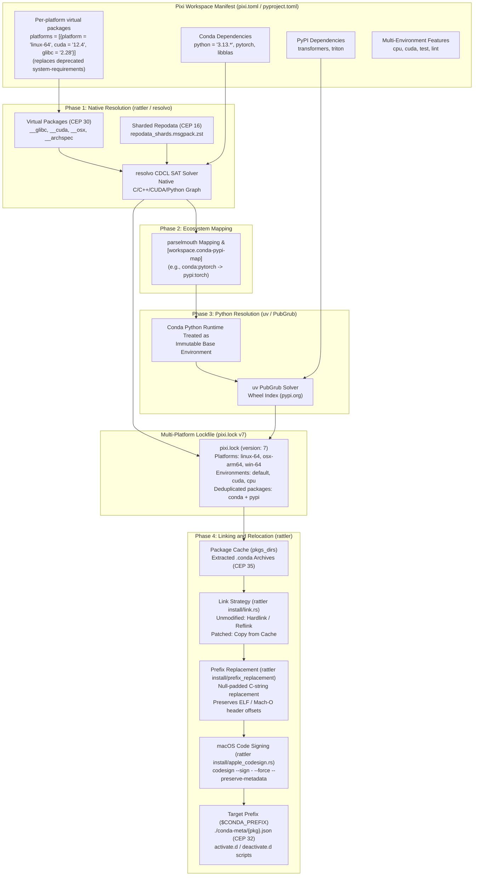
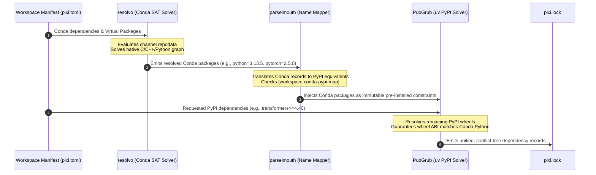
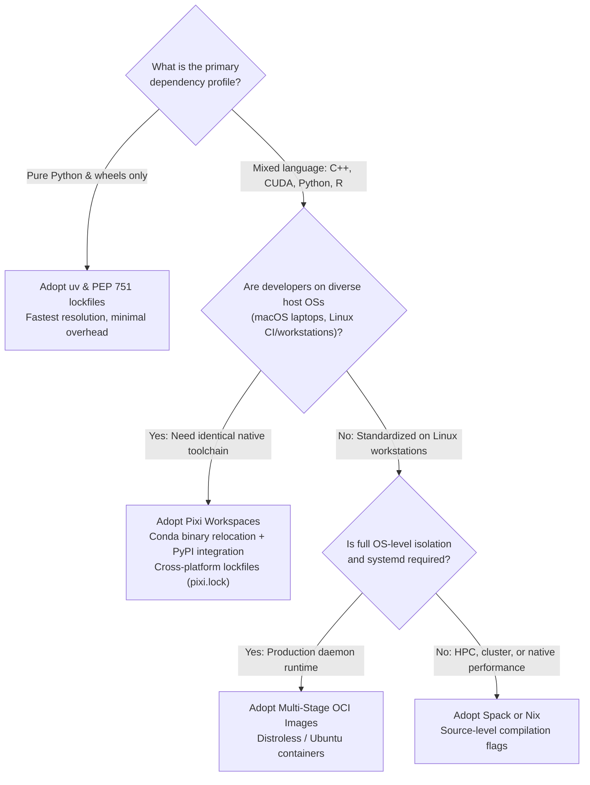

# Polyglot Environments: Conda Architecture and Pixi Workspaces

> [!summary] Claim:
> Conda distributes relocatable binary artifacts that couple native C, C++, Fortran, and CUDA shared libraries directly to Python runtimes without requiring root privileges.
> It achieves relocation by embedding 255-character placeholder paths during build and performing null-padded binary string replacement and Mach-O ad-hoc resigning at installation time.
> Pixi unifies this native substrate with PyPI wheels by sequencing a dual-solver pipeline: rattler's SAT-based resolvo solver determines the native environment, and uv's PubGrub solver resolves PyPI wheels against the locked Conda baseline.
> This dual graph resolves into a unified multi-platform lockfile that prevents the uncoordinated native-library duplication behind most runtime symbol clashes in mixed language toolchains.



## The Mechanism

### 1. Conda Binary Archive Layout: .tar.bz2 (v1) Versus .conda (v2)

Conda package distribution relies on pre-compiled, relocatable binary archives.
Historically, Conda distributed packages as bzip2-compressed tar archives with the `.tar.bz2` extension (format version 1).
As channels expanded to hundreds of thousands of packages, `.tar.bz2` exposed three fundamental bottlenecks: bzip2 decompression is single-threaded and CPU-bound, reading package metadata requires decompressing the preceding payload stream, and compression ratios lag behind modern algorithms.
To eliminate these bottlenecks, CEP 35 standardized the `.conda` file format (format version 2).

A `.conda` package is an uncompressed ZIP container enclosing two distinct Zstandard-compressed (`.tar.zst`) tarballs and a JSON metadata manifest:

```text
package-1.0.0-h1234567_0.conda  (Uncompressed ZIP container)
|-- metadata.json               (Format version descriptor: {"conda_pkg_format_version": 2})
|-- info-package-1.0.0-h1234567_0.tar.zst  (Isolated ./info directory metadata)
`-- pkg-package-1.0.0-h1234567_0.tar.zst   (Binary payload: bin/, lib/, include/, etc.)
```

The outer container MUST NOT use ZIP compression.
Using an uncompressed ZIP envelope allows package managers such as Conda, Mamba, and Rattler to perform random-access reads into the ZIP central directory using HTTP range requests (`bytes: start-end`).
CEP 35 itself gives the rationale as enabling "metadata-only retrieval more efficiently" and does not name HTTP range requests; the range-request client is rattler, whose `rattler_package_streaming::reqwest::sparse` module fetches single files from a remote `.conda` with range requests and errors if the server does not support them (`crates/rattler_package_streaming/src/reqwest/sparse.rs`, rattler `main`, 2026-11-26).
The client reads `metadata.json` and fetches only `info-*.tar.zst` to inspect package dependencies, file lists, and prefix-replacement metadata without downloading or decompressing the multi-gigabyte payload in `pkg-*.tar.zst`.

The inner tarballs are compressed with Zstandard (`zstd`).
CEP 35 gives the rationale: modern decompressors are 4x to 10x faster than bzip2, and Zstandard artifacts can be up to 60 percent smaller than the equivalent `.tar.bz2` file.
During installation, the package manager streams `pkg-*.tar.zst` through a zstd decoder into the package cache directory.
The `.conda` artifacts inspected for this note (conda-forge, 2026-11-26) store all three members with ZIP method `none (stored)`, as `zipinfo -v` reports.

### 2. Package Internals and Metadata Invariants (CEP 34)

When extracted into the package cache, every Conda package adheres to the layout standardized in CEP 34.
The package root contains the exact directory structure intended for installation into the destination prefix, alongside a reserved metadata directory named `./info/`.
Build tools are prohibited from placing arbitrary user files inside `./info/`.

```text
extracted_package/
|-- bin/
|   `-- my_binary
|-- lib/
|   `-- libmylib.so.1.0
`-- info/
    |-- index.json          (Package identity, dependencies, constraints, ABI)
    |-- paths.json          (File inventory, hashes, link types, prefix placeholders)
    |-- run_exports.json    (Downstream ABI and SONAME constraints)
    |-- link.json           (Optional: entry points, noarch relocation rules)
    |-- about.json          (License, home URL, build provenance)
    |-- hash_input.json     (Variant input dictionary for build hash computation)
    `-- recipe/             (Source recipe files and meta.yaml / recipe.yaml)
```

The `./info/index.json` document serves as the primary manifest for indexers generating `repodata.json`.
It conforms to the following schema:
- `name`: Lowercase ASCII string conforming to CEP 26.
- `version`: Normalized version string conforming to CEP 33.
- `build`: Build string containing variant hashes and the build number, such as `py313h41a2e72_0`.
- `build_number`: Non-negative integer incremented for recipe updates that share a package version.
- `depends`: List of runtime requirements expressed in the `MatchSpec` syntax defined in CEP 29.
- `constrains`: List of optional runtime constraints that restrict matching packages if present in the environment.
- `subdir`: Target architecture platform string (such as `linux-64`, `linux-aarch64`, `osx-arm64`, `win-64`), or `noarch`.
- `noarch`: Literal string specifying `generic` or `python`.

The `./info/paths.json` document tracks every file shipped outside `./info/`.
It contains an array of path objects conforming to `paths_version: 1`:

```json
{
  "paths_version": 1,
  "paths": [
    {
      "_path": "lib/libmylib.so.1.0",
      "path_type": "hardlink",
      "sha256": "4b227777d4dd1fc61c6f884f48641d02b4d121d3fd328cb08b5531fcacdabf8a",
      "size_in_bytes": 1048576,
      "file_mode": "binary",
      "prefix_placeholder": "/opt/anaconda1anaconda2anaconda3",
      "no_link": false
    },
    {
      "_path": "bin/my_script",
      "path_type": "hardlink",
      "sha256": "8f434346648f6b96df89dda901c5176b10f6000cbb1471f71a8a494f053435ac",
      "size_in_bytes": 412,
      "file_mode": "text",
      "prefix_placeholder": "/opt/anaconda1anaconda2anaconda3",
      "no_link": false
    }
  ]
}
```

The key properties governing relocation in `paths.json` are:
- `prefix_placeholder`: The absolute path of the temporary build environment baked into the file during compilation.
- `file_mode`: Specifies whether prefix replacement must execute as `text` or `binary`.
- `no_link`: When `true`, forces the installer to copy the file into the environment rather than creating a hardlink or reflink.

### 3. Binary Relocation via Prefix Replacement and Mach-O Resigning

Native binaries (ELF on Linux, Mach-O on macOS, PE on Windows) frequently hardcode absolute paths at compile time.
These paths appear in shared library runtime search paths (ELF `DT_RUNPATH` or `DT_RPATH`, Mach-O `LC_RPATH`), dynamic library load commands (`LC_LOAD_DYLIB`), and embedded data strings pointing to configuration directories or data files.
Standard Linux package managers avoid relocation by installing exclusively to fixed absolute roots (`/usr` or `/usr/local`).
Because Conda must install into arbitrary, unprivileged user directories without root access, it implements binary prefix path replacement.

During package compilation, build engines (such as `conda-build` or `rattler-build`) establish a dummy build prefix of fixed length.
The modern build prefix is padded to 255 characters: rattler-build sets `HOST_PREFIX_LENGTH: usize = 255` and repeats `_placehold` after `host_env` until the absolute path reaches that length (rattler-build `directories.rs`); conda-build pads its `_h_env` prefix the same way.
The legacy placeholder `/opt/anaconda1anaconda2anaconda3` is only 32 characters; CEP 34 keeps it as the default for old `./info/has_prefix` text entries, so it is not a 255-character prefix.
A long placeholder ensures that it is longer than almost any real destination prefix.
For example, `libpng-1.6.59-hf5e6511_0` on conda-forge osx-arm64 records the 255-character placeholder `/Users/runner/miniforge3/conda-bld/bld/rattler-build_libpng_1790805167/host_env_placehold_placehold_...` (inspected 2026-11-26).

When installing a file flagged with `file_mode: text` (such as shell wrappers, pkg-config `.pc` files, or CMake configs), the installer performs standard string substitution, replacing the placeholder with the target `$CONDA_PREFIX`.

When installing a file flagged with `file_mode: binary`, variable-length string substitution is impossible without corrupting the binary.
In an ELF or Mach-O executable, string tables (`.dynstr`, `.strtab`, `__cstring`) are referenced by fixed byte offsets from program headers, dynamic tags, and symbol table entries.
Modifying the length of an embedded path would alter downstream offsets and invalidate the binary structure.

Conda resolves this by executing in-place, null-padded C-string replacement:
1. The installer scans the binary file for byte sequences matching the encoded `prefix_placeholder`.
2. When a matching C-string is located, the installer writes the replacement `$CONDA_PREFIX` starting at the string beginning.
3. The remaining characters of the original path following the placeholder are shifted left to attach immediately to the new prefix.
4. The remaining unused bytes between the new string null-terminator and the original null-terminator are overwritten with zero bytes (`0x00`).
5. The total length of the binary string field remains completely unchanged, preserving all downstream section offsets and header addresses.

```text
Original Build Prefix in Binary (Length = 64 bytes):
/opt/anaconda1anaconda2/lib/libfoo.so.1\0.........................

Target Installation Prefix ($CONDA_PREFIX = /home/user/.pixi/envs/default):
/home/user/.pixi/envs/default/lib/libfoo.so.1\0\0\0\0\0\0\0\0\0\0\0\0\0\0\0\0\0\0
                                              ^^^^^^^^^^^^^^^^^^^^^^^^^^^^^^^^
                                              Null-byte zero padding to boundary
```

If the target installation prefix exceeds the byte length of the placeholder, expansion is impossible without rewriting the object headers.
Rattler implements this constraint in `reject_growing_prefix` (`crates/rattler/src/install/prefix_replacement/mod.rs`), which `copy_and_replace_cstring_placeholder` (`prefix_replacement/binary.rs`) calls after finding the patches and before writing any output.
Only encodings that actually occur in the file constrain the target prefix, so a long prefix fails only for binaries that really embed the placeholder.

On macOS, modifying binary contents introduces a fatal operating system failure mode.
Apple Silicon kernels enforce mandatory code signing validation for all ARM64 Mach-O binaries.
Any in-place mutation of a compiled binary invalidates its SHA-256 code directory hashes in the `LC_CODE_SIGNATURE` load command.
When an unmodified dynamic linker attempts to execute or `dlopen` an invalidated binary, the Darwin kernel terminates the process immediately with signal 9 (`SIGKILL`, termination reason: `CODESIGNING`).

To prevent this crash, rattler includes a dedicated Apple code signing module (`crates/rattler/src/install/apple_codesign.rs`).
When a `file_mode: binary` file that is executable or Mach-O is installed for an `osx-*` target and its hash changed during patching, `link.rs` invokes the system signing utility; the default `AppleCodeSignBehavior::Fail` turns a signing failure into an install error:

```sh
/usr/bin/codesign --sign - --force --preserve-metadata=identifier,entitlements,requirements <destination_binary>
```

This command replaces the corrupted signature with a valid ad-hoc signature (`--sign -`), while preserving the binary's original identifier and entitlements.
On Linux ELF binaries, code signing is not kernel-enforced, but binaries must use `$ORIGIN`-relative `DT_RUNPATH` entries (e.g., `DT_RUNPATH = $ORIGIN/../lib`) so that runtime linking finds companion libraries inside `$CONDA_PREFIX/lib`.

### 4. Package Cache and Linking Semantics (Hardlink, Reflink, Copy)

To conserve disk space and optimize installation latency, Conda package managers maintain a centralized global package cache (`pkgs_dirs` in Conda; in Pixi the `pkgs` subdirectory of the rattler cache, `~/.cache/rattler/cache/pkgs` on Linux and `~/Library/Caches/rattler/cache/pkgs` on macOS, overridable with `PIXI_CACHE_DIR` or `RATTLER_CACHE_DIR`) (as of 2026-11).
Downloaded `.conda` and `.tar.bz2` archives are extracted into the cache exactly once.
When an environment is provisioned, files are linked from the cache into the target environment.

Rattler implements five distinct linking strategies via `LinkMethod`:

```rust
pub enum LinkMethod {
    Reflink,
    Hardlink,
    Softlink,
    Copy,
    Patched(FileMode),
}
```

- `Reflink`: The installer creates a Copy-on-Write (CoW) clone of the file using `clonefile(2)` on macOS APFS or `ioctl(FICLONE)` on Linux Btrfs and XFS.
  This operation completes in constant time `O(1)` without duplicating disk blocks, while providing storage isolation.
- `Hardlink`: When reflinks are unsupported, the installer calls `link(2)` to create a hardlink pointing to the inode in the package cache.
  This consumes zero additional storage blocks and executes instantaneously.
- `Softlink`: Symbolic links created via `symlink(2)`, used for package-internal relative references.
- `Copy`: A standard byte-for-byte copy created when cross-device filesystem boundaries prevent hardlinking (`EXDEV`), or when a package flags `no_link: true`.
- `Patched(FileMode)`: A file that requires textual or binary prefix replacement.

The critical safety invariant of Conda linking is:
Any file requiring prefix replacement MUST NEVER be hardlinked from the package cache.
If an installer created a hardlink and subsequently applied null-padded binary prefix patching, writing to that inode would modify the underlying storage blocks in the global package cache.
That mutation would corrupt the cache for all other environments referencing that inode and cause non-deterministic behavior across concurrent builds.
Consequently, any file undergoing prefix replacement is copied from the cache (or cloned via CoW reflink) before in-place patching is applied.

### 5. Environment Structure and Runtime Lifecycle (CEP 32)

CEP 32 standardizes the structure and lifecycle of a Conda environment.
An environment is defined as a directory that contains, at least, a `./conda-meta/history` file (CEP 32); an empty history file is enough, and rattler creates one when it initializes a prefix (`rattler_conda_types/src/prefix.rs`).
The directory layout mirrors standard Unix prefixes:

```text
$CONDA_PREFIX/
|-- bin/                    (Executables and scripts)
|-- lib/                    (Shared libraries .so / .dylib, pythonX.Y/site-packages)
|-- include/                (C/C++ header files)
|-- share/                  (Man pages, cmake configs, pkgconfig)
|-- etc/
|   `-- conda/
|       |-- activate.d/     (Shell scripts sourced during activation)
|       `-- deactivate.d/   (Shell scripts sourced during deactivation)
`-- conda-meta/
    |-- history             (Audit trail of all transactional state changes)
    |-- last_activated      (Timestamp touch file tracking usage)
    `-- <name>-<version>-<build>.json  (Per-package installed record manifests)
```

On Windows, executables reside in `$CONDA_PREFIX\Scripts` and `$CONDA_PREFIX\Library\bin`, while headers reside in `$CONDA_PREFIX\Library\include`.

The `./conda-meta/history` file SHOULD record the operations performed during the lifetime of the environment, but MAY be empty (CEP 32).
When populated, each action block is demarcated by a timestamp header, the CLI invocation, the tool version, the linked (`+`) and unlinked (`-`) package records, and an `(update|remove|neutered) specs:` line.
The block below follows the CEP 32 grammar with illustrative package records; conda writes such blocks, while rattler only creates an empty file and Pixi writes a one-line placeholder comment, ``// not relevant for pixi but for `conda run -p` ``, so that `conda run -p .pixi/envs/<env>` works (`create_history_file` in `crates/pixi_core/src/environment/conda_metadata.rs`, Pixi `main`, 2026-11-26):

```text
==> 2026-11-21 22:30:00 <==
# cmd: /home/user/miniforge3/bin/conda create -n demo python=3.13
# conda version: 26.10.0
+conda-forge/linux-64::python-3.13.5-hf3f3da0_102_cp313
+conda-forge/linux-64::openssl-3.6.3-hd24854e_0
+conda-forge/linux-64::libsqlite-3.53.4-hf4e2dac_0
# update specs: ['python=3.13']
```

The `./conda-meta/<name>-<version>-<build>.json` file serves as the definitive bill of materials for each installed package.
It tracks the original package metadata alongside environment-specific installation records:
- `link`: A dictionary with `source` (the extracted package directory) and `type` (1 = hardlink, 2 = softlink, 3 = copy, 4 = directory), per CEP 32.
- `files`: Comprehensive list of all files introduced into the prefix by this package.
  This includes generated files created at install time that were not in the archive, such as compiled Python bytecode (`*.pyc`) and generated CLI entry-point scripts.
- `paths_data`: Contains per-file hashes, tracking both the original `sha256` of the archive file in the cache and the resulting `sha256_in_prefix` after prefix replacement.

Environment activation is not a chroot or container boundary.
It is an orchestrated shell configuration process.
Activating an environment via `conda activate <name>` or `pixi shell` performs the following deterministic sequence:
1. Sets `CONDA_PREFIX` to the absolute path of the environment directory.
2. Prepends `$CONDA_PREFIX/bin` to the shell `PATH` environment variable.
3. Sets `CONDA_DEFAULT_ENV` to the environment name.
4. Executes, in alphabetical order (ascending Unicode code point order, as CEP 32 defines it), all shell scripts located in `$CONDA_PREFIX/etc/conda/activate.d/`, and exports the variables declared in the JSON files of `$CONDA_PREFIX/etc/conda/env_vars.d/`.
   These scripts set critical toolchain environment variables (e.g., `CXXFLAGS`, `CMAKE_PREFIX_PATH`, `CUDA_HOME`, `PKG_CONFIG_PATH`).
5. On deactivation, the scripts in `$CONDA_PREFIX/etc/conda/deactivate.d/` run in reverse alphabetical order (CEP 32) and the original shell environment is restored.

In `noarch: python` packages, pure Python code is packaged in a generic `site-packages/` directory within the archive.
At install time, the installer inspects the installed CPython interpreter version, links the files into `$CONDA_PREFIX/lib/pythonX.Y/site-packages/`, compiles bytecode using the target interpreter's `compileall` module, and generates platform-specific executable launcher wrappers in `$CONDA_PREFIX/bin/`.

### 6. System Virtual Packages (CEP 30)

Conda packages must dynamically evaluate and link against host operating system resources that cannot be downloaded or installed inside user space.
These resources include the host kernel version, the system C runtime library (glibc), the macOS deployment target, and host GPU kernel drivers.
Standard packaging systems often fail silently when a downloaded binary attempts to invoke a kernel syscall or glibc symbol unsupported by the host machine.

CEP 30 standardizes Virtual Packages to solve this problem.
A virtual package is an in-memory package record synthesized by the package manager representing host system capabilities.
All virtual package names begin with a double underscore (`__`).
They are injected into the solver pool alongside remote channel metadata:

- `__glibc`: Discovered on Linux hosts by querying `os.confstr("CS_GNU_LIBC_VERSION")`, executing `getconf GNU_LIBC_VERSION`, or dynamically loading `gnu_get_libc_version` from `libc.so.6`.
  Exposed as version `{major}.{minor}` (e.g., `__glibc=2.28=0`).
  Prevents installing binaries compiled against modern glibc symbols (e.g., `GLIBC_2.34`) on older Linux hosts.
- `__osx`: Discovered on macOS by evaluating `platform.mac_ver()[0]` or `sw_vers -productVersion` with `SYSTEM_VERSION_COMPAT=0`.
  Exposed as `{major}.{minor}` (e.g., `__osx=14.4=0`).
  Prevents loading binaries compiled with deployment targets newer than the host kernel.
- `__cuda`: CEP 30 sets its version to the latest CUDA version the detected driver supports, the formatted value of `cuDriverGetVersion()`, truncated to `{major}.{minor}` (e.g., `__cuda=12.4=0`).
  Rattler probes NVML first and falls back to `libcuda` and `nvidia-smi` (`rattler_virtual_packages/src/cuda.rs`).
  If no GPU driver is installed, `__cuda` is omitted entirely from the solver pool.
- `__archspec`: The build string names a fitting CPU microarchitecture from the `archspec/archspec-json` database and the version MUST be `1` (CEP 30).
  Exposed as a microarchitecture name (e.g., `__archspec=1=x86_64_v3` or `__archspec=1=m1`); dependents MUST NOT constrain its version.
- `__linux`: Exposes the host kernel release (`uname -r`), overridable with `CONDA_OVERRIDE_LINUX`.
- `__win`: Exposes the first three components of the Windows build version as `{major}.{minor}.{micro}`, overridable with `CONDA_OVERRIDE_WIN` (CEP 30).
- `__unix`: Exposes a boolean marker (`version=0`) present on Linux, macOS, FreeBSD, and POSIX targets.

Virtual packages are strictly read-only representations of the host, but they can be explicitly overridden in automation pipelines using environment variables:
`CONDA_OVERRIDE_GLIBC`, `CONDA_OVERRIDE_CUDA`, `CONDA_OVERRIDE_OSX`, and `CONDA_OVERRIDE_ARCHSPEC`.
In Pixi manifests, developers declare the virtual packages of each solve target directly on `[workspace].platforms` as inline tables.
The older `[system-requirements]` table is deprecated since pixi 0.71.0 (2026-06-24); it is still parsed and migrated transparently (as of 2026-11, pixi 0.85.0):

```toml
[workspace]
platforms = [
  { platform = "linux-64", cuda = "12.4", glibc = "2.17" },
  { platform = "osx-arm64", macos = "11.0" },
]
```

This configuration instructs rattler's solver to assume a linux-64 machine with CUDA 12.4 and glibc 2.17.
In Pixi, `CONDA_OVERRIDE_*` variables change only the host view used for install-time compatibility checks, not the solve inputs of a declared platform.
Without explicit values Pixi applies default floors: `__linux = 4.18` and `__glibc = 2.28` on Linux (except `linux-riscv64`), `__osx = 13.0` on `osx-64` and `osx-arm64`, and `__win = 10.0` on Windows; CUDA is never a default (Pixi multi-platform configuration docs, as of 2026-11).
This enables headless CI runners without physical GPUs to resolve, lock, and verify GPU-enabled dependency trees.

### 7. Pixi Workspace Architecture and Multi-Environment Features

Pixi is a polyglot package manager built in Rust by prefix.dev.
It operates on workspaces defined by a `pixi.toml` manifest or a `[tool.pixi]` table inside `pyproject.toml`.
Unlike traditional Conda which defaults to imperative global state modifications (`conda install foo`), Pixi implements declarative, reproducible workspace management inspired by Cargo.

A Pixi workspace supports multi-environment feature sets.
A feature is a modular block defining dependencies, PyPI packages, system requirements, activation hooks, channels, and tasks.
Environments are named compositions of one or more features:

```toml
[workspace]
name = "deep-learning-core"
channels = ["conda-forge", "nvidia"]
platforms = [
  "linux-64",
  "osx-arm64",
  { name = "linux-64-cuda", platform = "linux-64", cuda = "12.4" },
]

[dependencies]
python = "3.13.*"
numpy = ">=2.0"

[feature.cuda]
platforms = ["linux-64-cuda"]
dependencies = { cuda-toolkit = "12.4.*", pytorch-gpu = ">=2.5" }

[feature.cpu]
dependencies = { pytorch-cpu = ">=2.5" }

[feature.test]
dependencies = { pytest = "*" }
tasks = { test = "pytest tests/" }

[environments]
default = { features = ["cpu"], solve-group = "cpu" }
test-cpu = { features = ["cpu", "test"], solve-group = "cpu" }
cuda = { features = ["cuda"], solve-group = "cuda" }
test-cuda = { features = ["cuda", "test"], solve-group = "cuda" }
```

Pixi introduces `solve-group`.
The environments of a solve group are solved together as one combined dependency set, and each environment then installs its own subset of that solution (Pixi manifest reference).
Shared packages therefore resolve to the same version in, for example, `default` and `test-cpu`, so the tested environment matches the one that ships.
A solve group cannot join mutually exclusive variants: putting `pytorch-cpu` and `pytorch-gpu` environments in one group would make the combined solve unsatisfiable, so the CPU and CUDA profiles above use separate groups.

Pixi executes tasks in isolated, cross-platform subshells powered by `deno_task_shell`.
Tasks inherit the exact environment variables, activation scripts, and binary paths of their target environment without requiring manual shell activation.

### 8. Unifying Conda and PyPI: The Dual-Solver Pipeline (Rattler + uv)

Modern scientific and machine learning stacks require packages that exist exclusively on Conda (e.g., CUDA toolkits, OpenBLAS, compiler runtimes) alongside bleeding-edge packages released exclusively on PyPI.
Historically, executing `pip install` inside a Conda environment caused catastrophic dependency corruption.
Pip was blind to Conda metadata and would overwrite Conda-managed shared libraries with incompatible wheel binaries, breaking the environment.

Pixi resolves this fundamental impedance mismatch through a synchronized dual-solver pipeline combining two specialized Rust libraries:
1. `rattler` / `resolvo`: A Boolean Satisfiability (CDCL SAT) solver managing Conda repodata.
2. `uv` / `pubgrub`: A PubGrub version-solving algorithm managing PyPI metadata.



The resolution executes in strict sequence:
1. Phase 1 (Conda Resolution): `resolvo` parses Conda channel metadata and host virtual packages.
   It solves all native dependencies, selecting the CPython interpreter, C runtime libraries, and Conda-based Python extensions.
2. Phase 2 (Ecosystem Mapping): Pixi translates resolved Conda packages into their PyPI equivalents.
   Because package naming conventions diverge between ecosystems (e.g., `pytorch` in conda-forge versus `torch` on PyPI), Pixi queries the `parselmouth` mapping database.
   Developers can supply explicit overrides via `[workspace.conda-pypi-map]`, which maps each channel to a mapping file or URL, an inline table such as `conda-forge = { mapping = { pytorch = "torch" } }`, or `false`; entries overlay the default mapping unless `mapping-mode = "replace"` (Pixi manifest reference, as of 2026-11).
3. Phase 3 (PyPI Resolution): Pixi invokes `uv`'s PubGrub resolver.
   The resolved Conda packages are passed to PubGrub as fixed, immutable baseline constraints.
   PubGrub resolves the requested `[pypi-dependencies]`, ensuring that every resolved wheel is compatible with the exact Python version, platform tags, and pre-installed packages provided by Conda.
   If a package is specified in both ecosystems, Conda takes precedence, and the PyPI resolver treats it as satisfied.
4. Phase 4 (Lock Generation): The unified solution is written into `pixi.lock`.

### 9. The Universal Multi-Platform Lockfile (pixi.lock v7)

The result of the dual-solver pipeline is recorded in `pixi.lock`.
Pixi lockfiles adhere to schema version 7, the `FileFormatVersion::LATEST` in `rattler_lock` (V7 added relative file paths in URLs), structured into three primary top-level sections after `version` (as of 2026-11):

```yaml
version: 7
platforms:
  - name: linux-64
    virtual-packages:
      - __glibc=2.28
      - __linux=4.18
      - __unix=0=0
      - __archspec=0=x86_64
  - name: osx-arm64
    virtual-packages:
      - __osx=13.0
      - __unix=0=0
      - __archspec=0=m1
environments:
  default:
    channels:
      - url: https://conda.anaconda.org/conda-forge/
    packages:
      linux-64:
        - conda: https://conda.anaconda.org/conda-forge/linux-64/python-3.13.5-hf3f3da0_102_cp313.conda
        - pypi: https://files.pythonhosted.org/packages/.../safetensors-0.4.3-cp313-cp313-manylinux_...whl
      osx-arm64:
        - conda: https://conda.anaconda.org/conda-forge/osx-arm64/python-3.13.5-h156bc91_101_cp313.conda
        - pypi: https://files.pythonhosted.org/packages/.../safetensors-0.4.3-cp313-cp313-macosx_...whl
packages:
  - conda: https://conda.anaconda.org/conda-forge/linux-64/python-3.13.5-hf3f3da0_102_cp313.conda
    sha256: 4b227777d4dd1fc61c6f884f48641d02b4d121d3fd328cb08b5531fcacdabf8a
    md5: d2ffd7602c02f2b316fd921d39876885
    depends:
      - __glibc >=2.17,<3.0.a0
      - libgcc >=14
      - openssl >=3.0.0
    size: 12948210
    timestamp: 1771350215188
  - pypi: https://files.pythonhosted.org/packages/.../safetensors-0.4.3-cp313-cp313-manylinux_...whl
    sha256: 8f434346648f6b96df89dda901c5176b10f6000cbb1471f71a8a494f053435ac
    requires_dist:
      - typing-extensions>=4.8.0
    requires_python: ">=3.8"
```

Hashes, sizes, and elided URLs in this excerpt are illustrative; the layout (`platforms` with `virtual-packages`, `environments`, `packages`) follows `rattler_lock`'s `parse/serialize.rs` and the conda/ceps repository's own `pixi.lock`.

The structural design principles of `pixi.lock` include:
- Cross-Platform Determinism: A single lockfile simultaneously locks dependencies across all target platforms (`linux-64`, `linux-aarch64`, `osx-arm64`, `win-64`).
- Deduplication: The `environments` section contains minimal references (`- conda: <url>` or `- pypi: <url>`).
  Full package metadata, hashes, dependency trees, and run_exports are stored once in the shared `packages` array.
- CI Integrity Flags:
  - `pixi install --locked`: Checks that `pixi.lock` is up to date with the manifest and fails rather than updating it (`PIXI_LOCKED=true` is equivalent; conflicts with `--frozen`).
    If the manifest was modified without updating the lockfile, the command exits with an error.
  - `pixi install --frozen`: Installs the exact packages pinned in `pixi.lock` without checking whether it is up to date with the manifest, and does not update it (`PIXI_FROZEN=true` is equivalent).
  - Neither flag bypasses host compatibility validation against the platform's declared virtual packages (Pixi lock file docs, as of 2026-11).

### 10. Channel Architecture, Repodata Scaling, and Sharded Repodata (CEP 16)

A Conda channel is a web-accessible static file repository organized by platform subdirectories:

```text
https://conda.anaconda.org/conda-forge/
|-- channeldata.json        (Channel overview and package metadata index)
|-- noarch/                 (Platform-agnostic packages)
|   |-- repodata.json
|   `-- my-package-1.0.0-py_0.conda
|-- linux-64/               (Linux x86_64 binaries)
|   |-- repodata.json
|   |-- repodata.json.zst   (Zstandard compressed repodata)
|   `-- repodata_shards.msgpack.zst (CEP 16 sharded index)
`-- osx-arm64/              (macOS Apple Silicon binaries)
    `-- ...
```

In traditional channels, `repodata.json` contains a single JSON dictionary indexing every package version and build ever published to that architecture.
CEP 16 describes conda-forge as having "over 150,000+ packages" and notes that even the zstd-compressed `repodata.json.zst`, about 20 percent of the original, is 20 to 30 MB for large cases, which puts the uncompressed file on the order of 100 to 150 MB.
Downloading, parsing, and caching this monolithic file on every environment solve introduced significant memory overhead and network latency.

CEP 16 standardized Sharded Repodata to enable sparse metadata querying.
Instead of downloading a single monolithic JSON file, clients fetch `<subdir>/repodata_shards.msgpack.zst`.
This compact, Zstandard-compressed MessagePack file holds a `version`, an `info` block (`base_url`, `shards_base_url`, `created_at`), and a `shards` map from each package name to the SHA-256 of its metadata shard, stored as raw bytes (shown hex-encoded here, as in CEP 16):

```text
repodata_shards.msgpack.zst
{
  "version": 1,
  "info": { "base_url": "...", "shards_base_url": "./shards/", "created_at": "..." },
  "shards": {
    "numpy": b"e3b0c44298fc1c149afbf4c8996fb92427ae41e4649b934ca495991b7852b855",
    "pytorch": b"a591a6d40bf420404a011733cfb7b190d62c65bf0bcda32b57b277d9ad9f146e"
  }
}
```

The client requests only the specific shards needed for the requested dependency tree, at `<shards_base_url><sha256>.msgpack.zst` (e.g., `shards/e3b0c4...msgpack.zst`).
Because shards are content-addressed, CEP 16 says they SHOULD be served with `Cache-Control: immutable`, while the index itself gets a short `max-age` (60 seconds to an hour suggested).
Clients never need to revalidate cached shards for unchanged packages, so a hot-cache update costs one small index fetch plus the changed shards; CEP 16 quantifies no aggregate transfer saving.

### 11. Architectural Contrast: Conda/Pixi Versus Linux Distro Managers (apt/dnf) and PyPI Wheels

| Architectural Dimension | Linux System Managers (`apt`, `dnf`) | Python Wheels (`pip`, `uv`) | Conda Channels & Pixi Workspaces |
| :--- | :--- | :--- | :--- |
| **Privilege Model** | Requires `root` / `sudo` privileges. | Unprivileged user space. | Unprivileged user space. |
| **Namespace Isolation** | Single global namespace (`/usr`, `/lib`). | Per-virtualenv (`.venv`). | Per-environment prefix (`.pixi/envs/<name>`). |
| **Binary Relocation** | Non-relocatable; fixed paths baked at compile time. | Relocatable via relative wheel paths and internal vendoring. | Fully relocatable via binary null-padded prefix replacement. |
| **Native Shared Libraries** | System-wide package dependencies managed by distro maintainers. | Bundled into wheel (`auditwheel` / `delocate`) or system ambient. | First-class versioned packages with explicit ABI dependencies. |
| **ABI Diamond Safety** | Governed by distro release cycle; cannot run dual versions. | High risk of runtime symbol clashing between uncoordinated wheels. | Governed by `run_exports` and global pinning (`conda_build_config.yaml`). |
| **Multi-Language Stacks** | Supports all languages, but strictly tied to host OS release. | Python-centric; cannot manage C++ toolchains, CUDA, or Julia. | Fully polyglot; manages compilers, runtimes, and libraries natively. |
| **Kernel / OS Coupling** | Direct coupling; packages are built for the specific OS version. | Loose coupling; relies on broad `manylinux` glibc baselines. | Explicitly decoupled via Virtual Packages (`__glibc`, `__cuda`). |

Traditional Linux package managers are fundamentally unsuited for multi-tenant developer environments.
Installing developer-requested libraries via `apt` mutates global system state, risks destabilizing host services, and restricts engineers to the compiler and library versions pinned by the distribution release.

Python Wheels distributed on PyPI solve user-space installation, but struggle with complex native dependencies.
Because the standard wheel format cannot express external C++ dependencies, backends package shared libraries directly inside individual wheels using `auditwheel` (Linux) or `delocate` (macOS).
When an application imports two distinct wheels that each vendor their own version of a common library (such as OpenSSL, OpenMP, or libprotobuf), both shared objects are loaded into the same process address space via `dlopen(3)`.
This triggers duplicate symbol resolution, memory allocator conflicts, and silent state corruption.

Conda and Pixi resolve native dependencies as first-class citizens.
Shared libraries (`libblas`, `libprotobuf`, `cudnn`) are packaged once as distinct, shared entities.
Downstream extensions link against these shared packages via dynamic `$ORIGIN` runtime search paths.
ABI compatibility is enforced globally across the channel using `run_exports` metadata (CEP 12), ensuring that all packages co-installed in an environment share compatible SONAMEs and compiler runtime configurations.

## Commands and Numbers to Know

The following reference metrics, configuration defaults, and operational variables govern Conda and Pixi environments:

| Identifier / Parameter | Category | Default Value / Standard Dimension | Target Platform | Description & Operational Impact |
| :--- | :--- | :--- | :--- | :--- |
| `prefix_placeholder` | Binary Relocation | `255` bytes `(as of 2026-11)` | Both | Length of the padded build-time host prefix (rattler-build `HOST_PREFIX_LENGTH`), recorded per file in `paths.json`. |
| `conda_pkg_format_version` | Archive Format | `2` `(as of 2026-11)` | Both | CEP 35 package format descriptor inside `metadata.json`. |
| `pixi.lock version` | Lockfile Schema | `7` `(as of 2026-11)` | Both | Current schema version for multi-environment Pixi lockfiles. |
| `solver` default | Conda Configuration | `rattler` `(as of 2026-11)` | Both | Default solver in Conda 26.10.0 (2026-11-06) for installs without an explicit solver setting; requires `conda-rattler-solver >=26.10.2`; `libmamba` and `classic`/`pycosat` remain selectable. |
| `__glibc` default floor | Virtual Package | `2.28` `(as of 2026-11)` | Linux | Pixi's default declared glibc for Linux platforms (`2.39` on `linux-riscv64`) when the manifest declares none. |
| `__osx` default floor | Virtual Package | `13.0` `(as of 2026-11)` | macOS | Pixi's default declared macOS version for `osx-64` and `osx-arm64`; many conda-forge osx-arm64 records depend on `__osx >=11.0`. |
| `CONDA_OVERRIDE_CUDA` | Environment Variable | Unset `(as of 2026-11)` | Both | Overrides host driver detection for `__cuda` virtual package. |
| `CONDA_OVERRIDE_GLIBC` | Environment Variable | Unset `(as of 2026-11)` | Linux | Overrides host glibc detection for `__glibc` virtual package. |
| `PIXI_FROZEN` | Environment Variable | `false` `(as of 2026-11)` | Both | Equivalent to `--frozen`; bypasses manifest freshness checks. |
| `PIXI_LOCKED` | Environment Variable | `false` `(as of 2026-11)` | Both | Equivalent to `--locked`; fails build if lockfile is stale. |
| `rattler cache` | Storage Path | `~/.cache/rattler/cache` (Linux), `~/Library/Caches/rattler/cache` (macOS) `(as of 2026-11)` | Both | Global package archive and extraction cache; `PIXI_CACHE_DIR`, then `RATTLER_CACHE_DIR`, override it. |
| `pkgs_dirs` | Storage Path | `~/miniforge3/pkgs` `(as of 2026-11)` | Both | Traditional Conda package cache directory location. |
| `exclude-newer` | Manifest Option | Unset `(as of 2026-11)` | Both | Ignores conda and PyPI packages newer than an RFC 3339 timestamp, a `YYYY-MM-DD` date, or a relative duration such as `7d`. |
| `solve-group` | Manifest Option | Unset `(as of 2026-11)` | Both | Harmonizes shared package versions across multiple environments. |

## Multi-Language Comparison: C++ / Python / Rust

The Conda and Pixi toolchains unify polyglot development by harmonizing how C++, Python, and Rust extensions compile, link, and relocate across platforms:

| Concern | C / C++ Toolchains | Python (Pure & C-Extensions) | Rust (Cargo & PyO3 / Maturin) |
| :--- | :--- | :--- | :--- |
| **Package Distribution Format** | `.conda` binary archive shipping headers (`include/`) and libraries (`lib/`). | `noarch: python` (pure Python) or platform `.conda` wheel wrapper. | `.conda` archive containing compiled `cdylib` or standalone binary. |
| **Binary Relocation Mechanism** | Null-padded binary prefix replacement patching embedded RPATH and data paths. | Textual replacement in `.py` entry points; binary patching in `.so`/`.dylib`. | Null-padded binary patching of compiled ELF `DT_RUNPATH` and Mach-O `LC_RPATH`. |
| **ABI & Linkage Governance** | Enforced via `run_exports.json` (`weak`, `strong`) matching library SONAME. | CPython ABI tags (`cp313-cp313`, `abi3`) and virtual package `__glibc`. | Rust compiler version matching; C-ABI exported via `extern "C"` functions. |
| **Runtime Linking Search Path** | Configured with `$ORIGIN/../lib` (Linux) or `@rpath` / `@loader_path` (macOS). | CPython dynamic loader locates extensions via `sys.path` and standard RPATH. | Dynamically linked dependencies resolved via `$ORIGIN/../lib` in executable. |
| **Environment Activation Hooks** | Injects `CXX`, `CC`, `CFLAGS`, `LDFLAGS`, and `CMAKE_PREFIX_PATH` via `activate.d`. | Sets `PATH`; does not set `PYTHONHOME` or `PYTHONPATH`, because the interpreter finds its prefix by searching from the real executable location for landmark files unless `PYTHONHOME` is set (Python docs, `sys.path` initialization); conda's `conda/activate.py` on `main` (2026-11-26) contains no assignment to either variable. | On Linux the conda-forge `rust` package ships `activate.d/rust.sh`, which exports `CARGO_TARGET_<TRIPLE>_LINKER="$CC"` (for example `CARGO_TARGET_X86_64_UNKNOWN_LINUX_GNU_LINKER`) and a matching `deactivate.d` unset; it sets no `RUSTFLAGS` or `CARGO_TARGET_DIR` (`recipe/install-rust.sh`, rust-feedstock `main`, 2026-11-26). |
| **Primary Dependency Solver** | SAT-based `resolvo` checking native library constraints and `__glibc`. | Dual-phase: `resolvo` solves CPython runtime; `PubGrub` solves PyPI wheels. | Cargo resolves internal crates; `resolvo` resolves native sys-crates. |
| **Typical Production Failure Mode** | Target prefix longer than the 255-byte placeholder; missing symbols due to unpinned shared library. | Package collision: Pip overwrites Conda-managed shared library with wheel copy. | Unsigned Mach-O binary crashes with `SIGKILL` on Apple Silicon after patching. |

## Worked Lab Example

This note has no lab; the commands below are for reading and for repeating by hand.
Steps 1 to 3 and 5 were re-run once on 2026-11-26 on macOS 27.3 arm64 (Darwin 27.3.0) with Python 3.15.2, Homebrew `zstd`, and the system `unzip`; the output blocks below are that run's real output.
The examples demonstrate the internal mechanisms of `.conda` extraction, binary prefix inspection, null-padded binary patching, and Pixi workspace resolution.

### Step 1: Dissecting a .conda Package Container

Fetch a `.conda` package archive from the conda-forge channel and inspect its internal ZIP structure:

```sh
mkdir -p /tmp/conda_lab && cd /tmp/conda_lab
curl -L -o bzip2-1.0.8-hd037594_9.conda \
  https://conda.anaconda.org/conda-forge/osx-arm64/bzip2-1.0.8-hd037594_9.conda

unzip -l bzip2-1.0.8-hd037594_9.conda
```

Observed output:

```text
Archive:  bzip2-1.0.8-hd037594_9.conda
  Length      Date    Time    Name
---------  ---------- -----   ----
       31  02-17-2026 17:46   metadata.json
   114892  01-01-1980 00:00   pkg-bzip2-1.0.8-hd037594_9.tar.zst
     9457  01-01-1980 00:00   info-bzip2-1.0.8-hd037594_9.tar.zst
---------                     -------
   124380                     3 files
```

The output confirms CEP 35: the `.conda` artifact is a ZIP container holding `metadata.json`, an isolated `info-*.tar.zst` metadata tarball, and the `pkg-*.tar.zst` payload tarball.
`zipinfo -v` reports `compression method: none (stored)` for all three members, so the container itself is uncompressed; member order inside the ZIP is not fixed by the CEP (here `pkg-*` precedes `info-*`).

Extract `metadata.json` and inspect its schema version:

```sh
unzip -p bzip2-1.0.8-hd037594_9.conda metadata.json
```

Observed output:

```json
{"conda_pkg_format_version": 2}
```

### Step 2: Inspecting Prefix Placeholders in paths.json

The bzip2 build above records no `prefix_placeholder` on any of its 23 `paths.json` entries, so every file links unchanged.
To see relocation metadata, pull a package that does carry placeholders, extract its `info-*.tar.zst` member from the ZIP, and inspect `info/paths.json`:

```sh
curl -L -o libpng-1.6.59-hf5e6511_0.conda \
  https://conda.anaconda.org/conda-forge/osx-arm64/libpng-1.6.59-hf5e6511_0.conda
unzip -o libpng-1.6.59-hf5e6511_0.conda info-libpng-1.6.59-hf5e6511_0.tar.zst
tar --use-compress-program=unzstd -xf info-libpng-1.6.59-hf5e6511_0.tar.zst
python3 -c "
import json
data = json.load(open('info/paths.json'))
for p in data['paths']:
    if 'prefix_placeholder' in p:
        print(f\"path: {p['_path']:<28} mode: {p['file_mode']:<7} placeholder length: {len(p['prefix_placeholder'])}\")
ph = {p['prefix_placeholder'] for p in data['paths'] if 'prefix_placeholder' in p}
print('distinct placeholders:', len(ph))
print(next(iter(ph)))
"
```

Observed output:

```text
path: bin/libpng16-config          mode: text    placeholder length: 255
path: lib/pkgconfig/libpng16.pc    mode: text    placeholder length: 255
distinct placeholders: 1
/Users/runner/miniforge3/conda-bld/bld/rattler-build_libpng_1790805167/host_env_placehold_placehold_placehold_placehold_placehold_placehold_placehold_placehold_placehold_placehold_placehold_placehold_placehold_placehold_placehold_placehold_placehold_place
```

The placeholder is `host_env` followed by repeated `_placehold` and truncated to exactly 255 characters, the rattler-build layout.
Only text files carry it here: `otool -L` on `lib/libpng16.16.dylib` shows `@rpath/libz.1.dylib` and `otool -l` shows a single `LC_RPATH` of `@loader_path/`, so the dylib holds no absolute prefix and needs no binary patching.

### Step 3: Demonstrating Binary Prefix Replacement and Null-Padding

To understand how rattler's `prefix_replacement/binary.rs` patches binary C-strings without modifying binary length, simulate the replacement algorithm in Python:

```sh
python3 -c "
placeholder = b'/opt/anaconda1anaconda2anaconda3/lib/libdata.so\x00'
target_prefix = b'/home/user/.pixi/envs/default'
target_string = target_prefix + b'/lib/libdata.so\x00'

# Pad with null bytes to preserve exact byte length
patched = target_string + b'\x00' * (len(placeholder) - len(target_string))

print(f'Original length: {len(placeholder)} bytes')
print(f'Original raw:    {placeholder}')
print(f'Patched length:  {len(patched)} bytes')
print(f'Patched raw:     {patched}')
assert len(placeholder) == len(patched), 'Invariant violated: binary length changed!'
"
```

Observed output:

```text
Original length: 48 bytes
Original raw:    b'/opt/anaconda1anaconda2anaconda3/lib/libdata.so\x00'
Patched length:  48 bytes
Patched raw:     b'/home/user/.pixi/envs/default/lib/libdata.so\x00\x00\x00\x00'
```

The new prefix is 3 bytes shorter than the 32-byte legacy placeholder, so the original terminator plus 3 padding bytes appear as 4 trailing `\x00`.

Downstream dynamic loaders stop reading the path at the first null byte (`\x00`).
The trailing null bytes fill the allocated string table slot, guaranteeing that all subsequent ELF or Mach-O header offsets remain valid.

### Step 4: Authoring a Polyglot Pixi Workspace

Construct a complete, production-grade `pixi.toml` defining a polyglot Python and C++ environment with CPU and CUDA features:

```toml
[workspace]
name = "polyglot-ai-service"
version = "1.0.0"
description = "High-performance inference engine with native C++ extensions"
channels = ["conda-forge", "nvidia"]
platforms = [
  "linux-64",
  "osx-arm64",
  { name = "linux-64-cuda", platform = "linux-64", cuda = "12.4" },
]

[dependencies]
python = "3.13.*"
numpy = ">=2.0.0"
openblas = "0.3.*"

[pypi-dependencies]
fastapi = ">=0.115.0"
uvicorn = ">=0.32.0"

[feature.cuda]
platforms = ["linux-64-cuda"]
dependencies = { cuda-version = "12.4", pytorch = ">=2.5.0" }

[feature.cpu]
dependencies = { pytorch = ">=2.5.0" }

[environments]
default = { features = ["cpu"] }
cuda-prod = { features = ["cuda"] }
```

### Step 5: Resolving the Lockfile and Inspecting Environment Composition

Run a small stdlib-only analyzer over a real v7 lockfile, the `pixi.lock` of the conda/ceps repository (byte-identical to upstream `main` on 2026-11-26), to observe multi-platform resolution.
Save the script below as `analyze_lock.py` in a directory of your own, and pass the lock path as an argument:

```python
import re
import sys
from collections import Counter

version = None
platforms = []
envs, shared = {}, Counter()
env = plat = key = None
section = ""
virt = {"__glibc": Counter(), "__osx": Counter()}
for line in open(sys.argv[1], encoding="utf-8"):
    line = line.rstrip("\n")
    if m := re.match(r"^(\w+):\s*(\S*)$", line):
        section = m.group(1)
        if section == "version":
            version = m.group(2)
        continue
    if section == "platforms" and (m := re.match(r"^- name: (\S+)", line)):
        platforms.append(m.group(1))
    elif section == "environments":
        if m := re.match(r"^  (\w+):$", line):
            env = m.group(1)
            envs[env] = Counter()
        elif m := re.match(r"^      ([\w-]+):$", line):
            plat = m.group(1)
        elif re.match(r"^      - conda: ", line):
            envs[env][plat] += 1
    elif section == "packages":
        if m := re.match(r"^- conda: (\S+)", line):
            shared[m.group(1).rsplit("/", 2)[1]] += 1
        elif m := re.match(r"^  (\w+):$", line):
            key = m.group(1)
        elif key == "depends" and (m := re.match(r"^  - (__glibc|__osx) ?(\S*)", line)):
            virt[m.group(1)][m.group(2)] += 1

print("version:", version)
print("platforms:", ", ".join(platforms))
for name, counts in envs.items():
    print(f"environment {name} ->", ", ".join(f"{p}={n}" for p, n in counts.items()))
print("shared package records:", sum(shared.values()))
print("subdirs:", dict(sorted(shared.items())))
for name, counts in virt.items():
    print(f"records depending on {name}: {sum(counts.values())}", dict(sorted(counts.items())))
```

```sh
curl -L -o ceps-pixi.lock https://raw.githubusercontent.com/conda/ceps/main/pixi.lock
python3 -I analyze_lock.py ceps-pixi.lock
```

Observed output (macOS 27.3 arm64, Python 3.15.2, run once on 2026-11-26):

```text
version: 7
platforms: linux-64, linux-aarch64, osx-64, osx-arm64, win-64
environment default -> linux-64=80, linux-aarch64=80, osx-64=74, osx-arm64=74, win-64=67
shared package records: 209
subdirs: {'linux-64': 38, 'linux-aarch64': 38, 'noarch': 45, 'osx-64': 32, 'osx-arm64': 32, 'win-64': 24}
records depending on __glibc: 37 {'>=2.17,<3.0.a0': 35, '>=2.28,<3.0.a0': 2}
records depending on __osx: 62 {'>=10.13': 12, '>=11.0': 48, '>=12.0': 2}
```

The output shows that one `pixi.lock` version 7 file locks five platforms at once from 209 shared records, 45 of them `noarch`.
Of the 37 records that depend on `__glibc`, 35 require `>=2.17` and 2 require `>=2.28`, both within the `__glibc=2.28` the lock declares for its Linux platforms.
The lock's `platforms` block declares `__glibc=2.28`, `__linux=4.18`, and `__osx=13.0`, matching Pixi's default floors.
This lock may change upstream at any time; the counts are for the copy fetched on 2026-11-26.

## Pitfalls

> [!warning] Pitfalls:
> 1. **Cache Inode Corruption via In-Place Hardlink Mutation:**
>    If an engineer or build script manually edits a file inside a Conda environment (such as editing a Python script or header) that was linked using `LinkMethod::Hardlink`, the underlying inode is modified in place.
>    Because that inode is shared with the centralized package cache, the file is silently corrupted for all existing and future environments on that machine.
>    Remediation: Configure `rattler` or `conda` with `clonefile` / `reflink` copy-on-write semantics, or execute `chmod -R u-w` on the package cache.
>
> 2. **Prefix Length Overflow in Deep Workspace Trees:**
>    Conda packages are compiled with a fixed 255-byte placeholder prefix.
>    If a nested environment prefix (e.g., `.pixi/envs/<name>` inside deeply nested monorepo paths, CI runner directories, or container bind mounts) exceeds 255 bytes, rattler's `reject_growing_prefix` aborts the link of any binary that embeds the placeholder.
>    Remediation: Relocate developer checkouts, or move environments to a shorter root with Pixi's `detached-environments` setting; `PIXI_CACHE_DIR` moves only the package cache and does not shorten the environment prefix.
>
> 3. **Apple Silicon Code Signing SIGKILL on Modified Mach-O Binaries:**
>    When binary prefix replacement patches dynamic library paths in a Mach-O binary on macOS ARM64, the kernel detects that the cryptographic hash in `LC_CODE_SIGNATURE` does not match the file bytes.
>    When executed, the Darwin kernel immediately issues `SIGKILL` (Code: `CS_KILL`).
>    Remediation: Ensure package installation runs through `rattler` or modern tools that automatically execute `/usr/bin/codesign --sign - --force --preserve-metadata=identifier,entitlements,requirements` following binary prefix patching.
>
> 4. **Pip Mutation of Native Conda Shared Libraries:**
>    Running `pip install <package>` directly inside a Conda or Pixi environment bypasses the solver.
>    If the PyPI wheel bundles a native library (e.g., `libtorch.so` or `libgomp.so`) that conflicts with an existing Conda package, Pip will overwrite the Conda-managed files without updating `./conda-meta/`.
>    Downstream Conda tools will fail hash verification, and the environment enters an unrecoverable mixed ABI state.
>    Remediation: Declare all dependencies inside `pixi.toml` under `[dependencies]` or `[pypi-dependencies]`, letting Pixi's dual solver coordinate version mapping.
>
> 5. **Silent GPU-to-CPU Fallback in Headless CI Runners:**
>    If a CI runner lacks an NVIDIA driver, conda evaluates host virtual packages, detects that `__cuda` is absent, and silently resolves CPU-only package variants.
>    Pixi solves against the declared platform instead of the host (`CONDA_OVERRIDE_*` changes only its host compatibility view), so the same silent CPU resolution happens whenever no platform declares `cuda`.
>    Unit tests pass in CI, but production deployments crash due to missing CUDA symbols.
>    Remediation: Declare CUDA on the solve target, e.g. `platforms = [{ platform = "linux-64", cuda = "12.4" }]` in `pixi.toml` (the deprecated `[system-requirements]` table with `cuda = "12.4"` still works), or, for conda, export `CONDA_OVERRIDE_CUDA=12.4` in the CI job environment.
>
> 6. **Conda-to-PyPI Package Name Aliasing Collisions:**
>    Package names on Conda and PyPI frequently diverge (e.g., `pytorch` on Conda versus `torch` on PyPI).
>    If `parselmouth` fails to recognize the mapping and an engineer requests `pytorch` in `[dependencies]` and `torch` in `[pypi-dependencies]`, Pixi will install both packages.
>    At runtime, Python imports both modules into memory, leading to duplicate C runtime allocations, static initialization crashes, and segmentation faults.
>    Remediation: Explicitly define the mapping alias in `pixi.toml`, e.g. `[workspace.conda-pypi-map]` with `conda-forge = { mapping = { pytorch = "torch" } }`.

## At Scale

Managing polyglot environments across an enterprise engineering organization (1,000 to 50,000 engineers) requires moving beyond local command-line invocation to centralized caching, artifact governance, and CI acceleration.

### 1. Enterprise Package Cache Architectures

In large CI/CD fleets running tens of thousands of containerized builds daily, repeatedly downloading and extracting multi-gigabyte CUDA and PyTorch packages saturates network switches and exhausts local SSD IOPS.
Organizations deploy a three-tier caching hierarchy:
- Layer 1 (Shared Read-Only NFS/EFS Cache): A persistent network mount pre-populated with common `.conda` packages.
  Containers mount this directory as a read-only cache (`pkgs_dirs: [/shared/cache/pkgs, ~/.cache/rattler/pkgs]`).
  Installers read extracted packages directly from the network mount without downloading.
- Layer 2 (Local Ephemeral Cache): Fast local NVMe storage on the CI host.
  Packages are extracted using Copy-on-Write reflinks (`clonefile` or `btrfs reflink`), eliminating file duplication across concurrent runner containers.
- Layer 3 (Private Upstream Proxy): Internal artifact mirrors (e.g., JFrog Artifactory, Sonatype Nexus, or Prefix Enterprise) proxying `conda-forge` and PyPI.
  The proxy caches sharded repodata (`repodata_shards.msgpack.zst`) and enforces vulnerability scanning (CVE gating) before artifacts reach developer workstations.

### 2. Decision Framework: Toolchain Selection at Scale

Choosing between Conda/Pixi, OCI containers, pure PyPI tooling (uv/pip), and system managers depends on workload complexity:



- When to use Pixi: When engineering teams develop across diverse host platforms (macOS Apple Silicon laptops and Linux cloud instances) and require identical C++, BLAS, CUDA, and Python toolchains without running Docker desktop virtualization.
- When to use uv / pip: When projects consist exclusively of pure Python code and standard pre-compiled wheels that require no specialized native system libraries or CUDA driver harmonization.
- When to use OCI / Docker: For immutable production deployment artifacts where kernel namespace isolation, process monitoring, and networking boundaries must be sealed into a single container image.

## Practice Drill

> [!tip] Practice Drill: Resolving an Incompatible Virtual Package Crash in CI
> **Scenario:** A developer on macOS Apple Silicon configures a machine learning project in Pixi.
> The project runs locally without errors.
> Months earlier someone declared `{ platform = "linux-64", glibc = "2.34" }` in `[workspace].platforms`, so the solver was free to pick builds that require `__glibc >=2.34`.
> When pushed to a Linux CI runner (Ubuntu 20.04 LTS, glibc 2.31), `pixi install --locked` fails the host compatibility check, because the locked platform needs `__glibc 2.34` but the host exposes `__glibc 2.31`; neither `--locked` nor `--frozen` bypasses that check.
>
> **Procedure:**
> 1. Compare the host's detected virtual packages with what the locked Linux platform requires:
>    ```sh
>    pixi info
>    pixi list --platform linux-64
>    ```
> 2. Inspect the generated `pixi.lock` file and identify the glibc declaration in `platforms` and the constraints embedded in the locked Linux records:
>    ```sh
>    grep -C 3 "__glibc" pixi.lock
>    ```
> 3. Enforce an organization-wide baseline compatibility standard in `pixi.toml` by lowering the declared glibc on the platform:
>    ```toml
>    [workspace]
>    platforms = [{ platform = "linux-64", glibc = "2.31" }]
>    ```
> 4. Re-solve the workspace to force `resolvo` to locate package builds compatible with the older glibc runtime:
>    ```sh
>    pixi update
>    ```
> 5. Verify the updated lockfile:
>    ```sh
>    git diff pixi.lock
>    ```
>    Confirm that every locked Linux record's `__glibc` lower bound is now at most 2.31 (for example `__glibc >=2.17,<3.0.a0`).

## Interview Questions

### L5: Predict-the-Output (Prefix Replacement Length Exceeded)

**Question:** An engineer sets `CONDA_PREFIX` to a deeply nested directory path containing 300 ASCII characters.
They execute `rattler` to install a pre-compiled native Conda package whose `paths.json` records a binary file with `file_mode: binary` and a standard 255-character `prefix_placeholder`.
What happens during the installation phase, what error is produced, and why does the toolchain behave this way?

> [!success]- Answer
> The installation fails immediately and aborts without mutating the destination environment.
> Rattler's `copy_and_replace_cstring_placeholder` finds the placeholder occurrences and then calls `reject_growing_prefix` (`crates/rattler/src/install/prefix_replacement/mod.rs`) before writing any output, returning an I/O error because the 300-byte target prefix cannot fit in the 255-byte placeholder.
>
> This failure is by design.
> In compiled binary formats (ELF and Mach-O), string tables are referenced by fixed byte offsets from headers and symbol tables.
> A binary prefix replacement cannot expand the string length without pushing downstream sections, altering byte offsets, and invalidating the entire binary layout.
> Because the target path cannot fit within the 255-byte null-padded slot, the installer rejects the operation to prevent generating a corrupted, unexecutable binary.

### L5: Package Architecture (noarch vs Platform Packages)

**Question:** What is a `noarch: python` Conda package, how does its internal file layout differ from an architecture-specific Conda package (e.g., `linux-64`), and what actions does the installer perform at installation time?

> [!success]- Answer
> A `noarch: python` package contains pure Python code that is completely platform-agnostic and interpreter-version-agnostic.
> Inside the archive, files reside in a generic `site-packages/` directory, rather than architecture-specific paths like `lib/python3.13/site-packages/`.
>
> At installation time, the installer performs dynamic linking:
> 1. It queries the target environment's specific CPython interpreter version and maps `site-packages/` into `$CONDA_PREFIX/lib/pythonX.Y/site-packages/`.
> 2. It reads entry-point declarations in `info/link.json` and compiles platform-specific executable launcher wrappers in `$CONDA_PREFIX/bin/` (Unix shell scripts) or `$CONDA_PREFIX/Scripts/` (Windows `.exe` stubs).
> 3. It invokes the target interpreter's `compileall` engine to generate optimized `.pyc` bytecode matching the installed Python version.
>
> This architecture allows a single package build to serve all operating systems and Python versions without recompilation.

### L6: Debug-This (macOS Apple Silicon Kernel Crash)

**Question:** You develop a custom package manager in Rust that implements Conda binary prefix replacement.
On Linux x86_64, your tool installs and relocates packages flawlessly.
However, when running on macOS Apple Silicon (ARM64), every patched executable crashes instantly upon invocation with:
`[1] 48291 killed  ./my_app`
Inspection of `dmesg` reveals: `CODE SIGNING: cs_invalid_page: pid 48291 ... fatal code signing error`.
Why did this failure occur, and what exact architectural fix must be added to your toolchain?

> [!success]- Answer
> On macOS Apple Silicon, the Darwin kernel mandates cryptographic code signature verification for all ARM64 Mach-O binaries.
> When the package manager performed binary prefix replacement, it modified bytes within the binary's text and data sections.
> This modification invalidated the SHA-256 code directory hashes stored in the binary's `LC_CODE_SIGNATURE` load command.
> When the kernel page fault handler validates the modified memory page against the signed code directory, verification fails, and the kernel terminates the process with `SIGKILL`.
>
> To resolve this, the toolchain must integrate an ad-hoc code resigning step immediately following binary patching.
> Rattler does this in `crates/rattler/src/install/apple_codesign.rs` by invoking:
> `/usr/bin/codesign --sign - --force --preserve-metadata=identifier,entitlements,requirements <binary_path>`
> The installer generates a valid ad-hoc signature (`--sign -`), updates the code directory hashes, and preserves original entitlements, allowing the kernel to execute the patched binary.

### L6: Dependency Unification (The Pixi Dual-Solver Pipeline)

**Question:** Explain the architectural sequence Pixi uses to resolve a workspace containing both Conda dependencies (`[dependencies]`) and PyPI dependencies (`[pypi-dependencies]`).
Why can `uv`'s PubGrub solver not resolve both ecosystems simultaneously?

> [!success]- Answer
> Pixi resolves dependencies in a sequential, conda-first pipeline:
> 1. Conda Phase: Rattler's `resolvo` SAT solver resolves all Conda dependencies and host virtual packages against remote channel repodata.
>    This selects the CPython interpreter, C/C++ runtimes, and native packages.
> 2. Mapping Phase: Resolved Conda packages are mapped to their PyPI counterparts using `parselmouth` and `[workspace.conda-pypi-map]`.
> 3. PyPI Phase: `uv`'s PubGrub solver resolves the requested PyPI wheels.
>    The mapped Conda packages are injected into PubGrub as immutable, pre-installed baseline constraints.
>
> PubGrub cannot resolve both simultaneously because the two ecosystems operate on fundamentally different metadata models.
> Conda manages system-level shared libraries, compilers, and multiple subdirs with SAT-based boolean clauses.
> PyPI manages Python wheels with PEP 508 environment markers and wheel platform tags.
> By sequencing Conda first, Pixi treats the Conda environment as an immutable physical machine substrate, enabling PubGrub to resolve wheels cleanly against that fixed runtime.

### L6: Binary Architecture (RPATH Relocation vs Dynamic Rewriting)

**Question:** Why does Conda rely on 255-character placeholder replacement rather than using tools like `patchelf --set-rpath` or `install_name_tool` at installation time to set dynamic library paths?

> [!success]- Answer
> Using utilities like `patchelf` or `install_name_tool` at installation time introduces severe performance and stability penalties:
> 1. Performance Overhead: `patchelf` rewrites ELF headers, shifts section contents, and reallocates file segments.
>    Executing `patchelf` on hundreds of binary files during environment creation converts an `O(1)` linking operation into an expensive, I/O-intensive binary modification process.
> 2. Stability and Memory Bugs: Historically, `patchelf` has corrupted binaries when modifying complex shared libraries (e.g., stripping TLS segments or invalidating note sections).
> 3. Data String Coverage: `patchelf` only modifies ELF dynamic headers (`DT_RUNPATH`).
>    It cannot patch hard-coded compiled data paths embedded inside library `.rodata` sections (e.g., paths to internal dictionaries, timezone data, or plugin directories).
>
> Null-padded string replacement operates across all file formats uniformly with simple byte-scanning, modifying RPATHs and internal data strings simultaneously without altering object headers.

### L7: C/C++ ABI Safety (run_exports and Global Pinning)

**Question:** In a large ecosystem like conda-forge with over 150,000 packages, how does Conda prevent the C/C++ diamond dependency problem (where package A links against `libpng 1.6` and package B links against `libpng 1.5`), and how does `run_exports` mechanize this protection?

> [!success]- Answer
> Conda-forge enforces ABI safety through two coordinated mechanisms:
> 1. Global Pinning (`conda_build_config.yaml`): The ecosystem maintains a centralized pinning repository defining exact versions for foundational shared libraries (e.g., OpenSSL, glibc, Python, Boost).
>    When a shared library undergoes an ABI-breaking SONAME bump, migration bots rebuild the entire dependent package graph in topological order.
> 2. Automated Runtime Constraints (`run_exports.json`): Standardized in CEP 12, when a package is built against a library listed in `host`, that library's `run_exports` metadata automatically injects compatibility constraints into the downstream package's `run` dependencies.
>    For example, conda-forge `libpng-1.6.59-hf5e6511_0` (osx-arm64) ships `info/run_exports.json` with `weak: ["libpng >=1.6.59,<1.7.0a0"]` (inspected 2026-11-26).
>    Any package compiled against `libpng` automatically inherits this constraint in its `index.json`.
>
> When the SAT solver evaluates package A and package B, it encounters mutually exclusive clauses if they require conflicting `run_exports` bounds, preventing the installation of an incompatible ABI diamond.

### L7: Concurrency & Storage Economics (Package Cache Link Strategies)

**Question:** Compare `Hardlink`, `Reflink`, and `Copy` in enterprise CI worker nodes executing dozens of concurrent builds.
What race conditions occur if a package cache is shared across concurrent processes, and how does modern tooling prevent them?

> [!success]- Answer
> - `Hardlink`: Pointing multiple environments to the same inode consumes zero additional storage blocks.
>   However, if a build process mutates a hardlinked file, all other environments sharing that inode are corrupted.
> - `Reflink` (Copy-on-Write): Supported on APFS, Btrfs, and XFS.
>   Clones file metadata in `O(1)` without copying data blocks.
>   If a process mutates the file, the filesystem allocates new storage blocks exclusively for that process, preserving cache immutability.
> - `Copy`: Creates a distinct byte copy.
>   Safe against mutation, but incurs severe I/O overhead and consumes substantial disk space.
>
> Concurrency Race Conditions:
> When multiple concurrent CI workers download and extract the same package simultaneously, a naive installer risks reading partial files or writing half-extracted tarballs.
>
> Modern engines (such as Rattler) prevent this using:
> 1. Advisory File Locking: rattler_cache locks a per-entry metadata file, the entry path with `.lock` appended, through the `fs4` crate (`flock(2)`-style locks on Unix), and records a revision and sha256 in it (`package_cache/cache_lock.rs`).
> 2. Atomic Directory Renaming: rattler_cache extracts into a temporary directory created in the destination's parent directory (`tempdir_in`) and moves it into place with `rename` (`package_cache/mod.rs`).
>    The order is: the fetch closure extracts into the temporary directory and compares the archive sha256 (or md5 when no sha256 is known) against the expected value, deleting the directory and returning `HashMismatch` on failure; only after the closure returns `Ok` does the cache remove any stale directory, `rename` the temporary directory into place, and record the new sha256 and a bumped revision in the metadata file.
>    A mismatching or interrupted download therefore never appears at the final path (rattler `main`, 2026-11-26).

### L7+: Distributed Toolchain Architecture (Polyglot Monorepo Design)

**Question:** Design a polyglot build and environment infrastructure for a 5,000-engineer enterprise developing CUDA C++ extensions, PyTorch models, and Go microservices across macOS Apple Silicon developer laptops and Linux x86_64 / aarch64 cloud instances.
How do you structure workspaces, virtual packages, artifact mirrors, and lockfile synchronization to guarantee 100% build reproducibility?

> [!success]- Answer
> An enterprise polyglot infrastructure requires five foundational pillars:
> 1. Unified Workspace Model: Use a root `pixi.toml` defining a single monorepo workspace.
>    Implement modular `[feature.<name>]` definitions for individual projects, composing them into named environments that share a `solve-group` per compatible variant family (one group cannot hold mutually exclusive variants such as CPU and CUDA PyTorch).
> 2. Virtual Package Normalization: Declare baseline host requirements per platform in `[workspace].platforms` (for example `{ platform = "linux-64", cuda = "12.4", glibc = "2.28" }` and `{ platform = "osx-arm64", macos = "13.0" }`), the replacement for the deprecated `[system-requirements]` table.
>    This enables macOS laptops and headless CI runners to resolve and lock Linux CUDA environments deterministically without requiring physical host GPUs.
> 3. Dual-Registry Mirroring: Deploy a private artifact proxy (e.g., JFrog Artifactory or Prefix Enterprise) mirroring conda-forge and PyPI.
>    Serve sharded repodata (`repodata_shards.msgpack.zst`) over HTTP/2 and cache `.conda` artifacts locally.
>    Block unapproved external channels and enforce CVE scanning on ingestion.
> 4. Deterministic CI Enforcement: Check `pixi.lock` into version control.
>    CI pipelines strictly execute `pixi install --locked`, failing immediately if a developer altered `pixi.toml` without committing an updated lockfile.
> 5. Storage Tiering in CI: Provision ephemeral CI runners with Copy-on-Write filesystems (Btrfs or APFS).
>    Mount a shared, read-only package cache containing pre-extracted base packages, letting workers instantiate fresh polyglot environments in seconds via reflinks.

## Further Reading

- Jaime Rodriguez-Guerra, *CEP 30 - Virtual packages*, Conda Enhancement Proposals, 2024.
  Standardizes how host system attributes (glibc, macOS deployment target, CUDA driver) are exposed to solvers without requiring physical package installations.
- Jaime Rodriguez-Guerra, *CEP 34 - Contents of conda packages*, Conda Enhancement Proposals, 2025.
  Defines the internal directory structure, `index.json`, `paths.json`, and metadata invariants for extracted Conda packages.
- Jaime Rodriguez-Guerra, *CEP 35 - Distributable package artifacts file formats*, Conda Enhancement Proposals, 2025.
  Specifies the `.conda` format: uncompressed ZIP container enclosing Zstandard-compressed metadata and payload archives.
- Bas Zalmstra, *CEP 16 - Sharded Repodata*, Conda Enhancement Proposals, 2024.
  Introduces content-addressable MessagePack shards, served `Cache-Control: immutable`, to scale channel metadata retrieval.
- Jaime Rodriguez-Guerra, *CEP 32 - Management and structure of conda environments*, Conda Enhancement Proposals, 2025.
  Standardizes the internal layout of `$CONDA_PREFIX`, `./conda-meta/history`, and package linking manifests.
- Prefix.dev, *Pixi Documentation and Architecture Manual*, Prefix.dev, 2026.
  Authoritative reference for workspace configurations, multi-environment features, and the dual-solver pipeline.
- Prefix.dev, *Rattler Source Code and Crates Documentation*, GitHub, 2026.
  Primary implementation of binary prefix replacement, Apple Silicon code signing, and SAT solving in Rust.
- conda-forge community, *conda-forge Documentation: Compilers, Pinning, and Infrastructure*, conda-forge, 2026.
  Details the global compiler migration, `conda_build_config.yaml`, and `run_exports` pinning architecture.

## Related

- Prerequisites: [[Lockfiles-Vendoring-and-Offline-Mirrors]]
- Next: [[Python-Trusted-Publishing-and-PEP-740-Attestations]]
- See also:
  - [[Python-Wheels-Platform-Tags-Manylinux-and-ABI3]]
  - [[Python-Dependency-Resolution-pip-uv-and-PEP-751-Lockfiles]]
  - [[Dependency-Resolution-SAT-PubGrub-and-MVS]]
  - [[Diamond-Dependency-and-Incompatible-ABI-Mitigation]]
  - [[Cpp-Conan-2-Architecture-and-Binary-Model]]
  - [[Cpp-Spack-and-Nix-for-Native-Dependencies]]
  - [[Cpp-System-Packaging-Deb-RPM-and-Homebrew]]
