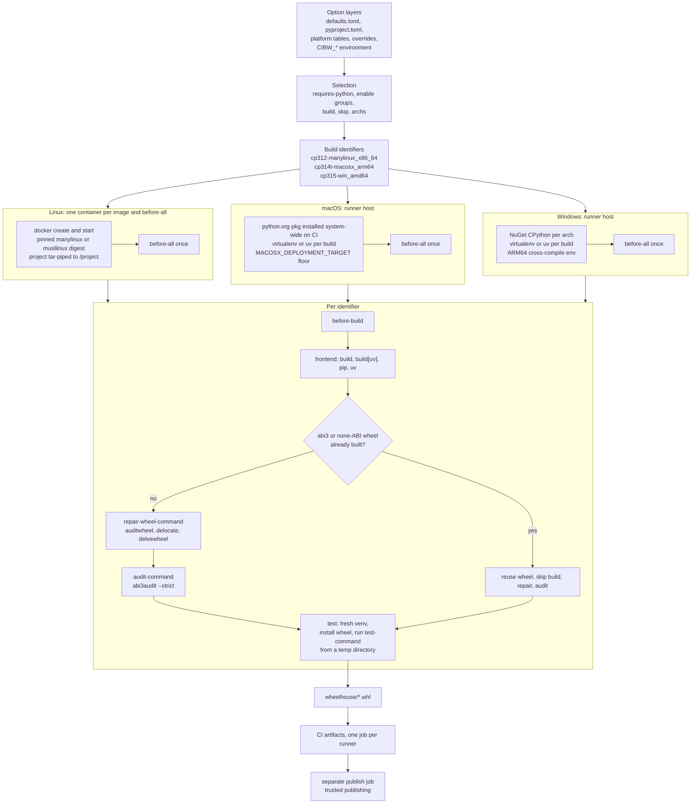

# Cross-Platform Wheel Pipelines with cibuildwheel

> [!summary] Claim:
> cibuildwheel is a driver, not a build backend: for every build identifier such as `cp312-manylinux_x86_64` it prepares a pinned interpreter, runs a PEP 517 frontend, repairs the wheel with `auditwheel`, `delocate`, or `delvewheel`, audits it, and installs it into a fresh virtual environment for a test command.
> Linux builds run inside digest-pinned manylinux or musllinux containers that receive the project as a tar stream, while macOS and Windows builds run directly on the runner with python.org, NuGet, or GraalPy and PyPy downloads.
> The tool is reproducible only as far as you pin it: the cibuildwheel version, its constraints file, the image digests, and the runner image all move independently.
> An expert reads a failed matrix from the identifier, the exit code, and the step name, and treats a green matrix as proof of "loads on the build image", not "loads everywhere the tag promises".



## The Mechanism

This note owns the pipeline: how cibuildwheel selects builds, supplies a toolchain on each operating system, runs the steps in a fixed order, and fails.
The wheel format, the tag triple, and the manylinux baselines are owned by [[Python-Wheels-Platform-Tags-Manylinux-and-ABI3]], and the build backends that actually compile code are owned by [[Python-Native-Build-Backends-scikit-build-core-meson-python-and-maturin]].
Everything below that quotes code was read from the cibuildwheel 4.3.4 source tree (the version installed on the capture host), and everything that quotes release dates comes from PyPI metadata and the project changelog (as of 2026-11).
PyPI lists 4.3.5 as the latest release, uploaded 2026-10-27, and the changelog says it fixes one regression introduced in 4.3.4 (see Pitfall 4).

### What cibuildwheel is, and what it is not

cibuildwheel replaces a pile of per-OS shell in CI.
It does not compile anything itself and it does not choose compiler flags.
For each selected interpreter it calls a frontend (`python -m build` by default, as `options.py` sets `default_frontend = "build"`) and lets the project's own `[build-system]` do the work.
Its value is the parts around the frontend: a clean, pinned Python for every version and architecture, a container with an old glibc for Linux, a deployment-target floor for macOS, a repair step, an audit step, and a test step that runs against the installed wheel instead of the source tree.
A project that builds only pure-Python wheels does not need it, and the tool enforces that: a build that produces a `none-any` wheel stops with exit code 5 and a message that points to `uv build --wheel` or `pipx run build`.

Version history that matters for reading old configurations (changelog, dated by release):

| Release | Date | Change that alters behavior |
|---|---|---|
| 3.0.0 | 2025-06-11 | Default Linux image moved from `manylinux2014` to `manylinux_2_28`; `CIBW_PRERELEASE_PYTHONS` and `CIBW_FREE_THREADED_SUPPORT` removed and PyPy moved behind `enable` (the `enable` option itself arrived in 2.22.0); iOS and GraalPy added; `test-sources` added; 32-bit Linux removed from `auto` (options docs). |
| 3.1.0 | 2025-07-23 | CPython 3.14 built by default from RC1; Android platform added. |
| 3.4.0 | 2026-03-05 | `uv` accepted as a build frontend. |
| 4.0.0 | 2026-06-07 | `abi3audit` runs by default after repair; `delvewheel` is the default Windows repair command; Python 3.8 and experimental 3.13 free-threaded builds removed; SHA256 verification of downloaded interpreters. |
| 4.2.0 | 2026-08-04 | CPython 3.15 built by default from RC1; failed downloads retried six times with exponential backoff. |
| 4.3.0 | 2026-10-05 | Option inheritance (`inherit.*`, `CIBW_INHERIT`) on every configuration layer; PyPy 3.12 and GraalPy 3.13 added behind `enable`. |
| 4.3.5 | 2026-10-27 | Latest release at the time of writing; restores host `virtualenv` environment handling that 4.3.4 broke. |

### Build identifiers and the selection algorithm

A build identifier is `{python_tag}-{platform_tag}`.
Python tags are `cp312`, `cp314t` for free-threaded CPython, `pp311`, and `gp313_253` for GraalPy 25.3 on 3.13.
Platform tags in identifiers are coarser than wheel tags: `manylinux_x86_64`, `musllinux_aarch64`, `macosx_universal2`, `win_amd64`, `pyodide_wasm32`.
The identifier carries no glibc version, so `cp312-manylinux_x86_64` is built in whatever image `manylinux-x86_64-image` names, and the wheel's `manylinux_2_28` tag is decided later by `auditwheel`.
Selectors in `build`, `skip`, and `test-skip` match identifiers, never wheel filenames.

`BuildSelector.__call__` in `selector.py` decides each identifier in a fixed order:
1. If `requires_python` is set, parse `major` and `minor` from the identifier and test `Version(f"{major}.{minor}.99")` against the specifier set, so only minor-version granularity matters.
2. Reject identifiers in an `enable` group that is not enabled: `cp316*` needs `cpython-prerelease`, PyPy needs `pypy` (or `pypy-eol` for `pp3?-*` and `pp310-*`), `gp*` needs `graalpy`, and `cp312-pyodide_*` needs `pyodide-eol`.
3. Keep the identifier only if some `build` pattern matches and no `skip` pattern matches.

Patterns are `fnmatch` globs with shell-style brace expansion from `bracex`, so `*-*linux_{aarch64,ppc64le,s390x}` is valid.
`requires-python` comes from `CIBW_PROJECT_REQUIRES_PYTHON` first, then from `pyproject.toml`, `setup.cfg`, or a simple `setup()` keyword.
This means a project declaring `requires-python = ">=3.11"` never builds `cp39` or `cp310` regardless of `build`, which is the intended behavior and a common source of "why is my matrix smaller than the docs table".

Architectures are resolved by `Architecture.parse_config`: `auto` is the runner's native architecture, plus `x86` on a 64-bit Windows runner and plus the iOS device architecture on an Apple Silicon Mac.
`auto` on Linux excludes `i686` and `armv7l`, `universal2` is never in `auto`, and `all` expands to every architecture the OS supports.
`archs` cannot be set in an override.
On Linux, any architecture other than the native one runs under emulation through `binfmt_misc`, which cibuildwheel assumes you registered (the docs use `docker/setup-qemu-action`).

`--only IDENTIFIER` forces exactly one build, overrides `build` and `skip`, enables every `enable` group, and refuses `--platform` and `--archs` because it derives the platform from the identifier text (`linux_`, `macosx_`, `win_`, `pyodide_`, `android_`, `ios_`).
Validation is asymmetric: an unknown or deprecated selector in `build` is an error, while the same selector in `skip` or `test-skip` is only a warning that says it "will have no effect".
`--print-build-identifiers` exits before that validation runs, so it shows the list but not the errors; the real error appears only on a run that reaches the preamble.

Exit codes come from `errors.py`, and the public docs (options reference, "Return codes") list only codes 2, 3, and 4:

| Code | Error class | Trigger |
|---|---|---|
| 1 | `FatalError` | Generic failure, including a failed command inside a step. |
| 2 | `ConfigurationError` | Bad option, unknown key, conflicting flags, `package_dir` outside the working directory. |
| 3 | `NothingToDoError` | No identifiers selected and no `--allow-empty`. |
| 4 | `DeprecationError` | A removed selector or option, for example `cp313t-*` in 4.x. |
| 5 | `NonPlatformWheelError` | The frontend produced a `none-any` wheel. |
| 6 | `AlreadyBuiltWheelError` | A wheel with the same filename was already produced in this run. |
| 7 | `OCIEngineTooOldError` | Docker below API 1.41 (20.10.0), or Podman below 3, or an engine that does not answer `version`. |
| 8 | `RepairStepProducedNoWheelError` and `RepairStepProducedMultipleWheelsError` | The repair command must leave exactly one wheel in `{dest_dir}`. |
| 9 | `AuditCommandFailedError` | An `audit-command` exited non-zero. |
| 10 | `BuildProducedNoWheelError` | The frontend exited zero but wrote no wheel. |

### The configuration model: layers, platform tables, overrides, inheritance

`OptionsReader.get` in `options.py` builds the value of every option from a cascade, lowest precedence first:
1. `resources/defaults.toml` global section, then its platform section.
2. `[tool.cibuildwheel]` in the project file, then `[tool.cibuildwheel.<platform>]`.
3. Every matching entry of the `tool.cibuildwheel.overrides` array of tables, in file order, selected by identifier.
4. The environment variable `CIBW_<OPTION>`, then `CIBW_<OPTION>_<PLATFORM>`.

Each layer replaces the value below it unless an `inherit` rule says `append` or `prepend`.
For a list, such as a command list, append and prepend concatenate; for a table, such as `environment`, append lets the new key win and prepend lets the old key win.
Command lists are joined with `" && "`, so a multi-line `test-command` stops at the first failing line.
`CIBW_INHERIT="audit-requires; audit-command"` applies the same rule to environment variables.
`--config-file` replaces the project file for option values, but `requires-python` is always read from the package directory's own metadata.
An unknown key fails fast, with a suggestion, at exit code 2.

Some options cannot vary per identifier: `build`, `skip`, `test-skip`, `archs`, `enable`, and `output-dir`.
Two options reshape the execution plan when they differ: a different `before-all` starts another container on Linux and is an error across identifiers on macOS and Windows (`check_for_invalid_configuration`), and a different image starts another container as well.
In 4.3.4 that macOS and Windows `before-all` error, and an `archs` value the platform does not support, are both raised as `ValueError` and re-raised as `DeprecationError` in `build_in_directory`, so they end with exit code 4 rather than 2.

Placeholders are substituted by cibuildwheel before the shell sees the command: `{project}`, `{package}`, `{wheel}`, `{dest_dir}`, `{delocate_archs}` (macOS), `{ldpaths}` (Android), and `{abi3_wheel}` (audit only).
A literal placeholder is written with a hash prefix, `#{project}`.
`environment` values use bash syntax, parsed by `bashlex`, evaluated in order, with `$VAR` and `$(command)` expansion; on Linux the command substitution runs inside the container through the container's environment executor, which is why an `environment` entry can call `$(uname -m)` and get the target's answer.
On Linux, host variables reach the container only through `environment-pass`, with the exception of `CIBUILDWHEEL` and `SOURCE_DATE_EPOCH`, which the container is created with.

### Linux: containers, tar streams, and a sentinel protocol

On Linux `platforms/linux.py` groups build configurations into steps keyed by `(platform_tag, container_image, before_all, container_engine)`, and each step is one container.
A default matrix on x86_64 therefore starts a manylinux container and a musllinux container, and a project that adds `i686` or an override with a different `before-all` starts more.
Inside a container the interpreters are the ones the image ships under `/opt/python/cpXY-cpXY`, and cibuildwheel calls `manylinux-interpreters ensure` first when the image has that tool, so an image can install interpreters lazily.

`OCIContainer` (in `oci_container.py`) does the following:
1. It checks the engine version: Docker must report client and server API 1.41 or newer, Podman must be 3 or newer.
2. It runs `docker create --env=CIBUILDWHEEL --env=SOURCE_DATE_EPOCH --name=cibuildwheel-<uuid> --interactive --volume=/:/host --platform=<oci platform> --pull=<always|never> <image> /bin/bash`, where `--pull=never` is used only when a local image already has the right OS, architecture, and variant, and `disable-host-mount` removes the `/host` volume.
3. It starts the container attached and interactive, and from then on talks to one long-lived `bash` over stdin: every command is wrapped as a subshell that runs `env VAR=value ... command` and then prints the return code padded to four digits followed by a random UUID, and the reader stops at that sentinel line.
4. It copies the project in with `tar -c -f - . | docker exec -i NAME tar --no-same-owner -xC /project -f -`, with `--format gnutar` added on a macOS host, rather than bind-mounting the source.
5. For 32-bit images on a 64-bit host it runs `linux32 /bin/bash` so `uname -m` reports a 32-bit machine.
6. It copies finished wheels out of `/output` with `docker cp`, and removes the container unless `CIBW_DEBUG_KEEP_CONTAINER` is set.

Copying the whole working directory, including `.git`, `build/`, and any stray `.so` files, is a deliberate choice: it works on CI systems where bind mounts are restricted, and it means the container never writes into your tree.
The cost is a full tree copy per container, and stale binaries travel with it; when a build or repair step fails and the project directory contains `**/*.so`, `troubleshoot()` prints a note listing them and suggests a clean checkout.

Images are named by alias or by full reference.
The aliases (`manylinux2014`, `manylinux_2_28`, `manylinux_2_34`, `musllinux_1_2`, and for 32-bit ARM and RISC-V `manylinux_2_31`, `manylinux_2_35`, `manylinux_2_39`) resolve through `pinned_docker_images.cfg` to `quay.io/pypa/...@sha256:<digest>` entries, each annotated with the manylinux release tag it came from (`2026.10.21-1` in 4.3.4).
Since 4.1.1 the pins are digests rather than tags (changelog), so a pinned cibuildwheel produces the same image bytes until you upgrade it, unlike `quay.io/pypa/manylinux_2_28_x86_64:latest`.
A custom image must provide the interpreters under `/opt/python/`, an `auditwheel`, and the `AUDITWHEEL_PLAT` variable that tells `auditwheel` which policy the image implements; cibuildwheel cannot infer `--plat` for a custom image.
The README of pypa/manylinux describes the images: `manylinux_2_28` is AlmaLinux 8 with GCC 14, `manylinux2014` is CentOS 7 (glibc 2.17, whose base distribution reached end of life on 2024-06-30), `manylinux_2_34` is AlmaLinux 9 (marked ALPHA in that README, as of 2026-11), and `musllinux_1_2` is Alpine Linux 3.22 based.

### macOS: system-wide python.org installs and a deployment-target floor

macOS builds run on the host with no isolation.
`install_cpython` in `platforms/macos.py` checks `pkgutil --pkgs` for `org.python.Python.PythonFramework-<version>` (or `PythonTFramework` for free-threaded), and installs the python.org `.pkg` with `sudo installer -pkg ... -target /` only when `detect_ci_provider()` finds a CI environment, after verifying the download's SHA256.
Outside CI it refuses with a message that names the installer URL and the `CIBW_SKIP` pattern that would skip that version, because a global install would modify the developer's machine.
For 3.14 and 3.15 it passes `-applyChoiceChangesXML` with a bundled plist that selects the installer choice `org.python.Python.PythonTFramework-3.14` (or `-3.15`), which is the free-threaded framework.
PyPy and GraalPy are unpacked into the cibuildwheel cache directory instead.

Each build then gets a virtualenv (or a `uv venv`) from that base interpreter, and `setup_python` sets the macOS environment:
1. `MACOSX_DEPLOYMENT_TARGET` defaults to `11.0` for `arm64`, to `10.15` for Intel CPython 3.14 and later or PyPy 3.9 and later, to `10.13` for Intel CPython 3.12 and 3.13, and to `10.9` otherwise.
2. The value is a floor: a lower user value is raised to the default with a warning, so `MACOSX_DEPLOYMENT_TARGET=10.9` cannot publish an Intel 3.14 wheel that claims 10.9.
3. `_PYTHON_HOST_PLATFORM` defaults to `macosx-11.0-arm64`, `macosx-10.9-universal2`, or `macosx-10.9-x86_64`, and `ARCHFLAGS` to `-arch arm64`, `-arch arm64 -arch x86_64`, or `-arch x86_64`.
4. The tools `delocate` and the frontend are installed into the venv under the pinned constraints.

For `universal2`, cibuildwheel sets `ARCHFLAGS` to both architectures and leaves the single build to the backend's compiler; it contains no code that builds twice and merges.
The default repair command is `delocate-wheel --require-archs {delocate_archs} -w {dest_dir} -v {wheel}`, where `{delocate_archs}` is `x86_64,arm64` for `universal2`.
Tests of the `x86_64` slice on an Apple Silicon runner run under Rosetta through `arch -x86_64`, and the tests of `arm64` on an Intel runner are skipped with a warning because they cannot run.
The test virtualenv gets `MACOSX_DEPLOYMENT_TARGET` set to the host's major version plus `.0` (for macOS 11 and later), so test-time source builds do not use the wheel floor.
delocate 0.11.0 and later check bundled libraries against `MACOSX_DEPLOYMENT_TARGET`, which cibuildwheel exports for the repair step; the explicit flag `--require-target-macos-version` is deprecated since delocate 0.12.0 in favor of that variable (delocate changelog).
The platform-tag and `minos` mechanics, and the repair-time deployment-target check, belong to [[Python-Wheels-Platform-Tags-Manylinux-and-ABI3]], and signing and notarization of the binaries inside belong to [[Cpp-macOS-Universal-Binaries-Code-Signing-and-Notarization]].

### Windows: NuGet interpreters, delvewheel, and ARM64 cross-compilation

On Windows `platforms/windows.py` installs CPython from NuGet packages (`python`, `pythonx86`, `pythonarm64`, each with a `-freethreaded` variant), caches them under `CIBW_CACHE_PATH`, and downloads `nuget.exe` on first use.
PyPy and GraalPy come from direct downloads with SHA256 checks.
The default repair command is `delvewheel repair -w {dest_dir} -v {wheel}` since 4.0.0, and delvewheel is installed next to the frontend in the build venv.

Cross-compiling `win_arm64` from an Intel runner needs two interpreters: a native one to run the build, and the ARM64 one for its `libs\*.lib` import libraries.
`setup_setuptools_cross_compile` then sets four things: `DIST_EXTRA_CONFIG` pointing at a generated `extra-setup.cfg` with `plat_name=win-arm64` and the ARM64 `library_dirs`, `VSCMD_ARG_TGT_ARCH=arm64` (and it refuses to continue if you set it to something else), `SETUPTOOLS_EXT_SUFFIX=.cp315-win_arm64.pyd` style names derived from the identifier, and `SETUPTOOLS_USE_DISTUTILS=local`.
`setup_rust_cross_compile` sets `CARGO_BUILD_TARGET` to `aarch64-pc-windows-msvc` unless you already set it.
The docs state that `setuptools>=65.4.1` and `setuptools_rust` are the only backends supported for this path, and that tests of ARM64 wheels are skipped on non-ARM64 runners with a warning.

### The per-identifier pipeline

The order of steps is the same on every desktop platform, and the failures are named after the step:

| Step | Linux | macOS and Windows | Fails with |
|---|---|---|---|
| `before-all` | Once per container, with a utility Python on `PATH` and pip configured with the CA bundle. | Once at the start, on the host, with `MACOSX_DEPLOYMENT_TARGET` defaulting to 10.9 on macOS. | Command exit code (1). |
| Environment | Container environment plus `environment-pass`, then `environment`. | Host environment, then `environment`. | Malformed `environment` string (2). |
| `before-build` | Runs in the container with `UV_PYTHON` pinned when the frontend is uv. | Runs inside the venv. | Command exit code (1). |
| Frontend | `python -m build <pkg> --wheel --outdir=...` (default), `... --installer=uv`, `python -m pip wheel <pkg> --no-deps --wheel-dir=...`, or `uv build --python=... --wheel`. | The same commands in the venv. | Backend failure (1), no wheel (10), `none-any` wheel (5). |
| Reuse check | `find_compatible_wheel` against wheels built earlier in this run. | Same. | None. |
| Repair | `auditwheel repair -w {dest_dir} {wheel}`. | `delocate-wheel ...` or `delvewheel repair ...`. | No or multiple wheels (8), duplicate filename (6). |
| Audit | `abi3audit --strict --report {abi3_wheel}` on the host, after copying the wheel out. | Same, on the host. | Audit failure (9). |
| Test | New venv, install the wheel, install `test-requires`, run `test-command` from a temp directory. | Same, per tested architecture. | Test command failure (1). |
| Output | Wheel moved to `/output`, copied to the output directory at the end of the container run. | Wheel moved to the output directory. | None. |

Three details of this table decide real-world behavior.
First, on Linux the build itself uses the image's interpreter directly with no virtualenv, so `pip install` in `before-build` modifies the image's `/opt/python/cpXY` tree for the rest of that container run, while macOS and Windows install into a throwaway venv.
Second, the test environment is built with `--no-setuptools` on Linux and in the shared virtualenv helper, so test code that imports `pkg_resources` or builds from source needs `test-requires = ["setuptools"]`.
Third, `test-command` runs in a temporary directory that holds only a `test_fail.py` sentinel unless you list `test-sources`, so a bare `pytest` there fails by design instead of importing the checkout.

### Reuse of abi3 and none-ABI wheels

`find_compatible_wheel` in `util/packaging.py` runs before the build step for every identifier after the first.
It looks at wheels already produced in this run and returns one if its filename carries `abi3` (and the identifier is not free-threaded) or carries the `none` ABI with a `py3` Python tag, if the wheel's minimum minor version is at most the identifier's minor version, and if the platform matches with the OS version number ignored (`manylinux_2_28_x86_64` matches `manylinux_x86_64`).
When it finds one, cibuildwheel prints `Found previously built wheel ..., that's compatible with <identifier>. Skipping build step...`, skips the frontend, repair, and audit steps, and still runs the test step against that wheel on the new interpreter.

Consequences:
1. An abi3 project builds once per platform tag and architecture, and is tested once per interpreter, so the test matrix is wider than the build matrix.
2. Identifiers are ordered oldest first, so the wheel is built on the oldest selected CPython, which is what the abi3 promise needs (see [[Python-Wheels-Platform-Tags-Manylinux-and-ABI3]] for why building abi3 wheels on the newest Python is a defect).
3. Free-threaded identifiers (`cp314t`, `cp315t`) never reuse an `abi3` wheel, because the code only matches `abi3` for non-free-threaded builds, and the `abi3t` tag is not matched at all in 4.3.4; a `py3-none` wheel is still reused for them, so free-threaded builds compile whenever the project ships version-specific or abi3 binaries.
4. The check compares tags, not provenance: it cannot know that a `cp38-abi3` wheel was built on 3.12 because the oldest selected interpreter was 3.12.
5. The oldest identifier cibuildwheel 4.x can select is `cp39`, so a wheel tagged `cp38-abi3` is never tested on 3.8 by this tool, and the `cp38` floor is a claim nothing in the pipeline checks.

### What the repair tools do, and what they cannot see

The repair step is a command, not a built-in: cibuildwheel substitutes placeholders and runs whatever you configure.
The defaults wrap three tools, each with the same job and different mechanics.

`auditwheel` (Linux, and Android with `--ldpaths`) reads the `DT_NEEDED` entries and symbol versions of every extension module.
`auditwheel show` lists the external libraries and the versioned symbols the wheel references (`GLIBC_2.3` in the README's example), and `auditwheel repair` copies libraries outside the policy into the wheel, sets `$ORIGIN`-relative `RPATH` entries so they are found at runtime, and rewrites the wheel's platform tag to the policy it satisfies (the README's example goes from `linux_x86_64` to `manylinux1_x86_64`).
Its README states two limits: it cannot see libraries loaded by `dlopen`, `ctypes`, or `cffi`, and it cannot fix a binary that was linked against a newer glibc or libstdc++ than the policy allows.
On Linux the `auditwheel` version is whatever the image ships, because `dependency-versions` does not pin the build tools inside the container (options docs).
In 4.3.4 the one container install it does constrain is the test step's `pip install virtualenv -c /constraints.txt` (non-uv frontends, `platforms/linux.py`).

`delocate` (macOS) finds dylibs outside `/usr/lib` and `/System`, copies them into a `.dylibs` directory in the package, and rewrites install names and rpaths.
`--require-archs` fails the repair if any binary or copied library lacks a required architecture, which is how a Homebrew `x86_64`-only library is caught in an `arm64` or `universal2` build.
Since 0.12.0 `delocate-merge` replaced `delocate-fuse` for fusing an `arm64` wheel and an `x86_64` wheel into a `universal2` wheel with a generated name.
The FAQ adds two macOS behaviors: System Integrity Protection strips `DYLD_LIBRARY_PATH` before `delocate` runs, so the library path must be passed through another variable and set inline in the repair command, and delocate 0.11.0 or newer rejects a dependency whose deployment target is newer than the wheel's tag.

`delvewheel` (Windows) copies DLLs found on `PATH` or `--add-path`, and mangles their names.
For each DLL it appends a hash of the DLL's contents and of the hashes of its renamed dependencies, edits the import directory table of every dependent, and then renames the files, so two wheels that bundle different builds of `C.dll` do not collide in one process.
Its documented limits are runtime-loaded DLLs (use `--include` or `--analyze-existing`), overlays that block mangling (`--strip` or `--no-mangle`), Authenticode signatures that are cleared when imports are rewritten, and wheels that mix architectures.
If a wheel has a platform tag but no extension module, the default `delvewheel` command can fail, and the docs say to set `repair-wheel-command = ""` for that case.

The audit step is separate.
`audit-command` defaults to `abi3audit --strict --report {abi3_wheel}`, with `audit-requires = ["abi3audit"]`.
A command must contain `{abi3_wheel}` or `{wheel}`, never both, and `{abi3_wheel}` commands are skipped for wheels without an `abi3` tag.
The audit runs on the host in its own virtualenv, after the wheel is copied out of the container, and its version is pinned by `dependency-versions` even on Linux, but only while `audit-requires` is exactly `["abi3audit"]` (`should_pin` in `audit.py`); any added requirement installs abi3audit unpinned.
abi3audit exists because the `abi3` tag is a claim that nothing enforces at install time; its README describes a wheel tagged for one ABI that uses symbols from a newer one.
To add a check without losing the default, use `inherit.audit-command = "append"` and `inherit.audit-requires = "append"`, as the sample configuration below does with `twine check`; the price is that abi3audit is then no longer constrained, so pin it yourself (for example `audit-requires = ["abi3audit==0.0.26", "twine"]` with no `inherit.audit-requires` rule) if reproducibility matters.

### Testing model and its boundary

`test-command` is the only thing that makes cibuildwheel install your wheel.
If it is empty, the wheel is built, repaired, and audited, but never installed.
When it is set, the test step creates a new virtualenv (`virtualenv` with the pinned pip, or `uv venv`), applies `test-environment`, runs `before-test`, installs `<wheel>[test-extras]`, installs `test-requires` and the resolved `test-groups` (PEP 735 dependency groups in `pyproject.toml`), copies `test-sources` into a temporary working directory, and runs the command there.
The venv has none of the build dependencies, which is the "clean sub-environment" guarantee: an import that worked only because a build-time package was present fails here.

The boundary is the operating system.
On Linux the test venv lives in the same container as the build, so the tests run on the build image's glibc, with the build image's libraries on the loader path.
They prove that the repaired wheel imports there, which catches a missing bundled library but cannot catch a symbol that the image provides and a target distribution lacks, and cannot catch CPU features newer than the target hardware.
On macOS the test deployment target is the host's own, so a wheel whose `minos` is higher than its tag loads fine on the runner.
Real portability testing is a separate job that downloads the artifacts and installs them on the oldest images and OS versions the tags claim; cibuildwheel has no option for it.

### Failure triage by symptom

Start from the exit code and the step name in the log (`Building wheel...`, `Repairing wheel...`, `Auditing wheel...`, `Testing wheel...`), then use this table.

| Symptom | Step | Cause | Fix |
|---|---|---|---|
| Exit 3, `No build identifiers selected` | Preamble | `requires-python`, `skip`, `build`, `archs`, or a missing `enable` group removed everything. | Run `--print-build-identifiers` and read the selector; add `--allow-empty` only where an empty selection is legitimate. |
| Exit 5, `a pure Python wheel was generated` | Build | The extension was skipped or optional, so the backend produced a `none-any` wheel. | Make the extension mandatory when `CIBUILDWHEEL=1`, as the FAQ shows with `optional=os.environ.get("CIBUILDWHEEL", "0") != "1"`. |
| Exit 6, `a wheel named ... was already generated` | Repair | Two identifiers produced the same filename and the reuse check did not apply. | Inspect the filenames with `CIBW_BUILD_VERBOSITY=1`; a backend that hard-codes tags is the likely cause (an inference from the error text). |
| Exit 8, repair produced no wheel or several | Repair | A custom `repair-wheel-command` wrote outside `{dest_dir}` or wrote more than one wheel. | Write exactly one wheel to `{dest_dir}`. |
| Exit 9, `Audit command failed` | Audit | `abi3audit` found a symbol newer than the claimed Limited API version, or a custom command failed. | Fix `Py_LIMITED_API` and the wheel tag so they agree; abi3audit's README notes the flag that tags the wheel and the macro that restricts the code are unconnected. |
| Exit 10, frontend succeeded but no wheel | Build | The backend wrote nothing to the output directory. | Raise `build-verbosity` and read the backend log. |
| Exit 7, engine too old or not working | Linux container | Docker below API 1.41 or Podman below 3, or no daemon. | Upgrade the engine, or select `container-engine = "podman"`. |
| `python available on PATH doesn't match our installed instance` | Environment | An `environment` entry replaced `PATH` and removed cibuildwheel's interpreter entry. | Append to `PATH` (`PATH=$PATH:/x`) instead of overwriting it. |
| `Framework CPython X not detected as installed` | macOS, local run | cibuildwheel never installs python.org pkgs outside CI. | Install that CPython yourself or skip it with `CIBW_SKIP`. |
| `Some missing architectures in wheel` style `delocate` errors | macOS repair | A bundled library has one architecture, usually a Homebrew library. | Compile the library for every wheel architecture in `before-all`. |
| `VSCMD_ARG_TGT_ARCH must be set to 'arm64'` | Windows ARM64 cross-build | A pre-activated MSVC environment targets another architecture. | Let the backend configure MSVC, or activate the right target before running cibuildwheel. |
| `ImportError: DLL load failed` after install | Windows runtime | The C++ runtime is absent, or a DLL loaded at runtime was not vendored. | Install the Visual C++ Redistributable, consider `/d2FH4-` for `VCRUNTIME140_1.dll`, or add `--include` to `delvewheel`. |
| Meson builds with MinGW on Windows | Build | The runner's default compiler is not MSVC. | Set `setup-args = "--vsenv"` in the Windows `config-settings`. |
| `cargo: command not found` in the container | Build | The manylinux image has no Rust toolchain. | Install `rustup` in `before-all` and extend `PATH` in `environment`; skip `*-musllinux_i686`, which has no Cargo. |
| Missing C headers such as OpenSSL | Build | Headers are absent from the image. | Install them in `before-all` with the image's package manager (`dnf`, `apk`, or `apt-get`), one override per distribution family. |
| Wheel contains a stale binary | Build | An earlier in-place build left `*.so`, `*.o`, or `build/` content that the tar copy shipped. | Build from a clean checkout or an sdist. |

## Commands and Numbers to Know

| Item | Value | Platform | Notes |
|---|---|---|---|
| Latest cibuildwheel (as of 2026-11) | 4.3.5, uploaded 2026-10-27 | Both | PyPI JSON; this note read the 4.3.4 source, uploaded 2026-10-22. |
| Default build frontend (as of 2026-11) | `build` | Both | `options.py`; `pip`, `build[uv]`, and `uv` are the alternatives, and `pyodide-build` is Pyodide only. |
| Default Linux images (as of 2026-11) | `manylinux_2_28` for x86_64, i686, aarch64, ppc64le, s390x; `manylinux_2_31` for armv7l; `manylinux_2_39` for riscv64; `musllinux_1_2` everywhere | Linux | `resources/defaults.toml`; aliases resolve to digests. |
| Pinned image release (as of 2026-11) | manylinux release tag `2026.10.21-1` | Linux | Comment in `pinned_docker_images.cfg` of 4.3.4. |
| Container engine floor (as of 2026-11) | Docker API 1.41 (20.10.0), Podman 3 | Linux | `_check_engine_version` raises exit code 7 below it. |
| Default repair commands (as of 2026-11) | `auditwheel repair -w {dest_dir} {wheel}`; `delocate-wheel --require-archs {delocate_archs} -w {dest_dir} -v {wheel}`; `delvewheel repair -w {dest_dir} -v {wheel}` | Linux; macOS; Windows | `defaults.toml`. |
| Default audit (as of 2026-11) | `abi3audit --strict --report {abi3_wheel}` | Both | Skipped for non-abi3 wheels. |
| Pinned tool versions in 4.3.4 for CPython 3.14 (as of 2026-11) | pip 26.2.2, build 1.6.1, virtualenv 21.14.12, delocate 0.13.0, delvewheel 1.13.2, abi3audit 0.0.26, packaging 26.3 | macOS and Windows | `resources/constraints-python314.txt`; that file also pins auditwheel 6.8.2, but Linux container builds use the image's `auditwheel` (options docs). |
| macOS default deployment target (as of 2026-11) | arm64 `11.0`; Intel 3.9-3.11 `10.9`; Intel 3.12-3.13 `10.13`; Intel 3.14+ and PyPy 3.9+ `10.15` | macOS | `setup_python`; user values below the floor are raised with a warning. |
| macOS test deployment target (as of 2026-11) | host major version plus `.0` on macOS 11 and later | macOS | `get_test_macosx_deployment_target`. |
| Cache directory (as of 2026-11) | `~/.cache/cibuildwheel`, `~/Library/Caches/cibuildwheel`, `%LOCALAPPDATA%\pypa\cibuildwheel\Cache` | Linux; macOS; Windows | Override with `CIBW_CACHE_PATH`; `cibuildwheel --clean-cache` deletes it only if its `CACHEDIR.TAG` signature matches. |
| Download retries (as of 2026-11) | 6 retries with exponential backoff, 4xx not retried | Both | Changelog 4.2.0. |
| Selection on the capture host (as of 2026-11) | Linux x86_64: 12 identifiers; macOS all archs: 18; Windows all archs: 18 | macOS host | Output below, project with `requires-python >=3.11` and a skip list, cibuildwheel 4.3.4. |
| Extra environment variables | `CIBUILDWHEEL=1` always; `CIBUILDWHEEL_BUILD_IDENTIFIER` per build step; `SOURCE_DATE_EPOCH` passed into containers | Both | Use `CIBUILDWHEEL` to make optional C extensions mandatory in wheel builds. |
| Debugging switches | `CIBW_BUILD_VERBOSITY` (-3 to 3), `CIBW_DEBUG_KEEP_CONTAINER`, `CIBW_DEBUG_TRACEBACK` / `--debug-traceback`, `CIBW_LOG_FOLD_MODE` | Both | `CIBW_DEBUG_KEEP_CONTAINER` is Linux only. |

## Multi-Language Comparison

| Concern | C++ extension | Python (pure dependencies, C-API extension) | Rust extension |
|---|---|---|---|
| Native dependencies | Build or install in `before-all`: `dnf` on `manylinux_2_28`, `apk` on `musllinux_1_2`, `apt-get` on the 32-bit ARM images; on macOS build from source rather than Homebrew. | Python build dependencies belong in `build-system.requires`, test dependencies in `test-requires` or `test-groups`. | Install the toolchain in `before-all` (`rustup` on Linux) and put `$HOME/.cargo/bin` on `PATH` through `environment`. |
| Language floor | `manylinux2014` supports C++17 and earlier; `manylinux_2_28` supports up to C++20; C++17 runtime features on macOS need a deployment target of 10.13 or 10.14. | Interpreters 3.9 through 3.15 (plus `t` variants for 3.14 and 3.15) in 4.3.4. | macOS needs `MACOSX_DEPLOYMENT_TARGET` of at least 10.12, above the 10.9 default for Intel CPython 3.9-3.11. |
| Cross-architecture | Backend-owned flags; cibuildwheel sets `ARCHFLAGS` on macOS and `DIST_EXTRA_CONFIG` for setuptools on Windows ARM64. | Same. | `CARGO_BUILD_TARGET` is set on Windows ARM64; maturin-action is recommended by the docs when you want Rust-specific cross-compilation. |
| Repair target | Shared libraries copied by auditwheel, delocate, or delvewheel. | Usually nothing to repair. | The repair step matters for system libraries the crate links, such as OpenSSL (an inference; the cibuildwheel docs do not discuss Rust repair). |
| Wheel reuse | An abi3 build through the backend, or per-version builds. | `py3-none-<platform>` wheels reused across all interpreters. | PyO3 `abi3-py3X` builds reuse across CPython versions; free-threaded identifiers always compile. |
| Typical failure | A `GLIBCXX` symbol above the policy, or a Homebrew library with a newer deployment target. | A pure wheel stops the run with exit code 5. | `musllinux_i686` has no Cargo, so the docs say to skip it. |

The backend-specific settings that cibuildwheel forwards, such as `config-settings` for scikit-build-core or `setup-args` for meson-python, are covered in [[Python-Native-Build-Backends-scikit-build-core-meson-python-and-maturin]].
The end-to-end Rust workflow, including maturin, is owned by [[Ship-a-Rust-Extension-in-a-Python-Wheel]] and [[Rust-PyO3-and-Maturin-Internals]].

## Worked Lab Example

This note has no lab, because every build step needs Docker, network access, or a CI runner, and lab checks are paused for this wave.
The traces below were captured once from the real tool without building anything: cibuildwheel 4.3.4 (installed with `uv tool`) on macOS arm64 (`Darwin arm64`, platform `darwin-arm64`), run from a scratch project whose `pyproject.toml` declares `requires-python = ">=3.11"` and `skip = ["*-musllinux_i686", "cp311-*"]`.
The commands only list identifiers, resolve options, or stop in the preamble before any container or installer is started.
The container build path described above was read from source and was not executed here.

Select the Linux x86_64 identifiers (platform `darwin-arm64`, cibuildwheel 4.3.4):

```text
$ cibuildwheel --platform linux --archs x86_64 --print-build-identifiers
cp312-manylinux_x86_64
cp313-manylinux_x86_64
cp314-manylinux_x86_64
cp314t-manylinux_x86_64
cp315-manylinux_x86_64
cp315t-manylinux_x86_64
cp312-musllinux_x86_64
cp313-musllinux_x86_64
cp314-musllinux_x86_64
cp314t-musllinux_x86_64
cp315-musllinux_x86_64
cp315t-musllinux_x86_64
exit=0
```

Override the project's Python range from the environment, and select only free-threaded builds (same host and version):

```text
$ CIBW_PROJECT_REQUIRES_PYTHON='>=3.9' cibuildwheel --platform linux --archs x86_64 --print-build-identifiers | head -n 4
cp39-manylinux_x86_64
cp310-manylinux_x86_64
cp312-manylinux_x86_64
cp313-manylinux_x86_64

$ CIBW_BUILD='cp3??t-*' cibuildwheel --platform linux --archs x86_64 --print-build-identifiers
cp314t-manylinux_x86_64
cp315t-manylinux_x86_64
cp314t-musllinux_x86_64
cp315t-musllinux_x86_64
```

Enable PyPy on aarch64, and print the macOS set for every architecture (same host and version; excerpts of the real output, which has 14 and 18 lines, with the omitted lines marked):

```text
$ cibuildwheel --platform linux --archs aarch64 --enable pypy --print-build-identifiers
cp312-manylinux_aarch64
...                          (cp313 through cp315t omitted)
pp311-manylinux_aarch64
pp312-manylinux_aarch64
cp312-musllinux_aarch64
...                          (cp313 through cp315t omitted)

$ cibuildwheel --platform macos --archs all --print-build-identifiers
cp312-macosx_x86_64
cp312-macosx_arm64
cp312-macosx_universal2
...                          (cp313 and cp314 omitted)
cp315-macosx_x86_64
cp315-macosx_arm64
cp315-macosx_universal2
cp315t-macosx_x86_64
cp315t-macosx_arm64
cp315t-macosx_universal2
```

The exit-code behaviors, each run in the same project (same host and version; the last line of output is shown):

```text
$ cibuildwheel --only cp312-manylinux_x86_64 --platform linux --print-build-identifiers
cibuildwheel: error: --platform cannot be specified with --only, it is computed from --only
exit=2

$ CIBW_BUILD='cp313t-*' cibuildwheel --platform linux --archs x86_64
cibuildwheel: error: Invalid build selector: 'cp313t-*'. cibuildwheel 4.x no longer supports Python 3.13 free-threading. Please use the 3.x series or update `build`.
exit=4

$ CIBW_BUILD='cp39-*' cibuildwheel --platform linux --archs x86_64
cibuildwheel: error: No build identifiers selected: BuildSelector(build_config='cp39-*', skip_config='*-musllinux_i686 cp311-*', requires_python=<SpecifierSet('>=3.11')>, enable=frozenset())
exit=3

$ CIBW_BUILD='cp39-*' cibuildwheel --allow-empty --platform linux --archs x86_64
0 wheel produced in a moment
exit=0
```

A second scratch project holds the sample configuration in the next section.
Counting the lines of `--print-build-identifiers --platform <os> --archs <arch>` for it gives (same host and version):

```text
linux x86_64 16
linux aarch64 16
macos x86_64 8
macos arm64 8
macos universal2 8
windows AMD64 8
windows ARM64 8
windows x86 0
```

The same project, run with `CIBW_SKIP='*' cibuildwheel --allow-empty --platform linux --archs x86_64`, stops after the preamble with `0 wheel produced in a moment` and exit code 0, and the preamble prints the merged options (excerpt, same host and version).
The `inherit` rules appended `twine` to the default audit, and `test-groups = ["test"]` resolved to a `pytest` test requirement from `[dependency-groups]`:

```text
  audit_command:
    abi3audit --strict --report {abi3_wheel}
    twine check {wheel}
  audit_requires:
    abi3audit
    twine
  before_all: dnf install -y openssl-devel
  build_frontend: build[uv]
  repair_command: auditwheel repair -w {dest_dir} {wheel}
  test_command: pytest tests
  test_groups:
    test
  test_requires:
    pytest
  test_sources:
    tests
```

A third project shows layered inheritance (same host and version).
Its `[tool.cibuildwheel]` has `test-command = ["pytest"]` and `environment = { A = "1", B = "2" }`, its `[tool.cibuildwheel.linux]` has `test-command = "pytest -x"`, and one override selects `cp311-*` with `inherit.test-command = "append"` and `inherit.environment = "append"`:

```text
cp311-manylinux_x86_64: test_command='pytest -x && echo done' environment={'A': '"1"', 'B': '"3"', 'C': '"4"'}
cp312-manylinux_x86_64: test_command='pytest -x' environment={'A': '"1"', 'B': '"2"'}
cp311-macosx_arm64: test_command='pytest && echo done' environment={'A': '"1"', 'B': '"3"', 'C': '"4"'}
```

### Reading the output

The first listing shows the selection order: manylinux identifiers first, then musllinux, and within each group the Python versions ascending with the free-threaded `t` build after its non-free-threaded sibling.
That order is the build order, and it is why an abi3 wheel is compiled on the oldest selected interpreter and then reused.
`cp39` and `cp310` are absent from the first listing because of `requires-python`, `cp311` because of `skip`, and the PyPy and `musllinux_i686` entries because of `enable` and `skip`; the second listing shows the `requires-python` override restoring `cp39` and `cp310` while `skip` still removes `cp311`.
The `cp313t` run shows the `enable` and removal rules together: the selector is rejected in `build`, which is a hard error at exit code 4, not a quiet empty list.
The `--only` conflict and the exit code 3 run show why a CI step should call `--print-build-identifiers` before a long matrix: a typo costs a second here and a runner-hour there.
The inheritance probe confirms the rules: a platform table replaces the global `test-command` for that platform, and an override with `inherit.test-command = "append"` extends whatever the lower layers produced, so `cp311` on Linux runs `pytest -x && echo done` and `cp311` on macOS runs `pytest && echo done`.

### A complete configuration

This `pyproject.toml` fragment parses cleanly on cibuildwheel 4.3.4 (the identifier counts and the preamble capture above used it), and it shows the structure a release pipeline needs.
It was not used to build a wheel here.
After the captures, a macOS `repair-wheel-command` that passed the deprecated `--require-target-macos-version 11.0` was removed from it; that line affects neither the Linux preamble nor the identifier counts.

```toml
[build-system]
requires = ["setuptools>=77"]
build-backend = "setuptools.build_meta"

[project]
name = "demo-ext"
version = "0.1.0"
requires-python = ">=3.10"

[dependency-groups]
test = ["pytest"]

[tool.cibuildwheel]
build-frontend = "build[uv]"
skip = ["*-musllinux_i686", "pp*", "*-win32"]
build-verbosity = 1
test-groups = ["test"]
test-sources = ["tests"]
test-command = "pytest tests"
# Emulated and cross-built wheels cannot be tested on the build host.
test-skip = ["*-*linux_{aarch64,ppc64le,s390x}", "*-macosx_universal2:arm64"]
# Keep the default abi3audit and add a metadata check.
audit-requires = ["twine"]
audit-command = "twine check {wheel}"
inherit.audit-requires = "append"
inherit.audit-command = "append"

[tool.cibuildwheel.linux]
manylinux-x86_64-image = "manylinux_2_28"
manylinux-aarch64-image = "manylinux_2_28"
before-all = "dnf install -y openssl-devel"
environment-pass = ["PIP_INDEX_URL"]
container-engine = "docker"

[tool.cibuildwheel.macos]
# The default delocate repair checks libraries against this target (delocate 0.11.0+).
environment = { MACOSX_DEPLOYMENT_TARGET = "11.0" }

[tool.cibuildwheel.windows]
repair-wheel-command = "delvewheel repair --add-path C:/vendor/bin -w {dest_dir} -v {wheel}"

[[tool.cibuildwheel.overrides]]
select = "*-musllinux*"
before-all = "apk add openssl-dev"
```

Two details in it are deliberate.
The musllinux override changes `before-all`, so manylinux and musllinux builds use different containers anyway and each runs its own install command.
Setting `MACOSX_DEPLOYMENT_TARGET = "11.0"` raises the Intel floor too, which is a decision to drop macOS 10.x Intel users; leave the variable unset on Intel runners if you need the lower default.
It sets no `archs` for macOS on purpose: each native runner builds its own architecture under `auto`, and `CIBW_ARCHS_MACOS` selects `universal2` or a cross-built architecture only where you want it.

### The CI shape

The official example workflow (`examples/github-deploy.yml` at main) builds on native runners, uploads one artifact per runner, builds an sdist in its own job, and publishes from a third job that has `id-token: write` and runs only on a release event.
Reduced to the Linux, macOS, and Windows runners it lists (labels as of 2026-11, GitHub-hosted):

```yaml
name: Build and upload to PyPI

on:
  workflow_dispatch:
  pull_request:
  release:
    types: [published]

jobs:
  build_wheels:
    name: Wheels for ${{ matrix.os }}
    runs-on: ${{ matrix.os }}
    strategy:
      fail-fast: false
      matrix:
        # ubuntu-24.04-arm and windows-11-arm are native ARM64 runners.
        os: [ubuntu-latest, ubuntu-24.04-arm, windows-latest, windows-11-arm, macos-15-intel, macos-latest]
    steps:
      - uses: actions/checkout@v6
        with:
          persist-credentials: false
      - uses: pypa/cibuildwheel@v4.3.5
      - uses: actions/upload-artifact@v4
        with:
          name: cibw-wheels-${{ matrix.os }}-${{ strategy.job-index }}
          path: ./wheelhouse/*.whl

  build_sdist:
    runs-on: ubuntu-latest
    steps:
      - uses: actions/checkout@v6
        with:
          persist-credentials: false
      - run: pipx run build --sdist
      - uses: actions/upload-artifact@v4
        with:
          name: cibw-sdist
          path: dist/*.tar.gz

  upload_pypi:
    needs: [build_wheels, build_sdist]
    runs-on: ubuntu-latest
    environment: pypi
    permissions:
      id-token: write
    if: github.event_name == 'release' && github.event.action == 'published'
    steps:
      - uses: actions/download-artifact@v5
        with:
          pattern: cibw-*
          path: dist
          merge-multiple: true
      - uses: pypa/gh-action-pypi-publish@release/v1
```

The `fail-fast: false` line is an addition to the official example, because one platform's failure should not hide the others' diagnostics.
The official example pins `pypa/cibuildwheel@v4.3.5`, and the FAQ states there is no floating major-version tag because a minor release can add or remove wheels.
The publish job holds the only credential, and it receives artifacts, never source builds; the trusted-publishing handshake and attestations are owned by [[Python-Trusted-Publishing-and-PEP-740-Attestations]].
For architectures without a native runner, `docker/setup-qemu-action` registers emulators and `CIBW_ARCHS_LINUX` adds `ppc64le s390x`; emulated builds work but their tests are usually skipped with `test-skip` because of speed.

### Reproducing a failure locally

1. List what would run: `cibuildwheel --platform linux --print-build-identifiers` from the project root.
2. Run exactly one build on any machine that has Docker: `cibuildwheel --only cp312-manylinux_x86_64` (this was not run for this note).
3. Raise logging with `CIBW_BUILD_VERBOSITY=1`, and keep the container for inspection with `CIBW_DEBUG_KEEP_CONTAINER=1`, then `docker exec -it <name> bash` and inspect `/project`, `/tmp/cibuildwheel`, and `/output`.
4. Remove build products first: `git clean -fdx` in a scratch clone, because the tar copy ships every file in the working directory.
5. For macOS and Windows the build is not isolated, so run on a runner image comparable to CI and expect differences in compilers and Xcode or Visual Studio versions.

## Pitfalls

> [!warning] Pitfall 1: No `test-command` means the wheel is never installed
> The documentation says that without a test command the wheel is not installed after building.
> A pipeline can therefore be green with wheels that fail on import, because only the build, repair, and audit steps ran.
> Set at least `test-command = "python -c 'import yourpkg'"`, and prefer a real test suite with `test-sources`.

> [!warning] Pitfall 2: A green Linux test means "loads on the build image"
> The test virtualenv runs inside the same manylinux or musllinux container as the build.
> It cannot show that the wheel loads on Ubuntu 20.04, Debian 11, or Alpine 3.x, and it cannot show that a bundled library avoids CPU instructions that older hardware lacks.
> Add a separate job that installs the artifacts on the oldest distribution images and the oldest macOS and Windows versions you claim.

> [!warning] Pitfall 3: A dirty working directory travels into the container
> `copy_into` tars the entire current directory, including `.git`, `build/`, `*.so` and `*.o` files from an earlier in-place build.
> A stale binary or a setuptools `build/` cache can produce a wheel that was not built from the current source, and the failure message mentions auditwheel, not your cache.
> Build from a clean checkout or an sdist (`cibuildwheel dist/pkg-1.0.tar.gz` works), and read the `Shared object (.so) files found` note that `troubleshoot()` prints.

> [!warning] Pitfall 4: A moving tool version is a moving build
> The changelog records that 4.3.4 (2026-10-22) shipped a regression in how the host virtualenv call received its environment; the 4.3.5 (2026-10-27) entry "Stops passing the target build environment to the host virtualenv call, regression in v4.3.4" fixes it.
> Anyone tracking a floating tag or an unpinned `pip install cibuildwheel` had a different virtualenv behavior for five days without a change in their own repository.
> Pin the exact version in the workflow or in a one-line requirements file, update through Dependabot pull requests, and let a pull-request build prove the new version before a release tag does.

> [!warning] Pitfall 5: `dependency-versions = "pinned"` does not pin everything
> On Linux the docs state that the option does not affect the tools used on the build, which are bundled with the image: `pip`, `build`, and `auditwheel` come from the image.
> The one exception in 4.3.4 is the test step, which installs `virtualenv` in the container with `-c /constraints.txt` (non-uv frontends).
> A pinned cibuildwheel with an image named `...:latest` is not reproducible; the aliases that resolve to digests are.
> The pin does reach `abi3audit` even on Linux, because the audit runs on the host, but only while `audit-requires` is left at `["abi3audit"]`; appending another requirement, as the sample does, drops the constraint.

> [!warning] Pitfall 6: Homebrew libraries and the macOS floor
> `brew install` builds a library for the runner's macOS version, so grafting it into an Intel wheel tagged `10.13` lets the tag lie, and the FAQ names that as the reason delocate 0.11.0 added a target-version check.
> `brew` also installs the host architecture only, which `--require-archs` rejects for `arm64` and `universal2` builds.
> Compile the library from source in `before-all`, where cibuildwheel has already exported `MACOSX_DEPLOYMENT_TARGET`.

> [!warning] Pitfall 7: Free-threaded selectors changed meaning in 4.x
> 4.0.0 removed the experimental 3.13 free-threaded build, so `cp313t-*` in `build` fails with exit code 4, and `CIBW_FREE_THREADED_SUPPORT`, already removed in 3.0.0, is still rejected as a configuration error (exit code 2, `detect_errors`).
> `cp314t` and `cp315t` build by default, and a project that cannot support them must skip `cp3??t-*` explicitly.
> A free-threaded identifier never reuses an abi3 wheel, so it adds real compile jobs; the packaging background is in [[Python-Free-Threaded-Wheels-and-Wheel-Variants]].

> [!warning] Pitfall 8: The Windows default repair can reject platform-tagged wheels with no extension
> Since 4.0.0 the default is `delvewheel repair`, and the docs say it may error on a wheel that has a platform tag but ships a prebuilt DLL instead of an extension module.
> Set `repair-wheel-command = ""` for that project, and do not use the empty command for a wheel that does link DLLs, or the wheel will import only on machines with the same DLLs on `PATH`.

> [!warning] Pitfall 9: manylinux_2_34 on x86_64 targets x86-64-v2
> The docs and the manylinux README warn that RHEL 9 derivatives compile for x86-64-v2, and that libraries installed with `dnf` and grafted into a wheel "will fail to run on older hardware" (the exact failure mode is not stated there and was not reproduced here).
> The manylinux image intercepts compiler calls to keep code built from source on baseline x86_64, but not installed libraries, and the options docs add that the workaround does not cover executables; auditwheel does not detect it.
> Stay on `manylinux_2_28` unless you need the newer toolchain, and compile native dependencies from source in `before-all`.

> [!warning] Pitfall 10: Cache and credentials in the same workflow
> Persisting `CIBW_CACHE_PATH` speeds builds, and the FAQ warns that a poisoned cache can inject executables, especially in repositories that use `pull_request_target`.
> Never give the wheel build jobs a publishing credential, and never restore a cache written by pull-request builds into a release build.

## At Scale

For one developer, `cibuildwheel --platform linux` on a laptop with Docker is a fast way to reproduce a CI failure.
For a team, the paved road is one reusable workflow that pins the cibuildwheel version, the runner labels, and a shared configuration, and a per-repository `pyproject.toml` that declares only what differs.
For 1,000 to 50,000 engineers, the costs are matrix size, runner supply, and the blast radius of a tool upgrade that changes behavior in hundreds of repositories at once.

Matrix arithmetic, derived from the captured counts and the reuse rule (not measured):
1. The sample configuration selects 16 identifiers for each Linux architecture and 8 for each macOS and Windows architecture, so the six platform and architecture pairs of the example matrix select 64 identifiers per release before the sdist.
2. For an abi3 project, the six non-free-threaded manylinux identifiers on one Linux runner become one build and five reuses, so the eight selected manylinux identifiers need 3 builds instead of 8, and the same holds for musllinux.
3. Tests do not shrink, because every identifier is still tested, so build time falls and test time stays.
4. Each additional architecture added through emulation adds another 16 identifiers to a runner, and emulated test runs are the first thing teams skip, which removes the only runtime check on that wheel.

No build or test duration was measured here, so there is no per-job time in this note; measure your own matrix before setting a budget, and record the cibuildwheel version and image digest with each run.

Decision rules:
1. Pin cibuildwheel to an exact version, upgrade by pull request, and run the pull-request build on the full matrix before merging; a release tag is not the place to find a tool regression.
2. Prefer native runners to emulation for `aarch64`, and use emulation only for `ppc64le`, `s390x`, and similar architectures with `test-skip` documented as a known gap.
3. Use abi3 where the code allows it, build on the oldest supported interpreter, and keep `abi3audit` on; the reuse rule then cuts build jobs without cutting tests.
4. Keep the default `manylinux_2_28` baseline until fleet telemetry shows no production hosts below the next one, and mirror the pinned images to an internal registry rather than pulling `quay.io` on every run.
5. If you replace an image, keep the contract: interpreters under `/opt/python`, an `auditwheel`, `AUDITWHEEL_PLAT`, and a digest pin recorded in the repository.
6. Separate duties: build jobs get no publishing credentials, the publish job gets an OIDC token and downloads artifacts, and a portability job tests them on target distributions between the two.
7. For a 3.x to 4.x fleet upgrade, stage it: 4.0.0 turns on `abi3audit` by default and `delvewheel` for Windows, so expect new audit failures and Windows repair changes, and expect the removal of 3.8 and 3.13 free-threaded builds to break pinned `build` and `skip` selectors.

> [!tip] Practice Drill: Predict, then confirm, a matrix
> Create a scratch project with `requires-python = ">=3.11"` and `skip = ["*-musllinux_i686", "cp311-*"]`, and write down the expected identifier list for `--platform linux --archs x86_64` before running `cibuildwheel --platform linux --archs x86_64 --print-build-identifiers`.
> Then add `CIBW_PROJECT_REQUIRES_PYTHON='>=3.9'` and predict the first four lines, set `CIBW_BUILD='cp3??t-*'` and predict the count, and trigger exit codes 2, 3, and 4 with `--only`, an empty selection, and `cp313t-*`.
> With Docker available, run one real build with `--only cp312-manylinux_x86_64` for a small C extension and a deliberately failing `test-command`, and find the failure in the `Testing wheel...` step of the log.
> Then continue with the wheel-side failure in [[Drill-Packaging-Manylinux-GLIBC-Symbol-Leak]].

## Interview Questions

> [!question] L5: What does cibuildwheel add on top of `python -m build`?
> > [!success]- Answer
> > It supplies a pinned interpreter for every Python version and architecture, runs the build in a manylinux or musllinux container on Linux, and sets a macOS deployment-target floor.
> > After the build it runs a repair step, an audit step, and a test step in a fresh virtualenv from a temporary directory, so the tests exercise the installed wheel.
> > It does not choose compilers or flags; those stay in the project's `[build-system]`.

> [!question] L5: Why does the Linux build run in a container that receives the project as a tar stream, and what are the side effects?
> > [!success]- Answer
> > The manylinux image supplies an old glibc and toolchain, so the wheel's symbols stay under the policy cap, and the tar pipe works on CI systems that restrict bind mounts.
> > The whole working directory is copied, including `.git`, `build/`, and stale `.so` files, so a dirty tree can change what is built.
> > The host root is also mounted at `/host` unless `disable-host-mount` is set, and the container sees only `CIBUILDWHEEL` and `SOURCE_DATE_EPOCH` from the host unless you use `environment-pass`.

> [!question] L6: Predict the output of `cibuildwheel --platform linux --archs x86_64 --print-build-identifiers` for the config below.
> ```toml
> [project]
> requires-python = ">=3.11"
> [tool.cibuildwheel]
> skip = ["*-musllinux_i686", "cp311-*"]
> ```
> > [!success]- Answer
> > Twelve lines, in this order: `cp312`, `cp313`, `cp314`, `cp314t`, `cp315`, `cp315t` with `-manylinux_x86_64`, then the same six with `-musllinux_x86_64`.
> > `cp39` and `cp310` are removed by `requires-python`, `cp311` by `skip`, PyPy and GraalPy because their `enable` groups are off, and `*-musllinux_i686` has no effect on x86_64.
> > Setting `CIBW_PROJECT_REQUIRES_PYTHON='>=3.9'` puts `cp39` and `cp310` back at the top, and `cp311` stays skipped (captured output above, cibuildwheel 4.3.4, `darwin-arm64`).

> [!question] L6: Given `[tool.cibuildwheel] test-command = ["pytest"]`, a `[tool.cibuildwheel.linux]` table with `test-command = "pytest -x"`, and an override selecting `cp311-*` with `inherit.test-command = "append"` and `test-command = "echo done"`, what runs on `cp311-manylinux_x86_64`, `cp312-manylinux_x86_64`, and `cp311-macosx_arm64`?
> > [!success]- Answer
> > `pytest -x && echo done`, `pytest -x`, and `pytest && echo done`.
> > The Linux table replaces the global value on Linux, the override then appends to whatever the lower layers produced, and the commands are joined with `&&`.
> > The captured probe through `compute_options` printed exactly these three values.

> [!question] L6: Why does an abi3 project build fewer wheels than it tests, and where does the mechanism stop?
> > [!success]- Answer
> > `find_compatible_wheel` returns a previously built wheel with an `abi3` tag, or a `py3-none` wheel, when its minor version is at most the current identifier's and the platform family matches, so the frontend, repair, and audit steps are skipped.
> > The test step still runs on every interpreter, against that wheel.
> > It stops for free-threaded identifiers, which only match the `abi3` tag when not free-threaded, and it cannot prove the wheel was built on an old enough interpreter or that the claimed floor, such as `cp38`, was ever tested, since 4.x selects nothing older than 3.9.

> [!question] L7: After moving from cibuildwheel 3 to 4 a job fails at startup with exit code 4 and the message below, so what happened and what do you change?
> ```text
> cibuildwheel: error: Invalid build selector: 'cp313t-*'. cibuildwheel 4.x no longer supports Python 3.13 free-threading. Please use the 3.x series or update `build`.
> ```
> > [!success]- Answer
> > 4.0.0 removed the experimental CPython 3.13 free-threaded build and its `enable` group, and `check_for_invalid_selectors` raises a `DeprecationError` (exit code 4) for a `cp313t` selector in `build`.
> > Remove the selector from `build`, or stay on the 3.x series if you must still ship `cp313t` wheels.
> > A `cp313t` pattern in `skip` would only warn, and `cp314t` and `cp315t` build by default, so add `skip = ["cp3??t-*"]` if the project cannot support free-threaded Python yet.

> [!question] L7: Diagnose why a `manylinux_2_34` x86_64 wheel that passes cibuildwheel tests and auditwheel crashes on import for users on older Xeons.
> > [!success]- Answer
> > RHEL 9 derivatives target x86-64-v2, and the manylinux image only intercepts compiler calls to keep your own code on baseline x86_64.
> > A library installed with `dnf` in `before-all` and bundled by `auditwheel repair` can contain v2 instructions, and nothing in the pipeline checks microarchitecture: auditwheel does not detect it, and the tests ran on a modern CI CPU.
> > The cibuildwheel docs say only that such a wheel "will fail to run on older hardware", and the docs name no specific failure signal, so treat the exact symptom as something to observe rather than assume.
> > Confirm by running the wheel on a CPU without x86-64-v2, then move to `manylinux_2_28` or compile the dependency from source in `before-all` with baseline flags.

> [!question] L7: Design a release pipeline for 50 native packages that survives a bad tool release, a compromised cache, and a credential leak.
> > [!success]- Answer
> > Pin the cibuildwheel version exactly and upgrade by pull request, with a full-matrix build on the pull request, because 4.3.4 shipped a regression that 4.3.5 fixed five days later.
> > Resolve images to digests (the aliases do this) and mirror them internally, and treat `CIBW_CACHE_PATH` as untrusted for release builds.
> > Keep build jobs credential-free, upload per-runner artifacts, run a portability job on the oldest target distributions, and publish from one job with an OIDC token through trusted publishing.
> > Record the tool version, image digests, and wheel hashes with each release so a rollback or an incident can be reconstructed.

> [!question] L8+: For 300 repositories on a shared CI fleet, what do you standardize and what do you leave to teams?
> > [!success]- Answer
> > Standardize the pinned cibuildwheel version, the reusable workflow, the runner labels, the baseline images (`manylinux_2_28`, `musllinux_1_2`) and their internal mirror, the audit and test gates, and the publishing path.
> > Leave per-package selectors, native dependency installation, and test suites to teams, with a lint that rejects an empty `test-command`, a floating version, and a publish credential in a build job.
> > Measure matrix size, build and test time, and failure rate per identifier, and review the identifiers that fail most for removal, since every identifier is a long-term support promise.
> > Plan upgrades as a staged rollout, because a cibuildwheel minor release can add or remove wheels and the documentation says so.

## Further Reading

- cibuildwheel options reference: the authoritative list of options, defaults, placeholders, and return codes, which change between releases.
- cibuildwheel configuration page: the exact precedence of defaults, project tables, overrides, and environment variables, plus the `inherit` rules.
- cibuildwheel platforms page: Linux container layout, macOS deployment-target floors and architectures, and Windows ARM64 cross-compilation limits.
- cibuildwheel FAQ: the caching, emulation, `DYLD_LIBRARY_PATH`, Homebrew, and Windows runtime failure notes quoted in this note.
- cibuildwheel changelog: the dated record of behavior changes, including the 4.0.0 defaults and the 4.3.4 regression.
- cibuildwheel source tree at 4.3.4: `selector.py`, `options.py`, `oci_container.py`, `platforms/*.py`, and `util/packaging.py` implement every mechanism described here.
- pypa/manylinux README: image lineage, toolchains, the x86-64-v2 caveat for `manylinux_2_34`, and the `manylinux-interpreters` tool.
- auditwheel README: what `show` and `repair` do and the `dlopen` and too-new-glibc limits.
- delocate README: `.dylibs`, `--require-archs`, and `delocate-merge`.
- delvewheel README: DLL name mangling, runtime-loaded DLLs, overlays, and signatures.
- abi3audit README: why the `abi3` tag is unenforced and how violations are detected.

## Related

- Prerequisites: [[Python-Wheels-Platform-Tags-Manylinux-and-ABI3]]
- Next: [[Python-Native-Build-Backends-scikit-build-core-meson-python-and-maturin]]
- See also: [[Python-Free-Threaded-Wheels-and-Wheel-Variants]], [[Python-Trusted-Publishing-and-PEP-740-Attestations]], [[Cpp-Glibc-Symbol-Versioning-and-Portable-Linux-Binaries]], [[Cpp-macOS-Universal-Binaries-Code-Signing-and-Notarization]], [[Ship-a-Rust-Extension-in-a-Python-Wheel]], [[Drill-Packaging-Manylinux-GLIBC-Symbol-Leak]], [[Lockfiles-Vendoring-and-Offline-Mirrors]]
