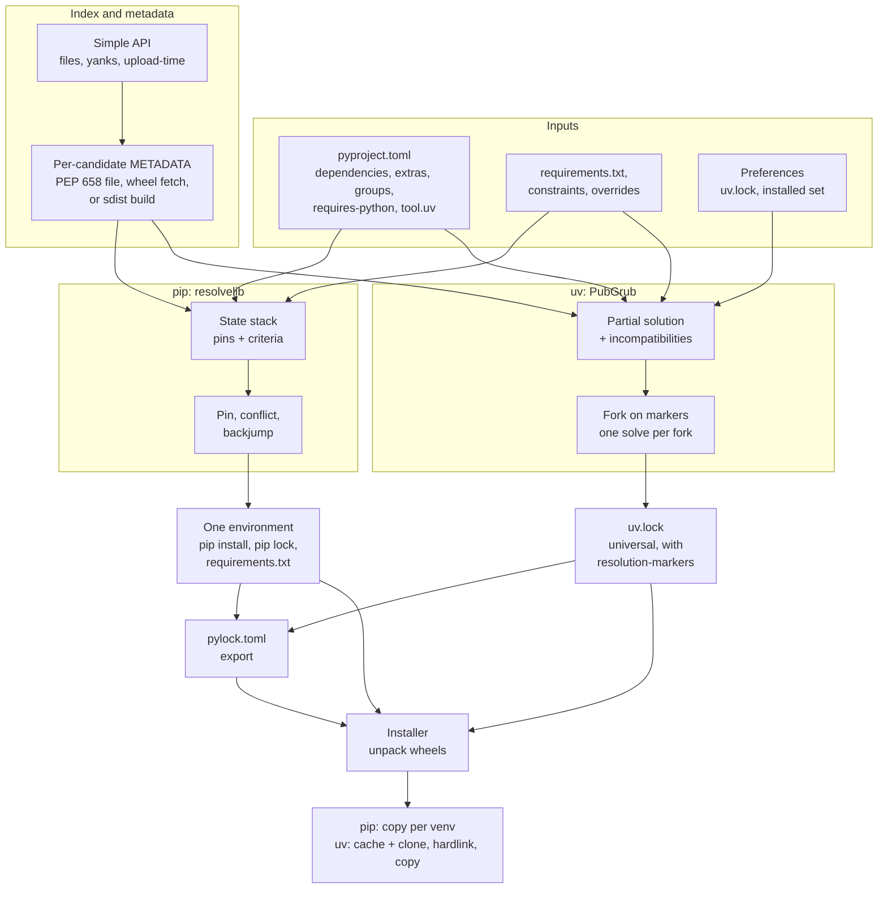

# Python Dependency Resolution: pip, uv, and PEP 751 Lockfiles

> [!summary] Claim:
> Python allows one version of a project per environment, so resolution means choosing a version for every reachable name under version ranges, environment markers, `Requires-Python`, extras, and wheel availability.
> pip solves that for the interpreter it runs on, with resolvelib's backtracking and backjumping, and installs in the same command.
> uv solves it with PubGrub, learns incompatibilities, forks on markers to produce one universal `uv.lock`, and then installs from a hardlink or clone cache.
> PEP 751's `pylock.toml` is the tool-neutral output: a flat, hash-pinned list that an installer follows with no resolver at all.
> An expert knows which tool decided which version, why a lock is or is not portable, and what a lock does not pin.



## The Mechanism

### 1. What Python adds to the resolution problem

[[Dependency-Resolution-SAT-PubGrub-and-MVS]] owns the general problem and the PubGrub algorithm.
This note owns what Python feeds into it and how pip and uv differ.

A project name is normalized (PEP 503), a version follows PEP 440, and a requirement is a specifier plus an optional environment marker (PEP 508).
Five facts make the Python problem different from the textbook one:
1. **One version per environment.**
   Two versions of `core` cannot coexist in one `site-packages`, so a conflict between `core>=3` and `core<3` is fatal for that environment.
   Cargo, by contrast, can keep SemVer-incompatible versions of a crate in one graph, and it backtracks rather than select multiple versions that could have been unified (Cargo Book, "Dependency Resolution").
2. **Markers make the graph depend on the machine.**
   `fk>=2 ; python_version >= "3.11"` and `fk<2 ; python_version < "3.11"` are two different graphs.
   A resolver either solves one environment (pip) or solves the whole marker space (uv's universal mode).
3. **`Requires-Python` is a constraint on the environment, not on a package.**
   pip models it as a pseudo-requirement named `Requires-Python` and always selects it alone first (see below).
   uv ignores upper bounds on it and forks instead.
4. **Metadata costs I/O.**
   To learn a candidate's dependencies the resolver needs its `METADATA`, which is a small file on a wheel, but may require running a build backend on an sdist.
5. **Candidates are files, not versions.**
   One version can have dozens of wheels and an sdist, and the installable subset depends on tags.
   numpy 2.3.2 has 73 wheels, per the uv resolver documentation.

How each tool gets `METADATA` for a candidate, in the order pip 26.2.2 tries (`operations/prepare.py`, `_fetch_metadata_only`):
1. If `--require-hashes` is on, skip metadata-only fetching, because the whole file must be downloaded to be hashed anyway.
2. Use the PEP 658 sidecar `.metadata` file that the index advertises, which avoids downloading the wheel.
3. Only with `--use-feature=fast-deps`, read the metadata from a remote wheel with HTTP range requests (the code comment says "--use-feature=fast-deps must be provided").
4. Otherwise download the wheel, or build the sdist, and read `METADATA` from the result.

pip 22.3 (2022-10-15) first used the PEP 658 attribute; pip 25.3 (2025-10-24) stopped downloading full distribution files for `pip lock` and `pip install --dry-run` when PEP 658 metadata exists (pip release notes).
uv makes the same bet with a stronger assumption, covered under "Metadata consistency" below.

### 2. pip: resolvelib backtracking

pip's resolver is resolvelib (vendored at 1.2.1 in pip 26.2.2, `_vendor/vendor.txt`) driven by a `PipProvider`.
resolvelib was vendored in pip 20.1 (2020-04-28), shipped as the opt-in `--use-feature=2020-resolver` beta in 20.2 (2020-07-29), and the docs mark backtracking as "Changed in version 20.3" (2020-11-30), when it replaced the old first-found-wins behavior.

#### Data model

resolvelib keeps a stack of `State` objects, each holding:
- `mapping`: an ordered dict from identifier to the pinned candidate (insertion order is pin order).
- `criteria`: for each identifier, a `Criterion` with a lazy iterator of candidates, a list of `(requirement, parent)` pairs saying why the name is needed, and a list of known-incompatible candidates.
- `backtrack_causes`: the requirement information from the last failure.

The provider supplies the policy: `identify`, `get_preference`, `narrow_requirement_selection`, `find_matches`, `is_satisfied_by`, and `get_dependencies`.
pip's identifiers are normalized names, names with extras such as `pkg[extra]`, and the `Requires-Python` pseudo-name.

#### One round

Each loop iteration in `Resolution.resolve` does the following, bounded by `max_rounds` (200,000 in pip 26.2.2, the local variable `limit_how_complex_resolution_can_be`):
1. Compute the unsatisfied names: criteria whose current pin is missing or fails some requirement.
2. If none, return the state: resolution is done.
3. Ask the provider to narrow the set (`narrow_requirement_selection`), then take the minimum by `get_preference`.
4. `_attempt_to_pin_criterion`: walk that name's candidates in provider order; for each, add its dependencies to a copy of the criteria; if some dependency's candidate set becomes empty (`RequirementsConflicted`), record the cause and try the next candidate; the first candidate that survives is pinned.
5. If no candidate survives, extract the causes and call `_backjump`.
6. On success, discard information contributed by pins that are no longer valid, then push a fresh state.

When the loop runs out of rounds, resolvelib raises `ResolutionTooDeep`, which pip reports as `ResolutionTooDeepError`.
The pip docs tell users to raise lower bounds, use `--upgrade`, add constraint files, and report the case to the pip issue tracker.

#### Which name to decide next

`get_preference` returns a tuple, and the smallest wins (pip 26.2.2, `provider.py`):

| Position | Key | Meaning |
|---|---|---|
| 1 | `not conflict_promoted` | Names promoted after repeated conflicts come first. |
| 2 | `not direct` | Requirements that are direct URLs. |
| 3 | `not pinned` | `==` without a wildcard, or `===`. |
| 4 | `not upper_bounded` | `<`, `<=`, `~=`, or `==` with a wildcard; the source comment explains that preferring upper bounds prunes infeasible candidates sooner while "this does not imply that upper bounds are good practice". |
| 5 | `requested_order` | The order the user typed requirements; others come after. |
| 6 | `not unfree` | Names with any operator come before bare names. |
| 7 | `identifier` | Alphabetical, for determinism. |

`narrow_requirement_selection` runs before the preference:
- `Requires-Python`, when present, is returned alone.
- Names in the current `backtrack_causes` come next, found in linear time.
- A name that appears as not-yet-pinned in conflicts `_CONFLICT_PRIORITY_THRESHOLD = 5` times is promoted and resolved earlier, so its constraints bind before other names choose versions.

uv's documentation describes the same idea, "once we see such conflict happen five time" (sic), so both tools independently settled on a five-conflict reordering heuristic (as of 2026-11, pip 26.2.2 source and uv 0.13.9 docs).

#### Which candidate to try first

`find_matches` returns candidates in preference order, and the installed distribution leads when `prefers_installed` is true.
That is the case unless the upgrade strategy makes the name eligible for upgrade (`provider.py`, `_eligible_for_upgrade`).
Without `--upgrade` the strategy is `to-satisfy-only` and the installed version always leads; with `--upgrade`, `eager` upgrades everything, and the default `only-if-needed` upgrades only the names the user typed.
Among index files, `PackageFinder._sort_key` sorts by this tuple, greater is better:
1. A file whose hash is allowed (matters with `--require-hashes`).
2. Not yanked (PEP 592).
3. Binary preference, set only with `--prefer-binary`.
4. Version.
5. Wheel tag priority from the interpreter's ordered `sys_tags()` list, with sdists lowest (see [[Python-Wheels-Platform-Tags-Manylinux-and-ABI3]]).
6. Build tag.

Candidates are built lazily (`found_candidates.py`: "Creating and visiting a candidate is a *very* costly operation"), so backtracking to the 40th version of a package pays for 40 metadata reads, not for the whole index.
A candidate whose metadata is invalid or inconsistent is skipped with an info-level log line, "Discarding <link>: Requested <req> has invalid metadata: <error>" (pip 26.2.2, `factory.py` and `exceptions.py`, `MetadataInvalid`).

#### Backjumping

On failure, `_backjump` removes the state that failed, then pops pins until it finds one worth changing.
Its docstring lays out the steps: discard the failing state Z, discard the state Y that made the last pin while remembering its incompatibilities, push a new Y' from the earlier state X, and apply what Y learned.
resolvelib has two modes:
- **Safe backjumping** stops at the most recent pin that is not itself one of the incompatible names, which is chronological backtracking with a skip.
- **Optimistic backjumping** (on by default, `_OPTIMISTIC_BACKJUMPING_RATIO = 0.1`) keeps popping until it finds a pin whose candidate's dependencies overlap the incompatible names, which is the likely culprit.
  It first saves the whole state stack.
  If the optimistic attempt fails, or runs for more than `int((max_rounds - start_round) * 0.1)` rounds, resolvelib restores the saved states and turns the optimism off.

What pip records is a list of incompatible candidates per name.
It does not derive new clauses over several packages, which is the difference from PubGrub described next, and the reason pip's error message names only the last conflicting requirements.

#### Scope: one environment

pip resolves for the interpreter running it: markers are evaluated against that environment, `Requires-Python` is checked against its version, and wheel tags come from it.
`pip lock` (experimental, added in 25.1, 2025-04-26) writes the result as `pylock.toml`, and its help text says "The generated lock file is only guaranteed to be valid for the current python version and platform."
pip has constraint files (`-c`) but no override mechanism: `pip install --help` in 26.2.2 has no such option, and a constraint can only narrow what a requirement allows.

### 3. uv: PubGrub with learned incompatibilities

uv uses pubgrub-rs, the Rust implementation of PubGrub, which the uv resolver documentation describes as "an incremental version solver".
The first line of that document concedes the textbook point: resolution is equivalent to SAT and NP-complete, but "the slowest part of resolution in uv is loading package and version metadata, even if it's cached", and for most resolutions "the resolver doesn't need to backtrack".

The loop, per the uv documentation:
1. Start with a partial solution containing only a virtual root.
2. Pick the highest-priority undecided package.
3. Pick a version consistent with every specifier in the partial solution and not marked incompatible, checking from the highest down, preferring versions in `uv.lock` or the installed environment.
4. Add that version's requirements to the undecided set, and prefetch their metadata in the background.
5. On conflict, derive an incompatibility (the doc's example: `{a 2, b 2}`), restore the partial solution to a state that excludes it, and continue.
6. Finish with a full solution, or with an incompatibility that includes the root, from which uv builds the error message.

uv models each name as several virtual packages internally: one per activated extra, per dependency group, and per marker, so the solver works on a finer graph than the user's names.

#### Prioritization

The uv docs give the order: the root and URL requirements first, then singleton `==` requirements, then "highly conflicting" packages, then everything else; within each class, in order of first encounter, which makes the search breadth first and prefers direct and workspace dependencies over transitive ones.
The conflict rule: when package A is decided first and every version of B fails against the latest A, "once we see such conflict happen five time", uv marks both as highly conflicting, orders B before A, and manually backtracks to before A was decided.
Without it, B would be tried version by version until uv exhausted the range (slow), chose an ancient version that does not depend on A (wrong in practice), or failed to build an old sdist.

#### Version choice and strategies

By default uv chooses the highest compatible version and prefers locked or installed versions.
`--resolution lowest` picks the lowest for everything, `lowest-direct` the lowest only for direct dependencies, and build dependencies always use the latest.
Pre-releases follow `--prerelease if-necessary` by default: stable versions are preferred, and pre-releases are used only after every stable candidate has been rejected, with `allow`, `disallow`, and `explicit` as alternatives, per package via `--prerelease-package`.

#### The trace that shows the difference

Both tools get the same input, `app` with `liba` and `libb`, where `liba 3.0` needs `core>=3` and every `libb` needs `core<3` (the full setup is in the worked example).
pip pinned `liba-3.0`, then `core-3.0`, and only then, in round 3, rejected `libb-2.0` and `libb-1.0` against the pinned `core`.
uv rejected `libb==2.0` straight after reading its dependency, by unit propagation, before any version of `core` was chosen.
After the conflicts, uv did not simply retry: it recorded incompatibilities, reprioritized `libb` ("has too many conflicts (affected), prioritizing"), and narrowed the next search to `Searching for a compatible version of liba (<=2.0)`.
That narrowed range is a learned fact, "liba 3 cannot go with any libb", applied without revisiting `libb 2.0`.
pip's equivalent record is only "this candidate failed under the earlier pins".

### 4. Universal resolution and forking

uv resolves per environment only in its pip interface (`uv pip compile`, which "is platform-specific, like pip-tools").
The project interface (`uv lock`, `uv sync`, `uv add`, `uv run`) is always universal, and "there is no way to use platform-specific resolution in uv's project interface".

When uv sees several requirements on one package with different markers, it splits.
For `numpy>=2,<3 ; python_version >= "3.11"` and `numpy>=1.16,<2 ; python_version < "3.11"` it solves two resolutions.
If markers overlap or leave gaps, it splits further: for `flask > 1 ; sys_platform == 'darwin'`, `flask > 2 ; sys_platform == 'win32'`, and bare `flask`, the forks are darwin, win32, and "neither".
Forks nest, and forks that produce identical packages are merged to keep the count low.
`uv lock -v` shows `Splitting resolution on ...`, `Solving split ...`, and `Split ... resolution took ...`.

Fork points depend on the order uv sees packages, which depends on preferences, which come from the existing lockfile.
Left alone, that could make a re-lock choose a different fork boundary than the lock it started from.
uv therefore writes the `resolution-markers` of each fork, and of each package that diverges between forks, into `uv.lock`, and reuses them on the next resolution (new forks may be added).

#### `requires-python`

For `requires-python = ">=3.9"`, every selected dependency version must itself allow 3.9, otherwise the result would not install on 3.9: "the project's requires-python must be a subset of the requires-python of all its dependencies."
When uv rejects a version because it needs a newer Python, it forks on that Python version.
Upper bounds on a dependency's `Requires-Python` are ignored (`>=3.8,<4` is treated as `>=3.8`), because honoring them makes resolvers back-track to the first release that omitted the bound, which is formally right and practically wrong.
The exception is a project that itself sets an upper bound, such as `==3.13.*`, where uv prunes out-of-range wheels from the lock after resolution, without changing the resolution.
Workspaces use one `requires-python`, the intersection of all members'.

#### Wheel tags are not universal

Markers are universal; tags are not.
A `cp312-cp312-manylinux2014_aarch64` wheel works only on one interpreter, OS, and architecture, and markers cannot express the glibc part of a tag.
So uv by default requires, for a package that has no sdist, at least one wheel compatible with the target Python.
Three knobs shape that:
- `environments = [...]` limits the marker space that is solved; entries must be disjoint.
- `required-environments = [...]` expands what must be installable, and fails resolution (or backtracks past the newest release) if a wheel-only package lacks a wheel for that environment.
  Use `==` for `platform_release` rather than `>=`, because a wheel for a newer macOS can satisfy the range while leaving the baseline uncovered.
- `minimum-libc-version = { glibc = "2.31" }` is a preview feature: with it, a `manylinux_2_17` wheel satisfies glibc 2.31 and a `manylinux_2_34` wheel does not, though both stay in the lock.

For local versions such as `1.2.3+cu130`, uv forks to combine a tagged version for platforms it covers with the base version for the rest.

#### Metadata consistency

uv assumes that all wheels of one version in one index have the same `Requires-Dist`, and that an sdist builds to the same metadata each time.
Without that assumption numpy 2.3.2 would need 73 metadata fetches instead of one.
The documentation explains the second half with an example: if the build at lock time yields `B>=2,<3` and the build at install time yields `B>=3,<4` and `C`, the lock cannot install, and re-resolving would defeat the lock and add an unreviewed package.
The standards do not require consistency, and a request to require it was rejected on discuss.python.org, so uv documents it as an assumption, not a guarantee.
`tool.uv.dependency-metadata` lets a project supply `requires-dist` for a package that cannot be built everywhere.

#### Conflicts that cannot be forked

uv resolves the project dependencies, all extras, and all dependency groups together, so two extras that pin different `numpy` versions fail to lock.
`[tool.uv] conflicts = [[{ extra = "extra1" }, { extra = "extra2" }]]` declares them mutually exclusive, so uv resolves them separately; `uv sync --extra extra1 --extra extra2` then errors, because installing both would put two versions in one environment.
The same works for dependency groups and across workspace members with the `package` key.

### 5. Lockfiles: uv.lock and pylock.toml

[[Lockfiles-Vendoring-and-Offline-Mirrors]] owns the general theory of lockfiles and hashes; this section covers the two Python formats and how they interoperate.

#### uv.lock

`uv.lock` is TOML next to `pyproject.toml`, "human-readable" but "managed by uv and should not be edited manually", and "specific to uv and not usable by other tools" (uv layout docs).
Recorded on uv 0.13.9 (as of 2026-11, macOS): the file starts with `version = 1` and `revision = 5`.
The documentation's rules: any uv can read the same schema `version` and rejects a greater one; `version` is bumped only in minor releases; `revision` tracks backward-compatible additions and does not make older uv fail.

Each `[[package]]` records name, version, `source` (registry URL, path, git commit, or virtual), `dependencies` with markers, an optional `sdist`, and `wheels`, each with `url`, `hash`, `size`, and `upload-time`.
A lock of one real package, `markupsafe>=3` with `requires-python = ">=3.11"`, resolved against PyPI on 2026-11-21 (uv 0.13.9), contained 1 sdist and 120 wheel entries and was about 39.8 kB (39,846 bytes; an independent re-run the same day, with a different project name, gave 39,840 bytes and the same 1 sdist and 120 wheels).
The wheel list dominates because uv locks every wheel that could serve some environment, so the file works on platforms the author never touched.
That count is a snapshot and grows as the project publishes wheels for new Python versions.

#### When is a lock stale

The docs define up-to-date as "matches the project metadata":
- Adding a dependency makes it outdated.
- Changing a constraint so that the locked version is excluded makes it outdated.
- Changing a constraint so that the locked version is still allowed does not.
- A new upstream release never does. "uv will not consider lockfiles outdated when new versions of packages are released".

`uv lock --check` (equivalently `--locked` on other commands) fails if the lock needs an update, `--frozen` uses the lock with no check, and `--no-sync` skips environment checks.
`uv lock --upgrade` and `--upgrade-package <name>[==<ver>]` move versions, within the project's constraints.
With an existing lock, uv prefers locked versions, which is why `uv lock` after a small edit changes only what the edit forces.

#### pylock.toml

PEP 751 (Final, resolution 2025-03-31) replaced the rejected PEP 665 and is now maintained as the pylock.toml specification, last amended March 2026 to clarify file-name precedence for archives, sdists, and wheels.
The PEP's stated aims: human-auditable, installable with no resolver, consumable by tools not written in Python, and secure by default.

**File name.** `pylock.toml`, or `pylock.<name>.toml` matching `^pylock\.([^.]+)\.toml$`.
A service named `spam` should look for `pylock.spam.toml`, then a multi-use `pylock.toml` with a dependency group `spam`, then the default install of `pylock.toml`.

**Top-level keys.**

| Key | Required | Meaning |
|---|---|---|
| `lock-version` | yes | The string `"1.0"`. An unknown major version MUST be an error. |
| `created-by` | yes | Tool that wrote the file. |
| `[[packages]]` | yes | Every package that may be installed, possibly several entries per name. |
| `environments` | no | PEP 508 markers the lock is compatible with; SHOULD be non-overlapping. |
| `requires-python` | no | Minimum Python for any supported environment. |
| `extras`, `dependency-groups`, `default-groups` | no | What a multi-use lock supports; an empty array signals "no extras" explicitly. |
| `[tool]` | no | Disposable tool data that MUST NOT affect installation. |

**Per package.** `name` is required; `version` SHOULD be present when an sdist or wheels are given and MUST NOT be present for a source tree, whose version cannot be guaranteed.
`marker` selects when to install; `requires-python` must hold or the installer MUST error; `dependencies` is informational and installers "MUST NOT use this information when doing installation".
The source is exactly one of `vcs` (with a required `commit-id`), `directory`, `archive`, or the pair `sdist` and `wheels`; the first three are direct-URL origins.
`archive`, `sdist`, and each wheel need a `hashes` table with at least one entry, SHOULD include an algorithm from `hashlib.algorithms_guaranteed` (sha256 is the one the spec recommends), and may carry `size` and `upload-time` (UTC).
`index` records the Simple API base URL "to assist with generating software bill of materials" and to find a file if a URL dies.
`[[packages.attestation-identities]]` records trusted-publisher identities (see [[Python-Trusted-Publishing-and-PEP-740-Attestations]]).

**Marker additions.** PEP 751 adds two set-valued markers, `extras` and `dependency_groups`, valid only inside lock files, and set operations such as `'extra-1' in extras and 'extra-2' not in extras`.
That is how one file expresses "install this only for the `docs` group".

**The installer's job.** The spec's steps: pick extras and groups (default groups from `default-groups`); check `lock-version`; check `requires-python`; check at least one `environments` marker holds; for each package, skip it if its `marker` is false, enforce its `requires-python`, require that exactly one entry per name remains, and require a single well-formed source; then fetch, verify size and hashes, build if needed, install.
Wheel selection must be decidable offline: tools "MUST NOT try to change what wheel file to download based on what's available".
If the recorded URL is dead, a tool MAY fall back to `index` or a tool-specific mechanism.

**What PEP 751 deliberately omits.** Its rejected-ideas section records why: no dependency graph (audit cost over benefit), no installer-side resolution (it would defeat auditing and put the complexity in installers), no hash or timestamp of the file itself (every merge would change it and produce conflicts), and no locking of sdist build requirements, which "confused enough people" and was left for a future PEP.
It does not replace requirements files wholesale either: they carry install options, can include other files, and can use environment variables, which pylock does not.
The Security Implications section states that tampering with an unreviewed lock, and typosquatting, are out of scope.

#### Who implements what

| Capability | uv | pip |
|---|---|---|
| Write `pylock.toml` | `uv export --format pylock.toml`, `uv pip compile -o pylock.toml` | `pip lock` (experimental since 25.1, 2025-04-26) |
| Install from it | `uv pip install -r pylock.toml`, `uv pip sync pylock.toml` | `pip install -r pylock.toml` (experimental since 26.1, 2026-04-26) |
| Extras and groups from a lock | `uv pip install -r pylock.toml --extra x --group docs` (uv 0.13.9, tested 2026-11-21 on a lock with `'x' in extras` and `'docs' in dependency_groups` markers; `--group` takes a bare name, and a `path:` prefix must end in `pyproject.toml`) | `-r pylock.toml[extra1,extra2]` and `--group pylock.toml:docs` since 26.3 (2026-11-02) |
| Native project lock | `uv.lock`, which stays the format because some uv features "cannot be expressed in the pylock.toml format" | none; `pip lock` is one-shot |
| Universal across platforms | yes in `uv.lock`; exported with `marker` per package and `requires-python` | no; "only guaranteed to be valid for the current python version and platform" |

uv has accepted `pylock.toml` since 0.7.0 (2025-04-29), where it started rejecting arbitrary `.toml` files passed as requirements, and 0.13.2 (2026-10-19) added supported-environment restrictions to the export.
Each tool tightened validation over many releases (`requires-python`, `lock-version`, duplicate entries, file-name rules in 0.12), which is what an emerging standard looks like in practice.

### 6. Caches and installation

#### pip

pip's cache is on by default and has two parts: an HTTP response cache, which since pip 23.3 lives in `http-v2`, and a cache of wheels pip built locally.
The docs state that the exact layout "is considered to be an implementation detail".
Default location on macOS is `~/Library/Caches/pip`, and since 26.2 pip also respects `XDG_CACHE_HOME` there.
Installing a wheel unpacks it into the target environment, so ten virtual environments hold ten copies of the same files; `pip install --help` in 26.2.2 lists no link, hardlink, or clone option.

#### uv

uv's cache is a set of versioned buckets.
The documentation lists buckets for wheels, source distributions, and Git repositories, and says "if a release contains a breaking change to the cache format, uv will not attempt to read from or write to an incompatible cache bucket", so several uv versions can share a directory.
This host's `~/.cache/uv` (as of 2026-11-21, macOS, written by several uv releases including 0.11.26 and 0.13.9) shows it: `simple-v21`, `simple-v25`, and `simple-v28`; `wheels-v6` and `wheels-v8`; `sdists-v9` and `sdists-v11`; `interpreter-v4` and `interpreter-v5`; plus `archive-v0`, `builds-v0`, and `environments-v2`.
`simple-v28` and `wheels-v8` were created on 2026-11-21 by the first networked uv 0.13.9 run, so 0.13.9 writes its own bucket versions next to the older ones rather than reusing them.
In `wheels-v6/pypi/<name>/`, each `<version>-<tag>` entry is a symlink to `../../../archive-v0/<id>`, the unpacked wheel, next to `.http` and `.msgpack` sidecar files for HTTP revalidation, and `simple-v<N>/pypi/<name>.rkyv` holds the Simple API response.
These names are observations of internals, not an interface, and uv's own docs say nothing about them beyond "buckets".

How uv decides a cache entry is fresh depends on the source:
- Registry files follow HTTP caching headers.
- Direct URLs use headers and the URL.
- Git dependencies key on the resolved commit hash.
- Local files key on modification time; a directory keys on the modification time of `pyproject.toml`, `setup.py`, or `setup.cfg`.
- A `--find-links` directory is assumed immutable, so rebuilding a wheel under the same name is not noticed until `--refresh`.
- `tool.uv.cache-keys` replaces the default keys for dynamic metadata (`file`, `git`, `env`, `dir` keys), and `tool.uv.reinstall-package` is the escape hatch.

Concurrency is handled by a lock on the cache and a file lock on each target environment: "It's safe to run multiple uv commands concurrently, even against the same virtual environment."
Cache-modifying commands wait up to 5 minutes for other uv processes (`UV_LOCK_TIMEOUT`), and the docs warn that modifying the cache by hand is never safe.

#### Link modes

`link-mode` selects how a package goes from the cache into an environment: `clone`, `hardlink`, `copy`, or `symlink`.
The settings reference gives the default as `clone` on macOS and Linux and `hardlink` on Windows (as of 2026-11).
One page disagrees: uv's `BENCHMARKS.md` still says "uv uses reflinking on macOS, and hardlinking on Linux", which the settings reference supersedes.

Evidence from this host (macOS 27.3 arm64, APFS, uv 0.13.9, a 100 MiB payload installed into three environments per mode, one cache per mode on the same volume):

| `--link-mode` | Payload inode, env 1 vs env 2 | Link count in env 1 |
|---|---|---|
| `clone` | different | 1 |
| `hardlink` | same | 4 (cache plus 3 environments) |
| `copy` | different | 1 |

An inode difference alone does not prove a clone shares blocks: `clone` and `copy` look identical in this table.
The uv documentation describes clones as copy-on-write, and its `cache-physical-space` preview feature accounts for clones and hardlinks in cache-cleanup estimates, but this note did not measure physical sharing.
Free-space deltas on this volume were too noisy to report: in an earlier run of the same experiment they ranged from a 125 MiB gain to a 243 MiB loss across the three modes.

Practical consequences:
- `hardlink` means one file with several names: if something edits a file inside one environment, every environment and the cache see the change.
  Clone and copy do not have that failure.
- Linking works only within one file system; "For best performance, locate the cache directory on the same file system as the Python environment", else uv falls back to copying.
- On CI, `uv cache prune --ci` deletes pre-built wheels and unpacked sdists but keeps wheels built from source, because re-downloading pre-built wheels is often faster than restoring them from a CI cache, while compiling is not.

#### Install planning

`uv sync` is exact by default and removes packages not selected; `uv run` is inexact.
Partial syncs (`--no-install-project`, `--no-install-workspace`, `--no-install-package`) exist for Docker layer caching, and the docs warn that they can leave an environment broken.
`uv sync` also installs the project and workspace members as editable.

### 7. Indexes, trust, and reproducibility knobs

- **Multiple indexes.**
  uv's default `index-strategy = "first-index"` stops at the first index that has the package name and limits candidates to that index, which the uv documentation says prevents "dependency confusion" attacks.
  `unsafe-first-match` and `unsafe-best-match` relax it, and the latter "is the closest to pip's behavior".
  pip merges candidates from `--index-url` and every `--extra-index-url`.
- **Time-based reproducibility.**
  uv's `exclude-newer` compares the upload time of each file, from PEP 700's `upload-time`, with a cutoff, and treats a file without that field as unavailable unless the package or index is opted out.
  Messages for unsatisfiable results deliberately never mention the cutoff.
  A duration such as `"1 week"` makes a dependency cooldown, resolved to a timestamp at lock time and stored in `uv.lock`.
  pip has `--uploaded-prior-to` (26.0, 2026-01-30), which accepts durations in days such as `P3D` since 26.1 and is also gated on `upload-time`.
- **Overrides versus constraints.**
  A constraint only narrows.
  A uv override, `tool.uv.override-dependencies`, replaces every declared requirement on that name (and can be scoped to one package version), so it can widen a bad upper bound.
  `exclude-dependencies` removes a package from the graph, and when the same name is both overridden and excluded in one scope the exclusion wins.
- **Yanked files.**
  pip sorts yanked files below others and, per its 20.3.2 notes (2020-12-15), does not return yanked versions "unless the version range can only be satisfied by yanked candidates".
  uv documents that an exact yanked-version pin in a scoped override opts that package into yanked-version selection.

### 8. Benchmarks: what the sources establish

The uv README says "10-100x faster than pip" and links `BENCHMARKS.md`.
That file benchmarks Trio's `docs-requirements.in` on macOS with Python 3.12.4 for the non-uv tools, in four scenarios (warm and cold, resolution and installation), as bar charts with no numbers in the text, and it warns that results "may vary dramatically across different operating systems and filesystems" and with the package set.
The charts come with a reproduction recipe built on `hyperfine`.
This note ran no benchmark: the offline demo resolves four packages in single-digit milliseconds, which measures process start-up.

The mechanisms, separated into documented and inferred:
- Documented: metadata loading dominates resolution time; metadata is prefetched in the background; with preferences from a lock, "barely any work needs to be done"; installs use cloning or hardlinks from a global cache; the Simple API cache is stored in a binary format (`.rkyv` files, observed).
- Not established: neither project publishes a breakdown of the speed gap by cause, so this note attributes it to no single one.
  Measure before attributing a gap to any one cause.

To measure your own case, compare cold and warm separately with `hyperfine`, once for resolution with no lock and once for install from a lock, on the file system you ship on, and report the package set.

## Commands and Numbers to Know

| Item | Value | Platform | Notes |
|---|---|---|---|
| pip resolver round limit | 200,000 rounds (as of 2026-11) | Both | pip 26.2.2 `resolver.py`; then `ResolutionTooDeepError`. |
| pip conflict promotion | 5 conflicts (as of 2026-11) | Both | `_CONFLICT_PRIORITY_THRESHOLD` in `provider.py`. |
| resolvelib optimistic backjumping | ratio 0.1 (as of 2026-11) | Both | resolvelib 1.2.1 `_OPTIMISTIC_BACKJUMPING_RATIO`; falls back after `(max_rounds - round) * 0.1` rounds. |
| `PIP_RESOLVER_DEBUG=1` | prints `Reporter.pinning`, `rejecting_candidate`, rounds (as of 2026-11) | Both | The trace in the worked example; pip checks only that the variable is set (`resolver.py`). |
| pip upgrade strategy | `only-if-needed` default, `eager` optional (as of 2026-11) | Both | `--upgrade-strategy`. |
| pip metadata fetch order | PEP 658 file, then `fast-deps` range reads, then full download (as of 2026-11) | Both | Skipped under `--require-hashes`. |
| `pip lock` | experimental, one environment, default `pylock.toml` (as of 2026-11) | Both | `-o -` writes to stdout; added 25.1. |
| `pip install -r pylock.toml` | experimental since 26.1; extras and groups since 26.3 (as of 2026-11) | Both | `-r pylock.toml[extra]`, `--group pylock.toml:docs`. |
| pip cache | `~/Library/Caches/pip` on macOS, `~/.cache/pip` on Linux (as of 2026-11) | Both | `pip cache dir`; layout is an implementation detail; `http-v2` since 23.3. |
| `uv lock` | universal, writes `uv.lock` (as of 2026-11) | Both | Schema `version = 1`, `revision = 5` on uv 0.13.9. |
| `uv lock --check` or `--locked` | exits 1 with "needs to be updated" when stale (as of 2026-11) | Both | `--frozen` skips the check. |
| `uv lock --upgrade-package pkg` | move one package within its constraints (as of 2026-11) | Both | `--upgrade` moves all. |
| `uv pip compile --universal` | markers in requirements output (as of 2026-11) | Both | Default `uv pip compile` is one platform. |
| `uv pip compile --python-platform P --python-version V` | solve for another target (as of 2026-11) | Both | `V` is exact, not a lower bound, in this mode. |
| `uv export --format pylock.toml` | also `requirements.txt`, `cyclonedx1.5` (preview) (as of 2026-11) | Both | `-o` writes a file; local paths are relative to it. |
| uv highly-conflicting rule | 5 conflicts (as of 2026-11) | Both | Documented in the resolver internals page. |
| `tool.uv.environments` | disjoint PEP 508 markers (as of 2026-11) | Both | Shrinks the solved space. |
| `tool.uv.required-environments` | markers that wheel-only packages must cover (as of 2026-11) | Both | Use `==` for `platform_release`. |
| `minimum-libc-version` | preview; `{ glibc = "2.31" }` (as of 2026-11) | Linux | Needs `required-environments`. |
| `tool.uv.conflicts` | declare exclusive extras or groups (as of 2026-11) | Both | `uv sync` of both then errors. |
| `exclude-newer` | RFC 3339 date, or a duration such as `1 week` (as of 2026-11) | Both | Needs PEP 700 `upload-time`; stored in `uv.lock`. |
| `link-mode` default | `clone` on macOS and Linux, `hardlink` on Windows (as of 2026-11) | Both | Settings reference; `UV_LINK_MODE`. |
| `uv cache prune --ci` | drops pre-built wheels and unpacked sdists, keeps built wheels (as of 2026-11) | Both | Run at the end of a CI job. |
| `UV_LOCK_TIMEOUT` | 5 minutes for cache-modifying commands (as of 2026-11) | Both | `--force` ignores the lock. |
| `index-strategy` | `first-index` default (as of 2026-11) | Both | Guards against dependency confusion. |
| Latest releases | pip 26.3 (2026-11-02), uv 0.13.9 (2026-11-17), resolvelib 1.2.1 (2025-10-11), packaging 26.3 (as of 2026-11) | Both | From PyPI JSON; this note's source reading used pip 26.2.2. |
| pylock.toml `lock-version` | `"1.0"` (as of 2026-11) | Both | PEP 751 resolution 2025-03-31. |
| markupsafe 3.0.4 universal lock | 1 sdist plus 120 wheels, about 39.8 kB (as of 2026-11-21) | macOS | Measured, uv 0.13.9, `requires-python = ">=3.11"`. |

## Multi-Language Comparison

| Concern | Python (pip) | Python (uv) | Rust (Cargo) | C++ (Conan 2, vcpkg) |
|---|---|---|---|---|
| Algorithm | resolvelib backtracking and backjumping | PubGrub, forking | Backtracking resolver with version unification | See [[Cpp-Conan-2-Architecture-and-Binary-Model]] and [[Cpp-vcpkg-Manifests-Registries-and-Binary-Caching]] |
| Versions per package in one build | one | one | several, if SemVer-incompatible | package-manager specific |
| Platform scope of the result | current interpreter | all markers, one lock | one `Cargo.lock` for all targets | Conan: per profile; vcpkg: per registry baseline |
| Native lock | none; `pip lock` is one-shot | `uv.lock` | `Cargo.lock` | `conan.lock`, vcpkg baseline |
| Standard lock | `pylock.toml` (experimental) | `pylock.toml` export and install | none | none |
| Learned conflicts | per-candidate incompatibilities | PubGrub incompatibilities | not applicable | Conan reports a version conflict as an error; vcpkg uses overrides |
| Binary choice | wheel tag ranking inside the resolver | wheel tags after the marker resolution | built from source | binary model keyed by settings |
| Install store | unpack into each environment | global cache, clone or hardlink | shared Cargo home (`registry/cache`, `registry/src`); build output in `target/` | Conan package store or vcpkg binary cache |

The two Python tools differ most on scope (one environment versus the marker space) and on conflict learning.
The Cargo column was checked against the Cargo Book: the resolver page says platform-specific dependencies "are resolved as-if all platforms are enabled" (so one `Cargo.lock` covers all targets), the Cargo home page puts downloaded `.crate` files in `registry/cache` and unpacked sources in `registry/src`, and the build cache page puts build output in a `target` directory at the workspace root by default.
The C++ column was checked against the Conan 2 tutorials (lockfiles and "Dependencies conflicts", where a dependency version conflict is reported as an error), the vcpkg versioning page (a per-registry baseline), and the vcpkg binary caching reference.
The detail behind those cells lives in the two sibling notes linked in the table.
For SemVer, ABI, and why one version per environment bites native extensions, see [[Versioning-SemVer-CalVer-and-ABI]] and [[Diamond-Dependency-and-Incompatible-ABI-Mitigation]].

## Worked Lab Example

Lab: none.
This note has no `code/` lab.
The transcript below comes from an offline demo run once on 2026-11-21 on macOS 27.3 arm64, with pip 26.2.2 (CPython 3.15.2, Homebrew), uv 0.13.9 (solving with managed CPython 3.14.6), and no network, using a directory of twelve tiny wheels.
The wheel builder is below so that you can reproduce it; save it as `make_wheels.py`.

```python
import base64, hashlib, sys, zipfile
from pathlib import Path

# name -> version -> (Requires-Dist lines, Requires-Python or None)
INDEX = {
    "core": {"1.0": ([], None), "2.0": ([], None), "3.0": ([], None)},
    "liba": {"1.0": (["core<2"], None), "2.0": (["core>=2,<3"], None), "3.0": (["core>=3"], None)},
    "libb": {"1.0": (["core<2"], None), "2.0": (["core<3"], None)},
    "app": {"1.0": (["liba", "libb"], None)},
    "fk": {"1.0": ([], ">=3.9"), "2.0": ([], ">=3.11")},
    "forkapp": {"1.0": (['fk>=2 ; python_version >= "3.11"', 'fk<2 ; python_version < "3.11"'], None)},
}

def b64(d): return base64.urlsafe_b64encode(d).rstrip(b"=").decode()

def build(out, name, version, requires, rpy):
    di = f"{name}-{version}.dist-info"
    meta = ["Metadata-Version: 2.1", f"Name: {name}", f"Version: {version}"]
    if rpy: meta.append(f"Requires-Python: {rpy}")
    meta += [f"Requires-Dist: {r}" for r in requires]
    files = {
        f"{name}/__init__.py": f"VERSION = {version!r}\n".encode(),
        f"{di}/METADATA": ("\n".join(meta) + "\n").encode(),
        f"{di}/WHEEL": b"Wheel-Version: 1.0\nGenerator: demo\nRoot-Is-Purelib: true\nTag: py3-none-any\n",
    }
    rec = [f"{p},sha256={b64(hashlib.sha256(c).digest())},{len(c)}" for p, c in files.items()]
    rec.append(f"{di}/RECORD,,")
    files[f"{di}/RECORD"] = ("\n".join(rec) + "\n").encode()
    with zipfile.ZipFile(out / f"{name}-{version}-py3-none-any.whl", "w", zipfile.ZIP_DEFLATED) as zf:
        for p, c in files.items():
            zf.writestr(zipfile.ZipInfo(p, (1980, 1, 1, 0, 0, 0)), c)

out = Path(sys.argv[1]); out.mkdir(parents=True, exist_ok=True)
for n, vs in INDEX.items():
    for v, (req, rpy) in vs.items():
        build(out, n, v, req, rpy)
```

Setup: `python3 make_wheels.py wheels`, a venv with pip 26.2.2, and a venv with `uv==0.13.9`.
The graph: `app` needs `liba` and `libb`; `liba 3.0` needs `core>=3`, `liba 2.0` needs `core>=2,<3`, `liba 1.0` needs `core<2`; `libb 2.0` needs `core<3`, `libb 1.0` needs `core<2`.
The only solutions pair `liba` 2.0 or 1.0 with a compatible `libb`, so the newest `liba` must be backtracked.

### A. pip: the resolvelib trace

Command: `PIP_RESOLVER_DEBUG=1 pip install --dry-run --no-index --find-links wheels --no-cache-dir app`, filtered to pins, rejections, and rounds.
Output (pip 26.2.2, macOS arm64, 2026-11-21):

```text
Reporter.starting_round(0)
Reporter.pinning(app-1.0)
Reporter.starting_round(1)
Reporter.pinning(liba-3.0)
Reporter.starting_round(2)
Reporter.pinning(core-3.0)
Reporter.starting_round(3)
Reporter.rejecting_candidate(Criterion(core>=3 via liba-3.0, core<3 via libb-2.0), libb-2.0)
Reporter.rejecting_candidate(Criterion(core>=3 via liba-3.0, core<2 via libb-1.0), libb-1.0)
Reporter.starting_round(4)
Reporter.pinning(liba-2.0)
Reporter.starting_round(5)
Reporter.pinning(core-2.0)
Reporter.starting_round(6)
Reporter.pinning(libb-2.0)
Reporter.starting_round(7)
Would install app-1.0 core-2.0 liba-2.0 libb-2.0
```

Reading it:
- Round 1 picks the newest `liba`, and round 2 pins `core-3.0` to satisfy it.
- Round 3 can pin no `libb`: both candidates conflict with the `core` that `liba-3.0` forced.
- The failure's causes name `liba-3.0` as a parent, so the backjump goes past `core-3.0` straight to `liba`.
- `liba-3.0` becomes an incompatible candidate, and round 4 pins `liba-2.0`.
- The rest follows, and round 7 only discovers that nothing is unsatisfied.

### B. uv: the PubGrub trace for the same input

Command: `uv pip compile -v --no-index --find-links wheels --no-cache req.in`, filtered.
Output (uv 0.13.9):

```text
DEBUG Searching for a compatible version of app (*)
DEBUG Selecting: app==1.0 [compatible] (app-1.0-py3-none-any.whl)
DEBUG Adding transitive dependency for app==1.0: liba*
DEBUG Adding transitive dependency for app==1.0: libb*
DEBUG Searching for a compatible version of liba (*)
DEBUG Selecting: liba==3.0 [compatible] (liba-3.0-py3-none-any.whl)
DEBUG Adding transitive dependency for liba==3.0: core>=3
DEBUG Searching for a compatible version of libb (*)
DEBUG Selecting: libb==2.0 [compatible] (libb-2.0-py3-none-any.whl)
DEBUG Adding transitive dependency for libb==2.0: core<3
DEBUG Recording unit propagation conflict of libb from incompatibility of (libb, core)
DEBUG Searching for a compatible version of libb (<=1.0)
DEBUG Selecting: libb==1.0 [compatible] (libb-1.0-py3-none-any.whl)
DEBUG Adding transitive dependency for libb==1.0: core<2
DEBUG Recording dependency conflict of libb==1.0 from incompatibility of (libb, core)
DEBUG Recording unit propagation conflict of libb from incompatibility of (core, libb)
DEBUG Recording unit propagation conflict of core from incompatibility of (libb, liba)
DEBUG Recording unit propagation conflict of liba from incompatibility of (libb, liba)
DEBUG Package libb has too many conflicts (affected), prioritizing
DEBUG Searching for a compatible version of libb (*)
DEBUG Selecting: libb==2.0 [compatible] (libb-2.0-py3-none-any.whl)
DEBUG Searching for a compatible version of liba (<=2.0)
DEBUG Selecting: liba==2.0 [compatible] (liba-2.0-py3-none-any.whl)
DEBUG Adding transitive dependency for liba==2.0: core>=2, <3
DEBUG Searching for a compatible version of core (>=2, <3)
DEBUG Selecting: core==2.0 [compatible] (core-2.0-py3-none-any.whl)
DEBUG Tried 6 versions: liba 2, libb 2, app 1, core 1
app==1.0
core==2.0
liba==2.0
libb==2.0
```

Both tools return the same set.
The difference is in the path: uv never selected a version of `core` until `liba` and `libb` were consistent, and the line `Searching for a compatible version of liba (<=2.0)` is the learned incompatibility cutting the range.

### C. The same input under `--resolution lowest`

Command: `uv pip compile --resolution lowest --no-index --find-links wheels --no-cache req.in`.
Output (uv 0.13.9):

```text
app==1.0
core==1.0
liba==1.0
libb==1.0
```

The lowest versions are mutually compatible, so no conflict arises.
A valid resolution is a matter of strategy, not of truth, which is why a library should test its lower bounds in CI.

### D. An impossible request, in both error styles

`pip install --dry-run ... app 'liba==3.0'` (pip 26.2.2):

```text
INFO: pip is looking at multiple versions of libb to determine which version is compatible with other requirements. This could take a while.
ERROR: Cannot install app and liba==3.0 because these package versions have conflicting dependencies.

The conflict is caused by:
    liba 3.0 depends on core>=3
    libb 2.0 depends on core<3
    libb 1.0 depends on core<2

Additionally, some packages in these conflicts have no matching distributions available for your environment:
    core

To fix this you could try to:
1. loosen the range of package versions you've specified
2. remove package versions to allow pip to attempt to solve the dependency conflict

ERROR: ResolutionImpossible: for help visit https://pip.pypa.io/en/latest/topics/dependency-resolution/#dealing-with-dependency-conflicts
```

`uv pip compile` on `app` and `liba==3.0` (uv 0.13.9):

```text
error: No solution found when resolving dependencies
  cause: Because libb<=1.0 depends on core<2 and libb>=2.0 depends on core<3, we can conclude that all versions of libb depend on core<3.
         And because all versions of app depend on libb and liba>=3.0 depends on core>=3, we can conclude that all versions of app and liba>=3.0 are incompatible.
         And because you require app and liba==3.0, we can conclude that your requirements are unsatisfiable.
```

pip lists the conflicting edges it saw last.
Its remark about `core` having "no matching distributions" means no version of `core` satisfies the combined range; it is not a statement about missing files.
uv's message is a derivation: it first proves "all versions of libb depend on core<3", then chains that to the conclusion.
That sentence is a fact pip never states.

### E. A universal lock, its PEP 751 export, and pip's one-environment lock

`pyproject.toml` (a uv project pointing at the local wheels):

```toml
[project]
name = "demo"
version = "0.1.0"
requires-python = ">=3.9"
dependencies = ["forkapp"]

[tool.uv]
no-index = true
find-links = ["../wheels"]
package = false
```

`uv lock -v` (filtered, uv 0.13.9):

```text
DEBUG Selecting: forkapp==1.0 [compatible] (forkapp-1.0-py3-none-any.whl)
DEBUG Splitting resolution on forkapp==1.0 over fk into 2 resolutions with separate markers
DEBUG Solving split (markers: python_full_version >= '3.11') (requires-python: ...)
DEBUG Selecting: fk==2.0 [compatible] (fk-2.0-py3-none-any.whl)
DEBUG Solving split (markers: python_full_version < '3.11') (requires-python: ...)
DEBUG Selecting: fk==1.0 [compatible] (fk-1.0-py3-none-any.whl)
INFO Solved your requirements for 2 environments
```

The resulting `uv.lock` (paths and wheel records unchanged):

```toml
version = 1
revision = 5
requires-python = ">=3.9"
resolution-markers = [
    "python_full_version >= '3.11'",
    "python_full_version < '3.11'",
]

[[package]]
name = "fk"
version = "1.0"
source = { registry = "../wheels" }
resolution-markers = [
    "python_full_version < '3.11'",
]
wheels = [
    { path = "fk-1.0-py3-none-any.whl" },
]

[[package]]
name = "fk"
version = "2.0"
source = { registry = "../wheels" }
resolution-markers = [
    "python_full_version >= '3.11'",
]
wheels = [
    { path = "fk-2.0-py3-none-any.whl" },
]

[[package]]
name = "forkapp"
version = "1.0"
source = { registry = "../wheels" }
dependencies = [
    { name = "fk", version = "1.0", source = { registry = "../wheels" }, marker = "python_full_version < '3.11'" },
    { name = "fk", version = "2.0", source = { registry = "../wheels" }, marker = "python_full_version >= '3.11'" },
]
wheels = [
    { path = "forkapp-1.0-py3-none-any.whl" },
]
```

(The `demo` project's own `[[package]]` entry is omitted above.)
One lock holds both `fk` versions, each tagged with the markers under which it applies.

`uv export --format pylock.toml -o pylock.toml` then wrote the standard form (URLs shortened to `<work>/`, hashes abbreviated):

```toml
lock-version = "1.0"
created-by = "uv"
requires-python = ">=3.9"

[[packages]]
name = "fk"
version = "1.0"
marker = "python_full_version < '3.11'"
index = "<work>/wheels"
wheels = [{ url = "<work>/wheels/fk-1.0-py3-none-any.whl", hashes = { sha256 = "1535f794c394..." } }]

[[packages]]
name = "fk"
version = "2.0"
marker = "python_full_version >= '3.11'"
index = "<work>/wheels"
wheels = [{ url = "<work>/wheels/fk-2.0-py3-none-any.whl", hashes = { sha256 = "663b5efdb1a5..." } }]

[[packages]]
name = "forkapp"
version = "1.0"
index = "<work>/wheels"
wheels = [{ url = "<work>/wheels/forkapp-1.0-py3-none-any.whl", hashes = { sha256 = "ce199a7ee98c..." } }]
```

Two details: `uv.lock` had no hash for these local wheels while the export did, because the export computes missing hashes (uv 0.12 changelog), and the export carries no `dependencies` arrays, though the spec allows them as audit data.
pip 26.2.2 on CPython 3.15 installed from it with `pip install --dry-run --no-deps -r pylock.toml`:

```text
Would install fk-2.0 forkapp-1.0
```

pip evaluated the marker for its own interpreter, kept `fk 2.0`, and never ran a resolver.
For contrast, `pip lock --no-index --find-links ../wheels forkapp -o -` (pip 26.2.2) wrote:

```text
lock-version = "1.0"
created-by = "pip"

[[packages]]
name = "fk"
version = "2.0"

[[packages.wheels]]
name = "fk-2.0-py3-none-any.whl"
url = "<work>/wheels/fk-2.0-py3-none-any.whl"

[packages.wheels.hashes]
sha256 = "663b5efdb1a5..."

[[packages]]
name = "forkapp"
version = "1.0"

[[packages.wheels]]
name = "forkapp-1.0-py3-none-any.whl"
url = "<work>/wheels/forkapp-1.0-py3-none-any.whl"

[packages.wheels.hashes]
sha256 = "ce199a7ee98c..."
```

That file is correct for CPython 3.15 and says nothing about 3.10, where `fk 1.0` would be right; it records no `marker` and no `requires-python`.

### F. Lock freshness

On the E project (uv 0.13.9):

```text
$ uv lock --check          # no error: lock matches pyproject.toml
Resolved 4 packages in Nms
$ sed ... dependencies = ["forkapp", "core"] ...
$ uv lock --check          # exit 1
Resolved 5 packages in Nms
error: The lockfile at `uv.lock` needs to be updated, but `--check` was provided.

hint: To update the lockfile, run `uv lock`.
$ uv lock
Resolved 5 packages in Nms
Added core v3.0
```

(Timings are replaced by `Nms` here; the run reported single-digit to low-double-digit milliseconds.)
The failing `--check` still printed `Resolved 5 packages`, so it re-resolved and compared the result with the file before refusing; the exit status 1 was read from uv itself, not from a pipe.
The final `uv lock` added `core v3.0`, the newest version, because nothing preferred another.

### G. Link modes

A wheel carrying a 100 MiB incompressible payload was installed into three environments per mode, one cache per mode, on one APFS volume (uv 0.13.9, macOS 27.3 arm64); the table in "Link modes" above is that run.
The decisive observation is that `hardlink` produced one inode with link count 4, so an in-place write through any environment would change the other three.

## Pitfalls

> [!warning] Pitfall 1: A `pip freeze` or a `pip lock` file is not a portable lock
> It records one environment: the packages installed or solved for this interpreter and OS, with markers evaluated away.
> Section E shows `pip lock` choosing `fk 2.0` with no marker, which is wrong on Python 3.10.
> Use a universal lock (`uv.lock`) or one `pylock.<name>.toml` per target, and test each in its target environment.

> [!warning] Pitfall 2: Missing lower bounds turn a conflict into a slow, wrong answer
> With no lower bound, both resolvers can walk back to the oldest release that avoids the conflict, which may be slow to build or silently incompatible with your code.
> uv warns about direct dependencies without lower bounds, and `uv add` adds them.
> Put a floor on every direct dependency, and test the floor with `--resolution lowest-direct`.

> [!warning] Pitfall 3: A universal lock can exist for a platform that has no installable wheel
> A lock is portable in markers, not in tags.
> A wheel-only package with no wheel for your container's platform locks fine on a Mac and fails at install.
> Declare `required-environments` for every platform you ship to, and use `minimum-libc-version` (preview) when glibc matters.

> [!warning] Pitfall 4: `requires-python` upper bounds do not do what they look like
> uv ignores upper bounds on a dependency's `Requires-Python`, because honoring them makes resolvers pick older releases that lack the bound.
> pip checks the running interpreter against the full range, so the same metadata can resolve differently in the two tools.
> Do not cap `requires-python` to prevent a future Python; set it to what you test.

> [!warning] Pitfall 5: `uv run` updates the lock unless told not to
> Locking and syncing are automatic, so a stale lock is silently fixed on a developer's machine and reaches CI as a diff.
> Use `uv lock --check` or `--locked` in CI so drift fails the build, and avoid `--frozen` there, because it uses the lock without checking that it matches `pyproject.toml`.

> [!warning] Pitfall 6: Hardlink mode shares writable files
> With `link-mode = "hardlink"`, a process that rewrites a file in one environment changes it in every environment and in the cache.
> `clone` avoids that on file systems that support it, and `copy` always does.
> Keep the cache and the environments on one file system, or accept the copy fallback and its cost.

> [!warning] Pitfall 7: The sdist build is outside the lock
> A source-only dependency is built at install time with whatever build requirements resolve then.
> PEP 751 deliberately leaves sdist build requirements unlocked, and uv assumes sdists build to the same metadata every time.
> Prefer wheels, pin builds with `--no-build` where you can, and supply `tool.uv.dependency-metadata` for packages that cannot build on every platform.

> [!warning] Pitfall 8: `exclude-newer` quietly drops files from indexes without `upload-time`
> uv treats a file without PEP 700 `upload-time` as unavailable once a cutoff is set, and unsatisfiable-resolution messages never mention the cutoff.
> A private mirror that strips the field turns a cooldown into "no versions found".
> Opt such an index out explicitly, or confirm the field with the mirror's maintainers.

> [!warning] Pitfall 9: `pylock.toml` is a snapshot of one tool's answer, not a way to reproduce it
> Different lockers choose different versions from the same inputs, because they use different algorithms.
> An installer can follow any conforming file, but nothing reproduces the solve; keep the inputs and the resolver version when you need to explain a choice.

## At Scale

For one developer, the tool choice is ergonomics: `pip install` is fine for a throwaway environment, and a lock buys little.
For a team, the unit of reproducibility is the lock committed with the code, and CI fails when it is stale.
For 1,000 to 50,000 engineers, the costs are metadata load on your index, the bytes of environments on build hosts, the number of distinct lock files, and the time a conflict takes to diagnose.

**Locks per repository.**
A uv workspace shares one lock, so `uv lock` "operates on the entire workspace at once" and all members stay on one set of versions; it is "not suited for cases in which members have conflicting requirements", and it enforces one `requires-python`, the intersection of the members'.
That suits a monorepo of libraries and services that deploy together.
Services that must upgrade independently, or that conflict (CUDA builds, for example), need separate projects, or `conflicts` declarations, so that a pin in one does not hold back another.

**Disk and cache.**
With a shared cache and `hardlink`, N environments of the same package cost one copy of the file data plus directory entries (measured above: one inode, link count N+1); with `clone` the uv documentation describes copy-on-write sharing; with pip each environment holds a full copy.
Measure physical disk use on your own hardware before putting the saving in a capacity plan, since the inode evidence above cannot show block sharing for `clone`.
On CI, persist the uv cache, and finish each job with `uv cache prune --ci`.

**Index load and trust.**
Everything that resolves pulls Simple API pages and metadata, so a company mirror (see [[Lockfiles-Vendoring-and-Offline-Mirrors]]) should serve PEP 658 metadata files and `upload-time`; without the first, resolvers download wheels, and without the second, `exclude-newer` and pip's `--uploaded-prior-to` cannot work.
Keep `first-index`, and name the index per package with `tool.uv.sources`, so a public package cannot shadow an internal name.

**Upgrade cadence.**
Locks are re-resolved by a bot on a schedule, not by developers' `uv run`; use a dependency cooldown (`exclude-newer = "1 week"`) to leave room for the ecosystem to notice a bad release, and treat the lock diff as a review artifact.
Merge conflicts in locks are resolved by re-running `uv lock` on the merged `pyproject.toml`, not by hand-editing; PEP 751 avoids file hashes and timestamps for exactly this reason.

**Interchange.**
Publish `pylock.toml` where another tool consumes it (scanners, platforms that install on your behalf), and keep `uv.lock` as the source of truth, since uv documents that it cannot express everything in the standard format.

Decision rules:
1. Applications and services: lock universally, commit the lock, and gate on `uv lock --check` or `--locked` in CI.
2. Libraries: do not ship a lock to users; test the declared floor with `--resolution lowest-direct` and the newest versions in separate CI jobs.
3. Targets with unusual platforms: set `required-environments` and verify the lock by installing it in each target image.
4. Mixed tool fleets: export `pylock.toml` per deployment target, and name files `pylock.<target>.toml`.
5. Keep pip for ad hoc and constrained environments, and pin it by version in automation, because `pip lock` and `-r pylock.toml` are experimental (as of 2026-11).
6. Do not claim a speedup from a vendor chart: benchmark your own package set, cold and warm, on your file systems.

> [!tip] Practice Drill: Make the resolvers disagree, then fix the lock
> Rebuild the wheels from the worked example and add a third `libb` that needs `core>=3` and `liba<3`.
> Predict which `liba` pip pins first and how many rounds it takes, then check with `PIP_RESOLVER_DEBUG=1`.
> Repeat with `uv pip compile -v` and name the learned incompatibility that narrows the second `liba` search.
> Lock the `forkapp` project, export `pylock.toml`, and install it with pip on a CPython below 3.11 (a uv-managed 3.10 works) to see `fk 1.0` selected from the same file.
> Then break the lock on purpose: add a wheel-only package that has no macOS wheel, and fix the failure with `required-environments`.
> For the algorithmic half, work through [[Drill-Packaging-PubGrub-Conflict-Diagnosis]].

## Interview Questions

> [!question] L5: What does pip do when two requirements conflict, and why can an install take minutes while it downloads the same package many times?
> > [!success]- Answer
> > Since 20.3 pip backtracks: it picks a candidate for a name, adds that candidate's dependencies, and when a dependency cannot be satisfied it goes back and tries another candidate.
> > Each tried version needs its metadata, and without a PEP 658 file that means downloading the wheel or building the sdist, so backtracking over many versions shows up as many downloads.
> > The message "pip is looking at multiple versions of this package" is that search, not a bug.
> > You shorten it by raising lower bounds, adding constraints, or pinning the name that is thrashing.

> [!question] L5: What is the difference between `requirements.txt`, `uv.lock`, and `pylock.toml`?
> > [!success]- Answer
> > A requirements file is a pip convention, not a standard: single-environment, hashes optional, and it carries install options.
> > `uv.lock` is uv's universal, versioned, uv-only format that records every wheel, with `resolution-markers` for forks, and uv's project commands depend on it.
> > `pylock.toml` is the PEP 751 standard: a flat list of packages with markers, hashes, sizes, and sources, installable without a resolver by any conforming tool.
> > `uv export --format pylock.toml` turns the second into the third, and it drops what the standard cannot hold.

> [!question] L5: Predict the output: `uv pip compile --resolution lowest` on `app`, where `app` needs `liba` and `libb`, `liba` has 1.0, 2.0, 3.0 needing `core<2`, `core>=2,<3`, `core>=3`, and `libb` has 1.0 and 2.0 needing `core<2` and `core<3`. `core` has 1.0, 2.0, 3.0.
> > [!success]- Answer
> > `app==1.0`, `core==1.0`, `liba==1.0`, `libb==1.0`.
> > The lowest `liba` and `libb` both need `core<2`, so the lowest `core` satisfies everything and no conflict arises.
> > The default (highest) strategy returns `core==2.0`, `liba==2.0`, `libb==2.0` after backtracking off `liba 3.0`; the worked example shows both.

> [!question] L6: Debug this: `uv sync --locked` passes on a Mac but fails in the Linux arm64 container with "no matching wheel" for a wheel-only dependency; what happened and how do you fix it?
> > [!success]- Answer
> > The lock is universal in markers, but wheel tags are not: that package publishes wheels for macOS and Linux x86_64 only, so the lock is valid yet cannot install on Linux arm64.
> > uv by default requires only that a wheel-only package has at least one wheel compatible with the target Python, so the Mac lock never failed.
> > Declare the platforms you ship to with `required-environments`, for example `sys_platform == 'linux' and platform_machine == 'aarch64'`, and re-lock, so uv backtracks to a release that has the wheel or fails at lock time.
> > Add `minimum-libc-version` (preview) if the failing wheel's glibc baseline is the cause.

> [!question] L6: Why does uv fork the resolution, and what do `resolution-markers` in `uv.lock` do?
> > [!success]- Answer
> > Python allows one version per environment, but different environments can need different versions: `numpy<2` before Python 3.11 and `numpy>=2` after, for example.
> > When requirements on one package carry different markers, or a candidate needs a newer Python, uv splits the solve into one per marker region, solves each, and merges forks that give identical packages.
> > Fork points depend on the order packages are seen, which depends on preferences from the existing lock, so uv records each fork's markers in `resolution-markers` and reuses them, which keeps a re-lock stable.

> [!question] L6: Explain `ResolutionTooDeepError` and how pip's limit relates to resolvelib.
> > [!success]- Answer
> > pip calls `resolver.resolve(..., max_rounds=200000)`; each round pins one name or backjumps once, and when the loop exhausts the rounds resolvelib raises `ResolutionTooDeep`, which pip maps to `ResolutionTooDeepError`.
> > It signals a graph or version space that the backtracking cannot finish, commonly from too many old versions of a thrashing package or a cycle of conflicts.
> > Mitigations from the pip docs: raise lower bounds, use `--upgrade`, add constraint files for transitive packages, and use upper bounds sparingly.
> > Optimistic backjumping spends at most 10 percent of the remaining rounds before falling back to chronological backtracking.

> [!question] L7: A monorepo has 40 services and 12 shared libraries, all on one team's CI. Do you use one uv workspace lock or one lock per service?
> > [!success]- Answer
> > Use one workspace lock when the members must run together or share one set of versions, because `uv lock` solves them as one resolution, a single `requires-python` applies, and a conflict is found at lock time rather than in production.
> > Split into several workspaces or projects when services deploy on independent schedules or when their needs conflict (different CUDA wheel indexes, say), since a workspace refuses members with conflicting requirements unless you declare `conflicts`.
> > The cost of one lock is that every upgrade is a joint decision and lock diffs are large; the cost of many is drift between services and many bot PRs.
> > A middle path is one lock for the libraries plus a per-service lock for each deployable, with shared constraints in one file; decide by how often two services need different versions of a third-party package.

> [!question] L7: PEP 751 declined to let installers resolve and declined to lock sdist build requirements; what did that buy, and what does it cost?
> > [!success]- Answer
> > It buys an installer that is a plain loop over a list: decidable offline, auditable by reading, portable to tools not written in Python, and secure by default through mandatory hashes.
> > It costs a dependency graph (only informational `dependencies`), the ability to adapt the install to an environment nobody locked for, and a gap in reproducibility: source distributions are built with build requirements resolved at install time.
> > Teams that need hermetic builds must pre-build wheels and lock those, or pin the build environment separately.
> > The PEP records the sdist-build gap as future work and notes that signing the lock or checking it in review is the answer to tampering, since the format itself cannot stop it.

> [!question] L7: A security team wants a one-week cooldown on new releases and protection from dependency confusion; what do you configure in uv and pip, and what breaks?
> > [!success]- Answer
> > In uv: `exclude-newer = "1 week"` (resolved to a timestamp that is stored in `uv.lock`) and the default `index-strategy = "first-index"`, with internal packages pinned to the internal index through `tool.uv.sources`.
> > In pip: `--uploaded-prior-to P7D` (26.1 and later accepts durations in days), and avoid `--extra-index-url`, since pip merges candidates from every index.
> > What breaks: both cutoffs need the index to supply PEP 700 `upload-time`, so a mirror that strips it makes files unavailable in uv or ineffective in pip; and a cooldown delays security fixes, so keep an explicit per-package opt-out such as `exclude-newer-package = { pkg = false }` for urgent updates.

> [!question] L8+: You own the Python toolchain for 5,000 engineers still on pip-tools, so plan the migration to uv and a PEP 751 interchange format.
> > [!success]- Answer
> > Start by measuring: cold and warm resolve and install times on your ten largest projects, on your file systems, so that the case rests on your numbers, not on a vendor chart.
> > Pilot on applications, not libraries; run `uv lock` beside the existing `requirements.txt`, compare the resolved sets, and fix differences that come from forking or lower-bound drift.
> > Standardize in CI: `uv lock --check`, install from the lock with `--locked`, a cache on the same file system as the environments, and `uv cache prune --ci`.
> > Put guardrails in the paved road: first-index strategy, a mirror that serves PEP 658 metadata and `upload-time`, `required-environments` for every shipped platform, and a cooldown.
> > Export `pylock.toml` per deployment target for scanners and platforms, and keep `uv.lock` as the source of truth until the standard covers what you use.
> > Roll back per project by keeping the old compiled requirements for one release cycle, and pin the uv version in automation because lock schema versions change in minor releases.

> [!question] L8+: Compare how pip and uv fail on a deep conflict, and decide which behavior your support organization should standardize on.
> > [!success]- Answer
> > pip's resolvelib records incompatible candidates, not derived facts, and reports the last conflicting requirements, so the message can omit the chain that caused it and the search can thrash until `ResolutionTooDeep`.
> > uv's PubGrub derives incompatibilities, reprioritizes conflicting packages, and prints a derivation from the root, so the message names the chain, which is what a support engineer needs.
> > Standardize on the tool whose failure the first-line team can read, and require a `uv lock -v` or `PIP_RESOLVER_DEBUG=1` log in every ticket.
> > Whichever you choose, the fix is usually in the inputs: lower bounds, a constraint, an override with a comment and an owner, or a declared conflict.

## Further Reading

- PEP 751 and the pylock.toml specification: the file format, the installer steps, and the rejected alternatives this note cites.
- PEP 665: the rejected predecessor, whose motivation PEP 751 inherits.
- pip, Dependency Resolution: the official explanation of backtracking and conflict advice.
- pip release notes: dates for resolvelib upgrades, `pip lock`, `-r pylock.toml`, and `--uploaded-prior-to`.
- pip source, `resolution/resolvelib/provider.py` and `resolver.py`: the preference order, conflict promotion, and the 200,000-round limit.
- resolvelib source, `resolvers/resolution.py`: the state stack and backjumping, readable in an hour.
- uv, Resolution and Resolver internals: forking, prioritization, metadata consistency, and `requires-python` handling, in the authors' words.
- uv, Caching and Settings reference: cache keys, buckets, link modes, and `index-strategy`.
- uv, Locking and syncing and Exporting a lockfile: lock freshness flags and the `pylock.toml` export.
- uv BENCHMARKS.md: the benchmark method and its caveats, including the one sentence that has gone stale.
- pubgrub-rs README: the solver uv builds on.
- PEP 658, PEP 700, PEP 592: the index-side data (metadata files, upload time, yanks) that resolvers depend on.
- The Cargo Book, Dependency Resolution: a contrasting design with SemVer-incompatible versions side by side.

## Related

- Prerequisites: [[Dependency-Resolution-SAT-PubGrub-and-MVS]], [[Lockfiles-Vendoring-and-Offline-Mirrors]]
- Next: [[Python-Conda-and-Pixi-for-Polyglot-Environments]]
- See also: [[02-Programming-Languages/Python/Python-Backend-Interview-Prep/02-Python-Core|02 Python Core]], [[Python-Packaging-History-and-pyproject-toml]], [[Python-Wheels-Platform-Tags-Manylinux-and-ABI3]], [[Python-Trusted-Publishing-and-PEP-740-Attestations]], [[Python-Native-Build-Backends-scikit-build-core-meson-python-and-maturin]], [[Versioning-SemVer-CalVer-and-ABI]], [[Diamond-Dependency-and-Incompatible-ABI-Mitigation]], [[Drill-Packaging-PubGrub-Conflict-Diagnosis]], [[Rust-Cargo-Model-Packages-Targets-Features-and-Workspaces]]
- Lab: none
