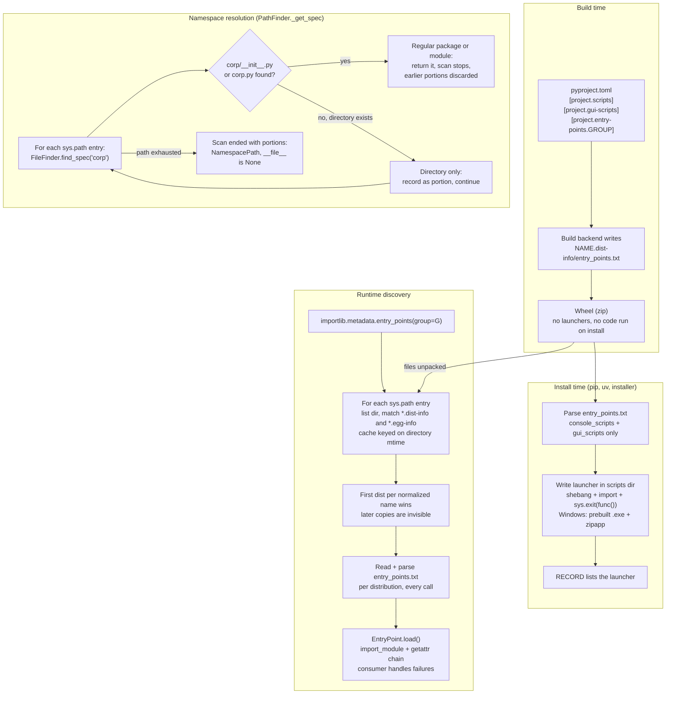

# Python Entry Points, Plugin Systems, and Namespace Packages

> [!summary] Claim:
> An entry point is a three-field record (group, name, object reference) in a distribution's `entry_points.txt`; nothing executes at install time except the installer writing a small launcher for the `console_scripts` and `gui_scripts` groups.
> Runtime discovery is a scan: `importlib.metadata.entry_points()` lists every `*.dist-info` on `sys.path`, keeps the first distribution of each name, and, as far as the source shows, reads and parses its `entry_points.txt` on every call.
> A PEP 420 namespace package is the import system's fallback: if no regular package or module named `corp` is found on any path entry, the directories named `corp` seen along the way become portions of one package whose `__path__` is recomputed when the parent path changes.
> One stray `corp/__init__.py` in any distribution turns the whole namespace into a regular package and hides every other portion.
> An expert treats both mechanisms as metadata and file-layout contracts that CI must check, because neither raises an error when the contract is broken.



## The Mechanism

### Vocabulary: three things called a "package"

- A distribution is the installable unit with a name and version, such as `corp-auth`; it is what `pip install` takes and what has a `*.dist-info` directory.
- An import package is a directory the interpreter imports, such as `corp.auth`.
- A portion is the PEP 420 term for the part of a namespace package that one directory or one distribution contributes.

One distribution may ship many import packages, and one import package name (`corp`) may be spread over many distributions.
[[Python-Packaging-History-and-pyproject-toml]] owns how metadata and `pyproject.toml` came to exist; this note owns the two runtime mechanisms that depend on them.

### The entry point record and its file format

The entry points specification defines three required properties and one optional property.
The specification page was last updated 2026-11-18 and its history records a January 2026 edit that replaced references to PEP 508 and PEP 685 with the Dependency specifiers page (as of 2026-11, Both).

| Property | Rule from the specification |
|---|---|
| group | One or more groups of letters, numbers, and underscores separated by dots, regex `^\w+(\.\w+)*$`; the consumer defines the expected interface, and a new group should start with a PyPI name the consumer owns, followed by `.` |
| name | Any characters except `=`; it cannot start or end with whitespace or start with `[`; new names should match `[\w.-]+`; unique within a distribution, and if two distributions provide the same name, the consumer decides |
| object reference | `importable.module` or `importable.module:object.attr`; each part is a valid identifier |
| extras (optional) | Names inside square brackets after the reference; "no longer recommended", consumers should parse and may ignore them |

The file is `entry_points.txt` inside the distribution's `*.dist-info` directory, UTF-8, INI format.
It differs from default `configparser` behavior in two ways that matter to anyone writing a reader: names are case sensitive, and `=` is the only delimiter, not `:`.
The sections are groups.

```ini
[console_scripts]
foo = foomod:main
# One which depends on extras:
foobar = foomod:main_bar [bar,baz]

# pytest plugins refer to a module, so there is no ':obj'
[pytest11]
nbval = nbval.plugin
```

The specification gives the resolution algorithm as three lines: import the module, then for each dotted part of the attribute path call `getattr`.
`importlib.metadata.EntryPoint.load()` does exactly that with `import_module` and `functools.reduce(getattr, attrs, module)`, and returns the module itself when the value has no colon.
`EntryPoint` construction never validates the value; the regex `(?P<module>[\w.]+)\s*(:\s*(?P<attr>[\w.]+)\s*)?((?P<extras>\[.*\])\s*)?$` runs lazily on first access of `.module`, `.attr`, `.extras`, or `.load()`, and a mismatch raises `ValueError('Invalid object reference...')` (CPython main, as of 2026-11).
uv's reader is stricter for scripts: its regex requires the `module:function` form, so a `console_scripts` value with no colon is rejected as `invalid console script`, while extras are parsed and ignored (uv `script.rs`, main, as of 2026-11).

In `pyproject.toml` the spec maps three tables onto the file:
1. `[project.scripts]` becomes the `console_scripts` group.
2. `[project.gui-scripts]` becomes `gui_scripts`.
3. `[project.entry-points.GROUP]` becomes any other group, one level deep with no nested tables.
A backend MUST raise an error if `[project.entry-points.console_scripts]` or `[project.entry-points.gui_scripts]` is present, because it would be ambiguous with the first two tables.

### What happens at install time: launcher generation

A wheel contains `entry_points.txt` as plain data.
The binary distribution format lists two recommended installer features: scripts in `{distribution}-{version}.data/scripts/` whose first line starts with exactly `#!python` get rewritten to the target interpreter, with `#!pythonw` marking a GUI script, and Windows installers "may want to add" `.exe` wrappers for them.
Console and GUI entry points are a separate path: the installer reads `console_scripts` and `gui_scripts` from `entry_points.txt` and writes one launcher per name into the scheme's `scripts` directory.
The entry points specification says installers are expected to do this for both groups and are not responsible for putting that directory on `PATH`.
The function must be callable with no arguments; it may return an integer used as the exit code, and `None` means 0.
Python's `sys.exit` says any other object is printed to stderr and exits with status 1, so `return "failed"` from `main()` prints `failed` and exits 1 (as of 2026-11, Both).

The three installers generate the same logical launcher with different text.

| Installer | Template (as of 2026-11) | Windows | Long or spaced interpreter path |
|---|---|---|---|
| pypa/installer | `import sys`, `from MODULE import FIRST_ATTR`, then under `if __name__ == "__main__":` strip a `.exe` suffix from `sys.argv[0]` and `sys.exit(FUNC_PATH())` | prebuilt launcher bytes, then the shebang line, then a zip with `__main__.py`; eight launcher binaries, `t32`, `t64`, `t_arm`, `t64-arm` for console and `w32`, `w64`, `w_arm`, `w64-arm` for GUI | shebang kept only if it has no space and `len + 3 <= 127`; otherwise a `/bin/sh` header |
| pip (distlib `ScriptMaker`) | same shape, with a template that omits `import re` so scripts start faster; `clobber = True`, `variants = {""}`, `set_mode = True` | distlib launchers | distlib logic |
| uv (`uv-install-wheel`) | the output captured below: `-*- coding: utf-8 -*-`, import, then guarded suffix stripping for `-script.pyw` and `.exe` | `windows_script_launcher` from the `uv-trampoline-builder` crate | `/bin/sh` wrapper when the shebang would exceed 127 characters, contains a space, or the install is relocatable |

`FIRST_ATTR` is the first dotted segment of the attribute path: for `foomod:mod_bar.sub_foo.func_baz` the launcher imports `mod_bar` and calls `mod_bar.sub_foo.func_baz()`.
Three consequences follow from the launcher being a few lines of text:
1. The shebang is an absolute path to the interpreter that ran the installer, so a venv moved or renamed after install has dead launchers, which is why uv has a `relocatable` mode that goes through `/bin/sh`.
2. The launcher imports the module directly and never touches `importlib.metadata`, so starting a console script does not scan `sys.path` for distributions.
   Older setuptools wrappers did query metadata through `pkg_resources`; the setuptools changelog records "Restore `__requires__` directive in easy-install wrapper scripts" (#2198, setuptools v47.3.1), which is how this note dates that behavior.
3. The launcher name comes from the entry point name, so the name decides a file path.
   pip's `PipScriptMaker.make` calls `_raise_for_invalid_entrypoint` and raises `InstallationError` when the script "would be installed outside the scripts directory" (pip main, as of 2026-11); the pip 26.1.2 changelog (2026-05-31) lists it under Bug Fixes as "Reject `console_scripts` and `gui_scripts` entry points whose name would install a script outside the scripts directory" (#14000), so earlier pip releases do not have the check.
   The entry point specification adds that names differing only in case are undefined behavior on case-insensitive filesystems.

pip sets `maker.clobber = True`, with the comment "Ensure old scripts are overwritten".
Two distributions that both declare `console_scripts` `acme` therefore do not conflict at install time: the second installer run overwrites the file, and both RECORDs list it.
The consequence shows at uninstall: with uv 0.11.26 on macOS, installing two handmade wheels that both declare `acme = <module>:main` left one `bin/acme` and two RECORDs listing `../../../bin/acme` with different hashes, and `uv pip uninstall` of either one removed the shared `bin/acme`, so the surviving distribution kept its `entry_points.txt` entry but lost its launcher until reinstalled (one run, uv only; pip was not run, and uv installs wheels in parallel, so which distribution's text wins is not deterministic).

The `gui_scripts` group matters only on Windows: console launchers attach to a console, GUI launchers start without one, and the installer library substitutes `pythonw` for `python` in the launcher's interpreter path (uv does the same in `get_script_executable(python, is_gui)`: only when compiled for Windows and `is_gui` is true does it rename `python` to `pythonw` in the interpreter file name, and only if that file exists; on other platforms the argument has no effect, uv main, as of 2026-11).

### Runtime discovery: what `entry_points()` does

`importlib.metadata` is no longer provisional since 3.10, and its entry point API has changed three times.

| Version | Change (docs, as of 2026-11) |
|---|---|
| 3.10 | `entry_points(**params)` selection by `group` and `name`; the "selectable" API from importlib_metadata 3.6 |
| 3.12 | `entry_points()` always returns an `EntryPoints` object; the dict-of-groups return from before 3.10 is gone (importlib_metadata 5.0) |
| 3.13 | `EntryPoint` objects no longer present a tuple-like interface (`__getitem__`) |

The call path in CPython main (`Lib/importlib/metadata/__init__.py`, as of 2026-11):
1. `entry_points(**params)` iterates `_unique(distributions())` and chains `dist.entry_points` for each.
2. `_unique` is `unique_everseen` keyed on `_normalized_name`, so for each distribution name only the first copy found survives.
3. `distributions()` calls `Distribution.discover`, which asks every finder on `sys.meta_path` that has `find_distributions`; the default one is `MetadataPathFinder`.
4. `MetadataPathFinder` wraps each `sys.path` entry in a `FastPath`, an `lru_cache`d object per root that lists the directory with `os.listdir` and falls back to reading it as a zip.
5. `FastPath.lookup(mtime)` builds a `Lookup` once per directory modification time: it sorts children in reverse lexicographic order (case-insensitive), keeps names ending in `.dist-info` or `.egg-info`, and indexes them by normalized name, where normalization is PEP 503 plus dashes as underscores.
6. The reverse sort means that when a directory holds two metadata directories for one distribution, as an interrupted upgrade can leave, the lexicographically greater one is found first (python/cpython#100666); the code comment says this only approximates "the newer version", because the comparison is on the directory name, not a parsed version.
7. `Distribution.entry_points` calls `read_text('entry_points.txt')` and parses it with `Sectioned.section_pairs`; the code caches no parsed result, so every `entry_points()` call reads and parses the file of every distribution (a reading of CPython main, `Distribution.entry_points`; not benchmarked).
8. `.select(**params)` filters with `EntryPoint.matches`, which compares attribute by attribute; `dist` is rejected as a query key because `Distribution` objects do not compare equal.

`os.register_at_fork` clears the `FastPath` cache in a forked child, because cached zip-backed paths hold a parent file handle (python/importlib_metadata#520, referenced in the source).
`MetadataPathFinder.invalidate_caches` clears the same cache, which is how `importlib.invalidate_caches()` makes a just-installed distribution visible.

Two APIs look like selectors and are not.
`EntryPoints.__getitem__(name)` selects by name alone across every group and returns the first match, so `entry_points()['good']` can return an entry from an unrelated group; select the group first.
Querying by distribution needs `Distribution.entry_points.select(...)` on a located distribution, not `entry_points(dist=...)`.

Because the scan walks `sys.path`, the result depends on who runs it.
`python -I` drops the user site and `PYTHONPATH`, a venv hides the system site, and a script that edits `sys.path` changes the answer, which the demo below exploits.
Editable installs still create a `*.dist-info` directory, and entry points come from the `entry_points.txt` written at install time, so editing `[project.entry-points]` in `pyproject.toml` has no effect until the project is reinstalled (follows from the file format and the scan above; see [[Python-Native-Build-Backends-scikit-build-core-meson-python-and-maturin]] for how editable installs are produced).

### Plugin architectures built on entry points

The PyPA guide names three discovery approaches: a naming convention with `pkgutil.iter_modules()` (Flask's `flask_{name}`), namespace packages with `pkgutil.iter_modules(ns.__path__, ns.__name__ + ".")`, and package metadata.
Entry points are the only one of the three where the plugin can be listed, versioned, and attributed to a distribution without importing it: `ep.name`, `ep.value`, `ep.group`, and `ep.dist.name` and `ep.dist.version` are all available before `load()`.
A host can therefore print a plugin table for `--help` or `doctor` at the cost of file reads, and pay import cost only for the plugin the user selects.

Design choices that every plugin system makes, and what real systems do:

| Decision | Options | Evidence |
|---|---|---|
| Group name | `<owned-name>.<role>`, and a new group when the contract breaks (`acme.plugins` then `acme.plugins.v2`) | The spec asks consumers to prefix with a PyPI name they own; there is no registry, so squatting is possible |
| Load timing | eager at startup versus lazy on first use | pytest loads third-party entry points at startup unless `PYTEST_DISABLE_PLUGIN_AUTOLOAD` is set; `pytest --trace-config` confirms registration |
| Failure policy | skip and report, or abort | stevedore logs `Could not load ...` and continues unless an `on_load_failure_callback` is given, re-raising only `KeyboardInterrupt` and `AssertionError`; pluggy's `load_setuptools_entrypoints` calls `ep.load()` with no guard, so a broken plugin raises out of it |
| Duplicates | first wins, last wins, or error | pluggy skips an entry point whose name is already registered or blocked (`has_plugin`, `is_blocked`); the spec leaves it to the consumer |
| Ordering | none guaranteed | order follows `sys.path` and directory listing; sort by `(name, value, group)` for determinism, as `EntryPoint.__lt__` allows |
| Allow and deny | by name | pytest `-p no:name` blocks a plugin before parsing; pluggy `set_blocked` |
| Caching | none, or a persistent cache | stevedore's `_cache` writes JSON keyed on a sha256 of `sys.executable`, `sys.prefix`, every `sys.path` entry with its mtime, and every `*.dist-info/entry_points.txt` and `*.egg-info/entry_points.txt` with its mtime; the directory is `~/Library/Caches/Python Entry Points` on macOS, `$XDG_CACHE_HOME/python-entrypoints` (default `~/.cache`) on other POSIX, and `%LOCALAPPDATA%\Python Entry Points` on Windows |

pluggy iterates `importlib.metadata.distributions()` and each `dist.entry_points`, not `entry_points()`, so it does not use the first-wins dedupe by distribution name; it relies on the plugin-name check instead (pluggy main, as of 2026-11).
pytest's documented startup order is: block `-p no:` names, load built-in plugins, load `-p` names, load entry-point plugins unless autoload is disabled, load `PYTEST_PLUGINS`, then initial `conftest.py` files.

A host that tests its own discovery should not depend on the real environment.
`importlib.metadata.distributions(path=[...])` forwards `path` into `DistributionFinder.Context`, so a test can write a `x.dist-info/entry_points.txt` into a temporary directory and scan only that directory (the collision checker below uses this form, and I ran it once; I did not run it for entry point selection).

#### Startup entry points: `.start` files (Python 3.15)

Python 3.15 adds a second, unrelated mechanism with the same `module:callable` syntax.
PEP 829 (Final, Python 3.15) lets a package ship `name.start` in site-packages; each non-blank, non-comment line is an entry point called with no arguments during interpreter startup, after all `.pth` path extensions are applied (as of 2026-11, Both).
Unlike `.pth` path lines, duplicate entries are not de-duplicated, an exception prints a traceback to `sys.stderr` and processing continues, resolution uses `pkgutil.resolve_name()` with `strict=True`, and the file must be UTF-8.
The same release deprecates `import` lines in `.pth` files: they still run during the deprecation period, are ignored when a `.start` file with the same base name exists, are silently ignored in 3.18 and 3.19 by the documented schedule, and produce a warning in 3.20.
These files run on every interpreter start unless `-S` is given, so they are a startup-time cost for every command in the environment; this is not a plugin discovery mechanism, and `importlib.metadata.entry_points()` does not read them.

### Namespace packages: PEP 420 mechanics

Before Python 3.3, a package split across distributions needed every portion to cooperate through code in `__init__.py`.
PEP 420 (Python 3.3) added implicit namespace packages: a directory without `__init__.py` can be a portion.
The packaging motivation in the PEP is concrete: Linux distribution vendors prefer to install every portion into one directory, and two portions that both ship `foo/__init__.py` would own the same file, which many system package managers refuse.
Dropping the file removes the conflict.

The algorithm is the PEP's specification and the shape of `PathFinder._get_spec` in CPython main (as of 2026-11).
To import `corp`, iterate the parent path (`sys.path` for a top-level name, the parent's `__path__` otherwise), and for each entry ask its cached finder (`FileFinder` for a directory) for a spec:
1. `FileFinder.find_spec` checks `corp/__init__<suffix>` for each loader suffix; if found it returns a regular-package spec with a loader.
2. Otherwise it checks for `corp<suffix>` files such as `corp.py` or an extension module and returns that spec.
3. Otherwise, if `corp` is a directory, it returns a spec with no loader whose `submodule_search_locations` is `[<dir>/corp]`.
4. `PathFinder._get_spec` returns immediately on any spec with a loader; for a loader-less spec it extends `namespace_path` with the portions and continues.
5. If the loop ends without a loader, it returns a loader-less spec carrying all recorded portions; `find_spec` then wraps them in a `NamespacePath(fullname, namespace_path, cls._get_spec)`, and returns `None` if the list is empty.

Step 4 is the rule that explains most namespace failures: a regular package or module found at any position in the path wins over every namespace portion found before it, because the scan returns the first loader-bearing spec.
Namespace portions are recorded in path order, and they lose to a later regular package.

The resulting object differs from a regular package in ways visible from Python:
- `__file__` is present and set to `None`, and `__spec__.origin` is `None`; the PEP says namespace packages have no `__file__`, but Python 3.7 changed both (bpo-32305, "What's New In Python 3.7"), and `hasattr(corp, "__file__")` is `True` with value `None` on CPython 3.15.2 (verifier run, macOS, as of 2026-11).
- `__loader__` is a `NamespaceLoader`, which CPython exposes publicly.
- `__path__` is a `NamespacePath`, not a `list`.
- `NamespacePath._recalculate` compares a tuple copy of the parent path (`sys.path`, or `parent.__path__`) with the last one it saw, and the class `_epoch`, which `invalidate_caches()` increments; when either changed it re-runs `_get_spec` over the new parent path and replaces its list.
  This is the PEP's "dynamic path computation": adding a path entry later makes new portions importable without re-importing the namespace.
- The PEP calls the path a "read-only iterable", but the class in CPython main defines `append` and `__setitem__` that mutate the cached list, so code that mutates it may work until the next recalculation replaces it (`_recalculate` assigns a new list to `_path` when the parent path or epoch changes; CPython main source, as of 2026-11; not run).

The import system reference adds two points: a namespace package can be nested inside a regular package, where a subdirectory without `__init__.py` becomes a portion of a namespace subpackage, and the PEP states that after creation "there is no functional difference" between a namespace package and a regular one.

### Legacy namespaces: `pkgutil.extend_path` and `pkg_resources`

`pkgutil.extend_path(path, name)` was introduced in Python 2.3.
A namespace `__init__.py` contains one line, `__path__ = __import__('pkgutil').extend_path(__path__, __name__)`, and every distribution ships it.
The function copies the list it is given, then for each directory in `sys.path` (or the parent's `__path__` for a dotted name) calls the cached finder's `find_spec(final_name)` and appends any `submodule_search_locations` not already present, also reading `NAME.pkg` files line by line and appending each non-comment line with no existence check.
The PEP 420 text records that `extend_path` was modified to recognize PEP 420 portions, so legacy and native portions can coexist, with the caveat that such hybrid namespaces "will not have the dynamic path computation".
The result is computed once, when the namespace's `__init__.py` runs, and is a plain `list`.

`pkg_resources.declare_namespace(__name__)` plus `namespace_packages=[...]` in `setup()` was the third style.
The PyPA guide says it is not compatible with the other two.
Setuptools v82.0.0 removed `pkg_resources` entirely; its changelog says projects relying on it "for namespace packages or other behavior should depend on older versions of `setuptools`", and the PyPA guide marks the style "obsolete and ... no longer functional (as of Setuptools 82.0.0)" (as of 2026-11, Both).
Older setuptools wrote `*-nspkg.pth` files for such namespaces (setuptools NEWS #250, v31.0.0, for `setup.py develop`; a name fix for editable installs, #4041).
Each namespace becomes one `.pth` line that begins with `import sys, types, os`, so it is an executable import line: it builds the module with `importlib.machinery.PathFinder.find_spec` or falls back to `types.ModuleType`, then appends `os.path.join(sitedir, *pkg.split('.'))` to the module's `__path__` unless already present (`setuptools/namespaces.py` `_nspkg_tmpl`, setuptools main, as of 2026-11).
The `.pth` import-line deprecation above therefore affects any package that still ships one.
The guide's migration rule is that all distributions sharing a namespace must migrate simultaneously.

| Property | PEP 420 native | `pkgutil` style | `pkg_resources` style |
|---|---|---|---|
| Namespace `__init__.py` | must be absent | one `extend_path` line in every portion | `declare_namespace` call in every portion |
| `__path__` type | `NamespacePath`, recomputed | `list`, computed once | managed by `pkg_resources` |
| Python 2 | no | yes | yes |
| Status (as of 2026-11) | recommended by the PyPA guide for Python 3 only projects | works; guide calls it legacy | removed with setuptools 82.0.0 |
| Mixed with native | n/a | "largely compatible" | not compatible |

The guide's rule for the first two styles is the one to enforce in CI: every distribution that uses the namespace must either omit `__init__.py` or ship the pkgutil-style one; one distribution doing otherwise makes the other sub-packages not importable.

### Plugins as namespace packages, and the prefix alternative

The PyPA guide's namespace approach makes a sub-package such as `myapp.plugins` a namespace, then walks it with `pkgutil.iter_modules(ns.__path__, ns.__name__ + ".")`.
It warns against making the project's main top-level package the namespace, because one bad plugin could break the whole namespace and make the project unimportable.
Its simpler alternative for a family of distributions is a prefix, such as `import mynamespace_subpackage_a as subpackage_a`, which needs no namespace logic at all.

The cost of the namespace approach is that discovery equals import: `iter_modules` lists modules, and you must import each to learn anything, while an entry point can be inspected first.
Entry points need a registered distribution; a namespace needs only a file on `sys.path`, which makes it work for vendored or zipped code that has no metadata and also makes provenance unattributable.

### Tooling that has to understand namespaces

- mypy: `--namespace-packages` is on by default (the docs describe `--no-namespace-packages` as the opt-out).
  With it on and `--explicit-package-bases` off, mypy uses the highest `__init__.py` in the tree to name a module; a tree with no `__init__.py` needs `MYPYPATH=src mypy --namespace-packages --explicit-package-bases .` to associate `src/namespace_pkg/mod.py` with `namespace_pkg.mod`.
- pytest: by default it does not resolve namespace packages automatically; the `consider_namespace_packages` setting changes that, and `prepend` import mode edits `sys.path` to import test modules.
- setuptools: package discovery scans implicit namespaces by default in `pyproject.toml` (`find = {}`) and `namespaces = false` disables it; `include = ["corp.auth*"]` limits a distribution to its portion.
  Editable installs may use a static `.pth` path, a link farm, or a finder installed from a dynamic `.pth`, and the setuptools docs say strict editable installs with `pkgutil`-style namespaces are not officially supported.
- `importlib.metadata.packages_distributions()` maps top-level import names to distribution names; for a namespace it lists every distribution that contributes a file under it, which is a cheap way to see who owns `corp`.

## Commands and Numbers to Know

| Item | Value | Platform | Notes |
|---|---|---|---|
| Entry point group regex | `^\w+(\.\w+)*$` (as of 2026-11) | Both | Entry points specification; consumer-defined, prefix with an owned PyPI name. |
| Entry point name regex (new names) | `[\w.-]+` (as of 2026-11) | Both | Hard rules: no `=`, no leading `[`, no leading or trailing whitespace. |
| `entry_points.txt` location | `NAME-VERSION.dist-info/entry_points.txt` (as of 2026-11) | Both | UTF-8 INI, case-sensitive names, `=` only. |
| Console script exit status | `int` is the status, `None` is 0, other objects print to stderr and exit 1 (as of 2026-11) | Both | Spec plus `sys.exit` docs; the demo's `main()` returning 3 exited 3. |
| Script shebang limit | simple shebang only if no space and length at most 127 in installer; uv wraps above 127 (as of 2026-11) | Both | Otherwise a `/bin/sh` trampoline header. |
| Windows launchers in installer | 8 prebuilt `.exe` files, `t64.exe` is 108032 bytes and `w64.exe` 101888 bytes in the GitHub listing (as of 2026-11) | Windows | Console `t*`, GUI `w*`; launcher plus shebang plus zip with `__main__.py`. |
| `importlib.metadata` selectable API | `entry_points(group=..., name=...)` since 3.10; dict return removed in 3.12; tuple-like `EntryPoint` removed in 3.13 (as of 2026-11) | Both | `importlib_metadata` 3.6 and 5.0 are the backport versions. |
| Entry point dedupe | first distribution per normalized name on `sys.path` (as of 2026-11) | Both | `unique_everseen` on `_normalized_name`; demo output 5. |
| Name normalization in lookup | PEP 503 plus `-` to `_` (as of 2026-11) | Both | `Prepared.normalize`. |
| Metadata cache invalidation | per-directory `os.stat` mtime, plus `importlib.invalidate_caches()` (as of 2026-11) | Both | `FastPath.lookup(mtime)`; cleared after `fork`. |
| `PYTEST_DISABLE_PLUGIN_AUTOLOAD` | any value set disables entry point plugins (as of 2026-11) | Both | Only `-p` and `PYTEST_PLUGINS` plugins load; also `--disable-plugin-autoload`. |
| pytest entry point group | `pytest11` (as of 2026-11) | Both | `pytest --trace-config` shows registration. |
| stevedore cache directory | `~/Library/Caches/Python Entry Points` (macOS), `$XDG_CACHE_HOME/python-entrypoints` (POSIX) (as of 2026-11) | Both | Keyed on sys.executable, sys.prefix, path mtimes. |
| `pkg_resources` | removed in setuptools 82.0.0; latest in the changelog read is 84.2.1 (as of 2026-11) | Both | `declare_namespace` no longer works. |
| `.start` files and `.pth` import lines | `.start` added in 3.15 (PEP 829); `.pth` import lines silently ignored in 3.18 and 3.19, warning in 3.20 (as of 2026-11) | Both | Documented schedule in the 3.15.2 `site` docs. |
| Namespace probe on the demo host | `type(corp.__path__)` is `NamespacePath`, `corp.__file__` exists and is `None`, `__loader__` is `NamespaceLoader` (as of 2026-11) | macOS | CPython 3.15.2; scratch run below, not a harness lab. |
| `NamespacePath` recomputation trigger | parent path tuple changed or `invalidate_caches()` epoch changed (as of 2026-11) | Both | `_recalculate` in `_bootstrap_external.py`. |

## Multi-Language Comparison

| Concern | C++ | Python | Rust |
|---|---|---|---|
| Discovery key | a directory of shared objects or a manifest the host defines; no standard metadata | `(group, name)` in `entry_points.txt` of each installed distribution | static: crate registration at link time; dynamic: a path to a library |
| Registration time | run time, by the host scanning a path | install time (metadata), import time (code) | link time (`inventory`, "typed distributed plugin registration") or run time (`libloading`) |
| Load primitive | `dlopen(path, RTLD_NOW or RTLD_LAZY, optionally RTLD_LOCAL)` then `dlsym` of a C-linkage factory | `import_module` plus `getattr` chain (`EntryPoint.load`) | `libloading` ("bindings around the platform's dynamic library loading primitives") or none for static registries |
| Name collisions | symbol interposition and `RTLD_GLOBAL` versus `RTLD_LOCAL` visibility | first distribution wins in `entry_points()`; consumer decides for plugin names | duplicate crate versions are separate; registry items merge at link time |
| Contract check | none built in; ABI must match (see [[Cpp-ABI-Stability-Symbol-Visibility-and-SONAME]]) | none built in; host-API version in the group name or `Requires-Dist` | no stable Rust ABI, so dynamic plugins cross a C ABI boundary (see [[Rust-FFI-Packaging-cdylib-staticlib-and-cbindgen]]) |
| Failure isolation | a crash in the plugin is a crash in the host | a failed `load()` is an exception the host can catch; a plugin can still `sys.exit` or hang | a panic across a C ABI boundary is the host's problem |
| Splitting one namespace across packages | `namespace` blocks may be reopened in any header | PEP 420 portions across distributions | modules belong to one crate; workspaces split crates, not modules |

The C++ and Rust rows are from the `dlopen(3)` man page and crate descriptions.
C++ `namespace` reopening is the extension-namespace-definition on cppreference's namespace page, and the absence of a stable Rust ABI follows from the Rust Reference, which says the default representation makes "no other guarantees of data layout" (`layout.repr.rust.unspecified`, as of 2026-11).

## Worked Lab Example

This note has no committed lab; the lab harness was paused for this wave.
The following was run once on darwin-arm64 (macOS 27.3) on 2026-11-21 with CPython 3.15.2 and uv 0.11.26, from a scratch script that builds eight wheels by hand (zip files with a valid `RECORD`), installs them with `uv pip install --offline --no-deps`, and probes them in subprocesses.
The first attempt of the script crashed at probe 5 because it replaced `sys.path` with only two entries and dropped the standard library (my script bug); I fixed that and re-ran the whole script, so the output below is from the second run.
Output blocks are reproduced from the captured file; paths are scrubbed to `<venv>` and `<work>`.

The host and plugins are three lines of metadata each.
The host's loader is the pattern the Mechanism section recommends:

```python
import importlib.metadata as md

def main():
    status = 0
    for ep in sorted(md.entry_points(group="acme.plugins")):
        try:
            fn = ep.load()
        except Exception as exc:
            print(f"skip {ep.name}: {type(exc).__name__}: {exc}")
            status = 3
            continue
        print(f"ok   {ep.name}: {fn()} (from {ep.dist.name} {ep.dist.version})")
    return status
```

The eight wheels:

| Distribution | Contents | Entry points |
|---|---|---|
| `acme-host` 1.0 | `acme_host/cli.py` holding `main` above | `console_scripts` `acme`, `gui_scripts` `acme-gui` |
| `acme-plugin-good` 1.0 | `hello()` returns `hello from good` | group `acme.plugins`: `good = acme_plugin_good:hello`, `missing = acme_plugin_good:nope` |
| `acme-plugin-good` 2.0 | `hello()` returns `hello from good 2` | `good2 = acme_plugin_good:hello` |
| `acme-plugin-broken` 1.0 | `__init__.py` imports a module that is not installed | `broken = acme_plugin_broken` |
| `corp-auth`, `corp-billing` | `corp/auth/__init__.py`, `corp/billing/__init__.py` and no `corp/__init__.py` | none |
| `corp-legacy` | `corp/__init__.py` (empty) and `corp/legacy/__init__.py` | none |
| `corp-pk-billing` | `corp/__init__.py` with the `extend_path` line, `corp/pkbilling/__init__.py` | none |

Probes 1 to 4 install `acme-host`, `acme-plugin-good` 1.0, and `acme-plugin-broken` into one venv and run the generated `acme` command.
Probes 5 to 9 install each wheel with `uv pip install --target`, which gives every portion its own directory, so that they behave like separate `sys.path` entries rather than sharing `site-packages`.

### Verified output

Captured by the scratch script on darwin-arm64 (macOS 27.3), 2026-11-21; this is not a harness golden file.

```text
uv 0.11.26 | python 3.15.2
--- 1. generated launcher bin/acme
#!<venv>/bin/python
# -*- coding: utf-8 -*-
import sys
from acme_host.cli import main
if __name__ == "__main__":
    if sys.argv[0].endswith("-script.pyw"):
        sys.argv[0] = sys.argv[0][:-11]
    elif sys.argv[0].endswith(".exe"):
        sys.argv[0] = sys.argv[0][:-4]
    sys.exit(main())
--- 2. generated launcher bin/acme-gui exists
True
--- 3. dist-info/entry_points.txt of acme-host
[console_scripts]
acme = acme_host.cli:main

[gui_scripts]
acme-gui = acme_host.cli:main
--- 4. run `acme` (host loads group acme.plugins)
skip broken: ModuleNotFoundError: No module named 'acme_dependency_not_installed'
ok   good: hello from good (from acme-plugin-good 1.0)
skip missing: AttributeError: module 'acme_plugin_good' has no attribute 'nope'
exit status: 3
--- 5. same distribution on two sys.path entries
[('good', '1.0'), ('missing', '1.0')]
[('good2', '2.0')]
['1.0', '2.0']
--- 6. portions A (auth) and B (billing), both PEP 420
type(corp.__path__) = NamespacePath
corp.__file__ = None
corp.__spec__.origin = None
type(corp.__loader__) = NamespaceLoader
len(list(corp.__path__)) = 2
 corp.auth ok
 corp.billing ok
 corp.legacy ModuleNotFoundError: No module named 'corp.legacy'
 corp.pkbilling ModuleNotFoundError: No module named 'corp.pkbilling'
--- 7. order A,B,C where C ships corp/__init__.py
type(corp.__path__) = list
corp.__file__ = <work>/nsC/corp/__init__.py
corp.__spec__.origin = <work>/nsC/corp/__init__.py
type(corp.__loader__) = SourceFileLoader
len(list(corp.__path__)) = 1
 corp.auth ModuleNotFoundError: No module named 'corp.auth'
 corp.billing ModuleNotFoundError: No module named 'corp.billing'
 corp.legacy ok
 corp.pkbilling ModuleNotFoundError: No module named 'corp.pkbilling'
--- 8. order A,E where E is a pkgutil-style portion
type(corp.__path__) = list
corp.__file__ = <work>/nsE/corp/__init__.py
corp.__spec__.origin = <work>/nsE/corp/__init__.py
type(corp.__loader__) = SourceFileLoader
len(list(corp.__path__)) = 2
 corp.auth ok
 corp.billing ModuleNotFoundError: No module named 'corp.billing'
 corp.legacy ModuleNotFoundError: No module named 'corp.legacy'
 corp.pkbilling ok
--- 9. dynamic __path__ recomputation (PEP 420)
before: ['<A>/corp']
billing before sys.path change: No module named 'corp.billing'
after:  ['<A>/corp', '<B>/corp']
```

### Reading the output

Probes 1 to 3 show that the launcher is generated text, not stored in the wheel.
The wheel had only `entry_points.txt`; uv produced `bin/acme` and `bin/acme-gui`, pinned to the venv's interpreter on the shebang line, importing `acme_host.cli` directly and calling `sys.exit(main())`.
The launcher text has no `importlib.metadata` call, and it has the `-script.pyw` and `.exe` suffix stripping that only matters on Windows.
An independent re-run of the same script from a deeper work directory produced a `#!/bin/sh` header with `'''exec' '<venv>/bin/python' "$0" "$@"` instead of the plain shebang, because the interpreter path pushed the line past 127 characters; the rest of the output was identical (verifier run, macOS, 2026-11-21).

Probe 4 shows the host's failure policy working and the exit-code contract.
`broken` fails on import with `ModuleNotFoundError`, and `missing` imports its module but fails the `getattr` with `AttributeError`; these are the two failure classes `EntryPoint.load()` can produce.
Entries came out sorted by name, and the status 3 the host returned from `main()` became the process exit status.

Probe 5 shows shadowing.
`distributions()` yields both versions (`['1.0', '2.0']`), but `entry_points()` sees only the copy that comes first on `sys.path`: with `dupA` first it lists `good` and `missing` from 1.0, and with `dupB` first it lists only `good2` from 2.0.
An entry point exists only if its distribution is the first of that name on the path.

Probe 6 is the PEP 420 object: a `NamespacePath` with two portions, a `__file__` of `None`, a `__spec__.origin` of `None`, and a `NamespaceLoader`.
Probe 7 puts the regular package last: with path order A, B, C the scan recorded A's and B's `corp` directories as portions, then reached C, found `corp/__init__.py`, and returned that regular package, so `corp.auth` and `corp.billing` fail although both are installed and on the path; this is the loader-bearing-spec rule from `_get_spec`.
Probe 8 shows the legacy hybrid working: `E`'s `corp/__init__.py` won as a regular package, and `extend_path` pulled in A's namespace portion, so `corp.auth` and `corp.pkbilling` import; the path is a two-element `list`.
It also shows the limit: C's `corp.legacy` and B's `corp.billing` are not on that path because B and C were not in `sys.path` for this probe.
Probe 9 shows dynamic recomputation: `corp.__path__` grew from one entry to two when B was inserted into `sys.path`, and `corp.billing` became importable without re-importing `corp`.

### A collision checker

A CI check can detect the Probe 7 hazard before an upload by reading installed `RECORD` data through `Distribution.files`.
This script flags two conditions: the same relative `.py` path owned by two distributions, and a top-level directory where some distributions ship `__init__.py` and others do not.

```python
import collections
import importlib.metadata as md
import sys


def hazards(paths=None):
    owners = collections.defaultdict(set)     # file path -> distributions
    top = collections.defaultdict(lambda: collections.defaultdict(set))
    for dist in md.distributions(**({"path": paths} if paths else {})):
        name = dist.metadata["Name"]
        for f in dist.files or ():
            if f.suffix == ".py" and "dist-info" not in f.parts and len(f.parts) > 1:
                owners[str(f)].add(name)
                top[f.parts[0]][name].add(str(f))
    out = []
    for path, names in sorted(owners.items()):
        if len(names) > 1:
            out.append(f"DUPLICATE FILE {path}: {sorted(names)}")
    for pkg, by_dist in sorted(top.items()):
        init = f"{pkg}/__init__.py"
        shippers = sorted(n for n, fs in by_dist.items() if init in fs)
        if len(by_dist) > 1 and shippers:
            others = sorted(set(by_dist) - set(shippers))
            out.append(f"MIXED NAMESPACE {pkg}: ships __init__.py={shippers}, without={others}")
    return out
```

Run once against the demo directories (macOS, same host and date), with `nsA` and `nsB` only, then with all four portions:

```text
$ nscheck A B
clean
$ nscheck A B C E
DUPLICATE FILE corp/__init__.py: ['corp-legacy', 'corp-pk-billing']
MIXED NAMESPACE corp: ships __init__.py=['corp-legacy', 'corp-pk-billing'], without=['corp-auth', 'corp-billing']
```

The checker cannot see a collision that is not in `RECORD`, files written by a post-install step, or distributions that are not installed together; run it in an environment where every portion is installed, and also unpack each wheel and check it before upload.

## Pitfalls

> [!warning] Pitfall 1: One `__init__.py` hides every other portion
> A single distribution that ships `corp/__init__.py` makes `corp` a regular package wherever that path entry sits, and the other portions on earlier or later entries become unreachable (probe 7, `ModuleNotFoundError: No module named 'corp.auth'`).
> When all portions share one `site-packages` directory the failure is masked, because every subdirectory sits next to the one `__init__.py`; it appears when the portions land in different directories, such as `--target`, a monorepo checkout on `PYTHONPATH`, or an editable install.
> Check wheel contents before upload with a script like the collision checker, and install each portion into its own directory in one CI job.

> [!warning] Pitfall 2: Entry points are shadowed by an earlier copy of the same distribution
> `entry_points()` keeps the first distribution per normalized name on `sys.path`, so a stale copy earlier in the path hides the entry points of the version you just installed (probe 5: with 1.0 first, `good2` from 2.0 is invisible).
> Typical causes are a leftover editable install, a source checkout on `sys.path[0]`, and a `build/` or `.egg-info` directory in the working directory.
> Debug with `importlib.metadata.distributions()`, which lists every copy, and compare it with `entry_points()`.

> [!warning] Pitfall 3: Entry points come from install-time metadata, not from `pyproject.toml`
> Adding a plugin to `[project.entry-points]` does nothing for a developer whose editable install predates the change.
> The scan reads `entry_points.txt` from the distribution's `dist-info`, which the installer wrote earlier.
> Reinstall the project, and make a test that asserts the expected entry points for the installed distribution.

> [!warning] Pitfall 4: Eager loading couples the host to every plugin
> A host that calls `ep.load()` on all entry points at startup pays every plugin's import time on every command, and an unguarded failure takes the host down: pluggy's `load_setuptools_entrypoints` has no guard, while stevedore logs and skips.
> Decide the policy per call site, list plugins without importing them (`ep.name`, `ep.dist.name`), and import only the selected one.
> Treat `PYTEST_DISABLE_PLUGIN_AUTOLOAD=1` as the escape hatch to document for your own host.

> [!warning] Pitfall 5: `EntryPoints[name]` ignores the group
> `entry_points()['good']` selects by name across every group and returns the first hit.
> Two groups with a `json` entry will collide silently.
> Select the group first: `entry_points(group="acme.plugins")["good"]`, or `select(group=..., name=...)`, which returns an empty collection instead of the wrong item.

> [!warning] Pitfall 6: Launchers are pinned to one interpreter and overwrite each other
> The shebang is the absolute path of the installing interpreter, so renaming or moving a venv breaks every console script until reinstall; uv's relocatable mode wraps the launcher in `/bin/sh` to avoid that.
> pip overwrites an existing launcher of the same name (`maker.clobber = True`), so two distributions that both claim `acme` race by install order, with no error.
> Give console scripts names with an owned prefix and check for duplicates across your own distributions.

> [!warning] Pitfall 7: Code that still calls `pkg_resources`
> Setuptools 82.0.0 removed `pkg_resources`, so `declare_namespace`, `iter_entry_points`, and `load_entry_point` fail at import on a fresh build environment.
> The replacement for entry points is `importlib.metadata.entry_points(group=...)`; for namespaces it is a coordinated move to PEP 420 across all distributions that share the namespace, because the `pkg_resources` style is not compatible with the others.
> Pin the old setuptools only as a stopgap, and record the pin in a [[Packaging-Decision-Records]] entry with an end date.

> [!warning] Pitfall 8: Accidental namespaces and stray directories
> Any directory with no `__init__.py` is a namespace candidate, so a leftover `corp/` directory in the working directory is recorded as a portion, and `tests/` directories shipped by several distributions share one path.
> Namespace portions lose to any regular package or module found anywhere on the path, so a stray directory usually does not shadow a real package; it does make `import corp` succeed with an empty namespace when the real package is missing, which turns a clear `ModuleNotFoundError` for `corp` into an attribute or submodule error.
> Exclude test and docs directories from wheels, and assert `__file__` is not `None` for packages that must be regular (a namespace package has the attribute, set to `None`, since Python 3.7).

> [!warning] Pitfall 9: Plugin code is install-time-trusted code
> Anything that provides an entry point in a group your host scans runs with your host's privileges at `load()`, and any `.pth` or `.start` file runs at every interpreter start.
> Group names are not registered anywhere, so a package can claim your group.
> Scan only environments you control, log the distribution for every loaded plugin, and gate installation with the controls in [[Python-Trusted-Publishing-and-PEP-740-Attestations]] and [[Python-Dependency-Resolution-pip-uv-and-PEP-751-Lockfiles]].

## At Scale

For one developer, `[project.scripts]` plus one console script is the whole feature, and nothing here needs a policy.
For a team, a plugin group is an API: it has a name, a contract (what the callable receives and returns), and a compatibility promise, and breaking it silently is a semantic version break in the sense of [[Versioning-SemVer-CalVer-and-ABI]].
For 1,000 to 50,000 engineers, the cost is the number of distributions that share an interpreter environment and the number of teams that can claim a name, and the failure mode is a wrong plugin loading in a place nobody tests.

Cost arithmetic that follows from the code, without a benchmark: `entry_points()` does one directory listing per `sys.path` entry per modification time, and one file read and parse per installed distribution per call, so its cost is linear in the number of distributions on the path and is paid each call, not each process.
A host that calls it three times at startup pays three times.
For a monorepo environment with several hundred distributions, measure it with `python -X importtime` and `time.perf_counter` around the call before choosing between laziness, a one-call cache in the host, and a persistent cache like stevedore's.

Decision rules:
1. Use an entry point when plugins are separately installed distributions, when the host must list them without importing, or when attribution and versions matter.
2. Use a naming convention or a flat prefix when you only need grouping of names, and you control all packages; it costs nothing and avoids namespace failure modes.
3. Use a namespace package only when users should import `corp.x` as one logical package across independently released distributions, and every portion is built by one organization with the CI check above.
4. Make namespace roots something no distribution owns: a dedicated `corp` namespace with no `__init__.py` anywhere, enforced by a wheel check, with each distribution owning exactly one subtree.
5. Never make your main package the plugin namespace; the PyPA guide's reason is that one bad plugin breaks importing the project.
6. Own group names in a registry file in the host's repository, version the group when the contract breaks, and publish a deprecation window like any API.
7. Specify the failure policy in the host: skip and report, abort, or isolate in a subprocess; do not inherit it from the library.
8. Budget startup: avoid `.pth` import lines, do not import plugins until selected, and measure with a representative environment.
9. Treat the plugin set as a supply-chain surface; allow-list distributions by name and hash in a lockfile, and see [[Diamond-Dependency-and-Incompatible-ABI-Mitigation]] for what happens when plugins pin conflicting host versions.
10. Migrate legacy namespaces in one change across all portions; the guide says all distributions sharing the namespace must move simultaneously.

> [!tip] Practice Drill: Break and repair a namespace and a plugin group
> Build the demo's seven wheels by hand, or with any backend, and install each portion with `uv pip install --target` into its own directory.
> Predict, then check, what `import corp.billing` does for every ordering of A, B, C, and E on `sys.path`, and why order matters only when a regular package is present.
> Add a second copy of `acme-plugin-good` with a different version earlier on `sys.path` and explain why `entry_points()` and `distributions()` disagree.
> Add a `.dist-info/entry_points.txt` with an invalid object reference and show that listing succeeds and `load()` raises `ValueError`.
> Write the CI check that fails a build when two distributions of one namespace disagree about `__init__.py`.

## Interview Questions

> [!question] L5: What is an entry point, and what writes it?
> > [!success]- Answer
> > It is a record of group, name, and object reference in `entry_points.txt` inside the distribution's `*.dist-info` directory.
> > The build backend writes it from `[project.scripts]`, `[project.gui-scripts]`, and `[project.entry-points.GROUP]` in `pyproject.toml`.
> > Installing a wheel copies the file as data; the only code-like artifacts created at install time are the launchers for `console_scripts` and `gui_scripts`.
> > Another program finds it later with `importlib.metadata.entry_points(group=...)`.

> [!question] L5: What does the `acme` console script contain, and what does the function's return value do?
> > [!success]- Answer
> > A few lines: a shebang for the installing interpreter, `from acme_host.cli import main`, and `sys.exit(main())`, with Windows-only suffix stripping for `.exe` and `-script.pyw`.
> > An integer return becomes the exit status, `None` becomes 0, and any other object is printed to stderr and exits with 1.
> > It does not call `importlib.metadata`, so launching a console script does not scan the environment for distributions.

> [!question] L5: Why must a PEP 420 namespace directory have no `__init__.py`?
> > [!success]- Answer
> > Because the import system treats a directory with `__init__.py` as a regular package and stops searching at it.
> > A directory without one is only recorded as a portion, and the scan continues; when the path is exhausted, all recorded portions become the namespace's `__path__`.
> > If any distribution ships the file, that package wins over the portions found anywhere on the path, and other distributions' sub-packages stop importing.

> [!question] L6 (predict the output): Directories A and B each hold a portion without `corp/__init__.py` (`corp/auth` and `corp/billing`), and C holds `corp/__init__.py` and `corp/legacy`. With `sys.path = [A, B, C]`, what do `import corp.billing`, `type(corp.__path__)`, and `corp.__file__` give?
> > [!success]- Answer
> > `import corp.billing` raises `ModuleNotFoundError: No module named 'corp.billing'`.
> > `type(corp.__path__)` is `list`, and `corp.__file__` is the path of C's `corp/__init__.py`.
> > The scan records A's and B's `corp` directories as portions, reaches C, and `PathFinder._get_spec` returns C's regular-package spec at once because it has a loader, discarding the recorded portions.
> > The same layout on the demo host printed exactly these: `list`, `<work>/nsC/corp/__init__.py`, `SourceFileLoader`, and only `corp.legacy` importing.

> [!question] L6 (debug this): `entry_points(group="acme.plugins")` lists `good` from `acme-plugin-good 1.0` and misses `good2`, yet `pip list` shows 2.0 installed; what is wrong and how do you confirm it?
> > [!success]- Answer
> > Two copies of the distribution are on `sys.path`, and `entry_points()` keeps only the first one per normalized name, so the older copy's entry points hide the newer.
> > Confirm with `[(d.version, d.locate_file('')) for d in importlib.metadata.distributions() if d.name == "acme-plugin-good"]`, which shows both copies and their locations.
> > The cause is usually a leftover editable install, a checkout on `sys.path`, or an old directory in `PYTHONPATH`; remove the stale copy rather than changing the order.

> [!question] L6: Compare `pkgutil.extend_path` namespaces with PEP 420 namespaces.
> > [!success]- Answer
> > `extend_path` runs inside every portion's `__init__.py`, scans `sys.path` once, and sets `__path__` to a `list` that is never recomputed; it also reads `*.pkg` files, trusting them without checking the paths exist.
> > PEP 420 needs no file, creates a `NamespacePath` with `__file__` set to `None`, and recomputes the path when the parent path changes.
> > They are largely compatible: `extend_path` was updated to see PEP 420 portions, but a hybrid has a static path, as the demo's probe 8 showed.
> > Both fail when one distribution breaks the convention; `pkg_resources` style is incompatible with both and is gone with setuptools 82.0.0.

> [!question] L6: Why does pytest, or any plugin host, not call `entry_points()` once per plugin?
> > [!success]- Answer
> > Each call re-scans `sys.path` metadata and re-reads every distribution's `entry_points.txt`, so the cost is linear in installed distributions per call.
> > The directory listing is cached by mtime, but parsing is not cached in the code I read, so the host should call it once, select the group, and keep the `EntryPoints` object.
> > For very large environments a persistent cache keyed on path mtimes, like stevedore's, avoids repeated parsing across processes.

> [!question] L7: What do you specify when designing a plugin system for a CLI with 40 internal plugins owned by 15 teams?
> > [!success]- Answer
> > A group name with an owned prefix, such as `acme.cli.commands`, plus a version suffix when the contract changes, and a registry file that owns the names.
> > Plugins listed from metadata without importing, and each plugin imported only when its command is run, so startup does not scale with plugin count.
> > A failure policy: catch exceptions from `load()` per plugin, report the distribution and version, and exit nonzero only when the requested command's plugin fails.
> > A conflict policy: the first distribution wins in `entry_points()`, so detect duplicate names across distributions in CI and fail the build.
> > Compatibility through `Requires-Dist` on the host with an upper bound, and an integration test that installs every plugin together and runs `--help`.
> > A kill switch: an environment variable or flag that disables third-party plugins, like `PYTEST_DISABLE_PLUGIN_AUTOLOAD`.

> [!question] L7: An organization wants `corp.*` split across 60 distributions; what breaks, and what do you enforce?
> > [!success]- Answer
> > The failure to guard against is one distribution shipping `corp/__init__.py` or a `pkg_resources` declaration, which hides or breaks the other 59, and it is invisible when all land in one `site-packages` directory.
> > Enforce a wheel-content check that no distribution ships files at the namespace root, a duplicate-path check across all wheels built from the monorepo, and an install-each-portion-into-its-own-directory import test.
> > Add type-checker config (`--namespace-packages --explicit-package-bases` for mypy) and a pytest `consider_namespace_packages` decision, because tools resolve names differently from the import system.
> > Weigh the alternative: a flat prefix such as `corp_auth` has none of these hazards, and the PyPA guide names it as the simple alternative.

> [!question] L7: A legacy namespace uses `pkg_resources.declare_namespace` and CI fails after a build image update; what is the cause, and how do you migrate?
> > [!success]- Answer
> > The new build environment installs setuptools 82.0.0 or later, which removed `pkg_resources`, so `__import__('pkg_resources').declare_namespace(__name__)` raises at import.
> > The styles are incompatible with each other, so you cannot migrate one distribution at a time: remove the `declare_namespace` call and `namespace_packages=` from every distribution and delete the namespace `__init__.py` in all of them, then release them together with matching constraints.
> > As a stopgap, pin `setuptools<82` in the build environment, record it as a time-boxed decision, and add the duplicate-file and mixed-`__init__.py` checks so the migration cannot half-complete.

> [!question] L8+: Decide between entry points, namespace packages, and a naming prefix for a plugin ecosystem that will have third-party authors.
> > [!success]- Answer
> > Choose entry points: third parties are untrusted, you need provenance (`ep.dist`), listing without import, version gating, and an allow-list or kill switch; a namespace gives none of those and a prefix gives only a PyPI search convention.
> > Pair them with a governance layer: a registry of group names, a documented contract with a version in the group name, a conformance test suite plugins can run, and a deprecation policy.
> > State the residual risks: the first-wins dedupe, load-time code execution, no group-name ownership, and per-call scan cost, with a mitigation for each.
> > Use a namespace only for your own first-party distributions that must share an import root, and record the choice in a [[Packaging-Decision-Records]] entry.

> [!question] L8+: Python 3.15 adds `.start` files and deprecates `import` lines in `.pth` files; what changes for a packaging team?
> > [!success]- Answer
> > Packages that rely on `.pth` import lines, including legacy namespace shims, must move to `name.start` entry points, or drop the import lines, before 3.18, when such lines are silently ignored.
> > A package straddling older and newer Pythons keeps path lines unchanged and can write import lines in a form older Pythons execute and newer ones ignore when a `.start` file exists, per the `site` docs migration section.
> > The `.start` mechanism runs on every interpreter start, does not de-duplicate, and prints tracebacks without aborting, so it needs the same review as any import-time code, and it does not replace `importlib.metadata` discovery.

## Further Reading

- Entry points specification (PyPA): the normative group, name, and object reference rules and the INI format.
- Binary distribution format specification (PyPA): `#!python` rewriting and why wheels run no install-time code.
- pyproject.toml specification, entry points section: how the three TOML tables map onto groups and the MUST-error rule.
- PEP 420, Implicit Namespace Packages: the algorithm, dynamic path computation, and migration from `extend_path`.
- Packaging namespace packages (PyPA guide): native, `pkgutil`, and `pkg_resources` styles and their compatibility.
- Creating and discovering plugins (PyPA guide): the three discovery approaches and the warning about namespace plugins.
- `importlib.metadata` documentation and `Lib/importlib/metadata/__init__.py`: the API history and the exact scan, dedupe, and cache code.
- The import system reference, sections on namespace packages and the path entry finder protocol: the specification the loader code implements.
- `Lib/importlib/_bootstrap_external.py`: `PathFinder._get_spec`, `FileFinder.find_spec`, and `NamespacePath`.
- `pypa/installer` `scripts.py` and pip `wheel.py`: the launcher templates and how clobbering and invalid names are handled.
- `site` documentation and PEP 829: `.pth` import-line deprecation and the `.start` startup entry points.
- pluggy `_manager.py` and stevedore `extension.py` and `_cache.py`: two production plugin hosts with different failure and caching policies.
- setuptools NEWS (v82.0.0): the removal of `pkg_resources` and its consequence for legacy namespaces.

## Related

- Prerequisites: [[Python-Packaging-History-and-pyproject-toml]]
- See also: [[02-Programming-Languages/Python/Python_Zero_to_Godhood/Chapter_47_Command_Line_Interfaces_argparse_cmd_shlex|Chapter_47_Command_Line_Interfaces_argparse_cmd_shlex]]
- Also relevant: [[Python-Wheels-Platform-Tags-Manylinux-and-ABI3]] for what a wheel contains and how it is tagged, [[Python-Shipping-Applications-Zipapp-PEX-and-Bundlers]] for bundlers that must carry entry point metadata, [[Python-Dependency-Resolution-pip-uv-and-PEP-751-Lockfiles]] for pinning a plugin set, [[Python-Trusted-Publishing-and-PEP-740-Attestations]] for plugin provenance, [[Diamond-Dependency-and-Incompatible-ABI-Mitigation]] for host and plugin version conflicts, and [[Packaging-Decision-Records]] for recording the namespace-versus-prefix choice.
