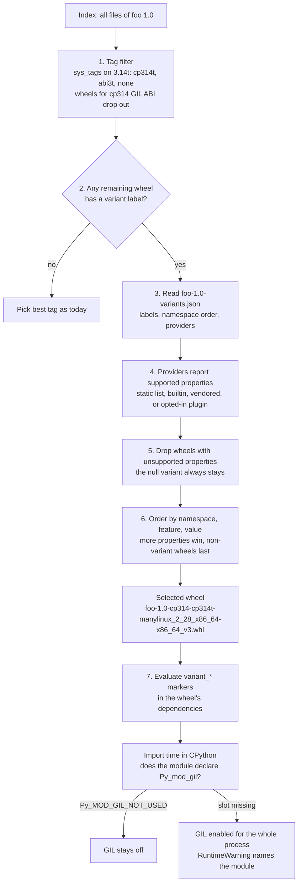

# Free-Threaded Python Wheels and Hardware Wheel Variants

> [!summary] Claim:
> A wheel filename carries three promises (Python tag, ABI tag, platform tag), and neither the GIL-free build of CPython nor the hardware a wheel was compiled for fits in them without help.
> The free-threaded build is a separate ABI per minor version (`cp313t`, `cp314t`, `cp315t`), and an extension only keeps the GIL off if its module declares `Py_mod_gil`; on CPython 3.15, `abi3t` and the tag `cp315-abi3.abi3t` give one wheel for both builds.
> Hardware and BLAS choice are a different axis: PEP 825 (Provisional) adds a variant label to the filename and a `variant.json` of `namespace :: feature :: value` properties, and PEP 850 (Draft) adds providers that say which properties a machine supports.
> An expert keeps the two axes apart, ships a non-variant fallback wheel, and verifies each claim (tag, slot, property) by import and by `sys._is_gil_enabled()`.



## The Mechanism

This note owns two mechanisms that share only a filename: how a wheel serves a CPython without the GIL, and how a wheel declares and an installer selects hardware-specific builds.
[[Python-Wheels-Platform-Tags-Manylinux-and-ABI3]] owns the tag grammar, `sys_tags()`, manylinux, and plain `abi3`; this note starts where `abi3` stops working.

### Why the free-threaded build needs its own wheels

PEP 703 made the GIL optional at build time: `./configure --disable-gil` defines `Py_GIL_DISABLED` and "the ABI tag will include the letter t".
The object header changes, which is the whole reason for a separate ABI.
PEP 703 replaces `ob_refcnt` with `ob_tid` (owning thread id), `ob_mutex` (a one-byte per-object lock), `ob_gc_bits`, `ob_ref_local` (a 32-bit local count) and `ob_ref_shared` (shared count plus state bits), using biased reference counting.
Code compiled against the old layout reads fields at the wrong offsets, so a binary built for one build cannot run on the other.
The CPython HOWTO notes one visible consequence: on AMD64, `None` is 32 bytes in the free-threaded build against 16 in the default build, because GC bits live in the header (as of 2026-11, 3.15 documentation).

The timeline matters for which wheels you owe users:
- CPython 3.13 shipped the free-threaded build as experimental (What's New in 3.13: "expect some bugs and a substantial single-threaded performance hit").
- PEP 779 (Final) set the criteria for "supported but still optional" status: performance within 15% of the GIL build, memory within 20%, proven stable APIs, and internal documentation.
  PEP 779 did not list a Stable ABI among its criteria and left it as an open question; `abi3t` arrived in 3.15.
- CPython 3.14 made the free-threaded build officially supported (phase II) and reported a single-thread penalty of roughly 5-10% (What's New in 3.14).
  The HOWTO gives a range from about 1% on macOS aarch64 to 8% on x86-64 Linux (as of 2026-11, 3.15 documentation).
- Phase III, making free-threading the default or only build, is undecided (What's New in 3.14).
- Each minor release is a new ABI: `cp313t`, `cp314t`, and `cp315t` do not load each other's extensions.

Identification in code and at the shell, per the HOWTO:
- `sysconfig.get_config_var("Py_GIL_DISABLED")` is `1` on a free-threaded build, and is the recommended build-configuration check.
- `sys._is_gil_enabled()` reports whether the GIL is actually off in this process, which can differ from the build.
- `sys.version` and `python -VV` contain "free-threading build".
- In C, `Py_GIL_DISABLED` is defined to `1`, but on Windows the compiler does not define it: from 3.14 the build backend must pass it (What's New in 3.14).

On the lab host the free-threaded interpreter reports `sys.abiflags == 't'`, `SOABI == 'cpython-314t-darwin'` and `EXTENSION_SUFFIXES == ['.cpython-314t-darwin.so', '.abi3.so', '.so']` (uv-managed CPython 3.14.6, macOS arm64, observed by hand 2026-11-21, not recorded in a golden file).
The `.abi3.so` entry is a trap covered in the pitfalls: the 3.14 free-threaded importer still searches for `abi3` filenames although the build cannot produce one.

### Loading an extension: multi-phase initialization and `Py_mod_gil`

An extension must say that it is safe without the GIL, or the interpreter assumes it is not.
CPython looks for the declaration during import, so the declaration has to fit the module's initialization style.

Multi-phase initialization (PEP 489, Final, 3.5) returns a `PyModuleDef` from `PyInit_<name>` via `PyModuleDef_Init`, and the interpreter then runs the `Py_mod_create` and `Py_mod_exec` slots.
`Py_mod_gil` is one more slot in that array, with value `Py_MOD_GIL_USED` or `Py_MOD_GIL_NOT_USED`.
The C API documentation states the semantics precisely:
- The slot is ignored by builds not configured with `--disable-gil`.
- If it is not specified, the import machinery defaults to `Py_MOD_GIL_USED`.
- The slot has been part of the Stable ABI since 3.13.

```c
static struct PyModuleDef_Slot module_slots[] = {
#if PY_VERSION_HEX >= 0x030D0000
    {Py_mod_gil, Py_MOD_GIL_NOT_USED},
#endif
    {0, NULL}
};
```

Legacy single-phase initialization (`PyModule_Create`) has no slot array, so the module calls `PyUnstable_Module_SetGIL(m, Py_MOD_GIL_NOT_USED)` during its init function, guarded by `#ifdef Py_GIL_DISABLED` because the function exists only in free-threaded builds.
The documentation notes that if this call is not made, the import machinery assumes the module does not support running without the GIL.
`PyUnstable_Module_SetGIL` is Unstable API, so it can change in any minor release.

What happens when a module does not declare it comes from PEP 703: "the interpreter pauses all threads and enables the GIL before continuing", and issues a visible warning naming the extension.
On the lab host, importing an extension compiled without the slot gave (CPython 3.14.6 free-threaded, macOS arm64, observed by hand 2026-11-21):

```text
RuntimeWarning | The global interpreter lock (GIL) has been enabled to load module 'gil_unmarked', which has not declared that it can run safely without the GIL. To override this behavior and keep the GIL disabled (at your own risk), run with PYTHON_GIL=0 or -Xgil=0.
```

Three consequences follow for wheel authors.
- The effect is process-wide: one unmarked extension anywhere in the dependency tree turns the GIL back on for every thread.
  The HOWTO says the same: some third-party packages "will re-enable the GIL".
- The slot is an attestation, not a check.
  PEP 703's own text describes `PYTHON_GIL=0` as useful for "extensions that are not thread-safe" that one still wants to use from a single thread or behind locks, which is a user taking responsibility.
- The runtime override is `PYTHON_GIL=0` or `-X gil=0` (force off) and `PYTHON_GIL=1` or `-X gil=1` (force on); `-X gil` takes precedence over the variable, and forcing off exists only in builds configured with `--disable-gil` (command line documentation, 3.15).
  PEP 703's prose spells the variable `PYTHONGIL`, which is not the name CPython implements; use `PYTHON_GIL`.

Declaring the slot is the easy half.
The HOWTO lists what the extension must then guarantee, and these are the usual sources of crashes in newly marked modules:
- Accessor macros such as `PyList_GET_ITEM` do no locking, and functions returning borrowed references (`PyList_GetItem`, `PyDict_GetItem`, `PyWeakref_GetObject`) are unsafe if the container can change; the HOWTO tabulates strong-reference replacements such as `PyList_GetItemRef` and `PyDict_GetItemRef`.
- `PyDict_Next` does not lock, so iterate inside `Py_BEGIN_CRITICAL_SECTION`.
- Only Python objects may be allocated in the object domain, and all of them must be: use `PyMem_Malloc` for plain buffers instead of `PyObject_Malloc`.
- Critical sections can suspend and release their locks around a blocking call, so they do not give exclusive access across blocking operations, and at most two objects can be locked at once (`Py_BEGIN_CRITICAL_SECTION2`).
- Never lock `ob_mutex` directly with `PyMutex_Lock`; it is reserved for the critical section API.
- State that the GIL used to protect (global caches, module-level variables) now needs its own lock, thread-local storage, or removal.

Pure-Python wheels (`py3-none-any`) install on the free-threaded build unchanged; the tracker at hugovk.github.io/free-threaded-wheels says only wheels with extensions "need to be updated".
They are not automatically thread-safe, which is a code question, not a packaging one.

### Tagging and building free-threaded wheels (3.13t and 3.14t)

A free-threaded extension wheel carries the version-specific ABI tag with a `t`, for example `foo-1.0-cp314-cp314t-manylinux_2_28_x86_64.whl`.
The Python tag stays `cp314`; only the ABI tag gains the `t`, matching the `SOABI` shown above.
The tag grammar and the rest of the filename are owned by [[Python-Wheels-Platform-Tags-Manylinux-and-ABI3]].

For 3.13t and 3.14t there is no Stable ABI, so every minor needs its own wheel.
The 3.14 header enforces it, as a hand-run compile confirmed on CPython 3.14.6 free-threaded (observed by hand 2026-11-21):

```text
Python.h:52:4: error: "The limited API is not currently supported in the free-threaded build"
```

The CPython HOWTO's escape hatch for setuptools is `py_limited_api=not sysconfig.get_config_var("Py_GIL_DISABLED")`.
PyO3 behaves the same way at a different layer: a crate that enables `abi3` or `abi3-pyXY` gets a warning and the setting is ignored on free-threaded interpreters, so Rust projects also need a per-version `cp3XYt` wheel before 3.15 (PyO3 user guide, as of 2026-11).
[[Rust-PyO3-and-Maturin-Internals]] owns the PyO3 side.

Tooling facts that decide a CI design (as of 2026-11):
- pip 24.1 or newer is required to install packages with C extensions into a free-threaded 3.13 (What's New in 3.13).
- cibuildwheel 3.1.0 (2025-07-23) began building CPython 3.14 by default, and with it the free-threaded `cp314t-*` identifiers: "Free-threading is no longer experimental in 3.14, so you have to skip it explicitly with `cp31?t-*` if you don't support it yet".
- cibuildwheel 4.0.0 (2026-06-07) removed the experimental CPython 3.13 free-threaded builds and the `cpython-freethreading` `enable` value, so `cp313t` wheels need an older cibuildwheel or another builder.
  The docs example for opting out is `skip = "cp3??t-*"`.
- The manylinux images carry free-threaded interpreters with the `t` suffix, such as `python3.14t` (HOWTO).
- scikit-build-core selects tags with `wheel.py-api`; the free-threaded stable ABI values are `"cp315t"` (tag `cp315-abi3t`) and `"cp315.cp315t"` (tag `cp315-abi3.abi3t`), added in scikit-build-core 1.0.

[[Python-Cross-Platform-Wheel-Pipelines-with-cibuildwheel]] owns the pipeline mechanics, and [[Python-Native-Build-Backends-scikit-build-core-meson-python-and-maturin]] owns the backend internals.

### abi3t: one wheel for both builds (PEP 803, Final, CPython 3.15)

PEP 793 states the obstacle exactly.
An ABI that supports both builds cannot include the `PyObject` layout, so it cannot contain statically allocated Python objects, and "the `PyModuleDef` returned from the module export hooks" is the one such object that nearly every extension has.
The fix has three parts.
- PEP 793 (Final, 3.15) adds the `PyModExport_<name>` entry point, which returns an array of slots and no `PyModuleDef`.
  `PyInit_*` is soft-deprecated, not removed.
- PEP 820 (Final, 3.15) adds the `PySlot` structure used by the new array, with initializer macros such as `PySlot_DATA`, `PySlot_STATIC_DATA` (sets the `PySlot_STATIC` flag), `PySlot_FUNC`, `PySlot_SIZE`, and `PySlot_END`; the C API documentation's own examples use `PySlot_DATA`.
- PEP 803 (Final, 3.15) adds the `abi3t` Stable ABI, which makes `PyObject` and `PyVarObject` opaque.

An extension selects it with `Py_TARGET_ABI3T`, set to the lowest supported version in `Py_PACK_VERSION` format; the C API documentation lists `0x30f0000` for 3.15, and `abi3t` needs at least that (as of 2026-11).
A minimal export hook for a module that declares itself GIL-free looks like this; it compiled against CPython 3.15.0b3 free-threaded headers and imported on the free-threaded build (observed by hand 2026-11-21, a beta interpreter):

```c
#define Py_TARGET_ABI3T 0x030f0000
#include <Python.h>

PyABIInfo_VAR(abi_info);
static PySlot slots[] = {
    PySlot_STATIC_DATA(Py_mod_abi, &abi_info),
    PySlot_STATIC_DATA(Py_mod_name, "t3"),
    PySlot_STATIC_DATA(Py_mod_gil, Py_MOD_GIL_NOT_USED),
    PySlot_END
};

PyMODEXPORT_FUNC PyModExport_t3(void) { return slots; }
```

The `Py_mod_abi` slot points at a `PyABIInfo` structure; the C API documentation says it is required except for modules created from `PyModuleDef`, and it carries the flags `PyABIInfo_FREETHREADED`, `PyABIInfo_GIL`, or `PyABIInfo_FREETHREADING_AGNOSTIC` (both `abi3` and `abi3t`).

Other porting costs, from the abi3t migration HOWTO:
- Custom types change the most: `PyObject_HEAD` can no longer be embedded, so a type's `basicsize` becomes negative (extra storage only) and data is reached with `PyObject_GetTypeData`.
- Types with variable size (`tp_itemsize`) cannot be ported to abi3t 3.15.
- `PyModule_GetDef` and `PyType_GetModuleByDef` give way to module tokens (`Py_mod_token`, `PyModule_GetToken`).
- `Py_GIL_DISABLED` is always defined under abi3t.
- Code must not use `PY_VERSION_HEX` to learn the running version; use `Py_Version` at run time and `Py_TARGET_ABI3T` at compile time.

The packaging contract (PEP 803, as of 2026-11):
- The ABI tag is `abi3t`; a wheel for both builds uses the compressed tag set `abi3.abi3t`, with the Python tag naming the minimum version, for example `myproject-1.0-cp315-abi3.abi3t-macosx_11_0_arm64.whl`.
- On systems with `.so` extension files the module is named `<name>.abi3t.so`; Windows keeps `.pyd`.
- GIL builds load `.abi3t.so` too, and prefer `.abi3.so` if both exist; free-threaded builds, unlike 3.14, will not load `.abi3.so`.
- PEP 803 gives no way to target abi3t for 3.14 and below, so `cp314-abi3t` is unsupported, and 3.13t and 3.14t keep their `cp3XYt` wheels.
- Installers should accept `abi3t` wheels on free-threaded builds wherever they accept `abi3` on GIL builds.

On the lab host the claims hold (CPython 3.15.0b3 free-threaded for the build and one import, Homebrew CPython 3.15.2 and 3.14.10 for the others, macOS arm64, observed by hand 2026-11-21):
- A module compiled from the source above and named `t3.abi3t.so` imported on the 3.15 free-threaded build with the GIL off.
- The same file imported on the GIL-enabled 3.15.2 build.
- The same file failed on 3.14.10 with `ModuleNotFoundError: No module named 't3'`, because the 3.14 importer does not search `.abi3t.so`.

`packaging` 26.1 (2026-04-14) added handling of the `abi3.abi3t` tag.
On the lab host `packaging` 26.3 gave a free-threaded 3.14.6 interpreter the ABI tags `cp314t`, `abi3t`, `none` in that order, and never plain `abi3`; a GIL 3.15.2 interpreter got `abi3` and no `abi3t`.
So a `cp315-abi3.abi3t` wheel matches the free-threaded interpreter through its `abi3t` half and the GIL interpreter through its `abi3` half.
The Python Free-Threading Guide adds that pip 26.1 or newer recognizes the combined tag, and says released `abi3audit` rejects the `PyModExport_*` entry point, so cibuildwheel's default audit must be turned off for abi3t wheels (`CIBW_AUDIT_COMMAND: ''` in its example) until abi3t auditing exists (as of 2026-11).

Backend support for abi3t, per the same guide (as of 2026-11): scikit-build-core 1.0 with CMake 4.4, meson-python 0.21.0, setuptools 84.2.0, maturin 1.14.0 with PyO3 0.29 (use maturin 1.14.1 or newer for both ABI families), and CFFI 2.1.1 source generation.
Cython has no released abi3t support and nanobind supports version-specific free-threaded extensions and `abi3`, but not `abi3t`.
Meson-python, setuptools, and scikit-build-core require a free-threaded 3.15 interpreter to build abi3t.

The wheel set the guide recommends for a project supporting CPython 3.11 and later is three wheels per platform: `cp311-abi3` for GIL 3.11 and later, `cp314-cp314t` for free-threaded 3.14 only, and `cp315-abi3.abi3t` for both builds on 3.15 and later.

### The hardware problem tags cannot express (PEP 817, Informational, Draft)

The three tags describe the interpreter and the operating system.
They cannot say "needs CUDA 13", "built for AVX2", or "linked against OpenBLAS".
PEP 817 documents what projects do instead, with numbers worth knowing:
- Separate indexes plus local version segments: PyTorch uses `+cu130`, `+rocm6.4`, `+cpu` and an index URL per accelerator.
  On 2025-12-05, 552 of 8136 issues (6.8%) in uv's tracker contained the term "torch" (as quoted in PEP 817).
  The same approach led to a supply chain attack through a compromised PyTorch nightly dependency.
- Package names as variants: `xgboost` and `xgboost-cpu`.
  CuPy had registered 55 `cupy*` names at the time of writing, most unused, as protection against name squatting.
  Installers cannot declare two such packages mutually exclusive, so both can install and overwrite each other's files.
- Extras: JAX publishes 12 extras, `pip install jax` with no extra yields a non-functional install, and mutual exclusion cannot be expressed.
- One mega-wheel: large downloads, and some artifacts exceed PyPI size limits.
- Source-distribution selection (FlashAttention): an sdist that detects the platform and downloads a wheel, which needs arbitrary code at install time and bypasses lockfiles.
- Runtime CPU dispatch (NumPy): one baseline wheel plus per-function dispatch.
  PEP 817 quotes an archspec paper on GROMACS 2020.1, where building for AVX-512 gave an additional 18% over AVX2 and about 70% over a generic SSE2 build.
  That is a 2020 result for one application, not a general number.

PEP 817 is Informational: "it specifies nothing normatively".
It is the umbrella with the motivation, the prior art (conda virtual packages and mutex metapackages, Spack and archspec, Gentoo USE flags and slots), and the design space.
It compares five approaches and chooses two: variant providers as the default, plus a user-declared static environment as a first-class path.

| Approach | Selects without user input | New axis needs | Detection logic maintained by |
|---|---|---|---|
| Fixed set of axes in PEPs | Yes | A PEP, then every installer | Installer maintainers |
| Logic shipped per project | Yes | Nothing | Every variant-shipping project |
| Separate package names | Unresolved | A new project name | Unspecified |
| User-declared environments | No | A PEP for the axis, no detection | Not applicable |
| Variant providers | Yes | A provider release | Provider maintainers |

The table is condensed from PEP 817's design-space table.
Its stated reason for avoiding a PEP per axis is PEP 600, which replaced a PEP per manylinux tag with a pattern, "to let maintainers adopt new tags sooner".

### Variant wheels: the package format (PEP 825, Provisional)

PEP 825 was provisionally accepted by the delegate (Paul Moore); the PEP says acceptance becomes final once the full suite of PEPs is accepted.
As of the October 2026 text of PEP 817, the remaining three Standards Track PEPs (providers, building, and UX with governance) were "in preparation"; of those, only PEP 850 (providers) exists yet, created on 2026-10-15 as a Draft (peps.json, as of 2026-11).

The filename grammar gains one optional trailing component:

```text
{distribution}-{version}(-{build tag})?-{python tag}-{abi tag}-{platform tag}(-{variant label})?.whl
```

The rules, from the PEP text:
- A variant wheel must carry a label; a wheel without one is a non-variant wheel.
- The label matches `^[0-9a-z_.]+$` and must map to exactly one property set, identical across all wheels with that label in one package version.
- The label `null` is reserved for the variant with zero properties, which is always compatible and is the fallback among variants.
- The Python tag must not start with a digit.
  That is what makes old tools reject variant wheels: with no build tag, a verifier reads the sixth-position element as a build tag, and build tags must start with a digit.
- The PEP's own examples use free-threaded filenames: `numpy-2.3.2-cp313-cp313t-musllinux_1_2_x86_64-x86_64_v3.whl` and `...-null.whl`.

A variant property is `{namespace} :: {feature_name} :: {feature_value}`.
Namespace and feature names match `^[a-z0-9_]+$`; values match `^[a-z0-9_.]+$`.
A feature may have several values on one wheel; the wheel is compatible if at least one value of every listed feature is compatible, so values within a feature are OR and features are AND.
A wheel with zero properties is always compatible.

Inside the wheel, `*.dist-info/variant.json` holds:

```text
+- $schema
+- default-priorities
|  +- namespace        : list[str]
+- variants
   +- {variant_label}
      +- {namespace}
         +- {feature}  : list[str]
```

This is format version 0.1.1.
Versions that start with zero are drafts and "MUST NOT be used in production"; tools must reject an unsupported major version and should accept a newer minor version.
PEP 850 extends the schema to 0.2.0 by adding a `providers` object.

On an index, `{name}-{version}-variants.json` merges every wheel's `variant.json`.
It is mandatory when a release has a variant wheel, may be auto-generated by the index or uploaded by the user, and is not immutable: it may be updated compatibly, for example when a variant is added.
Consistency is the publisher's duty: `default-priorities.namespace` lists must be identical or one a prefix of the other, and a label must always map to the same properties.
The reference tool generates it with `variantlib generate-index-json -d dist/` (PEP 817, as of 2026-11).
Clients that find labels missing from the file may ignore those wheels or read the wheel's own `variant.json`.
PEP 825 recommends that an index defer publishing the file until the release is complete, for example through the upload API of PEP 694, which is itself still a Draft.

#### Ordering

Several variant wheels can be compatible at once, so PEP 825 defines a total order.
Each property ranks by `(namespace, feature, value)`: namespace order comes from `default-priorities.namespace`; feature and value orders come from the providers (PEP 850).
For each wheel, keep the best-ranked value of each feature, sort the resulting triples best first, then compare wheels like Python compares lists: the first differing triple decides, a wheel whose list is a prefix of another loses ("the wheel with more properties wins"), and a tie falls to the label, ascending.
Variant wheels sort before all non-variant wheels, the null variant last among variants, and ordinary tag and build number ordering applies within a label.
The PEP's four-wheel example, run by the toy selector in the worked example below, yields `['gpu_cpuv4', 'gpu_cpuv2', 'gpu', 'cpuv4']`.

#### Markers and locking

PEP 825 adds four environment markers evaluated only after a wheel is selected, so a project can keep one dependency list: `variant_label` (string, empty for non-variant wheels), and the sets `variant_properties`, `variant_features`, and `variant_namespaces`.
Their values are narrowed to the properties the target system supports, so `"nvidia :: sm_arch :: 110_real" in variant_properties` is false on a machine that supports only `120_real`.
The markers may appear only in dependency specifiers, never in `packages.marker` or the top-level `environments` of a lockfile.
A lockfile records the choice through a new `[packages.variants-json]` table in `pylock.toml`, which inlines the merged metadata; [[Python-Dependency-Resolution-pip-uv-and-PEP-751-Lockfiles]] owns `pylock.toml`.

A project cannot depend on a particular variant of another project: there is no `torch+cu126` specifier, by design (PEP 817).
Matching across packages comes instead from sharing providers, which hand every package the same ordered properties.

### Providers: deciding what a machine supports (PEP 850, Draft)

PEP 850 answers what PEP 825 leaves open.
Every namespace in `default-priorities.namespace` must have an entry in a `providers` object, and each entry has exactly one of three forms:
- `static-properties`: ordered values per feature, with `feature-order` required when more than one feature is listed; nothing runs at install time.
- `requires` (with optional `plugin-api`): the dependency specifiers of a plugin package, queried at install time.
- `builtin`: a provider implemented inside the installer, currently only `abi_dependency`.

An optional `optional: true` makes a provider disabled by default so that, for example, a debug build can only be selected explicitly.
The plugin API endpoint is an entry-point style object reference; if `plugin-api` is absent it is the normalized name of the first `requires` entry with `-` replaced by `_`.
Plugins should register an entry point in the `variant_plugins` group and must implement one function:

```python
def get_supported_configs() -> list[VariantFeatureConfigType]:
    """Ordered features and ordered values, most preferred first, for this system."""
```

Each config has a `name`, a `multi_value` flag, and a non-empty `values` list.
A plugin that finds no runtime returns an empty list, which makes every wheel that uses the namespace incompatible.

The algorithm an installer must follow for each namespace, in order:
1. If the user supplied a static list for the provider, use it exclusively.
2. If the provider is `optional` and not enabled, treat its list as empty.
3. If it is `builtin`, use the internal implementation, or assume nothing is compatible if the installer lacks it.
4. If it has `static-properties`, use them exclusively.
5. If the installer has a secure vendored or reimplemented version of the plugin, use that, matched by `requires` and `plugin-api` and not by namespace.
6. Otherwise the installer must not install or use an untrusted plugin; it may let the user permit specific ones, and should use an isolated environment.
7. Query trusted installed plugins; for untrusted ones assume an empty list.

Each provider is queried once per install session and its answer is used for every package.
Any error while installing or running a plugin, including the plugin terminating the process, must abort the install.
Plugin dependency trees must be installable from non-variant wheels.

`abi_dependency` is the one builtin and the one piece that influences resolution rather than just wheel choice within a version.
A property `abi_dependency :: torch :: 2.9` means "built for `torch==2.9.*`"; values have at most three components and match like the `==X.*` specifier, so `2`, `2.0`, and `2.0.0` mean different ranges.
PEP 817's motivating case is vLLM wheels built against PyTorch 2.11, 2.12, or 2.13: the installer picks the wheel matching the PyTorch version the resolver chose, instead of downgrading vLLM.
Support is optional, and an installer without it must treat those variants as incompatible and tell the user they were skipped.
[[Diamond-Dependency-and-Incompatible-ABI-Mitigation]] owns the general ABI-conflict problem.

#### The providers that exist today are prototypes

PEP 825 says "the available properties and the rules governing their compatibility will be defined in a subsequent PEP", and PEP 850 defines the framework, not the CUDA, ROCm, or x86-64 vocabularies.
Everything below is therefore WheelNext prototype behavior as read from the repositories (as of 2026-11), and may change before any standard fixes it:
- `x86_64`: feature `level` with values `v1`, `v2` and so on, plus per-extension features such as `avx2` or `sse4_1` with value `on`.
  Detection uses archspec: on Linux it reads `vendor_id` and `flags` from the first CPU entry in `/proc/cpuinfo`, on macOS it parses `sysctl` output (`machdep.cpu.*`), and on Windows it executes `CPUID`.
  The README says the plugin adds the matching `-march=` to `CFLAGS` for a level, and warns that extension features should not be declared if the code detects the feature at run time, because that would block installs on machines where the code would have worked.
- `aarch64`: a `version` feature (`8.1a`, `8.2a`) and extension features such as `sve`, with the same caveats.
- `nvidia`: `cuda_version_lower_bound`, `cuda_version_upper_bound`, and `sm_arch` (CMake style `{major}{minor}_[real|virtual]`), detected with NVML; environment variables can force the driver version and architecture for testing without a GPU.
- `amd`: `rocm_version`, `kmd_version`, and `gfx_arch` keys in `detect_rocm.py`; the repository README is a title only and the plugin source carries a TODO for flexibility comparable to the NVIDIA provider, so treat ROCm as the least mature of these.
- `blas_lapack`: a plugin that "always returns a fixed list of supported variants" (so usable at build time), whose README lists `accelerate`, `openblas`, and `mkl` under a feature it calls `provider`, while PEP 850's example declares the same namespace with `static-properties` and calls the feature `library`; the README also shows a `plugin-use = "build"` key that PEP 850 does not define, which is a sign of how far the prototypes lag or lead the drafts.

The x86-64 levels are defined by the psABI (section 3.1.1) as cumulative sets: v2 adds CMPXCHG16B, POPCNT, SSE3, SSSE3, SSE4.1, SSE4.2, and LAHF-SAHF; v3 adds AVX, AVX2, BMI1, BMI2, F16C, FMA, LZCNT, MOVBE, and OSXSAVE; v4 adds AVX512F, AVX512BW, AVX512CD, AVX512DQ, and AVX512VL.
The psABI says v3 and v4 are available only if the features are fully enabled, which means the system passes the processor manual's checks including `XCR0` via `xgetbv`.
GCC selects a level with `-march=x86-64-v2`, `-march=x86-64-v3`, or `-march=x86-64-v4`, which enables generic tuning unless `-mtune` is given.
The same level names are the directory names under `glibc-hwcaps/`, which is the loader-level analogue of what variants do at install time; [[Cpp-Glibc-Symbol-Versioning-and-Portable-Linux-Binaries]] owns glibc portability.
The plugin itself does no hardware probing: `get_supported_configs` calls `archspec.cpu.host()`, takes the `x86_64_vN` generic ancestor as the `level` ceiling, and emits each extension feature whose name is `in` the detected microarchitecture (as of 2026-11, read from the provider and archspec source).
In the archspec source read for this note, none of `detect.py`, the vendored `cpuid` module, or `cpuid.json` reads `XCR0` or executes `xgetbv`.
On Windows the flag set is built only from `CPUID` register bits (the JSON lists `osxsave` and `xgetbv1` as plain bits), and the compatibility check is a subset test of those flags against each target's features.
So the psABI rule that v3 and v4 need `XCR0` to confirm the OS saves the wider registers is not visibly enforced by this prototype on the `CPUID` path.
For the Linux and macOS paths the flags come from `/proc/cpuinfo` and `sysctl` strings, so correctness there depends on what the kernel reports, which this note did not check.
Treat the x86-64 level as an install-time heuristic from the prototype, not a proof that `AVX2` or `AVX-512` code is safe to run.

### What happens when specialized wheels meet generic platforms

This is the fallback behavior, assembled from the three PEPs.
Every row is a rule from a PEP unless it names an observation.

| Situation | Specified behavior | Source |
|---|---|---|
| Installer predates variants | Full filename verification rejects the variant wheel because the Python tag sits where a build number must start with a digit; the non-variant wheel installs | PEP 825, Backwards Compatibility |
| Installer parses filenames loosely | May consume a variant wheel as an ordinary one: a real risk, not covered by the guarantee | PEP 825, Backwards Compatibility |
| No property of a feature is supported | The wheel is filtered out | PEP 825 |
| Wheel is the `null` variant | Always compatible, ranked last among variants, still above non-variant wheels | PEP 817 glossary, PEP 825 |
| Only non-variant wheels remain | Selected by ordinary tag rules | PEP 825 |
| Provider is not vendored, allow-listed, or opted in | Its properties are incompatible, so a generic wheel installs: "working - but unoptimized" | PEP 817, PEP 850 |
| Plugin install or call fails, or kills the process | Abort the install | PEP 850 |
| Unknown `builtin` provider | Variants using it are incompatible and the user should be told | PEP 850 |
| `variants.json` is missing or lacks a label | Ignore those wheels or read each wheel's own metadata; a tool may skip variants if that is too costly | PEP 825 |
| Invalid variant metadata | Prefer degrading gracefully (ignore variant wheels) to failing | PEP 825 |
| User forces a variant the machine cannot run | Overrides may reorder or narrow the compatible set but must not select unsupported properties | PEP 825 |
| Installing for another machine | Needs a static description of the target; its file format is deferred | PEP 817, PEP 825 |
| Two packages need different variants of a shared axis | The resolver does not search variants, so the installer reports the conflict, except for `abi_dependency` | PEP 817 |
| Wheels come from several indexes | Implementation-defined; considering each source's metadata in isolation is recommended | PEP 825 |
| Release has no non-variant wheel | Old installers cannot install it and may fall back to a source build | PEP 817 |
| Unknown variant markers in dependencies | pip 24.1 and later, uv, and PDM treat the release as invalid and use an older one; older pip fails; Poetry drops the marker, so all variants' dependencies install together | PEP 817 |

Two interactions with the free-threaded axis are not in the PEPs but follow from the pipeline.
- Tags filter first, so a variant wheel built for `cp314-cp314` is invisible to a free-threaded 3.14, and the variants you build must exist per `cp3XYt` tag.
- Variants select hardware, not thread safety: a perfectly selected `x86_64_v3` wheel still re-enables the GIL if its module lacks `Py_mod_gil`.

As of 2026-11, installer support is still experimental on this host: `uv pip install --help` (uv 0.11.26) and `python3 -m pip install --help` (pip 26.2.2) mention no variant option, and the uv pull request with a prototype (astral-sh/uv 12203) is open and unmerged on GitHub (observed by hand 2026-11-21, macOS arm64).
WheelNext's tutorials use a modified pip and `variantlib`, and say the code is "very experimental" and must not be used in production.
Prototype selection syntax shown in provider READMEs, such as `pip install "torch#cu129"` or `--no-variant`, is not specified by PEP 825, whose UX is deferred.

cibuildwheel has no variant support: its options page still says "There's no PEP to handle micro-architecture variants yet when it comes to packaging or installing wheels", and its changelog through v4.0.0 has no variant entry, so building variants today means a custom build step (as of 2026-11).

### Composing the two axes: a matrix strategy

The axes are independent and multiply.
- The interpreter axis is the Python tag and ABI tag: `cp311-abi3`, `cp314-cp314t`, `cp315-abi3.abi3t`.
- The operating system axis is the platform tag.
- The hardware and library axis is the variant label.
- The pinned dependency ABI axis is `abi_dependency`, when the installer supports it.

Wheel count is `platforms x interpreter-ABI wheels x (1 + variants)`, where the `1` is the non-variant fallback you should keep.
For a library supporting CPython 3.11 to 3.15 on four platforms (manylinux x86_64, manylinux aarch64, macOS arm64, Windows amd64) the arithmetic is:
- Version-specific wheels only: 5 GIL builds plus 2 free-threaded builds (3.14t, 3.15t) is 7 per platform, so 28 wheels.
- abi3 plus abi3t, following the guide's recommended set: 3 per platform, so 12 wheels.
- Add two x86-64 variants (`x86_64_v3`, `x86_64_v4`) on manylinux x86_64 only: that platform becomes 3 x (1 + 2) = 9, so 12 - 3 + 9 = 18 wheels.

These are arithmetic from the stated assumptions, not measurements.
The abi3 plus abi3t saving is the same one [[Python-Wheels-Platform-Tags-Manylinux-and-ABI3]] shows for abi3 alone, now covering free-threaded 3.15 and later.

| Strategy | Use when | Cost |
|---|---|---|
| One baseline wheel, runtime dispatch | Hot loops are few and isolated (NumPy style) | Code complexity; compiler optimizations only in the dispatched functions |
| Per-level variants (`x86_64_v3`, `x86_64_v4`) | The whole build benefits from `-march`, as the GROMACS result suggests | Wheel count, test hardware, and installer support that does not exist yet in released pip or uv |
| Variants for BLAS or OpenMP choice (`blas_lapack`) | Users need to pick a runtime, and all choices always work | Static provider only; conflicts between packages are not solved by the resolver |
| `abi_dependency` | Your wheel links the ABI of another package (PyTorch) | Installer support is optional; unsupported installers skip those wheels |
| Separate indexes or names (today's workaround) | You must serve users now | The problems PEP 817 lists, and they cannot compose in dependency resolution |

Rules that follow from the specifications:
1. Keep the non-variant wheel for years; PEP 817 says dropping it is "a matter of years rather than releases".
2. Choose the lowest viable level or CUDA bound for each variant, because a wheel built for v4 only serves v4 machines.
3. Do not declare per-extension `x86_64` features for code that detects the feature at run time.
4. Do not attach the variant label to a wheel whose GIL declaration or ABI audit has not been tested on that exact build.
5. Test every `(tag, variant)` cell by installing the wheel on a machine that actually supports its properties, then import and assert `sys._is_gil_enabled()`.

## Commands and Numbers to Know

| Item | Value | Platform | Notes |
|---|---|---|---|
| Free-threaded build flag | `./configure --disable-gil` defines `Py_GIL_DISABLED` (as of 2026-11) | Both | PEP 703 and the 3.15 configure docs; on Windows the build backend must define it from 3.14. |
| Build check | `sysconfig.get_config_var("Py_GIL_DISABLED")` is `1` (as of 2026-11) | Both | The recommended build-configuration test in the HOWTO. |
| Runtime check | `sys._is_gil_enabled()` (as of 2026-11) | Both | `False` on a free-threaded run with the GIL off. |
| Force the GIL | `PYTHON_GIL=0` or `1`, `-X gil=0` or `1` (as of 2026-11) | Both | `-X gil` wins over the variable; `0` works only on `--disable-gil` builds. |
| `Py_mod_gil` values | `Py_MOD_GIL_USED` (default), `Py_MOD_GIL_NOT_USED` (as of 2026-11) | Both | Stable ABI since 3.13; single-phase modules call `PyUnstable_Module_SetGIL`. |
| ABI tags | `cp313t`, `cp314t`, `cp315t`, one per minor (as of 2026-11) | Both | `sys.abiflags` is `t`; observed `SOABI` `cpython-314t-darwin` on 3.14.6. |
| Free-threaded 3.14 suffixes | `['.cpython-314t-darwin.so', '.abi3.so', '.so']` (as of 2026-11) | macOS | uv-managed CPython 3.14.6, observed by hand; no `.abi3t.so`. |
| Free-threaded 3.15 suffixes | `['.cpython-315t-darwin.so', '.abi3t.so', '.so']` (as of 2026-11) | macOS | uv-managed CPython 3.15.0b3 (beta), observed by hand. |
| `sys_tags()` ABI order on 3.14t | `cp314t`, `abi3t`, `none`; no `abi3` (as of 2026-11) | macOS | packaging 26.3, observed by hand. |
| abi3t selector | `Py_TARGET_ABI3T` at least `0x30f0000` (as of 2026-11) | Both | `Py_PACK_VERSION(3,15)`; defined before `Python.h`. |
| abi3t wheel tag | `cp315-abi3.abi3t` (as of 2026-11) | Both | Compressed tag set; Python tag names the minimum version. |
| abi3t module name | `<name>.abi3t.so`, Windows `.pyd` (as of 2026-11) | Both | GIL builds load it too. |
| Installer minimums | pip 24.1 for free-threaded 3.13 C extensions; pip 26.1 for `abi3.abi3t` (as of 2026-11) | Both | The first from What's New in 3.13, the second from the Python Free-Threading Guide. |
| `packaging` support | 24.0 disable-gil tags; 26.1 `abi3.abi3t` (as of 2026-11) | Both | `packaging` changelog. |
| Single-thread cost | roughly 5-10% on 3.14; 1% (macOS aarch64) to 8% (x86-64 Linux) (as of 2026-11) | Both | What's New in 3.14 and the free-threading HOWTO; workload dependent. |
| PEP 779 phase II targets | 15% speed, 20% memory (as of 2026-11) | Both | Hard targets for entering phase II. |
| cibuildwheel free-threaded | 3.14t on by default since 3.1.0; 3.13t removed in 4.0.0 (as of 2026-11) | Both | Skip with `skip = "cp3??t-*"`. |
| PEP statuses | 817 Draft (Informational), 825 Provisional, 850 Draft, 803 Final, 779 Final (as of 2026-11) | Both | Read from `peps.json`. |
| Variant filename | `...-{platform tag}-{variant label}.whl` (as of 2026-11) | Both | Label `^[0-9a-z_.]+$`; `null` is reserved. |
| Variant property | `ns :: feature :: value`; `^[a-z0-9_]+$`, value `^[a-z0-9_.]+$` (as of 2026-11) | Both | PEP 825. |
| Variant metadata | `*.dist-info/variant.json` 0.1.1, with `providers` 0.2.0 (as of 2026-11) | Both | `0.x` must not be used in production. |
| Index metadata | `{name}-{version}-variants.json` (as of 2026-11) | Both | Required when a release has a variant wheel. |
| Variant markers | `variant_label`, `variant_properties`, `variant_features`, `variant_namespaces` (as of 2026-11) | Both | Evaluated after selection, dependency specifiers only. |
| Lockfile table | `[packages.variants-json]` in `pylock.toml` (as of 2026-11) | Both | PEP 825. |
| Provider entry point group | `variant_plugins`; function `get_supported_configs()` (as of 2026-11) | Both | PEP 850. |
| `abi_dependency` match | `abi_dependency :: torch :: 2.9` means `torch==2.9.*` (as of 2026-11) | Both | Up to three components; optional for installers. |
| x86-64 levels | v2 adds SSE4.2 and POPCNT; v3 adds AVX2, BMI2, FMA; v4 adds AVX512F/BW/CD/DQ/VL (as of 2026-11) | Linux | psABI 3.1.1; GCC `-march=x86-64-v3`. |
| Installer variant options | none in uv 0.11.26 or pip 26.2.2 `--help` (as of 2026-11) | macOS | Observed by hand 2026-11-21. |

## Multi-Language Comparison

| Concern | C or C++ extension | Python (pure, Cython, cffi) | Rust (PyO3 and maturin) |
|---|---|---|---|
| Declare GIL-free | `Py_mod_gil` slot, or `PyUnstable_Module_SetGIL` for single-phase | Pure Python needs nothing; Cython and cffi inherit the generated module's declaration | `#[pymodule(gil_used = false)]` sets the slot; default `gil_used = true` for PyO3 0.23 to 0.27, opposite after (PyO3 guide) |
| Free-threaded 3.13 and 3.14 wheel | `cp313-cp313t`, `cp314-cp314t`, no Stable ABI | Pure: `py3-none-any`; extensions: `cp3XYt` | `abi3` features ignored with a warning, so `cp3XYt` wheels |
| Free-threaded 3.15 and later | `abi3t` via `Py_TARGET_ABI3T` and `PyModExport` | cffi 2.1.1 can target it; Cython has no released support | PyO3 0.29 feature `abi3t-py315`, maturin 1.14.1 or newer |
| Build tooling | scikit-build-core 1.0 and CMake 4.4, meson-python 0.21.0, setuptools 84.2.0; nanobind has no abi3t | Per backend | maturin selects via Cargo features |
| Hardware specialization | `-march=x86-64-v3` in a variant build; CUDA and ROCm kernels per provider | Dispatch in Python or native helpers | `RUSTFLAGS` or `target-cpu`; variants identify the build |
| Typical defect | Unmarked module silently re-enables the GIL; borrowed-reference macros race | A pure-Python dependency is thread-unsafe | Marked `gil_used = false` while holding unchecked `unsafe` state |

## Worked Lab Example

This note has no lab; the commands below are for reading and for repeating by hand.
Every output was produced by hand on 2026-11-21 on macOS arm64 (Darwin 27.3.0) and is not recorded in a golden file, so treat the outputs as observations from one host rather than verified fixtures.
The interpreters were uv-managed CPython 3.14.6 free-threaded, uv-managed CPython 3.15.0b3 free-threaded (a beta), Homebrew CPython 3.15.2 and 3.14.10, and `packaging` 26.3 resolved by `uv run --with packaging`.

### Step 1: a module that declares and one that does not

Compile two modules from the same source, one with `Py_mod_gil` and one without, using the free-threaded 3.14 headers.

```sh
PY=$(uv python find 3.14t)
INC=$("$PY" -c "import sysconfig; print(sysconfig.get_paths()['include'])")
SUF=$("$PY" -c "import sysconfig; print(sysconfig.get_config_var('EXT_SUFFIX'))")
clang -shared -undefined dynamic_lookup -I"$INC" -o "out/gil_off$SUF" gil_off.c
clang -shared -undefined dynamic_lookup -I"$INC" -o "out/gil_unmarked$SUF" gil_unmarked.c
```

`gil_off.c` is a multi-phase module that declares the slot:

```c
#include <Python.h>
static struct PyModuleDef_Slot slots[] = {
#ifdef Py_GIL_DISABLED
    {Py_mod_gil, Py_MOD_GIL_NOT_USED},
#endif
    {0, NULL}
};
static struct PyModuleDef def = {PyModuleDef_HEAD_INIT, "gil_off", NULL, 0, NULL, slots, NULL, NULL, NULL};
PyMODINIT_FUNC PyInit_gil_off(void) { return PyModuleDef_Init(&def); }
```

`gil_unmarked.c` is the same file with `gil_off` renamed to `gil_unmarked` and the slot lines removed, so its slot array is empty.
On Linux the equivalent is `cc -shared -fPIC` without `-undefined dynamic_lookup`; I did not run it there.
The test imports each and prints `sys._is_gil_enabled()` plus any `RuntimeWarning`:

```text
gil_off -> gil enabled: False | warnings: []
gil_unmarked -> gil enabled: True | warnings: ["RuntimeWarning: The global interpreter lock (GIL) has been enabled to load module 'gil_unmarked', which has not declared ..."]
```

Running the unmarked import with `PYTHON_GIL=0` left the GIL off and printed no warning, and `-X gil=1` started the interpreter with `sys._is_gil_enabled()` true.

### Step 2: the Limited API on the free-threaded build

```sh
printf '#define Py_LIMITED_API 0x030b0000\n#include <Python.h>\n' > lim.c
clang -fsyntax-only -I"$INC" lim.c
```

On free-threaded 3.14.6 this fails with `error: "The limited API is not currently supported in the free-threaded build"`.

### Step 3: abi3t

Compile the `PyModExport` source from the abi3t section against the free-threaded 3.15 headers and name the result `t3.abi3t.so`.
Importing it succeeded on free-threaded 3.15.0b3 (GIL off) and on GIL 3.15.2, and failed on 3.14.10 with `ModuleNotFoundError: No module named 't3'`.
In a real project use a backend with abi3t support and check that the wheel is named `cp315-abi3.abi3t`; do not hand-name tags.

### Step 4: a toy variant selector

This script (about 120 lines, `python3 -I toy_variant_select.py`) implements the PEP 825 filtering and ordering rules.
It is an aid to understanding, not an installer, and it ignores providers, markers, and metadata fetching.

```python
"""Toy wheel-variant selector following PEP 825 (Provisional) ordering rules."""
from __future__ import annotations

from dataclasses import dataclass
from functools import cmp_to_key

# Supported properties as a provider would report them, best value first.
# Shape: {namespace: {feature: [values, best first]}}
Supported = dict[str, dict[str, list[str]]]
# Variant metadata: {label: {namespace: {feature: [values]}}}
Variants = dict[str, dict[str, dict[str, list[str]]]]


@dataclass(frozen=True)
class Wheel:
    filename: str
    label: str  # "" for a non-variant wheel


def parse_variant_aware(filename: str) -> Wheel | None:
    """Split a wheel filename; the PEP 825 grammar adds an optional last component."""
    parts = filename.removesuffix(".whl").split("-")
    has_build = len(parts) >= 6 and parts[2][:1].isdigit()
    base = 6 if has_build else 5
    if len(parts) == base:
        return Wheel(filename, "")
    if len(parts) == base + 1:
        return Wheel(filename, parts[-1])
    return None


def parse_legacy(filename: str) -> bool:
    """A PEP 427 verifier: a sixth component must be a build tag starting with a digit."""
    parts = filename.removesuffix(".whl").split("-")
    if len(parts) == 5:
        return True
    return len(parts) == 6 and parts[2][:1].isdigit()


def compatible(label: str, variants: Variants, supported: Supported) -> bool:
    if label == "null":
        return True
    for ns, features in variants[label].items():
        for feature, values in features.items():
            have = supported.get(ns, {}).get(feature, [])
            if not any(v in have for v in values):  # one value per feature must match
                return False
    return True


def sort_key(label: str, variants: Variants, supported: Supported, ns_order: list[str]):
    """Best-value (namespace, feature, value) index triples, most preferred first."""
    keys = []
    for ns, features in variants.get(label, {}).items():
        feature_order = list(supported[ns])
        for feature, values in features.items():
            best = min(supported[ns][feature].index(v) for v in values if v in supported[ns][feature])
            keys.append((ns_order.index(ns), feature_order.index(feature), best))
    return sorted(keys)


def better(a: list, b: list) -> int:
    """Negative when key list a sorts before b (PEP 825 step 7)."""
    for ka, kb in zip(a, b):
        if ka != kb:
            return -1 if ka < kb else 1
    return (len(b) > len(a)) - (len(b) < len(a))  # more keys wins


def rank(wheels: list[Wheel], variants: Variants, supported: Supported, ns_order: list[str]):
    ok = [w for w in wheels if w.label and compatible(w.label, variants, supported)]

    def cmp(x: Wheel, y: Wheel) -> int:
        c = better(sort_key(x.label, variants, supported, ns_order), sort_key(y.label, variants, supported, ns_order))
        return c or (x.label > y.label) - (x.label < y.label)

    ok.sort(key=cmp_to_key(cmp))
    return ok + [w for w in wheels if not w.label]  # non-variant wheels come last


def show(title: str, wheels: list[Wheel]) -> None:
    print(title)
    for i, w in enumerate(wheels, 1):
        print(f"  {i}. {w.filename}")


BASE = "foo-1.0-cp314-cp314t-manylinux_2_28_x86_64"
names = [f"{BASE}-x86_64_v4.whl", f"{BASE}-x86_64_v3.whl", f"{BASE}-null.whl", f"{BASE}.whl"]
wheels = [parse_variant_aware(n) for n in names]
variants: Variants = {
    "x86_64_v4": {"x86_64": {"level": ["v4"]}},
    "x86_64_v3": {"x86_64": {"level": ["v3"]}},
    "null": {},
}
print("legacy PEP 427 verifier accepts:", {(w.label or "(no label)"): parse_legacy(w.filename) for w in wheels})
print()
v3_host: Supported = {"x86_64": {"level": ["v3", "v2", "v1"]}}
v4_host: Supported = {"x86_64": {"level": ["v4", "v3", "v2", "v1"]}}
v1_host: Supported = {"x86_64": {"level": ["v1"]}}
show("host v4:", rank(wheels, variants, v4_host, ["x86_64"]))
show("host v3:", rank(wheels, variants, v3_host, ["x86_64"]))
show("host v1:", rank(wheels, variants, v1_host, ["x86_64"]))
print()

# The PEP 825 ordering example: nvidia outranks x86_64.
pep_variants: Variants = {
    "gpu": {"nvidia": {"cuda_version_lower_bound": ["13.0"]}},
    "gpu_cpuv2": {"nvidia": {"cuda_version_lower_bound": ["13.0"]}, "x86_64": {"level": ["v2"]}},
    "gpu_cpuv4": {"nvidia": {"cuda_version_lower_bound": ["13.0"]}, "x86_64": {"level": ["v4"]}},
    "cpuv4": {"x86_64": {"level": ["v4"]}},
}
pep_supported: Supported = {
    "nvidia": {"cuda_version_lower_bound": ["13.0", "12.0"]},
    "x86_64": {"level": ["v4", "v3", "v2"]},
}
pep_wheels = [Wheel(f"foo-1.0-py3-none-any-{lab}.whl", lab) for lab in pep_variants]
order = [w.label for w in rank(pep_wheels, pep_variants, pep_supported, ["nvidia", "x86_64"])]
print("PEP 825 example order:", order)
```

Output on Homebrew CPython 3.15.2, macOS arm64, 2026-11-21 (observed by hand, and reproduced byte for byte by an independent run of the script above with `python3 -I`):

```text
legacy PEP 427 verifier accepts: {'x86_64_v4': False, 'x86_64_v3': False, 'null': False, '(no label)': True}

host v4:
  1. foo-1.0-cp314-cp314t-manylinux_2_28_x86_64-x86_64_v4.whl
  2. foo-1.0-cp314-cp314t-manylinux_2_28_x86_64-x86_64_v3.whl
  3. foo-1.0-cp314-cp314t-manylinux_2_28_x86_64-null.whl
  4. foo-1.0-cp314-cp314t-manylinux_2_28_x86_64.whl
host v3:
  1. foo-1.0-cp314-cp314t-manylinux_2_28_x86_64-x86_64_v3.whl
  2. foo-1.0-cp314-cp314t-manylinux_2_28_x86_64-null.whl
  3. foo-1.0-cp314-cp314t-manylinux_2_28_x86_64.whl
host v1:
  1. foo-1.0-cp314-cp314t-manylinux_2_28_x86_64-null.whl
  2. foo-1.0-cp314-cp314t-manylinux_2_28_x86_64.whl

PEP 825 example order: ['gpu_cpuv4', 'gpu_cpuv2', 'gpu', 'cpuv4']
```

Reading the output:
- The legacy verifier rejects all three variant wheels and accepts the non-variant one, which is the mechanism behind safe coexistence on one index.
- On a v4 host the v4 wheel beats v3, then the null variant, then the non-variant wheel.
- On a v3 host the v4 wheel is filtered out, not demoted, and on a v1 host both specialized wheels are filtered out and the fallback is the null variant followed by the non-variant wheel.
- The last line reproduces the order that PEP 825 gives for its four-wheel example, which is a check that the comparison rule (more properties wins, higher namespace first) is implemented as written.
- Every wheel here carries the `cp314-cp314t` tags, so the tag filter and the variant filter are visibly separate stages.

## Pitfalls

> [!warning] Pitfall 1: One unmarked extension turns the GIL back on for the whole process
> The interpreter enables the GIL when it imports any extension without `Py_mod_gil`, and only a `RuntimeWarning` says so.
> The worked example's `gil_unmarked` import flipped `sys._is_gil_enabled()` to true on free-threaded 3.14.6 while `gil_off` did not.
> Gate CI on `sys._is_gil_enabled()` being false after importing the package and its dependencies.
> A `PYTHON_GIL=0` workaround in a deployment hides the problem and takes responsibility for thread safety with you.

> [!warning] Pitfall 2: `Py_MOD_GIL_NOT_USED` is a promise that nothing verifies
> The slot only stops the warning.
> Borrowed-reference macros, `PyDict_Next` without a critical section, and unprotected global caches still race.
> Run the test suite on the free-threaded build with ThreadSanitizer and with many threads before flipping the declaration, as the Python Free-Threading Guide advises.

> [!warning] Pitfall 3: An abi3-only release has nothing for free-threaded 3.14
> On 3.13t and 3.14t the interpreter's tags contain no plain `abi3`, and the headers reject `Py_LIMITED_API`, so installers fall back to source builds or fail.
> Ship `cp313-cp313t` and `cp314-cp314t` wheels, and `cp315-abi3.abi3t` for 3.15 and later.
> The free-threaded 3.14 importer still lists `.abi3.so` in `EXTENSION_SUFFIXES`, so copying a GIL-built `abi3` file by hand bypasses the tag guard; the layouts differ (PEP 793), so I would expect undefined behavior, but I did not test loading one.

> [!warning] Pitfall 4: abi3t built on the wrong interpreter, or audited by the wrong tool
> The Python Free-Threading Guide says that with setuptools a GIL-enabled Python 3.15 given the same abi3t settings produces an ordinary `abi3` wheel, and that meson-python, setuptools, and scikit-build-core need a free-threaded 3.15 to build abi3t.
> Check the filename for `abi3.abi3t` and the module for `.abi3t.so`.
> Released `abi3audit` rejects `PyModExport_*`, so cibuildwheel's default audit has to be disabled for these wheels and the tag becomes an unaudited claim; add an import test on both builds.

> [!warning] Pitfall 5: Treating PEP 817 or a prototype as a specification
> PEP 817 is Informational, PEP 850 is a Draft, PEP 825 is only Provisional, and metadata versions starting with `0` "MUST NOT be used in production".
> No released pip or uv on the lab host exposes a variant option, and the prototype installers use their own syntax.
> Do not publish variant-only releases and do not hard-code a namespace, feature name, or `variants.json` shape that a later PEP can change.

> [!warning] Pitfall 6: Loose filename parsers and unknown markers
> A script that splits wheel filenames without full verification can read a variant wheel as an ordinary one.
> If you use the new `variant_*` markers in dependencies, Poetry drops the marker and installs every variant's dependencies together, and old pip fails outright (PEP 817).
> Partially evaluating markers at build time and stripping them from the non-variant wheel is the workaround the PEP names.

> [!warning] Pitfall 7: Declaring CPU features that the code detects at run time
> The x86_64 provider README warns that `x86_64 :: avx2 :: on` blocks installs on machines without AVX2 even where the code would have fallen back correctly.
> Declare a feature only when the code uses the intrinsics unconditionally, and prefer a `level` that matches the `-march` you compiled with.

> [!warning] Pitfall 8: Detection answers about this machine, not the target
> A container image build, a CI runner without a GPU, or a fleet with mixed CPU generations will detect the build host.
> PEP 817 says such installs need a static description of the target, but the file format is deferred, so today you pin the wheel you want explicitly or build per target.

## At Scale

For one developer, installing a free-threaded Python and a handful of wheels is a `uv python install 3.14t` away; the failure mode is only a slow sdist build or a GIL warning.
For a team, the decisions are which tags to publish and how to prove each claim.
For 1,000 to 50,000 engineers, the cost is the build and test matrix, and the failure modes are silent: a fleet-wide GIL re-enable through a transitive extension, or a "specialized" wheel that is never selected.

Decision rules:
1. Publish free-threaded wheels as a separate, tested artifact class: `cp314-cp314t` today, plus `cp315-abi3.abi3t` for 3.15 and later when the extension can be ported to `PyModExport` and opaque `PyObject`.
2. Port to abi3t only when the type definitions and module initialization are straightforward; the HOWTO says continuing with per-version wheels is a valid choice and not every extension needs to switch now.
3. Make `sys._is_gil_enabled()` a fleet CI assertion on an import of the full dependency set, because the GIL is a property of the whole process.
4. Treat `Py_MOD_GIL_NOT_USED` as a code review item with a thread-safety checklist (borrowed references, `PyDict_Next`, globals, allocator domain), not as a build flag.
5. Pin minimum installers: pip 24.1 for free-threaded C-extension installs and pip 26.1 for the combined abi3 tag, and document them in the README, as the guide recommends.
6. Do not adopt variants for production releases until installers you control implement them; until then, evaluate them in an internal index with a modified installer, and keep the non-variant wheel as the contract.
7. If you must ship per-hardware builds now, keep today's separate-index approach behind one internal mirror and treat the variant label as the migration target: label your builds with the same properties (`x86_64 :: level :: v3`) so a later switch is a rename.
8. For heterogeneous fleets, pin by explicit variant or lockfile, not by auto-detection, since PEP 817 says detection would "correctly select a different wheel on each" machine when the point is to match.
9. Keep provider trust local: vendor or reimplement the few providers you need, and never allow-list arbitrary plugin packages on build or install hosts; the PEPs make this opt-in precisely because a provider runs code during resolution.
10. Budget wheel count with the formula above, and spend variants only where a benchmark shows a gain larger than the added test matrix; I have no benchmark in this note that justifies a fleet-wide number.

[[Lockfiles-Vendoring-and-Offline-Mirrors]] owns the mirror and lockfile mechanics, and [[Release-Trains-Backports-and-Artifact-Registries]] owns how long old artifacts stay available.

## Practice Drill

> [!tip] Practice Drill: Catch a silent GIL re-enable and rehearse every fallback row
> Using a free-threaded 3.14 and a 3.15 interpreter, repeat Steps 1 to 3 of the worked example.
> Add a third module that enables the GIL from `Py_mod_exec` by importing a stdlib module, and find out whether the GIL stays on afterwards (the documentation describes enabling but not disabling; I did not test it).
> Then extend the toy selector with a `providers` table that has a static `blas_lapack` provider and an optional provider, and write a failing test for each fallback row in the table of specified behaviors.

## Interview Questions

> [!question] L5: What does the `t` in `cp314t` mean, and why will pip not install a `cp314-cp314` wheel on `python3.14t`?
> > [!success]- Answer
> > The `t` marks the free-threaded build, which defines `Py_GIL_DISABLED` and has a different `PyObject` layout (`ob_tid`, `ob_ref_local`, `ob_ref_shared`, `ob_mutex`).
> > A binary built for one layout cannot run on the other, so the ABI tag differs.
> > The free-threaded interpreter's `sys_tags()` contains `cp314t`, `abi3t`, and `none`, but not `cp314` (GIL ABI) and not plain `abi3`, so the GIL wheel does not match and pip falls back to a source build or fails.

> [!question] L5 (predict the output): `gil_unmarked` is a multi-phase module with an empty slot array.
> `gil_off` declares `Py_mod_gil` as `Py_MOD_GIL_NOT_USED`.
> On free-threaded 3.14, what does this print?
> ```python
> import sys, importlib
> importlib.import_module("gil_off");      print(sys._is_gil_enabled())
> importlib.import_module("gil_unmarked"); print(sys._is_gil_enabled())
> ```
> > [!success]- Answer
> > It prints `False`, then `True`, plus a `RuntimeWarning` saying the GIL was enabled to load `gil_unmarked`.
> > The missing slot defaults to `Py_MOD_GIL_USED`.
> > Running with `PYTHON_GIL=0` or `-X gil=0` would keep the GIL off and silence the warning, at the user's risk.

> [!question] L5: Why does the PEP 825 filename put the variant label last, and what happens to old installers?
> > [!success]- Answer
> > The label is an optional sixth hyphen-separated component after the platform tag.
> > A tool unaware of variants reads the Python tag where it expects a build number, and a build number must start with a digit, so the filename fails verification and the wheel is skipped.
> > That lets variant and non-variant wheels coexist on one index.
> > The cost is that tools which parse loosely may mistake a variant wheel for an ordinary one.

> [!question] L6 (debug this): A project's `setup.py` sets `py_limited_api=True` and `Py_LIMITED_API=0x030b0000`.
> The `python3.14t` build fails.
> Why, and what is the fix?
> > [!success]- Answer
> > The 3.14 free-threaded headers contain `#error "The limited API is not currently supported in the free-threaded build"`.
> > There is no Stable ABI for 3.13t or 3.14t.
> > Disable the Limited API when building on a free-threaded interpreter, for example `py_limited_api=not sysconfig.get_config_var("Py_GIL_DISABLED")`, publish `cp314-cp314t`, and keep the `abi3` wheel for GIL builds.
> > On 3.15 and later, port to `PyModExport` and `Py_TARGET_ABI3T` and publish `cp315-abi3.abi3t` instead.

> [!question] L6: What wheels would you publish per platform for a project supporting CPython 3.11 and later?
> > [!success]- Answer
> > Three: `cp311-abi3` for GIL 3.11 and later, `cp314-cp314t` for free-threaded 3.14, and `cp315-abi3.abi3t` for both builds from 3.15.
> > Add `cp313-cp313t` only if you still want free-threaded 3.13, and note cibuildwheel 4.0.0 removed its 3.13t builds.
> > Build abi3t on a free-threaded 3.15 with a backend that supports it, disable the default `abi3audit` step if it rejects `PyModExport`, and test the same wheel on GIL and free-threaded interpreters.

> [!question] L6: A user reports that after installing your newly marked free-threaded wheel, `sys._is_gil_enabled()` is still true.
> How do you debug it?
> > [!success]- Answer
> > Look for the `RuntimeWarning`, which names the module that forced the GIL on.
> > Bisect by importing each dependency and printing `sys._is_gil_enabled()`; it is process-wide, so the culprit may be a transitive extension without `Py_mod_gil`, not yours.
> > Check the wheel for a `cp313t` or `cp314t` build and an actual slot.
> > `PYTHON_GIL=0` is a diagnostic, not a fix, because it only silences the check.

> [!question] L7: Why does PEP 817 keep variants out of the resolver, and what does that mean when two packages want different BLAS libraries?
> > [!success]- Answer
> > Making variants part of resolution would require changes to backtracking, SAT, and PubGrub resolvers, and extras are the cautionary precedent.
> > Variant selection happens among wheels of a version the resolver has already chosen.
> > If package A is installed against one BLAS and package B only publishes the other, the installer can backtrack to an older version of A but cannot revisit A's wheel choice, so it reports the conflict.
> > Two things reduce this: packages sharing a provider get the same ordered properties, and the user can declare a combination.
> > `abi_dependency` is the one optional exception that interacts with resolution.

> [!question] L7: What is the trust model for variant providers, and why not just run whatever plugin a wheel names?
> > [!success]- Answer
> > A provider runs code during resolution, before the user has agreed to install anything, so naming a plugin in a wheel would be remote code execution on any machine that considers the package.
> > PEP 850 forbids installing or using untrusted plugins by default, lets installers vendor or reimplement common providers, lets users opt in per plugin or give a static list, and treats an unavailable provider as "properties incompatible", which degrades to a generic wheel.
> > Asking about every plugin would cause security fatigue, which is why a governed list of trusted providers is planned in a later PEP.

> [!question] L7: Design the wheel and variant strategy for an HPC numerical library with free-threaded support, x86-64 v3 and v4 builds, and a PyTorch ABI dependency.
> > [!success]- Answer
> > Keep a non-variant baseline wheel per tag, since old installers need it and dropping it is a matter of years.
> > Per platform, publish the tag set `cp311-abi3`, `cp314-cp314t`, `cp315-abi3.abi3t`; add `x86_64_v3` and `x86_64_v4` variants on x86-64 Linux, using levels for whole-build `-march` and not per-extension features, plus `abi_dependency` variants per PyTorch minor if you accept that unsupported installers skip them.
> > Test every `(tag, variant)` cell on hardware that supports it, import on both GIL and free-threaded builds, and assert the GIL stays off.
> > Count wheels as platforms x tag wheels x (1 + variants), and treat all variant metadata as draft until the PEPs are final.

> [!question] L8+: Argue for or against shipping variant wheels to PyPI today.
> > [!success]- Answer
> > Against shipping variant-only releases: PEP 825 is Provisional, PEP 850 is a Draft, the building and governance PEPs are not final, the metadata format is a 0.x draft that must not be used in production, and the installers most users run do not implement selection.
> > For a limited preview: because variant wheels add a filename component that old installers reject, adding them next to a non-variant wheel is safe for those installers, and it gives variant-aware tools real data.
> > The risk is the marker problem: if you also add `variant_*` markers to dependencies, Poetry installs every variant's dependencies and old pip fails.
> > The defensible position is to build and test variants internally, publish labels that follow the prototype providers, keep the fallback wheel, and avoid markers until installer support is measured.

## Further Reading

- [PEP 703 - Making the GIL Optional](https://peps.python.org/pep-0703/): the build flag, object header, biased reference counting, and the original `Py_mod_gil` design.
- [PEP 779 - Free-threaded supported status](https://peps.python.org/pep-0779/): the phase II criteria, and its open question about requiring a Stable ABI.
- [PEP 803 - abi3t](https://peps.python.org/pep-0803/): the tag, filename, and installer and build tool recommendations.
- [PEP 793 - PyModExport](https://peps.python.org/pep-0793/): why `PyModuleDef` blocks a common ABI and how slots replace it.
- [PEP 489 - Multi-phase initialization](https://peps.python.org/pep-0489/): the slot mechanism that `Py_mod_gil` builds on.
- [Python support for free threading](https://docs.python.org/3/howto/free-threading-python.html): known limitations, memory costs, and the runtime switches.
- [C API Extension Support for Free Threading](https://docs.python.org/3/howto/free-threading-extensions.html): borrowed references, critical sections, and `Py_mod_gil` in practice.
- [Migrating to Stable ABI for free threading](https://docs.python.org/3/howto/abi3t-migration.html): the porting checklist for abi3t, including types and tokens.
- [Python Free-Threading Guide: abi3t](https://py-free-threading.github.io/abi3t/): backend status, the three-wheel recommendation, and a cross-test workflow.
- [PEP 817 - Wheel Variants: Beyond Platform Tags](https://peps.python.org/pep-0817/): motivation, prior art, and design space; read it for the reasoning behind the design.
- [PEP 825 - Wheel Variants: Package Format](https://peps.python.org/pep-0825/): the normative filename, metadata, ordering, markers, and lockfile rules.
- [PEP 850 - Wheel Variants: Providers](https://peps.python.org/pep-0850/): the provider forms, the plugin API, the trust rules, and `abi_dependency`.
- [WheelNext](https://wheelnext.dev/): the prototype implementation, providers, and tutorials, with the caveat that they are experimental.
- [x86-64 psABI](https://gitlab.com/x86-psABIs/x86-64-ABI): the authoritative definition of the micro-architecture levels.

## See Also

- [[Versioning-SemVer-CalVer-and-ABI]] for how ABI compatibility is versioned in general.
- [[Python-Packaging-History-and-pyproject-toml]] for the `pyproject.toml` that the variant tables extend.
- [[Python-Trusted-Publishing-and-PEP-740-Attestations]] for how wheels are published and attested, including variant wheels.
- [[Ship-a-Rust-Extension-in-a-Python-Wheel]] for the end-to-end maturin and PyO3 playbook that this note's tag rules feed.
- [[Python-Conda-and-Pixi-for-Polyglot-Environments]] for conda virtual packages and mutex metapackages, the prior art PEP 817 cites.
- [[Cpp-Spack-and-Nix-for-Native-Dependencies]] for archspec and microarchitecture-aware binary caches.
- [[Packaging-Decision-Records]] for recording the choice between per-version, abi3, abi3t, and variant strategies.

## Related

- Prerequisites: [[Python-Wheels-Platform-Tags-Manylinux-and-ABI3]]
- Next: [[Python-Cross-Platform-Wheel-Pipelines-with-cibuildwheel]]
- See also: [[02-Programming-Languages/Python/Python_Zero_to_Godhood/Chapter_57_The_Python_Packaging_Ecosystem_PEP_517_to_Wheels|Chapter_57_The_Python_Packaging_Ecosystem_PEP_517_to_Wheels]]
