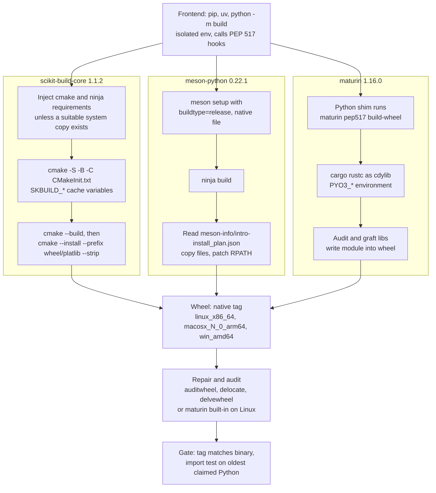

# Python Native Build Backends: scikit-build-core, meson-python, and maturin

> [!summary] Claim:
> A native build backend is a PEP 517 adapter that drives a foreign build system (CMake, Meson, or Cargo), collects the files that system would install, and writes them into a wheel with tags the backend computes itself.
> The three backends differ in who owns the install manifest: scikit-build-core runs `cmake --install` into the wheel tree, meson-python reads Meson's install plan and copies from the build directory, and maturin links the Cargo output and places it directly.
> None of them proves portability: scikit-build-core and meson-python emit native `linux_*` tags, and maturin does its own manylinux audit but its PEP 517 entry point turns that audit off unless told otherwise.
> An expert picks the backend that matches the existing native build system, then gates every wheel with a repair tool, a tag-versus-binary check, and an import test on the oldest interpreter the tag claims.



## The Mechanism

### The contract every backend implements (PEP 517, PEP 660)

A frontend such as pip, uv, or `python -m build` reads `[build-system]` in `pyproject.toml`, creates an isolated environment, installs `requires`, and imports the module named by `build-backend`.
PEP 517 makes `build_wheel` and `build_sdist` mandatory and the `get_requires_for_*` and `prepare_metadata_for_build_wheel` hooks optional; PEP 660 adds `build_editable` for editable installs.
`config_settings` is the only per-build channel from the frontend, which is why all three backends expose options both in `pyproject.toml` and as `-C key=value` settings.
[[Python-Packaging-History-and-pyproject-toml]] owns the history and the table layout; this note owns what happens after the hook is called.

The three backends implement the hooks differently (read from each package's source, as of 2026-11):

| Hook | scikit-build-core 1.1.2 | meson-python 0.22.1 | maturin 1.16.0 |
|---|---|---|---|
| `build_wheel`, `build_sdist` | yes | yes | yes |
| `build_editable` | yes | yes | yes |
| `prepare_metadata_for_build_wheel` | yes, except when an override uses the `failed` condition | not defined, so a frontend that wants metadata runs `build_wheel` | yes, by running `maturin pep517 write-dist-info` |
| `get_requires_for_build_wheel` | adds `cmake` and `ninja` when no suitable system program exists, plus `build.requires` and dynamic-metadata providers | adds `ninja` when none is found, and `patchelf` on Linux when it is not on `PATH` | adds `cffi` for `bindings = "cffi"` and `puccinialin` (a Rust bootstrapper) when `cargo` is missing |

A native backend does five jobs that a pure-Python backend does not:
1. It finds or provisions the foreign toolchain and declares extra build requirements.
2. It configures and compiles with the right interpreter, ABI, and platform hints.
3. It builds a manifest of the files that belong in the wheel and where they go.
4. It computes the wheel metadata and the compatibility tag triple.
5. It produces an sdist that can be rebuilt without the original checkout, and an editable install that survives source edits.

Repair, meaning bundling external shared libraries and proving manylinux compliance, is not one of the five jobs for two of the three backends.
[[Python-Wheels-Platform-Tags-Manylinux-and-ABI3]] owns the tag grammar and the repair tools; this note records where each backend stops and the repair tool must start.

### scikit-build-core: CMake is the build system, the backend is the glue

scikit-build-core is a pure-Python backend (`requires-python >=3.9`, release 1.1.2 on 2026-11-03) that depends on `packaging`, `pathspec`, and on Python older than 3.11 `tomli`, `exceptiongroup`, and `typing-extensions` (PyPI `requires_dist`).
Its configuration lives in `[tool.scikit-build]`, can be overridden by `-C` config settings and by `SKBUILD_`-prefixed environment variables, and can be conditioned per platform or Python version with the `tool.scikit-build.overrides` array of tables (conditions include `python-version`, `platform-system`, `platform-machine`, `implementation-name`, `scikit-build-version`, and `env.*`).

**Toolchain provisioning.**
`get_requires_for_build_wheel` yields `cmake{specifier}` unless a system CMake satisfies `cmake.version`, and `ninja{specifier}` unless Ninja is clearly not used, a system Ninja satisfies `ninja.version`, or `CMAKE_MAKE_PROGRAM` is set.
On Windows with the default Visual Studio generator it adds no Ninja requirement.
With `ninja.make-fallback = true` (the default) a platform with no known Ninja wheel and a working `make` skips the Ninja download.
`cmake.version` defaults to the `cmake_minimum_required` read from `CMakeLists.txt` (since scikit-build-core 0.10), and `ninja.version` defaults to `>=1.5`.
Listing `cmake` or `ninja` in `build-system.requires` is discouraged: the backend logs `cmake should not be in build-system.requires - scikit-build-core will inject it as needed`, because a pin defeats the system-tool detection.

**Configure.**
`CMaker.configure` runs `cmake -S<source> -B<build> [--toolchain=...] -C<build>/CMakeInit.txt -D<define>... <args>`.
The `-C` initial-cache file `CMakeInit.txt` is where the backend injects its hints, each written as a forced `CACHE` entry:
- `SKBUILD=2`, `SKBUILD_CORE_VERSION`, `SKBUILD_PROJECT_NAME`, `SKBUILD_PROJECT_VERSION` (capped to four components so `project(VERSION ...)` accepts it), `SKBUILD_PROJECT_VERSION_FULL`, and `SKBUILD_STATE` (one of `sdist`, `wheel`, `metadata_wheel`, `editable`, `metadata_editable`).
- One `SKBUILD_<TREE>_DIR` per wheel tree: `SKBUILD_PLATLIB_DIR` (or `SKBUILD_PURELIB_DIR` for a wheel with no compiled code), `SKBUILD_DATA_DIR`, `SKBUILD_HEADERS_DIR`, `SKBUILD_SCRIPTS_DIR`, `SKBUILD_NULL_DIR`, and `SKBUILD_METADATA_DIR`.
- `SKBUILD_SOABI`, `SKBUILD_SABI_COMPONENT` (`Development.SABIModule` or empty), and `SKBUILD_SABI_VERSION` such as `3.9`.
- With `cmake.python-hints = true` (the default), `Python_EXECUTABLE`, `Python_ROOT_DIR`, `Python_INCLUDE_DIR`, `Python_FIND_REGISTRY=NEVER`, and their `Python3_` and legacy `PYTHON_` twins, so `find_package(Python)` finds the build interpreter and not a system one.
- `CMAKE_PREFIX_PATH` extended with `site-packages` and with `cmake.prefix`, `cmake.module`, and `cmake.root` entry points, so a build dependency such as pybind11 or nanobind is found by installing it from PyPI.

A single-config generator also gets `-DCMAKE_BUILD_TYPE:STRING=Release`, because `cmake.build-type` defaults to `Release`; a list value builds and installs several configurations into one wheel (new in 1.0).
`CMAKE_ARGS` from the environment is honored (conda-forge relies on it), but `CMAKE_BUILD_TYPE` and `CMAKE_INSTALL_PREFIX` in it are dropped with an `Unsupported CMAKE_ARGS ignored` warning, because the backend owns those two.
If CMake is older than 3.26.1 (`backport.find-python`), a backported `FindPython` is added to `CMAKE_MODULE_PATH`.

**Build and install into the wheel tree.**
The backend runs `cmake --build <dir>` and then `cmake --install <dir> --prefix <wheel platlib dir> --strip`, with `install.strip` defaulting to true for `Release` and `MinSizeRel` builds (since 0.5, per the setting's docstring) and `install.components` or `install.targets` to narrow the install.
It also sets `CMAKE_INSTALL_PREFIX` at configure time to the same directory, because some projects hard-code it.
The wheel tree is a temporary directory with the sub-trees `platlib` (or `purelib`), `data`, `headers`, `scripts`, `null`, and `metadata`.
A `CMakeLists.txt` therefore writes `install(TARGETS _core DESTINATION demo)` and the file lands in `demo/` inside the platlib tree, with `wheel.install-dir` available to relocate everything.
Python sources are copied separately by `wheel.packages`, which autodetects the first of `src/<name>`, `python/<name>`, or `<name>`, and `wheel.exclude` filters the result.

**Build directory lifecycle.**
By default the build directory is a temporary directory deleted after the build, so an isolated `pip install .` does a full rebuild every time.
Setting `build-dir` reuses it; `CMaker` writes `.skbuild-info.json` and deletes `CMakeCache.txt` and `CMakeFiles/` when the source path or the scikit-build-core install path recorded there differs (a new isolated environment changes the second), or when the file is unreadable.
`cmake.fresh = true` forces the same clean.

**Tags.**
`WheelTag.compute_best` starts from the first `packaging.tags.sys_tags()` entry that is not `manylinux` or `musllinux`, so Linux wheels carry the native `linux_<arch>` tag and the backend says so in a code comment: "can't assume manylinux, use auditwheel instead".
`wheel.py-api = "cp39"` produces `cp39-abi3` (only on CPython whose minor version is at least 9, and the request is otherwise ignored with a debug-level log line), `"cp315t"` produces `cp315-abi3t`, and `"cp315.cp315t"` produces `cp315-abi3.abi3t`, both only from a free-threaded CPython 3.15 or later build (on a GIL-enabled interpreter an abi3t-only request is ignored at debug level).
On a free-threaded interpreter older than 3.15 a classic `py-api` is ignored with the message `Free-threaded Python doesn't support the classic Limited API, ignoring`, so the wheel falls back to a version-specific `cp314-cp314t` tag.
The CMake side opts in with `find_package(Python REQUIRED COMPONENTS Interpreter Development.Module ${SKBUILD_SABI_COMPONENT})` and `python_add_library(_core MODULE WITH_SOABI USE_SABI ${SKBUILD_SABI_VERSION} ...)`; CMake 3.26 added `Development.SABIModule` and `USE_SABI`, which defines `Py_LIMITED_API` for the target, and CMake 4.4 defines `Py_TARGET_ABI3T` instead when `Python_FREE_THREADED` is true on Python 3.15 or later (FindPython documentation).
On macOS the platform tag comes from, in order, an explicit `CMAKE_OSX_DEPLOYMENT_TARGET` in `cmake.define` or `cmake.args`, then `MACOSX_DEPLOYMENT_TARGET`, then `platform.mac_ver()`, with a floor of 11.0 on arm64 and the minor version forced to 0 from macOS 11 on (`builder/macos.py`).
A value set only in `CMakeLists.txt` or a toolchain file is invisible to the tag logic, which the source says plainly: "Settings in CMakeLists.txt or a toolchain file cannot be seen here and are not honored."
`ARCHFLAGS` with both `arm64` and `x86_64` yields `universal2`.

**Metadata and sdist.**
Metadata comes from `[project]` through a vendored `pyproject_metadata`, with dynamic fields filled by providers declared in `tool.dynamic-metadata` array entries (the package ships providers under `scikit_build_core.metadata`).
`build_sdist` walks the tree with git-ignore semantics (`sdist.inclusion-mode = "default"` since 0.12, with `classic`, `manual`, and `explicit` alternatives), applies `sdist.include`, `sdist.exclude`, and `sdist.force-include`, and writes a reproducible tarball by default (`sdist.reproducible = true`).
The sdist is not a build tree: the receiving machine runs the whole backend again, so the sdist must contain `CMakeLists.txt` and every file it references.
`sdist.cmake = true` additionally runs CMake before the sdist is built (the setting's docstring says only "CMake will be run before building the SDist").
`wheel.reproducible` defaults to false and, when enabled, normalizes archive timestamps and permissions and exports `SOURCE_DATE_EPOCH` to the build.

**Minimum-version compatibility.**
`tool.scikit-build.minimum-version` (or the special string `"build-system.requires"`, which reads the lower bound from `requires`) makes a newer backend select older defaults, so a project is not broken when a default flips; for example `minimum-version` below 0.12 keeps the `classic` sdist mode.

### meson-python: Meson plans the install, the backend replays it into a wheel

meson-python (0.22.1, released 2026-10-01, `requires-python >=3.10`) requires `meson >=0.64.0` on Python older than 3.12 and `>=1.2.3` on 3.12 and later, `packaging >=23.2`, `pyproject-metadata >=0.9.0`, and ninja 1.8.2 or newer at build time.
Unlike the other two it has no mandatory `[tool.*]` table: a project that wants no customization needs only `[build-system]`, `[project]`, and a `meson.build`.
When `[project]` is absent, the name and version come from `project()` in `meson.build`.

**Setup.**
The `Project` constructor writes two small files into the build directory and then calls Meson:
1. A native file `meson-python-native-file.ini` with `[binaries] python = '<sys.executable>'`, passed as the last `--native-file` so it overrides any user-supplied interpreter path.
2. On macOS with `ARCHFLAGS`, a synthesized cross file; on iOS always, and on Android under cibuildwheel, a cross file as well.
3. `meson setup <src> <build> -Dbuildtype=release -Db_ndebug=if-release -Db_vscrt=md <setup-args> --native-file=...`, adding `--reconfigure` when `meson-private/coredata.dat` already exists.

The three `-D` defaults exist because Meson's own defaults suit development, not wheels: `buildtype=release` drops debug info and optimizes, `b_ndebug=if-release` makes release builds define `NDEBUG`, and `b_vscrt=md` avoids linking the MSVC debug runtime, whose Python DLL does not exist on Windows (all three from `docs/explanations/default-options.rst`).
User options go through `-Csetup-args=...`, `-Ccompile-args=...`, `-Cinstall-args=...`, or `[tool.meson-python.args]`, and command-line values are applied after file values.
The build directory is a temporary `.mesonpy-*` directory inside the source tree unless `-Cbuild-dir` is given, and a `.gitignore` containing `*` (plus a matching `.hgignore`) is written into an empty build directory.
The `MESON` environment variable or `tool.meson-python.meson` selects the Meson executable, and a value ending in `.py` is run with the build Python, which supports a vendored Meson.
`NINJA` selects Ninja or an alternative such as `samu`.

**Build and the install plan.**
The compile step is `ninja` directly, except on Windows, where it is `meson compile` so MSVC's environment is set up.
meson-python does not run `meson install`.
It reads `meson-info/intro-install_plan.json`, a JSON document Meson writes after setup that lists every file Meson would install with its destination, install tag, subproject, and install RPATH, and builds the wheel from that.
`--tags` and `--skip-subprojects` found in `install-args` filter the plan, and `tool.meson-python.wheel.exclude` and `wheel.include` apply `fnmatch` globs to the destination.
Each destination's anchor maps to a wheel tree through a fixed table: `{py_platlib}` and `{moduledir_shared}` to `platlib`, `{py_purelib}` to `purelib`, `{bindir}` to `scripts`, `{includedir}` to `headers`, `{datadir}` to `data`, and `{libdir}` and `{libdir_shared}` to a custom `.<distribution>.mesonpy.libs/` directory at the wheel root.
An install location that matches none of these is a hard `BuildError`, and a package split between `purelib` and `platlib` is another: the message tells the author to pass `pure: false` to `find_installation()`.
Because the plan is replayed rather than executed, behavior that `meson install` would add beyond copying plan entries, such as scripts registered with `meson.add_install_script`, has no counterpart in this path (observed on macOS arm64 with meson-python 0.22.1 and Meson 1.12.1: a `meson.add_install_script` hook that writes a marker file ran under `meson install --destdir` and did not run during `python -m build --wheel`).

**RPATH rewriting.**
The wheel does not hold the build tree, so build-time RPATH entries must go.
For every native file in the wheel (ELF magic `7fELF`, Mach-O magics, or `MZ` on Windows), `mesonpy._rpath.fix_rpath`:
1. reads the current RPATH with `patchelf --print-rpath` on Linux or `otool -l` on macOS;
2. prepends the target's `install_rpath` entries and drops the entries Meson listed in `build_rpaths` (relative to the build directory, or absolute inside it), plus the `XXXX` padding entry Meson reserves;
3. if the wheel has project-internal libraries and any old entry began with `$ORIGIN` (which signals a dependency on one), appends `$ORIGIN/<relative path to .<dist>.mesonpy.libs>`;
4. writes the result with `patchelf --set-rpath` on Linux, or `install_name_tool -delete_rpath` and `-add_rpath` on macOS (`$ORIGIN` becomes `@loader_path`), and does nothing on Windows.

This is why `get_requires_for_build_wheel` asks for `patchelf >=0.11.0` on Linux, and why internal shared libraries on Windows are refused unless `tool.meson-python.allow-windows-internal-shared-libs = true`: Windows has no RPATH, so the package itself must call `os.add_dll_directory` or preload the libraries.
Internal libraries get RPATH relocation for free; external libraries (for example a system `libfoo.so`) get nothing, and need `auditwheel`, `delocate`, or `delvewheel`.

**Tags.**
`mesonpy._tags.Tag` assembles the triple from the running interpreter, not from the project:
- A wheel with nothing in `platlib` or the libs directory and no native script is `py3-none-any`.
- A wheel with native files but no `platlib` content (a program wheel) is `py3-none-<platform>`.
- Otherwise it is `<interpreter>-<abi>-<platform>`, with the ABI parsed from `EXT_SUFFIX`, such as `cp312-cp312`.
- With `tool.meson-python.limited-api = true` and a Meson option `python.allow_limited_api` that is still true, the ABI becomes `abi3`, or `abi3.abi3t` on free-threaded CPython 3.15 and later.
The interpreter field stays `cp3XY` of the build interpreter: the docs say so directly, "The wheel's Python compatibility tag still corresponds to the interpreter used for the build, regardless of the `limited_api` version you select."
A package built on CPython 3.12 with `limited_api: '3.9'` is therefore `cp312-abi3-*`, which an installer on 3.10 will not select, unlike scikit-build-core's `cp39-abi3`.
The Linux platform tag is `sysconfig.get_platform()` lowercased with `-` and `.` replaced by `_`, so `linux_x86_64`.
On macOS the version is `MACOSX_DEPLOYMENT_TARGET` if set, else `platform.mac_ver()`, floored at 11.0 on arm64 with the minor reset to 0 from macOS 11 on; `-mmacosx-version-min` in `c_args` is not read, and the docs say the tag is wrong unless the environment variable is set.
meson-python never consults the interpreter's `sysconfig` deployment target, so it avoids the Homebrew-built-for-27 trap that [[Python-Wheels-Platform-Tags-Manylinux-and-ABI3]] documents for setuptools.

**Limited API in Meson.**
`extension_module('_core', ..., limited_api: '3.9')` (Meson 1.3.0 and later) appends `-DPy_LIMITED_API=<hex>` to `c_args` and `cpp_args` and switches the module suffix to the stable-ABI suffix; on Windows it links `python3.dll`'s import library instead of `pythonXY.lib`.
With `limited-api = true` meson-python then checks every platlib file whose name looks like an extension module and raises `BuildError` if any carries a version-specific ABI suffix, which catches a module that forgot `limited_api`.
On free-threaded CPython older than 3.15 it raises `The package targets Python's Limited API, which is not supported by free-threaded CPython before version 3.15`, and the recommended pattern is to default `python.allow_limited_api=false` in `project()` and opt in per build.

**sdist.**
`build_sdist` runs `meson dist --allow-dirty --no-tests --formats gztar`, then rewrites the archive: it renames members to the PEP 625 name, resolves symbolic links to regular files, resets owner to `root:root`, and adds `PKG-INFO`.
Meson's own documentation says `meson dist` packages "the full contents of the latest commit in revision control", so a file that is modified but not committed is not in the sdist, and `--allow-dirty` only suppresses the error that would otherwise stop the build.
This is intentional in Meson (to prevent releasing an archive that matches no commit) and a trap for a Python workflow that expects the sdist to match the working tree.

### maturin: a Rust binary that happens to speak PEP 517

maturin (1.16.0, released 2026-10-29) is a Rust program shipped as platform wheels; its `build-backend = "maturin"` module is a thin Python shim that shells out to `maturin pep517 <subcommand>` and reads the last line of stdout as the hook's return value.
Building maturin itself needs Rust 1.89 or newer (`rust-version` in its `Cargo.toml`), which only matters if no wheel exists for the platform.

**The shim.**
`build_wheel` runs `maturin pep517 build-wheel -i <sys.executable> [--editable] <args>`, where extra arguments come from `-C maturin.build-args=...` (or the older `build-args`) or the `MATURIN_PEP517_ARGS` environment variable.
Two defaults live here and not in the Rust code:
1. If neither `--compatibility` nor `--manylinux` is in the arguments, the shim prepends `--compatibility off`, with the comment "default to off if not otherwise specified".
2. If no `cargo` is on `PATH` and `MATURIN_NO_INSTALL_RUST` is unset, `get_requires_for_build_wheel` returns `puccinialin` and the shim installs a temporary Rust toolchain.
`use-base-python` (or `MATURIN_PEP517_USE_BASE_PYTHON`) makes the shim pass the base interpreter instead of the venv one, which avoids recompiling when only the venv changes.
PEP 517 builds default to the `release` Cargo profile.

**Bridge detection.**
`find_bridge` reads `cargo metadata` and decides how the Rust code talks to Python:
1. `pyo3-ffi` or `pyo3` in the dependency graph selects the PyO3 bridge, unless the crate has only a binary target, which selects `bin`.
2. Otherwise a `uniffi` dependency selects UniFFI, a `cdylib` target selects `cffi`, and a lone `bin` target selects `bin`.
3. `--bindings` or `[tool.maturin] bindings` overrides detection.
Abi3 is inferred from the `abi3` and `abi3-pyXY` features of `pyo3` or `pyo3-ffi`, and `[tool.maturin] features` may be conditional on the target Python version, for example `{ feature = "pyo3/abi3-py311", python-version = ">=3.11" }`.
A single build selects one stable ABI family; the guide says to run two builds with different interpreters to publish both an `abi3` and an `abi3t` wheel.
[[Rust-PyO3-and-Maturin-Internals]] owns what PyO3 does with those features.

**Compile.**
maturin runs `cargo rustc` (adding `--crate-type cdylib` for a library target that lacks it) and sets, for PyO3 builds, `PYO3_BUILD_EXTENSION_MODULE=1`, `PYO3_PYTHON` to the chosen interpreter, and `PYO3_ENVIRONMENT_SIGNATURE` so PyO3's build script reruns when the interpreter changes.
PyO3 0.26 and later read that environment variable; for older PyO3 it warns when the `extension-module` feature is off.
When the target interpreter cannot run (cross-compilation) or a stable ABI is forced, it writes `target/maturin/pyo3-config-<triple>-<major>.<minor>[-abi3].txt` and points `PYO3_CONFIG_FILE` at it, rewriting the file only when its content changes so Cargo does not rebuild needlessly.
On macOS it adds `-C link-arg=-undefined -C link-arg=dynamic_lookup` through `CARGO_ENCODED_RUSTFLAGS` so they apply to every crate in the graph, and sets `MACOSX_DEPLOYMENT_TARGET` for non-editable builds when the variable is unset, choosing in order the environment, then `[tool.maturin.target.<triple>] macos-deployment-target`, then rustc's default, and printing `Using MACOSX_DEPLOYMENT_TARGET=<v> for <triple> by <source>`.
Cargo's `target/` directory persists between builds in the project directory, so a repeated build reuses compiled dependencies, unlike the CMake and Meson backends, whose default build directories are temporary and deleted after each build.

**Audit and repair.**
`AuditWheelMode` has four values: `repair`, `check`, `warn`, and `skip`.
The default is `repair` on Linux and `warn` on macOS and Windows; the source comment says the newer macOS and Windows repair support defaults to warn "so we don't break existing workflows".
The Linux path is an auditwheel reimplementation: it parses the ELF with `goblin`, compares symbol versions and `DT_NEEDED` entries with the bundled `manylinux-policy.json` and `musllinux-policy.json`, picks the highest compatible policy, and returns plain `linux` if none fits.
It errors if the module links `libpython`.
When external libraries must be bundled it copies them into `<distribution>.libs/` under hashed names and edits the ELF with `patchelf` (soname, `DT_NEEDED`, and an `$ORIGIN` RPATH); `patchelf` comes from `pip install maturin[patchelf]` and is not in the PEP 517 `requires` list.
maturin 1.13.0 added reimplementations of `delocate` (macOS, bundling into `<distribution>.dylibs/` with an ad-hoc re-signature) and `delvewheel` (Windows), per the changelog entries for #3114, #3116, and #3121.
Platform selection also lives here: the default for a non-zig Linux glibc build is the lowest compatible manylinux tag, musl targets default to `musllinux_1_2`, and `--zig` defaults to the architecture's minimum manylinux tag from `Target::get_minimum_manylinux_tag` (`manylinux2014`, glibc 2.17, on x86_64, aarch64, armv7, ppc64, ppc64le, and s390x; `manylinux_2_31` on riscv64; `manylinux_2_36` on loongarch64) and links with `zig cc` so the chosen glibc baseline is enforced at link time instead of audited afterwards.

**The PEP 517 consequence.**
`resolve_platform_tags` uses the command-line tags if any were given and only otherwise reads `[tool.maturin] compatibility`, so the shim's injected `--compatibility off` wins over the `pyproject.toml` value in a PEP 517 build (confirmed in the 1.16.0 source, `build_context/builder.rs` and `maturin/__init__.py`, by reading rather than a recorded build).
The shim tests for the exact tokens `--compatibility` and `--manylinux`, so pass the option as two tokens; a single `--compatibility=manylinux_2_28` token is not recognized and `off` is still prepended.
`off` maps to `PlatformTag::Linux`, and `auditwheel_rs` returns immediately for that tag, so a Linux wheel from `pip wheel .` or `python -m build` is `linux_<arch>` and unaudited, while `maturin build` run directly applies the audit.
The way to get a manylinux tag through a frontend is `-C maturin.build-args="--compatibility manylinux_2_28"`, or to let cibuildwheel's `auditwheel repair` retag the wheel afterwards.

**Wheel assembly and layouts.**
A pure Rust project gets a generated `__init__.py` that re-exports the extension module; a mixed project (a directory named after `lib.name`, or `python-source`, or a `src/` layout that maturin detects) keeps the author's `__init__.py` and places the compiled module inside the package, optionally under a dotted `module-name` such as `my_package._native`.
`include` and `exclude` take globs, `python-packages` lists extra packages, and `data` points at a `<module>.data` directory.
Type stubs next to the Rust source are copied (`__init__.pyi` and `py.typed`), and with PyO3's `experimental-inspect` feature `--generate-stubs` generates them from the binary instead.
`cffi` bindings run `cbindgen` to produce a header and write a small `ffi`/`lib` module; `uniffi` generates `ctypes` bindings; `bin` places the executable in the wheel's `scripts` directory.
Wheel compression defaults to deflate level 6, and only `stored` and `deflated` are compatible with every installer.

**sdist.**
`maturin sdist` and `build_sdist` produce the files `cargo package` would, plus `pyproject.toml`, the Python sources, and any `include` entries with `format = "sdist"`; `sdist-generator = "git"` switches to `git ls-files`.
Path dependencies and workspace members outside the crate are copied into the sdist and the `Cargo.toml` files are rewritten, resolving workspace inheritance, so the archive builds without the original checkout.
The PEP 517 `write-sdist` path enables all features so optional path dependencies are packaged, and 1.16.0 stops including the Cargo `target` directory in wheels built from sdists.

### Editable installs side by side

All three implement PEP 660, and all three need the build tools at import or reinstall time, so isolated editable builds are discouraged by every one of them:

| Aspect | scikit-build-core 1.1.2 | meson-python 0.22.1 | maturin 1.16.0 |
|---|---|---|---|
| Mechanism | `.pth` installs `ScikitBuildRedirectingFinder` (on 3.15 and later the import moves into a PEP 829 `.start` file and the `.pth` keeps only `sys.path` entries, both observed on 3.15.2); Python sources load from the source tree and compiled files from the CMake install tree; `editable.mode = "inplace"` instead adds a `.pth` to the source package and builds in place | a `.pth` (or a `.start` file on 3.15 and later, observed on 3.15.2) imports a generated `_<dist>_editable_loader.py` that inserts a meta-path finder and a path hook, mapping names from the install plan to the build tree and source tree | mixed layout: the compiled module is copied into the Python source directory and a `<dist>.pth` pointing at `python-source` is written; pure Rust: an ordinary wheel is installed |
| Rebuild | off by default; `editable.rebuild = true` (documented as experimental) rebuilds on first import and needs `build-dir` except in `inplace` mode; `module.__loader__.rebuild()` rebuilds on demand | on the first matching import in every Python process the finder runs the recorded `ninja` command; with `-n` as a dry run when verbose | none; rerun `maturin develop`, or use the separate import-hook project |
| Build directory | `build-dir` required for rebuilds; `inplace` uses the source tree | `build/<abi tag>` by default, for example `build/cp311`, so one project can be editable-installed for several interpreters | Cargo `target/` |
| Failure mode | a stale or deleted `build-dir` breaks the install; adding files needs a reinstall | a failed rebuild raises `ImportError: rebuilding the "<name>" editable package failed` with the build log attached; output goes to `meson-logs/meson-python-build-log.txt` unless verbose | `maturin develop` also rewrites `direct_url.json` so tools see the install as editable |
| Verbose switch | `SKBUILD_EDITABLE_VERBOSE` or `editable.verbose` | `MESONPY_EDITABLE_VERBOSE` or `editable-verbose` | `-v` |
| Needed in the environment | the build requirements, and `--no-build-isolation` is recommended | `meson-python`, `meson`, `ninja`, and the other build requirements, because the rebuild imports nothing from the isolated environment | Rust toolchain for rebuilds |

Both finders guard against recursion: scikit-build-core lists the build directory in `SKBUILD_EDITABLE_SKIP`, and meson-python puts the build path in `MESONPY_EDITABLE_SKIP`, so a build step that imports the package during its own rebuild does not trigger another rebuild.
Data files in an editable meson-python install must be read through `importlib.resources`, because the loader presents a virtual file tree and `__file__`-relative reads of installed data fail.

### Cross-compilation and platform hints

| Target situation | scikit-build-core | meson-python | maturin |
|---|---|---|---|
| General mechanism | CMake toolchain file via `cmake.toolchain-file` or `CMAKE_TOOLCHAIN_FILE`, with `wheel.tags` to set the tag and `cmake.python-hints = false` if the toolchain finds Python | Meson cross file via `-Csetup-args=--cross-file=...` | `--target <triple>`; PyO3 gets a generated config file when the target interpreter is not runnable |
| macOS arm64 from x86_64 | `ARCHFLAGS` honored unless `CMAKE_SYSTEM_PROCESSOR` is in the CMake args; two architectures give `universal2` | `ARCHFLAGS` with one architecture synthesizes a cross file; several architectures are rejected with `Multi-architecture builds are not supported` | `--target` with an Apple triple; the macOS repairer handles universal2 artifacts |
| Tag override | `_PYTHON_HOST_PLATFORM`, `wheel.tags` | `_PYTHON_HOST_PLATFORM` (arch part read by `_get_macosx_platform_tag`) | derived from the target triple |
| Linux glibc baseline | build in a manylinux image or cross toolchain | same | `--zig` with `--compatibility`, or the `manylinux-cross` images |
| Windows ARM or MSVC from Linux | `DIST_EXTRA_CONFIG` and `SETUPTOOLS_EXT_SUFFIX` as cibuildwheel sets them; use `${SKBUILD_SOABI}` for the suffix | Meson cross file | `xwin` (the `cross-compile` feature is `zig` plus `xwin`) |
| Mobile and WebAssembly | Pyodide via `_PYTHON_SYSCONFIGDATA_NAME` and `_PYTHON_HOST_PLATFORM`; Android via cibuildwheel's toolchain file | iOS cross file generated automatically (needs Meson 1.9.0); Android under cibuildwheel; `IPHONEOS_DEPLOYMENT_TARGET` for the tag | Emscripten (the 1.16.0 changelog mentions the toolchain pyodide-build expects) and a WASI platform tag for extension wheels |

[[Python-Cross-Platform-Wheel-Pipelines-with-cibuildwheel]] owns the matrix that sets these variables for you.

### Repair: where each backend stops

| Concern | scikit-build-core | meson-python | maturin |
|---|---|---|---|
| Linux tag | `linux_<arch>`; build in a manylinux image and run `auditwheel` | `linux_<arch>`; same | audited manylinux or musllinux tag by direct `maturin build`; `linux_<arch>` in a PEP 517 build unless overridden |
| External shared libraries on Linux | not bundled; `auditwheel repair` | not bundled; `auditwheel repair` | grafted into `<dist>.libs/` by default in repair mode |
| Project-internal shared libraries | an `install(TARGETS ... DESTINATION)` and RPATH set in CMake are the author's job | installed under `.<dist>.mesonpy.libs/` with RPATH rewritten | cdylib only; vendored C libraries are audited like any external library |
| macOS | `delocate` | `delocate` for externals | built-in delocate equivalent since 1.13.0, default `warn` |
| Windows | `delvewheel` | `delvewheel`, or `allow-windows-internal-shared-libs` plus DLL-path code | built-in delvewheel equivalent since 1.13.0, default `warn` |
| ABI audit | none | checks that limited-API modules carry the stable-ABI suffix | none; `abi3audit` is separate |

The scikit-build-core guide states the contract bluntly: "The wheels produced by default are not designed to be redistributable."
[[Cpp-Glibc-Symbol-Versioning-and-Portable-Linux-Binaries]] owns the glibc symbol mechanism that makes a wheel built on a new distribution fail the policy, and [[Drill-Packaging-Manylinux-GLIBC-Symbol-Leak]] is the matching exercise.

## Commands and Numbers to Know

| Item | Value | Platform | Notes |
|---|---|---|---|
| Current releases | scikit-build-core 1.1.2 (2026-11-03), meson-python 0.22.1 (2026-10-01), maturin 1.16.0 (2026-10-29), Meson 1.12.1, PyPI `cmake` 4.4.5, PyPI `ninja` 1.13.2 (as of 2026-11) | Both | PyPI JSON API, queried 2026-11-21. |
| Backend Python floor | scikit-build-core `>=3.9`, meson-python `>=3.10`, maturin `>=3.7` (as of 2026-11) | Both | `requires-python` of the three releases. |
| scikit-build-core build type | `cmake.build-type = "Release"` (as of 2026-11) | Both | Passed as `CMAKE_BUILD_TYPE` only for single-config generators; a list builds several configurations (1.0 and later). |
| scikit-build-core install flags | `cmake --install <dir> --prefix <platlib> --strip` (as of 2026-11) | Both | `install.strip` defaults to true for `Release` and `MinSizeRel`; `CMAKE_INSTALL_PREFIX` is also set at configure time. |
| scikit-build-core toolchain versions | `cmake.version` from `cmake_minimum_required`, `ninja.version >=1.5`, `backport.find-python = 3.26.1` (as of 2026-11) | Both | `CMakeLists.txt` as the default specifier needs 0.10 or later. |
| scikit-build-core abi3 | `wheel.py-api = "cp39"` gives `cp39-abi3`; `"cp315t"` gives `cp315-abi3t`; `"cp315.cp315t"` gives `cp315-abi3.abi3t` (as of 2026-11) | Both | `SKBUILD_SABI_COMPONENT` and `SKBUILD_SABI_VERSION` expose the request to CMake. |
| scikit-build-core editable | `editable.mode = "redirect"`; `editable.rebuild` experimental and needs `build-dir` (as of 2026-11) | Both | Env `SKBUILD_EDITABLE_VERBOSE` controls rebuild output. |
| meson-python defaults | `-Dbuildtype=release -Db_ndebug=if-release -Db_vscrt=md` and a native file (as of 2026-11) | Both | Shown in the `User defined options` block of `meson setup` output. |
| meson-python tools | Meson `>=0.64.0` (`>=1.2.3` on Python 3.12 and later), ninja `>=1.8.2`, patchelf `>=0.11.0` on Linux (as of 2026-11) | Both | `NINJA` and `MESON` select alternatives. |
| Meson feature floors | limited API 1.3.0, `--skip-subprojects` 1.2.0, `install_rpath` and dynamic license 1.6.0, iOS and build RPATH removal 1.9.0 (as of 2026-11) | Both | From `reference/meson-compatibility.rst`. |
| meson-python editable | build directory `build/<abi tag>`, for example `build/cp311` (as of 2026-11) | Both | `-Cbuild-dir` overrides. |
| meson-python wheel layout | internal libs under `.<dist>.mesonpy.libs/` (as of 2026-11) | Both | Windows requires `allow-windows-internal-shared-libs`. |
| meson-python sdist | `meson dist --allow-dirty --no-tests --formats gztar` (as of 2026-11) | Both | Packages the latest commit, not the working tree. |
| maturin audit default | `repair` on Linux, `warn` on macOS and Windows (as of 2026-11) | Both | `AuditWheelMode` in 1.16.0; the guide's Distribution page lists `warn`, but its Configuration page comment still lists only repair, check, and skip. |
| maturin PEP 517 default | `--compatibility off` prepended when neither flag is given (as of 2026-11) | Linux | `maturin/__init__.py` in 1.16.0; yields a `linux_<arch>` tag. |
| maturin direct default | lowest compatible manylinux tag, `musllinux_1_2` on musl targets, `manylinux2014` with `--zig` on x86_64 and aarch64 (higher on riscv64 and loongarch64) (as of 2026-11) | Linux | `resolve_platform_tags` and the `--compatibility` help text. |
| maturin PyO3 env | `PYO3_BUILD_EXTENSION_MODULE=1`, `PYO3_PYTHON`, `PYO3_ENVIRONMENT_SIGNATURE`, `PYO3_CONFIG_FILE` when cross-compiling (as of 2026-11) | Both | `src/compile.rs`; PyO3 0.26 and later read the first. |
| maturin macOS target | environment, then `[tool.maturin.target.<triple>] macos-deployment-target`, then rustc default (as of 2026-11) | macOS | The rustc defaults, 11.0 on aarch64 and 10.12 on x86_64, were measured on rustc 1.99.0 in [[Python-Wheels-Platform-Tags-Manylinux-and-ABI3]]. |
| maturin repair directories | `<dist>.libs/` on Linux and Windows, `<dist>.dylibs/` on macOS (as of 2026-11) | Both | Same names as auditwheel, delvewheel, and delocate. |
| maturin first repair release | 1.13.0 added macOS and Windows repair (as of 2026-11) | Both | `Changelog.md` entries for #3114 and #3116. |
| `python -m scikit_build_core.builder.wheel_tag --abi cp39` | prints the computed tag for the current environment (as of 2026-11) | Both | A CLI in the 1.1.2 source; shows the tag without building. |
| Install plan inspection | `meson-info/intro-install_plan.json` in the build directory (as of 2026-11) | Both | The exact input to meson-python's manifest and to `wheel.exclude` patterns. |

## Multi-Language Comparison

| Concern | CMake and C, C++, Fortran (scikit-build-core) | Meson and C, C++, Cython, Fortran (meson-python) | Cargo and Rust (maturin) |
|---|---|---|---|
| Native build system | CMake 3.15 or newer, Ninja or Makefiles or Visual Studio | Meson plus Ninja | Cargo, rustc |
| Project config | `[tool.scikit-build]` plus `CMakeLists.txt` | `meson.build` plus optional `[tool.meson-python]` | `Cargo.toml` plus `[tool.maturin]` |
| Binding layer | pybind11, nanobind, Cython, SWIG, plain C, Fortran (scikit-build-core's getting-started page lists all of these) | C, C++, Cython, D, Fortran, Objective-C (the meson-python docs) | PyO3, `cffi` via cbindgen, UniFFI, or a `bin` target |
| Tag source | interpreter `sysconfig` for the Python and ABI fields, `py-api` for abi3, CMake and environment for macOS | the running interpreter for the Python and ABI fields, environment or `mac_ver` for macOS | target triple, PyO3 features, environment or rustc for macOS |
| abi3 request | `wheel.py-api = "cp39"` plus `USE_SABI` in CMake | `limited_api: '3.9'` in Meson plus `tool.meson-python.limited-api = true` | PyO3 feature `abi3-py39` |
| Python tag of an abi3 wheel | the requested version, `cp39-abi3` | the build interpreter, `cp312-abi3` on 3.12 | the minimum from the feature, `cp39-abi3` |
| Free-threaded abi3 | ignored below 3.15 with an info message; `cp315t` or `cp315.cp315t` on 3.15 | `BuildError` below 3.15; `abi3.abi3t` on 3.15 | version-specific `cp314-cp314t` fallback; `abi3t` for 3.15 and later |
| Linux portability | none built in | none built in | built-in audit and repair, off in PEP 517 mode by default |
| Incremental rebuild in dev | `build-dir` plus `editable.rebuild` | automatic on import via ninja | `maturin develop` |
| Typical failure | CMake finds a system Python instead of the build one, or an `install()` rule misses `SKBUILD_PLATLIB_DIR` | `meson dist` sdist missing uncommitted files, or a build RPATH leaking | a `linux_*` tag from the PEP 517 path, or a vendored C library needing its own repair |

[[Ship-a-Rust-Extension-in-a-Python-Wheel]] is the end-to-end playbook for the Rust column, and [[Python-Free-Threaded-Wheels-and-Wheel-Variants]] owns the free-threaded build matrix.

## Worked Example

This note has no lab, so there is no recorded `expected/` file.
The three projects below were built once on 2026-11-21 on macOS arm64 (Darwin 27.3.0, Apple clang 21) with CPython 3.13 in a fresh virtual environment, using `python -m build --wheel` with `scikit-build-core==1.1.2`, `meson-python==0.22.1` (Meson 1.12.1), and `maturin==1.16.0` (cargo 1.99.0, which resolved `pyo3 = "0.29"` to 0.29.3).
All three built, and each wheel installed into a clean environment and returned 42 from `demo._core.answer()`.
Each "Observed on macOS arm64" paragraph is that run.
Each "Expected on Linux x86_64" paragraph is derived from the backend source and was not run, because no Linux host or container was used; treat it as a claim to confirm with `unzip -l` and the commands in the Practice Drill.

The goal is one extension module `demo._core` exposing a trivial function, built three ways from a CPython interpreter.
The Linux expectations assume CPython 3.12 on Linux x86_64, and the macOS observations used CPython 3.13 on arm64, so the meson-python Python tag differs between them by design.
The C source is identical for the first two:

```c
/* Py_LIMITED_API is defined by the build system (CMake USE_SABI or Meson limited_api). */
#include <Python.h>

static PyObject *answer(PyObject *self, PyObject *args) {
    return PyLong_FromLong(42);
}

static PyMethodDef methods[] = {
    {"answer", answer, METH_NOARGS, "Return 42."},
    {NULL, NULL, 0, NULL}
};

static struct PyModuleDef moddef = {
    PyModuleDef_HEAD_INIT, "_core", NULL, -1, methods
};

PyMODINIT_FUNC PyInit__core(void) { return PyModule_Create(&moddef); }
```

### scikit-build-core

```toml
[build-system]
requires = ["scikit-build-core>=0.12"]
build-backend = "scikit_build_core.build"

[project]
name = "demo"
version = "0.1.0"
requires-python = ">=3.9"

[tool.scikit-build]
minimum-version = "build-system.requires"
wheel.py-api = "cp39"
wheel.packages = ["src/demo"]
wheel.exclude = ["**/*.c"]
```

```cmake
cmake_minimum_required(VERSION 3.26)
project(${SKBUILD_PROJECT_NAME} LANGUAGES C)

find_package(Python REQUIRED COMPONENTS Interpreter Development.Module ${SKBUILD_SABI_COMPONENT})

if(NOT "${SKBUILD_SABI_VERSION}" STREQUAL "")
  python_add_library(_core MODULE WITH_SOABI USE_SABI ${SKBUILD_SABI_VERSION} src/demo/_core.c)
else()
  python_add_library(_core MODULE WITH_SOABI src/demo/_core.c)
endif()

install(TARGETS _core DESTINATION demo)
```

`wheel.packages` copies the whole `src/demo` directory into the wheel, so without `wheel.exclude` the observed wheel also contained `demo/_core.c`; the exclude pattern applies to final wheel paths and removed it.
Observed on macOS arm64 (CPython 3.13): `demo-0.1.0-cp39-abi3-macosx_27_0_arm64.whl` with `Generator: scikit-build-core 1.1.2`, `Tag: cp39-abi3-macosx_27_0_arm64`, and exactly `demo/__init__.py` and `demo/_core.abi3.so` plus `dist-info`.
Expected on Linux x86_64 (derived from the source, not run): `demo-0.1.0-cp39-abi3-linux_x86_64.whl` with the same two files, with the `cmake` requirement added only if no system CMake satisfies `>=3.26`.
The `if` and `else` branches avoid a quoted `USE_SABI` variable, because an unquoted expansion of a string containing a space passes one argument to CMake (checked with `cmake -P` on CMake 4.5.1: `"USE_SABI 3.9"` expands to one argument, the list `USE_SABI 3.9` to two); the docs' prose form `set(USE_SABI USE_SABI ${SKBUILD_SABI_VERSION})` is a list and works, while their code block quotes it.

### meson-python

```toml
[build-system]
build-backend = "mesonpy"
requires = ["meson-python>=0.18"]

[project]
name = "demo"
version = "0.1.0"
requires-python = ">=3.9"

[tool.meson-python]
limited-api = true
```

```meson
project('demo', 'c', version: '0.1.0', meson_version: '>=1.3.0')

py = import('python').find_installation(pure: false)

py.extension_module('_core', 'src/demo/_core.c',
  subdir: 'demo',
  limited_api: '3.9',
  install: true,
)

py.install_sources('src/demo/__init__.py', subdir: 'demo')
```

Observed on macOS arm64 (CPython 3.13): `demo-0.1.0-cp313-abi3-macosx_27_0_arm64.whl` with `Generator: meson`, `Tag: cp313-abi3-macosx_27_0_arm64`, and exactly `demo/__init__.py` and `demo/_core.abi3.so` plus `dist-info`.
Expected on Linux x86_64 (derived from the source, not run): `demo-0.1.0-cp312-abi3-linux_x86_64.whl` on CPython 3.12 with the same two files.
The Python tag is `cp313` on 3.13 and would be `cp312` on 3.12, never `cp39`, because the tag logic uses the build interpreter although the Meson source says `limited_api: '3.9'`; the observed `cp313` is that behavior, and the first predict-the-output question below turns on it.
`requires = ["meson-python>=0.18"]` is a placeholder lower bound chosen for the example; set it to the oldest release that has every feature you use and check the changelog.

### maturin

```toml
[build-system]
requires = ["maturin>=1.0,<2.0"]
build-backend = "maturin"

[project]
name = "demo"
version = "0.1.0"
requires-python = ">=3.9"

[tool.maturin]
python-source = "python"
module-name = "demo._core"
features = ["pyo3/abi3-py39"]
```

```toml
[package]
name = "demo"
version = "0.1.0"
edition = "2021"

[lib]
name = "_core"
crate-type = ["cdylib"]

[dependencies]
pyo3 = "0.29"
```

```rust
use pyo3::prelude::*;

#[pyfunction]
fn answer() -> i64 {
    42
}

#[pymodule]
fn _core(m: &Bound<'_, PyModule>) -> PyResult<()> {
    m.add_function(wrap_pyfunction!(answer, m)?)
}
```

Observed on macOS arm64 (CPython 3.13): `maturin build` ran through the PEP 517 shim and produced `demo-0.1.0-cp39-abi3-macosx_11_0_arm64.whl` with `Generator: maturin (1.16.0)` and `Tag: cp39-abi3-macosx_11_0_arm64`.
It contained `demo/__init__.py`, `demo/_core.abi3.so`, `dist-info`, and a CycloneDX file `demo-0.1.0.dist-info/sboms/demo.cyclonedx.json`, the PEP 770 SBOM for the Rust dependency tree that the `[tool.maturin.sbom]` section of the guide's Configuration page describes (as of 2026-11).
Expected on Linux x86_64 (derived from the source, not run): with `python-source = "python"`, a package directory `python/demo/__init__.py`, and a module named `demo._core`, a direct `maturin build --release` on Linux yields `demo-0.1.0-cp39-abi3-manylinux_2_17_x86_64.manylinux2014_x86_64.whl` or a newer baseline, depending on the host glibc, and `pip wheel .` on the same host yields `demo-0.1.0-cp39-abi3-linux_x86_64.whl` because the shim injects `--compatibility off`.
`pyo3 = "0.29"` matches the maturin 1.16.0 guide's own example; PyO3 0.30.1 (2026-10-14, `rust-version` 1.85) is current on crates.io (as of 2026-11).
The example compiled on cargo 1.99.0 with `pyo3` 0.29.3; the Rust version that PyO3 needs is its own `rust-version`, and the maturin guide recommends declaring `package.rust-version`.
The exact lowest-compatible manylinux name is the one part of this example that no run here confirmed, because the audit only runs on Linux.

### What to compare

1. `unzip -p <wheel> 'demo-0.1.0.dist-info/WHEEL'` for the `Tag:` and `Generator:` lines.
2. `unzip -l <wheel>` for the layout: platlib files at the root for all three, no `.libs` directory unless something was bundled, and, for maturin, the SBOM file under `dist-info/sboms/`.
3. `readelf -d demo/_core*.so | grep -E 'RPATH|RUNPATH|NEEDED'` for the Linux library dependencies and RPATH.
4. `auditwheel show <wheel>` to see which manylinux policy the binary satisfies, which none of the first two backends computed.

## Pitfalls

> [!warning] Pitfall 1: A meson-python sdist ships the last commit, not your edits
> `meson dist` archives the latest commit and meson-python passes `--allow-dirty`, which only silences the dirty-tree error.
> A file you modified or added without committing is absent from the sdist, and a wheel built from that sdist can differ from the wheel built from your checkout.
> Build release sdists from a clean, tagged commit in CI, and always build a wheel from the sdist as a test.

> [!warning] Pitfall 2: maturin through a frontend does not audit by default
> The PEP 517 shim prepends `--compatibility off`, so `pip wheel .` and `python -m build` on Linux produce `linux_<arch>` wheels with no manylinux audit, and PyPI rejects a native `linux_*` tag.
> The `[tool.maturin] compatibility` value is ignored when a command-line tag is present, so setting it in `pyproject.toml` does not help (derived from the maturin 1.16.0 source and not run on Linux for this note).
> Pass `-C maturin.build-args="--compatibility manylinux_2_28"`, call `maturin build` directly in a manylinux image, or repair with `auditwheel` in cibuildwheel.

> [!warning] Pitfall 3: A meson-python abi3 wheel is tagged with the build interpreter
> The Python tag is `cp3XY` of the interpreter that ran the build, so an abi3 wheel built on 3.12 is `cp312-abi3` and is skipped by installers on 3.9 through 3.11.
> scikit-build-core and maturin tag the requested minimum, `cp39-abi3`.
> Build abi3 wheels with the oldest Python the tag should serve, which is also what [[Python-Wheels-Platform-Tags-Manylinux-and-ABI3]] recommends for its suffix problem.

> [!warning] Pitfall 4: The default wheel is not redistributable
> scikit-build-core and meson-python produce native `linux_<arch>` tags, `macosx_*` tags that follow the build host, and no bundled libraries.
> Run `auditwheel repair`, `delocate-wheel`, or `delvewheel` in a pinned build image, and verify the result with the checks in [[Python-Cross-Platform-Wheel-Pipelines-with-cibuildwheel]].

> [!warning] Pitfall 5: macOS deployment target set where the tag logic cannot see it
> scikit-build-core reads `CMAKE_OSX_DEPLOYMENT_TARGET` only from `cmake.define` and `cmake.args`, plus `MACOSX_DEPLOYMENT_TARGET` and `ARCHFLAGS`, so a `set(CMAKE_OSX_DEPLOYMENT_TARGET ...)` in `CMakeLists.txt` changes the binary but not the tag.
> meson-python reads only `MACOSX_DEPLOYMENT_TARGET` and ignores `-mmacosx-version-min` passed in `c_args`.
> Set the environment variable, and check `vtool -show-build` against the tag as in [[Cpp-macOS-Universal-Binaries-Code-Signing-and-Notarization]].

> [!warning] Pitfall 6: Editable installs with build isolation break on first import
> meson-python and scikit-build-core rebuild or re-resolve against build requirements at import time, and pip deletes the isolated environment after the install.
> The symptom is `ImportError: rebuilding the "demo" editable package failed` with a build log naming a missing `meson`, `ninja`, or Python header path.
> Install the build requirements in the development environment and use `pip install --no-build-isolation -e .`.

> [!warning] Pitfall 7: Pinning cmake or ninja in build-system.requires
> scikit-build-core detects a suitable system CMake or Ninja and downloads one only if needed; a pin forces the PyPI copy everywhere and logs a warning.
> Put the constraint in `cmake.version` and `ninja.version`, and let the backend decide.

> [!warning] Pitfall 8: Setting CMAKE_BUILD_TYPE or CMAKE_INSTALL_PREFIX through CMAKE_ARGS
> scikit-build-core drops both from the environment variable with a warning, because it owns the build type and the install prefix.
> Use `cmake.build-type` and `wheel.install-dir` instead.

> [!warning] Pitfall 9: Assuming one backend's free-threaded behavior holds for another
> On a free-threaded 3.14 build, scikit-build-core quietly produces a version-specific wheel, meson-python raises an error unless you opted out of the limited API, and maturin builds a `cp314-cp314t` wheel.
> A matrix that relies on the quiet fallback can ship the wrong wheel set without any failure.

## At Scale

For one developer, the right backend is the one that already matches the project's native build system, and the cost of switching dwarfs any difference between the three.
For a team, the constraint is the build matrix and the repair step: the backend should be one line in `pyproject.toml`, and everything else (images, interpreters, repair, tests) belongs to cibuildwheel.
For 1,000 to 50,000 engineers, the failure mode is inconsistency: three backends with three tag behaviors and three editable mechanisms in one organization, each with its own set of Linux and macOS surprises.

Decision rules:
1. Keep the existing build system and pick its backend: a CMake project uses scikit-build-core, a Meson project uses meson-python, a Cargo crate uses maturin.
   A port to another build system purely for packaging costs more than the backend difference ever saves.
2. For a new C or C++ extension with no build system, prefer scikit-build-core when the dependency graph is CMake-centric (pybind11, nanobind, and most C++ libraries ship CMake packages), and meson-python when the project mixes Cython, Fortran, or subprojects and wants Meson's wrap system.
   The meson-python documentation describes SciPy as probably the most complex project using it, which shows that the tool carries a Fortran and C++ project of that size.
3. For Rust, use maturin, and keep PyO3 version policy in [[Rust-PyO3-and-Maturin-Internals]]; do not wrap a Rust crate in CMake just to reuse scikit-build-core.
4. For a project with both a Rust core and a C++ dependency, make the outermost build system the backend and treat the other as an inner dependency (a sys crate with a build script, as in [[Rust-Build-Scripts-and-Sys-Crates]], or a CMake dependency), rather than writing a custom orchestrator.
5. Standardize on one wheel pipeline: cibuildwheel with pinned images and interpreters, a repair step per platform, and a rule that the registry rejects `linux_*` tags (see [[Python-Cross-Platform-Wheel-Pipelines-with-cibuildwheel]]).
6. Pin each backend with a lower bound in `build-system.requires`, and set scikit-build-core's `minimum-version` or Meson's `meson_version` so defaults do not move under you.
   Unbounded latest installs are how a changed default reaches a release build.
7. Test the sdist: build an sdist, build a wheel from it in a clean directory, and compare the file lists with the checkout build; this catches the meson-python uncommitted-file case and missing `CMakeLists.txt` includes.
8. Keep development and release paths separate: a persistent `build-dir` and an editable install for development, isolated builds in a pinned image for release.
   Reusing an incremental build directory for a release wheel is a reproducibility risk.
9. Record the backend version and the build interpreter with each artifact, because the wheel tag depends on both for scikit-build-core, meson-python, and the macOS path of every backend.
10. Revisit the backend choice only when a hard requirement appears that the current one cannot meet, such as a Meson project that needs a feature that only CMake provides in its ecosystem.

## Practice Drill

> [!tip] Practice Drill: Same module, three backends, four checks
> Build the C extension above with scikit-build-core and meson-python, and the Rust extension with maturin, each in a fresh virtual environment on CPython 3.12.
> For each wheel record the filename tags, the `Generator:` line in `.dist-info/WHEEL`, and the layout from `unzip -l`.
> Install the meson-python and scikit-build-core wheels into a CPython 3.10 environment and explain why only one is selected, using `python -m pip debug --verbose` to list the compatible tags.
> Build the maturin project with `python -m build` and with `maturin build --release` in a `manylinux_2_28` container and compare the platform tags, then rebuild with `-C maturin.build-args="--compatibility manylinux_2_28"`.
> Install each project in editable mode with `--no-build-isolation`, edit a Python file and then a native source file, and record which edit takes effect on the next import without a manual step.
> Finish with the Linux half of repair in [[Drill-Packaging-Manylinux-GLIBC-Symbol-Leak]] and decide which of your three wheels would need `auditwheel repair` before upload.

## Interview Questions

> [!question] L5: What does a PEP 517 native build backend do that a pure-Python backend does not?
> > [!success]- Answer
> > It finds or provisions a foreign toolchain, configures and compiles with the right interpreter and ABI hints, builds a manifest of the installed files, and computes platform-specific wheel tags.
> > It also has to make an sdist that rebuilds without the original checkout and an editable install that survives source edits.
> > scikit-build-core drives CMake, meson-python drives Meson and Ninja, and maturin drives Cargo, and in each case the backend adds the foreign tool to the build requirements only when no suitable system copy exists.

> [!question] L5: You inherit a C++ library with a CMake build and need a Python wheel.
> Which backend do you pick, and what does the project need to add?
> > [!success]- Answer
> > Use scikit-build-core: add the `[build-system]` and `[project]` tables, `[tool.scikit-build]` with `minimum-version`, and `find_package(Python ... Development.Module)` plus `python_add_library` and an `install(TARGETS ... DESTINATION <package>)` rule in `CMakeLists.txt`.
> > Do not list `cmake` or `ninja` in `build-system.requires`, and do not port the build to Meson just to package it.
> > Then add a repair step, because the default wheel carries a native `linux_*` tag and no bundled libraries.

> [!question] L6: Predict the output.
> On CPython 3.12.x on Linux x86_64 you build with meson-python, with `limited-api = true` in `[tool.meson-python]` and `limited_api: '3.9'` in `extension_module`.
> What is the wheel tag, and does pip on 3.10 select it?
> > [!success]- Answer
> > The tag is `cp312-abi3-linux_x86_64`, because meson-python uses the build interpreter for the Python tag and `limited_api` only sets `Py_LIMITED_API` and the module suffix.
> > pip on 3.10 will not select it: its supported tags include `cp310-abi3` and older `cp3X-abi3` entries, but not `cp312-abi3` (checked with `packaging` 26.3 `tags.cpython_tags(python_version=(3, 10), platforms=["linux_x86_64"])`, which yields `cp39-abi3` and `cp310-abi3` but no `cp312-abi3`; the same call for 3.12 does yield it).
> > To publish a wheel that serves 3.9 and later, build on 3.9, or use scikit-build-core's `wheel.py-api = "cp39"` or PyO3's `abi3-py39`, which tag the requested minimum.

> [!question] L6: Debug this.
> `pip wheel .` in a manylinux_2_28 container builds a maturin project and produces `demo-0.1.0-cp39-abi3-linux_x86_64.whl`, which PyPI rejects, although `[tool.maturin] compatibility = "2_28"` is in `pyproject.toml`.
> Why does this happen, and what are the fixes?
> > [!success]- Answer
> > The PEP 517 shim prepends `--compatibility off` when neither `--compatibility` nor `--manylinux` is on the command line, and maturin only reads the `pyproject.toml` value when no command-line tag exists, so the audit never runs and the tag is native.
> > Fixes: pass `-C maturin.build-args="--compatibility manylinux_2_28"`, or run `maturin build --release` directly in the image, or build the native wheel and run `auditwheel repair`, which retags it.
> > This is derived from the maturin 1.16.0 source and was not run on Linux for this note, so reproduce it in a manylinux container before relying on it.

> [!question] L6: Why does meson-python not use `meson install`, and what does that change?
> > [!success]- Answer
> > It reads `meson-info/intro-install_plan.json` after the build and builds the wheel directly from the listed files, mapping Meson install locations to wheel trees, which gives it control over RPATH rewriting and file filtering and avoids a staging install.
> > The consequence is that only files in the install plan reach the wheel, and behavior beyond copying plan entries, such as an install script, has no counterpart (the hook did not run in a macOS arm64 wheel build, observed with meson-python 0.22.1), so a project that relies on `meson.add_install_script` must express that step another way.
> > It also means `install_rpath` is applied by meson-python's own `patchelf` or `install_name_tool` calls, not by Meson's install step, which is why `patchelf` is a Linux build requirement.

> [!question] L7: An editable meson-python install works in the shell that made it and fails in CI with `ImportError: rebuilding the "demo" editable package failed`.
> How do you diagnose it?
> > [!success]- Answer
> > The finder runs the recorded `ninja` command on first import in every process, so the CI environment needs `meson`, `ninja`, the compiler, and the other build requirements, and the recorded build directory must exist.
> > Read the attached log, which is also in `build/<abi tag>/meson-logs/meson-python-build-log.txt`, or set `MESONPY_EDITABLE_VERBOSE=1` to stream it.
> > If the editable install was made with build isolation, the build requirements lived in a deleted environment, so reinstall with `--no-build-isolation` after installing them, or stop using editable installs in CI and build a wheel instead.

> [!question] L7: Compare how the three backends behave on free-threaded CPython 3.14 when the project requests the stable ABI.
> > [!success]- Answer
> > scikit-build-core ignores a classic `py-api` with an info message and builds a version-specific `cp314-cp314t` wheel.
> > meson-python raises `BuildError` for a package that sets `limited-api = true` on free-threaded CPython before 3.15, unless `python.allow_limited_api` is false.
> > maturin builds the version-specific `cp314-cp314t` wheel for that interpreter and documents that one build selects at most one stable ABI family, so an `abi3` wheel and an `abi3t` wheel need separate builds.
> > From 3.15, `abi3t` is available, and [[Python-Free-Threaded-Wheels-and-Wheel-Variants]] owns the matrix.

> [!question] L7: Design the release gate for a repository that publishes one wheel per backend type (CMake, Meson, and Rust packages) to PyPI.
> > [!success]- Answer
> > Build in cibuildwheel with pinned images and interpreters so the macOS target and the Linux glibc baseline are fixed, and run the repair tool for each platform.
> > Reject any wheel with a `linux_*` platform tag, compare each binary's minimum OS or glibc requirement with its tag, and run an import test on the oldest Python and OS that the tag claims.
> > Build an sdist from a clean tag and rebuild a wheel from it to catch uncommitted-file (Meson) and missing-source (CMake and Cargo) problems, and record the backend and interpreter versions with each artifact.
> > For maturin, pass the compatibility option explicitly in the PEP 517 path rather than relying on the pyproject value.

> [!question] L8+: You own packaging for 300 native extensions across CMake, Meson, and Cargo.
> What do you standardize, and what do you leave per project?
> > [!success]- Answer
> > Standardize the pipeline, not the backend: cibuildwheel, pinned images, repair and audit steps, tag policy, an sdist-to-wheel test, and a registry that enforces tags.
> > Leave each project on the backend that matches its native build system, because the build system defines the dependency graph, and a port adds risk without removing the repair or audit work.
> > Publish a paved-road template per backend (a `pyproject.toml` with `minimum-version` or `meson_version`, an abi3 policy, and an editable-install recipe with `--no-build-isolation`), and measure drift with a lint that checks tags, backend lower bounds, and audit mode.
> > Revisit the split only when a backend's maintenance or feature gap becomes a measured cost, and write the decision down in a [[Packaging-Decision-Records]] entry.

> [!question] L8+: A new project has a Rust core, a C++ dependency that ships a CMake package, and Python bindings.
> How do you choose the backend and structure the build?
> > [!success]- Answer
> > Make the Rust crate the outer build and use maturin, and bring the C++ dependency in through a sys crate whose build script compiles or locates it, so one backend owns the wheel and the other build system is a dependency.
> > Alternatively, if the C++ code dominates and Rust is a small component, use scikit-build-core with the Rust piece as a CMake external build, but accept that you must then own the Rust target directory, Cargo features, and the audit step yourself.
> > Whichever you choose, vendored native libraries need `auditwheel` or maturin's own repair, and the two toolchains must agree on the C++ runtime and glibc baseline, as covered in [[Rust-Build-Scripts-and-Sys-Crates]] and [[Cpp-ABI-Stability-Symbol-Visibility-and-SONAME]].

## Further Reading

- PEP 517 and PEP 660: the hook contract and the editable-wheel contract that all three backends implement.
- scikit-build-core documentation, especially the CMakeLists, cross-compiling, build, and editable guides: the authoritative description of the `SKBUILD_*` variables, settings, and tag rules read here from the 1.1.2 release.
- meson-python documentation, especially default options, editable installs, shared libraries, and limited API: explains the design choices behind the install-plan replay and the RPATH handling.
- Meson reference for the Python module and for creating releases: `extension_module`, `limited_api`, and the latest-commit rule of `meson dist`.
- maturin User Guide (project layout, configuration, distribution, local development, bindings): the options behind `[tool.maturin]`; the audit modes in the 1.16.0 source include `warn`, which the Distribution page lists and the Configuration page comment does not.
- CMake FindPython module documentation: the `Development.SABIModule` component and `Python_add_library(USE_SABI WITH_SOABI)`.
- [[Python-Wheels-Platform-Tags-Manylinux-and-ABI3]]: the tag grammar and the measured macOS findings this note builds on.
- [[Rust-PyO3-and-Maturin-Internals]]: PyO3 features, `Bound`, and what maturin passes to the build.

## Related

- Prerequisites: [[Python-Packaging-History-and-pyproject-toml]]
- Next: [[Python-Dependency-Resolution-pip-uv-and-PEP-751-Lockfiles]]
- See also: [[Python-Wheels-Platform-Tags-Manylinux-and-ABI3]], [[Python-Cross-Platform-Wheel-Pipelines-with-cibuildwheel]], [[Python-Free-Threaded-Wheels-and-Wheel-Variants]], [[Rust-PyO3-and-Maturin-Internals]], [[Ship-a-Rust-Extension-in-a-Python-Wheel]], [[Rust-Build-Scripts-and-Sys-Crates]], [[Cpp-Glibc-Symbol-Versioning-and-Portable-Linux-Binaries]], [[Drill-Packaging-Manylinux-GLIBC-Symbol-Leak]], [[Packaging-Decision-Records]], [[02-Programming-Languages/Python/Python_Zero_to_Godhood/Chapter_24_C_Extensions__Python_C-API_Interoperability|Chapter_24_C_Extensions__Python_C API_Interoperability]]
