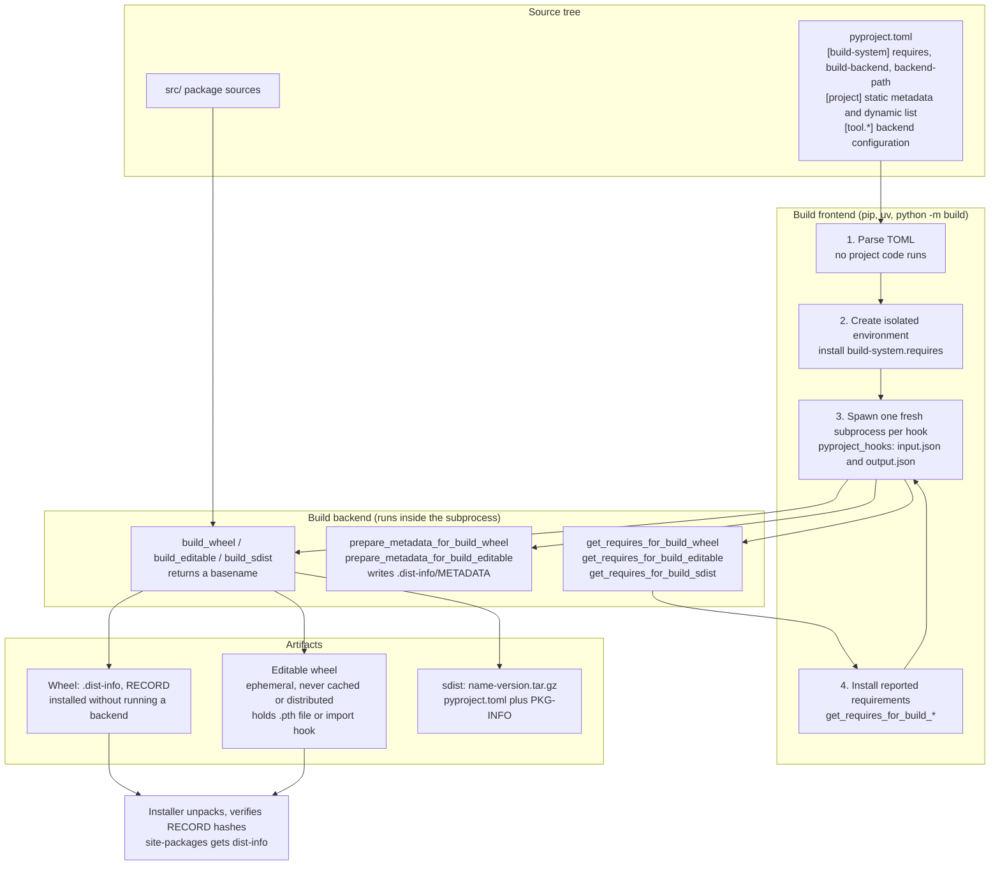

# Python Packaging Evolution: From distutils to pyproject.toml

> [!summary] Claim:
> A Python source tree is built by two programs that never share a process: a build frontend (`pip`, `uv`, `python -m build`) reads `pyproject.toml`, creates an isolated environment, and calls a build backend (`setuptools`, `hatchling`, `flit_core`, `maturin`) through named hook functions defined by PEP 517 and PEP 660.
> The legacy contract was the opposite: running `setup.py` was the only way to learn a project's name, version, dependencies, or even its build requirements, so every question about a package executed that package's code in the caller's environment.
> The modern contract makes the answer to "what does it need to build" a static TOML table (PEP 518), makes "what is it" a static `[project]` table that a backend may only extend where the project opts in through `dynamic` (PEP 621, PEP 808), and makes "install it in place" an ordinary wheel install of a throwaway wheel (PEP 660).
> An expert reads the hook trace, not the config: which hooks ran, in which environment, with which requirements installed, and what each wrote into `METADATA`.



## The Mechanism

### The setup.py contract and why it stopped scaling

Distutils entered the standard library with Python 2.0, released on October 16, 2000.
Its What's New entry describes the model that governed the next two decades: the author writes a `setup.py` script, and users run `python setup.py install`; the script calls `distutils.core.setup()` with keyword arguments, and a set of commands (`build`, `install`, `sdist`, `bdist_*`) act on that call.
The metadata that describes a release was standardized separately: PEP 241 (A.M. Kuchling, 2001) defined the first `PKG-INFO` fields, and `setup.py sdist` wrote them.

Everything a tool wanted to know about a project was therefore computed by executing the script.
The PEPs that replaced the model give five concrete failures, each of which is a design constraint on what replaced it.

1. **Metadata only by execution.**
   There was no static place to read a name, a version, or a dependency list.
   PEP 621 states the goal it serves as encouraging "core metadata" to be specified "statically for speed, ease of specification, unambiguity, and deterministic consumption by build back-ends".
   A scanner that wanted to know what a package needed had to run it.
2. **The bootstrap catch-22.**
   `setup_requires` let a script name the packages it needed in order to run, but setuptools could only read the argument by running `setup()`.
   PEP 518 calls this "the catch-22 trap that a setup.py has where tooling can't infer what a project needs to build itself".
   A script whose first line was `import numpy` or `from Cython.Build import cythonize` failed before `setup()` was reached.
3. **Two dependency installers in one build.**
   PEP 518 notes that with `setup_requires`, `pip install spam` could end up "having both pip and setuptools downloading and installing packages", so users had to configure indexes and format preferences for both.
   Setuptools later deprecated that machinery: v58.3.0 (2021-10-22) deprecated `setup_requires` outright in favor of `build-system.requires`, and v59.1.0 (2021-11-15) backed that out and instead deprecated `setuptools.installer` and `fetch_build_egg`, keeping `setup_requires` working when it runs inside a PEP 517 build.
4. **Lockstep with the interpreter.**
   PEP 632 records the motivation for removing distutils: because it lived in the standard library, "many updates can only be released with a major release, and users cannot rely on particular fixes being available".
   Setuptools had extended distutils "using subclassing and monkeypatching", and in v48 it began carrying its own copy of the code.
5. **No way to use anything but setuptools.**
   PEP 517's abstract names the third problem: "it's very difficult to use anything else, because distutils/setuptools provide the standard interface for installing packages expected by both users and installation tools like pip".
   PEP 518 adds that pip simply assumed setuptools was necessary whenever it saw a `setup.py`.

A sixth problem, build hygiene, comes from PEP 517's rationale for isolated builds: without isolation "we'll inevitably end up with lots of packages on PyPI that build fine on the original author's machine and nowhere else".

The `.egg` ecosystem sat on top of this.
PEP 376 records that setuptools installed either a single `.egg` or a directory with an `.egg-info`, and "also add a reference to the distribution into an `easy-install.pth` file".
The `easy_install` script and `pkg_resources` were part of the same package.
Setuptools removed the `easy_install` command in v80.0.0 (2025-04-27), the `easy_install` module in v80.3.0 (2025-05-03), and `pkg_resources` in v82.0.0 (2026-02-08).

### Migration timeline

| Date | Event | Source |
|---|---|---|
| 2000-10-16 | Python 2.0 ships Distutils in the standard library | What's New In Python 2.0 |
| 2001-03 | Core Metadata 1.0 approved (PEP 241) | Core metadata specification, History |
| 2016-05 | `pyproject.toml` with `[build-system]` and `[tool]` approved (PEP 518) | pyproject.toml specification, History |
| 2018-04-14 | pip 10.0 supports build dependencies declared in `pyproject.toml` | pip NEWS 10.0.0, PyPI upload time |
| 2019-01-22 | pip 19.0 implements PEP 517 | pip NEWS 19.0 |
| 2019-02-05 | setuptools 40.8.0 adds `build_meta:__legacy__` | setuptools NEWS v40.8.0, PyPI upload time |
| 2020-10 | Core Metadata 2.2 adds `Dynamic` (PEP 643) | Core metadata specification, History |
| 2020-11 | The `[project]` table approved (PEP 621) | pyproject.toml specification, History |
| 2021-10-11 | pip 21.3 installs PEP 660 editable projects | pip NEWS 21.3 |
| 2022-03-24 | setuptools 61.0.0 reads PEP 621 metadata | setuptools NEWS v61.0.0, PyPI upload time |
| 2022-08-11 | setuptools 64.0.0 implements the PEP 660 hooks | setuptools NEWS v64.0.0, PyPI upload time |
| 2023-03-05 | setuptools 67.5.0 warns on `import pkg_resources` | setuptools NEWS v67.5.0, PyPI upload time |
| Python 3.12 | `distutils` removed from the standard library (PEP 632, deprecated in 3.10); `venv` and `ensurepip` stop installing setuptools | What's New In Python 3.12 |
| 2024-08 | Core Metadata 2.4 adds `License-Expression` and `License-File` (PEP 639) | Core metadata specification, History |
| 2025-10-24 | pip 25.3 removes `setup.py bdist_wheel` and the `setup.py develop` editable path; PEP 517 is always on | pip NEWS 25.3 |
| 2026-05 | Core Metadata 2.6 allows static plus dynamic list fields (PEP 808) | Core metadata specification, History |
| 2026-07-29 | pip 26.2 adds experimental `--use-feature=venv-isolation` | pip NEWS 26.2 |

### PEP 518: the `[build-system]` table

PEP 518 (Brett Cannon, Nathaniel J. Smith, Donald Stufft; created 2016-05-10) answers one question: what must be installed before the build system can start.
It introduces `pyproject.toml`, written in TOML, and reserves two tables: `[build-system]`, with the mandatory key `requires`, and `[tool]`.
The PEP gives its reasons for TOML in a sentence: human-usable "(unlike JSON)", flexible enough "(unlike configparser)", derived from a standard, and "not overly complex (unlike YAML)"; it also notes that Cargo already used TOML.
The `[tool]` table is namespaced by ownership: a project may use `tool.$NAME` "if, and only if, they own the entry for $NAME" on PyPI.

The defaults are a frequent source of confusion, because three documents say slightly different things.

| Situation | What the specs say | What pip 26.3 does (`pip/_internal/pyproject.py`) |
|---|---|---|
| No `pyproject.toml`, or no `[build-system]` table | PEP 518 and the pyproject.toml specification: behave as if `requires = ["setuptools"]`. PEP 517: revert to the legacy `setup.py` behavior, "either directly, or by implicitly invoking the `setuptools.build_meta:__legacy__` backend" | `requires = ["setuptools>=40.8.0"]`, `build-backend = "setuptools.build_meta:__legacy__"` |
| `[build-system]` present, `requires` missing | "the tool should consider it an error" | raises `MissingPyProjectBuildRequires` |
| `[build-system]` present, `build-backend` missing | PEP 517: the source tree is not using the PEP 517 interface; legacy behavior | backend becomes `setuptools.build_meta:__legacy__`, and pip checks that `setuptools>=40.8.0` is present after the environment is built |
| Neither `setup.py` nor `pyproject.toml` | not specified | refuses: "does not appear to be a Python project" |

The version floor `40.8.0` is where setuptools added the `__legacy__` backend (NEWS v40.8.0, issue 1652).
Earlier drafts of this topic list `wheel` as part of the fallback requirements; pip 26.3 does not add it, and pip 25.1 dropped the need for the `wheel` package for the non-PEP 517 path.

The `__legacy__` backend exists to keep `setup.py` scripts running.
In `setuptools/build_meta.py`, `_BuildMetaLegacyBackend.run_setup` inserts the script directory at the front of `sys.path` and sets `sys.argv[0]` to the script name, because `setup.py` files in projects such as numpy and pygame depend on both.
The file's own docstring calls it "a temporary bridge" that "will eventually be removed".
A `pyproject.toml` that exists only to configure Ruff or pytest therefore still builds through the legacy path.

### PEP 517: the hook interface

PEP 517 (Nathaniel J. Smith and Thomas Kluyver, created 2015-09-30) defines the boundary.
Its vocabulary matters because tools use it precisely.
A **source tree** is a directory such as a VCS checkout.
A **source distribution** (sdist) is a snapshot such as `lxml-3.4.4.tar.gz`.
A **build frontend** turns a source tree or sdist into a wheel, as `pip wheel some-directory/` does.
An **integration frontend** takes requirements and updates an environment, as `pip install lxml==2.4.0` does.
The **build backend** is the object named by `build-backend`, which implements the hooks.

`build-backend` is a string of the form `module_path(:object_path)?`, with the grammar `identifier = (letter | '_') (letter | '_' | digit)*`.
`flit.api:main` resolves as `import flit.api; backend = flit.api.main`, and `flit.api` alone uses the module as the backend.
The directory containing the source tree is not on the import path unless it would be anyway.

`backend-path` is a list of directories, relative to the project root, for backends that ship inside the tree.
PEP 517 restricts it twice: every entry must resolve to a location inside the source tree after symbolic links are resolved, and the backend must actually be loaded from one of those entries, because the key exists for in-tree backends and "not to allow configuration of existing backends".
The motivating cases are self-hosting backends, which cannot depend on a published copy of themselves, and project-specific wrappers around a standard backend.

Build requirements must form a directed acyclic graph.
PEP 517 tells frontends to detect cycles and stop, and notes that a backend wanting to build itself must specify itself as an in-tree backend and avoid external build dependencies, "usually by vendoring them".

The interface is a set of functions on the backend object.
PEP 517 defines five and PEP 660 adds three optional ones, for eight in total.

| Hook | Status | Environment it runs in | If absent |
|---|---|---|---|
| `get_requires_for_build_wheel(config_settings=None)` | optional | `build-system.requires` | treated as `[]` |
| `prepare_metadata_for_build_wheel(metadata_directory, config_settings=None)` | optional | `requires` plus the `get_requires_for_build_wheel` result | frontend calls `build_wheel` and reads the metadata from the result |
| `build_wheel(wheel_directory, config_settings=None, metadata_directory=None)` | mandatory | same as the previous row | not applicable |
| `get_requires_for_build_sdist(config_settings=None)` | optional | `build-system.requires` | treated as `[]` |
| `build_sdist(sdist_directory, config_settings=None)` | mandatory | `requires` plus the `get_requires_for_build_sdist` result | not applicable |
| `get_requires_for_build_editable(config_settings=None)` | optional (PEP 660) | `build-system.requires` | treated as `[]` |
| `prepare_metadata_for_build_editable(metadata_directory, config_settings=None)` | optional (PEP 660) | `requires` plus the editable requirements | frontend calls `build_editable` and reads the metadata |
| `build_editable(wheel_directory, config_settings=None, metadata_directory=None)` | optional (PEP 660) | same as the previous row | the project cannot be installed in editable mode |

The normative rules that surprise people:

- Every hook returns a basename (a unicode string), never a full path: the wheel file, the sdist file, or the `.dist-info` directory it created.
- Hooks run with the working directory set to the source tree root, may print to stdout and stderr, and "MUST NOT read from stdin".
- If `prepare_metadata_for_build_wheel` was called, the frontend passes the resulting directory as `metadata_directory`, and `build_wheel` "MUST produce a wheel with identical metadata".
  The directory must be identical "including any unrecognized files it created", which is the sanctioned way to carry build decisions from the metadata step to the build step.
- `build_sdist` must produce a `.tar.gz` with a single top-level `{name}-{version}` directory containing `pyproject.toml` and `PKG-INFO`, in POSIX.1-2001 pax format.
  A backend that cannot produce an sdist for a well-understood reason raises the exception it exposes as `UnsupportedOperation`, and the frontend then builds the wheel directly from the source tree.
- `config_settings` is an arbitrary dictionary that is "an escape hatch" for ad-hoc options; backends "MAY assign any semantics they like to this dictionary".
  Duplicate keys should combine into a list of strings.
- The source directory may be read-only, so backends should be prepared to build without writing into it, and caches must not change the result.
- If a hook raises an exception or the process dies, that is an error.
  Frontends should call each hook in a fresh subprocess so backends can change process-global state such as environment variables and the working directory.

PEP 517 deliberately does not say how a frontend talks to the subprocess.
The protocol in the next section belongs to the reference library, not to the PEP.

### How pyproject-hooks calls a hook

`pyproject_hooks` (1.3.3, released 2026-09-16, vendored by pip 26.3) is the library that `pip` and `build` use to call hooks.
`BuildBackendHookCaller._call_hook` in `_impl.py` does the same five things for every hook:

1. Create a temporary directory.
2. Write `{"kwargs": {...}}` to `input.json` there, with any path arguments made absolute.
3. Run `[python, _in_process.py, hook_name, tempdir]` with the working directory set to the source tree and two environment variables added: `_PYPROJECT_HOOKS_BUILD_BACKEND` (the `build-backend` string) and, for in-tree backends, `_PYPROJECT_HOOKS_BACKEND_PATH_JSON` (a JSON array of absolute paths).
4. The script in the subprocess imports the backend, calls the hook with the kwargs, and writes `output.json`.
5. The caller reads `output.json` and returns `return_val`, or raises.

`output.json` carries one of a small set of keys: `return_val`, `unsupported` (becomes `UnsupportedOperation`), `no_backend` (becomes `BackendUnavailable`, with the backend traceback), `hook_missing` (becomes `HookMissing`), and a `warnings` list that is re-emitted in the frontend as `BuildBackendWarning` (new in 1.3).
The subprocess runner is pluggable: `default_subprocess_runner` lets output through, and `quiet_subprocess_runner` captures stdout and stderr into the exception.

Three implementation details are worth knowing because they decide failures:

- **Backend loading.**
  For in-tree backends, the in-process script inserts a `_BackendPathFinder` at the front of `sys.meta_path`, which resolves the backend's top-level module from `backend-path` only.
  If the module is not there, it raises `BackendUnavailable("Cannot find module ... in ...")`.
  Since 1.1 the library no longer loads the backend and then checks where it came from; it only loads it from the specified path.
  The caller also rejects absolute paths and paths that leave the source tree (`norm_and_check`).
- **Optional hook fallbacks live in the library, not in the PEP.**
  Missing `get_requires_for_build_wheel` returns `[]`.
  Missing `prepare_metadata_for_build_wheel` makes the library call `build_wheel` into the metadata directory and extract the `.dist-info`; the wheel is left next to it with a marker file named `PYPROJECT_HOOKS_ALREADY_BUILT_WHEEL`, so a following `build_wheel(..., metadata_directory=...)` copies it instead of rebuilding.
  The same mechanism backs `prepare_metadata_for_build_editable` and `build_editable`.
- **Feature probing.**
  `_supported_features` returns `["build_editable"]` if the backend object has that attribute, and pip calls it to decide between the editable path and an error.

### Build isolation: what each frontend actually builds

PEP 517 makes the environment a requirement, not a mechanism.
Whatever the frontend does, the backend "MUST NOT assume that it has access to any packages except those that are present in the stdlib, or that are explicitly declared as build-requirements"; new Python subprocesses spawned by the backend must see the same packages; and the scripts of build requirements must be on `PATH`.
Isolation itself is the "SHOULD" in the non-normative section, justified by two goals: letting one install run build several packages with contradictory build requirements, and forcing authors to declare their requirements accurately.

**pip 26.3 (default).**
`RequirementPreparer` chooses a `BuildIsolationMode` in `cli/req_command.py`: `"off"` for `--no-build-isolation`, `"venv"` only when `--use-feature=venv-isolation` is set, and `"virtual"` otherwise (as of 2026-11, Both).
`VirtualBuildEnvironment` (`build_env/virtual.py`) is not a venv.
It creates a temp directory with two prefixes, `normal` and `overlay`, and a `site/sitecustomize.py`.
`pyproject.toml` requirements are installed into `overlay` and the hook-reported requirements into `normal` (`distributions/sdist.py`), and `lib_dirs` lists `overlay` before `normal`, so the static requirements win on `sys.path`.
Requirements are installed by running `pip install --prefix <prefix> --no-user --no-compile --target ""` in a subprocess, plus `--ignore-installed` for the non-venv case, and `--no-compile` is there because the environment is ephemeral.
Entering the environment sets `PATH` to the prefix `bin` directories first, `PYTHONNOUSERSITE=1`, and `PYTHONPATH` to the `site` directory.
The `sitecustomize.py` computes the system site-packages from `site.getsitepackages()`, drops those paths from `sys.path`, and calls `site.addsitedir` on the prefix library directories so `.pth` files are honored.
The source carries a comment that on Python 3.15 and later this has to clear `sys.path` before calling `addsitedir`, because `.pth` files are no longer re-executed for already-known paths; the NEWS entry for pip 26.2 ("Prevent system packages from leaking into isolated build environments on Python 3.15", issue 14033) is the same fix.
The class docstring says the approach "has known bugs and weird edge cases".
`VenvBuildEnvironment` (`build_env/venv.py`) is the replacement: a real `venv` with symlinks on POSIX, requirements installed into it, `PYTHONPATH` cleared on entry.
pip 26.2 added it as experimental, "will be enabled by default in a future release", with "limited compatibility" with `--use-feature=inprocess-build-deps`.

**build 1.6.1.**
`DefaultIsolatedEnv` makes a directory named `build-env-*` and creates a venv (or a `virtualenv` environment if the outer pip is unusable), then installs `build-system.requires` and the hook-reported requirements into it.
The installer is `pip` by default; `uv` is "opt-in only" and displayed as `venv+uv`.
With no flag, `python -m build` builds an sdist and then builds the wheel from that sdist, which tests the sdist's completeness as a side effect; `--sdist --wheel` builds both from the source directory.

**uv.**
`uv build` and `uv pip install` build each package in an isolated virtual environment with its declared build dependencies.
uv offers two escape hatches: `extra-build-dependencies` augments a package's requirements, and `no-build-isolation-package` disables isolation for named packages.
The uv documentation recommends augmenting, because disabling isolation "requires that the build dependencies are installed in the project environment prior to installing the package itself".
Build dependencies can be pinned with `build-constraint-dependencies` and, experimentally, verified with hashes (`--require-build-hashes`, as of 2026-11).
uv also ships a build backend, `uv_build`, that needs no hash because it is part of the uv executable.

`--no-build-isolation` moves the burden to the caller.
The frontend then builds in the current environment and, in `build`, checks the declared requirements against it and fails if they are missing (the trace later in this note shows the message).
pip 25.3 introduced `--build-constraint`, and pip 26.2 stopped letting `PIP_CONSTRAINT` affect isolated build environments.

Isolation is hygiene, not a security boundary.
The backend, and any code it runs, executes with the invoking user's privileges, and build requirements are installed from the same index as everything else.
The pip 26.3 changelog adds a documentation note that pip "has never considered installing untrusted wheels safe", because Python's import system is dynamic.

### PEP 621: static metadata in `[project]`

PEP 621 (created 2020-06-22; approved 2020-11) replaced a patchwork of `setup.py` keywords, `setup.cfg`, and per-tool tables such as flit's with one schema.
Its three stated motivators are static metadata, a tool-agnostic way to write it, and shared code for "the boring parts".

The rules, as currently stated in the pyproject.toml specification:

- Only `name` must be statically defined.
  `version` is required but may be listed in `dynamic`.
  Every other key is optional, and a missing `[project]` table means the backend provides all keys dynamically.
- `name` is normalized by the PEP 503 rule `re.sub(r"[-_.]+", "-", name).lower()`.
  Tools "SHOULD normalize this name, as soon as it is read", but they do not have to rewrite it in the output: hatchling 1.33.0 wrote `Name: Enterprise_Service` into `METADATA` exactly as typed while using the normalized `enterprise_service-1.0.0.dist-info` directory (see the trace).
- The field-to-metadata mapping is fixed:

| `[project]` key | Core metadata | Notes |
|---|---|---|
| `name`, `version` | `Name`, `Version` | version format is PEP 440 |
| `description` | `Summary` | one line; tools MAY error on multiple lines |
| `readme` | `Description`, `Description-Content-Type` | `.md` implies `text/markdown`, `.rst` implies `text/x-rst`; file encoding is UTF-8; unknown suffix without a `content-type` is an error |
| `requires-python` | `Requires-Python` | |
| `license` | `License-Expression` | an SPDX expression string; the table form is deprecated |
| `license-files` | `License-File` | glob patterns relative to `pyproject.toml`; matched files go in every archive; wheels store them under `.dist-info/licenses/` |
| `authors`, `maintainers` | `Author`, `Author-email`, `Maintainer`, `Maintainer-email` | name only, email only, or `{name} <{email}>` |
| `keywords`, `classifiers`, `urls` | `Keywords`, `Classifier`, `Project-URL` | `License ::` classifiers are deprecated |
| `dependencies` | `Requires-Dist` | one per string |
| `optional-dependencies` | `Provides-Extra`, `Requires-Dist` with `extra == "..."` | extra names are normalized (PEP 685) |
| `scripts`, `gui-scripts`, `entry-points` | `entry_points.txt` groups `console_scripts`, `gui_scripts`, and arbitrary groups | defining `console_scripts` under `entry-points` is an error |
| `import-names`, `import-namespaces` | `Import-Name`, `Import-Namespace` | added by PEP 794; `; private` marks private names; the same name in both is an error |

- `[dependency-groups]` (PEP 735, final 2024-10-10) is a sibling table at the top level of the file.
  Groups are named lists of requirements, and by design they are not included in any built distribution, so they never appear in `METADATA`.
  Inline script metadata (PEP 723, `# /// script` blocks) and `pylock.toml` (PEP 751) are separate mechanisms that reuse the TOML and requirement syntax; the latter is owned by [[Python-Dependency-Resolution-pip-uv-and-PEP-751-Lockfiles]].

**The `dynamic` contract.**
`dynamic` lists keys that a backend will compute.
Four rules follow from the specification:

1. `name` may never be dynamic, and a backend must raise if it is.
2. A key not in `dynamic` cannot be filled in by the backend: "dynamic is the only way to allow a tool to fill in metadata and the user must opt into the filling in".
3. A key listed in `dynamic` that the backend cannot determine is an error (omitting the data is allowed when that is the accurate value).
4. A key defined statically and listed in `dynamic` is an error, with one exception added by PEP 808 (accepted 2026-05-19): keys whose values are lists or arbitrary tables (`authors`, `classifiers`, `dependencies`, `entry-points`, `gui-scripts`, `import-names`, `import-namespaces`, `keywords`, `license-files`, `maintainers`, `optional-dependencies`, `scripts`, `urls`) may be both.
   The static entries are then fixed, and the backend "MAY only append further entries"; it "MUST NOT remove, reorder, or modify" the static ones.
   String-valued keys (`version`, `description`, `readme`, `requires-python`, `license`) keep the strict rule.
   The relaxation is opt-in for backends: the specification says a backend "SHOULD raise an error if a key is listed in `dynamic` and it does not support extending that key", and hatchling 1.33.0 still raises "cannot be both statically defined and listed in field `project.dynamic`" for every key, list keys included (`metadata/core.py`, as of 2026-11).

A concrete use of rule 4 is a project that wants a stable static `dependencies` list in `pyproject.toml` that a plugin may extend at build time, while a dependency scanner can still read the static part without running the plugin.
Version is the common dynamic field: `version` is listed in `dynamic` and a plugin such as `hatch-vcs` or `setuptools-scm` computes it.
setuptools-scm documents that for Git projects "the version relies on `git describe`", so the checkout must contain the tags it describes from.

### Core Metadata versions and `Dynamic`

Backends turn `[project]` into an email-header text file named `METADATA` in wheels and `PKG-INFO` in sdists.
The `Metadata-Version` header selects the schema, and a consumer "SHOULD warn" if the version is higher than the highest it supports and "MUST fail" if the major version is higher.
Build tools "MAY choose to produce distribution metadata using the lowest metadata version that includes all of the needed fields".
The specification's list of legal values has no `2.0`: the sequence is 1.0, 1.1, 1.2, 2.1, 2.2, 2.3, 2.4, 2.5, 2.6.

| Version | Approved | PEP | What it added |
|---|---|---|---|
| 1.0 | 2001-03 | 241 | first `PKG-INFO` fields |
| 1.1 | 2003-04 | 314 | |
| 1.2 | 2010-02 | 345 | `Requires-Python`, `Requires-Dist` with environment markers |
| 2.1 | 2018-02 | 566 | `Description-Content-Type`, `Provides-Extra`; JSON transformation of metadata; restricted `Name` grammar |
| 2.2 | 2020-10 | 643 | `Dynamic` |
| 2.3 | 2022-03 | 685 | extra names restricted to a normalized form |
| 2.4 | 2024-08 | 639 | `License-Expression`, `License-File` |
| 2.5 | 2025-09 | 794 | `Import-Name`, `Import-Namespace` |
| 2.6 | 2026-05 | 808 | a multiple-use field in the sdist that is also marked `Dynamic` may only be appended to in the wheel |

The `Dynamic` field is what makes an sdist trustworthy.
When a wheel is built from an sdist: a field not marked `Dynamic` must have the same value in the wheel as in the sdist; if it is absent from the sdist and not marked, it must be absent from the wheel; a single-use field marked `Dynamic` may take any valid value, including none.
Under 2.6, a multiple-use field present in the sdist and marked `Dynamic` must keep the sdist's values and may only gain new ones.
`Name`, `Version`, and `Metadata-Version` cannot be listed.
A clarification in August 2025 states that `Dynamic` only constrains building a wheel from an sdist, not modifying a wheel later.
The same property lets an index or resolver trust the metadata of an sdist for non-dynamic fields without running the build.

The index side of the same idea is PEP 658, which exposes a distribution's `METADATA` through the simple repository API so resolvers need not download the whole file (renamed from `data-dist-info-metadata` to `core-metadata` by PEP 714).
pip 26.2 raises an error when that file disagrees with the downloaded wheel's `METADATA` on `Name`, `Version`, `Requires-Dist`, `Requires-Python`, or `Provides-Extra`.
Dependency resolution itself belongs to [[Dependency-Resolution-SAT-PubGrub-and-MVS]] and [[Python-Dependency-Resolution-pip-uv-and-PEP-751-Lockfiles]].

### Artifacts: sdist and wheel

An **sdist** is `{name}-{version}.tar.gz` (PEP 625), where `{name}` is normalized as for wheels and `{version}` is the canonical version.
It holds one top-level `{name}-{version}` directory with `pyproject.toml` and a `PKG-INFO` of at least metadata version 2.2, and if the metadata version is 2.4 or later it must contain the license files named by `License-File`.
The tar must be pax format and readable with `tarfile.open(..., 'r:gz')`; extractors must use `tarfile.data_filter` or the specification's equivalent rules, and must not unpack files or links that escape the destination, or device files.
A legacy sdist with no `pyproject.toml` follows the older, implicit distutils format.

A **wheel** is a ZIP with `{distribution}-{version}.dist-info/` holding `METADATA`, `WHEEL`, and `RECORD`, plus optional `entry_points.txt` and `licenses/`.
`RECORD` lists every file with a sha256 hash in URL-safe base64 without padding, and an installer verifies every hash and "installation will fail if any file in the archive is not both mentioned and correctly hashed".
An installer unpacks a wheel without invoking a backend, which is why moving work from "run setup.py on the user's machine" to "build once, install a wheel" removed arbitrary code execution from the install step.
The tag part of the filename and platform compatibility are owned by [[Python-Wheels-Platform-Tags-Manylinux-and-ABI3]].

After installation the installer writes `INSTALLER` and, for direct URL installs, `direct_url.json` (PEP 610) next to the metadata.

### Editable installs (PEP 660)

**The legacy mechanism.**
`setup.py develop` made a project importable from its checkout.
From pip 8.0.0 on, pip detected editable projects by the presence of their `.egg-link` file (pip NEWS 8.0.0), and PEP 376 notes that setuptools wrote a reference into `easy-install.pth`.
It required `setup.py`, so it died with it, and PEP 517 had deliberately left editable installs for a later PEP: the original draft's `install_editable` hook "was removed due to the complexity of the topic".

**PEP 660.**
PEP 660 (Daniel Holth and Stephane Bidoul, created 2021-03-30) adds three optional hooks, `get_requires_for_build_editable`, `prepare_metadata_for_build_editable`, and `build_editable`.
`build_editable` "must build a .whl file" that, once installed, lets the distribution be imported from its source folder; it may also do an in-place build as a side effect for extension modules.
The wheel's metadata must be identical to a normal build's, "except for Requires-Dist", which may add dependencies the editable mechanism needs at runtime, such as `editables`.
The wheel "must not be exposed to end users, nor cached, nor distributed", and "uses the wheel format not for distribution but as ephemeral communication between the build system and the front end".
Frontend duties: install it like any wheel, so uninstall needs no special case; write `direct_url.json` with a `file://` URL of the project directory and `dir_info` of `{"editable": true}`; and run the three hooks in an environment containing the requirements named in the PEP.
Limitations stated by the PEP: only `purelib` and `platlib` are made editable, so scripts, headers, and data are not; and changes to entry points or dependencies need a new installation.

**pip's handling.**
pip 21.3 (2021-10-11) added editable installs through PEP 660 backends and fell back to `setup.py develop` for older setuptools.
pip 24.2 deprecated that fallback, and pip 25.3 removed it: "setuptools >= 64 is now required".
In pip 26.3, `editable_sanity_check` raises `InstallationError` if the backend lacks `build_editable`, with the message that the project "cannot be installed in editable mode".

**What backends put in the wheel.**
The PEP offers three non-normative techniques: a `.pth` file containing the source directory, proxy modules as in the `editables` library, and a symlink tree on `sys.path`.
Real backends differ, and the differences are observable:

| Backend | Default strategy | Other modes | Evidence |
|---|---|---|---|
| setuptools 64 and later | `lenient`: for a simple `src` layout (or `compat` mode) a static `.pth` pointing at the source directory (`_StaticPth`); otherwise a `MetaPathFinder` plus namespace path hook (`_TopLevelFinder`) so accidental top-level modules are not exposed | `strict`: `_LinkTree`, a tree of links under `build/__editable__.{name}-{tag}` on `sys.path`, new files are not exposed until reinstall; `compat`: deprecated emulation of `setup.py develop` | `command/editable_wheel.py`, `_select_strategy` |
| hatchling 1.33.0 | a `.pth` file listing directories computed from the files the wheel target selects (the trace shows `_editable_impl_enterprise_service.pth`) | `dev-mode-dirs` lists the directories explicitly and writes `_{name}.pth`; `dev-mode-exact` maps module names through an `editables` `MetaPathFinder` instead of adding directories | `builders/wheel.py`, `build_editable_detection`; observed in the trace |

`get_requires_for_build_editable` in hatchling returns the wheel target's build dependencies plus `editables~=0.3` unconditionally (`build.py`), even though the default `.pth` mode does not use that library at runtime: `build_editable_detection` imports `editables.EditableProject` at build time and uses its `add_to_path` to generate the `.pth`.
The consequence is in the trace: calling `build_editable` in an environment where that requirement was not installed fails with `ModuleNotFoundError: No module named 'editables'`.
The Hatch documentation warns that `dev-mode-exact` is not understood by static analysis tools, so autocompletion in IDEs may not work.

Editable install limits that follow from the design, not from any one backend: metadata is captured at install time, so a version or dependency edit is invisible until reinstall; compiled extensions are rebuilt only by the backend's own mechanism; and anything outside `purelib` and `platlib` is a snapshot.

## Commands and Numbers to Know

| Item | Value | Platform | Notes |
|---|---|---|---|
| Hooks defined | 8: 5 from PEP 517, 3 from PEP 660 (as of 2026-11) | Both | mandatory: `build_wheel`, `build_sdist` |
| Default backend when none is declared | `setuptools.build_meta:__legacy__`, requirement `setuptools>=40.8.0` (pip 26.3, as of 2026-11) | Both | the specs themselves say `["setuptools"]` |
| In-process hook script env vars | `_PYPROJECT_HOOKS_BUILD_BACKEND`, `_PYPROJECT_HOOKS_BACKEND_PATH_JSON` (pyproject-hooks 1.3.3, as of 2026-11) | Both | `input.json` in, `output.json` out |
| Optional-hook marker file | `PYPROJECT_HOOKS_ALREADY_BUILT_WHEEL` in the metadata directory (pyproject-hooks 1.3.3, observed as of 2026-11) | macOS arm64 | fallback for `prepare_metadata_for_build_wheel` |
| Current Core Metadata | 2.6, approved 2026-05 via PEP 808 (as of 2026-11) | Both | no 2.0 exists |
| `Metadata-Version` hatchling 1.33.0 writes | `2.5`, its default and latest supported version (`metadata/spec.py`), so it cannot emit 2.6 (observed as of 2026-11) | macOS arm64 | |
| pip default isolation | `virtual`: prefixes `normal` and `overlay` plus `sitecustomize.py` (pip 26.3, as of 2026-11) | Both | `--use-feature=venv-isolation` opts into a real venv |
| `build` default installer | `pip`; `uv` is opt-in (build 1.6.1, as of 2026-11) | Both | log label `venv+pip` or `venv+uv` |
| `python -m build` with no flags | builds an sdist, then a wheel from that sdist (build 1.6.1, as of 2026-11) | Both | `--sdist --wheel` builds both from the tree |
| Disable isolation | `pip install --no-build-isolation`, `python -m build --no-isolation`, `uv pip install --no-build-isolation-package NAME` (as of 2026-11) | Both | caller must pre-install every requirement |
| Constrain build deps | `pip --build-constraint FILE` (pip 25.3 and later); `PIP_CONSTRAINT` no longer affects builds (pip 26.2, as of 2026-11) | Both | |
| setuptools editable modes | `lenient` (default), `strict`, `compat` via `--config-settings editable_mode=...` (setuptools 64 and later, as of 2026-11) | Both | |
| hatchling editable requirement | `editables~=0.3` (hatchling 1.33.0, as of 2026-11) | Both | |
| `distutils` | removed in Python 3.12; `import distutils` raises `ModuleNotFoundError` on 3.15.2 (observed as of 2026-11) | macOS arm64 | setuptools ships a copy |
| setuptools editable support | PEP 660 since 64.0.0 (2022-08-11; as of 2026-11) | Both | pip 25.3 requires at least this |
| Latest versions seen | pip 26.3 (2026-11-02), setuptools 84.2.1, hatchling 1.33.0 (2026-10-28), build 1.6.1, pyproject-hooks 1.3.3, packaging 26.3, uv 0.13.9 (2026-11-17), flit-core 4.2.0 (PyPI, as of 2026-11) | Both | local uv in the trace was 0.11.26 |
| Inspect metadata without tools | `unzip -p dist/*.whl '*.dist-info/METADATA'` (as of 2026-11; works with exactly one wheel in `dist/`, observed on macOS) | Both | |
| Build both artifacts | `python -m build` or `uv build` (as of 2026-11) | Both | `uv build` printed "Building source distribution..." then "Building wheel from source distribution..." (observed) |

## Multi-Language Comparison

| Concern | Python (`pyproject.toml`) | Rust (`Cargo.toml`) | C++ |
|---|---|---|---|
| Static manifest | `[project]` TOML, optionally extended through `dynamic` | `Cargo.toml` TOML read by `cargo` itself | none standard: CMake is a program; Conan and vcpkg have manifests; see [[Cpp-CMake-Package-Configs-pkg-config-and-CPS]] |
| Build orchestration | split: frontend and backend meet only at the PEP 517 hooks | one tool; project-specific logic goes in a build script, see [[Rust-Build-Scripts-and-Sys-Crates]] | split across CMake, a package manager, and compilers |
| Isolation of build tools | ephemeral environment from `build-system.requires` | dependencies come from the registry and lockfile; tool versions come from the toolchain | sysroots, package-manager profiles; see [[Cpp-Conan-2-Architecture-and-Binary-Model]] |
| Source artifact | sdist `.tar.gz` with `PKG-INFO` | `.crate`, a compressed file produced by `cargo package` | tarballs, distro source packages |
| Binary artifact | wheel, installed without code execution | none standard on crates.io; see [[Rust-Binary-Distribution-with-dist-and-Cross-Compilation]] | `.deb`, `.rpm`, archives; see [[Cpp-System-Packaging-Deb-RPM-and-Homebrew]] |
| Native extensions | a backend such as scikit-build-core, meson-python, or maturin; see [[Python-Native-Build-Backends-scikit-build-core-meson-python-and-maturin]] | `cdylib` plus maturin or PyO3; see [[Rust-PyO3-and-Maturin-Internals]] | the extension is the project |
| Editable development | PEP 660 wheel with `.pth` or finder | `cargo` workspaces and path dependencies | build tree used in place |

The lesson the comparison carries: Python is the one ecosystem here where the manifest, the build tool, and the installer are three different programs by design, so its failures cluster at the seams (a backend not installed in the isolated environment, metadata that differs between hook calls, a frontend that does not honor a hook).

## Worked Example: Tracing the Hooks (no lab)

This note has no lab.
The trace below was produced by one script (a scratch virtualenv built by `uv venv`, then `pyproject_hooks`, `hatchling`, `build`, and `uv pip` driving two toy projects) on macOS arm64 with CPython 3.15.2, hatchling 1.33.0, build 1.6.1, pyproject-hooks 1.3.3, and uv 0.11.26 (as of 2026-11).
Paths are scrubbed to `<WORK>`.
Earlier attempts at the same script failed because of mistakes in the script, such as using one directory as both the metadata and wheel directory; the output shown is from the run that completed.

### Project A: hatchling, driven hook by hook

The project is a `src` layout with `name = "Enterprise_Service"`, `version = "1.0.0"`, `license = "Apache-2.0"`, one dependency, one extra named `crypto`, and one console script.
The driver builds a `BuildBackendHookCaller` for `hatchling.build` using the scratch environment's Python and calls each hook in turn.

```text
python in scratch venv: 3.15.2
get_requires_for_build_wheel  -> []
get_requires_for_build_editable -> ['editables~=0.3']
prepare_metadata_for_build_wheel -> enterprise_service-1.0.0.dist-info
Metadata-Version: 2.5
Name: Enterprise_Service
Version: 1.0.0
Summary: demo
License-Expression: Apache-2.0
License-File: LICENSE
Requires-Python: >=3.10
Requires-Dist: httpx>=0.28
Provides-Extra: crypto
Requires-Dist: cryptography>=44; extra == 'crypto'
Description-Content-Type: text/markdown

build_wheel -> enterprise_service-1.0.0-py3-none-any.whl
  wheel members: ['enterprise_service-1.0.0.dist-info/METADATA', 'enterprise_service-1.0.0.dist-info/RECORD', 'enterprise_service-1.0.0.dist-info/WHEEL', 'enterprise_service-1.0.0.dist-info/entry_points.txt', 'enterprise_service-1.0.0.dist-info/licenses/LICENSE', 'enterprise_service/__init__.py', 'enterprise_service/cli.py']
build_editable before installing its requirements -> exit 1 | ModuleNotFoundError: No module named 'editables'
build_editable -> enterprise_service-1.0.0-py3-none-any.whl
  editable members: ['_editable_impl_enterprise_service.pth', 'enterprise_service-1.0.0.dist-info/METADATA', 'enterprise_service-1.0.0.dist-info/RECORD', 'enterprise_service-1.0.0.dist-info/WHEEL', 'enterprise_service-1.0.0.dist-info/entry_points.txt', 'enterprise_service-1.0.0.dist-info/licenses/LICENSE']
  _editable_impl_enterprise_service.pth: '<WORK>/proj/src'
build_sdist -> enterprise_service-1.0.0.tar.gz
```

What this shows:

- `get_requires_for_build_wheel` returned `[]` but `get_requires_for_build_editable` returned `editables~=0.3`: the editable path needs a package the wheel path does not.
  A frontend that skips that call fails exactly as the log shows.
- The `.dist-info` directory is normalized (`enterprise_service-1.0.0`) while the `Name` header keeps the author's spelling.
- `License-File: LICENSE` is in `METADATA` and the file is stored under `.dist-info/licenses/`.
- The editable wheel has the same filename as the regular wheel (`py3-none-any`, no distinguishing build tag), and contains no project code: only a `.pth` and the metadata.
  The `.pth` contains the absolute path of `src/`, which is hatchling's default (path-based) strategy, not the `editables` finder.

### Project A: the editable install, observed in `site-packages`

```text
  _editable_impl_enterprise_service.pth
  enterprise_service-1.0.0.dist-info
  direct_url.json: {"url":"file://<WORK>/proj","dir_info":{"editable":true}}
  _editable_impl_enterprise_service.pth: '<WORK>/proj/src'
  import origin: <WORK>/proj/src/enterprise_service/__init__.py
  after editing source, no reinstall: 1.0.1-edited
  installed metadata Version (unchanged until reinstall): 1.0.0
  after uninstall, leftovers: []
```

- The install put two entries in `site-packages`: the `.pth` and the `.dist-info`.
- `direct_url.json` has the `file://` URL and `{"editable": true}` that PEP 660 requires of the frontend.
- Editing `__version__` in the source was visible immediately, while the installed distribution's `Version` metadata still said `1.0.0`, because metadata is frozen at install time.
- Uninstall removed everything it installed, because the editable wheel went through the ordinary `RECORD` mechanism.

### Project B: an in-tree backend with `backend-path`

`pyproject.toml` is `requires = []`, `build-backend = "tinybackend"`, `backend-path = ["tools"]`.
`tools/tinybackend.py` implements only `get_requires_for_build_wheel` and `build_wheel`, writes a wheel by hand with a correct `RECORD`, and logs each call to stderr.

```python
import base64, hashlib, os, sys, zipfile

def _log(msg):
    print("[backend] " + msg, file=sys.stderr)

def get_requires_for_build_wheel(config_settings=None):
    _log("get_requires_for_build_wheel cwd=" + os.path.basename(os.getcwd()))
    return []

def build_wheel(wheel_directory, config_settings=None, metadata_directory=None):
    _log("build_wheel metadata_directory=%r" % (metadata_directory,))
    name, ver = "demo_mod", "0.1"
    di = "%s-%s.dist-info" % (name, ver)
    files = {
        "demo_mod/__init__.py": open("src/demo_mod/__init__.py", "rb").read(),
        di + "/METADATA": ("Metadata-Version: 2.1\nName: demo-mod\nVersion: %s\n" % ver).encode(),
        di + "/WHEEL": b"Wheel-Version: 1.0\nGenerator: tinybackend\nRoot-Is-Purelib: true\nTag: py3-none-any\n",
    }
    rec = []
    for n, b in files.items():
        h = base64.urlsafe_b64encode(hashlib.sha256(b).digest()).rstrip(b"=").decode()
        rec.append("%s,sha256=%s,%d" % (n, h, len(b)))
    rec.append(di + "/RECORD,,")
    files[di + "/RECORD"] = ("\n".join(rec) + "\n").encode()
    wheel = "%s-%s-py3-none-any.whl" % (name, ver)
    with zipfile.ZipFile(os.path.join(wheel_directory, wheel), "w", zipfile.ZIP_DEFLATED) as z:
        for n, b in files.items():
            z.writestr(n, b)
    return wheel
```

The driver uses separate directories for metadata and wheels (a single shared directory raised `shutil.SameFileError` in pyproject-hooks 1.3.3 during an earlier attempt), calls the hooks in this order, and uses `default_subprocess_runner` so backend stderr reaches the terminal.

```text
get_requires_for_build_editable (hook absent) -> []
get_requires_for_build_wheel (hook present) -> []
prepare_metadata_for_build_wheel (hook absent, fallback builds a wheel) -> demo_mod-0.1.dist-info
  metadata dir holds: ['PYPROJECT_HOOKS_ALREADY_BUILT_WHEEL', 'demo_mod-0.1-py3-none-any.whl', 'demo_mod-0.1.dist-info']
build_wheel with metadata_directory (fallback wheel is copied) -> demo_mod-0.1-py3-none-any.whl
backend-path outside tree -> paths must be inside source tree
backend not under backend-path -> BackendUnavailable | backend_path: ['src']
backend stderr, as seen by the frontend:
[backend] get_requires_for_build_wheel cwd=intree
[backend] build_wheel metadata_directory=None
```

Reading it:

- A backend with two functions is a valid PEP 517 backend, because the other hooks have defaults.
- The stderr shows exactly two backend invocations: `get_requires_for_build_wheel`, and one `build_wheel` call.
  That single `build_wheel` is the fallback inside `prepare_metadata_for_build_wheel`; the later frontend `build_wheel(..., metadata_directory=...)` found the marker and copied the wheel without calling the backend.
  The log line `metadata_directory=None` is the fallback's call, not the frontend's.
- The working directory was the source tree (`cwd=intree`).
- `backend-path = ["../escape"]` was rejected in the frontend before any subprocess started, and a backend module that is not under `backend-path` raised `BackendUnavailable` instead of being found elsewhere.

### Project C: failures a frontend reports

```text
=== static plus dynamic version is rejected ===
exit code 1
ValueError: Metadata field `version` cannot be both statically defined and listed in field `project.dynamic`
```

```text
=== pypa/build as the frontend ===
build version: 1.6.1
Successfully built enterprise_service-1.0.0-py3-none-any.whl
--no-isolation with an uninstalled build requirement -> exit 1

* Getting build dependencies for wheel...
ERROR Unmet dependencies (checked against <WORK>/venv/bin/python):
	cython>=3
		wanted: >=3
		found: not installed
```

`python -m build` printed only the final line without `-v`; the "Creating isolated environment: venv+pip..." step message exists in `env.py` but was not shown in this run.
The second block used a project whose `requires` named `cython>=3`: with `--no-isolation`, `build` checks the host environment and refuses.

## Pitfalls

> [!warning] Pitfall 1: The backend or its plugin is missing from `requires`
> A project that builds on the author's laptop but not in CI usually relies on an ambient package: `hatch-vcs`, `setuptools-scm`, `cython`, or `wheel` installed globally.
> With isolation on, the symptom is `BackendUnavailable` ("Cannot import ...") or a `ModuleNotFoundError` inside the backend, and pip 26.3 now reports build-backend import failures as pip errors instead of a traceback.
> With `--no-build-isolation`, the same defect is hidden on the machine that has the package and shows up everywhere else.
> Test with isolation on in a clean runner, and treat any `--no-build-isolation` in a project's own scripts as a smell unless a pinned, prebuilt environment backs it.

> [!warning] Pitfall 2: Calling `build_editable` without installing its requirements
> A script or custom frontend that calls the PEP 660 hooks directly must call `get_requires_for_build_editable` first and install the result.
> In the trace, hatchling returned `editables~=0.3`, and skipping that step produced `ModuleNotFoundError: No module named 'editables'`.
> The same rule applies to `get_requires_for_build_wheel` and `get_requires_for_build_sdist`: the three sets differ, and each hook runs with a different combination.

> [!warning] Pitfall 3: A string key that is both static and dynamic
> `version = "1.0"` with `dynamic = ["version"]` is rejected by hatchling 1.33.0 with `Metadata field version cannot be both statically defined and listed in field project.dynamic` (observed).
> PEP 808 relaxed this rule only for list and table keys, and only for backends that implement it: hatchling 1.33.0 raises the same error for `dependencies`, `authors`, and every other list key (`metadata/core.py`, as of 2026-11).
> When a plugin computes the version, delete the `version` line.

> [!warning] Pitfall 4: The `src` directory does not match the project name
> Hatchling's default file selection looks for a package directory named after the project (`enterprise-vault-client` maps to `enterprise_vault_client`).
> With `src/vault_client/` it fails in `build_wheel` with "Unable to determine which files to ship inside the wheel" and prints the fix: `[tool.hatch.build.targets.wheel] packages = ["src/vault_client"]` (observed through `uv build --wheel`, exit status 2).

> [!warning] Pitfall 5: Treating an editable install as a regular install
> Metadata is frozen at install time (the trace showed `Version` unchanged after the source edit), entry points and dependencies need a reinstall, and data files and scripts outside `purelib` and `platlib` are snapshots.
> Static analysis tools cannot follow `dev-mode-exact` finders, and `setuptools` strict mode writes a `build/__editable__.*` tree that must not be deleted while the project is in use.
> For release testing, install the built wheel into a clean environment instead of an editable install.

> [!warning] Pitfall 6: Declaring both an SPDX expression and `License ::` classifiers
> The pyproject.toml specification says `License ::` classifiers are deprecated and that build tools "MAY raise an error" if both the `license` string and those classifiers are used.
> Whether a given backend errors, warns, or accepts the mix depends on its version; remove the classifiers when adopting the SPDX string.
> The legacy `license = { text = ... }` and `{ file = ... }` table forms are also deprecated in favor of the string.

> [!warning] Pitfall 7: Relying on `setup.py` behavior on Python 3.12 and later
> `import distutils` raises `ModuleNotFoundError: No module named 'distutils'` on CPython 3.15.2 (observed), and `venv` and `ensurepip` no longer install setuptools (What's New 3.12).
> `pip install` of a legacy project still works because the isolated build environment gets `setuptools>=40.8.0` through the legacy fallback, but `python setup.py install` in a plain virtual environment does not.
> A `setup.py` that imports `setuptools` without declaring it in `[build-system].requires` is exactly the "missing requirement" case that pip's post-build check logs as a warning.

> [!warning] Pitfall 8: Version plugins that read VCS state
> `hatch-vcs` and `setuptools-scm` derive a version from tags, and setuptools-scm documents the mechanism as `git describe`.
> A CI checkout that fetches no tags or no history does not necessarily fail: observed on macOS arm64 with uv 0.11.26 and `setuptools-scm>=8` resolved at build time (PyPI latest 10.3.4 as of 2026-11), a clone with `git clone --depth 1 --no-tags` built a wheel with `Version: 0.1.dev1+gf0b33a526`, while the full clone of the same commit with tag `v1.2.0` one commit back built `Version: 1.2.1.dev1+gf0b33a526`.
> The shallow build exits 0 and ships a wrong version; only a tree with no `.git` at all failed, with `LookupError: setuptools-scm was unable to detect version`.
> Release builds therefore need a full fetch of tags, and a CI step should assert the built version against the tag; other plugins such as `hatch-vcs` were not run, so their behavior on a shallow checkout is not claimed here.
> Building the wheel from the sdist avoids the problem for downstream builds: observed on the same host, an sdist unpacked into a directory with no `.git` rebuilt to a wheel with `Version: 1.2.1.dev1+gf0b33a526`, because the sdist carries the computed version in `PKG-INFO` and PEP 643 forbids marking `Version` as `Dynamic`.

## At Scale

One developer needs correctness: isolated builds, `uv build` or `python -m build` before a release, and a wheel inspected with `unzip -l`.
A fleet needs three further properties, and each has a different owner.

**Reproducible build environments.**
Isolation protects the build from the host, but `requires = ["hatchling>=1.27"]` resolves to whatever is newest on the day, so two builds of one commit can differ.
For a published library, a hard upper bound in `requires` is a trade-off: it protects against a major-version break, and it makes old sdists unbuildable when the pinned version is yanked or the interpreter moves on.
A better split is to keep `requires` loose in the repository and pin the environment where the build runs: `pip --build-constraint` (pip 25.3 and later), uv's `build-constraint-dependencies` with hashes (experimental, as of 2026-11), or a pre-baked image built with the exact backend version.
Lockfile and mirror mechanics belong to [[Lockfiles-Vendoring-and-Offline-Mirrors]].

**Hermetic builds.**
Monorepo systems that already control every input (Bazel, Buck2, Nix) often run `--no-build-isolation` inside an environment they populated and hashed themselves.
That is correct only if the system, not the frontend, enforces the requirement list; otherwise it reintroduces Pitfall 1 at fleet scale.
This note has no measured numbers for isolation cost, because it depends on cache hit rate, network, and whether the backend compiles anything; measure a representative sdist before claiming a figure.
The structure of the cost is clear from the mechanism: every isolated build creates an environment and installs `requires` (and again for the hook-reported requirements), so the cost scales with the number of builds times the install size of the backend, and caches (pip's wheel cache, uv's cache) are what amortize it.

**Standardization.**
A fleet with five backends has five editable behaviors, five metadata quirks, and five failure vocabularies.
The decision rules below reduce that.

Decision rules:
1. Make `pyproject.toml` the only source of truth for metadata; reject new `setup.py` and `setup.cfg` metadata in review, with an explicit exception process for native-extension projects that still need `setup.py` logic.
2. Pick one backend per class of project: one for pure Python (hatchling and flit-core are both small and PEP 621 native), and the backends in [[Python-Native-Build-Backends-scikit-build-core-meson-python-and-maturin]] for native code, and record the choice in [[Packaging-Decision-Records]].
3. In CI, build the sdist first and then the wheel from the sdist (the default of `python -m build` and `uv build`), so a file missing from the sdist fails a build instead of a customer's install.
4. Test the wheel, not the checkout: install it into a clean environment and run the tests there; use the `src` layout so an accidental import from the checkout fails.
5. Use `[dependency-groups]` for development tooling so it never leaks into published metadata, and use lockfiles for applications ([[Python-Dependency-Resolution-pip-uv-and-PEP-751-Lockfiles]]).
6. Validate metadata in CI: read `METADATA` from the built wheel and assert `Metadata-Version`, `License-Expression`, `Requires-Python`, and the absence of unexpected `Requires-Dist` lines.
7. Pin `pip` and `uv` in the build image, because isolation behavior changes between releases (the venv isolation switch in pip is expected to become the default).
8. Migrate in this order: add `[build-system]` to existing `setup.py` projects; move metadata into `[project]` and delete `setup.py` where there is no build logic; move the rest into the backend's own configuration.

## An Annotated Production `pyproject.toml`

This file builds with hatchling for a pure-Python service.
It was built once with `uv build` in a scratch directory (as of 2026-11, macOS arm64, uv 0.11.26, hatchling 1.33.0), which produced `acme_ledger_service-1.4.2.tar.gz` and `acme_ledger_service-1.4.2-py3-none-any.whl`.

```toml
# Build contract (PEP 518, PEP 517). Frontends install these into an isolated environment.
[build-system]
requires = ["hatchling>=1.27"]          # lower bound only; pin exact versions with a build constraint in CI
build-backend = "hatchling.build"       # no backend-path: this backend is published, not in-tree

# Static metadata (PEP 621). Only name is required to be static; version is static here.
[project]
name = "acme-ledger-service"
version = "1.4.2"
description = "Ledger posting service"  # one line; becomes Summary
readme = "README.md"                    # .md implies text/markdown
requires-python = ">=3.11"
license = "Apache-2.0"                  # SPDX expression (PEP 639); no License :: classifier
license-files = ["LICENSE"]             # globs; stored under .dist-info/licenses/
authors = [{ name = "Acme Platform Team", email = "platform@example.com" }]
keywords = ["ledger", "service"]
classifiers = [
    "Development Status :: 5 - Production/Stable",
    "Programming Language :: Python :: 3 :: Only",
]
dependencies = [
    "httpx>=0.28,<1",                   # compatible-range pins: libraries publish ranges, applications lock
    "pydantic>=2.10,<3",
    "typing-extensions>=4.12; python_version < '3.13'",   # environment marker
]

[project.optional-dependencies]
crypto = ["cryptography>=44"]
metrics = ["prometheus-client>=0.21"]
all = ["acme-ledger-service[crypto,metrics]"]            # self-referential extra

[project.urls]
Repository = "https://github.com/example/acme-ledger-service"
Issues = "https://github.com/example/acme-ledger-service/issues"

[project.scripts]                        # becomes console_scripts in entry_points.txt
ledger-ctl = "acme_ledger_service.cli:main"

[project.entry-points."acme.ledger.plugins"]             # any group except console_scripts and gui_scripts
builtin = "acme_ledger_service.plugins:Builtin"

# PEP 735: never published in METADATA. `uv sync --group dev` or `pip install --group dev` read it.
[dependency-groups]
test = ["pytest>=8"]
lint = ["ruff>=0.8"]
dev = [{ include-group = "test" }, { include-group = "lint" }]

# Backend configuration lives under tool.<backend>, per PEP 518's ownership rule.
[tool.hatch.build.targets.sdist]
include = ["/src", "/tests", "/README.md", "/LICENSE"]

[tool.hatch.build.targets.wheel]
packages = ["src/acme_ledger_service"]   # explicit, so a directory rename cannot silently ship nothing
```

Observed result of that build, for the wheel's `METADATA` (headers only, as of 2026-11):

```text
Metadata-Version: 2.5
Name: acme-ledger-service
Version: 1.4.2
Summary: Ledger posting service
Project-URL: Repository, https://github.com/example/acme-ledger-service
Project-URL: Issues, https://github.com/example/acme-ledger-service/issues
Author-email: Acme Platform Team <platform@example.com>
License-Expression: Apache-2.0
License-File: LICENSE
Keywords: ledger,service
Classifier: Development Status :: 5 - Production/Stable
Classifier: Programming Language :: Python :: 3 :: Only
Requires-Python: >=3.11
Requires-Dist: httpx<1,>=0.28
Requires-Dist: pydantic<3,>=2.10
Requires-Dist: typing-extensions>=4.12; python_version < '3.13'
Provides-Extra: all
Requires-Dist: cryptography>=44; extra == 'all'
Requires-Dist: prometheus-client>=0.21; extra == 'all'
Provides-Extra: crypto
Requires-Dist: cryptography>=44; extra == 'crypto'
Provides-Extra: metrics
Requires-Dist: prometheus-client>=0.21; extra == 'metrics'
Description-Content-Type: text/markdown
```

Notes on the output:

- The self-referential extra `all` was expanded by hatchling into the concrete requirements of `crypto` and `metrics`; the wheel does not contain a `Requires-Dist` on the project itself.
- The `[dependency-groups]` table and the `[tool.*]` tables do not appear in `METADATA`.
- `entry_points.txt` held `[console_scripts] ledger-ctl = ...` and `[acme.ledger.plugins] builtin = ...`.
- The wheel contained `acme_ledger_service-1.4.2.dist-info/licenses/LICENSE` and three modules; the sdist contained `PKG-INFO`, `pyproject.toml`, `LICENSE`, `README.md`, `src/`, `tests/`, and a `.gitignore`.
- The sdist's `PKG-INFO` began with `Metadata-Version: 2.5`, `Name: acme-ledger-service`, `Version: 1.4.2`.

A dynamic-version variant replaces `version = "1.4.2"` with `dynamic = ["version"]`, adds `"hatch-vcs"` to `requires`, and sets `[tool.hatch.version] source = "vcs"`.
That variant was not built for this note.

## Practice Drill: Write a PEP 517 Backend and Break It

> [!tip] Practice Drill: Build, break, and repair an in-tree backend
> Create a project with `requires = []`, `build-backend = "tinybackend"`, and `backend-path = ["tools"]`, and copy the backend from the worked example into `tools/tinybackend.py`.
> 1. Drive it with `pyproject_hooks.BuildBackendHookCaller` and confirm the hook-by-hook behavior, including the fallback for the missing metadata hook.
> 2. Add `prepare_metadata_for_build_wheel` that writes `.dist-info/METADATA` and an extra file `.dist-info/build-decision.txt`, and make `build_wheel` read that file when `metadata_directory` is given.
>    Show that the frontend preserves the extra file, as PEP 517 requires.
> 3. Add `build_sdist` that writes a pax-format `.tar.gz` named `{name}-{version}.tar.gz` with `PKG-INFO` and `pyproject.toml`, and check it with `tarfile.open(path, "r:gz")`.
> 4. Add `build_editable` that writes a wheel containing a single `.pth` pointing at `src/`, install it with `uv pip install -e .`, and confirm `direct_url.json` shows `{"editable": true}`.
> 5. Break it: move the backend to `src/` and keep `backend-path = ["tools"]`, and read the error; then set `backend-path = ["../elsewhere"]` and read the other one.
> 6. Compare your `RECORD` with `unzip -l` and with what hatchling produced for the same project.
> The sibling note [[Ship-a-Rust-Extension-in-a-Python-Wheel]] applies the same hook flow to a compiled backend.

## Interview Questions

> [!question] L5: What does `[build-system]` do, and what happens when `pyproject.toml` has no such table?
> > [!success]- Answer
> > `requires` lists the packages that must be installed before the backend can start, and `build-backend` names the object that implements the hooks.
> > A frontend installs `requires` into an isolated environment, imports the backend there, and calls hooks.
> > If the table is missing, the specs say to behave as if `requires = ["setuptools"]`, and PEP 517 says to fall back to the legacy `setup.py` path, which pip implements as the `setuptools.build_meta:__legacy__` backend with `setuptools>=40.8.0`.
> > A table that exists without `requires` is an error.
> > This is why a `pyproject.toml` that only configures a linter still builds a legacy project.

> [!question] L5: What is the difference between a build frontend and a build backend?
> > [!success]- Answer
> > The frontend (`pip`, `uv`, `python -m build`) owns the user interface, the isolated environment, requirement installation, and the subprocess calls.
> > The backend (`setuptools.build_meta`, `hatchling.build`, `flit_core.buildapi`, `maturin`) owns only the hook functions that read the source tree and produce a wheel or sdist.
> > They meet through PEP 517 hooks, and the frontend runs each hook in a fresh subprocess so a backend that changes global state or crashes does not affect it.

> [!question] L5: Why does installing a wheel not execute project code, while installing an sdist does?
> > [!success]- Answer
> > A wheel is already built: the installer unpacks files, checks the hashes in `RECORD`, and writes launchers.
> > An sdist must be built first, which means installing the build requirements and running the backend, which can run arbitrary code.
> > PEP 517 moved that execution into an isolated environment but did not remove it; installing from an sdist still runs backend code with the user's privileges.

> [!question] L6: Predict the output of a two-hook backend
> A backend defines only `get_requires_for_build_wheel` and `build_wheel`, and `build_wheel` prints `[backend] build_wheel` to stderr.
> A frontend using pyproject-hooks 1.3.3 calls `prepare_metadata_for_build_wheel(meta)` and then `build_wheel(whl, metadata_directory=meta/<dist-info>)`.
> How many times does the line print, and what is in `meta`?
> > [!success]- Answer
> > Once.
> > The missing `prepare_metadata_for_build_wheel` hook makes pyproject-hooks call `build_wheel` itself, into `meta`, and extract the `.dist-info`.
> > `meta` then holds the `.dist-info` directory, the built wheel, and a marker file `PYPROJECT_HOOKS_ALREADY_BUILT_WHEEL`.
> > The later `build_wheel` call with that `metadata_directory` finds the marker and copies the wheel to `whl` without invoking the backend.
> > The note's trace shows exactly one `build_wheel` log line.
> > If both calls used the same directory, the copy fails with `shutil.SameFileError`.

> [!question] L6: Debug this editable build failure
> A custom script calls `hatchling.build.build_editable("out")` in a fresh virtualenv that has only hatchling.
> It dies with `ModuleNotFoundError: No module named 'editables'`, yet `pip install -e .` works on the same project.
> Why?
> > [!success]- Answer
> > Hatchling's `get_requires_for_build_editable` returns `[*dependencies, "editables~=0.3"]`, and PEP 660 requires the frontend to run `build_editable` in an environment that has those requirements installed.
> > Pip calls that hook first and installs the result into the isolated environment; the script skipped it.
> > Fix by calling `get_requires_for_build_editable()`, installing its result, and then calling `build_editable`, or by using a frontend.
> > Note that hatchling's default editable mode does not use `editables` at runtime, but the requirement is still declared, and the wheel build imports it.

> [!question] L6: How do hatchling and setuptools differ in the editable wheels they generate by default?
> > [!success]- Answer
> > Hatchling's default writes an `_editable_impl_{name}.pth` (generated through `editables.EditableProject.add_to_path`) listing directories derived from the wheel target's selected files, so everything under those directories is importable; `dev-mode-exact` switches to an `editables` `MetaPathFinder` that maps only the selected modules, and `dev-mode-dirs` takes an explicit list.
> > Setuptools 64 and later defaults to `lenient`: a static `.pth` for a simple `src` layout, otherwise a `MetaPathFinder` and namespace path hook that avoids exposing stray top-level files; `strict` builds a link tree under `build/__editable__.*`; `compat` emulates the old develop command and is deprecated.
> > In both, metadata is frozen at install time and only Python files under `purelib` and `platlib` are editable.

> [!question] L6: Explain the `dynamic` rules after PEP 808 and why `Dynamic` exists in Core Metadata 2.2.
> > [!success]- Answer
> > In `pyproject.toml`, only keys listed in `dynamic` may be computed by the backend, `name` can never be listed, and a static key that is also listed is an error unless it is a list or table key, where the backend may only append to the static entries.
> > In an sdist's `PKG-INFO`, `Dynamic` says which fields may change when a wheel is built from it; unlisted fields must match exactly, which lets an index or resolver trust them without building.
> > Core Metadata 2.6 added that a multiple-use field present in the sdist and listed in `Dynamic` must be preserved, with additions allowed.

> [!question] L7: Should every repository pin its build backend exactly?
> A team wants `requires = ["hatchling==1.33.0"]` in every repository for reproducibility.
> Argue for or against.
> > [!success]- Answer
> > Against exact pins in published metadata, for libraries: every sdist ever published embeds that pin, so it becomes unbuildable once the version is yanked or incompatible with a new Python, and downstream distributors must patch it.
> > Reproducibility is a property of the build environment, so supply it there: `pip --build-constraint` (pip 25.3 and later), uv `build-constraint-dependencies` with hashes (experimental), or a pre-baked image.
> > For applications that are never published as sdists, an exact pin is reasonable.
> > The lower bound in `requires` should track the oldest backend version the project actually works with, because the bound is the only contract downstream builders see.

> [!question] L7: Why does PEP 660 use a throwaway wheel instead of letting the backend install files directly?
> > [!success]- Answer
> > It keeps the backend out of the installer's business: the frontend installs the wheel with the ordinary pipeline (validation, `RECORD`, launchers), so uninstall, `pip freeze`, and `importlib.metadata` work without a second code path.
> > The PEP states the wheel is "ephemeral communication between the build system and the front end" and must not be exposed, cached, or distributed, because it only works on the machine and checkout that built it.
> > The cost is that the abstraction leaks: anything outside `purelib` and `platlib` is a snapshot, and each backend picks its own redirect technique, so behavior differs.

> [!question] L7: Design a migration plan for 2,000 repositories that still have `setup.py`, `setup.cfg`, and `python setup.py` in CI scripts.
> > [!success]- Answer
> > Inventory first: for each repository record the build entry points (`python setup.py ...`, `pip install .`), whether `setup.py` has logic beyond metadata, and whether a native extension is built.
> > Stage 1 is mechanical: add `[build-system]` with `setuptools` and a version floor, switch CI to `python -m build` and `pip install`, and run an install test of the built wheel.
> > Stage 2 moves static metadata to `[project]` using the setuptools 61 mapping and removes the metadata from `setup.py` and `setup.cfg`; a CI check compares `METADATA` from the old and new builds for equality except for expected fields.
> > Stage 3 picks a backend per class under a decision record: pure Python moves to the standard backend, native projects to a native backend.
> > Gate with a lint that rejects `setup.py install`, `setup.py develop`, and `setup.py bdist_wheel` (pip removed the last two in 25.3), and track the setuptools versions that removed `easy_install` (80.0.0, 80.3.0) and `pkg_resources` (82.0.0) as known breakers.
> > Roll out by repository criticality and keep a rollback of reverting the repository's `pyproject.toml`; see [[Contain-and-Roll-Back-a-Bad-Production-Release]] for the release-side pattern.

> [!question] L8+: Where does the PEP 517 model still require trust, and what would you change to reduce it at organizational scale?
> > [!success]- Answer
> > Three places: the backend executes arbitrary code at build time with the builder's privileges; the build requirements are resolved from an index at build time; and sdist unpacking and build hooks run before any wheel-level verification.
> > Isolation controls what the backend sees, not what it does, so the controls are elsewhere: build in a network-restricted environment with a mirror of approved requirements ([[Lockfiles-Vendoring-and-Offline-Mirrors]]), pin and hash build requirements (uv's `--require-build-hashes` is experimental), prefer wheels over building sdists in production, and sign what you publish ([[Python-Trusted-Publishing-and-PEP-740-Attestations]]).
> > pip's own documentation changed in 26.3 to state that it has never considered installing untrusted wheels safe, because the import system is dynamic.
> > The structural fix is to make "build" a separate, audited stage that emits wheels and to make the install stage wheel-only; [[Release-Trains-Backports-and-Artifact-Registries]] covers the registry side of that split.

## Further Reading

- PEP 517 and PEP 518: the frontend and backend contract and the `[build-system]` table; read the "Build environment" and "In-tree build backends" sections of PEP 517.
- PEP 621, PEP 639, PEP 685, PEP 794, and PEP 808: the `[project]` table and each Core Metadata revision after 2.1.
- PEP 660: the editable wheel hooks and the frontend requirements, including `direct_url.json`.
- PEP 632 and the What's New pages for Python 3.10 and 3.12: the distutils deprecation and removal schedule and what replaced it.
- PEP 735 and PEP 751: dependency groups and the `pylock.toml` lock format, the standardized pieces that sit next to `[project]`.
- PyPA specifications for core metadata, pyproject.toml, source distributions, and binary distributions: the living versions of the PEPs, with history sections used for the dates in this note.
- `pyproject-hooks` source (`_impl.py`, `_in_process/_in_process.py`): the reference implementation of hook calls, short enough to read in one sitting.
- pip 26.3 source under `src/pip/_internal/build_env/` and `distributions/sdist.py`: the real isolation code, including the two prefixes and the `sitecustomize.py`.
- `build` source (`env.py`): the other isolation implementation, and the model of "sdist first, then wheel from the sdist".
- setuptools `NEWS.rst` and `command/editable_wheel.py`: the record of what was deprecated and when, and the three editable strategies.
- Hatchling `builders/wheel.py`: the clearest short implementation of path-based and `editables` redirection.
- uv documentation on build isolation and build constraints: how a modern Rust frontend approaches the same problems.

## Related

- Prerequisites: [[Versioning-SemVer-CalVer-and-ABI]]
- Next: [[Python-Wheels-Platform-Tags-Manylinux-and-ABI3]]
- See also: [[02-Programming-Languages/Python/Python_Zero_to_Godhood/Chapter_57_The_Python_Packaging_Ecosystem_PEP_517_to_Wheels|Chapter_57_The_Python_Packaging_Ecosystem_PEP_517_to_Wheels]], [[02-Programming-Languages/Python/Python_Zero_to_Godhood/Chapter_66_ADVANCED_TYPING_SHM_AND_PACKAGING|Chapter_66_ADVANCED_TYPING_SHM_AND_PACKAGING]]
- Also in this pillar: [[Python-Native-Build-Backends-scikit-build-core-meson-python-and-maturin]], [[Python-Dependency-Resolution-pip-uv-and-PEP-751-Lockfiles]], [[Python-Entry-Points-Plugins-and-Namespace-Packages]], [[Python-Trusted-Publishing-and-PEP-740-Attestations]], [[Python-Shipping-Applications-Zipapp-PEX-and-Bundlers]], [[Python-Conda-and-Pixi-for-Polyglot-Environments]], [[Lockfiles-Vendoring-and-Offline-Mirrors]], [[Packaging-Decision-Records]], [[Ship-a-Rust-Extension-in-a-Python-Wheel]]
