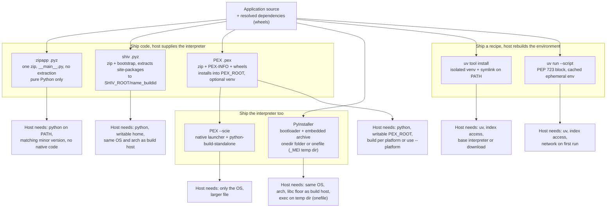

# Shipping Python Applications: zipapp, PEX, PyInstaller, and uv tool

> [!summary] Claim:
> Every way of shipping a Python application answers one question: which of the interpreter, the standard library, third-party code, and your code travel with the artifact, and which the host must already hold.
> A zipapp or PEX ships code and needs a compatible interpreter on the host; PyInstaller ships the interpreter too and needs only the OS; `uv tool` and `uv run` ship nothing and rebuild an environment from an index.
> Python can import `.py` and `.pyc` from a zip but cannot load a `.so` from one, so every bundler that handles native wheels extracts them to disk first, and that extraction is the cost you pay at cold start.
> An expert picks by host contract (known fleet or unknown desktops), by cold-start budget, and by who owns the interpreter, and checks the result by running the artifact on a clean host.



## The Mechanism

### The four things an application needs, and where each can live

A running Python application needs an interpreter, the standard library, third-party packages, and first-party code.
Distribution tools differ in how many of these they put in the artifact and in how they make the rest available at run time.
The table is the spine of the whole note; each later section explains one row.

| Strategy | Interpreter | Third-party code | Native extensions | Artifact | Host prerequisite |
|---|---|---|---|---|---|
| `zipapp` | Host | In the zip if you vendored it | Cannot run from the zip | One file | Compatible `python` |
| shiv | Host | Zip, extracted to a cache | Extracted, so they work | One file | Compatible `python`, writable cache |
| PEX | Host (or bundled with `--scie`) | Wheels in the zip, installed into a cache | Installed, so they work | One file, or a directory layout | Compatible `python`, writable cache |
| PyInstaller | Bundled | Bundled, found by static analysis | Bundled | Folder or one file | Same OS, arch, and libc floor |
| `uv tool install` | Host or uv-managed | Fetched from an index into a venv | Installed, so they work | None (a venv) | `uv`, network at install |
| `uv run --script` | Host or uv-managed | Fetched into a cached environment | Installed, so they work | The script | `uv`, network on first run |

[[Python-Packaging-History-and-pyproject-toml]] owns how the project and its wheels are built; this note starts from a project that already builds.
[[Python-Wheels-Platform-Tags-Manylinux-and-ABI3]] owns why a wheel fits one platform, which is the reason every strategy below that handles native code is tied to the platform that built it.

### zipapp: the standard-library mechanism (PEP 441, PEP 273, PEP 302)

A Python zip application is a zip file that contains `__main__.py` at its root, optionally preceded by a shebang line.
The format is defined in the `zipapp` documentation as an optional `#!` line with an interpreter name and a newline, followed by standard zip data, whose content must include `__main__.py` at the root of the archive.
The zip format allows arbitrary bytes before the first local header because readers locate the archive from the end, so a shebang line is harmless to zip tools and meaningful to the kernel's `execve`.
PEP 441 (Final, Python 3.5) added the `zipapp` module and the `.pyz` and `.pyzw` extensions; `.pyz` is a console application and `.pyzw` is a windowed one.
The PEP states that the Python 3.5 installer would associate both extensions with the Windows launcher, which implements shebang support; it is the PEP's stated design, and the current Python on Windows documentation does not mention `.pyz`, so on any given machine run the archive as `python app.pyz` to be certain.
Python had been able to run zip files containing `__main__.py` since 2.6, so PEP 441 standardized tooling, not the runtime.

What happens at `python app.pyz`, from `Modules/main.c` in CPython 3.15.2:
1. `pymain_run_python` asks `pymain_get_importer(config->run_filename, ...)` for a path importer for the argument, by calling `PyImport_GetImporter` on the path string.
2. For a zip file this returns a `zipimporter`.
   For an ordinary script it returns `None` and the file is run as a script.
3. If an importer was found, the path of the archive is prepended to `sys.path` as `sys.path[0]`, and `pymain_run_module(L"__main__", 0)` runs `__main__` through the import system, so `__main__.py` is read out of the archive by `zipimport`.
4. Everything the application imports afterward is searched in `sys.path`, whose first entry is the archive, so the zip serves as the application's top-level directory.

`zipimport` (`Lib/zipimport.py`, 3.15.2) is the loader behind step 3, and its limits are the limits of every zip-based strategy:
- It locates the archive by scanning backward from the end of the file for the end-of-central-directory record, within a window sized from the maximum zip comment length plus the EOCD structures (`_read_directory`).
- It computes `arc_offset` as the number of bytes prepended before the zip data, and adds it to every file offset.
  The source comment says this "is used for pex as well as self-extracting .exe", so the PEX and shiv shebang lines rely on this exact code path.
- It caches the parsed central directory per archive in `_zip_directory_cache`, so a long-running process reads the directory once.
- Its search order for a module name is `pkg/__init__.pyc`, `pkg/__init__.py`, `mod.pyc`, then `mod.py` (`_zip_searchorder`).
  There is no entry for `.so`, `.pyd`, or `.dylib`: the documentation says importers are only invoked for `.py` and `.pyc` files and that "ZIP import of dynamic modules (.pyd, .so) is disallowed".
- It never writes a `.pyc` back into the archive.
  The documentation warns that an archive holding only `.py` files "may be rather slow" to import, because the source is compiled at every start.
- ZIP64 archives are supported from Python 3.13, and zstd-compressed entries from 3.15.
  Archives with a comment are supported from 3.8.
- `get_resource_reader` returns a `ZipReader`, so `importlib.resources` works inside an archive, but `__file__` points into the archive (`example_archive.zip/example.py` in the docs), not at a real file, so code that opens files next to its modules breaks.

`zipapp` itself is a thin writer (`Lib/zipapp.py`):
- `-m pkg.mod:fn` generates a `__main__.py` from `MAIN_TEMPLATE`, which in 3.15.2 is the coding line, `import {module}`, and `{module}.{fn}()`.
  It does not call `sys.exit` on the return value, so a `main()` that returns an integer yields exit status 0 unless it raises or calls `sys.exit` itself.
- `-p interpreter` writes `#!interpreter` and sets the executable bit on POSIX.
  Without it there is no shebang and the file is not executable.
- `-c` (Python 3.7 and later) compresses with deflate; the default stores files uncompressed.
- `--info` prints the embedded interpreter.
- `create_archive` refuses an invalid entry point string and refuses `main` if the source already has a `__main__.py`.

The documented recipe for a standalone archive is `python -m pip install -r requirements.txt --target myapp` followed by `python -m zipapp -p "interpreter" myapp`.
It works for pure-Python dependencies only.
The documentation's own caveat is that a dependency with a C extension "cannot be run from a zip file (this is an OS limitation, as executable code must be present in the filesystem for the OS loader to load it)", and it suggests shipping the unzipped module beside the archive and adding its directory to `sys.path`.
The shebang is a second portability trap: `zipapp` documents that there "is no way to say 'python X.Y or later'", so `/usr/bin/env python3` means whatever `python3` is first on the host's `PATH`, and a pinned minor version fails on hosts that have a different one.

### shiv: a zipapp that extracts its dependencies

shiv (LinkedIn) is a builder that runs `pip install` into a staging directory, zips the result with a generated `__main__.py` and a bootstrap, and prepends a shebang.
Its documentation states the design: "a special `__main__.py` that instructs the Python interpreter to unpack those dependencies to a known location", then adds them to the search path.
At first run the bootstrap extracts a complete `site-packages` into a subdirectory of `~/.shiv` named after the output file and a build id, and later runs reuse it.
`SHIV_ROOT` overrides the base directory, `SHIV_FORCE_EXTRACT` forces re-extraction, `SHIV_INTERPRETER` drops into a REPL, and `SHIV_ENTRY_POINT` and `SHIV_CONSOLE_SCRIPT` override the baked-in entry point.
The default build id is a SHA256 of the build contents, per the `--build-id` help; a custom id must be unique per build, or two different builds would share one cache directory.

The documentation gives two reasons for extracting instead of importing from the zip: shared objects loaded with `dlopen` need a regular file, and many libraries build paths from `__file__`.
It adds a performance reason: decompressing on every run would be slow.
Its history page explains the split from PEX: LinkedIn found `pkg_resources` startup cost unacceptable and chose to install a whole `site-packages` and register it with `site.addsitedir`, which keeps `sys.path` short and makes namespace packages work.
It claims "almost 2x" faster than PEX in that design; that is a vendor claim from the project's motivation page, from an old PEX architecture, and this note does not rely on it.

Other shiv facts verified from `shiv --help` (1.0.8):
- The default shebang is `/usr/bin/env python3`, changed with `-p`.
- `--compressed` and `--uncompressed` choose the zip method; the help does not print the default, but `src/shiv/cli.py` at tag 1.0.8 declares `--compressed/--uncompressed` with `default=True`, so archives are compressed unless you pass `--uncompressed`.
- `--reproducible` overwrites file timestamps, and setting `SOURCE_DATE_EPOCH` implies it.
- `--no-modify` makes the runtime raise if extracted sources were modified, and the help recommends Python's `--check-hash-based-pycs always` with it.
- `--preamble` runs a script after extraction and before the entry point; the docs show one that deletes stale sibling directories, which is the supported answer to unbounded cache growth.
- There is no platform selector among shiv's own options, and unprocessed arguments go to `pip install`, so a shiv archive is built for the platform of the machine that ran it unless you drive pip's platform options yourself.

### PEX: a self-extracting virtual environment

PEX (originally from Twitter) builds on the same zipapp trick and adds a lock-aware resolver, a runtime that treats the file as a virtual environment, and many controls.
The Pex documentation describes a PEX file as "a self-contained executable Python virtual environment", made from "carefully constructed zip files with a `#!/usr/bin/env python` and special `__main__.py`".

The default (zipapp) layout, as observed for a project with one dependency (see the observed run below), holds:
- `__main__.py` and `__pex__/__init__.py`, the entry stub and an importable shim.
- `.bootstrap/`, the Pex runtime itself.
- `.deps/<name>-<version>-<tags>.whl/`, one directory per resolved wheel, unpacked.
- `PEX-INFO`, a JSON file.
  Keys observed in a 2.107.1 build include `entry_point`, `requirements`, `distributions` (wheel name to sha256), `interpreter_constraints`, `interpreter_selection_strategy` (`oldest`), `inherit_path` (`false`), `strip_pex_env` (`true`), `venv` (`false`), `venv_hermetic_scripts`, `pex_hash`, `bootstrap_hash`, and `code_hash`.

Boot sequence, as the documentation describes it:
1. The shebang names an interpreter.
   By default Pex writes the shebang of an interpreter compatible with the one that built it, for example `#!/usr/bin/env python3.15`, and `--python-shebang` overrides it.
   If the name does not resolve, the kernel fails before Python starts; the scie page shows `/usr/bin/env: 'python3.11': No such file or directory` under `env -i PATH=`.
2. The Pex bootstrap runs, selects an interpreter honoring `interpreter_constraints`, `PEX_PYTHON`, and `PEX_PYTHON_PATH`, and may re-execute under a different one.
3. It installs the application into `PEX_ROOT`.
   The recipes page says all PEX forms other than a non-`--venv` loose-layout PEX "re-execute themselves against an installed version of themselves in the configured `PEX_ROOT`".
   The runtime-variables page and `pex --help` mark `PEX_FORCE_LOCAL` and `--zip-safe` deprecated because "user code is now always unzipped before execution", and `PEX_UNZIP` deprecated because unzipping before execution "is now the default".
   So the PEX analog of a zipapp that runs from inside the zip does not exist any more; the zip is a transport format.
4. It scrubs `sys.path` of everything outside the standard library unless `PEX_INHERIT_PATH` (or `--inherit-path`) is `prefer` or `fallback`, then puts the PEX's wheels on the path, and runs the entry point.
   `PEX_EXTRA_SYS_PATH` adds paths on purpose; `PEX_PATH` merges other PEX files, which is the plugin mechanism.
5. With `--venv` (or `PEX_VENV=1`) step 3 builds a real virtual environment under `PEX_ROOT` once, and "subsequent runs will enjoy lower startup latency".

PEX knobs that decide the portability and cold-start story, from `pex --help` 2.107.1 and the docs:
- Layouts, `--layout {zipapp,packed,loose}`: `zipapp` is one file; `packed` is a directory with the bootstrap and each dependency in its own zip, designed for "cache-friendly" syncing of incremental updates over a network; `loose` has everything unpacked, and its help says "Both zipapp and packed layouts install themselves in the PEX_ROOT as loose apps by default before executing".
- `--sh-boot` replaces the Python shebang with `#!/bin/sh` and an embedded script that selects and re-executes an interpreter.
  The help states the sh path has constant overhead "O(1ms)" against "O(100ms)" for Python doing the same selection, and the observed numbers below point the same direction.
- `--venv [prepend|append]`, `--venv-copies`, `--venv-site-packages-copies`, `--venv-system-site-packages`, and `--non-hermetic-venv-scripts` control the venv form.
- `--pre-install-wheels` (default on) trades build time for faster cold boot.
- `--compress` defaults to true for zipapp and packed; `--compression-level` accepts zstd levels -7 to 22 (default 3) and a deflate range.
- `--lock FILE` resolves from a Pex lock file; `--platform` and `--complete-platform` resolve wheels for another target.
  `--platform` takes `PLATFORM-IMPL-PYVER-ABI`, for example `linux_x86_64-cp-38-cp38`, and `--complete-platform` takes a JSON file with a `marker_environment` and an ordered `compatible_tags` list, which `pex3 interpreter inspect --markers --tags` produces on the target machine.
  The docs note that with `--platform` and a short Python version, a `python_full_version` environment marker raises `UndefinedEnvironmentName`, so a complete platform is safer.
- `--include-tools` (default off; the recipes page says `--venv` serves as well) enables `PEX_TOOLS=1`, including the `venv` tool that converts a PEX into a plain virtualenv directory; the recipes page uses it for container images.
- `--inject-args`, `--inject-env`, and `--inject-python-args` seal runtime configuration into the file.
- `PEX_ROOT` defaults to a platform cache directory; the `--runtime-pex-root` help names `~/.cache/pex` on Linux and `~/Library/Caches/pex` on Mac.
- `PEX_INTERPRETER=1`, `PEX_MODULE`, `PEX_SCRIPT`, and `PEX_DISABLE_VARIABLES` change or lock down what the file runs; the last is the knob to set when the PEX must not obey the caller's environment.
- The `PEX` environment variable inside the process holds the absolute path of the running PEX, so application code can detect it.
- The `setproctitle` package, if included, makes `ps` show the PEX path instead of an `unzipped_pexes/<hash>` path.

`--scie eager` (or `lazy`) is the bridge to the next family.
Pex uses the `science` projects to emit a native executable that contains a python-build-standalone CPython and the PEX, so it needs no host interpreter.
The docs' example for `cowsay` shows a 31M scie against 728K and 724K for `--sh-boot` and plain PEX files, and `--scie lazy` fetches the interpreter on first run into `~/.cache/nce` (and `PEX_BOOTSTRAP_URLS` repoints that download, which must return bytes with the original hash).
The docs report the scie and the `--sh-boot` PEX at 16 to 18 ms against about 99 ms for the Python-shebang PEX on their machine; treat that as the vendor's measurement.
`--scie-busybox` seals several commands into one scie.
pex 2.107.1 declares `requires_python` as `>=2.7,<3.17` with several 3.x exclusions on PyPI (as of 2026-11), and its Building .pex files page still shows `--python=python2.7` examples, so it is the builder in this note with the widest interpreter range; that matters only for legacy fleets.

### PyInstaller: freeze the interpreter into a bootloader executable

PyInstaller solves the other half: the host may have no Python.
Its operating-mode page lays out the design.
At build time it performs static analysis: it finds every `import` statement in your script, recurses into imported modules, and builds the list of modules and shared libraries the program may use.
It also collects what it cannot see by hooks for known packages (Qt bindings, matplotlib, tkinter) and by options you supply (`--hidden-import`, `--collect-all`, `--add-data`, spec files).
Imports built from `__import__()` with variable data, `importlib.import_module()`, or `sys.path` edits are invisible to the analysis; the docs list this as the main reason bundles fail, and `--debug=imports` and the `warn-<name>.txt` file in the build directory are the diagnostics.
It does not bundle libraries "that should exist in any installation of this OS", and on Linux it skips everything under `/lib` and `/usr/lib`, so the bundle dynamically links the build host's libc.

Output has two forms, and `--onedir` is the default:
- One-folder: a directory containing the executable and, since PyInstaller 6, an `_internal` directory that holds the supporting files (the `--contents-directory` option names it, and `.` restores the old flat layout).
  The executable is the bootloader, a small C program for the platform that is "the heart of the myscript executable".
  The bootloader sets up an environment so the embedded interpreter finds modules in the folder, and starts it.
- One-file: the bootloader plus an embedded archive of modules and compressed copies of support files.
  On start the bootloader makes `_MEIxxxxxx` under the OS temp directory (`TMPDIR`, `TEMP`, `TMP`, in that order, then `/tmp`, `/var/tmp`, `/usr/tmp` on POSIX), extracts the support files, runs, and deletes the directory at exit.
  The docs say this is why onefile "is a little slower to start up", and that the directory is not removed if the program is killed with `kill -9`, so a crashing app accumulates directories.
  A `noexec` temp mount breaks it, and `--runtime-tmpdir` (without shell expansion of `~` or `$HOME`) or setting `TMPDIR` before launch are the workarounds.
  Two copies of a onefile app share nothing, and each unpacks separately.

The bootstrap, from "The Bootstrap Process in Detail" (6.22.3):
1. The first process is the bootloader.
   It extracts the archive (onefile only), saves `LD_LIBRARY_PATH` into `LD_LIBRARY_PATH_ORIG` and prepends its own path (on AIX, `LIBPATH`), unsets `DYLD_LIBRARY_PATH` on macOS, sets up signal handling, and runs the child.
2. The child is the same executable, started again.
   It loads the Python dynamic library named in the executable, initializes the interpreter, sets `sys.frozen` and `sys._MEIPASS`, installs importers on `sys.meta_path`, runs runtime hooks, and runs the main script.
   This two-process design is used in every mode except onedir on Windows, so a task manager shows two processes.
3. Import resolution in the frozen app is: built-in modules, then modules embedded in the executable (compiled `.pyc` from the archive), then C extensions as files named `package.module.so` or `.pyd`, then `sys.path`, then `ImportError`.
   The importers are PEP 302 hooks appended to `sys.meta_path`, implemented in `pyi_mod03_importers.py` according to the docs.
4. In a frozen app `sys.executable` is the bootloader, not Python, `__file__` for the main script is an absolute path in the bundle directory (since 4.3), and `sys._MEIPASS` names the bundle directory.

Constraints and recent changes that matter in practice (as of 2026-11):
- A bundle is specific to the OS, word size, and Python version that built it; the Python interpreter that runs PyInstaller becomes part of the bundle.
  Multi-platform releases need one build per OS and architecture, and `--target-arch {x86_64,arm64,universal2}` on macOS builds single-architecture or universal2 bundles when the Python install supports it.
- On macOS, `--codesign-identity` signs collected binaries; without one PyInstaller signs ad hoc.
  [[Cpp-macOS-Universal-Binaries-Code-Signing-and-Notarization]] owns notarization.
- UPX is used only on Windows; the manual says Linux shared libraries "seem to break" under UPX and UPX-compressed macOS files fail `codesign` validation.
- PyInstaller 6.22.1 (2026-08-15) added bootloader validation of the inherited environment for onefile child processes, tied to GHSA-9fxf-4qw3-ghmr.
  The child looks up its parent process id, resolves the parent's executable (on Windows, macOS, and POSIX systems with a procfs lookup such as Linux, Cygwin, FreeBSD, and Solaris, but not OpenBSD or AIX), and requires that it match its own executable.
  6.22.3 (2026-09-12) limited that validation to processes running with elevated privileges while inheriting variables from an unprivileged user, meaning setuid, setgid, or Linux file capabilities, and UAC-elevated processes on Windows.
  Setuid or setgid onedir executables must have a contents directory owned by the executable's owner (setuid) or group (setgid), with no world write and, for setuid, no group write.
  Onefile with setuid is refused on OpenBSD and AIX, and the docs say elevated-privilege support is limited because the OS clears `LD_LIBRARY_PATH`.
- Python 3.15 support arrived in 6.21.0 (2026-06-13), and PyInstaller 6.22.3 on PyPI requires Python `>=3.8,<3.16` (as of 2026-11).
- PyInstaller is GPL 2.0 or later (PyPI metadata: "GPLv2-or-later") with an exception that allows bundling commercial applications and shipping them under any license, subject to the licenses of your dependencies.
- Source is not hidden: the bundle holds compiled `.pyc`, which "could in principle be decompiled"; the manual's suggestion is to compile sensitive modules with Cython.
- Applications that start other programs must undo the `LD_LIBRARY_PATH` change by clearing it or restoring `LD_LIBRARY_PATH_ORIG` for the child, or the system program loads incompatible bundled libraries ("Common Issues and Pitfalls", 6.22.3).

### uv tool: an isolated environment per command, no artifact

`uv tool install` does not produce a distributable file.
It creates a virtual environment under the uv tools directory (`UV_TOOL_DIR`; on Unix, Linux and macOS alike, the default is `$XDG_DATA_HOME/uv/tools`, else `~/.local/share/uv/tools`, per the uv storage reference, and the latter was observed on macOS), installs the package and its dependencies, and links the package's executables into a bin directory (`UV_TOOL_BIN_DIR`; on Unix `$XDG_BIN_HOME`, then `$XDG_DATA_HOME/../bin`, then `~/.local/bin`, observed as `~/.local/bin` on macOS).
Executables are symlinked on Unix and copied on Windows.
Only the entry points of the requested package are exposed; executables from its dependencies are not, unless you ask with `--with-executables-from`.
`uvx` is the alias for `uv tool run`, which runs the tool in a cached disposable environment, and uv documents it as nearly equivalent to `uv run --no-project --with <name> -- <name>`, with the difference that an already installed tool wins and the environment lives in a dedicated cache location.

Documented behaviors that shape a deployment:
- A tool environment is linked to one Python.
  If that Python is uninstalled, "the tool environment will be broken and the tool may be unusable".
  The observed `pyvenv.cfg` has `home = /opt/homebrew/opt/python@3.15/bin`, so the venv points at the base interpreter instead of copying it.
- Tool environments are not meant to be mutated by hand.
- `uv tool upgrade` respects the constraints given at install time and keeps the settings; reinstalling replaces them.
- `uvx` uses the cached version after the first run, so `uvx tool@latest` is how you refresh.
- `uv tool install` will not overwrite an executable in the bin directory that uv did not install (for example one from pipx) unless `--force` is given.
- uv downloads managed CPython builds automatically when none matches, unless `python-downloads` or `UV_PYTHON_DOWNLOADS` disables it, and `UV_NO_MANAGED_PYTHON` ignores managed versions; `UV_PYTHON_INSTALL_DIR` sets where they live.
  The consequence for fleets is that the host needs network access to an index and, if it lacks the Python, to the Python download source, or you must mirror both.
- The tool does not honor `.python-version` or `requires-python` from a project in the current directory; `--python` picks the interpreter.

The observed install (see the run below) shows the mechanism: a `uv-receipt.toml` recording the requirement, the Python path, and the entry points with their install paths, and a generated launcher whose first lines are a `/bin/sh` and Python polyglot (`'''exec' '<venv>/bin/python' "$0" "$@"`) that re-executes the venv's interpreter, so the launcher works wherever the shell finds it on `PATH`.
That is the opposite portability contract from a PEX: the launcher contains absolute paths into the venv and is not relocatable.

### uv run and PEP 723: ship a script and its recipe

PEP 723 (Final) defines inline script metadata so a single-file script can declare its Python requirement and dependencies.
The block is a run of comment lines that starts with `# /// script`, ends with `# ///`, and contains TOML between.
Rules from the specification:
- The type must be ASCII letters, digits, and hyphens; `script` is the only standardized type, and tools must not read metadata blocks of types that are not standardized.
- Every line between the markers must start with `#`; the content is each line with the first two characters removed if the second is a space, otherwise the first character.
- Unclosed blocks are ignored, and more than one block of the same type is an error.
- The `script` block may have `dependencies` (PEP 508 strings), `requires-python` (a version specifier), and a `[tool]` table.
- Runners must error if the dependencies cannot be provided and should error if no matching Python can be provided.
- The canonical regular expression is `(?m)^# /// (?P<type>[a-zA-Z0-9-]+)$\s(?P<content>(^#(| .*)$\s)+)^# ///$`; where it disagrees with the text, the text wins.

uv implements it as `uv run script.py`, creating a cached environment from the block, and finding or downloading a Python that satisfies `requires-python`.
Details from the uv docs:
- `dependencies` must be present even when empty.
- With inline metadata, uv ignores the project's dependencies even inside a project; without it, `uv run` installs the current project first, and `--no-project` skips that.
- A shebang `#!/usr/bin/env -S uv run --script` makes the file directly executable, with or without the block.
- `uv lock --script example.py` writes `example.py.lock` beside the script, and later `uv run --script`, `uv add --script`, `uv export --script`, and `uv tree --script` reuse it.
  Locking is opt-in; without the file nothing is created.
- `[tool.uv] exclude-newer = "<RFC 3339 timestamp>"` in the block restricts resolution to releases before that time, a reproducibility lever when you do not lock.
- `uv init --script` creates a script with a block, and `uv add --script` edits it; `--index` writes a `tool.uv.index` array of tables into the block.

This is a distribution format only for hosts that already have uv and index access.
It is the cheapest strategy to author and the weakest in determinism, and [[Python-Dependency-Resolution-pip-uv-and-PEP-751-Lockfiles]] owns what the resolver does with the block.

### What each strategy needs from the host, and what it costs

Portability is a property of the host contract, not of the file:
- zipapp, shiv, PEX (default): a Python whose minor version satisfies the wheels, found by a shebang name or by `PEX_PYTHON`.
  The platform is fixed by the wheels' tags: a wheel for `macosx_11_0_arm64` is useless on Linux.
  PEX can resolve for other platforms with `--platform` or `--complete-platform`, but only from wheels; a dependency that exists only as an sdist must build on the build host.
- PyInstaller: OS, architecture, and a libc at least as new as the build host's, because the bundle links host libraries.
  Build on the oldest distribution you support; [[Cpp-Glibc-Symbol-Versioning-and-Portable-Linux-Binaries]] owns the mechanism, and [[Drill-Packaging-Manylinux-GLIBC-Symbol-Leak]] practices the failure.
- `--scie` PEX: OS and architecture; the interpreter is bundled.
- uv-based: the host needs uv and either a Python or the ability to download one.

Costs fall into four buckets: artifact size, cold-start time, warm-start time, and the disk and permission footprint at run time.
The observed table below gives one data point for each on one machine; the structural reasons are:
- A zipapp has no first-run cost but pays source compilation at every start unless the archive contains `.pyc` files (the zipimport rule above).
- shiv and PEX pay a first-run extraction or install and then a warm cost that includes interpreter re-selection (PEX) or a short `sys.path` (shiv).
- PyInstaller onedir pays no extraction; onefile pays extraction at every start, because it deletes the directory at exit.
- uv-based flows pay environment creation on the first run and then a cache check plus a venv start.

### Single-file binary or container

A single-file artifact (a PEX with `--scie`, a PyInstaller onefile) is the right answer when the host is not yours, has no Python, and cannot pull an image: a developer laptop, a customer server, an air-gapped box.
A container is the right answer when you own the host's runtime (an orchestrator) and want the interpreter, libc, and dependencies fixed together; [[OCI-Images-Layers-Multi-Stage-and-Distroless]] owns that model.
The two compose: the Pex recipes show a multi-stage Dockerfile that converts a PEX into a plain venv with `PEX_TOOLS=1 python app.pex venv --scope=deps --compile /my-app` and a second stage for `--scope=srcs`, so first-party code changes rebuild one thin layer, and the image has no unpacking at start.
The rule is that a zip-transport artifact belongs outside a container, and inside one you ship the already-expanded form.

## Commands and Numbers to Know

| Item | Value | Platform | Notes |
|---|---|---|---|
| Build a zipapp | `python -m zipapp stage -m pkg.mod:fn -p "/usr/bin/env python3" -o app.pyz` (as of 2026-11) | Both | `-c` compresses (3.7 and later); default stores; no `.pyc` is added. |
| Vendor deps for zipapp | `python -m pip install -r requirements.txt --target stage` (as of 2026-11) | Both | The documented recipe; the observed run used `uv pip install --target`. |
| zipapp inspect | `python -m zipapp app.pyz --info` (as of 2026-11) | Both | Prints the shebang interpreter. |
| zipimport limits | `.py` and `.pyc` only, ZIP64 from 3.13, zstd entries from 3.15 (as of 2026-11) | Both | Python 3.15.2 `zipimport` docs. |
| zipapp archive observed size | 457,803 bytes stored, 130,625 compressed, one app plus click (as of 2026-11) | macOS | Single ad hoc run, Python 3.15.2. |
| shiv build | `shiv -c hello -o hello.shiv ./proj` (shiv 1.0.8, as of 2026-11) | Both | Cache at `~/.shiv/<name>_<build id>/site-packages`, override with `SHIV_ROOT`. |
| shiv runtime env | `SHIV_ROOT`, `SHIV_FORCE_EXTRACT`, `SHIV_INTERPRETER`, `SHIV_ENTRY_POINT` (alias `SHIV_MODULE`), `SHIV_CONSOLE_SCRIPT`, `SHIV_EXTEND_PYTHONPATH`, `SHIV_PREPEND_PYTHONPATH` (as of 2026-11) | Both | From the shiv docs. |
| PEX build | `pex ./proj -c hello -o hello.pex` (pex 2.107.1, as of 2026-11) | Both | Default layout is `zipapp`; shebang is the build interpreter. |
| PEX boot variants | `--sh-boot`, `--venv`, `--layout packed`, `--layout loose`, `--scie eager` (as of 2026-11) | Both | `--sh-boot` is documented as O(1ms) interpreter selection against O(100ms). |
| PEX cache | `PEX_ROOT` (`~/.cache/pex` on Linux, `~/Library/Caches/pex` on Mac, as of 2026-11) | Both | Per-user; holds installed wheels, venvs, and unpacked PEXes. |
| PEX observed size | 1,146,363 bytes zipapp, 1,171,151 bytes `--sh-boot --venv` (as of 2026-11) | macOS | Same app as the zipapp above; includes the Pex runtime. |
| PyInstaller build | `pyinstaller --onedir` (default) or `--onefile entry.py` (6.22.3, as of 2026-11) | Both | Output specific to the build OS, arch, and Python; supports Python `>=3.8,<3.16`. |
| PyInstaller onedir layout | executable plus `_internal/` (`--contents-directory`) (as of 2026-11) | Both | `.` restores the old flat layout. |
| PyInstaller onefile extraction | `TMPDIR`, `TEMP`, `TMP`, then `/tmp`, `/var/tmp`, `/usr/tmp`; `--runtime-tmpdir` fixes it (as of 2026-11) | Linux | Directory `_MEIxxxxxx`; left behind by `kill -9`. |
| PyInstaller observed size | onefile 9,122,624 bytes; onedir bootloader 2,278,896 bytes, folder 20,724 KiB (`du -sk`) (as of 2026-11) | macOS | Single ad hoc run, Homebrew Python 3.15.2 arm64. |
| PyInstaller UPX | Windows only (as of 2026-11) | Both | `--noupx` disables; broken on Linux libs and fails macOS codesign. |
| PyInstaller macOS arch | `--target-arch x86_64`, `arm64`, `universal2`; `--codesign-identity ID` (as of 2026-11) | macOS | Ad hoc signing when no identity is given. |
| uv tool install | `uv tool install ./proj` (uv 0.11.26, as of 2026-11) | Both | Venv in `UV_TOOL_DIR`, symlink in `UV_TOOL_BIN_DIR`; copied on Windows. |
| uv tool dirs | `~/.local/share/uv/tools`, `~/.local/bin` (as of 2026-11) | Both | Unix defaults when the `XDG_*` variables are unset (uv storage reference); printed by `uv tool dir` and `uv tool dir --bin` on the observed macOS host. |
| uvx | `uvx tool`, `uvx tool@latest`, `uvx --with extra tool` (as of 2026-11) | Both | Cached disposable environment; first resolved version is reused. |
| PEP 723 block | `# /// script` ... `# ///` with `dependencies` and `requires-python` (as of 2026-11) | Both | Final; `dependencies` must exist for uv even if empty. |
| uv script lock | `uv lock --script s.py` writes `s.py.lock` (as of 2026-11) | Both | Observed `greet_locked.py.lock`. |
| uv shebang | `#!/usr/bin/env -S uv run --script` (as of 2026-11) | Both | `env -S` splits the arguments. |

## Multi-Language Comparison

The question "how do I hand someone a program" is answered differently by each ecosystem, and the Python answers above exist because the Python runtime is a separate artifact.

| Concern | C++ | Python (this note) | Rust |
|---|---|---|---|
| What the build emits | A native executable, dynamically or statically linked | A script, a wheel set, or a frozen bundle, never a native executable by default | A native executable from `cargo build` |
| Interpreter or runtime on the host | None, but a libc and often `libstdc++` | Yes for zipapp, shiv, PEX, uv; bundled for PyInstaller and `--scie` | None beyond the OS and libc |
| Native dependencies | Linked at build or shipped with an install prefix | Wheels carry them; zip import cannot load them | Compiled in, or system libraries via `-sys` crates |
| Portability knob | Build on an old baseline, hide symbols, static libstdc++ | Wheel tags, `--platform`, oldest-distro PyInstaller builds | Target triple, musl for static Linux binaries |
| Single-file shipping | Static link and strip | PyInstaller onefile, PEX scie | Default |
| Reproducibility | Pinned toolchain and sysroot | Locks, `--reproducible`, `SOURCE_DATE_EPOCH`, `exclude-newer` | `Cargo.lock`, `--locked` |
| Where to read next | [[Cpp-Hardened-Release-Builds-and-Separate-Debug-Symbols]] | [[Python-Wheels-Platform-Tags-Manylinux-and-ABI3]] | [[Rust-Binary-Distribution-with-dist-and-Cross-Compilation]] |

The structural point is that PyInstaller and `--scie` convert a Python application into the compiled-language contract (OS plus libc), and they pay for it by carrying a whole interpreter, while the zip-based tools and the uv tools keep the Python contract and make the host responsible for the interpreter.

## Worked Lab Example

This note has no lab.
It rests on one ad hoc run on 2026-11-21 that was not recorded by the lab harness, has no `expected/` file, and was not repeated, so every number below is a single sample from one machine and not a benchmark.
The run used macOS 27.3 arm64, Homebrew CPython 3.15.2, uv 0.11.26, pex 2.107.1, shiv 1.0.8, PyInstaller 6.22.3, click 8.5.1, and orjson 3.13.0, with a project `hello-app` that depends only on `click` and exposes a `hello` console script.

Build the project's dependencies into a staging directory and make a zipapp:

```sh
uv pip install --python /opt/homebrew/bin/python3.15 --target stage ./proj
python3.15 -m zipapp stage -m hello_app.cli:main -p "/usr/bin/env python3" -o hello.pyz
./hello.pyz zipapp
```

Observed:

```text
#!/usr/bin/env python3
size_bytes 457803
Interpreter: /usr/bin/env python3
hello zipapp from 3.15
compressed_size_bytes 130625
click.__file__ endswith /click/__init__.py
zipimporter
```

`unzip -l` printed 50 lines for the archive and listed no `.pyc` files (`uv pip install --target` does not compile bytecode by default), and `click.__file__` ends inside the archive path, so nothing was extracted.
Add a native dependency to the stage and the archive stops working, even though the `.so` is in it:

```text
ModuleNotFoundError: No module named 'orjson.orjson'
in archive: orjson/orjson.cpython-315-darwin.so
```

shiv and PEX first and second runs, in a fresh cache each (single samples of `time -p`):

```text
shiv:  first 0.52 s, second 0.11 s, cache dir hello.shiv_<sha256> containing site-packages, 137,045 bytes
PEX:   first 2.22 s, second 0.71 s, PEX_ROOT holds installed_wheels, user_code, unzipped_pexes, isolated, bootstraps, interpreters
```

Layouts the same PEX build produced:

```text
zipapp:  __main__.py  __pex__/  .bootstrap/  .deps/<wheel>/...  PEX-INFO   (one file, 1,146,363 bytes)
packed:  directory with .bootstrap  .deps/click-8.5.1-py3-none-any.whl  .deps/hello_app-0.1.0-py3-none-any.whl  PEX-INFO  __main__.py  __pex__  pex
loose:   directory with unpacked .bootstrap and .deps, run with `python hello_loose.pex`
sh-boot: first line #!/bin/sh, 1,171,151 bytes with --venv
```

PyInstaller: onedir produced `hello` (2,278,896 bytes) plus `_internal/` holding `base_library.zip`, `Python`, `Python.framework`, `libcrypto.4.dylib`, and others, 20,724 KiB in total by `du -sk`; onefile produced a single 9,122,624 byte Mach-O arm64 executable.
`uv tool install ./proj` created a venv under `UV_TOOL_DIR`, a `hello -> .../hello-app/bin/hello` symlink in `UV_TOOL_BIN_DIR`, a `uv-receipt.toml`, and a `pyvenv.cfg` with `home = /opt/homebrew/opt/python@3.15/bin`.
A PEP 723 script ran with `uv run --no-project`, and `uv lock --script greet_locked.py` created `greet_locked.py.lock`.

Startup of `hello x` with `hyperfine -N -w 3 -r 10`, on a machine that was not quiesced (so read the spread, not the median):

| Artifact | Median | Min | Max |
|---|---|---|---|
| `python -c pass` (baseline) | 44.8 ms | 30.2 ms | 94.0 ms |
| venv script (pip-installed) | 118.9 ms | 71.4 ms | 276.4 ms |
| `uv tool` launcher | 133.2 ms | 85.1 ms | 352.5 ms |
| shiv | 213.0 ms | 144.2 ms | 350.9 ms |
| PyInstaller onedir | 293.4 ms | 122.2 ms | 336.0 ms |
| zipapp (no `.pyc`) | 405.8 ms | 186.4 ms | 831.4 ms |
| PEX `--sh-boot --venv` | 703.6 ms | 486.6 ms | 1208.1 ms |
| PyInstaller onefile | 820.3 ms | 748.0 ms | 1039.3 ms |
| PEX default | 2152.4 ms | 1072.6 ms | 4865.5 ms |

What the run supports, and what it does not:
- Supported: onefile is slower than onedir, extraction-based tools have a cold-first-run cost, a zipapp without `.pyc` is slower than a venv for the same code, and `--sh-boot` was faster than the Python-shebang PEX.
- Not supported: any ranking among close neighbors, any absolute millisecond figure, and any claim about Linux, other Python versions, or larger applications; the application imports only `click`, and the cost of larger dependency trees scales with the number of modules compiled or extracted.
- The default PEX figure is far above the vendor's own cowsay numbers; its spread suggests contention and a long `PEX_ROOT` path (Pex warned that a venv script shebang had 200 characters), so do not quote it.

To reproduce, run the same commands on your fleet's actual hardware and Python, with `hyperfine`, on an idle machine, and keep the raw JSON.

## Pitfalls

> [!warning] Pitfall 1: A zipapp cannot load a native extension, and the failure message hides why
> `zipimport` has no `.so` entry in its search order, so `import orjson` inside a zipapp raises `ModuleNotFoundError: No module named 'orjson.orjson'` while the `.so` sits in the archive.
> Packages with a pure-Python fallback for an optional accelerator would not raise; they would run the slower path without a message (inferred from the mechanism, not observed).
> Use shiv or PEX for anything with native wheels, or ship the native package beside the archive and extend `sys.path`, as the `zipapp` documentation suggests.

> [!warning] Pitfall 2: `zipapp -m` discards the return value of `main`
> The generated `__main__.py` calls `{module}.{fn}()` and does not pass the result to `sys.exit` (`MAIN_TEMPLATE`, CPython 3.15.2).
> A function that returns 1 to signal failure produces exit status 0; a fact-check run on 2026-11-21 with Python 3.15.2 built such an archive from a `main` that returns 3 and got exit status 0.
> Call `sys.exit(main())` yourself in a `__main__.py` you write, or use a console-script wrapper that does.

> [!warning] Pitfall 3: A shebang pins a command name, not a Python version range
> `/usr/bin/env python3` runs whatever `python3` is first on the host's `PATH`, and Pex's default shebang names the build interpreter, such as `python3.15`.
> The scie documentation shows the failure: with no matching name the kernel reports `/usr/bin/env: 'python3.11': No such file or directory`.
> Use `--sh-boot` for interpreter search, `--python-shebang` for an exact path, or `--scie` to remove the dependency.

> [!warning] Pitfall 4: The first run writes to the user's home, and the cache is per user
> shiv writes `~/.shiv`, PEX writes `PEX_ROOT`, and uv writes its cache and tool directories.
> A read-only home, a container with no writable user directory, or a serverless filesystem makes the first run fail or re-extract every time.
> Set `SHIV_ROOT` or `PEX_ROOT` (or `--runtime-pex-root`) to a writable path, or pre-expand at build time, as the Pex container recipe does with `PEX_TOOLS=1 ... venv`.

> [!warning] Pitfall 5: Cache directories grow, and a stale directory runs old code
> shiv names each extraction `<output name>_<build id>`, and nothing deletes old ones, which is why the docs show a preamble that removes siblings.
> A custom `--build-id` that is reused for different contents makes two builds share one cache and run the first one's code.
> Keep the default content hash, and prune on upgrade.

> [!warning] Pitfall 6: A deep `PEX_ROOT` makes venv script shebangs too long
> Pex 2.107.1 warned, for a `PEX_ROOT` under a deep directory, that a venv's script shebang "has 200 characters", which "may be too long and cause problems", and suggested a shorter `PEX_ROOT`.
> CI workspaces with long paths hit this first.
> Choose a short, stable `PEX_ROOT` such as `/opt/pex`.

> [!warning] Pitfall 7: PyInstaller finds only the imports it can see
> Dynamic imports, plugin loading by name, and data files read through `__file__` all fail at run time while passing a build.
> Build with `--debug=imports`, read `warn-<name>.txt`, add `--hidden-import` or `--collect-all`, and locate data through `__file__` or `sys._MEIPASS`, as the run-time information page describes.
> A bundle that starts on the build machine proves little: test on a clean machine of each target.

> [!warning] Pitfall 8: A PyInstaller bundle inherits the build host's libc floor
> The bundle does not carry libraries under `/lib` or `/usr/lib` and links the build host's.
> A bundle built on a current distribution can require a newer glibc than an older target provides, with the same mechanism as the manylinux wheel failure.
> Build on the oldest supported distribution and verify with the checks in [[Cpp-Glibc-Symbol-Versioning-and-Portable-Linux-Binaries]].

> [!warning] Pitfall 9: Onefile depends on an executable temp directory and can leak it
> A `noexec` `/tmp` makes onefile fail to load its extracted libraries, and `kill -9` leaves `_MEIxxxxxx` behind.
> Set `--runtime-tmpdir` to a directory you control, or use onedir inside an installer.
> Do not run a onefile executable with elevated privileges on Windows: the manual warns that an attacker could corrupt a library in the temp folder during extraction.

> [!warning] Pitfall 10: Subprocesses inherit the bundle's library path
> The PyInstaller bootloader prepends its directory to `LD_LIBRARY_PATH` (Linux) and unsets `DYLD_LIBRARY_PATH` (macOS).
> A frozen app that runs `git` or `ssh` can make that program load bundled libraries.
> Clear `LD_LIBRARY_PATH` or restore `LD_LIBRARY_PATH_ORIG` in the child's environment, as the "Common Issues and Pitfalls" page of the manual shows.

> [!warning] Pitfall 11: uv tools are environments, not artifacts
> `uv tool install` leaves a launcher with absolute paths into a venv that points at a base interpreter.
> Copying `~/.local/bin/hello` to another machine does not work, and removing the base Python breaks every tool built on it.
> To distribute a result, ship the recipe (a package and a pinned `uv tool install`), or build a PEX or PyInstaller bundle.

> [!warning] Pitfall 12: PEP 723 metadata is easy to write wrong and quietly ignored
> An unclosed block is ignored, a second `script` block is an error, and uv requires `dependencies` even if empty.
> An unlocked script resolves against the index on every fresh environment, so two runs a month apart can get different versions.
> Lock with `uv lock --script`, or bound resolution with `exclude-newer`.

## At Scale

For one developer, the cheapest honest answer is `uv tool install` for your own CLIs and `uv run --script` for one-off scripts, because both rebuild from declared metadata and need nothing built.
For a team shipping an internal tool to a known fleet, the interesting trade is between a PEX and a container, and the deciding fact is who owns the interpreter on the host.
For 1,000 to 50,000 engineers, three costs dominate: the build matrix, the cold-start storm, and the support burden of host variation.

Build matrix.
A PyInstaller bundle is per OS, architecture, and Python minor, and per libc floor on Linux.
Three operating systems, two architectures, and three Pythons is 18 builds per release.
A pure-Python application shipped as one PEX or zipapp needs one build for all 18 combinations, which is the argument for keeping dependencies pure or for choosing a container.

Cold-start storm.
When a release rolls out, every host does its first run at once.
PEX and shiv each install or extract into a per-user cache, so a rollout to 5,000 machines is 5,000 extractions, each paying the first-run cost, and a shared network home directory serializes them.
The mitigation is a stable, local `PEX_ROOT` or `SHIV_ROOT` on every host, a post-install step that runs the artifact once, or a `--venv` PEX expanded at image or install time.

Host variation.
Each strategy that needs a host interpreter turns every host's Python into a dependency of your release.
Pin the interpreter by making it part of the deployment (a managed Python, a container, or `--scie`), or by a fleet policy of one supported interpreter per OS image.

Decision rules:
1. Unknown hosts with no Python (customers, desktop users): PyInstaller onedir inside a signed installer, or a `--scie` PEX for a command-line tool; avoid onefile where start latency or `noexec` temp directories matter.
2. Known fleet with one supported Python and no native code: a zipapp with `.pyc` files precompiled, or a PEX with `--sh-boot`.
3. Known fleet with native wheels: PEX with `--venv` and `--sh-boot`, built per platform from a lock file, and a writable short `PEX_ROOT`.
4. Servers you orchestrate: a container with the application expanded to a venv; do not ship a zip into an image.
5. Developer tools for engineers who already have uv: `uv tool install` pinned to a version from an internal index, and PEP 723 scripts locked with `uv lock --script` for shared scripts.
6. Anything user-facing or security-sensitive: sign the artifact, record the build input hashes (`pex --lock`, shiv `--reproducible`), and run the artifact in a clean-host smoke test in CI.
7. Do not choose a tool from startup numbers on a trivial application; measure your own application on your own hosts, with the first-run and warm-run cases kept apart.

Supply-chain properties differ per strategy and are owned elsewhere: [[Lockfiles-Vendoring-and-Offline-Mirrors]] for pinning and mirroring the inputs, [[Python-Trusted-Publishing-and-PEP-740-Attestations]] for publishing a wheel that a `uv tool install` consumes, and [[Packaging-Decision-Records]] for recording the choice.

> [!tip] Practice Drill: Make one application ship five ways and prove each on a clean host
> Take a small CLI with one pure dependency and one native dependency.
> Build a zipapp, a shiv, a PEX (default, `--sh-boot --venv`, and `--layout packed`), a PyInstaller onedir and onefile, and a `uv tool install`.
> For each, run it with `env -i PATH=/usr/bin:/bin` and an unwritable home directory, record which ones fail and with what message, and explain each failure from the mechanism.
> Then time the first and second runs with `hyperfine`, on an idle machine, with the artifact's cache removed before the first.
> Finish by building the PyInstaller bundle on the oldest distribution you support and checking its glibc requirements with `readelf -V`, then compare with [[Drill-Packaging-Manylinux-GLIBC-Symbol-Leak]].

## Interview Questions

> [!question] L5: What is a Python zip application, and how does `python app.pyz` run it?
> > [!success]- Answer
> > It is a zip file containing `__main__.py` at its root, optionally preceded by a shebang line.
> > CPython asks for a path importer for the argument, gets a `zipimporter`, puts the archive at `sys.path[0]`, and runs `__main__` through the import system.
> > Zip readers find the archive from the end of the file, so the prepended shebang does not break it.
> > The `zipapp` module only writes such files; the runtime support has existed since Python 2.6.

> [!question] L5: Why can a zipapp not contain `numpy`, and what do you do instead?
> > [!success]- Answer
> > `zipimport` imports only `.py` and `.pyc`, and the operating system's loader needs a real file for a shared object, so an extension module inside the zip is never found.
> > The `zipapp` documentation says a package with a C extension cannot run from a zip.
> > Use shiv or PEX, which extract or install wheels to disk, or ship the native package beside the archive and add its directory to `sys.path`, or freeze with PyInstaller.

> [!question] L5: What does `uvx ruff` do, and how is it different from `uv tool install ruff`?
> > [!success]- Answer
> > `uvx` is `uv tool run`: it runs `ruff` in a cached, disposable virtual environment that `uv cache clean` deletes, and reuses the cached version after the first run unless you ask for `ruff@latest`.
> > `uv tool install` creates a persistent venv under the tools directory and symlinks the executables into the bin directory on Unix, so it is on `PATH` for other programs.
> > Neither produces a file you can copy to another host.

> [!question] L6: Predict the exit status.
> A package builds with `python -m zipapp myapp -m "myapp.cli:main"`.
> `main()` returns 3 and does not call `sys.exit`.
> What does `python myapp.pyz; echo $?` print?
> > [!success]- Answer
> > It prints 0.
> > The generated `__main__.py` contains `import myapp.cli` and `myapp.cli.main()` (`MAIN_TEMPLATE` in `Lib/zipapp.py`), which discards the return value, so the interpreter exits normally.
> > Fix it by writing your own `__main__.py` with `sys.exit(main())`, or by having `main` call `sys.exit(3)`.

> [!question] L6: Debug this.
> You built `app.pyz` with `pip install --target stage` of a project that depends on `orjson`.
> On every host it fails with `ModuleNotFoundError: No module named 'orjson.orjson'`.
> `unzip -l app.pyz | grep orjson` shows `orjson/orjson.cpython-315-darwin.so`.
> Why does it fail, and what are two fixes?
> > [!success]- Answer
> > The file is present, but `zipimport` does not search for `.so` files (its search order has only `__init__.pyc`, `__init__.py`, `.pyc`, and `.py`), so the Rust extension `orjson.orjson` is never found.
> > It would also be the wrong platform on any host that is not macOS arm64 with CPython 3.15.
> > Fix one: build a PEX or shiv per platform, which installs wheels to a cache directory.
> > Fix two: freeze with PyInstaller on each target OS, or ship a container image that has the wheel installed.

> [!question] L6: Explain how PEX starts, and why a PEX that "runs from a zip" is not actually running from the zip.
> > [!success]- Answer
> > The shebang runs an interpreter (or `/bin/sh` with `--sh-boot`), the Pex bootstrap picks an interpreter matching `interpreter_constraints` and `PEX_PYTHON`, and it re-executes if needed.
> > It then installs the wheels and first-party code into `PEX_ROOT`; since Pex made unzipping the default, `PEX_FORCE_LOCAL` and `PEX_UNZIP` are deprecated no-ops.
> > It scrubs `sys.path` of non-stdlib entries unless `PEX_INHERIT_PATH` is set, adds the installed distributions, and runs the entry point.
> > With `--venv` it builds a real venv once under `PEX_ROOT`, which is why later runs are faster.

> [!question] L7: Compare shiv and PEX on design, and say when you would still pick the zipapp module.
> > [!success]- Answer
> > Both are zipapps with a bootstrap and an on-disk cache.
> > shiv packs a whole `site-packages` as pip installed it and registers it with `site.addsitedir`, keeping `sys.path` short and avoiding `pkg_resources`, but has no platform selector of its own and no lock-file integration.
> > PEX packs wheels, resolves with its own resolver (lock files, `--platform`, `--complete-platform`), supports interpreter constraints, venv mode, `--sh-boot`, layouts for incremental sync, and `--scie`, and pays for that with a larger file and more machinery.
> > Pick plain `zipapp` for pure-Python tools with a known interpreter where you want no third-party builder and can precompile `.pyc` into the archive.

> [!question] L7: A one-file PyInstaller app works on your laptop and fails on a customer's locked-down Linux server with a library load error.
> List the likely causes in order.
> > [!success]- Answer
> > First, a `noexec` temp mount: onefile extracts to `_MEIxxxxxx` under `TMPDIR` or `/tmp` and must execute from there, fixed with `--runtime-tmpdir` or `TMPDIR`.
> > Second, a libc older than the build host's, because the bundle does not carry `/lib` and `/usr/lib` and links the host libc, so rebuild on the oldest supported distribution.
> > Third, a missing system library that static analysis did not collect, or a hidden import, found with `--debug=imports` and `warn-<name>.txt`.
> > Fourth, an elevated-privilege launch (setuid, setgid, or file capabilities) that hits the 6.22.1 and 6.22.3 validation, or an OS that clears `LD_LIBRARY_PATH` for privileged binaries.

> [!question] L8+: You own the packaging paved road for 20,000 engineers who ship 300 Python tools to laptops (macOS and Linux) and servers.
> What do you standardize?
> > [!success]- Answer
> > One decision rule keyed on host ownership: servers get containers with an expanded venv; laptops with uv installed get `uv tool install` of a pinned version from an internal index; hosts without Python get a `--scie` PEX or a signed PyInstaller onedir.
> > One build system: CI builds per platform on pinned images with the oldest supported glibc, resolves from lock files, and sets `SOURCE_DATE_EPOCH` or `--reproducible` so artifacts are bit-reproducible.
> > One gate: every artifact runs a smoke test on a clean host with an empty cache and an unwritable home, and cold-start and warm-start times are tracked against a budget.
> > One supply-chain rule: pin and mirror inputs, record build hashes, and sign what users run.
> > One policy for caches: a short, local, writable `PEX_ROOT` and `SHIV_ROOT`, pruned on upgrade, never on a network home directory.

> [!question] L8+: When is a single-file Python binary the wrong answer?
> > [!success]- Answer
> > When you own the runtime, because an image fixes the interpreter, libc, and dependencies together and needs no unpack at start.
> > When cold start matters and onefile re-extracts every time, or a PEX re-installs into a cold cache.
> > When the application has heavy native dependencies, large data, or GPU libraries, where the bundle size and the per-platform builds dominate.
> > When security review needs inspectable contents: a bundle of `.pyc` is not a hidden source and an opaque blob complicates SBOMs.
> > In those cases, ship a container, or a wheel plus a lock file and a managed interpreter.

## Further Reading

- PEP 441, Improving Python ZIP Application Support: the origin of `zipapp`, `.pyz`, and `.pyzw`, with the rejected proposals that explain the shebang choices.
- `zipapp` and `zipimport` documentation for Python 3.15: the exact format, options, and the C-extension and `.pyc` caveats.
- CPython `Lib/zipimport.py` and `Modules/main.c`: the code that locates the archive, applies `arc_offset`, and runs `__main__`.
- Pex documentation (building, scie, recipes, runtime variables): the layouts, boot modes, and the container recipe.
- shiv documentation, including its motivation page: the extraction design and why it avoids `pkg_resources`.
- PyInstaller manual (operating mode, bootstrap process, run-time information, usage): the bootloader mechanics, extraction directory rules, and the 6.22.x security changes.
- uv documentation on tools and scripts: tool environments, `uvx`, PEP 723 support, and `uv lock --script`.
- PEP 723, Inline script metadata: the block grammar and the canonical regular expression.
- The Rust Reference on linkage and the Cargo Book on build scripts: the static C runtime on musl targets and the `-sys` convention behind the Rust column of the comparison table.

## Related

- Prerequisites: [[Python-Packaging-History-and-pyproject-toml]]
- Next: [[Python-Entry-Points-Plugins-and-Namespace-Packages]]
- See also: [[Python-Wheels-Platform-Tags-Manylinux-and-ABI3]], [[Python-Dependency-Resolution-pip-uv-and-PEP-751-Lockfiles]], [[Lockfiles-Vendoring-and-Offline-Mirrors]], [[OCI-Images-Layers-Multi-Stage-and-Distroless]], [[Cpp-Glibc-Symbol-Versioning-and-Portable-Linux-Binaries]], [[Cpp-macOS-Universal-Binaries-Code-Signing-and-Notarization]], [[Rust-Binary-Distribution-with-dist-and-Cross-Compilation]], [[Drill-Packaging-Manylinux-GLIBC-Symbol-Leak]], [[Packaging-Decision-Records]]
