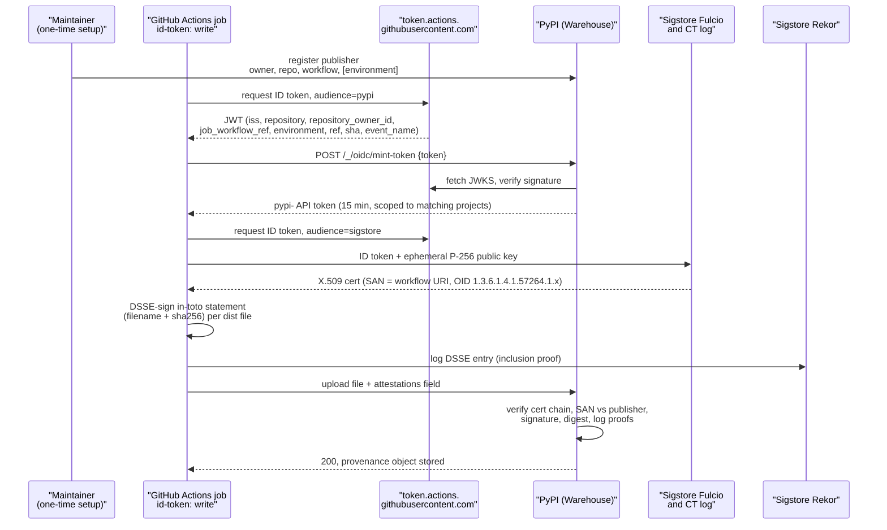

# Python Publishing: PyPI Trusted Publishers and PEP 740 Attestations

> [!summary] Claim:
> Trusted Publishing replaces a stored PyPI API token with a two-step exchange: the CI platform signs a short-lived OIDC identity token, and PyPI matches its claims against publisher records on the project and mints a project-scoped API token that expires within 15 minutes.
> PEP 740 attestations then bind each uploaded file to that same CI identity: a Sigstore certificate names the workflow, an in-toto statement names the filename and SHA-256, a DSSE signature covers both, and PyPI verifies and re-serves the result at `/integrity/<project>/<version>/<file>/provenance`.
> Neither mechanism says the code is safe.
> They remove the stealable long-lived secret and make "who published this file" a verifiable, publicly logged fact, which only helps a consumer who pins the expected identity and checks it, and no installer does that by default (as of 2026-11).
> An expert configures the publisher narrowly (workflow file, environment, protected refs), splits build from publish, revokes every leftover token, and treats a changed or vanished attestation identity as an incident signal.



## The Mechanism

### Why long-lived tokens had to go

A classic PyPI API token is a macaroon with the prefix `pypi-`, scoped to a user or to one project, and valid until someone revokes it.
Stored as a CI secret, it is readable by every step of the job that receives it, by anyone who can edit the workflow, and by an attacker who gets code execution on the runner.
It does not expire, so theft is silent until the attacker uses it.
PGP signatures did not fill the gap: PyPI disabled signature uploads in May 2023 after finding that most existing signatures could not be tied to a public key or verified at all (PEP 740, "Previous Work").
Wheel-embedded JWS signatures from PEP 427 were never broadly used, and the wheel tooling deprecated signing in 0.32.0 (2018).
Trusted Publishing (announced 2023-04-20) addresses the credential; PEP 740 (Final, resolved 2024-07-17) addresses verifiable provenance.

### The token exchange

The user-facing contract is in the PyPI documentation, and the "manual way" there is explicitly implementation-specific and not a public interface.
The shape is stable and worth knowing cold:

1. The job asks its identity provider for an OIDC token whose `aud` is PyPI's audience.
   `GET {index}/_/oidc/audience` returns it; PyPI answers `{"audience":"pypi"}` and TestPyPI uses `testpypi`.
2. On GitHub the job calls `ACTIONS_ID_TOKEN_REQUEST_URL` with `ACTIONS_ID_TOKEN_REQUEST_TOKEN` as the bearer, appending `&audience=pypi`.
   Those variables exist only when the job has `permissions: id-token: write`.
3. The job posts `{"token": "<jwt>"}` to `https://pypi.org/_/oidc/mint-token`.
4. PyPI verifies the JWT signature against the issuer's published keys, matches the claims against every publisher record on file, and returns a `pypi-` API token.
5. The upload client uses that token like any project token (`twine` with username `__token__`).

PyPI documents the token as valid at most 15 minutes and scoped to every project that has a matching publisher, so one workflow registered on three projects gets one token that can upload to all three.
`twine` 6.2.0 (2025-09-04) added a refresh: when an upload outlasts the validity window and is 10 minutes in, it replaces the token on later requests.
`uv publish` additionally tries to invalidate the minted token after publishing, even when publishing fails, and only warns if invalidation fails.

Why exchange at all instead of accepting the JWT directly?
PyPI's internals page gives three reasons: its authorization code is built around macaroon tokens, OIDC failure modes belong to the issuer and should stay out of the upload path, and secret scanning depends on the `pypi-` prefix, which PyPI participates in with GitHub to auto-revoke leaked tokens.
A raw JWT has no such prefix and would have to be reported to both issuer and consumer.

### What PyPI actually matches (GitHub)

The user enters four things: repository owner, repository name, workflow filename, and an optional environment.
The code in `warehouse/oidc/models/github.py` (main branch, read 2026-11-21) shows what that means.

| Claim or field | Check | Consequence |
|---|---|---|
| `repository` | split into owner and name for the lookup, then compared case-insensitively | A repo rename invalidates the publisher |
| `repository_owner_id` | equality with the numeric ID stored at registration | Defeats account resurrection: a freed username does not inherit trust |
| `job_workflow_ref` | filename extracted by regex, then compared with `{repo}/.github/workflows/{file}@{ref or sha}` | The file name is the trust anchor, not its contents |
| `environment` | skipped when the publisher has none, else case-insensitive equality and the claim must be present | A publisher without an environment accepts any environment and none |
| `event_name` | `pull_request_target` and `issue_comment` raise an error | A denylist, flagged in the source with a TODO to make it an allowlist |
| `ref`, `sha` | required but not verified; stored in the provenance `claims` | Recorded for forensics, never an authorization input |
| `sub`, `actor`, `run_id`, `workflow_ref`, others | listed as unchecked | Tag, branch, and actor are not constrained by PyPI |

Two consequences follow directly from the code.
First, when several publishers match the same repository and file, the one whose `environment` equals the token's wins over the one with an empty environment, so a project can register both.
Second, the check uses `job_workflow_ref`, which for a job in a reusable workflow names the called workflow, not the caller.
That is why reusable workflows cannot be the registered publisher: PyPI's troubleshooting page lists this as a current limitation, tracked in `pypi/warehouse` issue 11096 (open since 2022-04-01, still open on 2026-11-21).
The `pypa/gh-action-pypi-publish` README says the same and recommends a top-level non-reusable workflow whose publish job is the only job that holds `id-token: write`.

The user also controls which branch or tag may run the workflow only through GitHub, never through PyPI.
GitHub's environment rules (required reviewers, up to 6 people or teams, one approval suffices; optional prevent self-review; optional wait timer; deployment branch and tag patterns; an "allow administrators to bypass" switch) are the enforcement point.
On GitHub Free, Pro, and Team plans, required reviewers and wait timers are available only for public repositories (as of 2026-11).
GitHub's documentation notes that a workflow referencing an environment that does not exist creates it with no protection rules, so naming `environment: pypi` in YAML, and on PyPI, protects nothing until an admin configures the environment.

GitHub's token itself has changed recently: for repositories created after 2026-07-15, or that opt in, the default `sub` claim embeds numeric IDs (`repo:octo-org@123456/octo-repo@456789:ref:refs/heads/main`).
This matters to cloud trust policies keyed on `sub`; PyPI does not key on `sub` and relies on `repository_owner_id` instead.

### Other publishers and the resurrection defense

Google Cloud publishers are identified by service account email with an optional numeric `sub`; PyPI warns against the default Compute Engine and App Engine accounts because every service gets them.
ActiveState publishers are bound to a project, organization, and acting user, and ActiveState produces no attestations.
GitLab CI/CD publishers name a namespace, a project, and the top-level pipeline file, with an optional environment.
GitLab's API cannot resolve a personal namespace ID at registration, so PyPI records `namespace_id` from the first token it verifies and checks later tokens against it; until first use the publisher is bound only to the namespace name, and PyPI's docs tell you to delete and re-add the publisher after deleting and recreating your own namespace.
GitLab claims name only the top-level pipeline, so any job in that pipeline can obtain a valid token.
The public docs still say only gitlab.com is supported; PyPI's 2025-11-10 blog post announces a beta for GitLab Self-Managed in which staff onboard each instance manually, and the 2025 year-in-review repeats that support was expanded; the docs page has not caught up (as of 2026-11).

New providers must meet PyPI's bar: an OIDC IdP with OpenID Connect Discovery (`jwks_uri`, `claims_supported`), claims that identify a unique workload with immutable IDs behind any mutable name, a settable `aud`, and enough reliability and usage.

### Pending publishers

A pending publisher is registered at the account level with a project name that does not exist yet.
Its first successful use creates the project and converts it into a normal publisher.
It does not reserve the name: if someone else registers that name first, the pending publisher is invalidated.
A name mismatch between the pending record and the upload metadata fails with "Non-user identities cannot create new projects"; the fix is to correct whichever side is wrong, and the wrong-project case requires deleting the accidental project, which also deletes its publisher.
Registration is rate-limited to 100 publishers per user or IP per 24 hours.

### Sigstore keyless signing, as PyPI uses it

Attestations reuse the same CI identity against a second relying party.
The job requests an ID token with audience `sigstore` (on GitLab that is the `SIGSTORE_ID_TOKEN` entry with `aud: sigstore`) and generates an ephemeral key pair.
Fulcio authenticates the token by fetching the issuer's discovery document and keys, checks a signed challenge over `sub` (or a CSR) as proof of possession of the private key, and issues an X.509 code-signing certificate whose subject alternative name carries the workload identity and whose extensions carry the claims.
Fulcio first logs a precertificate with a poison extension to a certificate transparency log, embeds the returned signed certificate timestamp, and then returns the certificate.
The private key is discarded after signing.

The consequence is that the signature verifies long after the certificate expires only because a transparency log recorded when the signing happened.
Sigstore's bundle documentation says that when verification may occur after certificate expiry, a bundle must carry at least one log signed entry timestamp or an RFC 3161 timestamp proving the signing fell inside the validity window.
PyPI requires more than that for its own acceptance: its attestation security page states an attestation is not considered verified without a Rekor inclusion proof and a Fulcio CT log inclusion proof.
PEP 740 itself only says attestations SHOULD carry transparency entries and that, when a verifier checks them, each entry's inclusion time MUST lie within the certificate validity period.

What the certificate holds is concrete.
The sample in the Integrity API documentation (`sampleproject-4.0.0.tar.gz`, signed 2024-11-06) decodes as follows; the commands and output are in the worked example below.

| Extension OID (under 1.3.6.1.4.1.57264.1) | Fulcio name | Value in the sample |
|---|---|---|
| SAN URI | identity | `https://github.com/pypa/sampleproject/.github/workflows/release.yml@refs/heads/main` |
| `.8` | Issuer (V2) | `https://token.actions.githubusercontent.com` |
| `.9` | Build Signer URI | the workflow URI above |
| `.11` | Runner Environment | `github-hosted` |
| `.12`, `.14` | Source Repository URI, Ref | `https://github.com/pypa/sampleproject`, `refs/heads/main` |
| `.13` | Source Repository Digest | `621e4974ca25ce531773def586ba3ed8e736b3fc` |
| `.15`, `.17` | Source Repository Identifier, Source Repository Owner Identifier | `14899596`, `647025` |
| `.20` | Build Trigger | `push` |
| `.21` | Run Invocation URI | `https://github.com/pypa/sampleproject/actions/runs/11713038981/attempts/1` |
| `.22` | Source Repository Visibility At Signing | `public` |

Extensions `.1` (Issuer) and `.2` through `.6` (GitHub workflow trigger, SHA, name, repository, ref) are the older fields that Fulcio marks deprecated in favor of the provider-generic ones from `.8` onward; the sample still carries `.1` through `.3`.
The commit, run URL, and visibility are in a public, immutable log, which is why PyPI's attestation docs tell you to read the Linux Foundation immutable record notice first.

### The PEP 740 object model

An attestation is one signed claim about one file.
The JSON has three keys: `version` (always 1), `verification_material`, and `envelope`.

- `verification_material.certificate` is `base64(DER(cert))`, an RFC 5280 certificate.
- `verification_material.transparency_entries` is a list of log entries, each with an inclusion proof; the PEP defines the model in its Appendix 2, and the live sample uses the Rekor v1 `dsse` entry kind (version 0.0.1) with a signed entry timestamp and checkpoint.
- `envelope.statement` is the base64 of an in-toto v1 Statement; `envelope.signature` is the base64 DSSE signature.

Version 1 fixes one cryptographic suite: X.509 certificates, ECDSA on P-256 with SHA-256.
The PEP does this deliberately to avoid algorithm agility, and a new suite requires a new version number.
(The CA signing the certificate in the sample is `sigstore-intermediate` using `ecdsa-with-SHA384`; the suite constraint is about the leaf and the message signature.)

The statement is constrained beyond plain in-toto: exactly one `subject`, whose `name` is a valid sdist or wheel filename and whose `digest` contains a hex SHA-256.
Allowed `predicateType` values are `https://slsa.dev/provenance/v1` and `https://docs.pypi.org/attestations/publish/v1`.
The publish predicate has no schema: its body must be `{}` or absent (JSON null), so the claim lives entirely in who signed it.
It says "this file was uploaded via this Trusted Publisher, not via some other means such as a local token".
SLSA provenance says more about where the artifact came from, and PyPI checks its signer more loosely: any identity under the same repository is accepted, because the workflow that builds need not be the one that publishes.

The signature is DSSE v1.
The signed bytes are `PAE(type, body)` where PAE is `"DSSEv1" SP LEN(type) SP type SP LEN(body) SP body`, with `LEN` the ASCII decimal byte length.
The payload type must be `application/vnd.in-toto+json` and no other is permitted.
Signing the PAE rather than the bare statement binds the payload type to the signature, so a signature over a statement cannot be replayed as a different message type, and it avoids JSON canonicalization because the statement is carried as opaque bytes.
The worked example shows the failure when verifying against the bare statement.

Verifiers must check, in the PEP's words: version is 1; the certificate chains to an a priori trusted authority; the certificate subject is appropriate (such as the Trusted Publisher's machine identity); the statement subject name (parsed as a distribution filename, since names may normalize differently) and digest match the file; and the signature reconstructs under DSSE.
Transparency-entry checks are policy.

### Provenance objects, serving, and limits

The index groups attestations into a provenance object, `{"version": 1, "attestation_bundles": [...]}`, where each bundle pairs a `publisher` (a `kind`, a `claims` object, and open-ended publisher-specific keys) with its attestations.
The PEP's Appendix 1 example shows `kind: GitHub` with `repository_name`, `repository_owner`, and so on, but the live PyPI response for the sample project shows `{"kind": "GitHub", "repository": "pypa/sampleproject", "workflow": "release.yml", "environment": "", "claims": null}`.
Code that parses provenance must follow the live shape and the open-ended rule, not the appendix.
The PEP says provenance objects are mutable: the index may add attestations from other identities, such as auditors or the index itself, after upload.

Discovery is in the Simple API.
HTML file links may carry `data-provenance` with a fully qualified, secure-origin URL.
The JSON form has `provenance` (string or null) on each file, introduced in API version 1.3 and still present in the current 1.4.
A PEP table sketches `<file URL>.provenance` as a possible location; the specification only requires the URL to be advertised.
PyPI's own implementation is the Integrity API: `GET /integrity/<project>/<version>/<filename>/provenance` with `Accept: application/vnd.pypi.integrity.v1+json` (also the default), returning 200, 403 when administrators have temporarily disabled it, 404 when the file has no provenance, or 406.

On upload, the legacy endpoint (`POST https://upload.pypi.org/legacy/`) accepts a multipart `attestations` field holding a JSON array of attestation objects, and PyPI rejects the whole upload if any one of them fails to verify (Upload API docs: "reject the upload if it can't verify each of the supplied attestations").
PyPI allows at most two per file, one per predicate type, and rejects duplicates of a predicate.
Only attestations signed by Trusted Publisher identities are accepted: PyPI supports attesting identities from GitHub Actions, GitLab CI/CD, and Google Cloud, and a manually produced attestation signed by any other identity is rejected.

The PEP estimated about 5.3 KB per attestation, three attestations per file as a conservative figure, and about 21 files per average project (May 2024), which is why the Simple API links to provenance instead of embedding it: roughly 339 KB more JSON per project page otherwise.

### Producing attestations

The default path needs no configuration: `pypa/gh-action-pypi-publish` since v1.11.0 (released 2024-10-30 UTC, which flipped the v1.10.0 opt-in to on by default) generates Sigstore-signed attestations for every file in `dist/` and uploads them with the files, using the same job identity that authenticated the publish.
It only does this on the Trusted Publishing path; supplying `password:` switches the action to a static token and no attestations are made.
Opt out with `attestations: false`.
The action is Docker-based and therefore Linux-only; it does not support running inside a job with `container:`, composite actions, reusable-workflow Trusted Publishing, or two invocations per job.

Manual routes, all producing the same object:

```bash
# PEP 740 attestation via the reference library CLI (the CLI is documented as experimental)
python -m pip install pypi-attestations
python -m pypi_attestations sign dist/*          # writes dist/<file>.publish.attestation

# Upload with attestations adjacent to the files
twine upload --attestations dist/*               # --attestations flagged experimental in twine 5.1.0
uv publish                                       # discovers <file>.publish.attestation; does not generate them
```

GitHub's `actions/attest` can emit a Sigstore bundle with `predicate-type: 'https://docs.pypi.org/attestations/publish/v1'` and `predicate: '{}'`, and `Attestation.from_bundle(Bundle.from_json(raw))` converts it, since attestations are functionally but not structurally Sigstore bundles.
On GitLab the documented pattern is a job between build and publish that declares `id_tokens: SIGSTORE_ID_TOKEN: aud: sigstore`, runs `pypi_attestations sign`, and passes artifacts to a publish job that calls `twine upload --attestations`.
`uv publish --no-attestations` (or `UV_PUBLISH_NO_ATTESTATIONS`) exists because some third-party indexes reject uploads that include attestations rather than ignoring them.

### Consuming and verifying

The reference verifier is the `pypi-attestations` CLI, whose own README calls it experimental and not a stable interface:

```bash
pypi-attestations verify pypi --repository https://github.com/pypa/sampleproject \
  https://files.pythonhosted.org/packages/d7/73/c16e5f3f0d37c60947e70865c255a58dc408780a6474de0523afd0ec553a/sampleproject-4.0.0-py3-none-any.whl
```

It downloads the file and its provenance from the Integrity API, checks the provenance publisher matches the `--repository` you supplied, and verifies the signature and digest.
The expected identity comes from you.
A verifier that trusts whatever publisher the provenance names has only proved the file matches some attestation.

Installer integration does not exist as a default.
Trail of Bits' 2024 post said PEP 740 deliberately defines only the index side and that installer verification was future work, including a pip plugin architecture and trust-on-first-use of identities stored in lockfiles.
PEP 751's `pylock.toml` reserves `[[packages.attestation-identities]]` with a required `kind` and publisher keys copied as-is, and says tools SHOULD record them when available.
A third-party handbook page reports that neither `uv export --format pylock.toml` nor `pip lock` writes the table yet and that no installer verifies at install time; pip's news page mentions attestations only for pip's own releases, and the uv CLI reference lists attestation options only on `uv publish` (all as of 2026-11).
Sibling notes cover the lockfile format and resolver: [[Python-Dependency-Resolution-pip-uv-and-PEP-751-Lockfiles]] and [[Lockfiles-Vendoring-and-Offline-Mirrors]].

### What these mechanisms do and do not defend

The attestation security page is explicit that the basic publish attestation does two things: it detects modification of a file after the build while it sits on the index or a mirror, and it makes changes of the project's Trusted Publisher observable.
It does not say the identity is trustworthy and does not detect malicious code present before or during the build.

| Threat | Trusted Publishing | PEP 740 publish attestation |
|---|---|---|
| Leaked or stolen upload token | Removes the standing secret; a stolen minted token lasts at most 15 minutes | Not applicable |
| Leftover API token still valid | No effect; the old token keeps working | Absence of an attestation on a release is the visible signal |
| Malicious commit or dependency in the build | Not addressed; the workflow identity is legitimate | Not addressed; the attestation is valid for malicious bytes |
| Poisoned CI cache or build step in the publish job | Not addressed | Signs the poisoned output |
| Index or mirror swaps file bytes | Not addressed | Detected if the consumer verifies against an expected identity |
| Index drops the attestation | Not addressed | Detected only if the consumer expects one (policy) |
| Publisher quietly changed to another repo | Not addressed | Visible as a changed identity to anyone watching |
| Workflow file edited to run on a new trigger | Mitigated only by environment protection | Not addressed |
| Account resurrection (renamed or deleted owner) | Mitigated by `repository_owner_id` check | The certificate also records owner and repository IDs |

The Ultralytics incident (December 2024) is the worked example of the table.
Versions 8.3.41 and 8.3.42 were published through the legitimate workflow after the attacker compromised the project's GitHub Actions workflows and poisoned the Actions cache used by the build (the zizmor analysis flags a dangerous workflow trigger in the repository); PyPI staff could tell from the Sigstore logs and provenance that these came through the workflow and not a token, which put the injection in the repository or the build.
Versions 8.3.45 and 8.3.46 came from an unrevoked PyPI API token that was still available to the workflow (PyPI calls it potentially a hold-over from before Trusted Publishing), and these had no matching repository activity and no publish attestations.
PyPI named two follow-ups it opened: flag API tokens that sit unused while Trusted Publishing releases continue, and warn when a GitHub publisher is not configured to require the environment the workflow uses.

## Commands and Numbers to Know

| Item | Value | Platform | Notes |
|---|---|---|---|
| Minted token lifetime | at most 15 minutes (as of 2026-11) | Both | PyPI docs; scoped to every project with a matching publisher. |
| Audience values | `pypi`, `testpypi`; `GET {index}/_/oidc/audience` (as of 2026-11) | Both | Implementation-specific per PyPI docs. |
| Mint endpoint | `POST https://pypi.org/_/oidc/mint-token` with `{"token": ...}` (as of 2026-11) | Both | Not a stable public interface; use the action or `uv publish`. |
| Mint errors | `not-enabled`, `invalid-payload`, `invalid-token`, `invalid-publisher`, `invalid-pending-publisher` (as of 2026-11) | Both | `invalid-publisher` means well-formed token, no matching record. |
| Forbidden GitHub triggers | `pull_request_target`, `issue_comment` (as of 2026-11) | Both | Enforced via the `event_name` claim; list may change. |
| Publisher registration limit | 100 per user or IP per 24 hours (as of 2026-11) | Both | PyPI troubleshooting page. |
| GitHub action attestation default | on since `pypa/gh-action-pypi-publish` v1.11.0; disable with `attestations: false` (as of 2026-11) | Linux | Docker-based action, Linux runners only. |
| GitHub id-token permission | `permissions: id-token: write` at job level (as of 2026-11) | Both | Without it no OIDC token is issued. |
| `twine upload --attestations` | experimental flag since twine 5.1.0; current twine 7.0.0 (as of 2026-11) | Both | Version from PyPI JSON on 2026-11-21. |
| `uv publish` attestations | uploads adjacent `*.publish.attestation` by default; cannot generate (as of 2026-11) | Both | uv 0.13.9 current on PyPI; docs footer 2026-10-14. |
| `uv publish --trusted-publishing` | `automatic` (default), `always`, `never` (as of 2026-11) | Both | `automatic` falls through to other credentials if exchange fails. |
| `pypi-attestations` | 0.0.31 (as of 2026-11) | Both | CLI documented as experimental. |
| Integrity API | `GET /integrity/<project>/<version>/<file>/provenance` (as of 2026-11) | Both | 200, 403, 404, 406. |
| Simple API version for provenance | 1.3 added it; current 1.4 (as of 2026-11) | Both | `data-provenance`, JSON `provenance`. |
| Attestations per file | at most 2, one per predicate (as of 2026-11) | Both | Rejects more or repeated predicates. |
| Attestation crypto suite v1 | X.509, ECDSA P-256, SHA-256 (as of 2026-11) | Both | PEP 740. |
| Sample cert validity | exactly 10 minutes (2024-11-06 22:37:07 to 22:47:07 GMT) (as of 2026-11) | Both | Decoded from the Integrity API sample, not a Fulcio guarantee. |
| Adoption, uploads | over 20 percent of uploads in 2025 via Trusted Publishers; 17 percent with an attestation (as of 2026-11) | Both | PyPI 2025 review; over 50,000 projects use Trusted Publishing. |
| Adoption, files per month | about 10 percent (2024-02) to over 25 percent (2025-10) via Trusted Publishers (as of 2026-11) | Both | PyPI blog 2025-11-10. |
| Typical attestation size | about 5.3 KB JSON (as of 2026-11) | Both | PEP 740 estimate. |
| GitHub immutable `sub` | default for repos created after 2026-07-15 (as of 2026-11) | Both | Not available on GitHub Enterprise Server. |
| Environment required reviewers | up to 6 people or teams (as of 2026-11) | Both | GitHub docs; any one approval suffices. |
| Rekor v2 | GA 2025-10-10; log URL not yet default for signers at that time (as of 2026-11) | Both | PyPI's docs and the GA post say nothing about v2 entries on PyPI. Warehouse `main` pins `pypi-attestations==0.0.29` and `sigstore==4.5.1`, and sigstore-python added Rekor v2 verification in 4.0.0 (its changelog), so the library layer can verify them; no upload of one was tried, so do not plan around it. |

## Multi-Language Comparison

| Concern | Python (PyPI) | Rust (crates.io) | C++ |
|---|---|---|---|
| Central index | Yes, PyPI; uploads authenticated per project | Yes, crates.io | No single index; Conan, vcpkg, distro and Homebrew repositories each decide |
| OIDC token exchange for upload | Trusted Publishing, 15 minute project tokens | Trusted Publishing exists; mechanism and limits are owned by [[Rust-Publishing-Crates-io-Trusted-Publishing-and-Private-Registries]] | No common mechanism; see [[Cpp-System-Packaging-Deb-RPM-and-Homebrew]] |
| Signed provenance per file | PEP 740 attestations via Sigstore, served by the index | Not covered here; see the Rust sibling | Per-ecosystem signing, outside this note |
| Installer verifies by default | No (as of 2026-11) | No provenance check; the Cargo registry docs describe only the index `cksum` (sha256) of each `.crate` and mention no signature or attestation, and RFC 3691 put provenance verification out of scope (as of 2026-11) | Distro tools verify repository signatures, a different trust model |
| Reusable-workflow publishing | Not supported by PyPI | Defer to the Rust sibling | Not applicable |
| Natural consumer pin | Identity in `pylock.toml` `attestation-identities` (not yet written by lockers) | Defer to [[Rust-Dependency-Hygiene-cargo-deny-cargo-audit-and-cargo-vet]] | Package recipe checksums and recipe review |

The shared design idea, an identity-bound short-lived credential in place of a stored secret, is the same wherever it appears; the guarantees differ in who verifies the identity and what the index is willing to enforce.

## Worked Lab Example

There is no lab for this note.
The check below was run by hand once on 2026-11-21 (macOS arm64, OpenSSL 4.1.0, Python 3.15.2) against a live, public attestation, and it is not recorded by the lab harness; an independent verifier re-ran it the same day and got identical output.
It verifies, without any Sigstore client, the three facts a verifier proves: the statement's digest matches the file, the DSSE signature verifies under the certificate's public key, and the certificate names the expected workflow.

Inputs: the provenance JSON from `https://pypi.org/integrity/sampleproject/4.0.0/sampleproject-4.0.0.tar.gz/provenance` and the sdist from `files.pythonhosted.org`, each saved into a fresh directory.
The script below reads the provenance, decodes the three base64 fields, rebuilds the PAE bytes, and calls `openssl dgst` against the certificate's public key.

```python
# verify_sample.py <provenance.json> <sdist> <workdir>   (run with python3 -I)
import base64, hashlib, json, subprocess, sys
prov_path, sdist_path, workdir = sys.argv[1:4]
att = json.load(open(prov_path))["attestation_bundles"][0]["attestations"][0]
stmt = base64.b64decode(att["envelope"]["statement"])
sig = base64.b64decode(att["envelope"]["signature"])
cert = base64.b64decode(att["verification_material"]["certificate"])
subj = json.loads(stmt)["subject"][0]
actual = hashlib.sha256(open(sdist_path, "rb").read()).hexdigest()
print("subject.name        :", subj["name"])
print("subject sha256 match:", subj["digest"]["sha256"] == actual)
ptype = b"application/vnd.in-toto+json"
pae = b"DSSEv1 %d %s %d %s" % (len(ptype), ptype, len(stmt), stmt)
open(workdir + "/sig.bin", "wb").write(sig)
open(workdir + "/cert.der", "wb").write(cert)
pub = subprocess.run(["openssl", "x509", "-inform", "der", "-in", workdir + "/cert.der",
                      "-pubkey", "-noout"], capture_output=True, check=True).stdout
open(workdir + "/pub.pem", "wb").write(pub)
for label, data in (("PAE", pae), ("raw statement (no PAE)", stmt)):
    open(workdir + "/msg.bin", "wb").write(data)
    r = subprocess.run(["openssl", "dgst", "-sha256", "-verify", workdir + "/pub.pem",
                        "-signature", workdir + "/sig.bin", workdir + "/msg.bin"],
                       capture_output=True, text=True)
    print("signature over %-22s: %s" % (label, (r.stdout + r.stderr).splitlines()[0]))
```

Output on macOS arm64 (2026-11-21, run by hand):

```text
subject.name        : sampleproject-4.0.0.tar.gz
subject sha256 match: True
signature over PAE                   : Verified OK
signature over raw statement (no PAE): Verification failure
```

The decoded statement is `{"_type":"https://in-toto.io/Statement/v1","subject":[{"name":"sampleproject-4.0.0.tar.gz","digest":{"sha256":"0ace7980f82c5815ede4cd7bf9f6693684cec2ae47b9b7ade9add533b8627c6b"}}],"predicateType":"https://docs.pypi.org/attestations/publish/v1","predicate":null}`.
The `predicate` is null, which the publish predicate permits.

Decoding the certificate with `openssl x509 -inform der -in cert.der -noout -text` on the same host gives these facts (excerpt):

```text
Issuer: O=sigstore.dev, CN=sigstore-intermediate
Validity
    Not Before: Nov  6 22:37:07 2024 GMT
    Not After : Nov  6 22:47:07 2024 GMT
Subject:
Public-Key: (256 bit field, 128 bit security level)   NIST CURVE: P-256
X509v3 Extended Key Usage: Code Signing
X509v3 Subject Alternative Name: critical
    URI:https://github.com/pypa/sampleproject/.github/workflows/release.yml@refs/heads/main
1.3.6.1.4.1.57264.1.2:  push
1.3.6.1.4.1.57264.1.3:  621e4974ca25ce531773def586ba3ed8e736b3fc
CT Precertificate SCTs: ... Timestamp : Nov  6 22:37:07.428 2024 GMT
```

Reading the result:

- The empty Subject with a critical SAN means the identity is the URI, not a distinguished name.
- The certificate expired about two years before this check ran, yet the signature verified: validity was only the window in which the key could be issued and used, and the Rekor entry (integrated time 1730932627, which is 2024-11-06 22:37:07 GMT) is the evidence that signing fell inside it.
  This script does not check the Rekor proof or the CT timestamp, so it is not a complete verifier; `pypi-attestations verify pypi --repository https://github.com/pypa/sampleproject ...` does the full check.
- Verifying the raw statement fails, which shows the PAE prefix is part of the signed message; a verifier that skips it rejects every valid attestation.
- A check that only compared the digest would pass for a forged statement signed by any key, which is why identity binding and chain validation are separate steps.

To extend by hand: change one byte of the statement before building the PAE and show the signature fails; change the sdist and show `subject sha256 match: False`.
Each check is independent, which is the point of the design.

## Pitfalls

> [!warning] Pitfall 1: An environment name that nothing enforces
> A publisher with `environment: pypi` rejects tokens from other environments, but the environment is protective only if GitHub is configured with required reviewers or a branch and tag rule.
> GitHub creates a missing environment on first use with no rules, so a typo or a deleted environment silently turns "protected" into "unprotected".
> Conversely, a publisher registered with no environment accepts every environment, including ones nobody reviews.
> PyPI does not warn about the mismatch, as the Ultralytics analysis noted.

> [!warning] Pitfall 2: Leaving the old API token alive
> Adopting Trusted Publishing without revoking the project token leaves the original attack path open and unused, which is hard to notice.
> The second Ultralytics wave used exactly that.
> Revoke the token, delete the CI secret, and rotate everything else that lived in the same job.

> [!warning] Pitfall 3: Build and publish in one job
> `id-token: write` at workflow level, or in a job that also runs dependency installs and build backends, lets any code in that job request a token and mint one.
> The action README states that building in the publishing job lets compromised build tooling impersonate the repository's identity.
> Build in a job without the permission, pass `dist/` as an artifact, and publish from a job whose only steps are download and the publish action.

> [!warning] Pitfall 4: A reusable workflow as the publisher
> Because PyPI matches `job_workflow_ref`, which GitHub sets to the called workflow for a job in a reusable workflow, a publisher registered for the caller file does not match, and the failure is `invalid-publisher`.
> Reading the Warehouse matcher: `lookup_by_claims` extracts the filename from `job_workflow_ref`, and `_check_job_workflow_ref` compares that claim with `<publisher repository>/.github/workflows/<file>@<ref or sha claim>`.
> A called file in a different repository can therefore never match, because the expected string is built from the publisher's own repository, which must equal the caller's `repository` claim.
> A called file in the same repository could match textually when the `@ref` equals the caller's `ref` or `sha` claim, but this is a reading of the source, no live upload was tried, and PyPI documents reusable workflows as unsupported, so do not rely on it.
> Put only the publish job in a top-level workflow, and call the reusable workflow for everything else.

> [!warning] Pitfall 5: Renames and moves
> `invalid-publisher` on a previously working project usually means a repository rename or transfer, a workflow file rename, or a changed environment.
> PyPI's GitHub security note adds that if `foo.yml` is renamed to `bar.yml`, the new file is indistinguishable from the old `bar.yml` except for ref-related claims, so renaming into a trusted name is an attack, not only a maintenance step.
> After July 2026, repositories renamed or transferred also move to the immutable `sub` format on GitHub's side, which matters to cloud trust policies but not to PyPI's matcher.

> [!warning] Pitfall 6: Treating a valid attestation as a safety signal
> A valid publish attestation on a release says a particular workflow published these bytes.
> It does not say the workflow is the one you intended to trust, and it says nothing about the commit.
> The only useful checks are against an identity you recorded earlier: the same repository and workflow as the previous release, and presence when presence was the norm.

> [!warning] Pitfall 7: Attestations are not mandatory on the index
> PyPI accepts uploads without attestations and only verifies those it receives.
> A downgrade, where the attacker uploads a malicious release without one, is detectable only by a consumer whose policy requires it.
> Provenance objects are also mutable by design, so a consumer pinning "no change" must pin the identity, not a hash of the provenance JSON.

> [!warning] Pitfall 8: Partial releases and mixed-platform builds
> Letting each platform job upload its own wheels means a failed job leaves a half-published release that installers may already resolve, and PyPI allows many publishers per project precisely to tolerate this.
> The action README recommends collecting artifacts into one publishing job for atomic upload and one attestation pass.

> [!warning] Pitfall 9: Provenance leaks build facts
> The certificate and the log entry record the commit SHA, branch, trigger, and run URL, in a public append-only log.
> Do not run attested publishing from workflows whose run URLs or ref names you consider sensitive.

> [!warning] Pitfall 10: Third-party indexes and the attestations field
> `uv publish` tries to upload attestations by default, and some indexes reject the extra field.
> Use `--no-attestations` for those, and do not assume an index supports Trusted Publishing because it implements the legacy upload API.

## At Scale

For one maintainer, the paved path is short: register a publisher, add a `release.yml` with a build job and a publish job, use a protected environment, and revoke the token.
For 1,000 to 50,000 engineers, the work shifts from mechanism to policy, and there are three distinct control planes.

Publisher side (who can ship a package):
- Every internal Python package with a public release goes through one template repository with the two-job layout, SHA-pinned actions, and a protected `pypi` environment with required reviewers and a tag pattern.
- Because reusable workflows cannot be the registered publisher, centralization is by template and lint, not by a shared callable workflow.
  A linter such as zizmor, which would have flagged the dangerous trigger in the Ultralytics repository, runs as a required check.
- Publishers belong to projects, not people, so off-boarding a maintainer must include a publisher review, and a quarterly job should list every project's publishers via the PyPI UI or support and compare them with the expected repository and workflow.
- A pending publisher for a new name is a squat target; register and publish in the same change window.

Consumer side (what you accept):
- Verification does not happen in `pip install` (as of 2026-11), so the control point is ingestion into your internal mirror or proxy, described in [[Release-Trains-Backports-and-Artifact-Registries]] and [[Lockfiles-Vendoring-and-Offline-Mirrors]].
  At ingestion, fetch provenance, verify against a per-project expected repository recorded in an allowlist, and quarantine on change or absence.
- Start in report mode: measure how many pinned dependencies have attestations before deciding to block.
  The PyPI numbers (17 percent of uploads attested over 2025) say a blocking policy rejects most of the ecosystem today.
- Decide per tier: attestation required for the few hundred packages you consider critical, observed for the rest.

Decision rules:
1. Always move to Trusted Publishing for public releases; there is no remaining reason to hold a project-scoped token.
2. Always split build and publish, and grant `id-token: write` only to the publish job.
3. Always configure an environment on both sides, and verify the GitHub side has required reviewers or a ref rule.
4. Require an attestation for packages whose compromise would reach production without human review; observe the rest.
5. Treat "identity changed" as a page and "attestation vanished" as a ticket.
6. Do not build a verification gate on `pypi-attestations` as a stable API; pin its version, or call the Python library, and track its releases.

A lab-measured cost is not available here; the PEP's 5.3 KB per attestation and three-per-file estimates bound the index-side storage, and verification cost per file is one provenance fetch plus signature and log-proof checks, which was not measured for this note.

## Practice Drill

> [!tip] Practice Drill: Verify, then break, a real attestation
> In an empty scratch directory, download the provenance for `sampleproject-4.0.0.tar.gz` from the Integrity API and the sdist from `files.pythonhosted.org`.
> Reproduce the three verifications in the worked example with the script and `openssl`.
> Then (1) flip a byte in the decoded statement and show the DSSE check fails, (2) rebuild the PAE with a different payload type and show it fails, (3) run `pypi-attestations verify pypi --repository https://github.com/pypa/sampleproject pypi:sampleproject-4.0.0.tar.gz` and then again with `--repository https://github.com/pypa/evil-sampleproject` and explain which step rejects it.
> Last, write the one-page publisher checklist for a repository you own: workflow file, environment rules, protected tags, and the revocation of the old token.
> Link the checklist to [[Python-Shipping-Applications-Zipapp-PEX-and-Bundlers]] if the same release also ships an application bundle.

## Interview Questions

> [!question] L5: What does PyPI receive and return in a Trusted Publishing exchange, and why is there a second token?
> > [!success]- Answer
> > The job presents a signed OIDC JWT with audience `pypi` to the mint-token endpoint.
> > PyPI verifies the signature against the issuer's keys, matches the claims against every publisher record, and returns a `pypi-` API token that lives at most 15 minutes and is scoped to every project with a matching publisher.
> > The second token exists because PyPI's authorization code, scanning partnership, and revocation story are built around its own macaroon-style tokens with the `pypi-` prefix, and a raw JWT has no such prefix and would couple upload auth to the issuer's failure modes.

> [!question] L5: What goes into a GitHub Trusted Publisher record, and which of those fields are optional?
> > [!success]- Answer
> > Repository owner, repository name, and workflow filename are required; the environment is optional but recommended.
> > PyPI stores the owner's numeric ID at registration and checks `repository_owner_id` on every exchange.
> > An empty environment on the record means any environment is accepted, so an environment only protects if it is set and GitHub enforces rules on it.

> [!question] L5: What is the minimal workflow change to move from a token to Trusted Publishing?
> > [!success]- Answer
> > Add `permissions: id-token: write` to the publish job and remove `username` and `password` from the action, then register the publisher on PyPI.
> > Add `environment: pypi` to the job and configure that environment.
> > Revoke the old token and delete the CI secret.

> [!question] L6: A workflow publishes fine for months, then fails with `invalid-publisher` after a refactor. List the causes you check, in order.
> > [!success]- Answer
> > Compare repository owner, repository name, workflow filename, and environment between PyPI's record and the workflow run, since all four are matched.
> > A repository rename or transfer, a renamed workflow file, a moved publish job into a reusable workflow (so `job_workflow_ref` names the called file), or an added or changed `environment:` are the usual causes.
> > Also check the trigger: `pull_request_target` and `issue_comment` are rejected before matching.
> > Do not fix it by loosening the publisher; correct the record to the intended workflow.

> [!question] L6: Predict the output: verifying the sample attestation with `openssl dgst -sha256 -verify` against the bare statement bytes rather than the DSSE PAE bytes.
> > [!success]- Answer
> > It prints `Verification failure` (plus an OpenSSL error stack), whereas the PAE input prints `Verified OK`.
> > DSSE signs `"DSSEv1" SP LEN(type) SP type SP LEN(body) SP body`, so the signature covers the payload type and the body length as well as the body.
> > A verifier that skips the PAE rejects every genuine attestation, and a signer that skips it would let one signature be reused as a different message type.

> [!question] L6: Debug this: the job has `id-token: write`, uses `pypa/gh-action-pypi-publish@release/v1`, publishes successfully, but the file page on PyPI shows no attestation.
> > [!success]- Answer
> > ```yaml
> > permissions:
> >   id-token: write
> > steps:
> >   - uses: pypa/gh-action-pypi-publish@release/v1
> >     with:
> >       password: ${{ secrets.PYPI_TOKEN }}
> > ```
> > Supplying `password` selects the static-token path, so the action does not use the OIDC identity, and attestation generation requires Trusted Publishing.
> > Other causes: `attestations: false`, an action older than v1.11.0, or a publisher that is not yet attesting (ActiveState).
> > Fix by removing the token, registering the publisher, and revoking the secret.

> [!question] L6: What exactly does a PyPI publish attestation prove, and what does it not?
> > [!success]- Answer
> > It proves that a signer holding a Sigstore certificate for a specific workflow identity signed an in-toto statement naming this filename and SHA-256, and that PyPI verified the signature and the log proofs at upload.
> > Together with the Trusted Publishing record it shows the file went through that publisher and not a local token.
> > It does not prove the workflow is trustworthy, that the source was uncompromised, that the build was clean, or that the index served the same attestation as before; each of those needs the consumer to hold an expected identity.

> [!question] L7: Walk through why a Sigstore certificate with a 10 minute validity can still be verified two years later.
> > [!success]- Answer
> > The signature is checked against the public key in the certificate, which does not expire cryptographically.
> > The relying party has to establish that signing happened inside the validity window, which the transparency entry provides: the entry's integrated time is covered by a log signature and an inclusion proof, and PEP 740 requires each entry's inclusion time to lie inside the certificate validity period.
> > The certificate chain is verified as of that time, not as of now, and the CT precertificate timestamp shows the CA issued it when claimed.
> > Without a log entry or an RFC 3161 timestamp, the expiry would make the bundle unverifiable.

> [!question] L7: Ultralytics 8.3.41 and 8.3.45 were both malicious. What did attestations and Trusted Publishing tell investigators about each, and what did they not prevent?
> > [!success]- Answer
> > The first wave came through the legitimate workflow, which the logs and provenance showed, narrowing the injection to the repository or the build; later analysis found GitHub Actions cache poisoning.
> > The second wave had no corresponding repository activity or publish attestation, pointing to an unrevoked API token that the workflow could still reach.
> > Neither mechanism prevented the first wave, because the signed bytes were the attacker's.
> > Prevention came from the other mitigations: no dangerous triggers, no shared caches in release builds, pinned dependencies, a protected environment, and revoking old tokens.

> [!question] L7: Design the registry-ingestion policy that uses attestations for 3,000 internal services without breaking builds.
> > [!success]- Answer
> > Record, per dependency, the expected repository and workflow identity the first time it is approved; store it with the lock entry.
> > On each new version, fetch provenance from the Integrity API, verify the signature, digest, and certificate chain with a pinned verifier version, and compare identity to the record.
> > Start with report-only, because most packages are unattested (17 percent of 2025 uploads).
> > Block on identity change; ticket on attestation disappearance; require attestations only for the critical tier.
> > Keep the verifier outside `pip install`, since no installer verifies by default (as of 2026-11).

> [!question] L8+: You own release policy for 400 repositories and want one shared reusable publish workflow. PyPI will not accept it as the publisher. What do you do?
> > [!success]- Answer
> > Accept the constraint: the registered publisher must be the top-level workflow whose job runs the publish action.
> > Generate that thin top-level workflow from a template and enforce its shape with a required lint (zizmor plus a custom check that the publish job has only download and publish steps, `id-token: write` only there, actions SHA-pinned, protected environment named).
> > Put build, test, and signing steps in a reusable workflow called by a separate job that has no OIDC permission.
> > Track `pypi/warehouse` issue 11096 and re-evaluate when it closes, since `job_workflow_ref` matching will then change the registration story.
> > The downside is 400 copies of a small file; the mitigation is automated drift detection, not a shared callable workflow.

> [!question] L8+: Argue for or against making attestations mandatory for your own published packages and for your consumers.
> > [!success]- Answer
> > Producing: yes, because the cost on the supported path is zero configuration and it gives incident responders a verifiable origin.
> > Consuming: only in tiers and only through your own gate.
> > A hard global requirement would reject most of the ecosystem today, and no installer enforces it, so the policy lives in the mirror.
> > The weakness is trust in identity: a valid attestation from a hijacked repository is still valid, so pair it with identity pinning and change alerts, and treat it as one signal alongside review, hash pinning, and release-age rules.

## Further Reading

- PEP 740 and the PyPA Index hosted attestations specification: the object model, DSSE and in-toto constraints, and the verification steps this note walks through.
- PyPI Trusted Publishers documentation, including internals and security model: the exchange, the many-to-many design, and the resurrection defense.
- `warehouse/oidc/models/github.py`: the actual claim matcher; read it to see what is and is not checked.
- PyPI attestation documentation and the Integrity API: how to produce, serve, and consume provenance objects.
- Warehouse "Attestation Internals": how signing identities map to attestation types and why SLSA provenance is matched more loosely.
- GitHub OIDC reference and environment documentation: the claims the matcher reads and the controls that make an environment protective.
- Sigstore Fulcio certificate issuing overview and OID information: how the identity gets into the certificate.
- DSSE protocol 1.0.2 and in-toto Statement v1: the signed bytes and the statement schema.
- PyPI blog posts on Ultralytics (2024-12-11) and Trusted Publishing adoption (2025-11-10 and 2025-12-31): an incident analysis and the adoption numbers quoted here.
- Trail of Bits post "Attestations: A new generation of signatures on PyPI": the design rationale and the gaps, including downstream verification.
- PEP 751: where attestation identities will be stored once lockers write them.

## Related

- Prerequisites: [[Release-Trains-Backports-and-Artifact-Registries]]
- Next: [[Python-Shipping-Applications-Zipapp-PEX-and-Bundlers]]
- See also: [[Rust-Publishing-Crates-io-Trusted-Publishing-and-Private-Registries]], [[Python-Dependency-Resolution-pip-uv-and-PEP-751-Lockfiles]], [[Lockfiles-Vendoring-and-Offline-Mirrors]], [[Python-Cross-Platform-Wheel-Pipelines-with-cibuildwheel]], [[Case-Study-Left-Pad-and-Registry-Immutability]], [[Packaging-Decision-Records]], [[17-Cloud-AI-Engineering/Volume_08_Security_Identity_and_the_Data_Perimeter/Chapter_05_Software_Supply_Chain_Security_SLSA_and_Sigstore|Chapter_05_Software_Supply_Chain_Security_SLSA_and_Sigstore]]
