# Release Trains, Backports, and Artifact Registries

> [!summary] Claim:
> A release train ships whatever is on trunk at a fixed time, so the schedule is the contract and features that miss the branch cut ride the next train instead of delaying this one.
> A backport is a three-way merge whose base is the parent of the fixed commit, applied to an older branch, so it lands on trunk first and is recorded with `git cherry-pick -x`, because patch-id equivalence breaks as soon as a conflict is resolved.
> Commit-driven release tools such as semantic-release and release-please derive the next version from Conventional Commits, but each parser accepts a different dialect, and a maintenance branch can only publish the release levels that cannot collide with a newer line.
> An artifact is built once and promoted by digest through registry stages; registries make published bytes immutable and offer only metadata to revoke them: yank, retract, deprecate, or a project status, never a silent replacement.

```mermaid
flowchart LR
    subgraph Trunk["Trunk (main)"]
        F1["fix lands first<br/>reviewed, CI green"]
        CUT["branch cut<br/>fixed calendar time"]
    end

    subgraph Branches["Release branches"]
        RB["release-N<br/>stabilization only"]
        MB["release-N-1, N-2<br/>maintenance"]
    end

    subgraph Version["Version derivation"]
        CC["Conventional Commits<br/>feat, fix, !, BREAKING CHANGE"]
        SR["semantic-release or<br/>release-please"]
        TAG["tag vX.Y.Z<br/>on the released commit"]
    end

    subgraph Registry["Artifact registry"]
        BLD["build once<br/>record digest"]
        STG["staging repo or channel<br/>beta, next, canary"]
        PRD["production repo or channel<br/>latest, stable"]
        META["revocation metadata<br/>yank, retract, deprecate, status"]
    end

    CUT --> RB
    F1 -->|"git cherry-pick -x"| RB
    F1 -->|"git cherry-pick -x<br/>newest to oldest"| MB
    RB --> CC
    MB --> CC
    CC --> SR --> TAG --> BLD
    BLD -->|"push by digest"| STG
    STG -->|"promote same digest<br/>after gates pass"| PRD
    PRD -.->|"bad release found"| META
```



## The Mechanism

### 1. The train: time-boxed releases

A release train fixes the departure time and lets scope float.
The alternative, a feature-boxed release, waits for a named set of features and slips whenever one of them slips.
The train inverts that: a feature that is not ready at the cut is not merged to the branch, or it is merged to trunk behind a flag that is off, and it rides the next train.

Rust shows the model in its purest form.
All development happens on the main branch, and a nightly release is produced every night.
Every six weeks the `beta` branch is cut from main, and six weeks after the first beta the `stable` branch is produced from `beta` (The Rust Programming Language, Appendix G).
An unstable feature lands on main behind a feature flag, and only nightly compilers accept `#![feature(...)]`, so beta and stable cannot use it; that rule is what lets work in progress share a branch with releasable code.
When a regression is found in beta, the fix is applied to main first and then backported to `beta`, and a new beta is produced.

The trains that matter in practice differ in cadence, stabilization window, and support length (as of 2026-11):

| Project | Cadence | Stabilization before release | Support per line | Source |
|---|---|---|---|---|
| Rust | 6 weeks | 6 weeks on `beta` | the latest stable; the fetched pages state no longer window | Rust Book Appendix G, Rust Forge |
| Chrome | 2 weeks since Chrome 153 on 2026-09-08; 4 weeks from 2021 | 3 weeks from branch point to stable promotion | stable refreshed weekly; every fourth milestone kept 6 more weeks as Extended Stable (8-week cycle) | Chromium `release_cycle.md`, Chrome blog 2026-03-03 |
| Kubernetes | about 3 minors per year | code freeze from about week 12, release after about 14 weeks | about 14 months: 12 standard plus 2 maintenance-mode | kubernetes.io Release Cycle, Patch Releases |
| Linux mainline | 9 to 10 weeks | the -rc phase | longterm kernels start with about 2 years projected, extended on industry interest | kernel.org releases page |
| CPython | annual, in October | beta 1 is feature freeze; 7 alphas, 4 betas, 2 release candidates | 24 months of bugfix releases (3.13 onward), source-only security fixes to 5 years | PEP 602 |
| Node.js | one major per year from Node.js 27 (branched each October); every 6 months before | 6 months of Alpha releases from Node.js 27 | 36 months from first Current to end of life from Node.js 27 | nodejs/release README |

Chrome's 2026 change is a live example of shortening a train.
Google's announcement says a new milestone shipped every four weeks from 2021, and that from Chrome 153 on 2026-09-08 one ships every two weeks; Extended Stable keeps its eight-week cycle.
The reasons given are that a smaller scope "minimizes disruption and simplifies post-release debugging", which is the core economic argument for trains: the batch of changes in each release shrinks, so bisecting a regression covers fewer commits.

### 2. Branch cuts and freezes

The branch cut is the moment a release's contents stop accepting new work.
Chromium's document gives the checklist for its branch point: planned features code complete, strings landed, and beta-blocking bugs addressed; features not code complete by then move to the next milestone.
The branch is cut from the daily Canary build at branch point, so the branch starts from a build that already shipped to the Canary channel.

Kubernetes uses two freezes ahead of the cut:
1. Enhancements Freeze, about four weeks into the cycle, is the deadline by which KEPs must be complete for a feature to be in the release.
2. Code Freeze starts around week 12; during it only critical bug fixes merge, and a PR needs `/milestone`, `/sig`, `/kind bug` or `/kind failing-test`, `/lgtm`, and `/approved`.
3. The `release-X.Y` branch is created at `vX.Y-rc.0`, main reopens, and any remaining fixes are cherry-picked from main to the release branch.

Rust's cut is a single commit.
On the Friday before a release, a PR bumps `src/version`, marked `r+ rollup=never`, and that PR marks the point where the next beta forks (Rust Forge, Release Process).
On the Monday, the stable promotion PR sets `src/ci/channel` to `stable` and cherry-picks any accepted beta backports that missed the branch update; the beta PR sets the channel to `beta`.
Release day is a Thursday, and the Forge page notes that a release took 75 to 90 minutes as of September 2024.

Three cut strategies cover almost every project:
- Cut early and stabilize: Chrome, Kubernetes, and Rust branch first and spend weeks hardening, which costs a backport stream for every fix during stabilization.
- Tag on trunk and branch late: trunkbaseddevelopment.com describes releasing from a tag on trunk and creating the branch only when a production fix needs one, which costs nothing until a fix is needed.
- No release branch: continuous delivery teams roll forward from trunk; this works only when every user can take the newest release, which rules out libraries and on-premises software.

The number of branches a team maintains at once follows from cadence and support length.
With a release every `c` weeks and support of `s` weeks per line, about `ceil(s / c)` lines are alive at once, plus one in stabilization.
For Kubernetes, about 14 months of support over about 4-month cycles gives 3 to 4 at once, depending on where in the cycle you look: in 2026-11 the schedule lists 1.37, 1.36, and 1.35 as supported, because 1.34 reached end of life on 2026-10-27, and 1.35 enters maintenance mode on 2026-12-28 (arithmetic from the published schedule, `data/releases/schedule.yaml` in kubernetes/website, not a measured count).
For Chrome after the change, a 2-week cadence with a 3-week branch-to-stable window means that for about one week of every two, two milestone branches are in pre-stable stabilization at once, alongside the stable and Extended Stable branches (arithmetic from `release_cycle.md`).
Every extra live branch multiplies the backport work for each fix, which is why shortening a cadence without shortening support is expensive.

### 3. Backports: trunk first, then cherry-pick

#### The rule

Every serious train applies fixes to trunk first and copies them to branches.
The Google SRE book states it directly: Google branches "from the mainline at a specific revision and never merge changes from the branch back into the mainline", and fixes are cherry-picked into the branch, so "we know the exact contents of each release."
Kubernetes requires "a pull request merged against the `master` branch" before a cherry-pick PR.
The Linux stable rules require that the fix "or an equivalent fix must already exist in Linux mainline."
The reason is regression prevention: if a fix lands only on the branch with a plan to port it forward, someone forgets, and the next train ships the bug again, which trunkbaseddevelopment.com names as the failure mode of fixing on the branch.

#### What `git cherry-pick` computes

A cherry-pick is a three-way merge, not a patch application.
In `do_pick_commit` in `sequencer.c` (git v2.55.0), the merge base is the picked commit's parent, "ours" is `HEAD`, and "theirs" is the picked commit; `git revert` swaps the roles, using the commit as the base and its parent as the target.
That is why a backport conflicts whenever the release branch has changed the same lines differently than trunk had at the time of the fix: the base is trunk's state before the fix, not the release branch's state.
The merge itself is the ort strategy described in [[Git-Three-Way-Merge-ORT-and-Diff-Algorithms]].

The options that matter for backports (git-cherry-pick manual, Git 2.56.0):
- `-x` appends `(cherry picked from commit <full-sha>)` to the message; the manual recommends it for publicly visible branches such as maintenance branches.
- `-m <parent-number>` is required to pick a merge commit, naming which parent is the mainline; without it git 2.55.0 stops with `error: commit <sha> is a merge but no -m option was given.`
- `--empty=(drop|keep|stop)` decides what happens when a pick becomes empty because the change is already present; the default is `stop`, and `--keep-redundant-commits` is a deprecated synonym for `--empty=keep`.
- `-n` applies without committing and records no `CHERRY_PICK_HEAD`, so the committed result loses the original author.
- `--continue`, `--skip`, `--quit`, and `--abort` drive the sequencer through a multi-commit pick.

The manual says `-x` "is done only for cherry picks without conflicts".
That sentence does not match git 2.55.0 on macOS (run 2026-11-14, and reproduced in an independent rerun): with `-x` and a conflict, `.git/MERGE_MSG` already contained the `(cherry picked from commit ...)` line, and the commit made by `git cherry-pick --continue` kept it.
The source agrees with the observation: `do_pick_commit` appends the line whenever `opts->record_origin` is set, before the merge runs.
Treat the line as present on conflicted picks in current git, but do not rely on it in tooling without checking the git version your bots run.

The appended line is not a `key: value` trailer.
On the same run, `git log --format='%(trailers:key=cherry picked from commit)'` printed nothing for picked commits, while `git log --grep='cherry picked from commit'` found them.
Backport bots that want machine-readable provenance therefore either grep for the parenthetical line or add their own trailer; the Linux stable process uses the body line `commit <sha1> upstream.` or `[ Upstream commit <sha1> ]` for adjusted backports.

#### Equivalence: patch-id, `git cherry`, and `git range-diff`

`git patch-id` hashes a diff with line numbers and whitespace ignored; the manual calls it "a sum of SHA-1 of the file diffs associated with a patch, with line numbers ignored."
Two commits with the same patch ID are "almost guaranteed to be the same thing", and the default is `--unstable`, which keeps compatibility with Git 1.9 IDs; `--stable` makes file order irrelevant.
`git cherry <upstream> <head> <limit>` uses that equivalence to mark each commit in `<limit>..<head>` with `-` when an equivalent exists in `<upstream>` and `+` when not.

Patch-id breaks exactly where backports get hard.
A clean pick keeps the patch ID, because the hunk text is unchanged and only its line numbers move.
A pick whose conflict was resolved by hand changes the hunk, so the patch ID changes and `git cherry` reports the backport as missing, as the worked example shows.
For conflicted backports, the `-x` line or a trailer is the only reliable link back to the trunk commit.

`git range-diff` is the review tool for a backport series.
It pairs commits from two ranges by solving a least-cost assignment with a Jonker-Volgenant implementation over "diff of diffs" sizes, weighting unmatched commits by `--creation-factor` (default 60 percent).
Its output marks unchanged pairs with `=`, modified pairs with `!` followed by the inner diff, and commits present on only one side with `<` or `>`; the manual warns the output is for humans and may change between versions.
`git range-diff main~3..main release-1.0~3..release-1.0` shows a reviewer exactly which backported commits needed adaptation.

#### Backport policy as an input filter

Each project limits what may be backported, because every backport is unreleased code on a branch that is supposed to be quiet:
- Kubernetes accepts security fixes, regression fixes, critical bug fixes (data loss, memory corruption, panic, crash, hang), prerequisites for critical dependency updates such as Go updates, and test-only fixes for flaky release-branch tests; alpha-only issues and scanner-silencing bumps do not qualify.
- Kubernetes creates cherry-picks with `hack/cherry_pick_pull.sh upstream/release-X.Y <pr-number>`, once per branch, from newest to oldest; new picks get `do-not-merge/cherry-pick-not-approved` until a Release Manager approves.
- Linux stable limits a patch to 100 lines with context, requires a real bug or a new device ID, and asks submitters to tag the mainline patch `Cc: <stable@vger.kernel.org> # 3.3.x`, where the suffix means every stable tree from that version on; prerequisites are listed as `# 3.3.x: a1f84a3: sched: Check for idle`.
- Linux's review committee has 48 hours to ACK or NAK each queued patch before it goes into a stable release candidate.
- Rust uses the labels `beta-nominated` and `beta-accepted` on the PR that fixed main, and the release team performs the backport.

Picking newest to oldest is a conflict-minimizing order: each older branch has diverged further from trunk, so adapting the patch one step at a time keeps each conflict small, and a reviewer can `range-diff` each branch against the previous one.

### 4. Deriving the version from commits

#### Conventional Commits 1.0.0

Conventional Commits puts the release level into the commit message.
A header is `type(scope)!: description`, where the scope and `!` are optional; a body follows after a blank line; footers follow after another blank line, each a token, `: ` or ` #`, and a value.
`fix` maps to a patch release, `feat` to a minor release, and any commit marked breaking to a major release.
A breaking change is marked either by `!` immediately before the colon or by a `BREAKING CHANGE: ` footer, and rule 16 makes `BREAKING-CHANGE` a synonym in footers.
Rule 15 makes every element case-insensitive "with the exception of BREAKING CHANGE which MUST be uppercase."
Types other than `feat` and `fix`, such as `docs`, `perf`, or `refactor`, are allowed and carry no SemVer meaning by themselves.
What a major, minor, or patch bump promises is owned by [[Versioning-SemVer-CalVer-and-ABI]].

#### semantic-release: release on every qualifying push

semantic-release 25.0.9 runs in CI on every push to a configured branch and publishes when the commits since the last release tag call for one (as of 2026-11).
Its defaults are `tagFormat: "v${version}"` and the plugins `@semantic-release/commit-analyzer`, `@semantic-release/release-notes-generator`, `@semantic-release/npm`, and `@semantic-release/github`.
The commit-analyzer plugin (13.0.1) parses each commit with a conventional-changelog preset and matches it against release rules; the default rules in `default-release-rules.js` begin with `{ breaking: true, release: "major" }`, `{ revert: true, release: "patch" }`, `{ type: "feat", release: "minor" }`, `{ type: "fix", release: "patch" }`, and `{ type: "perf", release: "patch" }`, followed by rules for the Atom, Ember, ESLint, Express, and JSHint conventions.
`analyze-commit.js` keeps the highest level any rule matches and matches strings with `micromatch`, which is case-sensitive by default; that is why the JSHint rules list `FEAT` and `FIX` separately.

The default parser is not the Conventional Commits parser.
When no `preset` is configured, `load-parser-config.js` loads `conventional-changelog-angular`, whose 9.4.0 `headerPattern` is `/^(\w*)(?:\((.*)\))?: (.*)$/` with `noteKeywords: ['BREAKING CHANGE']`.
That pattern has no `!`, so `feat!: drop v1` does not parse as a header at all, and the only breaking signal it recognizes is the exact `BREAKING CHANGE` note.
The `conventionalcommits` preset (10.4.1) adds `!?` to the header pattern and a separate `breakingHeaderPattern`, so projects that write `!` must set `preset: "conventionalcommits"` or their breaking changes ship as patch releases or not at all.

The default `branches` value is `['+([0-9])?(.{+([0-9]),x}).x', 'master', 'main', 'next', 'next-major', {name: 'beta', prerelease: true}, {name: 'alpha', prerelease: true}]`.
There are three branch types:
1. Release branches (one to three, ordered): each publishes on top of the previous; the first uses the default channel (`@latest` on npm) and later ones publish to a channel named after the branch.
2. Maintenance branches named `N.x` or `N.N.x` (or with an explicit `range`): they publish fixes for older lines to their own channel.
3. Pre-release branches such as `beta`: they publish `2.0.0-beta.1` style versions to a channel named by their unique `prerelease` value.

The maintenance rule is a collision-avoidance computation in `lib/branches/normalize.js`.
For each maintenance branch, the lower bound is the higher of the branch's last release (or `1.0.0` if none) and the lower bound of its range, and the upper bound is the lower of the branch range's ceiling and the first default-branch release not already on a maintenance branch.
The accepted release levels are every level below the first component in which the two bounds differ (`RELEASE_TYPE.slice(0, RELEASE_TYPE.indexOf(diff))` with `RELEASE_TYPE = [patch, minor, major]`).
So a `1.2.x` branch at 1.2.3 with `1.3.0` already on main accepts only patches, a `1.x` branch at 1.9.0 with `2.0.0` on main accepts patches and minors, and a branch at 1.2.3 when main already released 1.2.4 accepts nothing.
A push whose next version falls outside the branch range fails with `EINVALIDNEXTVERSION` (the `semver.satisfies(nextRelease.version, context.branch.range)` check in `index.js`), and merging an out-of-range release into a maintenance branch fails with `EINVALIDMAINTENANCEMERGE`.
semantic-release records which channels a version was published to in git notes under the ref `semantic-release` (`GIT_NOTE_REF` in `constants.js`), and its first release is `1.0.0` (`FIRST_RELEASE`).

#### release-please: a release pull request

release-please 17.11.2 does not publish on every push (as of 2026-11).
It maintains a Release PR that accumulates the changelog and version bump as commits land, and merging that PR is the human decision to release.
After the merge it updates the changelog and language-specific version files, tags the commit, and creates a GitHub Release.
`feat`, `fix`, and `deps` commits are releasable and `chore` and `build` are not; a `Release-As: x.y.z` line in a commit body forces a version.
The labels `autorelease: pending` and `autorelease: tagged` track the PR's state.
For monorepos, `release-please-config.json` holds per-package settings and `.release-please-manifest.json` maps each package path to its last released version; tags default to `<component>-v<version>` unless `include-component-in-tag` is `false`.
`bump-minor-pre-major` makes a breaking change bump only the minor while the version is below 1.0.0, and `bump-patch-for-minor-pre-major` makes `feat` bump only the patch.
The `always-bump-patch` versioning strategy exists for backport branches, which is release-please's answer to semantic-release's maintenance ranges.

The two models trade differently.
semantic-release removes humans from the version decision and suits libraries where every merged fix should ship.
release-please keeps a reviewable release artifact (the PR diff of the changelog and version files) and suits trains, because the PR can wait for the scheduled departure.

### 5. Build once, promote by digest

The SRE book's release chain is the reference design: hermetic builds, so two builds of one revision on different machines give "identical results"; binaries that report "the build date, the revision number, and the build identifier"; and packages "versioned with a unique hash, and signed", which move between stages by label (`dev`, `canary`, `production`) in Google's Midas Package Manager.
The principle is that promotion changes metadata, never bytes.
Rebuilding at each stage tests one artifact in staging and ships another, because compilers, base images, and dependency resolution all drift between builds; [[Hermetic-and-Reproducible-Builds]] owns how to make a rebuild bit-identical, and promotion avoids needing it.

Registries implement stages in three ways:
- Separate repositories: `registry/staging/app` and `registry/prod/app`, with promotion as a copy of the same digest.
- Channels on one package: npm dist-tags, where `npm publish --tag beta` publishes without moving `latest`, and `npm dist-tag add pkg@1.4.0 latest` promotes; semantic-release channels use exactly this.
- Mutable labels pointing at immutable content: OCI tags and Google's MPM labels.

OCI separates the name from the content.
The distribution specification defines a tag as "a custom, human-readable pointer to a manifest" and a digest as a cryptographic hash of the content; a manifest is pushed with `PUT /v2/<name>/manifests/<tag-or-digest>`, and a registry stores it "in the exact byte representation provided by the client."
Pulling by digest therefore gets the same bytes forever, while pulling by tag gets whatever the tag points at now.
Amazon ECR can make that pointer write-once: with `--image-tag-mutability IMMUTABLE`, pushing an existing tag fails with `ImageTagAlreadyExistsException`, and `IMMUTABLE_WITH_EXCLUSION` with wildcard filters lets a tag such as `latest` stay movable.
Copying between repositories must preserve the digest: `skopeo copy --all --preserve-digests --digestfile out.txt docker://src@sha256:... docker://dst:1.4.0` copies every image in a multi-architecture index and fails rather than silently converting a manifest, and `--all` matters because without it skopeo copies only the image for the local OS and architecture.
The manifest and index structure are owned by [[OCI-Images-Layers-Multi-Stage-and-Distroless]]; signing and provenance attached through the referrers API (`GET /v2/<name>/referrers/<digest>`, added in distribution-spec 1.1.0, released 2024-02-15; the v1.0.1 spec text has no mention of referrers) are owned by [[Sigstore-Keyless-Signing-Cosign-Fulcio-and-Rekor]] and [[SLSA-Framework-Build-and-Source-Tracks]].

Promotion also needs idempotent publish, because release jobs get retried.
PyPI's upload handler (`warehouse/forklift/legacy.py`) returns `200 OK` for a re-upload whose filename, SHA-256, and BLAKE2-256 digests all match an existing file (`_is_duplicate_file`), and rejects a file that shares only the filename or only the BLAKE2 digest with an existing file with `File already exists`, a prefix twine's `--skip-existing` depends on.
A retried PyPI upload of the same bytes is therefore safe, and a retried build that produced different bytes fails loudly.

### 6. Registry governance: immutability and revocation

Every major public registry converged on the same rule: published bytes do not change, and a bad release is handled by publishing metadata about it.
The rule exists because consumers pin: a lockfile, a `go.sum` line, or a digest in a deployment manifest names exact bytes, and changing or deleting them breaks every build that pinned them (the 2016 npm incident is analyzed in [[Case-Study-Left-Pad-and-Registry-Immutability]]).

Immutability rules (as of 2026-11):
- Maven Central does not "remove or modify components once they are publicly available"; a broken release is fixed by publishing a new version.
- npm allows unpublish within 72 hours if no other package depends on it; after that only if there are no dependents in the public registry, fewer than 300 downloads in the last week, and a single owner; after a full unpublish no new version may be published for 24 hours, and "Once `package@version` has been used, you can never use it again."
- PyPI lets owners delete, permanently, but records every filename ever used: re-uploading a deleted filename fails with "This filename was previously used by a file that has since been deleted. Use a different version." (`legacy.py`).
- PEP 763 proposed limiting PyPI deletions to 72 hours after upload and was withdrawn on 2025-09-22, because PyPI usage policy is not decided through PEPs; deletion policy is therefore still a PyPI policy question.
- crates.io allows deletion only if no other crate depends on it and either the crate is less than 72 hours old, or it has a single owner and total downloads of at most 1000 times its age in 30-day months, rounded up (`max_downloads`); a deleted name is blocked for 24 hours (`DOWNLOADS_PER_MONTH_LIMIT = 1000` and the delete page text in rust-lang/crates.io at commit b7a0ecd, 2026-10-11).
- That threshold moved: RFC 3660 proposed 100 downloads per month, the February 2025 announcement stated 500, and the source now says 1000, so quote the registry's current source rather than the RFC.
- The Go module proxy protocol requires that a proxy "must always serve the same content" for a module's `.mod` and `.zip`, and `sum.golang.org` is a transparent log of `go.sum` hashes backed by Trillian, so a re-tagged version produces a "security error" in clients instead of different code.

Revocation primitives, from weakest to strongest:

| Primitive | Registry | Bytes still downloadable | New resolutions | Existing lockfiles and pins | Reversible |
|---|---|---|---|---|---|
| Deprecate | npm (`npm deprecate pkg@"< 0.2.3" "msg"`) | yes | still allowed, with a warning on install | work | yes, with an empty message `""` |
| Project status `deprecated` or `archived` | PyPI (PEP 792, index API 1.4) | yes | allowed; installers may warn; `archived` blocks new uploads | work | status can change |
| Yank | PyPI (PEP 592), crates.io (`cargo yank`) | yes | skipped unless an exact pin (`==` or `===` on PyPI, `=1.5.0` in Cargo) or a lockfile names only that version | work | yes (`cargo yank --undo`; PEP 592 allows unyank) |
| Retract | Go (`retract` in `go.mod`, Go 1.16+) | yes, must remain on proxies | excluded from `@latest` and `@>=` queries and hidden from `go list -m -versions` without `-retracted` | builds continue to work; `go list -m -u` and `go get` report the retraction | publish a newer version without the directive |
| Quarantine | PyPI (PEP 792 `quarantined`) | no | none | broken | administrator action |
| Delete | npm, PyPI, crates.io within their policies | no | none | broken | no; version or filename never reusable |

Three details decide how these behave in an incident:
- Go retraction is published as data in a newer version: the author adds `retract v1.0.0 // Published accidentally.` to `go.mod` and releases `v1.0.1`, and the `go` command reads retractions from the `@latest` version, which may retract itself.
- A yank cannot unpublish a secret: the Cargo book says yanking "cannot stop further spreading of the leaked credentials", because lockfiles and direct downloads are unaffected; rotate the credential first.
- PEP 592 tells installers not to use yanked files when creating or updating a lockfile, so a yank takes effect at the next `lock` or `update`, not at the next install from an existing lock.

The mechanics of how resolvers treat yanked candidates belong to [[Dependency-Resolution-SAT-PubGrub-and-MVS]], and the incident procedure for yanking a poisoned release across registries belongs to [[Contain-and-Roll-Back-a-Bad-Production-Release]].

### 7. Release criteria for many services

A multi-service release fails in the window where old and new versions run together, and a train makes that window routine rather than exceptional.
Kubernetes publishes the clearest machine-checkable skew contract (Version Skew Policy, as of 2026-11):
- HA `kube-apiserver` instances must be within one minor version of each other.
- `kubelet` and `kube-proxy` must not be newer than `kube-apiserver` and may be up to three minors older (two for versions before 1.25).
- `kube-controller-manager`, `kube-scheduler`, and `cloud-controller-manager` must not be newer than the API servers and may be one minor older.
- `kubectl` is supported within one minor, older or newer.
- The upgrade order is API server first, then controllers, then kubelets and kube-proxy, and minor versions must not be skipped.

The general pattern behind such a policy is parallel change, which Danilo Sato named expand, migrate, contract: add the new interface beside the old, move clients, then remove the old one once nothing uses it.
Each phase is a separate release, so a breaking change across services needs at least three trains, and the skew policy is what makes each intermediate state supported.
Runtime flags that decouple deploy from activation are owned by [[Progressive-Delivery-Rollbacks-and-Feature-Flags]].

Release criteria that hold up at scale are checkable facts, not meetings:
1. Every commit on the release branch passed the required checks on the exact merge result; a merge queue tests each PR against the base plus every PR ahead of it, and GitHub's queue requires workflows to listen for `merge_group` (mechanism owned by [[Git-Branching-Models-Merge-Queues-and-Code-Review]]).
2. Every backport on the branch traces to a trunk commit, by `-x` line or trailer, and no fix on trunk labeled for the branch is missing.
3. The release is described by a manifest of digests, one per service, and the digests deployed to staging are the digests promoted to production.
4. Each service's new version is compatible with the oldest version of every peer still inside the skew window, tested in CI rather than asserted.
5. Blocking bugs are labeled, as Kubernetes does with `priority/critical-urgent`, "considered a release blocking issue", and the train leaves without anything not labeled blocking.

## Commands and Numbers to Know

| Item | Value | Platform | Notes |
|---|---|---|---|
| `git cherry-pick -x <sha>` | appends `(cherry picked from commit <full-sha>)` (as of 2026-11) | Both | Present even on conflicted picks in git 2.55.0, despite the manual; not a parsed trailer. |
| `git cherry-pick -m 1 <merge>` | required for merge commits (as of 2026-11) | Both | Without `-m`: `error: commit <sha> is a merge but no -m option was given.` |
| `git cherry-pick --empty=drop` | drops picks already applied (as of 2026-11) | Both | Default `stop`; git 2.55.0 prints `dropping <sha> <subject> -- patch contents already upstream`. |
| `git cherry -v <upstream> <head> <limit>` | `-` has equivalent, `+` does not (as of 2026-11) | Both | Equivalence is patch-id, so a conflict-resolved backport shows `+`. |
| `git patch-id` default | `--unstable`, compatible with Git 1.9 IDs (as of 2026-11) | Both | `--stable` ignores file order; `--verbatim` keeps whitespace. |
| `git range-diff --creation-factor` | default 60 percent (as of 2026-11) | Both | Jonker-Volgenant assignment, cubic in commits. |
| Rust train | 6 weeks; release on Thursday; labels `beta-nominated`, `beta-accepted` (as of 2026-11) | Both | Beta builds publish daily at 00:00 UTC. |
| Chrome train | 2 weeks from Chrome 153 (2026-09-08); Extended Stable 8 weeks (as of 2026-11) | Both | Branch point 3 weeks before stable; about 2 weeks of that in beta. |
| Kubernetes support | about 14 months per minor, 3 minors maintained, monthly patches (as of 2026-11) | Linux | Cherry-pick deadline days before each patch release. |
| Kubernetes skew | kubelet up to 3 minors older than API server; kubectl plus or minus 1 (as of 2026-11) | Linux | Do not skip minors when upgrading. |
| Linux `-stable` patch limit | 100 lines with context; 48-hour review (as of 2026-11) | Linux | Tag `Cc: <stable@vger.kernel.org> # 6.1.x`. |
| Linux mainline cadence | 9 to 10 weeks (as of 2026-11) | Linux | Longterm 5.10 and 5.15 projected EOL Dec 2026. |
| CPython support | 24 months bugfix (3.13+), 5 years total (as of 2026-11) | Both | PEP 602, release every October. |
| semantic-release `tagFormat` | `v${version}` (as of 2026-11) | Both | semantic-release 25.0.9. |
| semantic-release default parser | `conventional-changelog-angular`, no `!` support (as of 2026-11) | Both | Set `preset: "conventionalcommits"` to honor `feat!:`. |
| release-please override | `Release-As: x.y.z` in a commit body (as of 2026-11) | Both | release-please 17.11.2. |
| npm unpublish | 72 hours; later only with no dependents, under 300 downloads per week, single owner (as of 2026-11) | Both | A used `package@version` is never reusable. |
| crates.io deletion | under 72 hours, or single owner and under 1000 downloads per month; no dependents (as of 2026-11) | Both | Name blocked 24 hours after deletion. |
| PyPI limits | 100 MB per file, 10 GB per project by default (as of 2026-11) | Both | Organization projects 200 MB and 20 GB. |
| PyPI deleted filename | upload rejected forever (as of 2026-11) | Both | Identical re-upload returns 200, so retries are idempotent. |
| Go `retract` | Go 1.16 and later (as of 2026-11) | Both | `go list -m -versions -retracted <mod>` shows retracted versions. |
| ECR tag immutability | `aws ecr put-image-tag-mutability --image-tag-mutability IMMUTABLE` (as of 2026-11) | Both | Overwrite fails with `ImageTagAlreadyExistsException`. |
| `skopeo copy --all --preserve-digests` | copies every image in an index and fails if a digest would change (as of 2026-11) | Both | `--digestfile` records the result digest. |
| GitHub merge queue | `merge_group` event; build concurrency 1 to 100 (as of 2026-11) | Both | Third-party CI runs on `gh-readonly-queue/{base_branch}` branches. |

## Multi-Language Comparison: What Each Registry Guarantees

C++ has no single public registry with a release-governance policy; Conan and vcpkg binary models are owned by [[Cpp-Conan-2-Architecture-and-Binary-Model]] and [[Cpp-vcpkg-Manifests-Registries-and-Binary-Caching]], and system packages by [[Cpp-System-Packaging-Deb-RPM-and-Homebrew]].

| Concern | Python (PyPI) | Rust (crates.io) | Go (proxy.golang.org) | JavaScript (npm) | Java (Maven Central) | Containers (OCI) |
|---|---|---|---|---|---|---|
| Unit that is immutable | file, keyed by filename, forever | version | module version `.mod` and `.zip` | `package@version` | component version | digest; tags are mutable unless the registry enforces otherwise |
| Owner deletion | permanent, at any time (PEP 763 withdrawn) | under 72 hours, or single owner and low downloads, no dependents | no deletion; content may stay on proxies after the tag is deleted | under 72 hours, or strict conditions | never | registry-specific `DELETE` by tag or digest |
| Non-destructive revoke | yank (whole releases); project status | yank, `--undo` | `retract` in a newer version | `deprecate` | none; publish a new version | move or remove the tag |
| Effect on existing pins | exact pins and lockfiles still install | `Cargo.lock` still builds | builds keep working, warnings on update | install works with warning | not applicable | digest pulls keep working |
| Version reuse after deletion | filename never reusable | name blocked 24 hours | not applicable | never | not applicable | tag can be re-pointed |
| Staging and channels | no channels; pre-release versions, TestPyPI, or a private index | no channels; pre-release versions | pre-release versions | dist-tags (`latest`, `next`) | not covered by the fetched pages | separate repositories or tags |

## Worked Example

This note has no lab in `code/`.
The two transcripts below were run once on macOS (darwin arm64) on 2026-11-14 with git 2.55.0 and Python 3.15.2, in a throwaway repository with global config disabled; commit hashes differ on every run because they include timestamps.

### Backport provenance with git

The repository has `main` with three commits after `v1.0.0` and a `release-1.0` branch cut at `v1.0.0`.

```sh
export GIT_CONFIG_GLOBAL=/dev/null
git init -q -b main r && cd r
printf 'v1\nline2\nline3\n' > f && git add f && git commit -qm init && git tag v1.0.0
git branch release-1.0
printf 'v1\nline2 fixed\nline3\n' > f && git commit -qam 'fix: line2'; FIX=$(git rev-parse HEAD)
printf 'v2\nline2 fixed\nline3\n' > f && git commit -qam 'feat: v2'
git switch -q release-1.0 && git cherry-pick -x "$FIX" >/dev/null
git log -1 --format=%B
git show "$FIX" | git patch-id; git show HEAD | git patch-id
git cherry -v release-1.0 main v1.0.0
```

Output (darwin-arm64, git 2.55.0):

```text
fix: line2

(cherry picked from commit 09c4470265899f93a006ced6326266d6d7c4794a)

056ffed18f4e77b3fe2447c7917410e73c7b6366 09c4470265899f93a006ced6326266d6d7c4794a
056ffed18f4e77b3fe2447c7917410e73c7b6366 89e638ef102af9e8256895adc9816a799b7e32df
- 09c4470265899f93a006ced6326266d6d7c4794a fix: line2
+ b9597b30feea28e147d5c28b882d1b6708512d67 feat: v2
```

The clean pick has the same patch ID as the original, so `git cherry` marks the trunk fix `-` (already on the release branch) and the feature `+`.
Next, `main` gets `fix: line3` while `release-1.0` independently edits the same line, and the fix is picked with `-x`, resolved, and continued:

```sh
git switch -q main
printf 'v2\nline2 fixed\nline3 hardened\n' > f && git commit -qam 'fix: line3'; F3=$(git rev-parse HEAD)
git switch -q release-1.0
printf 'v1\nline2 fixed\nline3 local-1.0\n' > f && git commit -qam 'fix(1.0): line3 local'
git cherry-pick -x "$F3"; echo "exit=$?"
echo '--- MERGE_MSG'; cat .git/MERGE_MSG
printf 'v1\nline2 fixed\nline3 hardened\n' > f && git add f && GIT_EDITOR=true git cherry-pick --continue >/dev/null
echo '--- patch-id of original vs resolved'
git show "$F3" | git patch-id | cut -c1-12; git show HEAD | git patch-id | cut -c1-12
```

Output (darwin-arm64, git 2.55.0; the seven `hint:` lines git prints after the `error:` line are omitted):

```text
Auto-merging f
CONFLICT (content): Merge conflict in f
error: could not apply 6d7240e... fix: line3
exit=1
--- MERGE_MSG
fix: line3

(cherry picked from commit 6d7240e4367d1cb8eee2dd6270dca0e7bfda72a7)

# Conflicts:
#	f
--- patch-id of original vs resolved
0dc6b0b9ebeb
5251e59423b8
```

Then `git cherry -v main release-1.0 v1.0.0`, which lists release-branch commits and marks those with an equivalent on `main`:

```text
- 89e638ef102af9e8256895adc9816a799b7e32df fix: line2
+ d3cadefd2ba31b4a98c3c1854e43e4e0238af7e7 fix(1.0): line3 local
+ de9f9861571a5c2a0e24f41ea677d48a07fbe486 fix: line3
```

Three facts come out of the second run:
1. The `(cherry picked from commit ...)` line was written into `MERGE_MSG` before the conflict was resolved and survived `git cherry-pick --continue`, contrary to the manual's wording.
2. After resolution the patch IDs differ, so `git cherry` reports the backported `fix: line3` as `+`, not equivalent to anything on `main`.
3. `git log --grep='cherry picked from commit' --format='%h %s' release-1.0` still lists both backports, so the message line, not patch-id, is the audit key for conflicted backports.

### Two parsers, one commit log

The script below reimplements the Conventional Commits 1.0.0 header and footer rules and, separately, the subset of semantic-release's default path that matters here: the angular 9.4.0 `headerPattern`, the single `BREAKING CHANGE` note keyword, and case-sensitive release rules.
The note-keyword regex is a simplification of conventional-commits-parser, and the maintenance function mirrors the `accept` computation in `normalize.js`.

```python
import re

LEVELS = ["patch", "minor", "major"]  # same order as semantic-release RELEASE_TYPE
SPEC_HEADER = re.compile(r"^(?P<type>[A-Za-z]+)(?:\((?P<scope>[^()]*)\))?(?P<bang>!)?: (?P<desc>.+)$")
SPEC_FOOTER = re.compile(r"^(BREAKING CHANGE|BREAKING-CHANGE): ")
ANGULAR_HEADER = re.compile(r"^(\w*)(?:\((.*)\))?: (.*)$")  # angular 9.4.0 parser.js
ANGULAR_NOTE = re.compile(r"^BREAKING CHANGE[:\s]")


def level_spec(msg):
    head, *body = msg.split("\n")
    m = SPEC_HEADER.match(head)
    if not m:
        return None
    if m["bang"] or any(SPEC_FOOTER.match(line) for line in body):
        return "major"
    return {"feat": "minor", "fix": "patch"}.get(m["type"].lower())  # rule 15


def level_angular(msg):
    head, *body = msg.split("\n")
    m = ANGULAR_HEADER.match(head)
    typ = m.group(1) if m else None
    if any(ANGULAR_NOTE.match(line) for line in body):
        return "major"
    rules = {"feat": "minor", "fix": "patch", "perf": "patch", "FEAT": "minor", "FIX": "patch"}
    return rules.get(typ)  # case-sensitive, like micromatch


def highest(levels):
    found = [lv for lv in levels if lv]
    return max(found, key=LEVELS.index) if found else None


def bump(version, level):
    major, minor, patch = map(int, version.split("."))
    if level == "major":
        return f"{major + 1}.0.0"
    if level == "minor":
        return f"{major}.{minor + 1}.0"
    return f"{major}.{minor}.{patch + 1}"


def maintenance_accept(last_on_branch, next_on_default):
    a = list(map(int, last_on_branch.split(".")))
    b = list(map(int, next_on_default.split(".")))
    diff = "major" if a[0] != b[0] else "minor" if a[1] != b[1] else "patch"
    return LEVELS[: LEVELS.index(diff)]


COMMITS = [
    "fix(parser): reject empty input",
    "feat!: drop the v1 wire format",
    "Feat: add --json output",
    "perf: cache compiled patterns",
    "refactor: split module\n\nBREAKING-CHANGE: config key renamed",
    "docs: fix typo",
]
print(f"{'commit header':40} {'spec':6} {'angular':7}")
for c in COMMITS:
    print(f"{c.splitlines()[0]:40} {str(level_spec(c)):6} {str(level_angular(c)):7}")
for name, fn in (("spec", level_spec), ("angular", level_angular)):
    lv = highest(fn(c) for c in COMMITS)
    print(f"{name}: release={lv} next={bump('1.4.2', lv) if lv else 'none'} (from 1.4.2)")
for last, nxt in (("1.2.3", "1.3.0"), ("1.9.0", "2.0.0"), ("1.2.3", "1.2.4")):
    print(f"maintenance last={last} default-next={nxt} accepts={maintenance_accept(last, nxt)}")
```

Output of `python3 -I next_version.py` (darwin-arm64, Python 3.15.2):

```text
commit header                            spec   angular
fix(parser): reject empty input          patch  patch  
feat!: drop the v1 wire format           major  None   
Feat: add --json output                  minor  None   
perf: cache compiled patterns            None   patch  
refactor: split module                   major  None   
docs: fix typo                           None   None   
spec: release=major next=2.0.0 (from 1.4.2)
angular: release=patch next=1.4.3 (from 1.4.2)
maintenance last=1.2.3 default-next=1.3.0 accepts=['patch']
maintenance last=1.9.0 default-next=2.0.0 accepts=['patch', 'minor']
maintenance last=1.2.3 default-next=1.2.4 accepts=[]
```

Read it as a release-engineering incident in miniature.
The commit log contains two breaking changes, and a spec-conformant tool releases 2.0.0.
The emulated default path releases 1.4.3, because `feat!:` does not match the angular header pattern, `Feat` does not match the case-sensitive `feat` rule, and `BREAKING-CHANGE` is not the angular note keyword; only `fix` and `perf` count.
Consumers on `^1.4.0` would then receive two breaking changes in a patch release.
The real tool agrees with the emulation.
A scratch repository (git 2.55.0, a local bare repository as remote, tag `v1.4.2`, the same six commits in this order, `.releaserc.json` with only `@semantic-release/commit-analyzer`) run with `npx semantic-release@25.0.9 --dry-run --no-ci` on darwin-arm64 printed, in the analyzer lines:
- `perf: cache compiled patterns` and `fix(parser): reject empty input`: "The release type for the commit is patch".
- `Feat: add --json output`, `feat!: drop the v1 wire format`, `docs: fix typo`, and the `BREAKING-CHANGE` refactor: "The commit should not trigger a release".
- "Analysis of 6 commits complete: patch release" and "The next release version is 1.4.3".

That run used the default preset only; the `preset: "conventionalcommits"` side rests on the parser source cited above.

## Pitfalls

> [!warning] Pitfall 1: Fixing on the release branch and porting forward later
> A fix made only on `release-N` is absent from trunk, so `release-N+1`, cut from trunk, ships the bug again.
> Google, Kubernetes, and Linux all require the fix on mainline first for this reason.
> Make the branch reject changes without a trunk reference: a `(cherry picked from commit ...)` line or an `Upstream commit` reference in every non-merge commit.

> [!warning] Pitfall 2: Auditing backports with patch-id alone
> `git cherry` and `git log --cherry-pick` compare patch IDs, and a backport whose conflict was resolved by hand gets a new patch ID.
> The audit then reports a delivered fix as missing, or, if the team learns to ignore `+` lines, hides a genuinely missing one.
> Key the audit on the `-x` line or a trailer, and use `git range-diff` to review the adapted hunks.

> [!warning] Pitfall 3: `feat!:` with semantic-release's default preset
> semantic-release loads `conventional-changelog-angular` unless `preset` is set, and its header pattern has no `!`.
> A commit written to the Conventional Commits spec as `feat!: drop v1` produces no release on its own, and combined with a `fix` it produces a patch.
> Set `preset: "conventionalcommits"` and add a commit-lint check in CI that uses the same parser as the release tool.

> [!warning] Pitfall 4: Promoting by tag or by rebuild
> Rebuilding for production ships bytes that staging never tested, and promoting `app:1.4.0` by tag ships whatever the tag points at when production pulls.
> Record the digest at build time, deploy staging and production from `name@sha256:...`, and turn on tag immutability or an equivalent policy in the production repository.

> [!warning] Pitfall 5: Yanking a release that leaked a secret
> Yank, retract, and deprecate leave the bytes downloadable, and lockfiles keep resolving them.
> The Cargo book says plainly that yanking cannot stop leaked credentials from spreading.
> Revoke and rotate the credential first; then yank, and delete only within the registry's policy, knowing PyPI and npm will never let you reuse that version or filename.

> [!warning] Pitfall 6: Publishing a feature from a maintenance branch
> A `1.2.x` branch at 1.2.3, with 1.3.0 already released from main, can only publish 1.2.4 and later patches; a `feat` there would need 1.3.0, which already exists.
> semantic-release refuses with `EINVALIDNEXTVERSION`; hand-run releases simply publish a confusing version or fail at the registry.
> Backport only fixes to patch-only branches, and name branches `N.x` when the line must accept minors.

> [!warning] Pitfall 7: Assuming a yank fixes installs immediately
> PEP 592 tells installers to skip yanked files when creating or updating a lockfile, but an existing lock that names the yanked version still installs it.
> A yank therefore reaches a service at its next `lock` or `update`, not its next deploy.
> Pair a yank with a fixed release and an explicit lock update across consumers.

> [!warning] Pitfall 8: Trusting a registry rule quoted from an RFC
> The crates.io deletion threshold was 100 downloads per month in RFC 3660, 500 in the February 2025 announcement, and 1000 in the source in October 2026.
> Policies change faster than specifications, so read the registry's current documentation or source before writing a runbook around a number.

## At Scale

For one developer, a tag on `main` and `npm publish` or `cargo publish` is a complete release process, and backports are rare enough to do by hand.
The first scale step is a second supported line: at that point the team needs a branch naming convention, trunk-first backports with `-x`, and a tool that refuses out-of-range versions.

For a team of 50 to 500 engineers, the train is the coordination mechanism.
A fixed cut replaces negotiation about what is in the release, and the cost moves to the backport stream: every fix for a supported line is reviewed twice, once on trunk and once on each branch.
The backport count scales with live branches, which is `ceil(support / cadence)` plus one in stabilization; halving cadence at constant support doubles live branches, which is why Chrome kept the Extended Stable cadence at eight weeks when the stable cadence went to two.

For 1,000 to 50,000 engineers and hundreds of services, three things dominate:
- Artifact identity: thousands of builds per day make rebuild-for-production untenable, so every deployment system speaks digests, and the release record is a manifest of digests rather than a list of version strings.
- Registry topology: a single internal registry per ecosystem with staging and production repositories, immutable production tags, and pull-through mirrors for public registries; [[Lockfiles-Vendoring-and-Offline-Mirrors]] owns the mirror design.
- Skew management: a published skew policy per platform component, enforced in CI by compatibility tests against the oldest supported peer, replaces synchronized big-bang releases.

Decision rules:
1. Choose time-boxed trains for anything with external consumers, and set cadence by how often consumers can absorb change, not by how often you can build.
2. Support the fewest lines you can; each extra line multiplies backport review, CI capacity, and security response.
3. Require trunk-first fixes and `-x` provenance, and run a nightly job that lists trunk fixes labeled for a branch that have no matching `cherry picked from` line there.
4. Pick semantic-release for libraries that should ship every fix, release-please where a human or a train decides when to release, and pin the commit parser preset either way.
5. Build once, record the digest, promote by copying the digest, and make production tags immutable.
6. Revoke with metadata (yank, retract, deprecate) and reserve deletion for malware and legal takedowns; rotate secrets before touching the registry.
7. Write the skew policy before the first multi-service train, and make every breaking change an expand, migrate, contract sequence across at least three trains.

> [!tip] Practice Drill: Run a two-line release train on a scratch repository
> Create a repository with `main` and a `1.x` maintenance branch, and configure semantic-release with `preset: "conventionalcommits"` and `--dry-run`.
> Land `fix:`, `feat:`, and `feat!:` commits on `main`, backport the fix to `1.x` with `git cherry-pick -x`, and confirm the dry run proposes a patch on `1.x` and a major on `main`.
> Force a conflicting backport, show that `git cherry` reports it as `+`, and write a ten-line script that lists trunk fixes lacking a `cherry picked from` line on `1.x`.
> Remove the preset, rerun the dry run, and explain the different version from `conventional-changelog-angular`'s header pattern.
> Finally push one image to two repositories with `skopeo copy --all --preserve-digests` and show that both report the same digest.

## Interview Questions

> [!question] L5: Why must a fix land on trunk before it is backported, and what does `git cherry-pick -x` add?
> > [!success]- Answer
> > The next release branch is cut from trunk, so a fix that exists only on the old branch reappears as a regression in the next release.
> > Landing on trunk first also means the fix was reviewed and tested where most traffic and tests run.
> > `-x` appends `(cherry picked from commit <full-sha>)` to the message, which gives every backport a pointer to its trunk original.
> > It is meant for public branches; on a private branch the reference is useless to anyone else.

> [!question] L5: What is the difference between yanking, deprecating, retracting, and deleting a release?
> > [!success]- Answer
> > Deprecating (npm) only warns on install; yanking (PyPI, crates.io) hides the version from new resolutions but still serves it to exact pins and lockfiles.
> > Retracting (Go) is published in a newer version's `go.mod` and excludes the retracted versions from `@latest` and range queries, while existing builds keep working.
> > Deleting removes the bytes and breaks every pin, and PyPI and npm never allow the same filename or version again.
> > All but deletion are reversible metadata, which is why registries prefer them.

> [!question] L6: Predict the output. semantic-release runs with default configuration on a branch whose last tag is `v1.4.2`, and the new commits are `fix(parser): reject empty input`, `feat!: drop the v1 wire format`, and `Feat: add --json output`. What version is released?
> > [!success]- Answer
> > `v1.4.3`.
> > With no `preset`, commit-analyzer uses `conventional-changelog-angular`, whose header pattern `/^(\w*)(?:\((.*)\))?: (.*)$/` has no `!`, so `feat!:` does not parse and has no `BREAKING CHANGE` note.
> > `Feat` parses with type `Feat`, but the release rules match case-sensitively and only `feat` and `FEAT` exist.
> > Only `fix` matches, so the release is a patch; with `preset: "conventionalcommits"` the same log releases `v2.0.0`.

> [!question] L6: Debug this. A release manager runs `git cherry -v main release-2.3` and sees `+` next to a fix that was definitely backported last week. The audit job now pages every night. What is happening and how do you fix the audit?
> > [!success]- Answer
> > `git cherry` decides equivalence by patch ID, a hash of the diff with whitespace and line numbers ignored.
> > The backport conflicted and was resolved by hand, so its diff differs from the trunk commit and its patch ID changed; `git cherry` correctly says no equivalent patch exists.
> > Confirm with `git log --grep='cherry picked from commit <sha>' release-2.3`, which finds the backport if it was made with `-x`; git 2.55.0 records that line even for conflicted picks.
> > Change the audit to key on the `-x` line or a dedicated trailer, keep patch-id only as a fallback, and use `git range-diff` to review how the backport differs.

> [!question] L6: Why promote artifacts by digest instead of rebuilding or re-tagging at each stage?
> > [!success]- Answer
> > A rebuild can pick up a different compiler, base image, or dependency, so the bytes in production were never the bytes tested in staging.
> > A tag is a mutable pointer, so promoting by tag deploys whatever the tag names at pull time.
> > A digest names exact content, so staging and production run the same artifact, and the registry can prove it.
> > Make it enforceable with immutable production tags, such as ECR's `IMMUTABLE` setting, and copy with `skopeo copy --all --preserve-digests` so multi-architecture indexes keep their digest.

> [!question] L7: Chrome went from a four-week to a two-week stable cadence in September 2026 while keeping a three-week branch-to-stable window. What changes for the release and backport process?
> > [!success]- Answer
> > With a branch cut every two weeks and three weeks of stabilization, two milestone branches are in pre-stable stabilization at once for part of every cycle, in addition to stable and Extended Stable.
> > A fix found in beta may need to go to two pre-stable branches as well as stable, so the merge-review load per fix rises even though each release is smaller.
> > Each release batch is half the size, so bisecting a regression covers fewer commits, which is the benefit Google cited.
> > Keeping Extended Stable at eight weeks caps the number of long-lived security branches, so the extra cost lands on short-lived branches that die within weeks.

> [!question] L7: You maintain `1.x`, `2.3.x`, and `main` (heading to 3.0.0) with semantic-release. A contributor merges a `feat:` into `2.3.x`. What happens, and what policy do you write?
> > [!success]- Answer
> > `2.3.x` may only publish patches: its upper bound is the lower of its range ceiling, 2.4.0, and the next release above it on `main`, so the bounds first differ in the minor component and only `patch` is accepted.
> > The `feat` asks for 2.4.0, which is outside the branch range, so `index.js` throws `EINVALIDNEXTVERSION` instead of publishing a version that collides with or reorders another line.
> > `1.x` can still take minors if `2.0.0` is the next version above it.
> > The policy: backport only fixes to `N.N.x` branches, use `N.x` names only where minors are intended, and land features on `main`.

> [!question] L7: Design release criteria for a train that ships 40 services together every two weeks.
> > [!success]- Answer
> > Every commit on the release branch passed required checks on the exact merge result through a merge queue, and every non-merge commit carries a trunk reference.
> > The release is a manifest of 40 digests; the digests verified in staging are copied, not rebuilt, to production repositories with immutable tags.
> > Each service is tested against the oldest version of each peer allowed by a written skew policy, so any deployment order inside the window works.
> > Breaking changes go through expand, migrate, contract across separate trains, and only bugs labeled release-blocking can hold the train.

> [!question] L8+: You own artifact registries for 20,000 engineers across npm, PyPI, crates.io mirrors, and OCI. Write the governance policy.
> > [!success]- Answer
> > One internal registry per ecosystem with separate staging and production repositories; production accepts only copies of digests that passed staging, and production tags are immutable.
> > Published versions are never overwritten; revocation uses the ecosystem's metadata (yank, deprecate, retract, project status), and deletion is reserved for malware, legal takedowns, and secrets after rotation, with an audit log.
> > Public registries are reached through pull-through mirrors that keep copies of everything ever resolved, so an upstream deletion cannot break builds.
> > Every published artifact records its source commit, build identity, and digest, so incident responders can map a bad version to its commit and to every service manifest that includes it.

> [!question] L8+: A release published to PyPI, crates.io, npm, and an OCI registry contains a live cloud credential. Walk through the response in order.
> > [!success]- Answer
> > First revoke and rotate the credential, because every registry's revocation leaves bytes in caches, mirrors, and lockfiles, and the Cargo book states that yanking cannot stop leaked credentials spreading.
> > Then publish fixed versions, so yanking does not strand consumers with no compatible version.
> > Then revoke: yank on crates.io and PyPI, deprecate or unpublish on npm if within policy, and delete or re-point the OCI tag and the manifest by digest.
> > Accept that PyPI filenames and npm versions are never reusable, notify consumers whose lockfiles pin the bad version, and check internal mirrors, which keep their own copy.

## Further Reading

- Conventional Commits 1.0.0: the 16 rules, including case-insensitivity and the uppercase `BREAKING CHANGE` exception.
- semantic-release workflow configuration and `lib/branches/normalize.js`: branch types, channels, and the maintenance range computation.
- `@semantic-release/commit-analyzer` `default-release-rules.js` and `conventional-changelog-angular` `parser.js`: the exact rules and header pattern behind the default release decision.
- release-please README and `manifest-releaser.md`: the Release PR model, monorepo manifests, and pre-1.0 options.
- git-cherry-pick, git-patch-id, git-cherry, and git-range-diff manuals, plus `sequencer.c` `do_pick_commit`: how backports are computed, recorded, and compared.
- Site Reliability Engineering, Chapter 8: Google's hermetic build, branch, cherry-pick, and package-label chain.
- Rust Forge Release Process: a complete, current runbook for a six-week train, down to the PR labels.
- Chromium `release_cycle.md` and the 2026-03-03 Chrome blog post: branch points, Extended Stable, and the move to two weeks.
- Kubernetes Release Cycle, Patch Releases, Cherry Picks, and Version Skew Policy: freezes, backport eligibility, and a machine-checkable skew contract.
- Linux `stable-kernel-rules.rst`: the strictest public backport acceptance rules.
- PEP 592, PEP 792, and the withdrawn PEP 763: how PyPI revokes and why its deletion policy is not a PEP.
- Cargo `cargo-yank` documentation, RFC 3660, and crates.io `delete.rs`: yank semantics and the deletion rule as implemented.
- npm unpublish policy and `npm dist-tag`: unpublish limits and channel promotion.
- Go Modules Reference: `retract`, proxy content rules, and the checksum database.
- OCI Distribution Specification: tags, digests, deletion, and the referrers API.

## Related

- Prerequisites: [[Versioning-SemVer-CalVer-and-ABI]]
- Next: [[OCI-Images-Layers-Multi-Stage-and-Distroless]]
- See also: [[17-Cloud-AI-Engineering/Volume_06_Infrastructure_as_Code_and_Delivery/Chapter_06_Progressive_Delivery_and_Deployment_Pipelines|Chapter_06_Progressive_Delivery_and_Deployment_Pipelines]], [[Progressive-Delivery-Rollbacks-and-Feature-Flags]], [[Contain-and-Roll-Back-a-Bad-Production-Release]], [[Case-Study-Left-Pad-and-Registry-Immutability]], [[Lockfiles-Vendoring-and-Offline-Mirrors]], [[Dependency-Resolution-SAT-PubGrub-and-MVS]], [[Git-Branching-Models-Merge-Queues-and-Code-Review]], [[Git-Three-Way-Merge-ORT-and-Diff-Algorithms]], [[Hermetic-and-Reproducible-Builds]], [[Sigstore-Keyless-Signing-Cosign-Fulcio-and-Rekor]], [[SLSA-Framework-Build-and-Source-Tracks]]
