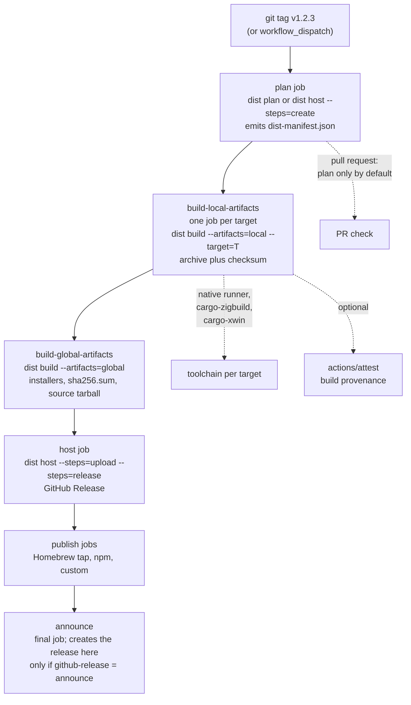
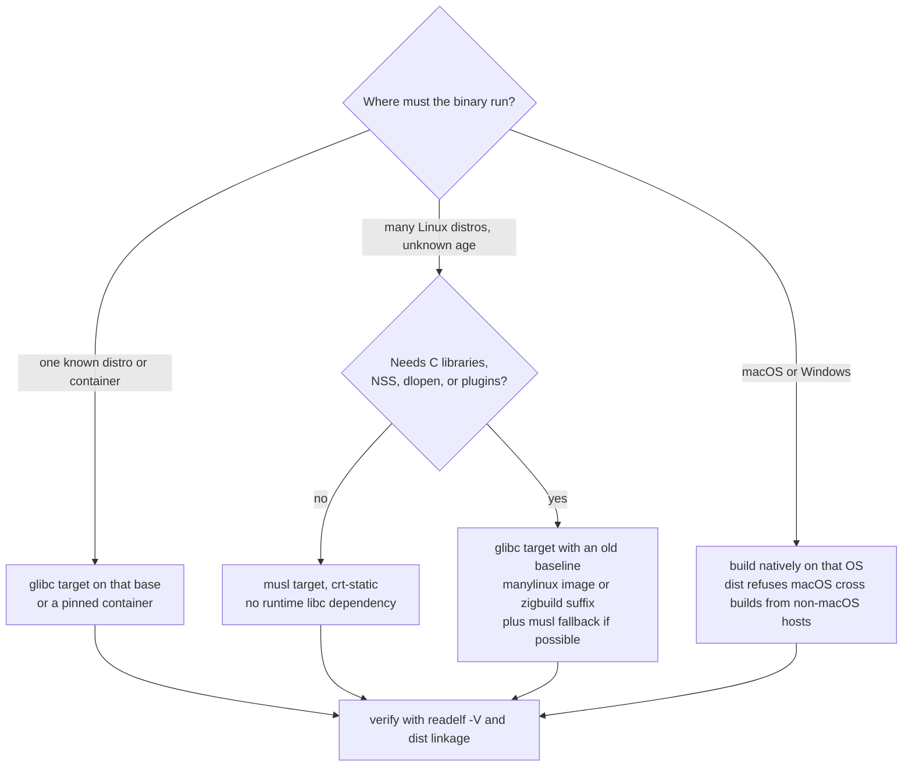

# Rust Binary Distribution: Automated Releases with dist and Cross-Compilation

> [!summary] Claim:
> Shipping a Rust program means producing one binary per target triple and proving each one runs on the machines you promised.
> `dist` turns a Cargo workspace plus one tag push into a plan, a per-target build matrix, installers, checksums, and a hosted release, and it computes the whole set of artifacts before it builds any of them.
> A Linux binary is portable only as far as its libc: a glibc build runs on glibc at or above the version of the machine that built it, and a musl build with `crt-static` has no libc dependency at all.
> Cross-compilation is the choice of linker, C sysroot, and glibc baseline, made by a native runner, a container (`cross`), or Zig (`cargo-zigbuild`), and `dist` picks among them from a hardcoded table keyed on host and target.
> An expert reads the produced binary (`readelf`, `dist build --print=linkage`, `vtool`) rather than trusting the target name.





## The Mechanism

### What dist is and how it thinks

`dist` is the new name of `cargo-dist`.
The rename landed in 0.24.0 (2024-10-28), which also made Cargo optional for non-Rust projects and added the unified checksum file.
The CLI is still installable as a Cargo plugin, so `cargo dist` keeps working.
The version that the generated CI installs is pinned in your config as `cargo-dist-version`.

The central design decision is that every invocation computes the full "Universe" of artifacts and then filters it.
The dist book names four inputs: the Cargo workspace structure (read through `cargo metadata`), the config, the announcement tag, and the artifact mode.
The first two define everything that could be built, and the last two select the subset this run builds.
This is why a shell installer can embed a table of every platform archive and its checksum even when the job that generates it never compiled those archives.

| Concept | Meaning in dist | Source |
|---|---|---|
| App | A Cargo package with binary targets; `publish = false` or `dist = false` removes it | Concepts, "Defining Your Apps" |
| Announcement | One tag selects the apps to release; 1 git tag = 1 announcement = 1 GitHub Release | Concepts, "Announcements" |
| Unified tag | `v1.0.0`, selects all dist-able packages at that version | Concepts |
| Singular tag | `my-app-v1.0.0` or `my-app/1.0.0`, selects one package | Concepts |
| Artifact mode | `local` (per target), `global` (per app), `all`, `host` (default, fuzzy, not for CI, where `cli.rs` says to always pass `local` or `global`), `lies` (fake artifacts) | `cli.rs` |
| Release variant | A (release, target) pair such as `my-app-v1.0.0-x86_64-apple-darwin` | Concepts |

Apps released together in one announcement must agree on their version, otherwise `dist` refuses with "too many unrelated apps in your workspace to coherently Announce" and asks for `--tag`.
A singular tag for a library-only package produces a minimal build-less announcement; the book calls that feature "half-baked".

Configuration is read from three places in increasing precedence: the language manifests (`Cargo.toml`), the workspace dist config (`dist-workspace.toml` or `dist.toml`), and the package dist config (`dist.toml`).
The book says (as of 2026-11, dist 0.34.0) that a config migration is in progress and that, for Rust projects, a `[dist]` section may also appear as `[workspace.metadata.dist]` in `Cargo.toml`.
`dist init` is meant to be rerun, because it preserves settings, migrates old formats, and regenerates the CI file.
`dist plan` verifies that the generated files are not stale unless `allow-dirty` lists them.

### The generated release pipeline

`dist init` writes `.github/workflows/release.yml`, and the template it renders (v0.34.0) has these jobs.
The names come from the config reference's custom-job phases: plan, build-local, build-global, host, publish, announce.

| Phase | What it runs | Notes |
|---|---|---|
| plan | `dist plan --output-format=json` on pull requests, `dist host --steps=create --tag=...` on a tag push | Writes `plan-dist-manifest.json` and exposes it as a job output |
| build-local-artifacts | `dist build <tag-flag> --print=linkage --output-format=json --artifacts=local --target=T,...` | One matrix job per target group; default `merge-tasks = false` keeps targets on separate machines |
| build-global-artifacts | `dist build <tag-flag> --output-format=json --artifacts=global` | Downloads every local artifact first so installers and `sha256.sum` can reference them |
| host | `dist host --steps=upload --steps=release` | Creates or undrafts the GitHub Release |
| publish | Homebrew formula push, npm publish, or custom `./jobs` | Runs with escalated permissions |
| announce | Final job after publish | Last phase `dist` schedules; `post-announce-jobs` run after it |

Properties worth knowing:

- The workflow triggers on tags matching `**[0-9]+.[0-9]+.[0-9]+*`.
  The template comment says the version must have at least major, minor, and patch, and that GitHub will refuse more than 3 tags pushed per commit.
- `pr-run-mode` defaults to `"plan"`, so every pull request runs the plan step and catches a broken release configuration before a release day.
  `"upload"` runs the full build and attaches an `artifacts.zip` to the workflow summary; the book calls it slow and wasteful and recommends enabling it only temporarily.
- `fail-fast` defaults to `false`: one failing target does not cancel the others, but the global job refuses to run if any local job failed, so partial releases cannot happen.
- With `dispatch-releases = true` the workflow is started by `workflow_dispatch` with a tag input, `dry-run` is the default input, and the GitHub Release itself creates the git tag.
- `github-release` defaults to `"auto"`, which creates the release in the host phase, before publish, so Homebrew and npm artifacts never point at missing URLs (`"host"` forces the same stage explicitly).
  Forcing `"announce"` opens a window of about 30 seconds in which those packages are live but their URLs 404, per the config reference.
- The `release` branch mode (`release-branch`) and `tag-namespace` exist for unusual repositories; `tag-namespace` renames the workflow file to `<prefix>-release.yml` and does not delete the old one.

The book states the design goal in one sentence: copy the single `dist` invocation CI made, run it locally, and get the same result "not to bit-level precision".
It does not claim bit-reproducible builds, and nothing in this pipeline pins the Rust toolchain unless `rust-toolchain.toml` does (the `rust-toolchain-version` key is deprecated since 0.1.0 in favor of that file).

### What dist passes to cargo

In v0.34.0 `build/cargo.rs` builds the command, and it shows exactly what the "shippable binary" defaults are.

1. `--profile dist`, always (`PROFILE_DIST`), never `--release`.
   `dist init` appends `[profile.dist]` with `inherits = "release"` and `lto = "thin"` if it is absent.
   The `init.rs` comment explains the choice: fat LTO squeezes out a bit more but can be far more expensive (enormous programs can become unbuildable), and many projects would burn CI time for nothing, so the user may raise it and/or set `codegen-units = 1`.
2. `--workspace` by default, so Cargo unifies features once across all apps; `precise-builds = true` builds each package separately, and `dist` forces it when packages disagree on `features`, `all-features`, or `default-features`.
   The trade-off is the one from [[Rust-Cargo-Model-Packages-Targets-Features-and-Workspaces]] and [[Drill-Packaging-Cargo-Feature-Unification-Hazard]]: unified builds ship features you did not ask for, separate builds compile shared dependencies twice.
3. `--message-format=json-render-diagnostics` and `--target <triple>`, with an extra `rustup target add <triple>` step whenever the target differs from the host triple.
4. `RUSTFLAGS` set from the environment plus additions.
   For `*-msvc` targets it appends `-Ctarget-feature=+crt-static` when `msvc-crt-static` is true, which is dist's default (Rust's own default is dynamic CRT).
   For `*-musl` targets it appends `-Ctarget-feature=+crt-static -Clink-self-contained=yes` to future-proof the day rustc's musl default changes.
5. `cargo auditable build` instead of `cargo build` when `cargo-auditable = true`.

The `RUSTFLAGS` detail has a consequence.
The Cargo Book lists four mutually exclusive sources of rustflags, checked in order: `CARGO_ENCODED_RUSTFLAGS`, `RUSTFLAGS`, the matching `target.<triple>.rustflags` and `target.<cfg>.rustflags` entries, then `build.rustflags`.
Because dist always sets `RUSTFLAGS` on the cargo child process (to an empty string when it has nothing to add), a `[target.x86_64-unknown-linux-gnu] rustflags = ["-C", "target-cpu=native"]` in `.cargo/config.toml` is silently ignored in dist builds.
A verification run on cargo 1.99.0 (darwin-arm64) confirmed that even `RUSTFLAGS=""` suppresses a `target.<host>.rustflags` entry in `cargo build -v`.
That is a good thing for `target-cpu=native`, and a trap for a flag you wanted, such as a custom linker.

### Targets, runners, and who compiles what

`targets` accepts, per the config reference (as of 2026-11), eight triples: `x86_64-apple-darwin`, `aarch64-apple-darwin`, `x86_64-pc-windows-msvc`, `aarch64-pc-windows-msvc`, `x86_64-unknown-linux-gnu`, `aarch64-unknown-linux-gnu`, `x86_64-unknown-linux-musl`, and `aarch64-unknown-linux-musl`.
Each becomes one archive per app.

Default runners come from `backend/ci/github.rs` in v0.34.0, with a comment that older runners are deliberate because they minimize "random system dependencies" and help portability.

| Target | Default runner (v0.34.0) | Compiler path |
|---|---|---|
| `x86_64-unknown-linux-gnu` | `ubuntu-22.04` | native |
| `aarch64-unknown-linux-gnu` | `ubuntu-22.04-arm` | native (changed from cross-compiling on x86_64 hosts in 0.30.0) |
| `x86_64-unknown-linux-musl` | `ubuntu-22.04` | cargo with the musl target; `musl-tools` installed via apt |
| `aarch64-unknown-linux-musl` | `ubuntu-22.04-arm` | native on the arm runner |
| `aarch64-apple-darwin` | `macos-15` | native |
| `x86_64-apple-darwin` | `macos-15-intel` | native |
| `x86_64-pc-windows-msvc` | `windows-2022` | native |
| `aarch64-pc-windows-msvc` | `ubuntu-22.04` inside container `messense/cargo-xwin` | `cargo xwin build` |

The 0.34.0 release body says "upgrades the aarch64-apple-darwin runner to macos-14", while the pull request title and the source say `macos-15`; the code is authoritative.
The runner-to-triple map in `platform/github_runners.rs` is dated "last updated 2026-10-30" in the source and covers `ubuntu-22.04`, `24.04`, and `26.04` (with `-arm` variants), `windows-2022` and `2025`, `windows-11-arm`, and the `macos-15` and `macos-26` families.

For a runner that `dist` does not know, `target_for_github_runner_or_default` assumes `x86_64-unknown-linux-gnu` and logs a warning, except names starting `buildjet-` which are parsed.
That is why third-party runner names need an explicit `host` in `github-custom-runners`.

### Cross-compilation: what has to be supplied

Compiling for target T on host H needs four things that a native build gets for free.

1. A `core` and `std` built for T: `rustup target add T`.
   Without it, rustc stops with E0463, shown in the worked example.
2. A linker that can emit T's object format, with correct relocations and startup files.
3. A C sysroot for T (headers and libc), because any `-sys` crate or `cc`-crate build script compiles C for T; see [[Rust-Build-Scripts-and-Sys-Crates]].
4. The right libc version, which decides the portability of the result and is covered in the glibc and musl section.

`dist` v0.34.0 decides who supplies items 2 to 4 in one function, `build_wrapper_for_cross(host, target)` in `tasks.rs`.

| Host OS | Target OS | Result |
|---|---|---|
| same OS and same architecture | same | no wrapper, plain `cargo build` (this includes gnu on a musl host) |
| macOS | macOS | no wrapper; only `rustup target add` is needed, even across Intel and Apple Silicon |
| any non-macOS host | macOS | error: "cross-compiling to macOS is a road paved with sadness - we cowardly refuse to walk it." (the text in the source uses an em dash) |
| Linux, macOS, or Windows | Linux | `cargo zigbuild` |
| Linux or macOS | Windows | `cargo xwin build` with `XWIN_ARCH` set to `x86`, `x86_64`, or `aarch64` |
| Windows | Windows | no wrapper |

The book adds that with both `cargo-zigbuild` and `cargo-xwin` installed on a Mac, `dist build --artifacts all` builds nearly every target, and that this is how `dist` itself is developed.
Linux and Windows cross support arrived in 0.26.0 (2024-12-12) ("Builtin Rust cross-compilation support"; before it, only macOS-to-macOS cross builds worked), which also made zigbuild and `cargo auditable` mutually exclusive until 0.32.0 lifted that.

#### cargo-zigbuild

`cargo-zigbuild` runs `zig cc` as the linker and C compiler, which gives one small tool a bundled libc for many targets.
As of 2026-11 the latest release is v0.24.1 (2026-11-04) and Zig's download index lists 0.17.1 (2026-11-02) as the newest stable.
It installs through `cargo install --locked cargo-zigbuild` or `pip install cargo-zigbuild`, which also installs the `ziglang` wheel.

Details that determine whether a build is right:

- A `*-gnu` target accepts a glibc version suffix: `cargo zigbuild --target aarch64-unknown-linux-gnu.2.17`.
  Without a suffix, Zig defaults to a version that varies by Zig release; the README says releases 0.12 to 0.14 default to glibc 2.28.
- The README lists caveats for the suffix feature: with no `--target`, Zig is not used and the command is a plain `cargo build`; an invalid version falls back silently; 2.32 can be requested and run on a host with 2.31; a flag such as `-C linker` opts out of Zig.
- `-C target-feature=+crt-static` on a gnu target is not supported ("upstream `zig cc` lacks support"); use a musl target for a fully static binary.
- `zig cc` is invoked with `-nostdinc`, so system headers in `/usr/include` are not found; the README prescribes `CFLAGS='-isystem /usr/include'` and `RUSTFLAGS='-L /usr/lib64'`.
- macOS: set `MACOSX_DEPLOYMENT_TARGET`; without it Zig uses its own default (13.0 for Zig 0.16 in the README), unlike rustc's 11.0 for `aarch64-apple-darwin`.
  The README also describes a `universal2-apple-darwin` pseudo-target.
- `target-cpu` matters: a CPU newer than the baseline produces `Illegal instruction` (SIGILL) on older hardware.
- Zig 0.15 and later bundle libc++ 19 headers, so crates using bindgen may need clang 18 or newer.
- The README caveats say only Linux and macOS targets are supported (one of its examples uses `x86_64-pc-windows-gnu`, so treat Windows as unsupported for planning); `dist` sends MSVC targets through `cargo-xwin`.

#### cross

`cross` is a Cargo wrapper that runs the build inside a Docker or Podman image per target, and it has the same CLI as Cargo.
The default image is `ghcr.io/cross-rs/<target>:<version>`, where the version is `cross`'s own version, according to the config reference.
The README requires Docker 20.10 (API 1.40) or Podman 3.4.0, and a Linux kernel with `binfmt_misc` for `cross test`, which uses QEMU.
Its default Linux GNU images are built on Ubuntu 24.04 with glibc 2.39, and `:main-centos` images give glibc 2.17 for `x86_64` and `aarch64` (as of 2026-11, per the README table).
`pre-build` hooks install foreign-architecture packages with `dpkg --add-architecture $CROSS_DEB_ARCH`, which is how `libssl-dev` for the target gets in.
A `zig` option under `[build]` or `[target.T]` switches a target to `zig cc` inside one image.

Maintenance state matters when you choose it.
The latest tagged release is v0.2.5 (2023-02-04), `main` has an "Unreleased" changelog section, and the README installs from git (`cargo install cross --git https://github.com/cross-rs/cross`); `Cargo.toml` on `main` declares `rust-version = "1.85.0"`.
Nothing here says the project is abandoned, but a pinned v0.2.5 and a floating `main` are different risks, so pin a commit.

Choosing between the three:

| Dimension | Native runner | cross | cargo-zigbuild |
|---|---|---|---|
| Setup | none beyond a runner of that arch | container engine on the build host | zig plus the wrapper |
| glibc baseline | the runner's glibc (2.35 on `ubuntu-22.04`) | image's (2.39 default, 2.17 with `:main-centos`) | any version via suffix |
| Run tests of the foreign binary | yes, native | yes, QEMU (slow, sequential) | no |
| C dependencies | the runner's packages | `pre-build` in the image | headers and libs must be passed by hand |
| Windows targets | native | prebuilt images for `-gnu` only; MSVC images are not shipped | not supported per its caveats |
| Used by dist by default | yes | no | yes, for Linux targets from another OS or architecture |

### Linux portability: glibc versus musl

An ELF executable records the symbol versions it needs from the C library (the `.gnu.version_r` section, see [[Cpp-Glibc-Symbol-Versioning-and-Portable-Linux-Binaries]]).
glibc is backward compatible only: a binary needs a glibc at least as new as the highest `GLIBC_x.y` it references.
The `platform.rs` documentation in `dist` says the same thing from the installer's side, and that a too-old glibc "will hard error out".

`dist` does not read the needed version from the binary.
Its documentation says it knows of no way to ask a binary which glibc it needs (the `readelf` version-requirement script in the worked example does exactly that), so it asks the glibc on the build machine for its version and assumes every binary built there is linked against it.
That is wrong for exactly the tools that go out of their way to link older glibc (the source names maturin and zig), so `dist` will pick a version that is too new.
The remedy is `min-glibc-version` (since 0.26.0), a table keyed by triple with a `"*"` wildcard, which overrides detection for `*-gnu` targets only.
When no glibc version can be found at all, `dist` invents one: `LibcVersion::default_glibc()` is 2.31, and its source comment calls that the glibc of Ubuntu 22.04, which is incorrect (Ubuntu 22.04 ships 2.35 and 24.04 ships 2.39, per the Ubuntu package pages).

The default runner `ubuntu-22.04` therefore sets the baseline for `x86_64-unknown-linux-gnu` archives at glibc 2.35 (as of 2026-11, Linux).
A host with glibc 2.28, such as RHEL 8, is excluded.
Two ways to lower it: build in an old container, which the book shows with `quay.io/pypa/manylinux_2_28_x86_64` plus `host = "x86_64-unknown-linux-musl"` (the container host triple is overridden because `dist` itself must run in the container and might otherwise be too new for it), or build with `cargo-zigbuild` and a suffix.

A musl target avoids the question.
rustc enables `crt-static` by default on `x86_64-unknown-linux-musl` and `aarch64-unknown-linux-musl`, which the worked example confirms with `rustc --print cfg`, and the Rust Reference lists `x86_64-unknown-linux-musl` among the targets that are static by default.
A comment in `dist`'s `build/cargo.rs` says the musl default "will change in the future" (it ties this to dist issue 486), which is why `dist` passes `+crt-static` explicitly anyway.
Tier status (as of 2026-11, rustc book platform support): `x86_64-unknown-linux-gnu` and `aarch64-unknown-linux-gnu` are Tier 1 with host tools, while `x86_64-unknown-linux-musl` and `aarch64-unknown-linux-musl` are Tier 2 with host tools, both documented against musl 1.2.5.

The costs of musl are behavioral differences, documented on the musl wiki:

- DNS: musl's resolver queries all configured nameservers in parallel (up to three) and takes the first answer; DNS over TCP was unsupported until musl 1.2.4, so large responses (DNSSEC) failed before that.
- `dlclose` is a no-op and libraries stay loaded for the process lifetime; there is no lazy binding (deferred binding instead).
- Only the default symbol version is selectable through the dynamic linker.
- The default pthread stack is 128 KiB (80 KiB before 1.1.21) against 2 to 10 MiB for glibc, which matters to C code that creates threads with default attributes.
- Locale: with no `LANG` or `LC_*` variables musl's default locale is always `C.UTF-8`, where glibc's default (through 2.26 at least) is `C`, and every locale other than the C locale is processed as UTF-8.
- `printf`, regex, `getopt` and a few other GNU quirks differ.
  Whether Rust code that never calls into those is affected is a question for the specific dependency; this note makes no performance claim about the two allocators or libcs, because none was measured; benchmark your own workload on both targets before choosing.

A static musl binary cannot `dlopen` glibc plugins, so programs that load NSS modules, GPU drivers, or Python extensions need the glibc build.

#### How the installer chooses

`PlatformSupport` in `platform.rs` models every archive as a list of "can this archive serve platform P" entries, each with a quality (`HostNative`, `ImperfectNative`, `BulkyNative`, `Emulated`) and optional runtime conditions.
A `linux-musl-static` archive is registered as `ImperfectNative` for `linux-gnu` and `linux-musl-dynamic` hosts, so when both gnu and musl archives exist, gnu is tried first and musl is the fallback.
An x86_64 macOS archive is `Emulated` on `aarch64-apple-darwin` (Rosetta 2).
The shell installer (`installer.sh.j2`) works in three steps:

1. `get_architecture` reads `uname`; on Linux it runs `ldd --version 2>&1 | grep -q musl` and sets `musl-dynamic` if it matches, otherwise `gnu`; on Darwin it asks `sysctl` for the real architecture because `uname -m` lies under Rosetta.
2. `select_archive_for_arch` walks the entries in order and, for entries with a `min_glibc_version`, calls `check_glibc`, which parses `ldd --version`, requires the same major version, and requires the minor to be at least the needed one.
3. On failure it prints "System glibc version (`X') is too old; checking alternatives" and tries the next entry, ending in "no compatible downloads were found for your platform".

The shell installer page in the book still says it "cannot detect situations where musl-based builds are appropriate"; the v0.34.0 template does detect musl, so that caveat is stale (issue 75).

### Installers

An installer here is anything fancier than a tarball.
There are two strategies: fetching installers download an archive at install time, and bundling installers carry the binary.
Shell, PowerShell, npm, and Homebrew are fetching; MSI is bundling and therefore single-platform.

#### Shell and PowerShell

The shell installer is rendered once per app (a "global" artifact) and ships as `<app>-installer.sh`.
The documented install line is `curl --proto '=https' --tlsv1.2 -LsSf <url>/<app>-installer.sh | sh`.
Those flags restrict the protocol, require TLS 1.2 or newer, follow redirects, stay silent except for errors, and fail on HTTP errors, so a 404 cannot be piped into `sh` as a page of HTML.

What the script does, from the template:

- Downloads with `curl` or `wget` and unpacks with `tar` or `unzip`; it keeps only the binaries, so a program cannot rely on other files in the archive (issue 307).
- Verifies the checksum that was baked into the installer at generation time.
  `verify_checksum` needs `sha256sum` (for sha256), `sha512sum`, `openssl` (for sha3), or `b2sum` (for blake2), and when the tool is missing it prints "skipping ... checksum verification" and carries on.
  On the macOS 27.3 host used for this note, `/sbin/sha256sum` exists (a Mach-O binary that prints `sha256sum (Darwin) 1.0`), so sha256 verification would run there; the script tests for the tool at run time with `check_cmd`, so on any host without it the skip message above is what appears, and the user must verify the archive by hand.
- Chooses the install directory from `install-path`: default `"CARGO_HOME"` (`$CARGO_HOME/bin`, else `$HOME/.cargo/bin`), or `~/subdir`, or `$VAR/subdir`, or a cascade list since 0.14.0.
  `CARGO_HOME` cannot be combined with other strategies in a cascade.
- Adds the directory to `PATH` the way rustup does: writes an `env` script and appends `. <env>` to `~/.profile`.
  The v0.34.0 template goes further than the book's shell page, which names only `~/.profile`: it also adds the line to whichever of `.bashrc`, `.bash_profile`, and `.bash_login` exist, to `.zshrc` or `.zshenv`, writes a fish `conf.d` file, and appends to `GITHUB_PATH` when run in CI.
  A child process cannot change its parent shell's `PATH`, so the user must `source` the file or open a new shell.
  Since 0.33.0, for a "flat" layout the `env` helper lives next to the receipt in `~/.config/<app>` instead of beside the binary.
- Writes an install receipt, `${XDG_CONFIG_HOME:-$HOME/.config}/<app>/<app>-receipt.json` (`%LOCALAPPDATA%` on Windows), which the updater reads.
- Honors `<APP>_INSTALL_DIR`, `INSTALLER_NO_MODIFY_PATH` and `<APP>_NO_MODIFY_PATH`, `<APP>_DOWNLOAD_URL` (since 0.30.0), `<APP>_GITHUB_TOKEN` (since 0.29.0), `HTTPS_PROXY` and `ALL_PROXY`, and `<APP>_UNMANAGED_INSTALL` (since 0.23.0), which installs into one directory with a flat layout, no receipt, no updater, and no `PATH` edits, intended for CI.
- Since 0.31.0 an interrupted installation is less likely to leave a partial install.

`install-updater = true` ships a `<app>-update` binary built from `axoupdater` (experimental per the book), which reads the receipt, asks the GitHub Releases API for the latest version, and installs it.
Since 0.27.0 `dist` bundles a fixed axoupdater version rather than the newest one, unless `always-use-latest-updater = true`.
Releases 0.21.1, 0.22.0, and 0.22.1 had a bug that skipped installing the updater from the shell installer; it was fixed in 0.23.0.

The `simple` hosting mode (since 0.31.0) adds a static-file mirror: `simple-download-url = "https://static.example.com/{tag}"`, with `hosting = ["simple", "github"]` as the implicit order when both exist.
`dist` does not upload to the mirror; you do.
The mirror does not carry update discovery (as of 2026-11, Linux, macOS, and Windows alike): `dist` v0.34.0 bundles axoupdater 0.10.0 (`Cargo.toml`), whose `ReleaseSourceType` has only `GitHub` and `Axo`, with no static-mirror type, and which lists releases through the GitHub REST API (`https://api.github.com` by default) and downloads the installer from the `browser_download_url` of the release it finds (`release/mod.rs`, `release/github.rs`, `lib.rs`).
A GitHub-shaped API can be substituted through `<APP>_INSTALLER_GITHUB_BASE_URL` or `<APP>_INSTALLER_GHE_BASE_URL` (set only one), which the axoupdater source reads; a plain static mirror cannot answer those requests.

#### Homebrew

The Homebrew installer generates a Ruby formula that fetches the same archives and declares per-OS and per-CPU `url` and `sha256` pairs, and adds extra `mirror` lines when several hosts are configured.
Publishing needs a tap: a repository named `homebrew-<something>`, and a token in the secret `HOMEBREW_TAP_TOKEN`, because "the core Homebrew tap does not accept prebuilt binaries from third parties" (as of 2026-11, per the book).
Users run `brew install OWNER/tap/app`.
The publish job runs `brew style --fix` on the formula and commits it.

Limits that bite:

- Homebrew has one version per formula.
  Publishing an older release line after a newer one replaces the newer one, and a prerelease would clobber the stable version, so `publish-prereleases` is `false` by default and prereleases are skipped.
- The formula's checksum is always sha256 regardless of the `checksum` setting, because Homebrew requires it.
- The formula cannot build from source and does not support casks.
- Linux support (Linuxbrew) works as long as you build Linux targets.

npm (`npx`) and MSI exist too; the npm installer ships an `npm-shrinkwrap.json` by default, and since 0.31.0 `npm-shrinkwrap = false` turns it off.

### Archives, checksums, and attestations

An archive contains the binaries at its root, plus an auto-detected README, LICENSE or UNLICENSE, and CHANGELOG or RELEASES file, plus anything in `include`.
Tarballs nest everything under a directory named like the archive (installers use `--strip-components=1`), while zips do not.
Defaults are `.tar.xz` off Windows and `.zip` on Windows, and `unix-archive` and `windows-archive` accept `.zip`, `.tar.gz`, `.tar.xz`, `.tar.zst` (and the deprecated spelling `.tar.zstd`).
The `symbols` feature (pdb and dSYM collection) is documented as "currently disabled pending a rework", so separate debug files are not shipped by `dist`; see [[Cpp-Hardened-Release-Builds-and-Separate-Debug-Symbols]] for the strategy and `extra-artifacts` for a custom hook.

Checksums: each archive gets a sidecar named `<archive>.sha256` by default, with `sha256`, `sha512`, `sha3-256`, `sha3-512`, `blake2s`, `blake2b`, and `false` as options.
Since 0.24.0 a unified file such as `sha256.sum` also lists every archive and works with `sha256sum -c`; individual files "will be deprecated in a future version".
The book states that unsigned checksums over HTTPS give "minimal" security benefit, because anyone who can replace the archive on the release can replace its checksum, so they catch corruption and not tampering.

Attestations: `github-attestations = true` (experimental per the book) adds a step using `actions/attest@v4`.
The default phase is `build-local-artifacts` with `subject-path: target/distrib/*<targets>*`.
`github-attestations-phase` can move it to `host` or `announce` (since 0.30.0), which is required when `build-local-artifacts = false`, and `github-attestations-filters` (default `["*"]`, globbed under `artifacts/`) chooses subjects in those phases.
The job gets `id-token: write`, `attestations: write`, and `contents: read`, and `contents: write` instead when the attestation runs in the host or announce phase.
GitHub's documentation says attestations alone provide SLSA v1.0 Build Level 2, and Level 3 needs the build to run in a reusable workflow that isolates it from the calling workflow; the workflow `dist` generates lives in your repository, so reading that statement literally gives Level 2 (this is an inference, not a `dist` claim).
For public repositories the attestation goes to the Sigstore Public Good Instance and its Rekor log.
Verification is `gh attestation verify <file> --repo OWNER/REPO`, and dist 0.33.0 fixed its own generated text to include `--repo`.
Nothing in the shell installer verifies an attestation, so an attestation is a record that a consumer must check, and GitHub's concepts page says generating them provides no benefit until someone verifies them.

Other supply-chain switches in the config: `cargo-auditable` (embeds the dependency tree in a linker section, under 4 kB even for 400 or more entries per its README, readable with `cargo audit bin`), `cargo-cyclonedx` (a `bom.xml` in the tarball), and `omnibor` (OmniBOR artifact IDs).
Windows signing exists through SSL.com (`ssldotcom-windows-sign`) and, since 0.33.0, Azure Artifact Signing (`azure-windows-sign`); both cover only x86_64 Windows.
The changelog calls macOS codesigning "experimental" (0.30.x) while the supply-chain page still lists it as future work, so treat it as unsupported for planning; for the full Apple path see [[Cpp-macOS-Universal-Binaries-Code-Signing-and-Notarization]].
`dist` does not publish to crates.io; the quickstart tells you to run `cargo publish` yourself, and [[Rust-Publishing-Crates-io-Trusted-Publishing-and-Private-Registries]] owns that path.

### The release profile: size, speed, and symbols

Cargo's `release` profile defaults (as of 2026-11, The Cargo Book): `opt-level = 3`, `debug = false`, `strip = "none"`, `lto = false`, `panic = "unwind"`, `codegen-units = 16`, `incremental = false`.
Rust 1.77.0 added that a profile without debuginfo gets `strip = "debuginfo"` by default, because the precompiled standard library ships with debuginfo and static linking would otherwise carry it into your binary.
The authoring session confirmed the effect on cargo 1.99.0: `cargo build --release -v` passes `strip=debuginfo` although `strip` is unset.

| Setting | Effect | Cost or risk |
|---|---|---|
| `lto = "thin"` | cross-crate inlining with parallelism; dist's default | longer link; Cargo says gains are "similar to fat" |
| `lto = "fat"` (or `true`) | whole dependency graph in one module | slowest link; can make huge programs unbuildable (the `init.rs` comment) |
| `codegen-units = 1` | most optimization, least parallelism | slower compile, usually smaller and faster code |
| `opt-level = "s"` or `"z"` | optimize for size; `"z"` also disables loop vectorization | can be slower; the Cargo Book warns "s" and "z" are not necessarily smaller |
| `panic = "abort"` | removes unwinding tables and landing pads | `catch_unwind` stops working, destructors do not run on panic, and FFI callers see a process abort |
| `strip = "symbols"` (or `true`) | removes the symbol table | backtraces lose function names; do not combine with expecting to symbolicate in production |
| `strip = "debuginfo"` | removes DWARF only | default for release since 1.77 |
| `debug = "line-tables-only"` | line info for backtraces | bigger binary; pair with `split-debuginfo` to keep it out of the shipped file |
| `-Zbuild-std` with `panic_abort` and `optimize_for_size` | rebuilds `std` with your settings | nightly only; min-sized-rust reports large reductions on macOS |

Measure, do not assume: `ls -l`, `size`, `bloaty`, or `cargo bloat` before and after one change at a time, and run the same smoke test on each variant.
UPX is mentioned by min-sized-rust with a warning that packed binaries have triggered heuristic antivirus; this note does not recommend it for distribution.
This note records no size numbers, because none were measured in a committed lab.

`cargo-auditable` stores its data, Zlib-compressed JSON, in a dedicated linker section named `.dep-v0` (per its README); on ELF targets `cargo-auditable` writes that section with `sh_flags = 0`, so it is not `SHF_ALLOC` and is not loaded at run time (`src/object_file.rs`).
This note does not claim what a given linker or `strip` does with such a non-loaded section, so run `cargo audit bin` on the final stripped artifact before relying on both together.

## Commands and Numbers to Know

| Item | Value | Platform | Notes |
|---|---|---|---|
| Latest dist | 0.34.0, CHANGELOG date 2026-11-01 (tag published 2026-11-02 UTC) (as of 2026-11) | Both | The topic inventory pins 0.33.0 (2026-09-10); 0.33.1 (2026-10-21) updated dependencies, including certificate lists (GitHub release notes). |
| Rename | `cargo-dist` became `dist` in 0.24.0, 2024-10-28 (as of 2026-11) | Both | `cargo dist` still works. |
| Config file | `dist-workspace.toml`, or `dist.toml`, or `[workspace.metadata.dist]` (as of 2026-11) | Both | Precedence: manifests, workspace dist config, package dist config. |
| Build profile | `--profile dist`, from `inherits = "release"` plus `lto = "thin"` (as of 2026-11) | Both | `dist init` writes it only if absent. |
| Default archives | `.tar.xz` off Windows, `.zip` on Windows (as of 2026-11) | Both | Configurable. |
| Default checksum | `sha256`, plus `sha256.sum` since 0.24.0 (as of 2026-11) | Both | `checksum = "false"` disables. |
| `pr-run-mode` | `"plan"` (as of 2026-11) | Both | `"skip"` and `"upload"` also valid. |
| Tag pattern | `**[0-9]+.[0-9]+.[0-9]+*` (as of 2026-11) | Both | From the workflow template; 3 tags per commit maximum per GitHub. |
| Default runners | `ubuntu-22.04`, `ubuntu-22.04-arm`, `macos-15`, `macos-15-intel`, `windows-2022` (as of 2026-11) | Both | Source of `github_runner_for_target`, v0.34.0. |
| Ubuntu glibc | jammy 2.35, noble 2.39 (as of 2026-11) | Linux | Ubuntu package pages. |
| `min-glibc-version` | table by triple plus `"*"`, since 0.26.0 (as of 2026-11) | Linux | Only `*-gnu` targets. |
| `msvc-crt-static` | default `true` (as of 2026-11) | Windows | Rust's own default is dynamic. |
| musl crt default | `target_feature="crt-static"` printed for `x86_64` and `aarch64` musl (as of 2026-11, observed) | macOS host reading Linux targets | rustc 1.99.0; see worked example. |
| macOS deployment target | `MACOSX_DEPLOYMENT_TARGET=11.0` from `rustc --print deployment-target` (as of 2026-11, observed) | macOS | aarch64 host, rustc 1.99.0. |
| `cargo build --release -v` | passes `opt-level=3`, `strip=debuginfo` (as of 2026-11, observed) | macOS | cargo 1.99.0, flags filtered from the rustc line. |
| cross | v0.2.5, 2023-02-04, latest tag; images `ghcr.io/cross-rs/<target>:<version>` (as of 2026-11) | Both | Needs Docker 20.10 or Podman 3.4.0. |
| cargo-zigbuild | v0.24.1, 2026-11-04 (as of 2026-11) | Both | Targets Linux and macOS only. |
| zigbuild glibc | `--target aarch64-unknown-linux-gnu.2.17` (as of 2026-11) | Linux | Default for Zig 0.12 to 0.14 is 2.28. |
| Zig | 0.17.1, 2026-11-02 (as of 2026-11) | Both | From the ziglang.org download index. |
| Attestation action | `actions/attest@v4` (as of 2026-11) | Both | dist migrated from `attest-build-provenance@v3` in 0.32.0. |
| Verify | `gh attestation verify FILE --repo OWNER/REPO` (as of 2026-11) | Both | Online; GitHub documents an offline path separately. |
| Rust tiers | `x86_64-unknown-linux-gnu` Tier 1, `x86_64-unknown-linux-musl` Tier 2 with host tools (as of 2026-11) | Linux | rustc book, musl 1.2.5. |
| Static libc check | `readelf -d BIN` shows no `NEEDED` entry; `file BIN` reports a static or static-pie executable (as of 2026-11) | Linux | Not run in this session, which had no Linux host; verify on the target. |
| Min glibc of a binary | `readelf -W --version-info --dyn-syms BIN \| grep 'Name: GLIBC' \| sed ... \| sort -t . -k1,1n -k2,2n \| tail -n 1` (as of 2026-11) | Linux | zigbuild README `get-min-glibc` script; needs an unstripped binary. |

## Multi-Language Comparison

| Concern | C++ (native binaries) | Python (wheels) | Rust (dist) |
|---|---|---|---|
| Unit of release | package, tarball, deb, rpm, or Homebrew formula | wheel with platform tag | per-target archive plus installers |
| Portability promise | pick a build image with an old glibc; see [[Cpp-Glibc-Symbol-Versioning-and-Portable-Linux-Binaries]] | the `manylinux_2_28` tag family, enforced by `auditwheel`; see [[Python-Wheels-Platform-Tags-Manylinux-and-ABI3]] | no tag; the installer compares `ldd --version` against a baked minimum |
| Where the baseline lives | the build image or sysroot | the tag in the filename, checked by pip and uv | `runtime_conditions` in `dist-manifest.json`, checked by the shell installer only |
| Static option | static libstdc++ and musl, with limits | not applicable | `*-unknown-linux-musl` with `crt-static` |
| Cross toolchain | sysroot plus cross GCC or clang, or Zig | manylinux and musllinux images, cibuildwheel; maturin `--zig` | native runner, `cross`, `cargo-zigbuild`, `cargo-xwin` |
| Matrix driver | CMake presets and CI scripts | [[Python-Cross-Platform-Wheel-Pipelines-with-cibuildwheel]] | generated `release.yml` |
| Integrity | signed packages, checksums | PyPI attestations; see [[Python-Trusted-Publishing-and-PEP-740-Attestations]] | `sha256.sum` plus optional GitHub attestations |
| Typical defect | a too-new glibc symbol leaks in | tag claims more than the binary supports | `dist` guessed the glibc version from the wrong machine |

## Worked Example: Reading the Evidence Without a Lab

This note has no lab, so the outputs here are not backed by a committed expected file.
They were captured once during authoring on 2026-11-21 on darwin-arm64 (macOS 27.3), with rustc 1.99.0 and cargo 1.99.0, and no Linux host or container was available, so no ELF was built.
An independent verification run on the same host and toolchain on 2026-11-21 reproduced steps 1 to 3 exactly.
`dist`, `cross`, `cargo-zigbuild`, and Zig were not installed, and their behavior in this note comes from their documentation and v0.34.0 source, not from running them.

The project is `cargo new hello`, with this appended to `Cargo.toml`, which is what `dist init` would write:

```toml
[profile.dist]
inherits = "release"
lto = "thin"
```

Step 1: confirm that musl links the C runtime statically by default, and gnu does not.

```text
$ rustc --print cfg --target x86_64-unknown-linux-musl | grep -E 'crt|env'
target_env="musl"
target_feature="crt-static"
$ rustc --print cfg --target aarch64-unknown-linux-musl | grep crt
target_feature="crt-static"
$ rustc --print cfg --target x86_64-unknown-linux-gnu | grep -E 'crt|env'
target_env="gnu"
```

Output from darwin-arm64, rustc 1.99.0.
The gnu target prints no `crt-static` line, so it links `libc.so.6` dynamically unless you force `+crt-static`, which `cargo-zigbuild` does not support for gnu.

Step 2: see what the release and dist profiles pass to rustc.
The lines that follow show the `-C` options that remained after filtering the `-v` command line for profile-controlled flags.

```text
$ cargo build --release -v       # flags: embed-bitcode=no  opt-level=3  strip=debuginfo
$ cargo build --profile dist -v  # flags: lto=thin          opt-level=3  strip=debuginfo
```

Output from darwin-arm64, cargo 1.99.0.
`strip=debuginfo` appears although `Cargo.toml` never sets `strip`, which is the Rust 1.77 default.
`embed-bitcode=no` disappears and `lto=thin` appears under the `dist` profile, because thin LTO needs the bitcode.

Step 3: build for a target whose standard library is not installed.

```text
$ cargo build --profile dist --target x86_64-unknown-linux-musl
   Compiling hello v0.1.0 (...)
error[E0463]: can't find crate for `std`
  |
  = note: the `x86_64-unknown-linux-musl` target may not be installed
  = help: consider downloading the target with `rustup target add x86_64-unknown-linux-musl`
```

Output from darwin-arm64, cargo 1.99.0, with the project path elided.
This is item 1 of the cross-compilation list failing.
`dist` runs the `rustup target add` step whenever the target is not the host triple; a hand-written workflow that does not will fail here.

Step 4 (not run here, to be done on a Linux host): the check that decides whether a gnu archive is honest.

```sh
cargo build --profile dist --target x86_64-unknown-linux-gnu
readelf -W --version-info --dyn-syms target/x86_64-unknown-linux-gnu/dist/hello \
  | grep 'Name: GLIBC' | sed -re 's/.*GLIBC_(.+) Flags.*/\1/' | sort -t . -k1,1n -k2,2n | tail -n 1
```

The last line is the minimum glibc, and it should be no newer than what `min-glibc-version` promises.
An illustrative `dist-workspace.toml` that applies the rules in this note, assembled from keys the config reference documents (not run):

```toml
[workspace]
members = ["cargo:."]

[dist]
cargo-dist-version = "0.34.0"
ci = ["github"]
installers = ["shell", "homebrew"]
targets = [
  "aarch64-apple-darwin", "x86_64-apple-darwin",
  "x86_64-unknown-linux-gnu", "aarch64-unknown-linux-gnu",
  "x86_64-unknown-linux-musl", "x86_64-pc-windows-msvc",
]
tap = "OWNER/homebrew-tap"
publish-jobs = ["homebrew"]
github-attestations = true
cargo-auditable = true
checksum = "sha256"
pr-run-mode = "plan"

[dist.min-glibc-version]
"*" = "2.28"

[dist.github-custom-runners.x86_64-unknown-linux-gnu]
container = { image = "quay.io/pypa/manylinux_2_28_x86_64", host = "x86_64-unknown-linux-musl" }
```

Combine this with the `[profile.dist]` table from the project setup in this example.
With the manylinux container shown, `dist` would read glibc 2.28 from the container itself, so the override mostly documents intent and guards against drift.
It becomes essential if you switch the Linux build to `cargo-zigbuild` with a glibc suffix, where the build host's glibc is not the binary's floor.
The container image shown is the example from the dist book.

## Pitfalls

> [!warning] Pitfall 1: Config-file rustflags vanish under dist
> `dist` sets `RUSTFLAGS` on every cargo build, and the Cargo Book says `RUSTFLAGS` beats `target.<triple>.rustflags` and `build.rustflags`, which are mutually exclusive with it.
> A `target-cpu`, a `-C linker=...`, or a hardening flag placed only in `.cargo/config.toml` is not applied to release builds.
> Put flags you need in the environment of the build step, or in a wrapper, and verify with `cargo build -v` equivalents in CI logs.

> [!warning] Pitfall 2: The default runner picks your glibc floor
> `ubuntu-22.04` means glibc 2.35, so the stock `x86_64-unknown-linux-gnu` archive does not run on a distribution with glibc 2.28.
> The shell installer falls back to a musl archive only if you built one.
> Users who download the tarball by hand get a loader error and no fallback.
> Ship a musl target, or build in an old container, and state the baseline in the README.

> [!warning] Pitfall 3: dist guesses glibc from the wrong machine
> Detection assumes the binary links the glibc of the build host.
> In a manylinux container that assumption holds, but with `cargo-zigbuild --target X.2.17` the host's glibc is newer than the binary's real floor.
> The `platform.rs` documentation names both failure modes: a version that is too new makes the installer refuse or fall back to musl on hosts that could run the binary, and a version that is too old lets it install a binary that fails at startup.
> Set `min-glibc-version` explicitly and gate CI on the `readelf` script.

> [!warning] Pitfall 4: zigbuild and static glibc, headers, and linkers
> `+crt-static` with a gnu target is unsupported under `zig cc`, `-C linker` rustflags silently opt out of Zig, and `/usr/include` is not searched because of `-nostdinc`.
> C-heavy dependencies such as OpenSSL or libelf then fail with "file not found" even though `cargo build` succeeded on the same machine.
> Prefer pure-Rust dependencies (rustls) for cross targets, or supply headers with `CFLAGS='-isystem ...'` and libraries with `RUSTFLAGS='-L ...'`.

> [!warning] Pitfall 5: target-cpu leaks into the baseline
> Setting `-C target-cpu=native` or a modern `x86-64-v4` produces `Illegal instruction` on older hardware, and `cargo-zigbuild` forwards a matching `-mcpu` to the C compiler so C code in dependencies is affected too.
> A release binary should name its baseline, and the matrix should include the oldest CPU you support.

> [!warning] Pitfall 6: Installer checksums are integrity, not authenticity
> The checksum is embedded in an installer that is served from the same release as the archive, and the shell installer skips verification when `sha256sum` is absent.
> Do not describe it as tamper protection.
> Distribute the attestation verification command or sign the archives.

> [!warning] Pitfall 7: Homebrew and prereleases
> One formula holds one version, so a patch release for an old line replaces a newer formula.
> A prerelease would replace the stable version too, which is why `publish-prereleases` defaults to `false`; `force-latest = true` makes `dist` treat every version as the latest, which removes that protection.
> Release old lines from a separate tap or accept that the tap tracks the latest publish.

> [!warning] Pitfall 8: panic = "abort" is a behavioral change, not a size knob
> It removes unwinding, so `catch_unwind`, panic-based error boundaries in servers, and drop-on-unwind cleanup stop working.
> It is also ignored for tests, benchmarks, build scripts, and proc macros per the Cargo Book, so a passing `cargo test` does not exercise the shipped panic strategy.

> [!warning] Pitfall 9: Windows CRT and macOS deployment target
> `dist` defaults `msvc-crt-static = true`, so a crate that dynamically links a DLL built against the dynamic CRT can mix two C runtimes.
> On macOS, rustc defaults to 11.0 for Apple Silicon, but `cc`-built C code in a dependency uses the runner SDK default, so check `vtool -show-build` (see [[Python-Wheels-Platform-Tags-Manylinux-and-ABI3]] for the same check on wheels).

> [!warning] Pitfall 10: Forgetting rustup target add
> A hand-rolled workflow that calls `cargo build --target` without the target installed fails with E0463, as the worked example shows.
> `dist` adds the step itself; replacements built with `build-local-artifacts = false` must replicate it.

## At Scale

A single developer needs `dist init`, one tag, and the defaults.
A team of 50 should keep `pr-run-mode = "plan"` (the default), pin `cargo-dist-version`, and treat a `dist` upgrade as its own pull request, because `dist init` regenerates `release.yml` and a stale file fails the plan check.
At 1,000 to 50,000 engineers the problem changes from "does the release run" to "what do thousands of hosts trust the release to mean", and the baseline policy has to live in one place.

Decision rules:

1. Use `dist` for applications with binary targets.
   Libraries stay on crates.io; see [[Rust-Publishing-Crates-io-Trusted-Publishing-and-Private-Registries]].
   Libraries meant for C callers belong in [[Rust-FFI-Packaging-cdylib-staticlib-and-cbindgen]], and `package-libraries` in `dist` is experimental.
2. Publish a gnu archive with an explicit, documented glibc floor, built in a pinned container or with a zigbuild suffix, and a musl static archive as the fallback.
   Set `min-glibc-version` and fail CI if the `readelf` result exceeds it.
3. Choose native runners where they exist (Linux arm64, both macOS architectures, Windows), which `dist` does by default since 0.30.0, because they run the test suite on the real architecture.
   Use `cargo-zigbuild` where no native runner exists or a glibc suffix is needed, `cargo-xwin` for Windows from Linux, and `cross` only when you need a container with specific system libraries or QEMU-based tests.
4. Pin everything that moves: `cargo-dist-version`, `rust-toolchain.toml`, Zig and `cargo-zigbuild` versions, and `github-action-commits` for supply-chain-sensitive repositories.
5. Keep the tap token narrow.
   The dist book tells you to create a token with the `repo` scope, so a bot account that can write only the tap repository limits the blast radius (an operational opinion, not a dist feature).
6. Turn on attestations and publish a one-line verification policy, because attesting without verifying has no effect.
   Decide the phase deliberately: `build-local-artifacts` attests the archives as built, and `host` can attest installers too.
7. Mirror downloads with `simple-download-url` when GitHub availability or rate limits are a risk, but note that the updater queries the GitHub API rather than the mirror, so it cannot find new versions while GitHub is unreachable (see Installers), and test that case.
8. Use `dispatch-releases` when the git tag must be the last act of the process, and accept the documented race if you also force `github-release = "announce"`.
9. Cost control: each target is a separate runner job by default (`merge-tasks = false`), `cache-builds` defaults off because the cache invalidates whenever `Cargo.toml` or `Cargo.lock` changes (which a version bump always does), and `pr-run-mode = "upload"` should be a temporary setting.
10. Treat the build matrix as a product surface.
    Every target you add is a promise that will be exercised on a machine you do not own; remove targets you cannot test.

Failure at scale usually comes from a promise that drifted: the baseline moved when the default runner changed, `dist` guessed the glibc version, or a macOS runner upgrade raised the deployment target.
The defense is a release gate that reads the binary: `dist build --print=linkage`, the `readelf` script, `vtool -show-build`, and a smoke test on the oldest supported OS image.
See [[Contain-and-Roll-Back-a-Bad-Production-Release]] for what to do when a bad archive is already out, and [[Release-Trains-Backports-and-Artifact-Registries]] for registry-side policy.

> [!tip] Practice Drill: Prove the glibc floor and the musl fallback
> On a Linux machine or container, create a `cargo new hello` project with the `[profile.dist]` table.
> Build `x86_64-unknown-linux-gnu` on `ubuntu:22.04` and run the `readelf` script; the answer should be at most 2.35.
> Copy the binary to an image with an older glibc (for example a RHEL 8 compatible image) and record the loader error.
> Build `x86_64-unknown-linux-musl` with `rustup target add` and `musl-tools`, run `file` and `readelf -d`, confirm there is no `NEEDED` entry, and run it in both images.
> Then build the gnu target again with `cargo zigbuild --target x86_64-unknown-linux-gnu.2.17`, rerun the script, and compare with what `min-glibc-version` would have recorded.
> Finally write a `dist-workspace.toml` that lists both Linux targets, run `dist plan`, and read which archives `dist-manifest.json` assigns to a glibc host, a musl host, and an old glibc host.
> The packaging-side drills are [[Drill-Packaging-Manylinux-GLIBC-Symbol-Leak]] and [[Drill-Packaging-Cargo-Feature-Unification-Hazard]].

## Interview Questions

> [!question] L5: What does `dist plan` do, and why does the generated workflow run it on pull requests?
> > [!success]- Answer
> > `dist plan` is an alias for `dist manifest --artifacts=all --no-local-paths`.
> > It computes the full artifact universe for the current config and tag and prints or emits `dist-manifest.json` without building anything.
> > It also checks that the generated CI file is up to date and that the workspace versions agree with the announcement.
> > Running it on every pull request (`pr-run-mode = "plan"`, the default) finds a broken release configuration, such as a version edit that no longer matches, long before release day.

> [!question] L5: Why does `dist init` add `[profile.dist]` instead of tuning `[profile.release]`?
> > [!success]- Answer
> > A separate profile lets release builds use slower, more aggressive settings without making local `cargo build --release` painful.
> > `dist` always builds with `--profile dist`, and `init` writes `inherits = "release"` and `lto = "thin"`.
> > Thin LTO is the compromise: gains close to fat LTO with much less link time, and the user may raise it or set `codegen-units = 1`.

> [!question] L5: Predict the output: in a fresh project whose only profile table is `[profile.dist]` with `inherits = "release"` and `lto = "thin"`, which profile-controlled flags does `cargo build --profile dist -v` pass to rustc, and how does that differ from `cargo build --release -v`?
> > [!success]- Answer
> > On cargo 1.99.0 the release build passes `opt-level=3`, `strip=debuginfo`, and `embed-bitcode=no`.
> > The dist build passes `lto=thin`, `opt-level=3`, and `strip=debuginfo`, with `embed-bitcode=no` gone because thin LTO needs bitcode.
> > `strip=debuginfo` appears in both although `strip` is unset, because Rust 1.77 made release-like profiles without debuginfo strip debuginfo by default, so the standard library's own debuginfo does not end up in your binary.

> [!question] L5: Does `rustc --print cfg --target x86_64-unknown-linux-musl` mention `crt-static`, and what does that mean for the binary?
> > [!success]- Answer
> > Yes, it prints `target_feature="crt-static"` (observed on rustc 1.99.0), while the gnu target prints none.
> > It means the C runtime is linked statically by default on that target, so the executable carries musl and has no `NEEDED` libc entry.
> > `dist` still appends `-Ctarget-feature=+crt-static -Clink-self-contained=yes` for musl targets so that a future change of rustc's default does not change what it ships.

> [!question] L6: Debug this: `cargo build --profile dist --target x86_64-unknown-linux-musl` on a Mac prints `error[E0463]: can't find crate for std`, so what is wrong and which two failures should you expect next?
> > [!success]- Answer
> > The `std` for that target is not installed; run `rustup target add x86_64-unknown-linux-musl`.
> > After that the build will likely fail at link time because a Mac has no Linux linker, so a wrapper such as `cargo zigbuild` (or a container) must supply one, and `dist` selects zigbuild for any Linux target built from a non-Linux host.
> > The third failure is any dependency that compiles C: it needs a target sysroot, which zigbuild bundles for libc but not for system libraries such as OpenSSL.

> [!question] L6: Why can a gnu archive built by `dist` on `ubuntu-22.04` fail on an older server even though the target triple is correct, and what are the two fixes?
> > [!success]- Answer
> > The triple names a libc family, not a version.
> > The binary references symbol versions up to the build host's glibc (2.35 on `ubuntu-22.04`), and an older glibc cannot resolve them.
> > Fix one: build in an older environment, such as a `manylinux_2_28` container configured through `github-custom-runners` with `host = "x86_64-unknown-linux-musl"`, or `cargo zigbuild` with a `.2.28` suffix.
> > Fix two: add a musl static target so the shell installer can fall back to it, and set `min-glibc-version` so the installer's check matches reality.

> [!question] L6: How does the shell installer decide between the gnu and musl archives, and where does that logic live?
> > [!success]- Answer
> > `PlatformSupport` (in `platform.rs`) lists every archive that can serve each platform, ordered by quality, with runtime conditions.
> > The rendered installer detects musl with `ldd --version 2>&1 | grep -q musl`, otherwise assumes gnu, and `select_archive_for_arch` tries entries in order.
> > For a gnu entry with a minimum glibc, `check_glibc` requires the same major and a minor at least as large; if that fails it prints that the glibc is too old and tries the musl-static archive, registered as an `ImperfectNative` fallback for gnu and musl-dynamic hosts.
> > If nothing fits it reports that no compatible downloads were found.

> [!question] L7: A release job for tag `v1.2` never started, so what do you check and what else can stop a tag from triggering it?
> > [!success]- Answer
> > The generated workflow triggers on tags matching `**[0-9]+.[0-9]+.[0-9]+*`, and the template comment says the version needs at least major, minor, and patch, so `v1.2` does not match.
> > Also check that you did not push more than 3 tags in one commit (GitHub treats that as a mistake), that `dispatch-releases = true` has not replaced tag-push triggers with `workflow_dispatch`, that a `tag-namespace` renamed the workflow file, and that the tag selects an app whose version actually equals the tag.
> > For a mismatch `dist plan --tag=...` reproduces the error locally.

> [!question] L7: Your `.cargo/config.toml` sets `-C target-cpu=x86-64-v3` for the Linux target, yet the flag is absent from the rustc command line and the shipped binary runs on an old CPU, so why?
> > [!success]- Answer
> > `dist` exports `RUSTFLAGS` for the cargo process, and the Cargo Book says the sources of rustflags are mutually exclusive in this order: `CARGO_ENCODED_RUSTFLAGS`, `RUSTFLAGS`, `target.<triple>.rustflags`, `build.rustflags`.
> > Because `RUSTFLAGS` is set, the config-file value is never read.
> > Move the flag into the build environment, or add it to the variable that `dist` inherits (it starts from any existing `RUSTFLAGS`), and verify it in the `-v` output.
> > The absence of the flag is also why the binary runs on the older CPU, which here is the safe outcome.

> [!question] L7: A customer reports that the installer printed "skipping sha256 checksum verification" and installed anyway, so is that a vulnerability?
> > [!success]- Answer
> > It is a designed degradation: `verify_checksum` returns success when the needed tool (`sha256sum` for sha256, `openssl` for sha3, `b2sum` for blake2) is missing.
> > It is not a new exposure, because the checksum is served over the same channel as the archive and the dist book calls the benefit of unsigned checksums over HTTPS "minimal".
> > The real control is authenticity: attestations verified with `gh attestation verify --repo`, or signatures, checked by the consumer.
> > If you must enforce checksums, ship a documented verification step or a different installer, and stop calling the check a security feature.

> [!question] L8+: Design the release platform for 300 Rust services and CLIs owned by 40 teams, including libc policy, runners, signing, and the promise to consumers.
> > [!success]- Answer
> > One policy repository defines the glibc floor (for example 2.28), the supported target list, and the pinned versions of `dist`, Rust, Zig, and actions, and each repository's `dist-workspace.toml` is checked against it in CI.
> > Every release builds a gnu archive in the pinned container, sets `min-glibc-version`, and runs the `readelf` gate, plus a musl static archive as the fallback, plus native macOS and Windows builds.
> > Attestations are on for all repositories, and a consumer-side policy (a wrapper around `gh attestation verify --repo`) is what internal installers call.
> > Homebrew taps and mirrors are owned by the platform team with a narrowly scoped bot token.
> > The public promise is one table: target, minimum OS or glibc, how it was verified, and the support window, which changes only through a versioned deprecation notice.

> [!question] L8+: How do you lower the glibc floor from 2.35 to 2.28 without breaking existing users?
> > [!success]- Answer
> > Inventory installs by glibc using telemetry or install-receipt data and confirm that lowering widens support and does not narrow it.
> > Move the gnu build to a `manylinux_2_28` container (or zigbuild `.2.28`) and set `min-glibc-version` to `2.28`, then run `dist build --print=linkage` and the `readelf` gate to prove the claim.
> > Test on a real 2.28 image and on the newest image you support, because lowering the floor can expose C dependencies that compiled against newer headers.
> > Because the floor only widens the set of hosts, old archives remain valid, so there is no forced migration, but keep the old tags and archives for rollback.
> > Update the README table and the installer's expected failure text in the same release.

## Further Reading

- The dist book (introduction, concepts, config reference): the authoritative description of artifacts, modes, and every option quoted here, with "since" versions.
- dist `CHANGELOG.md` and GitHub releases: the only reliable record of behavior changes such as the 0.24.0 rename, the 0.26.0 cross-compilation, and 0.33.0 installer changes.
- `cargo-dist/src/platform.rs` doc comments: the clearest explanation anywhere of musl fallback, runtime conditions, and glibc approximation.
- `cargo-dist/src/tasks.rs` (`build_wrapper_for_cross`): the table that decides zigbuild, xwin, or native.
- `cargo-dist/templates/installer/installer.sh.j2`: what `curl | sh` really does, including `get_architecture`, `check_glibc`, and `verify_checksum`.
- cargo-zigbuild README: glibc suffix semantics, the caveat list, and the `get-min-glibc` script.
- cross README and `docs/config_file.md`: image tags, the supported-target table with libc versions, and the `zig` option.
- The Cargo Book, Profiles and Configuration: exact defaults and the rustflags precedence rule.
- Rust 1.77.0 announcement: why release builds strip debuginfo by default.
- The Rust Reference, Linkage: `crt-static` and which targets are static by default.
- The rustc Book, Platform Support: tiers and libc versions for each Linux target.
- musl wiki, Functional differences from glibc: the checklist for deciding if a program can move to musl.
- GitHub Docs on artifact attestations: provenance, SLSA Build Level 2, Sigstore, and `gh attestation verify`.
- cargo-auditable README and min-sized-rust: dependency embedding and the size-versus-behavior trade-offs.

## Related

- Prerequisites: [[Rust-Cargo-Model-Packages-Targets-Features-and-Workspaces]]
- Next: [[Rust-FFI-Packaging-cdylib-staticlib-and-cbindgen]]
- See also: [[Rust-Build-Scripts-and-Sys-Crates]], [[Rust-Publishing-Crates-io-Trusted-Publishing-and-Private-Registries]], [[Rust-Dependency-Hygiene-cargo-deny-cargo-audit-and-cargo-vet]], [[Rust-SemVer-Checks-MSRV-and-Editions]], [[Cpp-Glibc-Symbol-Versioning-and-Portable-Linux-Binaries]], [[Cpp-Hardened-Release-Builds-and-Separate-Debug-Symbols]], [[Cpp-macOS-Universal-Binaries-Code-Signing-and-Notarization]], [[Cpp-System-Packaging-Deb-RPM-and-Homebrew]], [[Python-Wheels-Platform-Tags-Manylinux-and-ABI3]], [[Python-Trusted-Publishing-and-PEP-740-Attestations]], [[Ship-a-Rust-Extension-in-a-Python-Wheel]], [[Release-Trains-Backports-and-Artifact-Registries]], [[Contain-and-Roll-Back-a-Bad-Production-Release]], [[Drill-Packaging-Manylinux-GLIBC-Symbol-Leak]], [[Drill-Packaging-Cargo-Feature-Unification-Hazard]], [[Lockfiles-Vendoring-and-Offline-Mirrors]], [[OCI-Images-Layers-Multi-Stage-and-Distroless]]
