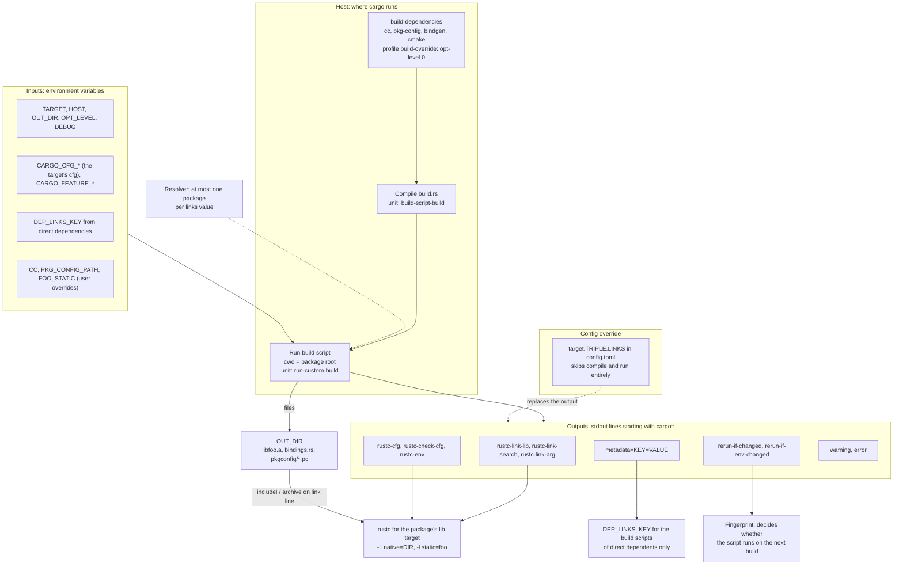

# Rust Build Scripts and -sys Crate Conventions

> [!summary] Claim:
> A `build.rs` is an ordinary program that Cargo compiles for the host, runs with a fixed environment, and listens to on stdout for lines that start with `cargo::`.
> Everything the rest of the build learns about native code (what to link, where to search, which cfgs to set, what a dependent crate should know) arrives through those lines, and everything Cargo knows about when to run the script again arrives through the same channel.
> The `links` manifest key turns a native library name into a resolver-enforced singleton and a metadata channel (`DEP_<LINKS>_<KEY>`) to direct dependents, and the `-sys` convention puts all discovery, building, and linking logic for one C library in one crate.
> An expert treats the script as a program running in the wrong architecture: read the target from `CARGO_CFG_*`, never from `cfg!`, emit `rerun-if-*` lines on purpose, and expect the build to run offline, from a `.crate` tarball, with environment overrides standing in for the features Cargo cannot unset.



## The Mechanism

### Where a build script sits in the unit graph

Cargo plans three kinds of units for a package that has a build script: compile the script, run the script, and compile the package.
The compile unit builds `build.rs` as an executable for the host with the package's build dependencies.
The run unit is a separate node (`CompileMode::RunCustomBuild` in `custom_build.rs`): Cargo executes `target/<profile>/build/<pkg>-<hash>/build-script-build` and then reads its output before the package's own units start.
The package units depend on the run unit, and so do the run units of crates that depend on this one, which is how metadata flows downstream.

Two directories exist per package under `target/debug/build/` (observed on darwin-arm64, Cargo 1.99.0, one run on 2026-11-21):

```text
hostvt-bf8a1ede0527b885/   build_script_build-bf8a1ede0527b885, build_script_build-bf8a1ede0527b885.d, build-script-build
hostvt-c351f13f623760c5/   invoked.timestamp, out/, output, root-output, stderr
```

The first directory holds the compiled script.
The second holds the run: `output` is the captured stdout (47 lines for the `cc` experiment below, most of them `cc`'s own lines), `stderr` is the captured stderr, `out/` is `OUT_DIR`, `root-output` records the `OUT_DIR` path, and `invoked.timestamp` records when the script was last invoked.
Cargo compares the mtime of each `rerun-if-changed` path with the mtime of `output`, and it rewinds that mtime to just before the script started, so a file edited while the script was running still counts as newer (`fingerprint/mod.rs`, "Build script mtime handling").

Build scripts, proc macros, and their dependencies compile with a cheap profile by default (The Cargo Book, Profiles, as of 2026-11, Both):

```toml
[profile.dev.build-override]
opt-level = 0
codegen-units = 256
debug = false # when possible

[profile.release.build-override]
opt-level = 0
codegen-units = 256
```

The consequence is that a build script that does real work (hashing a 200 MB source tree, parsing a large header) runs at `-O0` unless you set `[profile.release.build-override] opt-level = 3`, and the same default applies to `bindgen` itself, because it is a build dependency.
With `resolver = "2"` or later (the default for edition 2021 and later packages), build dependencies and proc macros do not share features with normal dependencies, so `cc` compiled for the build script does not inherit features that your runtime dependencies enabled (The Cargo Book, Features, "Feature resolver version 2").
The same crate can still be built twice, once for the host and once for the target, which is why [[Rust-Cargo-Model-Packages-Targets-Features-and-Workspaces]] and the cross-compilation hazards below belong together.

The script's current directory is the package root, `CARGO_MANIFEST_DIR`.
The `package.build` key names a different file (`build = "build/main.rs"`, which `openssl-sys` uses) or disables automatic detection of `build.rs` (`build = false`).

### Inputs: the environment contract

Cargo passes everything as environment variables, set in `build_work()` in `custom_build.rs` (Cargo 0.99.0 source, as of 2026-11).
The ones that matter, with the exact semantics read from that function:

| Variable | Value and source |
|---|---|
| `TARGET` | The triple the native code must be built for: `short_name(&unit.kind)`. Equals `HOST` on a native build. |
| `HOST` | The triple of the rustc Cargo runs, from `bcx.host_triple()`. |
| `OUT_DIR` | A per-package directory under the build directory. Cargo creates it and never cleans it. |
| `CARGO_MANIFEST_DIR`, `CARGO_MANIFEST_PATH`, `CARGO_MANIFEST_LINKS` | The package root, the manifest path, and the `links` value when one is set. |
| `CARGO_FEATURE_<NAME>` | `"1"` for each enabled feature: uppercase, `-` becomes `_`. Absent for disabled features. |
| `CARGO_CFG_<CFG>` | One variable per cfg of the **target**, uppercase with `-` as `_`. A boolean cfg such as `unix` is present with an empty value. A cfg with several values is joined by `,` (`CARGO_CFG_TARGET_FAMILY=unix,wasm` for `wasm32-unknown-emscripten`). Cargo also adds `CARGO_CFG_FEATURE` (the enabled features, joined by `,`) and sets `CARGO_CFG_DEBUG_ASSERTIONS` from the profile instead of from rustc's cfg query. |
| `OPT_LEVEL`, `DEBUG`, `PROFILE` | From the package's library profile, not the script's profile. `DEBUG` is the string `true` or `false`. The docs discourage `PROFILE` because profiles can inherit. |
| `NUM_JOBS`, `CARGO_MAKEFLAGS` | Top-level parallelism, and the jobserver handle. Each script inherits one jobserver slot. |
| `RUSTC`, `RUSTDOC`, `RUSTC_WRAPPER`, `RUSTC_WORKSPACE_WRAPPER` | The resolved compilers. The workspace wrapper is set only for workspace members, and `RUSTC_WRAPPER` is removed from the environment when unset. |
| `RUSTC_LINKER` | The linker Cargo resolved for the target, set only when one is configured. |
| `CARGO_ENCODED_RUSTFLAGS` | The rustflags, separated by byte `0x1f`. `RUSTFLAGS` itself is removed from the script's environment. |
| `DEP_<LINKS>_<KEY>` | Metadata from direct dependencies that have a `links` key, described below. |
| `CARGO_PKG_*` | The same package variables the crate sees at compile time. |

Everything else the script sees is the ambient environment of the `cargo` process, which is why user overrides such as `CC`, `PKG_CONFIG_PATH`, or `OPENSSL_DIR` reach the script with no plumbing.
The environment is the main configuration channel for a build script, and the `links` override described below is the one place where `config.toml` replaces a script's output.

**The host-versus-target rule**

The script is compiled for and runs on the host.
`cfg!(target_arch = "...")` and `#[cfg(...)]` inside `build.rs` therefore describe the host, and only `CARGO_CFG_*` describes the target.
The Cargo Book states this directly, and the one exception that is safe is `cfg!(feature = "...")`, because features are the same for both.
`rustc --print cfg --target <triple>` shows the full set; for example `x86_64-unknown-linux-gnu` prints `target_arch="x86_64"`, `target_env="gnu"`, `target_os="linux"`, `target_family="unix"`, `target_pointer_width="64"`, `target_vendor="unknown"`, and `unix`, and `x86_64-pc-windows-msvc` prints `target_env="msvc"`, `target_os="windows"`, `target_family="windows"`, and `windows` (observed with rustc 1.99.0 on macOS arm64).
rustc 1.99.0 lists 331 targets in `rustc --print target-list` (as of 2026-11, macOS arm64).
The `build-rs` crate 0.3.6 (maintained by the Cargo team, rust-version 1.95) wraps these variables in typed functions such as `cargo_cfg_target_os()` so that the string handling is not repeated in every script.

### Outputs: the stdout protocol

The script talks to Cargo by printing lines to stdout.
`BuildOutput::parse` in `custom_build.rs` processes them as follows, and each rule below is a behavior that bites in practice:
1. Each line is trimmed.
   A line that is not valid UTF-8 is skipped silently.
2. A line that starts with `cargo::` is a new-style directive.
   A line that starts with `cargo:` (one colon) is an old-style directive.
   Any other line is ignored, which is why `cc` can print `OPT_LEVEL = Some(0)` into the same stream.
3. The text after the prefix is split at the first `=`.
   A directive without `=` is an error ("Expected a line with `cargo::KEY=VALUE`").
   The value has trailing whitespace trimmed.
4. In the new style, an unknown key is an error ("Unknown key").
   Custom metadata must use the key `metadata` and a second `KEY=VALUE`: `cargo::metadata=include=/opt/x/include`.
5. In the old style, any key that is not on the reserved list becomes metadata.
   This is how `cargo:include=/path` has worked since before the new syntax existed, and it is also how a typo in an old-style directive disappears without an error.
6. A `cargo::` line in a package whose `rust-version` is older than 1.77 is rejected, with a message that tells the author to switch to the single-colon syntax.
7. Cargo rewrites occurrences of the script's old `OUT_DIR` path inside values if the target directory moved.

The reserved old-style keys are `rustc-flags`, `rustc-link-lib`, `rustc-link-search`, `rustc-link-arg`, `rustc-link-arg-cdylib` (alias `rustc-cdylib-link-arg`), `rustc-link-arg-bins`, `rustc-link-arg-bin`, `rustc-link-arg-tests`, `rustc-link-arg-benches`, `rustc-link-arg-examples`, `rustc-cfg`, `rustc-check-cfg`, `rustc-env`, `warning`, `rerun-if-changed`, and `rerun-if-env-changed`; `error` exists only in the new style, so an old-style `cargo:error=MSG` is stored as metadata under the key `error` and does not fail the build (`RESERVED_PREFIXES` in `custom_build.rs`, read from source, not run).
The Cargo Book's MSRV notes also bound what a helper library can emit: it marks `cargo::KEY=VALUE` as requiring Rust 1.77, `rustc-check-cfg` as respected from 1.80, and `cargo::error` from 1.84 (as of 2026-11, Both).
The three widely used helper crates (`cc` 1.11.3, `pkg-config` 0.3.34, `bindgen` 0.73.2) still print the single-colon form, and their declared rust-version floors are all older than 1.77 (`cc` 1.65.0, `pkg-config` 1.63, `bindgen` 1.71.0), which is consistent with keeping a syntax that works on every Cargo.
The `-vv` transcript in the lab section shows `cargo:rustc-link-lib=static=hello` coming from `cc` 1.2.26.

The directives, grouped by what they change:

| Directive | Effect |
|---|---|
| `rustc-link-lib=[KIND[:MODIFIERS]=]NAME[:RENAME]` | Passes `-l` to the package's **library target** (to every target if there is no library). Kinds are `dylib`, `static`, `framework`. |
| `rustc-link-search=[KIND=]PATH` | Passes `-L`. Kinds are `dependency`, `crate`, `native`, `framework`, `all`. Paths inside `OUT_DIR` are also added to the dynamic library search path variable at run time. |
| `rustc-flags=FLAGS` | Accepts only `-l` and `-L`. Equivalent to the two directives above. |
| `rustc-link-arg`, `-cdylib`, `-bin=BIN=`, `-bins`, `-tests`, `-examples`, `-benches` | Passes `-C link-arg=FLAG` for the named target kinds only. This is how soname flags, linker scripts, and rpaths are set. |
| `rustc-cfg=KEY[="VALUE"]` | Passes `--cfg`. Does not change dependency resolution or enable Cargo features. |
| `rustc-check-cfg=CHECK_CFG` | Registers the cfg with the `unexpected_cfgs` lint, with the syntax of `rustc --check-cfg`. |
| `rustc-env=VAR=VALUE` | Sets an environment variable for compiling the package, readable with `env!`. Setting `RUSTC_BOOTSTRAP` is an error, downgraded to an ignored warning only on a nightly Cargo or when the user's own `RUSTC_BOOTSTRAP` names the crate. |
| `metadata=KEY=VALUE` | Passes data to the build scripts of direct dependents as `DEP_<LINKS>_<KEY>`. |
| `rerun-if-changed=PATH`, `rerun-if-env-changed=VAR` | Replace the default change detection. |
| `warning=MSG`, `error=MSG` | `warning` is shown only for path dependencies unless the build fails or `-vv` is used. `error` fails the build after the script finishes. |

Order matters.
Cargo turns directives into rustc arguments in print order, and rustc turns them into linker arguments in that order.
The Cargo Book's own example is that if object `foo` needs library `bar`, the `rustc-link-lib` for `bar` must come after the instructions for `foo`.
With GNU `ld` and static libraries this is a real constraint, and a classic cause of undefined-symbol errors when two `-sys` crates are mixed.

**What rustc does with `-l` and `-L`**

The `-l` syntax is `[KIND[:MODIFIERS]=]NAME[:RENAME]`, and three modifiers exist: `whole-archive` and `bundle` are valid only with the `static` kind (any other kind is a compiler error), and `verbatim` is valid with every kind (The rustc Book, `-l`, as of 2026-11, Both):

| Modifier | Default | Meaning |
|---|---|---|
| `whole-archive` | `-whole-archive` | Link every object in the archive instead of only the ones that satisfy undefined symbols (`--whole-archive` for ld-like linkers, `/WHOLEARCHIVE` for link.exe, `-force_load` for ld64). Needed when the C side registers itself through static constructors that nothing references. |
| `bundle` | `+bundle` | With `+bundle`, an rlib or staticlib packs the native archive inside itself. With `-bundle`, the rlib records the library by name and the final link must find it again. |
| `verbatim` | `-verbatim` | rustc adds no `lib` prefix or `.a` suffix. GNU-style linkers get `-l:filename`. |

Two consequences follow.
First, `cc` emits `static=NAME` and so the bundled archive travels inside the crate's rlib, which is what lets a downstream binary link even though `OUT_DIR` is a build-directory detail.
Second, `-bundle` leaves the archive's location to a later stage, which is the mechanism `cc` documents for linking `c++abi` after a static `libc++`: `cargo:rustc-link-lib=static:-bundle=c++abi`.

Cargo passes `-l` only to the library target, because every other target of the package depends on it and the library should be included only once.
In the lab below, the `rustc` invocation for the package that declared `links = "alpha"` carries `-L /override/lib -l alpha`, while the invocation for its dependent carries `-L /override/lib` and no `-l` (observed).
The Rust Reference (Linkage) says that rlibs carry metadata that rustc reads in later linkage, that a `staticlib` output cannot carry native dynamic dependencies (they must be specified again when that archive is linked), and that `--print=native-static-libs` helps list them.
[[Rust-FFI-Packaging-cdylib-staticlib-and-cbindgen]] owns that packaging side.

### Change detection: when does the script run again

Cargo has two modes, and the mode switch is easy to trigger by accident.
`fingerprint/mod.rs` describes them under "Build script mtime handling":
1. **Old style.** If the script prints no `rerun-if-*` directive at all, the fingerprint is `LocalFingerprint::Precalculated`: the script reruns when the mtime of any file in the package changes (the package's file list follows `include` and `exclude`).
2. **New style.** If the script prints at least one `rerun-if-changed` or `rerun-if-env-changed`, the fingerprint tracks only those items.
   `RerunIfChanged` compares the mtime of the listed paths with the mtime of the previous `output` file, and a directory path is scanned recursively.
   `RerunIfEnvChanged` stores the variable's name and value and compares the value.

The Cargo Book gives the consequences:
- The script itself is always tracked: Cargo recompiles it if its source or its build dependencies change, and then reruns it.
  `cargo::rerun-if-changed=build.rs` is the idiom for "never rerun for any other reason".
- Only mtime is compared for `rerun-if-changed`, not content.
  The fingerprint source comments add that HFS on macOS has one-second timestamps and that some network filesystems misbehave.
- `rerun-if-env-changed` is for global variables such as `CC`.
  It cannot observe variables that Cargo itself sets for the script, such as `TARGET`.
- Since Cargo 1.46, `env!` and `option_env!` in the script's source are tracked automatically (The Cargo Book).
- Registry packages are not mtime-tracked at all: their identity includes the version, so the old-style rule matters only for path, workspace, and git sources (fingerprint docs, "Special considerations").

The interaction between the two modes is the most common build-script bug in the ecosystem.
`cc` prints `cargo:rerun-if-env-changed=<VAR>` for every variable it reads (one `cc::Build` produced dozens of lines in the lab), and it prints no `rerun-if-changed` for the sources you hand it (the string does not occur in `cc` 1.11.3's `src/`).
So a script that is only `cc::Build::new().file("foo.c").compile("foo")` has switched itself into the new style by way of `cc`, and Cargo now never looks at `foo.c`.
The lab shows the result: editing the C file leaves the old object in the binary, with Cargo reporting `Fresh`.

The opposite mistake has its own symptom.
`rerun-if-changed` on a path that does not exist makes the script rerun on every build, because the file can never be older than the output; the Cargo FAQ lists this under "Why is Cargo rebuilding my code?".
The lab reproduces it: `Dirty` and `Running` on builds 2 and 3.
To see Cargo's reasoning, run `CARGO_LOG=cargo::compiler::fingerprint=info cargo build` (The Cargo Book FAQ), which prints the fingerprint comparison for each unit.

`OUT_DIR` is not reset between runs.
The Cargo Book says this is deliberate (native code compilation is incremental in it), warns that scripts "should not rely on OUT_DIR being empty", and links the open issues for a cleaner design (#16427 and #9661).
A generator that writes `OUT_DIR/bindings.rs` on each run must therefore overwrite, not append, and must delete outputs it no longer produces.

### The `links` key, metadata, and overrides

`links = "foo"` in `[package]` declares that this package links the native library `libfoo`.
It has three effects, each read from Cargo source or confirmed in the lab:
1. **The package must have a build script.** A manifest with `links` and no script fails to load: `` package specifies that it links to `gamma` but does not have a custom build script `` (observed, from `util/toml/mod.rs`).
2. **The resolver allows at most one package per `links` value.** The resolver treats a second package with the same value as a conflict (`ConflictReason::Links` in `resolver/errors.rs`: "only one package in the dependency graph may specify the same links value to ensure that only one copy of a native library is linked in the final binary"), and backtracks to another version if one exists.
   For two path packages in one workspace there is no alternative, and the lab shows the short error `Attempting to resolve a dependency with more than one crate with links=alpha.` (observed; the text is in `resolver/context.rs`)
   The Cargo Book's example is `libgit2-sys` 0.11 and 0.12: both link `git2`, Cargo cannot unify them, so it is an error to depend on both.
3. **Metadata flows to dependents.** Anything the script prints as `cargo::metadata=KEY=VALUE` becomes the environment variable `DEP_<LINKS>_<KEY>` in the build script of each package that depends directly on this one, with `envify` uppercasing the text and turning `-` into `_` (`custom_build.rs`).
   If the producer has no `links` key, nothing is exported, because the variable name is built from the `links` value.

The metadata channel is deliberately narrow.
It reaches only direct dependents, never transitive ones, and the lab confirms it: with `a` (links `alpha`) <- `b` (links `beta`) <- `c`, the script of `b` sees `DEP_ALPHA_INCLUDE` and `DEP_ALPHA_LEGACY_KEY`, and the script of `c` sees only `DEP_BETA_OWN`.
A package that wants to pass its dependency's data further must re-export it as its own metadata key.
Values are plain strings with no schema, so conventions carry the weight.
The common keys are `include` (header directories), `root` (an install prefix, which `cmake-rs` consumes through `register_dep` as `DEP_<NAME>_ROOT` for `CMAKE_PREFIX_PATH`), `version`, and `conf` (for OpenSSL, a comma-separated list of `OPENSSL_NO_*` options).
Even `include` is not uniform: `libz-sys` joins several directories with `,` (`paths.join(",")`), `openssl-sys` prints one `cargo:include` line per directory (and since `custom_build.rs` sets one environment variable per metadata pair in a loop, a later line overwrites an earlier one; observed on cargo 1.99.0, macOS arm64: two `cargo:include` lines `/first` and `/second` from a `links` package reached a dependent's script as `DEP_ALPHA_INCLUDE=/second`), and Kornel's guide recommends `join_paths`.
A consumer must read the documentation of the specific `-sys` crate, which is why the best of them document their keys in the README.

Metadata is also how a high-level crate adapts to the library version that its `-sys` crate found.
The Cargo Book's example is `openssl-sys` printing `cargo::metadata=version_number={openssl_version:x}`; `openssl` reads `DEP_OPENSSL_VERSION_NUMBER` and emits `rustc-cfg=ossl110`, `ossl111`, and similar, so that `#[cfg(ossl111)] pub fn sha3_224()` exists only when the linked OpenSSL has SHA-3.
The Cargo Book adds the warning that follows from it: the binary becomes more dependent on the build environment, and a host with different shared libraries "could cause problems".

**Overriding a script from configuration**

If a manifest has `links = "foo"`, a `config.toml` table can replace the script's output entirely:

```toml
[target.x86_64-unknown-linux-gnu.foo]
rustc-link-lib = ["foo"]
rustc-link-search = ["/path/to/foo"]
include = "/path/to/foo/include"
```

Cargo then neither compiles nor runs that package's `build.rs`.
The `warning`, `rerun-if-changed`, and `rerun-if-env-changed` keys are ignored in such a table (Cargo Book).
The lab confirms both halves: with the override present, the script's `cargo::warning=a/build.rs RAN` never appears, and the dependent still sees `DEP_ALPHA_INCLUDE=/override/include`.
This is the supported lever for hermetic and distribution builds that provide their own libraries, and it is why a `-sys` crate should pick its `links` name and its metadata keys with care: they are public API for overrides.

### What a `-sys` crate is

The naming convention comes from the Cargo Book.
A package named `foo-sys` provides two things: a library crate that links the native `libfoo`, "often" probing the system before building from source, and declarations for the library's types and functions without higher-level abstractions.
A companion crate without the suffix wraps it safely (`git2` over `libgit2-sys`).
The Cargo Book lists the benefits of the convention:
- A common dependency on `foo-sys` alleviates the one-package-per-`links` rule, because all users share the single copy.
- Other `-sys` crates can use the `DEP_<LINKS>_<KEY>` variables to integrate.
- Discovery and building logic lives in one place.
- The crate is easy to override (see the config table above).

The convention has a cost that the resolver makes visible: a `-sys` crate is a global singleton, so a breaking release of it (a new `0.x` or major) cannot coexist with the old one in a build.
The Cargo Book warns to be "very careful when making SemVer-incompatible releases with the links field if your library is in common use".
Two ecosystem responses exist.
One is to avoid breaking the sys crate: Kornel's guide suggests separate crates (`foo1-sys` and `foo2-sys`) for incompatible library majors, or at least a new major of the sys crate.
The other is to put the version into the `links` name, which `openssl-sys` 0.9.118 documents in a source comment about the AWS-LC crates: the link name embeds the crate version (for example `aws_lc_0_26_0`), "to avoid issues if the cargo dependency graph for an application were to resolve to multiple versions for the same crate".
Its consumer must then scan the environment for the versioned `DEP_AWS_LC_*_INCLUDE` variable, which is the price of the approach.
Versioned names buy coexistence and pay with duplicate symbols, because the two copies of the C library both link into one binary; the resolver rule exists to prevent exactly that.
Cross-reference [[Diamond-Dependency-and-Incompatible-ABI-Mitigation]] for the general theory and [[Versioning-SemVer-CalVer-and-ABI]] for how version numbers promise compatibility.

`-sys` crates also set a convention for version numbers when they bundle sources: `openssl-src` 400.0.2+4.0.3 uses major `X` as the OpenSSL API and ABI compatibility version (`300` for 3.Y.Z, `400` for 4.Y.Z), minor and patch for crate changes, and the build-metadata field `+B` for the full upstream version, which Cargo ignores in comparisons (its README, as of 2026-11).
`libgit2-sys` 0.18.8+1.9.7 uses the same `+upstream` suffix.

### Finding the library: the discovery ladder

A typical `-sys` build script walks a ladder of discovery strategies, and the first success wins; the exact order differs by crate.
Three widely used implementations share this shape:

| Rung | libz-sys 1.1.33 (links `z`) | openssl-sys 0.9.118 (links `openssl`) | libgit2-sys 0.18.8 (links `git2`) |
|---|---|---|---|
| 1. Explicit user override | `LIBZ_SYS_STATIC` (`0` or `1`) beats the `static` feature | `OPENSSL_LIB_DIR` plus `OPENSSL_INCLUDE_DIR`, or `OPENSSL_DIR`, each also in a `<TARGET>_` prefixed form; `OPENSSL_STATIC`, `OPENSSL_LIBS` | `LIBGIT2_NO_VENDOR` forces a system library or panics |
| 2. Declared build-from-source | `static` feature, `zlib-ng` feature | `vendored` feature (via `openssl-src`), unless `OPENSSL_NO_VENDOR` is set and not `0` | `vendored` feature, or `zlib-ng-compat` |
| 3. pkg-config | `probe("zlib")` with system dirs suppressed | `probe("openssl")` after the Homebrew and well-known paths on macOS | `range_version("1.9.7".."1.10.0").probe("libgit2")` |
| 4. Platform finder | vcpkg on Windows targets | vcpkg on Windows targets (`try_vcpkg` returns unless `TARGET` contains `windows`) | none |
| 5. Probe compile | compile and link `src/smoke.c` with `-lz` | preprocess `build/expando.c` with the include dirs to read the version | none |
| 6. Build from source (fallback) | `build_zlib()` with `cc` | none, an error with install instructions | build bundled libgit2 with `cc` |

The sources show several deliberate choices, each worth copying or avoiding on purpose.

**libz-sys** (272 lines of `build.rs`, read in full): it prints four `rerun-if-*` lines up front (`LIBZ_SYS_STATIC`, `build.rs`, `zng/cmake.rs`, `zng/cc.rs`), so the script never runs in the old mode.
It skips pkg-config when it will build statically, on MSVC targets ("pkg-config just never works here"), and on FreeBSD or DragonFly when host and target match, because printing `-L /usr/lib` there "wreaks havoc with linking to an OpenSSL in /usr/local/lib".
It calls `print_system_libs(false)` so that pkg-config's `-L/usr/lib` never reaches Cargo, with the comment that printing them "interferes with other packages adding non-system search paths".
It publishes `cargo:include` and, when it builds from source, `cargo:root`, so that the `DEP_Z_INCLUDE` variable in the Cargo Book's `z_user` example works.
It reads `LIBZ_SYS_STATIC` with `option_env!`, which Cargo tracks since 1.46, and lets the environment variable override the `static` feature: the function's doc comment explains why, that a transitive dependency can force `static` through features and the build environment needs a way to "revert that preference via `LIBZ_SYS_STATIC=0`".

**openssl-sys** (`build/main.rs` and two helpers): its `env()` helper reads the `<TARGET>_NAME` form first, where the triple is uppercased with `-` as `_` (`X86_64_UNKNOWN_LINUX_GNU_OPENSSL_DIR`), then `NAME`, and prints a `rerun-if-env-changed` line for every variable it asks about, set or not.
That prefix scheme is the reverse of the suffix scheme in `cc` (`CC_x86_64_unknown_linux_gnu`) and `pkg-config` (`PKG_CONFIG_PATH_x86_64_unknown_linux_gnu`), so a cross-compiling build needs a table of per-crate conventions; there is no Cargo-level standard.
It finds the version by preprocessing a one-file C header probe with `cc::Build::try_expand` and printing `cargo:version_number`, then maps it to `rustc-cfg` values, and it registers the cfgs it can emit with `rustc-check-cfg` (52 lines in `build/main.rs` mention it), so that downstream `unexpected_cfgs` linting stays accurate.
It decides link mode with `determine_mode`: `OPENSSL_STATIC=0` means `dylib`, any other value means `static`, and otherwise it looks for `lib{ssl,crypto}.a` and `.so` or `.dylib` in the library directories; if both exist it picks `dylib`, in a comment about "security upgrades".
It adds `libstdc++` or `libc++` itself for static BoringSSL and AWS-LC builds, with a long comment on why the C++ runtime is a guess ("Cargo is not an integrated cross-language build system, so it cannot safely handle any of these situations").

**libgit2-sys** (`build.rs`): it accepts a system libgit2 only when its version is in `1.9.7..1.10.0`, and it defines `LIBGIT2_NO_VENDOR` as the escape hatch because "Due to the additive nature of Cargo features, if some crate in the dependency graph activates `vendored` feature, there is no way to revert it back."
If a system library is absent or out of range, it prints `cargo:warning=failed to probe system libgit2` and falls back to the bundled sources (and tries `git submodule update --init libgit2` if the sources are missing, which only helps in a git checkout).
The same feature-additivity problem is what [[Drill-Packaging-Cargo-Feature-Unification-Hazard]] drills.

The recurring design rule is the one Kornel states: features are easy for dependents to set and impossible for anyone to unset, and they cannot express mutually exclusive options such as `static` and `dynamic`, so the best build scripts accept both a feature and an environment variable and let the environment variable win.
His guide gives other defaults, which are opinions rather than Cargo rules, and are worth testing against your target: use dynamic linking by default on Linux and BSD (except musl, which is mostly used for self-contained executables), and static by default on macOS and Windows unless the library ships with the OS; do not download anything in the script; do not write outside `OUT_DIR`; support a `<LIBRARY_NAME>_PATH` or `_LIB_DIR` override; write tests that reference many C symbols, because linkers often work "lazily" and do not notice a broken library that nothing uses.
`openssl-sys` prefers `dylib` when both forms exist, which differs from the guide's static default on macOS and Windows and shows that the guide's defaults are a starting point, not a standard.

**pkg-config in detail**

`pkg-config` 0.3.34 is a thin wrapper around the `pkg-config` or `pkgconf` executable, and its documented environment contract is the model most `-sys` crates borrow:
- `probe(name)` runs `pkg-config --libs --cflags <name> [<name> >= version ...]`, then `pkg-config --modversion <name>`.
  If `PKG_CONFIG` is unset and `pkg-config` cannot be executed, it retries with `pkgconf`.
- `FOO_NO_PKG_CONFIG` disables probing for library `foo`.
  `FOO_STATIC`, `FOO_DYNAMIC`, `PKG_CONFIG_ALL_STATIC`, and `PKG_CONFIG_ALL_DYNAMIC` choose whether `--static` is passed, in that order.
  `Config::statik()` overrides them.
- `PKG_CONFIG_PATH`, `PKG_CONFIG_LIBDIR`, and `PKG_CONFIG_SYSROOT_DIR` are read with four spellings in priority order: `<var>_<target>`, `<var>_<target_with_underscores>`, `<HOST|TARGET>_<var>`, and plain.
  Every lookup prints a `rerun-if-env-changed` line, which is why one `probe` call produced 45 such lines in the lab.
- A plain pkg-config strips directories it considers system directories from `--libs`, so the crate sets `PKG_CONFIG_ALLOW_SYSTEM_LIBS=1` and `PKG_CONFIG_ALLOW_SYSTEM_CFLAGS=1` by default (`print_system_libs` and `print_system_cflags` are `true`).
  The lab shows the difference on Homebrew `pkgconf` 3.0.11, macOS arm64: `pkg-config --libs --cflags zlib` prints `-lz`, and with the two variables it prints `-L/usr/lib -lz`.
  That is the `-L` that `libz-sys` refuses to pass on.
- Parsing turns `-L` into `rustc-link-search=native=`, `-F` into `framework=`, `-l` into `rustc-link-lib=` (or `static=` when the static conditions hold), `-framework X` into `rustc-link-lib=framework=X`, and `-u` into `rustc-link-arg=-Wl,-u,`.
  An `-l:name` flag is passed straight to the linker as `rustc-link-arg`.
  On MSVC targets, `m`, `c`, and `pthread` are skipped because the CRT provides them.
- Static is honored only for libraries found outside system roots.
  `is_static_available` requires a `lib<name>.a` in one of the printed `-L` directories and rejects directories under the system roots (`/Library` and `/System` on macOS, the sysroot or `/usr` elsewhere, and only the sysroot on Windows).
  The crate picks that list with `cfg!(target_os = "macos")` inside its own code, so the roots follow the host, not the target: the same host-versus-target trap described below, inside a helper crate.
  `FOO_STATIC=1` for a library in `/usr/lib` therefore links dynamically without any message, which is correct for system libraries and surprising to the person who asked for a static binary.
- On a cross build (`HOST != TARGET`), the crate refuses to run unless `PKG_CONFIG_ALLOW_CROSS` is set to something other than `0`, or `PKG_CONFIG` or `PKG_CONFIG_SYSROOT_DIR` is set.
  The lab shows the refusal text, and shows that `PKG_CONFIG_ALLOW_CROSS=1` made a build for `x86_64-apple-darwin` on an arm64 host print the host's `/usr/lib`.
  Whether that is harmless depends on the library and was not tested here: a universal system stub on macOS may still link, while on Linux the host's directories hold host-architecture libraries, which is a wrong-architecture link and is what the crate's own warning means ("likely to break builds").

The pkg-config file format and the relationship between `.pc` files and CMake package configs belong to [[Cpp-CMake-Package-Configs-pkg-config-and-CPS]].
`system-deps` 9.0.1 moves the library list out of `build.rs` and into `[package.metadata.system-deps]`, so other tools can read it, and it adds uniform overrides: `SYSTEM_DEPS_<NAME>_SEARCH_NATIVE`, `_LIB`, `_INCLUDE`, `_NO_PKG_CONFIG`, `_LINK=static`, and `SYSTEM_DEPS_<NAME>_BUILD_INTERNAL` with values `auto`, `always`, or `never` (default `never`).
It is the closest thing to a standard for the override variables.
Whether a given `-sys` crate uses it is a per-crate fact to check in the crate's own documentation.

### Building from source: cc, cmake, and bindgen

**cc**

The `cc` crate compiles files into a static archive and does the Cargo bookkeeping around it.
It does not link; the Rust build links the archive (`cc` itself says it "does not compile code itself; it calls out to the default compiler").
The behaviors that matter for packaging, from `cc` 1.11.3 (MSRV 1.65.0, as of 2026-11):
- **Compiler selection.** `CC` and `CFLAGS` for C, `CXX` and `CXXFLAGS` for C++, plus `AR`, `ARFLAGS`, `RANLIB`.
  Each can be given four ways in priority order: `<var>_<target>`, `<var>_<target_with_underscores>`, `<HOST|TARGET>_<var>` (the kind is `TARGET` when cross compiling, `HOST` otherwise), and plain.
  The flag variables are different: every form that is set is used, from least to most specific, so a more specific flag comes last.
- **Defaults.** For GCC and Clang it adds `-ffunction-sections -fdata-sections` (except on iOS, watchOS, tvOS, and visionOS), and `-fPIC` except on Windows, bare metal (`none`), UEFI, Vita, and wasm.
  `OPT_LEVEL` and `DEBUG` come from Cargo.
  `CRATE_CC_NO_DEFAULTS` turns the default flags off.
- **Output.** It writes objects and `lib<name>.a` into `OUT_DIR`, prints `cargo:rustc-link-lib=static=<name>` and `cargo:rustc-link-search=native=<OUT_DIR>` (single-colon syntax, as in the lab), adds the C++ standard library when `.cpp(true)` is set (nothing on MSVC; `libc++` on every Apple target, FreeBSD, OpenBSD, AIX, OpenHarmony, and WASI, and wherever the Clang in use defaults to libc++; `libc++_shared` on Android; `libstdc++` otherwise; overridable by `CXXSTDLIB`; `get_cpp_link_stdlib` in `src/lib.rs`), and prints `rerun-if-env-changed` for each variable it consulted, including compiler-specific ones such as `CPATH` or `SDKROOT`.
- **No source tracking.** It prints no `rerun-if-changed` for the files you give it.
  Add them yourself.
- **Parallelism.** The `parallel` feature is off by default.
  With it on, compilation uses the jobserver handed down by Cargo, limited by `NUM_JOBS`.
- **Control surfaces.** `CC_ENABLE_DEBUG_OUTPUT` logs compiler invocations, `CC_FORCE_DISABLE` makes `cc` run nothing at all (for build systems that build native dependencies themselves), `Build::cargo_metadata(false)` suppresses all `cargo:` lines (useful for building a helper in a script), and `try_compile` returns an error instead of panicking.
- **Apple.** `MACOSX_DEPLOYMENT_TARGET` and the matching variables for the other Apple platforms select the minimum OS version, and `SDKROOT` selects the SDK.
  The effect on a distributed binary is covered in [[Python-Wheels-Platform-Tags-Manylinux-and-ABI3]], where the same variable decides a wheel's platform tag.

The prescription from Kornel's guide holds up: for small and mature C libraries, listing the `.c` files and a few `define()` calls in `cc` is often enough, and it handles cross compilation and Visual Studio discovery for you; `make --dry-run VERBOSE=1` shows which files and macros the original build uses.
Write generated headers such as `config.h` into `OUT_DIR` and put that directory first on the include path, never into the source directory.

**cmake**

`cmake::Config::new("libfoo").build()` runs `cmake` configure and build with an install prefix in `OUT_DIR` and returns that prefix.
It does not print link directives, so the script must print `rustc-link-search=native=<prefix>/lib` and `rustc-link-lib=static=foo` itself, as the crate's own example does.
It infers `CMAKE_BUILD_TYPE` from the profile (`Debug` at `opt-level=0`, `Release` when `debug=false`, `RelWithDebInfo` otherwise, `MinSizeRel` for `s` and `z`), sets `CMAKE_SYSTEM_NAME` when cross compiling, uses `CMAKE_TOOLCHAIN_FILE` from the environment if present, and by default reruns the configure step on every build (`always_configure` defaults to true; set it to false for large trees).
`register_dep("z")` adds `DEP_Z_ROOT` (from `libz-sys`' `cargo:root`) to `CMAKE_PREFIX_PATH`, which is the cleanest example of the metadata channel doing real work.
For autotools projects, Kornel's guide recommends an out-of-tree build in a subdirectory of `OUT_DIR`, so that `cargo clean` removes the temporary files.

**bindgen**

`bindgen` 0.73.2 (MSRV 1.71.0; default features `logging`, `prettyplease`, `runtime`) generates `extern "C"` declarations from headers and is normally called from the build script with `include!(concat!(env!("OUT_DIR"), "/bindings.rs"))` in the crate.
Its build-script relevant behavior:
- It loads libclang at run time (feature `runtime`) and warns on versions older than libclang 9.
- It derives `--target=<clang triple>` from `TARGET` when the target differs from the host and no `--target` is already in the arguments.
- `BINDGEN_EXTRA_CLANG_ARGS`, also in `_<target>` and `_<target_with_underscores>` forms, is split with shell quoting and appended to the clang arguments.
  This is the supported way for an end user to supply `--sysroot=...` for a cross build.
- `bindgen::CargoCallbacks::new()` prints `rerun-if-changed` for every header it reads and `rerun-if-env-changed` for every variable it consults.
  Without it the generated bindings go stale for the same reason the `cc` sources do.
  The deprecated constant form `CargoCallbacks` does not print `rerun-if-changed` for the top-level header files, only for the headers they include.

The architecture decision is whether to run bindgen on every build or to check in a pre-generated file.
Kornel's rule: pre-generate if the C ABI is stable and portable (new functions only, same on 32-bit and 64-bit, with bindgen's layout tests disabled because they are architecture-specific), which removes `bindgen` and clang from every user's build; run it per build if different incompatible versions of the library exist in the wild, which is the OpenSSL situation.
Rust enums generated from C enums are unsound if C can return a value that is not a declared variant, so prefer constants or newtypes for enums that cross the boundary.
Macros that contain code, C++ templates, and `static inline` functions have no symbol to bind and need a hand-written C shim compiled with `cc`.

### Cross-compilation: host versus target

A cross build has two worlds with two compilers: the script, its build dependencies, and anything it executes run on the host; the native code it produces runs on the target.
Every cross-compilation bug in a build script is a place where the script used one world's answer for the other.
The checklist:

| Question | Host answer (wrong for the target) | Target answer (right) |
|---|---|---|
| Which architecture? | `cfg!(target_arch)`, `std::env::consts::ARCH` | `CARGO_CFG_TARGET_ARCH` |
| Which OS or environment? | `cfg!(windows)`, `cfg!(target_os)` | `CARGO_CFG_TARGET_OS`, `CARGO_CFG_TARGET_ENV` (needed to tell `msvc` from `gnu`) |
| Which C compiler? | `Command::new("cc")` or `gcc` | `cc::Build`, which honors `TARGET` and `CC_<target>` |
| Pointer size or endianness? | `size_of::<usize>()` in the script | `CARGO_CFG_TARGET_POINTER_WIDTH`, `CARGO_CFG_TARGET_ENDIAN` |
| Where are the libraries? | The host's `/usr/lib`, from pkg-config or a hard-coded path | A sysroot with `PKG_CONFIG_SYSROOT_DIR` and `PKG_CONFIG_LIBDIR`, or an explicit `*_LIB_DIR` |
| Can I run the thing I just compiled? | Only if it is a host tool (build a separate host `cc::Build` with `target` and `host` both set to `HOST`) | Not on the build machine, unless an emulator is configured |
| Which clang target for bindgen? | The libclang's default | `--target` from `TARGET`, plus `BINDGEN_EXTRA_CLANG_ARGS` for the sysroot |

The lab shows both worlds in one transcript, from a real cross build on an arm64 host with `--target x86_64-apple-darwin` (the `[hostvt 0.1.0] ` prefix of each line is omitted):

```text
cargo::warning=cfg!(target_arch) in build.rs says: aarch64
cargo::warning=CARGO_CFG_TARGET_ARCH says: x86_64
cargo::warning=HOST=aarch64-apple-darwin TARGET=x86_64-apple-darwin
```

`lipo -info` on the `libhello.a` that `cc` produced then reports `architecture: x86_64`, so the correct path (reading `TARGET` through `cc`) built the right archive, while any `cfg!` decision in the same script would have been made for `aarch64`.
The build ends with `` error[E0463]: can't find crate for `std` ``, which is expected: only the `aarch64-apple-darwin` standard library is installed on that host, and the script and C compile stages had already finished.

Other host and target interactions that are not obvious:
- **Build dependencies are built for the host.** A crate listed in both `[dependencies]` and `[build-dependencies]` is compiled twice in a cross build, and with resolver 2 or later its features can differ between the two copies.
- **Linker and archiver.** Cargo exports `RUSTC_LINKER` only if one is configured, and `cc` falls back to it to infer a cross prefix when it ends in `-gcc` (`CROSS_COMPILE` also works).
  Setting `CC_<target>` and `AR_<target>` per triple in CI is the explicit alternative.
- **Apple targets.** Building for `x86_64-apple-darwin` from an arm64 Mac works for C because Apple clang can target both, which is why the lab succeeds.
  It still needs the target's Rust standard library installed (`rustup target add`).
- **Wrong-architecture libraries are silent until link time.** In general, `ar` accepts a static library of the wrong architecture and the final linker rejects it or reports undefined symbols, and a dynamic library of the wrong architecture can pass a pkg-config probe and fail at load time (general toolchain behavior, not run here).

Target selection, musl, and the toolchains (`cross`, `dist`) belong to [[Rust-Binary-Distribution-with-dist-and-Cross-Compilation]].
The script-side obligation is to never hard-code the answer to any row of the table above.

### Packaging a `-sys` crate

A `-sys` crate that works from a git checkout and fails when installed from crates.io is a common packaging defect, and `cargo package` is the tool that finds it.
`cargo package` assembles the `.crate`, extracts it into `target/package`, builds it "from scratch to ensure that it can be built from a pristine state", and then checks that build scripts did not modify any source files (`cargo-package(1)`, as of 2026-11).
The rules that decide what is in the tarball are the `include` and `exclude` fields:
- With neither field, everything under the package root is included except gitignored files (in a git repository) or dotfiles (outside one), sub-packages, and a root `target` directory.
- With `include`, gitignore rules are not applied and only the listed files are shipped.
  `libz-sys` uses an explicit `include` list with entries such as `build.rs`, `src/zlib/*.[ch]`, and `src/zlib-ng/arch/x86/**.[ch]`.
  If a vendored source file is missing from that list, the crate builds in the repository and fails on a clean machine.
- `cargo package --list` prints the final file list and is the first check to run.

Crates.io rejects a `.crate` larger than 10 MB (The Cargo Book, Publishing, as of 2026-11).
The crates.io source defines that default as `10 * 1024 * 1024` bytes (10,485,760, so MiB), applied to the compressed upload, and lets the operators raise it per crate through the `max_upload_size` column (`src/config/publish_limits.rs` and `src/controllers/krate/publish.rs`, as of 2026-11).
That is the real bound on vendoring: the crates.io API reports `libz-sys` 1.1.33 at 890,042 bytes, `libgit2-sys` 0.18.8+1.9.7 at 1,961,890 bytes, and `openssl-src` 400.0.2+4.0.3 at 7,160,051 bytes (as of 2026-11-21), which leaves `openssl-src` 3,325,709 bytes (about 3.3 MB) of headroom under the default limit, and is consistent with `openssl-sys` keeping the OpenSSL sources in a separate crate behind a `vendored` feature.
The release process for the source crate, trusted publishing, and registry mirrors belong to [[Rust-Publishing-Crates-io-Trusted-Publishing-and-Private-Registries]] and [[Lockfiles-Vendoring-and-Offline-Mirrors]]; the packaging obligation is that all inputs are in the tarball, so that `cargo vendor` and offline builds work.

Three rules keep a build script reproducible and reviewable:
- **Write only under `OUT_DIR`.** The Cargo Book says an implicit invariant is that sources in `.cargo/registry` are immutable, and that Cargo will not allow scripts that modify them when packaging.
  If you want a generated file checked in, generate it with a test, not a build script, and fail CI when the checked-in copy differs.
- **Do not use the network.** Kornel's guide says it directly: "Cargo build process is supposed to be entirely self-contained and work off-line".
  The reason is practical, not aesthetic: packaging and deployment tools run builds in isolated containers.
- **Do not install anything.** Report an error or a `cargo::warning` and fall back.

Build scripts are arbitrary code executed on every machine that builds the crate, with the user's privileges and no sandbox from Cargo.
[[Rust-Dependency-Hygiene-cargo-deny-cargo-audit-and-cargo-vet]] covers how an organization reviews and audits that surface; the minimum a library author can do is keep the script small, free of network and process spawning except for the tools it documents, and readable.

### Debugging a build script

| Question | Command or file |
|---|---|
| What did the script print? | `cargo build -vv`, which prefixes lines with `[pkg version]`, or `target/<profile>/build/<pkg>-<hash>/output` |
| What did the script's stderr say? | `target/<profile>/build/<pkg>-<hash>/stderr`, shown on failure in the "stderr" section |
| What environment did it get? | `cargo build -vv` shows the whole `Running` line, including `CARGO_CFG_*`, `TARGET`, and `HOST` |
| Why did it run again? | `CARGO_LOG=cargo::compiler::fingerprint=info cargo build`, and the `Dirty <pkg>` lines of `cargo build -vv` |
| Which `-l` and `-L` did rustc get? | `cargo build -vv` and read the `--crate-name <name>` line |
| What would the target's cfg be? | `rustc --print cfg --target <triple>` |
| What C compiler commands ran? | `CC_ENABLE_DEBUG_OUTPUT=1 cargo build -vv` |
| Is the archive the right architecture? | `lipo -info libfoo.a` on macOS, `readelf -h` or `file` on an object from `ar x` on Linux |
| Which dynamic libraries did it link? | `otool -L` on macOS, `ldd` on Linux |
| Is a cached run being reused wrongly? | Delete only that package: `cargo clean -p <pkg>`; inspect `target/.../build/<pkg>-*/out` |

Build with `RUST_BACKTRACE=1` plus `CARGO_PROFILE_<PROFILE>_BUILD_OVERRIDE_DEBUG=true` to get symbolized backtraces from a panicking script: Cargo prints this hint itself when a script fails with `RUST_BACKTRACE` set and the script has no debuginfo (`custom_build.rs`).

## Commands and Numbers to Know

| Item | Value | Platform | Notes |
|---|---|---|---|
| Toolchain read for this note | cargo 1.99.0 (5f94df478 2026-08-27), rustc 1.99.0 (as of 2026-11) | macOS arm64 | The Cargo source cited is the tag `0.99.0` (commit 797e8a9), which is not the shipped binary's commit (5f94df478 is on the `beta-1.99` branch, diverged from the tag). Diffing the cited files at the two commits showed `custom_build.rs` and `resolver/context.rs` differ only by module-path and `HashMap` refactors, `resolver/errors.rs` only by an added path-dependency hint, and `fingerprint/mod.rs` only by `trim-paths` remap, SBOM, and `embed-metadata` changes, so the build-script claims hold for both; claims marked observed were run on the binary. |
| `cargo::` syntax | Rust 1.77 (as of 2026-11) | Both | `cargo:` (single colon) works on every version; `cc`, `pkg-config`, and `bindgen` still print it. |
| `rustc-check-cfg`, `cargo::error` | Respected as of 1.80 and 1.84 (as of 2026-11) | Both | From The Cargo Book MSRV notes. |
| `env!` and `option_env!` tracking | Automatic since 1.46 (as of 2026-11) | Both | No `rerun-if-env-changed` needed for variables read through these macros in the script's source. |
| `RUSTFLAGS` in script env | Removed since 1.55; use `CARGO_ENCODED_RUSTFLAGS` (as of 2026-11) | Both | Separator is byte `0x1f`. |
| Build-override profile | `opt-level = 0`, `codegen-units = 256`, `debug = false` when possible (as of 2026-11) | Both | Applies to build scripts, proc macros, and their dependencies. |
| Jobserver | One slot per build script (as of 2026-11) | Both | Use the `jobserver` crate, or `cc`'s `parallel` feature, to use more. |
| Default change detection | Any file in the package (old style); only `rerun-if-*` items once any is printed (as of 2026-11) | Both | `fingerprint/mod.rs`; registry sources are not mtime-tracked. |
| `rerun-if-changed` on a missing path | The script runs on every build (as of 2026-11) | macOS | Observed in the lab; also listed in the Cargo FAQ. |
| `links` uniqueness | One package per value in the resolved graph (as of 2026-11) | Both | `Attempting to resolve a dependency with more than one crate with links=alpha.` for two workspace members (observed). |
| Metadata reach | Direct dependents only, only when the producer has `links` (as of 2026-11) | Both | Observed with a three-package chain. |
| `DEP_<LINKS>_<KEY>` casing | Uppercase, `-` becomes `_` (as of 2026-11) | Both | `envify` in `compiler/mod.rs`. |
| Config override table | `[target.<triple>.<links>]` skips compile and run (as of 2026-11) | Both | Observed: the script's warning did not print. |
| crates.io `.crate` limit | 10 MB, defined as 10,485,760 bytes by default (as of 2026-11) | Both | The Cargo Book, Publishing; crates.io `src/config/publish_limits.rs`, overridable per crate. |
| Vendored source crate sizes | 890,042 (libz-sys 1.1.33), 1,961,890 (libgit2-sys 0.18.8+1.9.7), 7,160,051 bytes (openssl-src 400.0.2+4.0.3) (as of 2026-11-21) | Both | From the crates.io API `crate_size`. |
| `cc` | 1.11.3, MSRV 1.65.0, `parallel` off by default (as of 2026-11) | Both | `CC_<target>` before `<KIND>_CC` before `CC`; flags merge instead. |
| `pkg-config` crate | 0.3.34 (as of 2026-11) | Both | System `-L` printed by default, refuses cross builds without `PKG_CONFIG_ALLOW_CROSS` or a sysroot. |
| `bindgen` | 0.73.2, MSRV 1.71.0 (as of 2026-11) | Both | `BINDGEN_EXTRA_CLANG_ARGS_<target>` for cross sysroots. |
| `cmake` crate | 0.1.58 (as of 2026-11) | Both | Does not print link directives. |
| `system-deps` | 9.0.1; `BUILD_INTERNAL` is `auto`, `always`, or `never` (default) (as of 2026-11) | Both | Declarative `[package.metadata.system-deps]`. |
| `build-rs` | 0.3.6, rust-version 1.95 (as of 2026-11) | Both | Typed `cargo_cfg_*()` accessors and directive emitters. |
| openssl-sys | 0.9.118; accepts OpenSSL 1.1.0, 1.1.1, 3.x, 4.x and LibreSSL 3.5.0 to 4.4.x (as of 2026-11) | Both | Per its own error text; `links = "openssl"`. |
| libgit2-sys | 0.18.8+1.9.7; system library must be `1.9.7..1.10.0` (as of 2026-11) | Both | `links = "git2"`; `LIBGIT2_NO_VENDOR` escape hatch. |
| pkgconf on the lab host | 3.0.11 from Homebrew, searches `/opt/homebrew/lib/pkgconfig` first (as of 2026-11) | macOS | `pkg-config --variable=pc_path pkg-config`. |
| rustc target list | 331 targets in rustc 1.99.0 (as of 2026-11) | macOS | `rustc --print target-list`. |

## Multi-Language Comparison

The concern is the same in every ecosystem: find or build a native dependency, tell the compiler and linker about it, and tell downstream packages what was found.
The mechanisms differ in who owns the answer.

| Concern | C++ (CMake, Conan, vcpkg) | Python (extension wheels) | Rust (build.rs and `-sys` crates) |
|---|---|---|---|
| Where discovery logic lives | `find_package`, pkg-config modules, or a package manager recipe, outside the compiler | The build backend (setuptools, scikit-build-core, meson-python, maturin) and the wheel builder image | In the `-sys` crate's `build.rs`, shipped with the library binding |
| Declaring "this package provides library X" | A CMake package config, a `.pc` file, a Conan recipe | Wheel metadata plus a bundled copy of the shared library | `links = "x"`, enforced by the resolver |
| One copy of a native library per binary | By convention and by the linker, or by the package manager's single version | Each wheel vendors its own copy after `auditwheel repair`; duplicates are possible | At most one package per `links` value in the resolved graph; a second one fails resolution |
| Passing facts to dependents | CMake targets with usage requirements, `.pc` `Cflags` and `Libs` | Backend-specific; typically build-time environment | `DEP_<LINKS>_<KEY>` strings to direct dependents only |
| Choosing static versus dynamic | CMake option or Conan option per package | Wheels bundle shared objects; static linking is a backend choice | Per `-sys` crate: Cargo feature, environment variable, or both; rustc `-l static` |
| Feature coupling to build graph | Options in the package manager's graph | Build-time config settings | Cargo features unify across the graph and cannot be unset, so env vars are needed |
| Cross compilation | Toolchain file and sysroot | `cibuildwheel` builds per platform in matching images | `TARGET` and `HOST` plus per-triple environment variables and `[target.<triple>]` configuration |
| Typical defect | Wrong `find_package` version found first | A wheel tag or `glibc` baseline that promises more than the binary delivers | `cfg!` used for the target, or a script that never reruns |

Each mechanism lives in its own note: [[Cpp-CMake-Package-Configs-pkg-config-and-CPS]] for package configs, [[Python-Native-Build-Backends-scikit-build-core-meson-python-and-maturin]] for backends that call Cargo, [[Python-Wheels-Platform-Tags-Manylinux-and-ABI3]] for the wheel promise, and [[Rust-PyO3-and-Maturin-Internals]] for the extension case.
The C++ stable-ABI background for this note is in [[02-Programming-Languages/C++/CPP_Zero_to_Godhood/Volume_09_Specialized_Mastery/Chapter_111_Interoperability/Chapter_111_Interoperability_and_the_Stable_C_ABI|Chapter_111_Interoperability_and_the_Stable_C_ABI]].

## Worked Lab Example

No lab accompanies this note (`Lab: none`).
The four runs below are one-off experiments, executed once each on 2026-11-21 on macOS (Darwin 27.3.0, arm64) with cargo 1.99.0 and rustc 1.99.0, `cc` 1.2.26 from the local registry (offline), the `pkg-config` crate 0.3.34 as a path dependency, and Homebrew `pkgconf` 3.0.11.
They are not recorded in the lab harness, so treat the output blocks as observations from that host and re-run them on yours.
Each experiment is short enough to type.

### Experiment 1: the script sees the host, Cargo reports the target

```toml
# Cargo.toml
[package]
name = "hostvt"
version = "0.1.0"
edition = "2024"

[build-dependencies]
cc = "=1.2.26"
```

```rust
// build.rs
use std::env;

fn main() {
    let host_view = if cfg!(target_arch = "aarch64") { "aarch64" } else { "other" };
    let target_view = env::var("CARGO_CFG_TARGET_ARCH").unwrap();
    println!("cargo::warning=cfg!(target_arch) in build.rs says: {host_view}");
    println!("cargo::warning=CARGO_CFG_TARGET_ARCH says: {target_view}");
    println!("cargo::warning=HOST={} TARGET={}", env::var("HOST").unwrap(), env::var("TARGET").unwrap());
    cc::Build::new().file("src/hello.c").compile("hello");
}
```

`src/hello.c` is `int hello_value(void) { return 41; }` and `src/lib.rs` declares `unsafe extern "C" { pub fn hello_value() -> i32; }`.
Run `cargo build --offline --target x86_64-apple-darwin -vv` on an arm64 Mac.
Selected lines of the output (darwin-arm64), in the order they were printed, with the path shortened:

```text
[hostvt 0.1.0] cargo::warning=cfg!(target_arch) in build.rs says: aarch64
[hostvt 0.1.0] cargo::warning=CARGO_CFG_TARGET_ARCH says: x86_64
[hostvt 0.1.0] cargo::warning=HOST=aarch64-apple-darwin TARGET=x86_64-apple-darwin
[hostvt 0.1.0] cargo:rerun-if-env-changed=CC_x86_64-apple-darwin
[hostvt 0.1.0] cargo:rerun-if-env-changed=CC_x86_64_apple_darwin
[hostvt 0.1.0] cargo:rerun-if-env-changed=TARGET_CC
[hostvt 0.1.0] cargo:rerun-if-env-changed=CC
[hostvt 0.1.0] cargo:rustc-link-lib=static=hello
[hostvt 0.1.0] cargo:rustc-link-search=native=<...>/target/x86_64-apple-darwin/debug/build/hostvt-7f5febd74e2fc0d5/out
warning: hostvt@0.1.0: cfg!(target_arch) in build.rs says: aarch64
warning: hostvt@0.1.0: CARGO_CFG_TARGET_ARCH says: x86_64
warning: hostvt@0.1.0: HOST=aarch64-apple-darwin TARGET=x86_64-apple-darwin
error[E0463]: can't find crate for `std`
```

`lipo -info` on the produced `libhello.a` printed `Non-fat file: ... is architecture: x86_64`.
The first two lines are the point: the same script, in the same run, gets `aarch64` from `cfg!` and `x86_64` from `CARGO_CFG_TARGET_ARCH`, and `cc` used the second.
The four `rerun-if-env-changed` lines show the lookup order for `CC` on a cross build (`TARGET_CC`, because `HOST != TARGET`).
The final error is expected (only the arm64 standard library is installed); the script and the C compile had completed before it.

### Experiment 2: why editing the C file changes nothing

A native build (no `--target`), with `src/main.rs` printing `hello_value()`, and this script:

```rust
// build.rs
fn main() {
    cc::Build::new().file("src/hello.c").compile("hello");
}
```

Run `cargo run --offline -q`, change `41` to `42` in `hello.c`, and run `cargo run --offline -vv`:

```text
hello_value = 41                                 (first run)
       Fresh hostvt v0.1.0 (...)                 (after editing hello.c to 42)
hello_value = 41
```

Cargo reports `Fresh` and the binary still prints 41.
`cc` printed `rerun-if-env-changed` lines, so the package left old style, and nothing told Cargo to watch `hello.c`.
Adding one line fixes it:

```rust
// build.rs
fn main() {
    println!("cargo::rerun-if-changed=src/hello.c");
    cc::Build::new().file("src/hello.c").compile("hello");
}
```

The first build after adding the line printed 43 (the script's own source had changed, so it reran).
A further edit of `hello.c` to 44 was then picked up: Cargo reported `Dirty hostvt`, ran `build-script-build`, and the program printed `hello_value = 44`.
A script that names a file that nothing creates (`rerun-if-changed=src/generated_that_nobody_writes.h`) reran on every build: builds 2 and 3 both printed `Dirty hostvt` and `Running ... build-script-build`.

### Experiment 3: metadata reach, the `links` rule, and the override

Three path packages: `a` has `links = "alpha"` and prints `cargo::metadata=include=/opt/alpha/include` and `cargo:legacy_key=old-style-value`; `b` has `links = "beta"`, depends on `a`, and prints every `DEP_*` variable it sees and `cargo::metadata=own=from-b`; `c` depends on `b` and prints its own `DEP_*` variables.
`cargo build --offline` printed:

```text
warning: b@0.1.0: b sees DEP_ALPHA_INCLUDE=/opt/alpha/include
warning: b@0.1.0: b sees DEP_ALPHA_LEGACY_KEY=old-style-value
warning: c@0.1.0: c sees DEP_BETA_OWN=from-b
```

Package `c` sees nothing from `a`.
Making `c` depend on a fourth workspace package `d` that also has `links = "alpha"` gave:

```text
error: Attempting to resolve a dependency with more than one crate with links=alpha.
This will not build as is. Consider rebuilding the .lock file.
```

A `links` key without a build script gave `` package specifies that it links to `gamma` but does not have a custom build script ``.
A script that printed `cargo::rustc-frobnicate=1` gave `` Unknown key: `rustc-frobnicate`. ``, and `cargo::mykey=1` gave the same error with the key `mykey`, while `cargo::metadata=nokey` gave `` Expected a line with `cargo::metadata=KEY=VALUE` with an `=` character, but none was found. ``
Finally, with this `.cargo/config.toml` the script of `a` did not run (its `cargo::warning=a/build.rs RAN` was absent) and `b` saw the override:

```toml
[target.aarch64-apple-darwin.alpha]
rustc-link-lib = ["alpha"]
rustc-link-search = ["/override/lib"]
include = "/override/include"
```

```text
warning: b@0.1.0: b sees DEP_ALPHA_INCLUDE=/override/include
```

The `rustc` command lines under `-vv` carried `-L /override/lib -l alpha` for `a` and `-L /override/lib` without `-l` for `b`.

### Experiment 4: a minimal `-sys` crate with pkg-config

```toml
# Cargo.toml
[package]
name = "z-sys-demo"
version = "0.1.0"
edition = "2024"
links = "z"

[build-dependencies]
pkg-config = "0.3.34"
```

```rust
// build.rs
fn main() {
    println!("cargo::rerun-if-changed=build.rs");
    let lib = pkg_config::Config::new().probe("zlib").unwrap();
    println!("cargo::metadata=version={}", lib.version);
}
```

With a `src/lib.rs` that declares `crc32` and tests it on `"hello"` (expecting `0x3610a686`, the value in the Cargo Book's example), `cargo build -vv` printed the directives that the Cargo Book shows, plus 45 `rerun-if-env-changed` lines from `pkg-config` (selected lines below):

```text
[z-sys-demo 0.1.0] cargo:rustc-link-search=native=/usr/lib
[z-sys-demo 0.1.0] cargo:rustc-link-lib=z
[z-sys-demo 0.1.0] cargo::metadata=version=1.2.12
```

`cargo test` passed (1 test).
The `-L /usr/lib` line is the default `print_system_libs(true)` behavior; `libz-sys` turns it off.
With `ZLIB_NO_PKG_CONFIG=1`, the probe returned `Aborted because ZLIB_NO_PKG_CONFIG is set`.
With `--target x86_64-apple-darwin` it refused:

```text
called `Result::unwrap()` on an `Err` value: pkg-config has not been configured to support cross-compilation.

Install a sysroot for the target platform and configure it via
PKG_CONFIG_SYSROOT_DIR and PKG_CONFIG_PATH, or install a
cross-compiling wrapper for pkg-config and set it via
PKG_CONFIG environment variable.
```

With `PKG_CONFIG_ALLOW_CROSS=1` the same cross build proceeded and printed the host's `cargo:rustc-link-search=native=/usr/lib`.
The query itself, on this host (pkgconf 3.0.11):

```text
$ pkg-config --libs --cflags zlib
-lz
$ PKG_CONFIG_ALLOW_SYSTEM_LIBS=1 PKG_CONFIG_ALLOW_SYSTEM_CFLAGS=1 pkg-config --libs --cflags zlib
-L/usr/lib -lz
```

## Pitfalls

> [!warning] Pitfall 1: `cfg!` and `#[cfg]` in `build.rs` describe the host
> On a native build the answer happens to be right, which hides the bug until the first cross build.
> Experiment 1 shows `aarch64` from `cfg!` next to `x86_64` from `CARGO_CFG_TARGET_ARCH` in one run.
> Read `CARGO_CFG_TARGET_*`, `TARGET`, and the typed `build-rs` accessors, and review any `cfg!` in a build script as a defect unless it tests a Cargo feature.

> [!warning] Pitfall 2: A script that uses `cc` and never prints `rerun-if-changed`
> `cc` prints `rerun-if-env-changed` lines, so the package is in new-style change detection and Cargo ignores your C sources.
> The build prints `Fresh` and the old object code runs.
> Print `cargo::rerun-if-changed` for every input (a directory path is scanned recursively), remember that the script's own source is already tracked, and never name a file that nobody creates: that reruns the script on every build.

> [!warning] Pitfall 3: Reading an environment variable the fingerprint does not know about
> The script calls `std::env::var("FOO_DIR")`, the user changes `FOO_DIR`, and Cargo reports `Fresh` because nothing tracks the variable (by the fingerprint rules above, not run).
> Print `cargo::rerun-if-env-changed=FOO_DIR` before reading it, as `openssl-sys` does for every variable, set or unset.
> `option_env!` and `env!` in the script's source are tracked automatically since Cargo 1.46, but `std::env::var` at run time is not.

> [!warning] Pitfall 4: Passing pkg-config's system `-L` directories to Cargo
> The `pkg-config` crate prints `-L/usr/lib` by default.
> That adds a system directory ahead of other search paths, so a library found in `/usr/local/lib` by a different crate loses to the older one in `/usr/lib` (the FreeBSD case in `libz-sys`' comments).
> Use `print_system_libs(false)` unless you know every other `-sys` crate in the graph agrees.

> [!warning] Pitfall 5: `static` and `vendored` as Cargo features that nobody can turn off
> Features are additive, so one crate deep in the graph that enables `vendored` forces the bundled build on everyone, including distribution packagers who must link the system library.
> Add an environment variable that wins over the feature (`LIBGIT2_NO_VENDOR`, `OPENSSL_NO_VENDOR`, `LIBZ_SYS_STATIC=0`), document it in the README, and read it with `rerun-if-env-changed`.
> See [[Drill-Packaging-Cargo-Feature-Unification-Hazard]] for the hands-on version.

> [!warning] Pitfall 6: Cross builds against the host's pkg-config
> `PKG_CONFIG_ALLOW_CROSS=1` silences the refusal and keeps the host's library directories, so the target links the host's library.
> The result is a wrong-architecture archive that fails at final link, or a wrong-architecture dynamic library that fails at load.
> Set `PKG_CONFIG_SYSROOT_DIR` and `PKG_CONFIG_LIBDIR` for the target, or point a per-target `*_LIB_DIR` override at a real target sysroot.

> [!warning] Pitfall 7: A typo in an old-style directive becomes silent metadata
> With the single-colon syntax, any key that is not on the reserved list is stored as metadata, so `cargo:rustc-link-libs=z` produces no error and no link flag (observed on cargo 1.99.0, macOS arm64: the dependent's script saw `DEP_ALPHA_RUSTC_LINK_LIBS=z`, and the `rustc` command line for the declaring crate carried no `-l z`).
> The new syntax rejects the same typo (`Unknown key`), as Experiment 3 shows.
> Use `cargo::` whenever the package's `rust-version` is 1.77 or newer.

> [!warning] Pitfall 8: Expecting metadata to reach transitive dependents
> `DEP_<LINKS>_<KEY>` reaches direct dependents only, and only when the producer declares `links`.
> A high-level crate that needs a header path from a `-sys` crate two levels down must have the intermediate crate re-export it as its own metadata key.
> Also check how the `-sys` crate encodes lists: `libz-sys` comma-joins include directories.

> [!warning] Pitfall 9: Vendored sources missing from `include`
> The crate builds from the git checkout (where gitignore rules decide what is present) and fails after `cargo publish` because the C files were not in the tarball.
> Run `cargo package --list` and a full `cargo package` (which builds the extracted crate), and keep the `.crate` under the 10 MB crates.io limit.

> [!warning] Pitfall 10: A sys crate that is never referenced is never linked
> Linkers work lazily: if no Rust symbol references anything in the archive, the library may be dropped and the failure surfaces in a different crate or at run time.
> Write tests in the `-sys` crate that reference many C symbols, and use `extern crate foo_sys;` in tests that must force the link (Kornel's guide).
> When the C side depends on static constructors that nothing calls, use `static:+whole-archive`.

> [!warning] Pitfall 11: Overwriting or leaking state in `OUT_DIR`
> `OUT_DIR` persists across runs.
> A generator that appends, or a script that assumes an empty directory, produces output that depends on build history; one that deletes the wrong files breaks incremental `cc` builds.
> Write complete files each run and remove the ones you no longer produce.

## At Scale

For one developer the right default is to let the `-sys` crate find the system library and to use `cargo build -vv` when something is off.
For a team, pin a short list of environment overrides in CI (`CC_<target>`, `AR_<target>`, `PKG_CONFIG_SYSROOT_DIR`, per-library `*_NO_VENDOR` or `*_STATIC` choices) and make the choice of vendored versus system explicit per library, so that a feature enabled three levels down does not change a production binary.
For 1,000 to 50,000 engineers, three costs dominate: native builds repeated per target and profile, the supply-chain surface of arbitrary build code, and the cost of a singleton `-sys` crate that every team depends on.

Decision rules:
1. **Choose system or vendored per library, and record it.** Libraries that need security updates independent of the binary (OpenSSL, zlib, libcurl) should link the system copy dynamically in server fleets, so the OS vendor patches them.
   Libraries whose exact version matters to correctness, or that the target OS does not ship (small codecs, SQLite pinned for file-format reasons, any library on Windows), should be vendored and rebuilt on every upstream security release.
   Make the choice through a `config.toml` link override or an environment variable that the build system sets, never by editing the crate.
2. **Make builds offline and hermetic.** Allow no network in build scripts.
   Vendor registries with `cargo vendor` (see [[Lockfiles-Vendoring-and-Offline-Mirrors]]), run CI in an isolated container, and have `cargo package`-style verification on any internal `-sys` crate.
   If another build system produces native dependencies itself, set `CC_FORCE_DISABLE` so `cc` cannot run a compiler behind its back, and supply the outputs through `[target.<triple>.<links>]` overrides.
3. **Own the singleton.** One team owns each `-sys` crate in the internal registry, publishes SemVer-incompatible versions rarely, and either versions the `links` name or provides a new crate for an incompatible library major.
   Check dependency graphs for a second `links` value in CI before a release, because the resolver error at the product repository is the most expensive place to find it.
   [[Diamond-Dependency-and-Incompatible-ABI-Mitigation]] has the general policy.
4. **Control the cost of rebuilds.** Native code is the slowest part of many Rust builds.
   Use a compiler cache through `RUSTC_WRAPPER` (`cc` also detects `sccache`, `cachepot`, `buildcache`, and `kache` in `RUSTC_WRAPPER` and prefixes it to the compiler command), set `[profile.release.build-override] opt-level` for scripts that compute, and avoid cache-poisoning inputs such as `__DATE__` in native code.
   Measure before claiming a saving: this note has no benchmark that would justify a fleet number.
5. **Audit build scripts as code that runs on every machine.** Require review of new `build.rs` content in vendored and internal crates, forbid network and `Command::new` of undocumented tools in the allow-list policy, and use the tooling in [[Rust-Dependency-Hygiene-cargo-deny-cargo-audit-and-cargo-vet]] to track who approved which version.
6. **Cross compile with explicit toolchains.** The paved road for target binaries is a pinned toolchain image with the sysroot, per-triple `CC_` and `AR_` variables, and `BINDGEN_EXTRA_CLANG_ARGS_<target>`, described in [[Rust-Binary-Distribution-with-dist-and-Cross-Compilation]].
   Do not let `PKG_CONFIG_ALLOW_CROSS=1` into a shared CI template.

The `.crate` size limit of 10 MB is a hard design input: a bundled library that would exceed it belongs in a separate source crate (the `openssl-src` pattern), downloaded from the registry like any other dependency, not from the network in a script.
Release procedure for those crates is in [[Rust-Publishing-Crates-io-Trusted-Publishing-and-Private-Registries]].

> [!tip] Practice Drill: Build a `foo-sys` crate with a four-rung ladder
> Pick a small C library available through Homebrew or apt (`zlib` or `lz4`).
> Write a `foo-sys` crate with `links = "foo"` whose `build.rs` tries, in order: an environment override (`FOO_LIB_DIR` and `FOO_INCLUDE_DIR`), `pkg-config` with `print_system_libs(false)`, a probe compile of a one-line C file with `cc::Build::get_compiler`, and a vendored build with `cc` from sources under `vendor/`.
> Print `rerun-if-env-changed` for each variable and `rerun-if-changed` for each vendored file, and publish `cargo::metadata=include=...` and `cargo::metadata=root=...`.
> Prove each rung by hiding the others (set `FOO_NO_PKG_CONFIG=1`, empty `PKG_CONFIG_PATH`, then remove the library), and confirm with `cargo build -vv` which rung won.
> Add a `foo` wrapper crate that reads `DEP_FOO_INCLUDE` in its own `build.rs` to compile a C shim.
> Then run `cargo package --list` and `cargo package` and confirm the vendored files are in the tarball.
> Finally add a second package with `links = "foo"` to a workspace and read the resolver error, and then add `FOO_NO_VENDOR` handling so a distribution can disable the bundled copy even if a dependency enables the `vendored` feature.

## Interview Questions

> [!question] L5: Why must a build script read `CARGO_CFG_TARGET_OS` instead of using `cfg!(target_os = "...")`?
> > [!success]- Answer
> > The script is compiled for and runs on the host, so `cfg!` evaluates the host's configuration.
> > Cargo passes the target's cfg values as `CARGO_CFG_*` environment variables, and `TARGET` and `HOST` tell the script whether the build is a cross build.
> > In a native build the two agree, so the bug stays hidden; on a cross build to `x86_64-apple-darwin` from arm64 the script saw `aarch64` from `cfg!` and `x86_64` from `CARGO_CFG_TARGET_ARCH` in the same run.
> > The exception is `cfg!(feature = "...")`, since features are the same for both worlds.

> [!question] L5: What does `links = "foo"` do, and what does it not do?
> > [!success]- Answer
> > It declares that the package links the native library `libfoo`.
> > It requires a build script, makes the resolver allow at most one package with that value in the graph, and exposes the script's `cargo::metadata` as `DEP_FOO_<KEY>` in the build scripts of direct dependents.
> > It does not link anything: the script must still print `cargo::rustc-link-lib`, and it does not choose between static and dynamic linking.
> > It also is not a version check; two versions of the same `-sys` crate with the same value conflict, so a breaking release of a widely used `-sys` crate is expensive.

> [!question] L5: What is the difference between `cargo::` and `cargo:` in build script output?
> > [!success]- Answer
> > `cargo::KEY=VALUE` (Rust 1.77 and later) is the new syntax, in which an unknown key is an error and custom metadata uses the explicit key `metadata`.
> > `cargo:KEY=VALUE` is the old syntax, in which any key not on the reserved list is stored as metadata, so a misspelled directive disappears without an error.
> > The new syntax is rejected for packages whose `rust-version` is below 1.77.
> > Libraries such as `cc`, `pkg-config`, and `bindgen` still print the old syntax, which works on every Cargo.

> [!question] L6: Predict the output of a three-package metadata chain.
> Package `a` has `links = "alpha"` and prints `cargo::metadata=include=/opt/alpha/include`.
> Package `b` has `links = "beta"`, depends on `a`, and prints `cargo::metadata=own=from-b`.
> Package `c` depends on `b`, has no `links`, and prints every environment variable that starts with `DEP_` from its build script.
> What does `c` print, and what changes if `b` has no `links` key?
> > [!success]- Answer
> > `c` prints one variable, `DEP_BETA_OWN=from-b`: metadata reaches direct dependents only, so `DEP_ALPHA_INCLUDE` is not visible to `c` (observed in Experiment 3).
> > If `b` has no `links` key, `c` prints nothing, because the variable name is built from the producer's `links` value and a package without one exports no metadata.
> > To pass the include directory to `c`, `b` must read `DEP_ALPHA_INCLUDE` in its own script and print it again as its own metadata.

> [!question] L6: Debug this stale native build.
> A `-sys` crate compiles `src/foo.c` with `cc::Build::new().file("src/foo.c").compile("foo")`.
> After a teammate edits `foo.c`, `cargo build` prints no compile step and the program shows the old behavior.
> `cargo build -vv` shows `Fresh`.
> Explain and fix it.
> > [!success]- Answer
> > `cc` prints `cargo:rerun-if-env-changed` lines for the variables it reads, and the presence of any `rerun-if-*` directive switches Cargo from "rerun when any file in the package changes" to tracking only the listed items.
> > `cc` does not list its input files, so nothing watches `foo.c`.
> > Print `cargo::rerun-if-changed=src/foo.c` (or the whole `src` directory) from the script.
> > Confirm with `CARGO_LOG=cargo::compiler::fingerprint=info cargo build`, and avoid naming files that do not exist, which makes the script run on every build.

> [!question] L6: Evaluate the advice to set `PKG_CONFIG_ALLOW_CROSS=1`.
> A build of `z-sys` for `aarch64-unknown-linux-gnu` from an x86_64 Linux host fails with "pkg-config has not been configured to support cross-compilation".
> A colleague suggests `PKG_CONFIG_ALLOW_CROSS=1`.
> > [!success]- Answer
> > The refusal is deliberate: with `HOST != TARGET` the `pkg-config` crate runs only if `PKG_CONFIG_ALLOW_CROSS` is set (not `0`), or `PKG_CONFIG` or `PKG_CONFIG_SYSROOT_DIR` is set.
> > `PKG_CONFIG_ALLOW_CROSS=1` only removes the check, so the host's `pkg-config` answers with the host's library directories, and the link uses x86_64 libraries for an aarch64 target; the crate's own docs call this "likely to break builds".
> > The correct fix is a target sysroot with `PKG_CONFIG_SYSROOT_DIR` and `PKG_CONFIG_LIBDIR` (or the `_aarch64_unknown_linux_gnu` suffixed forms), or an explicit `Z_LIB_DIR`-style override, or the vendored fallback built by `cc` with `CC_aarch64_unknown_linux_gnu` set.

> [!question] L6: Why do the best `-sys` crates read both a Cargo feature and an environment variable for static linking or vendoring?
> > [!success]- Answer
> > Features are additive and unify across the dependency graph, so once any crate enables `static` or `vendored`, nobody downstream can disable it, and features cannot express mutually exclusive choices.
> > An environment variable set by the person doing the final build can override the choice made deep in the graph: `LIBZ_SYS_STATIC=0`, `OPENSSL_NO_VENDOR`, and `LIBGIT2_NO_VENDOR` exist for exactly that reason.
> > The script must print `rerun-if-env-changed` for the variable, and the README must document it.

> [!question] L7: What happens when two crates need different major versions of the same `-sys` crate?
> Describe what Cargo does and what your options are.
> > [!success]- Answer
> > The resolver searches for a graph with one package per `links` value, and fails if there is none (`ConflictReason::Links`: "only one package in the dependency graph may specify the same links value").
> > The options are: bring both users onto one version (update, patch, or fork the lagging crate); make the `-sys` crate compatible across the two library versions with features or `cfg` values derived from metadata (the `openssl-sys` approach); or split the crates by library major (`foo1-sys` and `foo2-sys`).
> > A last resort is embedding the version into the `links` name, which lets both resolve but links two copies of the C library into one binary and so risks duplicate symbols and mixed state.
> > Decide by whether the library's ABI allows two copies to coexist in one process.

> [!question] L7: Debug this crate that builds from git but fails from crates.io.
> Users who install it from crates.io get "fatal error: 'zlib.h' file not found" for the vendored sources.
> Find the cause and prove the fix.
> > [!success]- Answer
> > The vendored C sources or headers were left out of the `.crate`: `include` was set without listing them, or a gitignore rule dropped them, or the files are in a git submodule that is not populated at package time.
> > `cargo package --list` shows what is in the tarball, and `cargo package` extracts it into `target/package` and builds it, which reproduces the failure before publishing.
> > Fix `include` (as `libz-sys` does with explicit globs for `src/zlib/*.[ch]`), re-run `cargo package`, and keep the `.crate` under the 10 MB crates.io limit.
> > Also check that the script does not write into the source tree, because `cargo package` fails if a build script modifies source files.

> [!question] L7: Design the discovery logic for a new `libfoo-sys` crate that must work on Linux, macOS, Windows, and in an offline distribution build.
> > [!success]- Answer
> > Set `links = "foo"` and publish metadata keys for include, root, and version, so that dependents and `cmake-rs` consume it.
> > Walk a ladder with the environment override first (`FOO_LIB_DIR`, `FOO_INCLUDE_DIR`, `FOO_STATIC`, `FOO_NO_VENDOR`, each with `rerun-if-env-changed`), then pkg-config with `print_system_libs(false)` and a version range, then vcpkg on MSVC, then an optional probe compile, then the vendored build from sources included in the `.crate` with `cc`.
> > Use `CARGO_CFG_TARGET_*` for every platform decision, `cc::Build` for every compiler invocation, and a `rustc-check-cfg` line for every cfg the script can emit.
> > Do not download, do not write outside `OUT_DIR`, make features additive, and let the environment variable win over a feature.
> > Test the vendored rung and the override rung in CI, with an offline container and a `[target.<triple>.foo]` override run that skips the script.

> [!question] L8+: What do you standardize in a native dependency policy for 5,000 engineers?
> They ship Rust services and desktop tools.
> > [!success]- Answer
> > Separate server fleets from distributed binaries: services link system libraries dynamically (patched by the OS), distributed tools vendor and rebuild.
> > Standardize the override surface: a single internal environment variable naming scheme, per-triple toolchain images, and `[target.<triple>.<links>]` tables managed by the platform team so that vendoring decisions are made in configuration, not in crate code.
> > Run all builds offline from a vendored registry, with `CC_FORCE_DISABLE` for libraries that the build system provides, and gate `build.rs` changes in internal crates on review.
> > Assign an owner to each `-sys` crate, CI-check that no second `links` value or a versioned `links` name appears unreviewed, and measure native build time and cache hit rate before choosing optimizations.
> > Link policy to dependency review (see [[Rust-Dependency-Hygiene-cargo-deny-cargo-audit-and-cargo-vet]]) and to the release process for the internal registry.

> [!question] L8+: How do you respond to a security advisory in the C library inside a vendored `-sys` crate?
> Walk through the response and say what makes it slow.
> > [!success]- Answer
> > The library is compiled into every binary that vendored it, so the fix needs a new release of the source crate (or the `-sys` crate), a lockfile update, and a rebuild and redeploy of each affected binary; nothing patches in place, unlike a dynamically linked system library.
> > Find affected binaries from lockfiles and the `links` values in `cargo metadata`, and from a software bill of materials if one exists.
> > Where policy allows, switch affected services to the system library with the override table or `*_NO_VENDOR`, which turns the fix into an OS update.
> > Use the registry's yank and publish procedures for the fixed source crate (see [[Rust-Publishing-Crates-io-Trusted-Publishing-and-Private-Registries]]), and avoid a mass rebuild where the semver range already allows the patched version.
> > The slowness comes from per-binary rebuilds and from singleton `links` constraints that block a mixed-version rollout.

## Further Reading

- The Cargo Book, Build Scripts: the normative list of directives, the `links` key, `-sys` conventions, and overrides.
- The Cargo Book, Build Script Examples: the `libz-sys` and `openssl-sys` walkthroughs that this note extends.
- The Cargo Book, Environment Variables, "Environment variables Cargo sets for build scripts": the input contract.
- The Cargo Book, Dependency Resolution, `links`: why two versions of a `-sys` crate conflict.
- The Cargo Book, Features and Profiles: resolver 2 behavior for build dependencies, and the `build-override` defaults.
- cargo-package(1) and the Publishing chapter: what the verify step does and the 10 MB limit.
- The rustc Book, `-l`: the kinds and the `whole-archive`, `bundle`, and `verbatim` modifiers.
- Cargo source, `src/cargo/core/compiler/custom_build.rs` and `fingerprint/mod.rs`: the real parser and the two change-detection modes.
- cc-rs documentation (crate docs of `cc`): the environment variable matrix and the list of variables it declares for rerun.
- pkg-config-rs documentation: cross-compilation variables and the static-detection rules.
- Kornel, "Using C libraries in Rust: make a sys crate": the best single opinionated guide to defaults, bindgen, and linking surprises.
- Sources of `libz-sys`, `openssl-sys`, and `libgit2-sys`: three production build scripts that show the same ladder with different trade-offs.
- system-deps documentation: the declarative alternative and its override variables.

## Related

- Prerequisites: [[Rust-Cargo-Model-Packages-Targets-Features-and-Workspaces]]
- Next: [[Rust-SemVer-Checks-MSRV-and-Editions]]
- See also: [[02-Programming-Languages/C++/CPP_Zero_to_Godhood/Volume_09_Specialized_Mastery/Chapter_111_Interoperability/Chapter_111_Interoperability_and_the_Stable_C_ABI|Chapter_111_Interoperability_and_the_Stable_C_ABI]]
- Also see: [[Rust-FFI-Packaging-cdylib-staticlib-and-cbindgen]], [[Rust-Binary-Distribution-with-dist-and-Cross-Compilation]], [[Lockfiles-Vendoring-and-Offline-Mirrors]], [[Drill-Packaging-Cargo-Feature-Unification-Hazard]], [[Diamond-Dependency-and-Incompatible-ABI-Mitigation]], [[Cpp-CMake-Package-Configs-pkg-config-and-CPS]], [[Rust-Publishing-Crates-io-Trusted-Publishing-and-Private-Registries]], [[Rust-Dependency-Hygiene-cargo-deny-cargo-audit-and-cargo-vet]], [[Python-Native-Build-Backends-scikit-build-core-meson-python-and-maturin]], [[Versioning-SemVer-CalVer-and-ABI]]
- Lab: none
