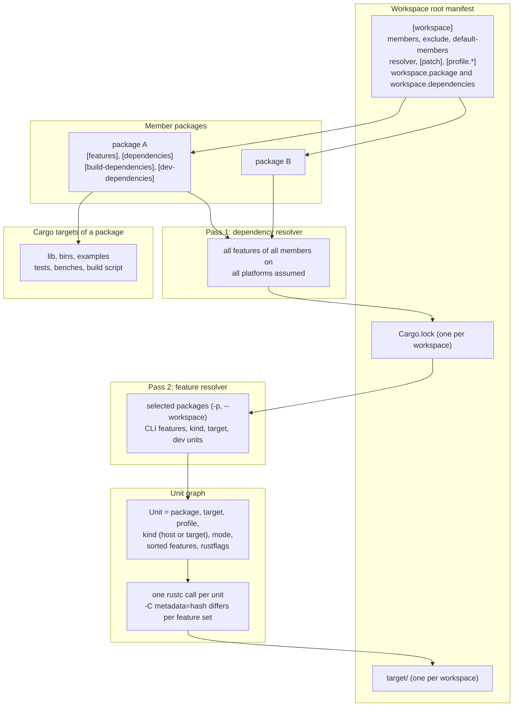

# The Cargo Model: Packages, Targets, Feature Unification, and Workspaces

> [!summary] Claim:
> A package is the unit Cargo versions and publishes, a target is the unit `rustc` compiles, and a workspace is a set of packages that share one `Cargo.lock`, one output directory, one resolver version, and the root-only tables `[patch]` and `[profile.*]`.
> Features are additive by contract: Cargo builds each package once per distinct union of every feature that anything in the current build requested, so a crate's feature set belongs to the build invocation and not to the crate.
> Resolver versions 2 and 3 split that union by dependency kind and platform, and resolver 3 changes only MSRV-aware version selection.
> The union still shifts with `-p`, `--workspace`, and whether dev units are built, so an expert reads the answer from `cargo tree -e features -i <crate>` for the exact command being run.



## The Mechanism

### Vocabulary: package, crate, target, unit, workspace

The Cargo Book glossary fixes the terms this note uses.
A *package* is a `Cargo.toml` manifest plus its sources, with a name and a version.
A package contains *targets*, and every target is a *crate*: a library crate or a binary crate.
A *workspace* is a collection of packages, its *members*, managed together; a manifest with `[workspace]` and no `[package]` is a *virtual manifest*.
A *unit* is Cargo's internal compilation node.
In `src/compiler/unit.rs` (tag 0.100.0), `UnitInner` is keyed by the package, the target, the profile, the `CompileKind` (host or a target triple), the `CompileMode`, a sorted `features` vector, and the rustflags, among other fields.
The source comment on the `target` field warns that it is "not to be confused with *target-triple*", which is the second meaning of the word covered below.

Packages are named on the command line by a *package ID specification*.
`cargo metadata` prints the fully qualified form, such as `path+file:///path/to/project/foo#1.1.8` for a path package and `registry+https://github.com/rust-lang/crates.io-index#regex@1.4.3` for a registry package.
Abbreviations such as `regex` or `regex@1.4` work as long as they identify one package in the graph; `-p` and `cargo update -p` accept them.

### The package: manifest, targets, and auto-discovery

Only `name` is required by Cargo itself; `version` is optional and defaults to `0.0.0` (as of 2026-11, Both; before 1.75 it was required).
A package that must never reach a registry can omit `version` or set `publish = false`.
If `edition` is absent, the 2015 edition is assumed, while `cargo new` writes `2024` (as of 2026-11, Both).

Targets come from the directory layout, and the manifest only adds or tunes them:

| Target | Default source | Default name | Notes |
|---|---|---|---|
| library | `src/lib.rs` | package name with `-` replaced by `_` | At most one per package; configured in `[lib]`. |
| binary | `src/main.rs`, `src/bin/*.rs`, `src/bin/*/main.rs` | package name for `main.rs` (dashes kept), file or directory name for the rest | Configured in `[[bin]]`; `default-run` picks the `cargo run` default. |
| example | `examples/*.rs`, `examples/*/main.rs` | file or directory name | Built, not run, by `cargo test` unless `test = true`. |
| test | `tests/*.rs`, `tests/*/main.rs` | file or directory name | Each file is a separate crate and a separate executable; `cargo test` runs them serially. |
| benchmark | `benches/*.rs`, `benches/*/main.rs` | file or directory name | `#[bench]` is nightly-only; the harness can be disabled with `harness = false`. |

Per-target keys are `name`, `path`, `test`, `doctest`, `bench`, `doc`, `proc-macro`, `harness`, `crate-type`, and `required-features`.
`crate-type` is accepted only for libraries and examples, with the values `bin`, `lib`, `rlib`, `dylib`, `cdylib`, `staticlib`, and `proc-macro`; binaries, tests, and benchmarks are always `bin`.
[[Rust-FFI-Packaging-cdylib-staticlib-and-cbindgen]] owns what `cdylib` and `staticlib` mean for packaging.
A binary target is built automatically when an integration test exists, and the test finds it through the `CARGO_BIN_EXE_<name>` environment variable.

Auto-discovery is controlled by `autolib` (respected as of 1.83), `autobins`, `autoexamples`, `autotests`, and `autobenches` (respected as of 1.27).
In a 2015-edition package, discovery turns off by default as soon as at least one target is defined manually in `Cargo.toml`; from 2018 on it is always on.
The classic reason to disable it is a library with a module named `bin`, because Cargo would otherwise try to compile `src/bin/mod.rs` as an executable.

`required-features` gates a target on features.
A default `cargo build` skips such a `[[bin]]` silently when the features are off, but naming it explicitly fails.
The run below used `cargo build -p bar --bin bar-tool` with `required-features = ["bar-feat"]` (cargo 1.99.0, macOS arm64, hand run 2026-11-21):

```text
error: target `bar-tool` in package `bar` requires the features: `bar-feat`
Consider enabling them by passing, e.g., `--features="bar-feat"`
```

A `build.rs` at the package root is auto-detected as the build-script target, and `build = false` disables that detection.
[[Rust-Build-Scripts-and-Sys-Crates]] owns the script's execution model and the `links` key; this note only needs the fact that a build script is compiled as its own target with its own dependency kind.

### Two meanings of "target": Cargo targets and compilation targets

The word has a second meaning that the glossary and the unit struct both call out: the *target triple* or platform that code is compiled for.
Cargo always distinguishes the host (where `rustc` runs, `aarch64-apple-darwin` on the lab machine) from the target (where the output runs).
Build scripts, proc macros, and the build-dependencies they use are always host artifacts.

The two modes lay out `target/` differently (Cargo Book, Build Cache):
- Without `--target`, everything is built for the host into `target/debug/` or `target/release/`, and normal dependencies are shared with build scripts and proc macros.
  `RUSTFLAGS` then reaches every `rustc` invocation, including those for build scripts and proc macros.
- With `--target <triple>`, target artifacts go to `target/<triple>/debug/`, while build scripts and proc macros are built separately for the host in `target/debug/` and do not receive `RUSTFLAGS`.

The worked example below shows this on a host-triple build: `consumer` lands in `target/<host>/debug/`, and the host-side `build/` directory and the build-dependency's rlib stay in `target/debug/`.

Selecting targets and configuring them:
- `--target` can repeat, and `build.target` can be an array, to build several triples at once (as of 1.64, Both).
- `build.target` also accepts the literal `host-tuple`, which Cargo substitutes with the host triple, and a path to a custom target specification.
- `[target.<triple>]` and `[target.'cfg(...)']` tables in `.cargo/config.toml` set `linker`, `runner`, `rustflags`, and `rustdocflags`.
  If both a triple table and a `cfg` table set a linker or runner, the triple wins; two matching `cfg` tables for a linker or runner are an error; `rustflags` from all matching tables are joined.
  For a custom target JSON file, the table name is the file stem, so `--target foo/bar.json` matches `[target.bar]`, and `.json` target specs are not usable on stable: Cargo 1.99 rejects them unless `-Zjson-target-spec` is passed (`src/compiler/compile_kind.rs`, tag 0.100.0).
- `cfg` values come from `rustc --print=cfg`, or `rustc --print=cfg --target=<triple>` for another platform, plus any `--cfg` in `RUSTFLAGS`.
  The Book warns not to match on `debug_assertions`, `test`, `feature = "..."`, or values set by build scripts, because Cargo evaluates these tables before any of them exist.

Dependencies can be platform-specific through `[target.'cfg(windows)'.dependencies]` or `[target.x86_64-pc-windows-gnu.dependencies]`, with matching `dev-dependencies` and `build-dependencies` tables.
The lockfile pass ignores the platform: "Platform-specific dependencies ... are resolved as-if all platforms are enabled", which is why a `Cargo.lock` produced on macOS already contains Windows-only crates.
A target-specific build-dependency is built only when the host matches.

Nightly-only knobs exist for the host side (as of 2026-11, Both): `-Ztarget-applies-to-host` with a top-level `target-applies-to-host = false` stops `[target.<host triple>]`, `RUSTFLAGS`, and `[build]` from applying to host artifacts, and `-Zhost-config` adds a `[host]` table.
The reason is documented historical inconsistency: with `--target` passed, Cargo honors `linker` from `[target.<host triple>]` for build scripts but not `rustflags`.

### Dependency kinds and the unit graph

A package has three dependency kinds: normal, build, and dev.
For lockfile resolution they are mostly equal, with one exception: dev-dependencies of non-member packages are ignored entirely.
Cycles through dev-dependencies are allowed, because the library is built first and the tests last, with the hazard that a unit-test binary links two copies of the library whose types do not match.

After resolution, Cargo expands the graph into units.
One package yields several units: a library unit per distinct feature set, a `test` unit and a `build` unit for a binary, a `custom-build` unit for compiling the build script and a `run-custom-build` unit for running it, and so on.
Each unit becomes one `rustc` invocation, and the feature set enters `rustc` as `--cfg 'feature="std"'` plus `--check-cfg 'cfg(feature, values(...))'`.
Distinct feature sets produce distinct `-C metadata=<hash>` and `-C extra-filename=-<hash>` values, so two builds of the same crate with different features coexist as separate rlibs under `target/debug/deps/`.

### Features: the table, optional dependencies, and the syntax

`[features]` maps a feature name to a list of other features and optional dependencies that it turns on.
Names follow Unicode XID rules plus an allowance for a leading digit or `_` and for `-`, `+`, and `.` afterwards; crates.io is stricter and takes only ASCII alphanumerics, `_`, `-`, and `+`.
New crates and versions on crates.io are limited to 300 features (as of 2026-11, Both), with exceptions case by case.

The `default` feature lists what is on when nobody says otherwise.
`default-features = false` on a dependency or `--no-default-features` on the command line drops it, but the Book is explicit that this does not guarantee the defaults stay off: another path in the graph that does not write `default-features = false` turns them back on.

Optional dependencies interact with the table in two ways introduced in Rust 1.60 (as of 2026-11, Both):
- An optional dependency defines an implicit feature of the same name unless the `[features]` table mentions it anywhere with the `dep:` prefix, which disables the implicit feature.
  Asking for the hidden name then fails with an explanation, as in this run where `gif` is mentioned as `dep:gif` in the `avif` feature (cargo 1.99.0, macOS arm64, hand run 2026-11-21):

  ```text
  error: package `bar v0.1.0 (...)` does not have feature `gif`

  help: an optional dependency with that name exists, but the `features` table includes it with the "dep:" syntax so it does not have an implicit feature with that name
  Dependency `gif` would be enabled by these features:
  	- `avif`
  ```

- `"pkg/feat"` enables the dependency `pkg`, if optional, and its feature `feat`; the weak form `"pkg?/feat"` enables `feat` only if something else has already enabled `pkg`.
  In the same run, `--features serde` with `serde = ["rgb?/serde"]` produced `bar v0.1.0 [serde]` with no `rgb` node, and `--features serde,rgb` produced `bar v0.1.0 [rgb,serde]` with `rgb v0.1.0 [serde]` below it.

Features are namespaced per package: enabling `std` on package A never enables `std` on package B.
A renamed dependency takes its feature names from the rename: with `bar = { package = "foo", ... }`, the path is `bar/log-debug`, and `foo/log-debug` is an error.
Build scripts see enabled features as `CARGO_FEATURE_<NAME>` with the name upper-cased and `-` turned into `_`.
Adding a feature or an optional dependency is usually minor-safe; removing a feature, removing an optional dependency, or moving existing public code behind a feature is a SemVer break, because the optional dependency is an implicit feature that others may name; see [[Versioning-SemVer-CalVer-and-ABI]] and [[Rust-SemVer-Checks-MSRV-and-Editions]].

On the command line, `--features` takes commas or spaces, `--all-features` turns everything on for the selected packages, and `--no-default-features` drops the `default` feature of the selected packages.
`package-name/feature-name` addresses a specific workspace member.

### Two resolution passes

Cargo resolves twice, and the difference explains most surprises.

**Pass 1, the dependency resolver**, builds the graph that goes into `Cargo.lock`.
For this purpose it treats all features of all workspace members as enabled, so optional dependencies are available and the lockfile does not churn when you toggle a feature.
It also assumes all platforms, and it prefers locked versions, then the highest compatible version.
The algorithmic side (backtracking, unifying SemVer-compatible versions, the `links` constraint) belongs to [[Dependency-Resolution-SAT-PubGrub-and-MVS]].
Two feature-related rules from the Book are worth knowing here: the resolver skips versions that lack a required feature, so a `^1` dependency on `regex` with `perf` cannot select anything older than 1.3.0, and a feature removed in a newer release strands every dependent on older releases.

**Pass 2, the feature resolver** (`src/resolver/features.rs`), runs "independently of the main dependency resolver".
Its module comment says it acts "as a second pass which can *narrow* the features selected in the dependency resolver": it cannot add packages, only decide which features, and therefore which optional dependencies, are active for the actual build.
Its result, `ResolvedFeatures`, is a map keyed by `(PackageId, FeaturesFor)`.
`FeaturesFor` has three variants: `NormalOrDev`, `HostDep` for build dependencies and proc macros, and `ArtifactDep(target)` for the unstable artifact dependencies.
That key is the whole mechanism of decoupling: with a single `FeaturesFor` value there is one namespace and everything unifies, and with several values each kind gets its own union.

`FeatureOpts` holds the switches, and the resolver version only chooses a preset:

| `FeatureOpts` field | Effect when true | Resolver 1 | Resolvers 2 and 3 |
|---|---|---|---|
| `decouple_host_deps` | Build dependencies and proc macros get their own feature sets. | off | on |
| `decouple_dev_deps` | Dev-dependency features do not apply unless dev units are built. | off | on, forced off when building any dev unit |
| `ignore_inactive_targets` | Features from `[target]` tables for platforms not being built are ignored. | off | on, off under `ForceAllTargets` (for example `cargo tree --target all`) |

In `FeatureOpts::new`, the match on `ws.resolve_behavior()` handles `V1 => {}` and `V2 | V3 => enable("all")`.
Resolvers 2 and 3 are therefore identical for features.
The source comment on `HasDevUnits` explains why dev decoupling is dropped whenever any test, example, or benchmark unit is built: relaxing it "will require significant changes to how unit dependencies are computed, and can result in longer build times with `cargo test` because the lib may need to be built 3 times instead of twice".
The experiment further below shows the cost of the split that exists today: after a `cargo build` and a `cargo test` of the same package, three `feat` rlibs exist under resolver 2 against one under resolver 1.
Within the single `cargo test` invocation `feat` is built twice (host `std` and target `extra`, scenario F's unit graph), which is the "twice" in the comment; the third rlib is the feature-less one left by the earlier `cargo build`.

### Feature unification: the union rule and what selects the set

When several packages depend on the same crate, Cargo builds it once with the union of all features requested of it, which keeps one copy of the types so they can flow between APIs.
The Book's example is `winapi`: `foo` requests `fileapi` and `handleapi`, `bar` requests `std` and `winnt`, and `winapi` is built with all four.
Because of this, features must be additive.
The Book's rule of thumb is to offer a `std` feature that enables `std`, never a `no_std` feature that disables it, and where two features truly conflict to add a `compile_error!` for the combination.
Alternatives to mutually exclusive features are splitting the package, choosing one feature over another with `cfg-if`, and selecting behavior at run time.

What the union contains depends on the selection:
1. **Selected packages.** With `-p a -p b` or `--workspace`, the dependency features of all selected packages unify; "if you have a circumstance where you want to avoid that unification ... you will need to build them via separate `cargo` invocations".
2. **Members that are also dependencies.** A member is selected with its own default features.
   Building the whole workspace therefore turns on `default` for `shared` even when every dependent wrote `default-features = false`, as scenario A shows with `shared feature "default" (command-line)`.
3. **Command-line features.** With resolver 1, `--features` can only name features of the package in the current directory, and `--no-default-features` only affects that package.
   With resolver 2 and later they apply to any package selected with `-p` or `--workspace`, and `--no-default-features` drops the defaults of all workspace members.
   The same command that works under resolver 2 fails under resolver 1 from the wrong directory (cargo 1.99.0, macOS arm64, hand run 2026-11-21, `cargo build -p bar --features bar-feat` run inside `foo/`):

   ```text
   error: package `foo v0.1.0 (...)` does not have the feature `bar-feat`

   help: a feature with a similar name exists: `foo-feat`
   ```

4. **Dev units.** `cargo test` and `cargo build --all-targets` build dev units, so dev-dependency features unify into everything in that invocation, including other members' libraries.
5. **Platform.** Under resolver 2 and later, `--target` decides which `[target.'cfg(...)']` features count.

The cost is compile time and cache hit rate.
Every distinct feature set is a separate compilation of that crate and of every crate above it in the graph, because a dependency's feature set is part of the dependent's inputs.
[cargo-hakari's documentation](https://docs.rs/cargo-hakari/latest/cargo_hakari/about/index.html) states the consequence plainly: `syn` built with a slightly different feature set forces a rebuild of everything that depends on it.

There are three ways to tame the selection dependence:
- **A workspace-hack crate.** Every member depends on a generated package that requests the union of all features of every shared dependency, so every build agrees.
  cargo-hakari automates it.
  Its documentation claims a cumulative benefit of up to 1.7x on moderately large workspaces, individual commands from 1.1x to 100x faster, and a first build that can be slower; these are the tool authors' numbers (cargo-hakari 0.9.39, as of 2026-11), not measured here.
  It also lists drawbacks: crates can silently depend on a feature that the hack crate turns on, and publishing to a registry gets more complex.
- **One invocation per shipped artifact.** Build the firmware, the server, and the CLI with separate `cargo` calls, each with its own `-p`, so each gets its own union.
  This is the fix used in [[Drill-Packaging-Cargo-Feature-Unification-Hazard]].
- **`resolver.feature-unification` (RFC 3692), unstable.**
  The config key takes `selected` (the default and today's behavior), `workspace` (unify across all members regardless of selection, a built-in workspace-hack), or `package` (each package on its own, so `cargo check -p a -p b` behaves like two runs).
  It requires `-Zfeature-unification` on nightly, and without the flag Cargo warns `ignoring resolver.feature-unification without -Zfeature-unification` (as of 2026-11, Both; still listed under Unstable Features in the Book on master on 2026-11-21).

Testing features is the other half.
The Book notes that features need an exponential number of configurations, and by default tests, docs, and Clippy run only the default set.
`cargo-hack` implements `--each-feature` and `--feature-powerset`, with `--depth N` to cap how many features combine at once (`--depth 1` equals `--each-feature`), `--group-features`, `--mutually-exclusive-features`, and `--exclude-features`.

### Resolver versions 1, 2, and 3

`resolver` is set once, in the root `[package]` or in `[workspace]`.
It is global: "the `resolver` version in dependencies is ignored, only the value in the top-level package will be used".

| Version | Selected by | Feature behavior | Other behavior | Since |
|---|---|---|---|---|
| `"1"` | manifest default, `edition` before 2021 | One feature namespace; platform, build-dependency, and dev-dependency features all unify. | `--features` limited to the current package. | original |
| `"2"` | default for `edition = "2021"` | Splits by host versus normal, by dev units, and by inactive target; `--features` and `--no-default-features` follow `-p`. | none | stable in Rust 1.51 (RFC 2957) |
| `"3"` | default for `edition = "2024"` | Same as `"2"`. | `resolver.incompatible-rust-versions` defaults to `fallback` instead of `allow`. | stable in Rust 1.84 (RFC 3537), edition 2024 stable in 1.85 |

A virtual workspace has no `package.edition` to infer from, so it needs an explicit `resolver`.
If it is missing, Cargo falls back to `"1"` and says so (cargo 1.99.0, macOS arm64, hand run 2026-11-21, a virtual workspace whose only member is edition 2024):

```text
warning: virtual workspace defaulting to `resolver = "1"` despite one or more workspace members being on edition 2024 which implies `resolver = "3"`
  |
  = note: to keep the current resolver, specify `workspace.resolver = "1"` in the workspace root's manifest
  = note: to use the edition 2024 resolver, specify `workspace.resolver = "3"` in the workspace root's manifest
  = note: for more details see https://doc.rust-lang.org/cargo/reference/resolver.html#resolver-versions
```

The seed for this note groups v3 with v2 under feature unification.
They are the same for features; what v3 adds is the Rust-version-aware selection.
With `fallback`, the resolver prefers dependency versions whose `rust-version` fits the package's, falls back to others only if none match, and never errors on that account.
The Book's example: with `rust-version = "1.62"` and `clap = "4.0"`, it picks 4.0.32 over a higher 4.5.20 that needs 1.74.
When a package has no `rust-version`, Cargo uses the running toolchain, and `cargo generate-lockfile` printed `Locking 2 packages to highest Rust 1.99.0 compatible versions` on the lab host.
The overrides are `--ignore-rust-version`, a version requirement above every compatible version, and `cargo update --precise`.
In a workspace with mixed `rust-version`s the resolver uses heuristics and can pick too low or too high a version, and a CI job should verify the latest dependencies with `CARGO_RESOLVER_INCOMPATIBLE_RUST_VERSIONS=allow`, as the Cargo Book's CI guide shows.
[[Rust-SemVer-Checks-MSRV-and-Editions]] owns the MSRV policy side.

### Workspaces: root discovery, members, and selection

A workspace needs one root manifest with `[workspace]`, either on a package (the *root package*) or standing alone (a *virtual manifest*).
Everything below follows from what the root owns:
- one `Cargo.lock` at the root, and one `target/` there unless `build.target-dir` says otherwise;
- the `[patch]`, `[replace]`, and `[profile.*]` tables, which are read only from the root and ignored in members;
- the `resolver` value.

**Finding the root.**
In `find_root` in `src/workspace/workspace.rs`, Cargo first asks whether the manifest in the current directory is itself a root; if not, it walks up the parent directories and takes the first `Cargo.toml` with a `[workspace]`.
The walk stops at a `target/package` directory (so `cargo package` verification builds do not find the source workspace) and never crosses `CARGO_HOME`.
`package.workspace = "path/to/root"` in a member replaces the search, which is for members outside the root's subtree.
A package cannot both define `[workspace]` and point at another with `package.workspace`.

If the search finds a root that does not list the package, Cargo refuses (cargo 1.99.0, macOS arm64, hand run 2026-11-21, a package under a workspace directory but not in `members`):

```text
error: current package believes it's in a workspace when it's not:
current:   <path>/c/orphan/Cargo.toml
workspace: <path>/c/Cargo.toml

this may be fixable by adding `orphan` to the `workspace.members` array of the manifest located at: <path>/c/Cargo.toml
Alternatively, to keep it out of the workspace, add the package to the `workspace.exclude` array, or add an empty `[workspace]` table to the package's manifest.
```

**Membership.**
`members` takes directories and globs (`crates/*`), and `exclude` removes paths.
The Book recommends one flat `crates/` directory with a glob, which minimizes manifest churn.
"All `path` dependencies residing in the workspace directory automatically become members", even when the dependency is optional and its feature is off.
The worked example shows `members = ["bar"]` yielding `['bar', 'gif']` because `bar` has an optional path dependency on `../gif`, and `exclude = ["gif"]` yielding `['bar']`.
A path dependency outside the workspace directory does not become a member.

**Selection.**
Package commands use `-p`/`--package` or `--workspace`; without them Cargo uses the package in the current directory, or `default-members` at the root.
`default-members` defaults to the root package when one exists and to all members for a virtual manifest.
That makes a plain `cargo build` or `cargo test` at the root of a workspace with a root package build only that package, and `--workspace` or `default-members = [".", "m"]` is what includes the members, as the worked example shows.
`cargo metadata` reports `workspace_root`, `workspace_members`, `workspace_default_members`, `target_directory`, and `build_directory` (as of 1.99.0, Both).
The directory for intermediate artifacts can be split from the final `target/` with `build.build-dir`, which defaults to `build.target-dir`.

### Inheritance: workspace.package, workspace.dependencies, workspace.lints

`[workspace.package]` holds keys that members adopt with `key.workspace = true`.
Sixteen keys are supported: `authors`, `categories`, `description`, `documentation`, `edition`, `exclude`, `homepage`, `include`, `keywords`, `license`, `license-file`, `publish`, `readme`, `repository`, `rust-version`, and `version` (as of 1.64, Both).
`license-file` and `readme` are relative to the workspace root, while `include` and `exclude` stay relative to the member.

`[workspace.dependencies]` declares dependencies once, and a member writes `dep.workspace = true` in `[dependencies]`, `[dev-dependencies]`, `[build-dependencies]`, or a `[target.*]` table.
Beside `workspace`, an inheriting entry may carry only `optional`, `features`, and `default-features`; `version` or `path` there is an error.
The workspace entry cannot be `optional`.
`features` are additive: the member's list is appended to the workspace's.
The subtle key is `default-features`, whose rule changed with RFC 3945 in Rust 1.99.
The parser (`inner_dependency_inherit_with` in `src/workspace/parser/mod.rs`) branches on the member's edition:
- Edition 2024 and later: the member's `default-features` overrides the workspace's, and if neither says, it is `true`.
- Earlier editions: a member `true` over a workspace `false` turns defaults on; a member `false` over a workspace `true` or unspecified is ignored with a warning.

Rust 1.85 through 1.98 rejected the ignored combination as a hard error in edition 2024; from 1.99 it is an override.
The matrix below comes from the worked example (cargo 1.99.0, macOS arm64, 2026-11-21); each cell is the feature set that `shared` ends up with for a member `m`:

| Workspace dependency | Member line | Edition 2021 | Edition 2024 |
|---|---|---|---|
| `default-features = false` | `{ workspace = true }` | `[]` | `[]` |
| `default-features = false` | `{ workspace = true, default-features = true }` | `[default,std]` | `[default,std]` |
| `default-features = false` | `{ workspace = true, default-features = false }` | `[]` | `[]` |
| unset | `{ workspace = true }` | `[default,std]` | `[default,std]` |
| unset | `{ workspace = true, default-features = true }` | `[default,std]` | `[default,std]` |
| unset | `{ workspace = true, default-features = false }` | `[default,std]` plus a warning | `[]` |

The warning on the last 2021 cell reads:

```text
warning: m/Cargo.toml: `default-features` is ignored for shared, since `default-features` was not specified for `workspace.dependencies.shared`; overriding workspace `default-features` to false requires Rust 1.99+ and the 2024 edition
```

It appeared on `cargo check`, not on `cargo tree`, so a CI that only runs `cargo tree` or `cargo metadata` will not show it.
The Edition Guide adds that `cargo fix --edition` removes the now-meaningless `default-features = false` on migration, and that unification still applies: if any member builds the dependency with defaults, every selected member gets them.

`[workspace.lints]` is inherited with `[lints] workspace = true` (respected as of 1.74, Both), and `[workspace.metadata]` is ignored by Cargo and free for tools.
A `[hints]` table exists (respected as of 1.90, Both) but has no stable hints.

### The lockfile and synchronization policy

The workspace has one `Cargo.lock` at the root, written by Cargo, never by hand.
The Cargo Book's advice is to commit it "when in doubt", and to pair that with a job that verifies the latest dependencies.
Resolution gives locked versions top priority, and it ignores a lock entry only when the manifest edit makes it incompatible.
Yanked releases are ignored unless already locked or requested by `cargo update --precise`.
Since Cargo 1.84, published packages always include `Cargo.lock` (as of 2026-11, Both), and `cargo install --locked` is how a binary's consumers use it.
`cargo package --exclude-lockfile` (added in Cargo 1.87) leaves it out of a locally built `.crate`; `cargo publish` has no such flag in 1.99.

Three flags set how strictly Cargo treats the lock:
- `--locked` errors when the lock is missing or Cargo would change it.
- `--offline` forbids the network and restricts resolution to locally downloaded crates.
- `--frozen` is both.

The run below added a dependency after the lock was generated (cargo 1.99.0, macOS arm64, hand run 2026-11-21):

```text
$ cargo build --locked
error: cannot update the lock file <pkg>/Cargo.lock because --locked was passed to prevent this
help: to generate the lock file without accessing the network, remove the --locked flag and use --offline instead.
$ cargo build --frozen
error: cannot update the lock file <pkg>/Cargo.lock because --frozen was passed to prevent this
```

The format has a version, and Cargo chooses it from `package.rust-version` (`ResolveVersion::with_rust_version` in `src/resolver/resolve.rs`): 1.83 or newer gets V4, 1.53 or newer gets V3, 1.41 or newer gets V2, and otherwise V1; unset means the current default, V4.
V2 arrived in 1.38, V3 in 1.47, V4 in 1.78, and V4 became the default for new lockfiles in 1.83; V5 is unstable.
The worked example confirms it:

```text
rust-version = 1.70   -> Cargo.lock version = 3
rust-version = 1.83   -> Cargo.lock version = 4
rust-version = unset  -> Cargo.lock version = 4
```

The consequence is that raising `rust-version` can rewrite the lockfile format, and a toolchain older than 1.78 predates V4 (the `ResolveVersion::V4` doc comment says "Introduced in 2024 in version 1.78"; no pre-1.78 toolchain was run here, so the failure below is read from source, not captured).
In the `encode.rs` of cargo tags 0.77.0 and 0.78.0 (Rust 1.76 and 1.77), `Some(4)` is accepted only when nightly features are allowed and `-Znext-lockfile-bump` is set, and otherwise a stable Cargo falls into the `Some(n)` arm and stops with ``lock file version `4` was found, but this version of Cargo does not understand this lock file, perhaps Cargo needs to be updated?``.
A nightly of that era without the flag stops with ``lock file version 4 requires `-Znext-lockfile-bump` ``.
Tag 0.79.0 (Rust 1.78) is the first with a plain `Some(4) => ResolveVersion::V4` arm.
Both failures are hard errors on parse, not a silent re-resolve.
The config key `resolver.lockfile-path` moves the lock out of the source tree, for read-only checkouts (as of 1.97, Both).
Lockfile mechanics across ecosystems and the offline-mirror story live in [[Lockfiles-Vendoring-and-Offline-Mirrors]].

A workable synchronization policy has four parts:
1. Commit `Cargo.lock` for every workspace that ships a binary or runs CI.
2. Run `cargo build --locked` and `cargo test --locked` on pull requests, so a manifest change that forgets the lock fails.
3. Update the lock deliberately, through a scheduled `cargo update` pull request or a dependency bot, and keep one non-blocking job that resolves the latest versions as the Cargo Book's CI guide shows.
4. Treat a lock-only change as a reviewable diff, because that is where a new transitive crate first appears.

### Overrides: [patch], [replace], and paths

`[patch]` adds extra copies of crates to a source.
`[patch.crates-io]` patches the default registry, and `[patch."https://github.com/example/baz"]` patches a git source.
Each entry is an ordinary dependency specification, and if it names a version that already exists in the source, the original is replaced.
The behavior that matters:
- **Root only.** Cargo reads `[patch]` from the workspace root and ignores it in dependencies.
  A member that declares it gets a warning and no effect.
- **Transitive within your graph.** A patch applies to every use of the crate in your build, but consumers of your library must repeat it.
- **Versions matter.** The patch is only used if its version satisfies a requirement, and the greedy resolver then picks the highest one.
- **Config form.** `[patch]` can also live in `.cargo/config.toml` or be passed with `--config 'patch.crates-io.rand.path="rand"'`, for local-only changes.
- **Several versions.** The `package` rename key patches a second line of a crate, as in `serde2 = { git = "...", package = "serde", branch = "v2" }`.

`[replace]` is deprecated in favor of `[patch]`, and `paths = [...]` in `.cargo/config.toml` is a restricted override that cannot change the graph's structure.

The run below used a workspace with `cfg-if` and `itoa`, with crates preloaded in the local registry cache so that `--offline` worked (cargo 1.99.0, macOS arm64, hand run 2026-11-21, not part of the recorded walkthrough because it depends on the cache):

```text
$ cargo tree        # [patch.crates-io] cfg-if = { path = "patched/cfg-if" }, same version 1.0.5
     Locking 1 package to highest Rust 1.99.0 compatible version
      Adding cfg-if v1.0.5 (.../exp8/patched/cfg-if)
app v0.1.0 (.../crates/app)
|-- cfg-if v1.0.5 (.../patched/cfg-if)
...
$ diff Cargo.lock.orig Cargo.lock
16,17d15
< source = "registry+https://github.com/rust-lang/crates.io-index"
< checksum = "4e7648175b45a9a48536d676f68d918270699102aa8dab5496df06904c914600"
```

The lock entry for a patched crate loses its `source` and `checksum`, which is what makes a lock diff after a patch visible.
Changing the patch to version `2.0.0`, outside `^1`, gave:

```text
warning: patch `cfg-if v2.0.0 (.../patched/cfg-if)` was not used in the crate graph
help: Check that the patched package version and available features are compatible
      with the dependency requirements. If the patch has a different version from
      what is locked in the Cargo.lock file, run `cargo update` to use the new
      version. This may also occur with an optional dependency that is not enabled.
```

An unused-patch warning is therefore a version-requirement or feature mismatch, not a path problem.
Source replacement is not a patching tool: it assumes the replacement is byte-for-byte the same code, which is why the Book sends patches to `[patch]` and private registries to the registry chapter.

### Vendoring and source replacement

`cargo vendor <path>` copies every crates.io and git dependency of the workspace into a directory and prints the configuration to add.
It also supports `-s`/`--sync <manifest>` for extra manifests, `--no-delete`, `--versioned-dirs`, and `--respect-source-config`.
The printed snippet defines a *directory source* and replaces `crates-io` with it:

```toml
[source.crates-io]
replace-with = "vendored-sources"

[source.vendored-sources]
directory = "vendor"
```

Four source kinds exist: registry (git or `sparse+https`), local registry, directory, and git.
Directory sources hold unpacked crates, each with a `.cargo-checksum.json`, and the file's own `$comment` says it "only protects against accidental modifications" and is "not a security mechanism".
Vendored sources are read-only to Cargo, so editing a vendored crate is done with `[patch]` or a path dependency.

On the lab host, `cargo vendor --locked vendor` vendored `cfg-if v1.0.5` and `itoa v1.0.18`, and with that config in place `cargo --frozen build` compiled and ran with no registry access (cargo 1.99.0, macOS arm64, hand run 2026-11-21, crates preloaded in the cache).
The lockfile did not change: it still names `registry+https://github.com/rust-lang/crates.io-index`, because replacement is transparent to the lock.
[[Lockfiles-Vendoring-and-Offline-Mirrors]] owns the trade-offs between vendoring, mirrors, and proxies, and [[Rust-Publishing-Crates-io-Trusted-Publishing-and-Private-Registries]] owns private registries.

### Inspecting what Cargo decided

| Question | Command |
|---|---|
| Why is this feature on this crate? | `cargo tree -e features -i <crate>` |
| What features does each package get? | `cargo tree -f '{p} [{f}]'` |
| Which crates are built more than once? | `cargo tree --duplicates` |
| What does the whole graph look like on every platform? | `cargo tree --workspace --target all --all-features` |
| What did the resolver do? | `CARGO_LOG=cargo::resolver=trace cargo update` (log targets may change) |
| Which units, with which features? | `cargo build -v`, or `cargo build --unit-graph -Zunstable-options` on nightly |
| What does the workspace look like to tools? | `cargo metadata --format-version 1` |

`cargo tree --charset ascii` produces plain-ASCII output, which this note uses.
`cargo tree` follows the same selection and feature rules as a build for the same flags, so run it with the flags of the command you are debugging, since `cargo tree` at the root and `cargo build -p app-a` can show different sets.

### Rebuilding the core: a toy feature unifier

The union rule is short enough to rebuild.
The toy below models packages with features, three dependency kinds, `default`, and the resolver 1 versus 2 split, and leaves out optional dependencies, weak features, target `cfg`s, and artifact dependencies.
It keys activations by `(package, context)`, where the context collapses to one value under resolver 1, as `FeaturesFor` does, and it skips dev-dependencies under resolver 2 unless dev units are built.

```python
from __future__ import annotations
from dataclasses import dataclass, field


@dataclass
class Dep:
    name: str
    kind: str = "normal"  # normal | build | dev
    features: tuple[str, ...] = ()
    default_features: bool = True


@dataclass
class Pkg:
    features: dict[str, tuple[str, ...]] = field(default_factory=dict)  # name -> implied
    deps: list[Dep] = field(default_factory=list)
    is_member: bool = False


def close(pkg: Pkg, wanted: set[str], use_default: bool) -> set[str]:
    out, todo = set(), list(wanted) + (["default"] if use_default and "default" in pkg.features else [])
    while todo:
        f = todo.pop()
        if f not in out:
            out.add(f)
            todo.extend(pkg.features.get(f, ()))
    return out


def resolve(graph: dict[str, Pkg], selected: list[str], v2: bool, has_dev_units: bool):
    acts: dict[tuple[str, str], set[str]] = {}
    work = [(m, "normal", set(), True) for m in selected]
    while work:
        name, ctx, wanted, use_default = work.pop()
        pkg = graph[name]
        new = close(pkg, wanted, use_default)
        if (name, ctx) in acts and new <= acts[(name, ctx)]:
            continue
        acts.setdefault((name, ctx), set()).update(new)
        for d in pkg.deps:
            if d.kind == "dev" and not (pkg.is_member and ctx == "normal" and (has_dev_units or not v2)):
                continue
            child_ctx = ("host" if d.kind == "build" else ctx) if v2 else "normal"
            work.append((d.name, child_ctx, set(d.features), d.default_features))
    return {k: sorted(v) for k, v in sorted(acts.items())}
```

Fed the graphs of scenarios A and C of the worked example, it printed (Python 3 `-I`, stdlib only, run once on 2026-11-21, macOS arm64):

```text
A: selected = ['app-a']
  shared  normal ['std']
A: selected = ['app-b']
  shared  normal ['fast']
A: selected = ['app-a', 'app-b']
  shared  normal ['fast', 'std']
C: resolver 1, cargo build
  feat    normal ['extra', 'std']
C: resolver 2/3, cargo build
  feat    host   ['std']
  feat    normal []
C: resolver 2/3, cargo test
  feat    host   ['std']
  feat    normal ['extra']
```

Each line matches what real Cargo printed in the worked example, which is the check that the model captures the rule.
Real Cargo additionally maps feature sets to units, runs the dependency resolver first so the optional dependencies exist, and evaluates `cfg` for the chosen target.

## Commands and Numbers to Know

| Item | Value | Platform | Notes |
|---|---|---|---|
| Toolchain of the hand runs | cargo 1.99.0 (5f94df478 2026-08-27), rustc 1.99.0 (b940084d7 2026-09-28) (as of 2026-11) | macOS arm64 | Cargo source and Book read at tag 0.100.0, which peels to commit 5f94df478. |
| Nightly used for unstable steps | cargo 1.101.0-nightly (cad07cf8e 2026-10-23) (as of 2026-11) | macOS arm64 | `-Zfeature-unification` and `--unit-graph`. |
| `resolver` default | `"1"`; `"2"` for edition 2021; `"3"` for edition 2024 (as of 2026-11) | Both | `"3"` requires Rust 1.84+; virtual workspaces must set it explicitly. |
| Resolver 2 stabilized | Rust 1.51 (as of 2026-11) | Both | RFC 2957. |
| Resolver 3 stabilized | Rust 1.84, edition 2024 in 1.85 (as of 2026-11) | Both | RFC 3537; changes only `incompatible-rust-versions`. |
| `dep:` and `pkg?/feat` | Rust 1.60 (as of 2026-11) | Both | Namespaced and weak dependency features. |
| Workspace inheritance, multi `--target` | Rust 1.64 (as of 2026-11) | Both | `workspace.package`, `workspace.dependencies`, `build.target` arrays. |
| Inheritable `workspace.package` keys | 16 (as of 2026-11) | Both | `version` through `rust-version`, listed above. |
| `workspace.lints` | respected as of 1.74 (as of 2026-11) | Both | `[lints] workspace = true`. |
| Member `default-features` overrides workspace | Rust 1.99, edition 2024 only (as of 2026-11) | Both | RFC 3945; 1.85 to 1.98 rejected it in 2024. |
| `version` field | optional since 1.75, defaults `0.0.0` (as of 2026-11) | Both | Omit it, or set `publish = false`, to block publishing. |
| Lockfile format | V4 default since 1.83; V3 for `rust-version` 1.53 to 1.82 (as of 2026-11) | Both | Chosen from `package.rust-version`; observed V3 at 1.70. |
| `resolver.lockfile-path` | 1.97 and later (as of 2026-11) | Both | Moves `Cargo.lock`; path must end in `Cargo.lock`. |
| `cargo publish` includes `Cargo.lock` | always since 1.84 (as of 2026-11) | Both | Earlier only for packages with executables or examples. |
| crates.io feature limit | 300 per crate version (as of 2026-11) | Both | Exceptions case by case. |
| `resolver.feature-unification` | `selected` (default), `workspace`, `package`; nightly only (as of 2026-11) | Both | Needs `-Zfeature-unification`, env `CARGO_RESOLVER_FEATURE_UNIFICATION`. |
| `target-applies-to-host`, `host-config` | nightly only (as of 2026-11) | Both | `-Ztarget-applies-to-host`, `-Zhost-config`. |
| `libfeat` rlibs, resolver 1 versus 2 and 3 | 1 versus 3 (as of 2026-11) | macOS arm64 | After `cargo build` and `cargo test` of the same package, from the worked example. |
| `cargo test` of integration tests | one executable per file, run serially (as of 2026-11) | Both | Consider one test crate with modules for large suites. |
| `--locked`, `--frozen` | error instead of updating the lock; `--frozen` adds `--offline` (as of 2026-11) | Both | Text of the error is quoted above. |
| `-C metadata` | differs per feature set of a crate (as of 2026-11) | macOS arm64 | Two `feat` compilations showed two distinct values. |
| cargo-hakari benefit | up to 1.7x cumulative, 1.1x to 100x per command (as of 2026-11) | Both | The tool authors' claim for cargo-hakari 0.9.39, not measured here. |
| Feature powerset size | 2^n builds; `--depth 2` gives 1 + n + n(n-1)/2 (as of 2026-11) | Both | n = 10 gives 1024 versus 56. |

## Multi-Language Comparison

| Concern | C++ (CMake with Conan or vcpkg) | Python (pyproject with pip or uv) | Rust (Cargo) |
|---|---|---|---|
| Unit of distribution | A package or recipe, such as a Conan reference | A distribution (sdist or wheel) with a name and version | A package, published as a `.crate` |
| Unit of compilation | A CMake target (library or executable) | Wheels carry built artifacts; pure Python has none | A Cargo target, compiled per unit |
| Optional capability | CMake `option()` (a boolean cache variable); Conan options chosen per package | Extras: `pkg[extra]` | `[features]`, with `dep:` and weak `?` |
| Combining requests across the graph | `option()` does nothing if the variable is already set, so the first setting wins and nothing is unioned | Extras are unioned with the distribution's own dependencies | The union of all requested features, per kind and platform |
| Multi-package repo | `add_subdirectory` trees or a superbuild | uv workspace: `members` and `exclude` globs | `[workspace]` with `members` and `exclude` globs |
| Shared lock | Conan `conan.lock`, created explicitly with `conan lock create` and then picked up automatically when present | uv: one lockfile for the whole workspace | One `Cargo.lock` at the root |
| Platform-specific deps | `if()` in CMake, conditions in recipes | Environment markers on requirements | `[target.'cfg(...)'.dependencies]`, resolved for all platforms in the lock |
| Override a dependency | Conan's `override` requirement trait; vcpkg's top-level `overrides` version pins | Constraints and overrides in the installer | `[patch]` at the workspace root |
| Typical defect | A cached option from a previous configure sticks | An extra drags in a heavy dependency | A dev-dependency feature leaks into another member's build |

The C++ and Python cells come from the CMake `option()` page, the PyPA dependency specifiers, the uv workspace page, and the Conan tutorial, which says option handling is tied to how Conan identifies binary-compatible packages; [[Cpp-Conan-2-Architecture-and-Binary-Model]] and [[Python-Dependency-Resolution-pip-uv-and-PEP-751-Lockfiles]] own those mechanisms.
The uv documentation says its workspace is "inspired by the Cargo concept of the same name" and that "the workspace shares a single lockfile".
The Conan lockfile cell comes from the Conan 2 lockfiles tutorial, which notes that `--lockfile=conan.lock` is used by default when the file is found and recommends passing it explicitly in CI.
The override cells come from the Conan 2 `requirements()` reference (`override` pins a transitive version without adding a direct dependency) and the vcpkg `vcpkg.json` reference (`overrides` from dependencies are ignored, so only the top-level project's pins apply, much as with Cargo's root-only `[patch]`).
The structural difference worth keeping is that Cargo unions at build time inside one solver-visible namespace, whereas CMake options and Conan options are set values, so mixed requests are a configuration error to find rather than a union.

## Worked Lab Example

This note has no committed lab and no `expected/` file; the walkthrough below was run once by hand and is not covered by `make verify`.
It uses only path crates and needs no network.
It was run on cargo 1.99.0 and rustc 1.99.0, `aarch64-apple-darwin`, macOS arm64, on 2026-11-21, with cargo 1.101.0-nightly for two steps, and every output below is copied from that single run.
The generating script is kept with the job's research files as `_research/worked/run.sh`, and each scenario's manifests are listed here so it can be recreated by hand.
`cargo tree --charset ascii` keeps the output ASCII.

### Scenario A: the selected packages change a shared dependency's features

The workspace is `members = ["crates/*"]`, `resolver = "3"`, and `[workspace.dependencies] shared = { path = "crates/shared", default-features = false }`.
`shared` has `default = ["std"]`, `std`, and `fast`; `app-a` inherits it with `features = ["std"]` and `app-b` with `features = ["fast"]`, both edition 2024; `shared::enabled()` reports which features it was compiled with.

```text
$ cargo tree --charset ascii -p app-a -f '{p} [{f}]'
app-a v0.1.0 []
`-- shared v0.1.0 [std]
$ cargo tree --charset ascii -p app-b -f '{p} [{f}]'
app-b v0.1.0 []
`-- shared v0.1.0 [fast]
$ cargo tree --charset ascii -p app-a -p app-b -f '{p} [{f}]'
app-a v0.1.0 []
`-- shared v0.1.0 [fast,std]

app-b v0.1.0 []
`-- shared v0.1.0 [fast,std]
$ cargo build -q -p app-a && target/debug/app-a
app-a sees shared = std
$ cargo build -q -p app-a -p app-b && target/debug/app-a && target/debug/app-b
app-a sees shared = std+fast
app-b sees shared = std+fast
$ cargo tree --charset ascii -e features -i shared
shared v0.1.0
|-- shared feature "default" (command-line)
|-- shared feature "fast"
|   `-- app-b v0.1.0
|       `-- app-b feature "default" (command-line)
`-- shared feature "std"
    `-- app-a v0.1.0
        `-- app-a feature "default" (command-line)
    `-- shared feature "default" (command-line)
```

The same binary `app-a`, built from unchanged source, reports `std` or `std+fast` depending only on which packages the build selected.
The inverted tree also shows the member effect: `shared` is itself a member, selected with its own `default` feature, which enables `std`.

### Scenario B: a dev-dependency of one member changes another member's test build

`core-lib` depends on `shared` with no features, and its integration test prints what `shared` was built with.
A sibling member `it-tests` has `shared = { features = ["std"] }` only as a dev-dependency.
The manifests, all edition 2024 with `[workspace] members = ["crates/*"]` and `resolver = "3"` at the root:

```toml
# crates/shared/Cargo.toml: [features] std = []; lib.rs exports flavor() = "std" or "no_std" by cfg!(feature = "std")
# crates/core-lib/Cargo.toml
[dependencies]
shared = { path = "../shared" }
# crates/it-tests/Cargo.toml
[dev-dependencies]
shared = { path = "../shared", features = ["std"] }
```

```text
$ cargo test -p core-lib -- --nocapture | grep "links shared"
core-lib links shared as: no_std
$ cargo test --workspace -- --nocapture | grep "links shared"
core-lib links shared as: std
$ cargo build -q --workspace && cargo tree --charset ascii --workspace -e normal -f "{p} [{f}]"
core-lib v0.1.0 []
`-- shared v0.1.0 []

it-tests v0.1.0 []

shared v0.1.0 []
```

Resolver 3 is on, and the leak is real: a plain build is clean, and the test build of an unrelated member links `shared` with `std`.
A `no_std` library tested by `cargo test --workspace` is therefore tested against a feature set that its users never build.

### Scenario C: resolver 1, 2, and 3

One package `consumer` depends on `feat` as a normal dependency, as a build-dependency with `features = ["std"]`, and as a dev-dependency with `features = ["extra"]`.
Its build script, `main`, and an integration test each print what `feat` was compiled with.
The workspace root is `members = ["consumer", "feat"]` with `resolver` set to each of `"1"`, `"2"`, and `"3"` in turn, and `consumer` is edition 2021:

```toml
# feat/Cargo.toml: [features] std = [] and extra = []; lib.rs lists the enabled ones through cfg!(feature = "...")
# consumer/Cargo.toml
[dependencies]
feat = { path = "../feat" }
[build-dependencies]
feat = { path = "../feat", features = ["std"] }
[dev-dependencies]
feat = { path = "../feat", features = ["extra"] }
```

```text
-- resolver = "1"
build script sees feat = std+extra
main sees feat = std+extra
test sees feat = std+extra
distinct libfeat rlibs: 1
-- resolver = "2"
build script sees feat = std
main sees feat = none
test sees feat = extra
distinct libfeat rlibs: 3
-- resolver = "3"
build script sees feat = std
main sees feat = none
test sees feat = extra
distinct libfeat rlibs: 3
```

Resolver 1 gives one `feat` for everyone and leaks the dev-dependency into `main`.
Resolvers 2 and 3 are identical, build `feat` three times across the `cargo build` and `cargo test` runs (the rlibs counted share one target directory), and `main` gets `none`, which is the point of the split and its cost.

### Scenario D: a virtual workspace without `resolver`

The output is the `virtual workspace defaulting to resolver = "1"` warning quoted in the resolver section: first line

```text
warning: virtual workspace defaulting to `resolver = "1"` despite one or more workspace members being on edition 2024 which implies `resolver = "3"`
```

and then the three notes about keeping or changing it.

### Scenario E: platform features and `--target`

`app` depends on `common` with `features = ["f1"]` and, under `[target.'cfg(windows)'.dependencies]`, with `features = ["f2"]`.

```text
-- resolver = "1"
host:                        `-- common v1.0.0 [f1,f2]
--target x86_64-pc-windows-msvc: `-- common v1.0.0 [f1,f2]
-- resolver = "2"
host:                        `-- common v1.0.0 [f1]
--target x86_64-pc-windows-msvc: `-- common v1.0.0 [f1,f2]
```

Resolver 1 enables the Windows-only feature on macOS, and resolver 2 does not.
`cargo tree --target` needs no installed Windows toolchain, because it only evaluates `cfg`.

### Scenario F: one package, several compilations

Using the scenario C package under resolver 3 with `cargo build -v`:

```text
rustc runs for crate feat: 2
  --cfg 'feature="std"'
  (no --cfg feature)
distinct -C metadata values: 2
$ cargo +nightly build --tests -p consumer --unit-graph -Zunstable-options   (nightly)
  consumer   bin        test              features=[]
  consumer   bin        build             features=[]
  t          test       test              features=[]
  build-script-build custom-build build             features=[]
  build-script-build custom-build run-custom-build  features=[]
  feat       lib        build             features=['std']
  feat       lib        build             features=['extra']
```

In the plain `cargo build -v`, the `std` build is for the build script on the host and the feature-less build is for `main`.
In the `--tests` unit graph the feature-less `feat` is gone: building dev units turns dev decoupling off, so both the `consumer` bin units and the test `t` link the single `extra` build, and the host `std` build remains for the build script.

### Scenario G: `--target` changes the output layout

Building `consumer` with `--target` set to the host triple `aarch64-apple-darwin`:

```text
./<host>/debug/build
./<host>/debug/consumer
./<host>/debug/deps
./debug/build
./debug/deps
libfeat rlibs under target/debug/deps:        1
libfeat rlibs under target/<host>/debug/deps: 1
```

The host copy of `feat` (with `std`, for the build script) and the target copy (without) live in different trees, which is why build dependencies need no deduplication when `--target` is used.

### Scenario H: inheriting `default-features`

The matrix and the warning text are quoted in the inheritance section; they come from this scenario.

### Scenario I: `resolver.feature-unification` on nightly

Scenario A's workspace with `cargo tree -p app-a -p app-b` under `-Zfeature-unification` (cargo 1.101.0-nightly, cad07cf8e, 2026-10-23):

```text
-- resolver.feature-unification = "selected", cargo tree -p app-a -p app-b
`-- shared v0.1.0 [fast,std]
`-- shared v0.1.0 [fast,std]
-- resolver.feature-unification = "workspace", cargo tree -p app-a -p app-b
`-- shared v0.1.0 [default,fast,std]
`-- shared v0.1.0 [default,fast,std]
-- resolver.feature-unification = "package", cargo tree -p app-a -p app-b
`-- shared v0.1.0 [std]
`-- shared v0.1.0 [fast]
-- same setting without -Zfeature-unification
warning: ignoring `resolver.feature-unification` without `-Zfeature-unification`
`-- shared v0.1.0 [fast,std]
`-- shared v0.1.0 [fast,std]
```

`workspace` includes `default` because the member `shared` is part of the workspace; `package` restores the one-package-at-a-time answer for a combined selection.

### Scenarios J and K: lockfile version, selection, and members

Scenario J's output is the three-line lockfile-version list in the lockfile section.
Scenario K printed, for a workspace with a root package `rootpkg` and `members = ["m"]`:

```text
-- root package plus members = ["m"]: cargo build
Compiling rootpkg
-- cargo build --workspace
Compiling m
-- with default-members = [".", "m"]: cargo build
Compiling m
Compiling rootpkg
members = ["bar"], optional path dependency gif (feature off): ['bar', 'gif']
with exclude = ["gif"]:                                         ['bar']
```

The plain `cargo build` compiled only `rootpkg`; `m` appeared only after `--workspace`, or with `default-members` naming both.
In the second step `rootpkg` was already built, so only `m` was compiled.
The members block shows that the optional path dependency `gif` was a member until `exclude` removed it.

## Pitfalls

> [!warning] Pitfall 1: Features are a property of the build command
> The same package compiles with different features depending on `-p`, `--workspace`, and the presence of dev units, as scenario A shows with `app-a` printing `std` and then `std+fast`.
> Debug with the exact command's `cargo tree -e features -i <crate>`, and ship each artifact from its own `cargo build -p <artifact>`.

> [!warning] Pitfall 2: `cargo test --workspace` tests a feature set that users never build
> A dev-dependency in one member, such as `shared = { features = ["std"] }` in `it-tests`, turned `core-lib`'s `shared` from `no_std` to `std` in scenario B, even with resolver 3.
> Test `no_std` and minimal-feature crates with `cargo test -p <crate>` and `--no-default-features` in a separate job, and use `cargo-hack --each-feature` for coverage.

> [!warning] Pitfall 3: A member that is also a dependency brings its defaults
> Building the whole workspace selects `shared` as a member with `default` on, so every dependent's `default-features = false` is moot in that invocation, as the inverted tree shows with `shared feature "default" (command-line)`.
> Keep a crate that must be `no_std` out of the default build set, or build it by itself.

> [!warning] Pitfall 4: A virtual workspace silently uses resolver 1
> Edition 2024 members do not change the root's resolver.
> Without `resolver = "3"` in `[workspace]`, Cargo prints a warning and unifies platform, build, and dev features as in 2018.
> Treat the warning as an error in CI.

> [!warning] Pitfall 5: Optional path dependencies inside the workspace directory are members
> `bar` has an optional dependency on `../gif`, and `gif` became a workspace member even though the feature was off, so `cargo build` at a virtual root compiled it.
> Put optional or experimental crates outside the tree, or list them in `exclude`, and check `cargo metadata` for `workspace_members`.

> [!warning] Pitfall 6: Bare `cargo build` in a workspace with a root package builds only the root
> Without `default-members` or `--workspace`, the members are not built or tested, and a green CI can skip them.
> Use `--workspace` in CI, or set `default-members` deliberately.

> [!warning] Pitfall 7: `[patch]` in a member is ignored, and an unused patch is a version problem
> A `[patch]` or `[profile]` in a non-root manifest produces a warning and no effect.
> A patch whose version does not satisfy the requirement is reported as unused, and after editing a patch you may need `cargo update <crate> --precise <version>`.
> Consumers of your library do not inherit your patches.

> [!warning] Pitfall 8: `default-features = false` does not guarantee the defaults are off
> Another dependent that omits it enables them, and inheritance of the key from `[workspace.dependencies]` depends on the member's edition and the Cargo version: edition 2021 members ignore `false` over an unset workspace value with a warning that appears on `cargo check` but not on `cargo tree`.
> Set `default-features = false` consistently, in the workspace table for edition 2021 members, and migrate to the 2024 override rule deliberately.

> [!warning] Pitfall 9: Resolver 2 and 3 multiply compile time
> Each distinct feature set is another compilation and invalidates dependents; across a `cargo build` and a `cargo test`, scenario C built `feat` three times where resolver 1 built it once.
> Run `cargo tree --duplicates` after switching, align feature lists in dependency declarations so duplicates collapse, and consider a workspace-hack crate or, once stable, `resolver.feature-unification = "workspace"`.

> [!warning] Pitfall 10: Raising `rust-version` can change the lockfile format
> The lockfile version follows `package.rust-version`, so moving it from 1.70 to 1.83 rewrites a V3 lock as V4, and a toolchain that predates the new version cannot be assumed to read it.
> Change `rust-version` in its own pull request and run the oldest supported toolchain against the result.

## At Scale

A solo developer can rely on defaults, and a 20-person team needs a workspace with `resolver = "3"`, `[workspace.dependencies]`, and `cargo build --locked` in CI.
At 1,000 to 50,000 engineers the costs move to feature-set diversity, lock churn, and override sprawl.

Why feature diversity dominates: a shared utility crate built with `k` distinct feature sets is compiled `k` times, and every crate above it is rebuilt each time.
Whatever the true value of `k` in a given monorepo, the cache key for each of those compilations includes the feature set, so remote caches fragment as `k` grows; measure `k` with `cargo tree --duplicates` and, on nightly, `cargo build --unit-graph -Zunstable-options` rather than guessing.
The workspace-hack technique answers it by forcing `k` to 1 for chosen crates at the price of a generated crate in every manifest, and the cargo-hakari authors claim up to 1.7x cumulative improvement on moderately large workspaces (their number, not measured here).

Feature testing has an arithmetic limit.
A powerset of `n` independent features is `2^n` builds, so 10 features are 1,024 runs and 20 are 1,048,576; `--depth 2` cuts 10 features to 56, and mutually exclusive groups cut it further.
Choose which features need a powerset by their public contract, and test the rest as each-feature plus the all-features and no-features builds.

Decision rules:
1. Set `resolver = "3"` in `[workspace]` for every workspace, and fail CI on the virtual-workspace resolver warning.
2. Declare shared dependencies in `[workspace.dependencies]` with `default-features = false` and list the features each member needs in the member.
   Move members to edition 2024 before relying on the member-level `default-features` override, and require Rust 1.99 or newer for those workspaces.
3. Ship each artifact from its own `cargo build -p`, and keep `no_std` and embedded crates out of whole-workspace builds and `cargo test --workspace`.
4. Adopt a workspace-hack crate only when measured rebuild cost justifies it; if the unstable `resolver.feature-unification = "workspace"` stabilizes, prefer that built-in.
5. Run `cargo build --locked` and `cargo test --locked` on every pull request, one scheduled job that resolves latest versions with `CARGO_RESOLVER_INCOMPATIBLE_RUST_VERSIONS=allow`, and `cargo tree --duplicates` against a budget.
6. Allow `[patch]` only at the workspace root and only with an owner and an expiry, and review any `[patch]` whose version does not match a requirement.
7. Vendor when builds must be hermetic, mirror when they only need availability, and keep both behind a source-replacement config checked into the repository; see [[Lockfiles-Vendoring-and-Offline-Mirrors]].
8. Keep supply-chain gates (licenses, bans, duplicate versions) in [[Rust-Dependency-Hygiene-cargo-deny-cargo-audit-and-cargo-vet]], and the publishing path in [[Rust-Publishing-Crates-io-Trusted-Publishing-and-Private-Registries]].

The downside of every one of these is added process: a workspace-hack crate hides missing features, `--locked` makes lock updates a deliberate chore, and per-artifact builds lose the single `cargo build --workspace` sanity check.

> [!tip] Practice Drill: Make `app-a` stable, then break a `no_std` crate on purpose
> Recreate scenario A from the manifests above in an empty directory (no network needed), and print `shared::enabled()` from `app-a` after `cargo build -p app-a` and after `cargo build -p app-a -p app-b`.
> Then switch to a nightly toolchain, set `CARGO_RESOLVER_FEATURE_UNIFICATION=package` with `-Zfeature-unification`, and use `cargo tree -p app-a -p app-b` to show that `app-a` keeps `std` alone in both cases.
> Next recreate scenario B and write the CI step that proves `core-lib` still builds as `no_std`.
> Finish with the embedded drill in [[Drill-Packaging-Cargo-Feature-Unification-Hazard]], which adds a real `no_std` firmware crate.

## Interview Questions

> [!question] L5: What is the difference between a package, a crate, a target, and a workspace?
> > [!success]- Answer
> > A package is a `Cargo.toml` plus sources, with a name and version, and it is what gets published.
> > A package holds targets, such as a library, binaries, examples, tests, benchmarks, and a build script, and each target compiles to a crate.
> > A workspace is a set of packages, its members, that share one `Cargo.lock`, one `target/` directory, one resolver version, and the root's `[patch]` and `[profile.*]` tables.
> > A package has at most one library target but any number of binaries.

> [!question] L5: In a workspace with a root package and `members = ["m"]`, what does a plain `cargo build` at the root build, and how do you build everything?
> > [!success]- Answer
> > Only the root package, because `default-members` defaults to the root package when one exists.
> > `cargo build --workspace` builds all members, and `default-members = [".", "m"]` makes the bare command build both.
> > In a virtual workspace the default is all members.
> > CI should use `--workspace` so a member cannot be skipped by accident.

> [!question] L5: Predict the output of two builds of the same binary.
> Two apps depend on `shared`, which has `std` and `fast` features and `default-features = false`.
> `app-a` requests `std`, `app-b` requests `fast`, and each prints its `shared` features.
> What do `cargo build -q -p app-a && target/debug/app-a` and then `cargo build -q -p app-a -p app-b && target/debug/app-a` print?
> > [!success]- Answer
> > The first command prints `app-a sees shared = std`, because only `app-a` is selected and `shared` is compiled with `std`.
> > The second prints `app-a sees shared = std+fast`, because selecting both packages unifies their requests into one `shared` build.
> > The binary was rebuilt from unchanged source, and only the selection changed.
> > `cargo tree -p app-a -p app-b -f '{p} [{f}]'` shows `[fast,std]` under both, and the worked example recorded exactly this.

> [!question] L6: What exactly differs between resolver 1, 2, and 3?
> > [!success]- Answer
> > Resolver 1 keeps one feature namespace, so features from platform-specific, build-dependency, proc-macro, and dev-dependency declarations all unify.
> > Resolver 2 (Rust 1.51, default for edition 2021) ignores features for target tables of platforms not being built, gives build dependencies and proc macros their own sets, and applies dev-dependency features only when dev units are being built; it also lets `--features` and `--no-default-features` follow `-p`.
> > Resolver 3 (Rust 1.84, default for edition 2024) is identical for features and changes only the default of `resolver.incompatible-rust-versions` from `allow` to `fallback`.
> > In Cargo's source, `FeatureOpts::new` enables the same "all" options for V2 and V3.
> > The cost of 2 and 3 is more compilations, because each distinct set is a separate build.

> [!question] L6: Debug this: a library tests as `no_std` locally and as `std` in CI.
> `cargo test -p core-lib` runs against `shared` without `std`, but CI's `cargo test --workspace` runs the same test against `shared` with `std`.
> What happened, and how do you find it?
> > [!success]- Answer
> > Another member, `it-tests`, has `shared = { features = ["std"] }` as a dev-dependency.
> > `cargo test --workspace` builds dev units, so dev decoupling is off and `shared` is built once with `std` for everything in that invocation, including `core-lib`.
> > Find it with `cargo tree --workspace -e features -i shared`, run with the CI flags; the inverted tree names the dev-dependency edge that requests `std`.
> > Fix the pipeline: test `no_std` crates with `cargo test -p core-lib`, build each shipped artifact with its own `cargo build -p`, and add a `cargo-hack --each-feature` job for the library.

> [!question] L6: How does a member's `default-features` interact with `[workspace.dependencies]`?
> > [!success]- Answer
> > Features are additive: the member's `features` are appended to the workspace's.
> > For `default-features`, an edition-2024 member overrides the workspace value in Rust 1.99 and later, and if neither says, it is `true`.
> > An older-edition member can turn defaults on over a workspace `false`, but its `false` over a workspace `true` or unspecified value is ignored with a warning that appears on `cargo check`.
> > Rust 1.85 through 1.98 made the ignored combination an error in edition 2024.
> > Whatever each member says, feature unification still applies when members are built together, so one member that keeps defaults turns them on for all.

> [!question] L6: Why is `[patch]` ignored in a member, and what does an "unused patch" warning mean?
> > [!success]- Answer
> > Cargo reads `[patch]`, `[replace]`, and `[profile]` only from the workspace root, because the lockfile and the dependency graph are workspace-wide; a member's copy gets a warning.
> > A patch is an extra candidate for a source, so it is used only if its version satisfies some requirement and wins the resolver's highest-version choice.
> > An unused-patch warning therefore means a version or feature mismatch, such as a patched `cfg-if` at 2.0.0 against `^1`, not a bad path.
> > A used patch removes the crate's `source` and `checksum` lines in `Cargo.lock`, which is the quickest way to see it took effect.

> [!question] L7: A 300-crate monorepo has slow, inconsistent builds because feature sets differ per command.
> Design the response.
> > [!success]- Answer
> > First measure: `cargo tree --duplicates` and the unit graph show which crates are built under several feature sets and how often.
> > Second, choose per artifact: ship each binary from its own `-p` build, so its union is its own, and keep `no_std` crates out of whole-workspace commands.
> > Third, where one canonical set is acceptable for development, add a workspace-hack crate generated by cargo-hakari, accepting that it can hide a missing feature, or adopt `resolver.feature-unification = "workspace"` when it stabilizes; it is nightly-only today.
> > Fourth, protect correctness with `cargo-hack --each-feature` and a depth-limited powerset on the features in a crate's public contract.
> > The trade-off is cache locality against test fidelity, and the decision should be made per crate group.

> [!question] L7: Design the lockfile and update policy for a workspace shipped as a binary and used as a library by other teams.
> > [!success]- Answer
> > Commit `Cargo.lock`, and run `cargo build --locked` and `cargo test --locked` on every pull request so a manifest change without a lock change fails.
> > Update through a scheduled or bot-driven pull request that shows the lock diff, and run one non-blocking job that resolves the latest versions with `CARGO_RESOLVER_INCOMPATIBLE_RUST_VERSIONS=allow` to catch upstream breakage early.
> > Keep `rust-version` changes in their own pull request, because the lockfile format version follows it (V3 below 1.83, V4 from 1.83).
> > For the library consumers, remember that your lock does not constrain them and that your `[patch]` does not travel, and rely on honest minimum version requirements.
> > Use `--frozen` with a vendored directory source for hermetic builds.

> [!question] L8+: You own build infrastructure for 5,000 Rust engineers.
> What do you standardize about Cargo?
> > [!success]- Answer
> > One manifest policy: `resolver = "3"` in every workspace root, workspace dependencies with explicit `default-features = false`, `[workspace.lints]`, and edition 2024 with Rust 1.99 or newer for new workspaces, enforced by a linter over manifests.
> > One selection policy: each shipped artifact is built with its own `-p`, and CI runs `--workspace` for correctness checks but never for shipping.
> > One feature policy: documented additive features, a `compile_error!` for any exclusive pair, and a per-crate `cargo-hack` profile instead of a global powerset.
> > One lock and override policy: `--locked` everywhere, owned, expiring `[patch]` entries only at roots, vendoring or mirror config checked in, and a duplicate-version budget from `cargo tree --duplicates`.
> > One measurement habit: report compile counts per crate from the unit graph before and after any change, and revisit the policy when `resolver.feature-unification` stabilizes.

> [!question] L8+: A reviewer says "just enable resolver 3 for the new feature behavior".
> Is that right?
> > [!success]- Answer
> > No: resolver 3 does not change feature unification, since Cargo's `FeatureOpts` treat V2 and V3 the same.
> > Moving from 2 to 3 changes version selection only, by making `incompatible-rust-versions = "fallback"` the default, so the lockfile may pick older dependency versions to fit `rust-version`.
> > The feature behavior comes with resolver 2, or with the nightly `resolver.feature-unification` key, which can restore workspace-wide or per-package behavior.
> > The right plan is to migrate to 3 for MSRV-aware resolution and to address feature scope separately with per-artifact builds or a workspace-hack crate.

## Further Reading

- The Cargo Book, Features: the additive-feature contract, `dep:` and weak syntax, and the SemVer rules for features.
- The Cargo Book, Dependency Resolution: the two resolver passes, resolver versions, and the troubleshooting recipes used above.
- The Cargo Book, Workspaces and Specifying Dependencies: root discovery rules, inheritance keys, and the `default-features` rule per edition.
- The Cargo Book, Overriding Dependencies and Source Replacement: `[patch]` semantics and the four source kinds that vendoring uses.
- Cargo source `src/resolver/features.rs`: `FeatureOpts`, `FeaturesFor`, and `HasDevUnits` are the primary source for what resolvers 2 and 3 split.
- RFC 2957, RFC 3537, RFC 3692, and RFC 3945: the design reasons for resolver 2, resolver 3, feature-unification modes, and the `default-features` override.
- Rust Edition Guide, Rust 2024 chapters on the resolver and on inherited `default-features`: the migration view.
- cargo-hakari "About" and the cargo-hack README: the two tools that exist because of unification and the feature-count explosion.

## Related

- Prerequisites: [[Versioning-SemVer-CalVer-and-ABI]], [[Lockfiles-Vendoring-and-Offline-Mirrors]]
- Next: [[Rust-Build-Scripts-and-Sys-Crates]]
- See also: [[Dependency-Resolution-SAT-PubGrub-and-MVS]], [[Drill-Packaging-Cargo-Feature-Unification-Hazard]], [[Rust-SemVer-Checks-MSRV-and-Editions]], [[Rust-Publishing-Crates-io-Trusted-Publishing-and-Private-Registries]], [[Rust-Dependency-Hygiene-cargo-deny-cargo-audit-and-cargo-vet]], [[Rust-Binary-Distribution-with-dist-and-Cross-Compilation]], [[Rust-FFI-Packaging-cdylib-staticlib-and-cbindgen]], [[Diamond-Dependency-and-Incompatible-ABI-Mitigation]], [[Python-Dependency-Resolution-pip-uv-and-PEP-751-Lockfiles]], [[Cpp-Conan-2-Architecture-and-Binary-Model]]
