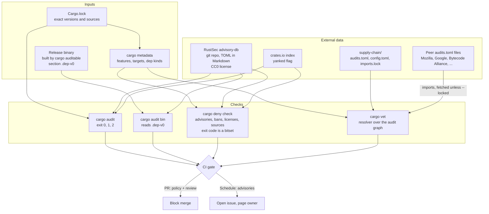

# Rust Dependency Hygiene: cargo-deny, cargo-audit, and cargo-vet

> [!summary] Claim:
> Three tools answer three different questions about the same `Cargo.lock`: is any locked version known to be bad (cargo-audit, and the advisories check of cargo-deny, against the RustSec database), does the graph obey our policy on licenses, bans, duplicates, and sources (cargo-deny), and has a human we trust read this exact code (cargo-vet).
> The first two are mechanical and stateless, and they go red or green because the world changed, not because your diff did.
> The third is a ledger in your repository, checked by a resolver that searches a graph of audits, deltas, exemptions, and imports for a path from "empty package" to each locked version.
> An expert gates pull requests on policy and review, runs the advisory scan on a schedule, pins every tool version, and treats a green `cargo vet init` as a backlog rather than a security state.



## The Mechanism

### Three questions, three tools

The tools overlap in data (RustSec) and in input (the dependency graph), but not in the question they answer.

| Question | Tool | Evidence it uses | Fails when |
|---|---|---|---|
| Is a locked version known to be vulnerable, unsound, unmaintained, or yanked? | `cargo audit`, `cargo deny check advisories` | RustSec advisory-db, crates.io index for yanks | The database learns something new, or you update the lockfile |
| Does the graph obey our policy? | `cargo deny check licenses bans sources` | Manifest `license` fields and license files, the crate graph, registry and git URLs | A dependency is added or updated, or a crate changes its license |
| Has a trusted party reviewed this exact code? | `cargo vet` | `supply-chain/audits.toml`, your `config.toml`, imported peer audits | A new crate or version enters the graph without an audit path |
| What was actually shipped in this binary? | `cargo audit bin` over a `cargo auditable` build | Zlib JSON in the `.dep-v0` section | The binary embeds a vulnerable version |

A crate with no advisory, an acceptable license, and an allowed source can still be malicious on the day it is published.
The advisory path is reactive: it needs a report, a RustSec maintainer, and a pull request merged into the database.
cargo-vet is the only one of the three that is proactive, and it is only as strong as the humans whose audits you accept.

### The graph each tool sees

All three start from the lockfile and `cargo metadata`, but they do not judge the same graph by default.

- cargo-deny considers every crate cargo resolved, including target-specific dependencies, unless `[graph].targets` restricts it.
  A dependency link is dropped when none of the listed targets satisfies its `cfg()`, and a crate with no remaining links leaves the graph.
- The `cargo deny init` template ships with `all-features = false`.
- cargo-vet runs `cargo metadata --locked --all-features` by default (and `--frozen` instead of `--locked` when you pass `--frozen` to vet, per `src/main.rs` in 0.10.3), because the "maximal" graph is a superset of every real build.
  You opt out with `--no-all-features`.
- cargo-audit reads the lockfile directly, so it sees every locked package regardless of features, targets, or dependency kind, and filters only by advisory metadata (`--target-os`, `--target-arch`).

The practical consequence is that the three can disagree about whether a crate is "in" the build.
A Windows-only dependency can fail `cargo audit` and `cargo vet` while cargo-deny with `targets = ["aarch64-apple-darwin"]` never looks at it.
Feature unification changes the graph too, which is the subject of [[Drill-Packaging-Cargo-Feature-Unification-Hazard]], and the lockfile semantics are owned by [[Lockfiles-Vendoring-and-Offline-Mirrors]].

### RustSec: the advisory database

RustSec is a git repository of advisories, one Markdown file per advisory under `crates/<name>/`, with TOML front matter (as of 2026-11, Both).
The mandatory fields are `id` (`RUSTSEC-YYYY-NNNN`), `package`, `date`, and `[versions].patched` (use `patched = []` when there is no fix).
Optional fields include `withdrawn`, `url`, `references`, `informational`, `categories`, `cvss`, `keywords`, `aliases`, `related`, `license`, `[affected] arch/os`, and `[affected.functions]`, a table from canonical function paths to the version ranges in which they were vulnerable.
`informational` takes `unsound`, `unmaintained`, or `notice`; an advisory without it is a vulnerability.

Facts that shape how the consuming tools behave:

- The database is licensed CC0-1.0, except advisories imported from GitHub's advisory database, which carry `license = "CC-BY-4.0"` and a `url` for attribution.
- Data is exported to OSV format on the `osv` branch and is available on osv.dev, and GitHub's advisory database imports it, so Dependabot and OSV-based scanners see the same records.
- Qualifying vulnerabilities include code execution, memory corruption, privilege escalation, file disclosure, cryptography failures, and panics in code advertised as panic-free.
  Soundness issues (safe code that can cause undefined behavior) are tracked as informational advisories.
- RustSec does not handle embargoed vulnerabilities: disclosure must already be public before filing.
- Suspected malicious crates are reported to crates.io, not RustSec.
  Malware that was removed still gets an advisory with category `malicious`, as RUSTSEC-2022-0042 did for `rustdecimal`.
- cargo-deny documents that advisories are never deleted from the canonical database, which is why an ignore for an ID the database does not know (`unknown-advisory`) is almost always a typo.
  A `withdrawn` date marks a retracted advisory.

### cargo-audit

`cargo audit` (0.23.0, released 2026-11-10; `rust-version` 1.88 in its `Cargo.toml`, as of 2026-11, Both) audits a `Cargo.lock` against the database.
Its README still says "Rust 1.74 or later", so trust the manifest, not the prose.

Behavior verified from the 0.23.0 source:

- **Exit codes.**
  `0` clean, `1` when `should_exit_with_failure` is true, `2` when the lockfile cannot be located or generated or the lockfile audit returns an error.
  A failure to fetch or load the advisory database is not a `2`: `auditor.rs` calls `exit(1)` there, so a CI step cannot tell "database unreachable" from "vulnerability found" by exit code alone.
  For binaries (`cargo audit bin`), `1` means a vulnerability was found and `2` means an error was encountered.
- **What fails the run.**
  Any vulnerability fails it.
  Warnings fail it only if their kind is in the deny set: `--deny warnings` (or `-D warnings`) denies all kinds, while `-D unmaintained`, `-D unsound`, and `-D yanked` deny one kind each.
  Without a deny flag, unmaintained, unsound, notice, and yanked findings are printed and the exit code stays `0`.
- **Informational kinds reported by default.**
  When `informational_warnings` is unset, the tool reports `unmaintained`, `unsound`, and `notice`.
  `-D <kind>` also adds the kind to the reported set, so denying a kind you excluded still works.
- **Lockfile generation.**
  If `Cargo.lock` is missing but `Cargo.toml` exists, it runs `cargo update --workspace` to create one.
  The README warns that Cargo can execute code from the project it runs in, so untrusted projects should be audited with `--file path/to/Cargo.lock` from a directory outside the project.
  `--file -` reads the lockfile from standard input.
- **Database.**
  Default path `~/.cargo/advisory-db`, default URL `https://github.com/RustSec/advisory-db.git`, fetched on every run unless `--no-fetch` (`-n`) or `database.fetch = false`.
  `--stale` (or `database.stale = true`) permits a database with no commits for 90 days.
  `cargo audit update-db` fetches without auditing.
- **Config.**
  `audit.toml` in `~/.cargo/` or in the project's `.cargo/`; every CLI option has a config key, and unknown keys are rejected (`deny_unknown_fields`).
  Sections: `[advisories]` (`ignore`, `informational_warnings`, `severity_threshold`; these are the only three fields of `AdvisoryConfig` in 0.23.0 `config.rs`), `[database]`, `[output]` (`deny`, `format`, `quiet`, `show_tree`), `[target]` (`arch`, `os`), and `[yanked]` (`enabled`, `update_index`).
- **Output.**
  `--format terminal|json|sarif` (SARIF is in 0.23.0), and `--json` still works and wins over `--format`.
- **Yanked crates.**
  Checked by default against the crates.io index (`[yanked] enabled = true`), disabled with `--no-yanked`.
- **Ignores.**
  `--ignore RUSTSEC-ID` or `[advisories] ignore`.
  There is no per-ignore reason or expiry in the 0.23.0 config, which is the main policy gap compared with cargo-deny.
- **`cargo audit fix`.**
  Experimental, behind the non-default `fix` feature, edits `Cargo.lock` and performs only semver-compatible upgrades by calling `cargo update` (rewritten in 0.20.0).

The `cargo audit bin` subcommand audits compiled binaries.
With dependency data from `cargo auditable` the result is complete.
Without it, the tool recovers a partial list from panic messages, which the README says misses embedded C code and roughly half of the Rust dependencies, because the compiler removes unneeded panics.
Defaults in 0.23.0: it refuses binaries larger than 100 MB (`--max-binary-size`, `0` for unlimited) and parses at most 8 MB of embedded audit data (`--audit-data-size-limit`).

### cargo-auditable: dependency data inside the binary

A lockfile says what you resolved; a deployed binary says what you shipped.
`cargo auditable` closes that gap by embedding the dependency tree in the executable, so a scanner needs no source tree, lockfile, or SBOM sidecar.

The mechanism, from the 0.7.7 source:

1. `cargo auditable build` re-executes `cargo` with `RUSTC_WORKSPACE_WRAPPER` pointing at itself and the original arguments serialized into `CARGO_AUDITABLE_ORIG_ARGS`.
   It uses the workspace wrapper rather than `RUSTC_WRAPPER` because only the former invalidates Cargo's cache, so switching to `cargo auditable` triggers a rebuild.
2. For each rustc call on a workspace crate, the wrapper acts only when `CARGO_PRIMARY_PACKAGE` is set, so only top-level artifacts (binaries and C dynamic libraries) carry the data, not every intermediate rlib.
3. It runs `cargo metadata` (or, with nightly and `CARGO_BUILD_SBOM=true cargo +nightly auditable build -Z sbom`, reads Cargo's SBOM precursor files, which the README says is more accurate), then encodes the graph.
   The encoder propagates dependency kinds: a runtime dependency of a build dependency is recorded as `build`, and procedural macros are demoted to `build`.
   Development dependencies are not recorded.
4. The JSON is zlib-compressed at level 7 and written into a new object file as a read-only section named `.dep-v0` (in the `__DATA` segment on Mach-O), which rustc links into the final artifact.
5. Source URLs and paths are redacted; crate names and versions are recorded as-is.
   The output is sorted and carries no timestamps, so reproducible builds stay reproducible.

The data format is a documented JSON schema, parseable in a few lines (`objcopy --dump-section .dep-v0=/dev/stdout $BIN | pigz -zd -` on Linux).
The README quotes under 4 kB for 400+ dependencies, roughly 1/1000 to 1/10,000 of the binary.
Consumers listed in the README include `cargo audit bin` (0.17.3 and later), trivy (0.31.0 and later), grype (0.83.0 and later), osv-scanner (2.0.1 and later, container images), and syft (1.15.0 and later), and several Linux distributions build Rust packages with it.
The format's parsing guide says to cap decompressed size (8 MiB is "more than enough") and to validate that the graph has one root and no cycles before walking it.

It does not protect against supply chain attacks: the README says plainly to use cargo-vet or cargo-crev for that, and that a malicious crate can remove itself from any SBOM.
It also does not see statically linked C libraries, which the README lists as an open item.

### cargo-deny

cargo-deny (0.22.0, released 2026-11-19, as of 2026-11, Both) lints the graph with four independent checks: `advisories`, `bans`, `licenses`, `sources`.
`cargo deny check` runs all of them with defaults for any section you omit.

#### Configuration, lint levels, exit codes

- **Discovery.**
  Starting at the manifest directory and walking up through parents, at each directory it tries `deny.toml`, `.deny.toml`, `.cargo/deny.toml`, `.config/deny.toml` (the `.config` location was added in 0.21.0), and uses the first hit.
  `--config <path>` overrides.
  Since 0.19.0 a relative `--config` resolves against the current working directory.
- **Lint levels.**
  Most fields take `deny` (error, fails the check), `warn`, or `allow` (a note at most).
  On the command line, `-D`, `-W`, and `-A` override a named diagnostic code for one run, for example `check -A duplicate bans` or `-D unmatched-skip`.
- **Exit code is a bitset since 0.14.1.**
  `advisories` is `0x1`, `bans` is `0x2`, `licenses` is `0x4`, `sources` is `0x8`, ORed over the failing checks.
  A script that tests `$? -eq 1` now means "only advisories failed".
- **Output.**
  `--format human|json|sarif`, `--color auto|always|never`, `-L` log level, `--hide-inclusion-graph`, `--show-stats`, `-g <dir>` to write a dot graph per duplicate crate.
  `--audit-compatible-output` applies only to JSON output and emits cargo-audit-shaped JSON to stdout, one object per advisory database.
- **Graph flags** (also in `[graph]`): `--manifest-path`, `--workspace`, `--exclude`, `--exclude-dev`, `--exclude-unpublished`, `-t/--target`, `--all-features`, `--no-default-features`, `--features`, `--metadata-path`, `--locked`, `--offline`, `--frozen`.
  `--offline` also stops advisory-database fetching, so advisories published since the last fetch are invisible.
- **Other commands.**
  `cargo deny init` writes a commented template `deny.toml` (`deny.template.toml` in the repository); its values are not all the documented defaults, for example it sets `wildcards = "allow"` where the bans page documents `warn`; `cargo deny list` prints licenses per crate in `human`, `json`, or `tsv`, grouped by license or by crate.

#### licenses

The check turns each crate's license into an SPDX expression and tests it against `allow` and `exceptions`.
Everything not explicitly allowed is denied.

- **Where the expression comes from, in order:** a matching `[[licenses.clarify]]`, then the manifest `license` field, then `license-file` plus all `LICENSE*` files whose detected identifiers are joined with `AND` (so you must accept all of them).
- **Text detection** uses the `spdx` crate with a `confidence-threshold` from `0.0` to `1.0`, default `0.8`.
  Detection replaced askalono in 0.18.7.
- **`clarify`** assigns an expression by hand and pins it to the hash of one or more license files, and it stops applying the moment those bytes change.
  The hash is printed by cargo-deny when it cannot classify a file.
- **`exceptions`** allow extra licenses for one crate (a PackageSpec), so a copyleft crate does not silently widen the global allow list.
  A project-local `deny.exceptions.toml` (also `.deny.exceptions.toml` or `.cargo/deny.exceptions.toml`) may carry only `exceptions`, so a shared global config and per-repo exceptions can be separated.
- **`private`** skips unpublished workspace members (`ignore = true`), optionally also those publishing only to named private registries; `ignore-sources` skips crates from listed registries.
- **GNU licenses are pedantic since 0.18.4.**
  `GPL-3.0-or-later` does not match `GPL-3.0-only`, and a crate declaring the deprecated `GPL-2.0` is matched only by `GPL-2.0`.
  Since 0.18.8, text detection of a GNU license always reports the `-or-later` variant, because the variants are indistinguishable from text.
- **Defaults worth knowing.**
  `include-dev = false`, `include-build = true` (added in 0.19.0), `unused-allowed-license = "warn"`, `unused-license-exception` (0.18.6).
  `version = 2` is accepted and ignored; the 0.16.0 release made the old `deny`, `copyleft`, `allow-osi-fsf-free`, `default`, and `unlicensed` fields hard errors.
- **What it does not check** (from the book): absent license data, a manifest expression that contradicts the files, and licensing text in unconventional places.
  It trusts what crates declare.

#### bans

- **`multiple-versions`** defaults to `warn`.
  Duplicates matter because cargo accepts several semver-incompatible versions of one crate: more downloads, longer builds, bigger `target/`, bigger binaries.
  Since 0.18.3 a version whose only dependent is another version of the same crate is not reported as a duplicate.
  `multiple-versions-include-dev` (default false) controls whether dev edges count, and when false, `skip` entries reached only via dev edges are reported unused.
- **`deny` and `allow`.**
  `deny = ["openssl", { crate = "openssl-sys", use-instead = "rustls" }]` bans by PackageSpec with an optional `reason`.
  `wrappers` allows a named crate to depend directly on a banned crate while denying all transitive use.
  If `allow` is non-empty, any crate not listed is denied; `allow-workspace = true` (0.19.0) exempts workspace members from that.
- **`skip` and `skip-tree`.**
  `skip` silences duplicate reports for matching versions and warns when an entry no longer matches (`unmatched-skip`, `unnecessary-skip`).
  `skip-tree` skips a crate and its transitive dependencies to a `depth` (default infinite), and the book calls it "a very big hammer".
- **`wildcards`** (default `warn`) flags `*` requirements; `allow-wildcard-paths` relaxes path and git dependencies in private crates.
- **`features`.**
  `[[bans.features]]` per crate with `deny`, `allow`, and `exact`; `external-default-features` and `workspace-default-features` lint a crate whose `default` feature is on.
- **Workspace hygiene (0.15.0, moved to `[bans.workspace-dependencies]` in 0.16.0).**
  `duplicates` flags direct dependencies declared in several members without `workspace = true`, `unused` flags `[workspace.dependencies]` entries nobody uses, and both default to `deny`.
- **`std-replacements` (0.20.0).**
  Flags crates.io crates whose functionality `std` or `core` now provides, using external `std-replacement-data`.
  It is off unless the table is present, with `scope` (`workspace` default, `all`, `transitive`, `none`), a `rust-version` gate, `ignore`, and `level` (default `deny`).
- **`build`: compile-time executables.**
  For crates with a build script or that are proc macros, it scans for native executables (ELF, PE, Mach-O read from file headers, so the executable bit is irrelevant), interpreted scripts, builtin script extensions (`*.py`, `*.sh`, `*.js`, ...), and optionally archives.
  `executables` defaults to `deny`, `interpreted` to `allow`.
  `allow-build-scripts` is an allow list for build scripts: omitted means all allowed, empty means none.
  `bypass` suppresses findings per crate, pinned to a SHA-256 of the build script or of a file.
  The book is explicit that this does not stop malicious code: it cannot see a crate that uploads your SSH keys in plain Rust, compressed or obfuscated binaries, or an `include!()` target swapped between versions.
  Build script behavior itself is owned by [[Rust-Build-Scripts-and-Sys-Crates]].

#### advisories

- **Database.**
  `db-urls` (default the RustSec URL), `db-path` (default `$CARGO_HOME/advisory-dbs`, with shell-style `~` and `${VAR:-fallback}` expansion).
  Since 0.18.0 the directory is `advisory-db-<hash>`, using the last URL path component and a stable hash identical across platforms.
  cargo-deny and cargo-audit therefore each keep their own clone and do not share a cache.
- **Fetching.**
  Since 0.19.1 it shells out to `git` instead of `gix`, so a runner with internet but no `git` binary needs the database populated first.
  `git-fetch-with-cli` is deprecated and does nothing.
  Also since 0.19.1 it parses advisories with its own implementation instead of the `rustsec` crate, with a nightly job comparing the two on the official database.
- **Levels.**
  Since 0.16.0 vulnerability and `notice` advisories are always errors unless ignored, and `yanked` defaults to `warn`.
  `unmaintained` and `unsound` take `all`, `workspace`, `transitive`, or `none`: `workspace` fails only for direct dependencies of a workspace crate.
  `unsound` was added in 0.19.0 defaulting to `workspace`, and 0.22.0 (PR 924) changed the `unmaintained` default from `all` to `workspace`.
  The book's overview page still says "by default, all `unmaintained` advisories will result in an error", while its config page says `workspace` is the default.
  Do not rely on a default: set both fields.
- **Ignores.**
  `ignore` takes an ID, an ID with `reason`, a yanked crate PackageSpec, and since 0.21.0 an `expiry` and an `allow` list.
  `expiry` is either an RFC 3339 duration counted from the advisory's publish date (`P30D`) or an absolute `YYYY-MM-DD`, with `ignore-expiry` as the default.
  `allow = ["crate@ver"]` names the only crates permitted to depend on the affected crate, so an ignore cannot silently cover new edges.
  After expiry the advisory is reported again with `advisory-ignore-expired`.
  `unused-ignored-advisory` (default `warn`) flags ignores that matched nothing, and 0.22.0 added `advisory-withdrawn` for ignores whose advisory was withdrawn.
- **Staleness.**
  `maximum-db-staleness` defaults to `P90D` and is checked only when fetching is disabled (`--offline`, `check --disable-fetch`).
  Version 0.19.1 fixed a bug that made that limit over 14 years instead of 90 days, so on older versions an offline cache was never "stale".
- **Yank checking** uses the local registry index and is switched off by `disable-yank-checking`.
- **Diagnostics** since 0.21.0 say whether the fix is `cargo update -p <crate>` or whether a dependent's version requirement precludes it, which the observed run below shows.

#### sources

- `unknown-registry` and `unknown-git` default to `warn`.
- `allow-registry` defaults to crates.io (`https://github.com/rust-lang/crates.io-index`; sparse URLs are accepted); set `allow-registry = []` with `unknown-registry = "deny"` to forbid all registries, which is how a fully vendored tree is enforced.
- `allow-git` needs an exact URL (a trailing `.git` is stripped), `private` accepts a host-and-path prefix, and `allow-org` trusts every repository under a GitHub, GitLab, or Bitbucket organization, so forks in a company org do not need individual entries.
- `required-git-spec` (`any` default, then `branch`, `tag`, `rev`) rejects underspecified git sources, because a bare git dependency is effectively a wildcard on a branch tip.
- The unused-entry lints are `unused-allowed-source` and `unused-allowed-org`, both defaulting to `warn`.

#### Version history that changes your config

| Version | Date | Change that can alter results | Platform |
|---|---|---|---|
| 0.14.1 | 2023-08-02 | Exit code becomes a bitset of failed checks (PR 538) | Both |
| 0.16.0 | 2024-08-02 | Old `vulnerability`, `unmaintained`, `unsound`, `notice`, `severity-threshold`, and license policy fields removed; all advisories deny by default | Both |
| 0.18.3 | 2025-06-11 | A version whose only dependent is another version of the same crate is not a duplicate | Both |
| 0.18.4 | 2025-08-14 | GNU license matching becomes exact, and `/` is no longer rewritten to `OR` | Both |
| 0.19.0 | 2026-01-08 | `[advisories] unsound` added (default `workspace`), `licenses.include-build`, `bans.allow-workspace`, relative `--config` resolution changes | Both |
| 0.19.1 | 2026-04-10 | `gix` and `rustsec` dependencies removed, staleness bug fixed, `krates` update can surface issues previously hidden | Both |
| 0.20.0 | 2026-07-09 | CLI refactor removing deprecated flags, `bans.std-replacements` added | Both |
| 0.21.0 | 2026-11-16 | Ignore `expiry`, `ignore-expiry`, and `ignore.allow`; `.config/deny.toml` discovery | Both |
| 0.22.0 | 2026-11-19 | `unmaintained` default `all` to `workspace`; `advisory-withdrawn` diagnostic | Both |

All dates are crates.io or changelog release dates (as of 2026-11).
The pillar topic inventory pins cargo-deny at 0.20.2 and cargo-audit at 0.22.2, which are both behind the releases above.

### cargo-vet

cargo-vet (0.10.3 on crates.io, released 2026-10-22; the GitHub changelog and tags also list 0.10.4 dated 2026-11-17, which fixes credential leakage in debug logs when `--use-git-credentials` is combined with `--verbose debug` or `trace`; MSRV 1.85 as of 0.10.3) is a ledger plus a resolver.
The ledger lives in `supply-chain/` next to `Cargo.lock` (configurable via `[package.metadata.vet]` or `[workspace.metadata.vet]`) and is committed with the code.

#### Store layout and vocabulary

| File | Holds | Importable by others |
|---|---|---|
| `audits.toml` | `[criteria.*]`, `[[audits.crate]]`, `[[wildcard-audits.crate]]`, `[[trusted.crate]]` | Yes |
| `config.toml` | `default-criteria`, `[imports.*]`, `[policy.*]`, `[[exemptions.crate]]`, `[cargo-vet]` version | No |
| `imports.lock` | Generated cache of imported audits, treated as an implementation detail | No |

`cargo vet init` creates this store and fills `exemptions` with every current third-party dependency (and `audit-as-crates-io` entries it guesses), so the check passes immediately.
The tool's own FAQ gives the reason: an open-ended audit task on the critical path of adoption means people never finish setup.
The honest consequence is that a freshly initialized repo has zero audited code and a green check.

#### Criteria, audits, deltas, violations

Criteria are labels with human-readable descriptions, and the built-in pair is `safe-to-run` (can be compiled, run, and tested on a workstation or in automation without surprising consequences such as touching unrelated files, installing software, reaching untrusted endpoints, or misusing resources) and `safe-to-deploy` (will not introduce a serious vulnerability to production software exposed to untrusted input; it implies `safe-to-run`).
For `safe-to-deploy`, the auditor must review enough to reason about every `unsafe` block and every use of powerful imports, but need not do a full logic review.
Custom criteria go in `audits.toml` with `description` or `description-url` and optional `implies`.
When you aggregate audits, a criterion's description must be byte-identical in every source.

Each audit entry has exactly one of:

- `version = "1.2.3"`: the whole version was audited.
- `delta = "1.2.3 -> 1.2.4"`: the diff was audited and preserves the criteria.
  Deltas may go backwards, and the standard is that the properties are actually preserved, not that the diff looks innocent, so the auditor must read enough of the base for context.
- `violation = ">=2.0, <2.3"`: a Cargo `VersionReq` that does not meet the criteria.
  A bare `1.0.0` means `^1.0.0`, so use `=1.0.0` for a single version.

A violation is an integrity constraint, not a build failure by itself.
It produces an error when an audit or exemption (including an imported one) claims a criterion the violation contradicts.
The algorithm chapter's worked examples are: violation `safe-to-deploy` with audit `safe-to-deploy` is an error, with audit `safe-to-run` it is fine, and violation `safe-to-run` with audit `safe-to-deploy` is an error because `safe-to-deploy` implies `safe-to-run`.
A violation therefore rejects a dependency even when it is listed in `exemptions`.

#### Exemptions, imports, trusted publishers, wildcard audits

- **Exemptions** are `[[exemptions.crate]]` entries in `config.toml` with `version`, `criteria`, `notes`, and `suggest`.
  `suggest = false` keeps an exemption out of the `cargo vet suggest` backlog.
  Differential audits still work against an exempted base, which the book calls out as meaningful protection against future attacks.
- **Imports** are `[imports.name] url = "https://..."` pointing at a peer's raw `audits.toml`.
  Imports are deliberately not transitive: you cannot import someone's imports, which keeps trust direct.
  Peer criteria are private to the peer unless mapped with `criteria-map`; only `safe-to-run` and `safe-to-deploy` map by default.
  `exclude` drops a crate's audits from one peer "as a last resort".
  Imported audits are cached in `imports.lock`, and `--locked` skips the fetch.
  `cargo vet import <name>` with no URL looks the peer up in the registry.
- **The registry** is `registry.toml` in the cargo-vet repository, an index of well-known audit files.
  It has nine entries as fetched on 2026-11-21: actix, ariel-os, bytecode-alliance, embark-studios, fermyon, google, isrg, mozilla, zcash.
  It is an index only: imports are always fetched from the publisher and only after you add them, so there is no central service to compromise.
- **Trusted publishers** (`[[trusted.crate]]`, `cargo vet trust`) record that you trust a crates.io user id (a number, not the username) for a date range, `end` at most one year out.
  The book labels this a heuristic: the publisher may not have written or reviewed the code.
  Since 0.10.2 a trust entry or wildcard audit can name a Trusted Publishing identity such as `github:organization/repository` (publishing is owned by [[Rust-Publishing-Crates-io-Trusted-Publishing-and-Private-Registries]]).
- **Wildcard audits** (`[[wildcard-audits.crate]]` with `user-id`, `start`, `end`, `renew`) let an organization self-certify every release a given account publishes within a window, for crates it itself owns.
  `end` is at most one year ahead; `cargo vet renew --expiring` renews those expiring within six weeks; dates are UTC.
  They vouch for the release process, not for individual versions.

#### Policy and first-party code

By default, every top-level crate must satisfy `safe-to-deploy` for regular and build dependencies and `safe-to-run` for dev-dependencies, on all platforms.
`[policy.crate]` can set `criteria`, `dev-criteria`, `dependency-criteria`, `audit-as-crates-io`, and `notes`.
`criteria` may be set only on first-party crates, because a third-party crate can sit in several unrelated places in the graph, so relaxations for third-party crates go through `dependency-criteria` and need version-qualified keys.

First-party means roots, path dependencies, git dependencies, and non-crates.io registry dependencies.
A `[patch]`-replaced crates.io crate blurs that line, so if a public crate has the same name and version as a first-party crate, a policy entry must say `audit-as-crates-io = true` or `false`.
When true for a git dependency, enforcement is precise: it needs an audit of the published base version plus delta audits to the commit, written `1.0.0@git:SHA`.

#### The resolver

The Cargo Vet Algorithm chapter describes `check` as one operation reused by `suggest` (the same with suggestable exemptions removed), `certify`, and `regenerate`.
The steps, in the order the book gives them:

1. **Build the `DepGraph`** from `cargo metadata --locked --all-features`.
   Workspace members with dev-dependencies can make cargo's graph cyclic (`serde` and `serde_derive` tests), so vet analyzes the graph without dev edges first, then replays the nodes with dev edges as "fake" test-only roots.
2. **Build the `CriteriaMapper`**, which interns criteria and precomputes the transitive closure of `implies`.
   A `CriteriaSet` is a `u64`, so the total of your criteria and your imports' mapped criteria is capped at 64, and the code is written so the cap can be raised with `u128` or a bit set.
3. **Propagate required criteria** from roots to leaves, starting with dev-dependencies one edge deep, applying `policy` overrides where present.
4. **Build an `AuditGraph` per third-party crate.**
   Nodes are versions plus an implicit Root representing the empty package, and edges are delta audits.
   A full audit becomes a delta from Root, an exemption becomes a full audit tagged with its origin, and imported audits are tagged likewise.
   Violations are checked while building.
5. **Search for a path** from Root to the target version along edges certifying each required criterion, one criterion at a time, using a priority queue so that better edges are tried first: local audits, then exemptions, then imports.
   If a path uses only local audits the crate is fully audited; if it needed an exemption, that exemption is necessary; if it needed an import, `imports.lock` must be updated.
6. **Check** that validated criteria are a superset of required criteria for every third-party package.
7. **Suggest** on failure: it takes the nodes reachable from Root and reverse-reachable from the target, intersects them across all failed criteria, and recommends the smallest diff.
   To avoid O(n squared) diffing it diffs each target-reachable version only against the nearest audited version below and above it, and it caches diff statistics on disk.
   A diff from Root is turned into a full audit recommendation, and diffs can run backwards.

The output of a failed check lists unvetted dependencies, the commands to run, and an estimated line count, for example (from the book, illustrative) `cargo vet diff foo 1.2 1.2.1 (10 lines)` against `cargo vet inspect baz 1.3 (2033 lines)` and `estimated audit backlog: 2296 lines`.
`cargo vet explain-audit <crate> [version] [criteria]` prints the computed path, and `dump-graph` prints the graph as Mermaid or JSON.

#### Commands

`check` (default), `suggest`, `init`, `inspect`, `diff`, `certify`, `import`, `trust`, `regenerate` (`exemptions`, `imports`, `audit-as-crates-io`, `unpublished`), `add-exemption`, `record-violation`, `fmt`, `prune`, `aggregate`, `explain-audit`, `dump-graph`, `gc`, and `renew`.
`inspect` and `diff` take `--mode local|diff.rs|custom_url=URL`, and `inspect` also accepts `crates.io` (the 0.10.3 changelog says `crates.io` is "only for `inspect`").
Since 0.10.3 the `sourcegraph` mode is gone, `custom_url` is new, and `inspect` and `diff` remember their last mode separately (the tutorial chapter of the book still shows Sourcegraph links).
`regenerate exemptions` is the "make `check` pass minimally" command, and it also weakens an over-broad exemption (`safe-to-deploy` to `safe-to-run`) and deletes unneeded ones.
Global flags include `--locked`, `--frozen`, `--no-all-features`, `--filter-graph`, `--output-format human|json`, `--no-registry-suggestions`, `--no-minimize-exemptions`, and `--cache-dir`.

`cargo vet aggregate sources.list` merges the `audits.toml` files at a list of URLs into one file, adding an `aggregated-from` field to each entry, which is how an organization with many repositories publishes one import target.
The book's example workflow runs it on a five-minute cron and commits when the output changes.

#### Rebuild: a toy resolver

The core of the resolver is reachability over audit edges with an origin ranking.
This 40-line Python model keeps only that: versions as nodes, Root as `None`, local edges ranked before exemption edges, and a priority queue.
It ignores criteria, dependency criteria, imports, and violations, so it is a teaching model and not a reimplementation.

```python
import heapq

ROOT = None  # the empty package


def edges(audits, exemptions):
    """Yield (src, dst, origin_rank). Lower rank is preferred: local < exemption."""
    for kind, a, b in audits:
        if kind == "version":
            yield ROOT, a, 0
        else:  # delta, may go backwards
            yield a, b, 0
    for v in exemptions:
        yield ROOT, v, 1


def search(target, audits, exemptions):
    adj = {}
    for s, d, r in edges(audits, exemptions):
        adj.setdefault(s, []).append((d, r))
    best = {ROOT: 0}
    pq = [(0, 0, ROOT)]
    n = 0
    while pq:
        worst, _, node = heapq.heappop(pq)
        if node == target:
            return "fully audited" if worst == 0 else "needs exemption"
        for d, r in adj.get(node, []):
            w = max(worst, r)
            if d not in best or w < best[d]:
                best[d] = w
                n += 1
                heapq.heappush(pq, (w, n, d))
    return "FAIL"


audits = [("version", "1.2.3", None), ("delta", "1.2.3", "1.2.4"), ("delta", "2.1.3", "2.1.1")]
print("1.2.4 with audits only    :", search("1.2.4", audits, []))
print("2.1.1 with exemption 2.1.3:", search("2.1.1", audits, ["2.1.3"]))
print("2.1.1 with no exemption   :", search("2.1.1", audits, []))
print("3.0.0 unreachable         :", search("3.0.0", audits, ["2.1.3"]))
```

Output (python3 on Darwin 27.3.0 arm64, run once on 2026-11-21):

```text
1.2.4 with audits only    : fully audited
2.1.1 with exemption 2.1.3: needs exemption
2.1.1 with no exemption   : FAIL
3.0.0 unreachable         : FAIL
```

The second line shows a backward delta (`2.1.3 -> 2.1.1`) reached through an exemption of the base, which is the differential-audit-against-an-exempted-base case.

### What none of the three can see

- A malicious crate no one has reported, unless a human audited it (cargo-vet) or you banned the name.
- A `build.rs` or proc macro that behaves differently per environment: `rustdecimal` triggered only when `GITLAB_CI` was set.
  A reviewer reading a diff can catch that, and cargo-deny's `build` scan cannot.
- Source that differs from what the repository shows: reviewers must read the published crate (`cargo vet inspect --mode local` downloads the crates.io source), and registry immutability and yanking semantics are covered in [[Case-Study-Left-Pad-and-Registry-Immutability]].
- Vulnerabilities in statically linked C code inside `-sys` crates, unless RustSec has an advisory against the `-sys` crate itself.
- Reachability: an advisory says a version range is affected, not that your code calls the affected function.
  `[affected.functions]` exists in the schema, and cargo-audit's binary scanning can print affected symbols, and only a minority of advisories populate it: 342 of the 1,536 `RUSTSEC-` records in the OSV crates.io export carry affected functions, about 22% (counted from `crates.io/all.zip` on 2026-11-21, as of 2026-11).

### Gate design for CI

A workable split has three jobs with different triggers and failure policies.

1. **Pull request, blocking:** `cargo deny check licenses bans sources` and `cargo vet --locked`.
   These change only when the graph or the ledger changes, so a red result is attributable to the diff.
2. **Pull request, blocking on new findings only:** `cargo deny check advisories` or `cargo audit`, because a new dependency can arrive already vulnerable.
   Use ignores with `reason` and `expiry` so a known accepted advisory does not block unrelated work.
3. **Schedule, non-blocking for PRs:** the same advisory scan against `main` and every release branch, opening an issue or paging an owner.
   Advisories land without any commit, so a blocking advisory job on `main` turns unrelated PRs red.
4. **Release artifact:** `cargo auditable build`, then `cargo audit bin` on the shipped binary, which catches differences between what you resolved and what you linked, and produces an artifact a fleet scanner can read later (see [[Rust-Binary-Distribution-with-dist-and-Cross-Compilation]], which owns `dist` and its opt-in support).

Pin every tool by version: `cargo install --locked cargo-deny --version 0.22.0`, a pinned `cargo-deny-action@v2` (the action README's example uses `@v2` and `actions/checkout@v4`, while the book's example still shows `@v1` and `@v3`), and the vet book's `CARGO_VET_VERSION` cache pattern.
The default flips in the table above are the reason: a tool upgrade is a policy change.

## Commands and Numbers to Know

| Item | Value | Platform | Notes |
|---|---|---|---|
| cargo-deny latest | 0.22.0, 2026-11-19 (as of 2026-11) | Both | crates.io API; release binary used for the observed run below. |
| cargo-audit latest | 0.23.0, 2026-11-10, `rust-version` 1.88 (as of 2026-11) | Both | README still says 1.74. |
| cargo-vet latest | 0.10.3 on crates.io, 2026-10-22; 0.10.4 tagged on GitHub (as of 2026-11) | Both | MSRV 1.85 per the 0.10.3 changelog. |
| cargo-auditable latest | 0.7.7, 2026-10-02 (as of 2026-11) | Both | Linux, Windows, macOS officially supported; WebAssembly since 0.6.3. |
| `cargo deny check` exit code | `advisories` 0x1, `bans` 0x2, `licenses` 0x4, `sources` 0x8 (as of 2026-11) | Both | Bitset since 0.14.1; observed 1, 2, and 3 below. |
| `cargo audit` exit code | 0 clean, 1 vulnerability or denied warning, 2 lockfile or audit error (as of 2026-11) | Both | From 0.23.0 `audit.rs`; a database fetch or load failure exits 1 (`auditor.rs`). |
| `cargo audit bin` limits | 100 MB binary, 8 MB audit data (as of 2026-11) | Both | `--max-binary-size`, `--audit-data-size-limit`. |
| cargo-audit database | `~/.cargo/advisory-db`, stale after 90 days without commits (as of 2026-11) | Both | `--no-fetch`, `--stale`. |
| cargo-deny database | `$CARGO_HOME/advisory-dbs/advisory-db-<hash>`, `maximum-db-staleness = "P90D"` (as of 2026-11) | Both | Staleness checked only with fetching disabled. |
| `.dep-v0` | zlib JSON, level 7, README says under 4 kB for 400+ dependencies (as of 2026-11) | Both | `objcopy --dump-section .dep-v0=/dev/stdout $BIN \| pigz -zd -` on Linux. |
| cargo-deny `licenses.confidence-threshold` | 0.8 default (as of 2026-11) | Both | Range 0.0 to 1.0. |
| cargo-deny `bans.multiple-versions` | `warn` default (as of 2026-11) | Both | `deny` makes duplicates fail with exit bit 0x2. |
| cargo-deny `sources.unknown-registry` and `unknown-git` | `warn` default (as of 2026-11) | Both | `allow-registry` defaults to crates.io. |
| cargo-deny `advisories.yanked` | `warn` default (as of 2026-11) | Both | `deny` to fail. |
| cargo-deny `advisories.unmaintained` and `unsound` | `workspace` default (as of 2026-11) | Both | `unmaintained` default was `all` before 0.22.0. |
| cargo-vet built-in criteria | `safe-to-run`, `safe-to-deploy` (implies run) (as of 2026-11) | Both | Mapped across projects automatically. |
| cargo-vet criteria limit | 64 per project including imports (as of 2026-11) | Both | `CriteriaSet` is a `u64`. |
| cargo-vet wildcard and trust window | `end` at most 1 year ahead; renew when within 6 weeks (as of 2026-11) | Both | `cargo vet renew --expiring`. |
| cargo-vet `gc` | removes cache entries unused for 30 days (as of 2026-11) | Both | `--max-package-age-days`. |
| cargo-vet registry | 9 audit sets (as of 2026-11) | Both | `registry.toml` on main. |
| Dependency overlap, from the vet book | Firefox 406, wasmtime 310, rustc 357 crates.io dependencies, 107 common to all three (undated in the book) | Both | The sharing argument for imports. |

## Multi-Language Comparison

| Concern | Rust | Python | C++ |
|---|---|---|---|
| Known-vulnerability scan of a lockfile | `cargo audit`, `cargo deny check advisories` against RustSec | `pip-audit` against the PyPI JSON API or OSV, for environments and requirements-style files | `osv-scanner` over supported lockfiles, and a vendored-C/C++ detection mode that sends file hashes to OSV |
| Policy as code (license, source, ban) | `cargo deny` with `deny.toml`: licenses, bans, sources, advisories in one file | `pip-licenses` covers licenses only, with `--allow-only` and `--fail-on` (exit code 1) over the installed environment; no ban or source policy tool is named here | `osv-scanner --licenses="MIT,Apache-2.0"` reports violations against an SPDX allowlist using deps.dev data; license only, and no ban or source policy tool is named here |
| Human-audit ledger shared across orgs | `cargo vet` with imports and a registry | No equivalent fetched here | No equivalent fetched here |
| Dependency data in the shipped binary | `cargo auditable` section `.dep-v0`, read by trivy, grype, syft, osv-scanner | No equivalent named here; not checked | No equivalent named here; not checked |
| Advisory source | RustSec, exported to OSV | PyPI JSON API vulnerability data or OSV, selectable in `pip-audit` | OSV through `osv-scanner` |

The portable lesson is structural: separate "known bad" (data feeds), "policy" (config in the repo), and "reviewed" (a ledger), and make each one fail for a different reason.
OSV-Scanner reads Rust lockfiles as one of its 11-plus ecosystems, so a polyglot organization can run one scanner for known-bad and keep the Rust-specific policy and review layers.
Wheel packaging is owned by [[Python-Wheels-Platform-Tags-Manylinux-and-ABI3]] and the Python side of attestation by [[Python-Trusted-Publishing-and-PEP-740-Attestations]].

## Worked Lab Example

This note has no lab: its brief assigns none and paused lab checks on 2026-11-11, and a lab here would need the `network` requirement for crates.io and the advisory database.
Instead the note records one real run, made once on 2026-11-21 on Darwin 27.3.0 arm64 (macOS) with the official `cargo-deny-0.22.0-aarch64-apple-darwin` release binary and cargo 1.99.0 (rustc toolchain from the host).
cargo-audit, cargo-vet, and cargo-auditable were not run here, so every claim about them comes from their documentation and source.

### The project

```toml
# Cargo.toml
[package]
name = "demo"
version = "0.1.0"
edition = "2021"
publish = false
license = "MIT"

[dependencies]
getrandom = "0.2"
getrandom03 = { package = "getrandom", version = "0.3" }
time = "=0.1.45"
```

```toml
# deny.toml
[graph]
targets = ["aarch64-apple-darwin"]

[advisories]
yanked = "deny"

[bans]
multiple-versions = "deny"
wildcards = "deny"

[licenses]
allow = ["MIT", "Apache-2.0"]
confidence-threshold = 0.8

[sources]
unknown-registry = "deny"
unknown-git = "deny"
```

After `cargo generate-lockfile`, `Cargo.lock` held 14 packages: `cfg-if 1.0.5`, `demo`, `getrandom 0.2.17`, `getrandom 0.3.4`, `libc 0.2.191`, `r-efi 5.3.0`, `time 0.1.45`, `wasi 0.10.0` and `wasi 0.11.1`, `wasip2 1.0.4`, `winapi 0.3.9` with its two `*-pc-windows-gnu` crates, and `wit-bindgen 0.57.1`.

### Observed output (cargo-deny 0.22.0, Darwin 27.3.0 arm64, 2026-11-21)

Box-drawing characters in the real output are replaced by ASCII, the advisory body is elided with `[...]`, and the project path is shown as `<job>`.

```text
$ cargo deny --color never check bans
error[duplicate]: found 2 duplicate entries for crate 'getrandom'
  |- <job>/_demo/Cargo.lock:3:1
  |  getrandom 0.2.17 registry+https://github.com/rust-lang/crates.io-index
  |  getrandom 0.3.4 registry+https://github.com/rust-lang/crates.io-index
  |  (lock entries)
  |- getrandom v0.2.17
     +-- demo v0.1.0
  |- getrandom v0.3.4
     +-- demo v0.1.0

bans FAILED
exit=2

$ cargo deny --color never check advisories
error[vulnerability]: Potential segfault in the time crate
  |- <job>/_demo/Cargo.lock:6:1
  |  time 0.1.45 registry+https://github.com/rust-lang/crates.io-index
  |  security vulnerability detected
  |- ID: RUSTSEC-2020-0071
  |- Advisory: https://rustsec.org/advisories/RUSTSEC-2020-0071
  |- [...]
  |- Announcement: https://github.com/time-rs/time/issues/293
  |- 1 dependent has version requirements that preclude updating:
  |- demo = 0.1.0
  |-   - time = '=0.1.45'
  |- time v0.1.45
     +-- demo v0.1.0

advisories FAILED
exit=1

$ cargo deny --color never check licenses
licenses ok
exit=0

$ cargo deny --color never check sources
sources ok
exit=0

$ cargo deny --color never check --hide-inclusion-graph     (filtered to headers and verdicts)
error[duplicate]: found 2 duplicate entries for crate 'getrandom'
error[vulnerability]: Potential segfault in the time crate
advisories FAILED, bans FAILED, licenses ok, sources ok
exit=3
```

### Reading the output

- **The exit code is the bitset.**
  `bans` alone gave 2, `advisories` alone gave 1, and the combined run gave 3 (`0x1 | 0x2`), matching the documented bit assignments.
- **`[graph] targets` pruned the lockfile.**
  `Cargo.lock` locks two `wasi` versions and three `winapi` crates, none of which cargo-deny reported, because every edge to them is conditioned on `wasi`, `windows`, or WASI targets and the only listed target is `aarch64-apple-darwin`.
  Only `getrandom`, which every target uses, was flagged as a duplicate.
  Removing the `targets` line would have flagged `wasi` as a second duplicate, and `cargo audit` and `cargo vet --all-features` would have considered all of them.
- **The advisory diagnostic says why the fix is not `cargo update`.**
  The `=0.1.45` requirement in `demo` precludes any unaffected version, and RUSTSEC-2020-0071 says users of `time` 0.1 have no patch and must move to 0.2.23 or later or the 0.3 series.
  This is the 0.21.0 diagnostic improvement in action.
- **`licenses ok` and `sources ok` are not evidence of safety.**
  They show that every locked crate matched `MIT` or `Apache-2.0` and came from crates.io, which says nothing about whether the code is trustworthy.

### Reproduce it

```bash
cargo install --locked cargo-deny --version 0.22.0
mkdir demo && cd demo && mkdir src && echo 'fn main() {}' > src/main.rs
# write the Cargo.toml and deny.toml shown above
cargo generate-lockfile
cargo deny --color never check; echo "exit=$?"
```

## Pitfalls

> [!warning] Pitfall 1: A green advisory scan is a statement about yesterday
> The advisory check changes result without any commit to your repository.
> A scheduled job on `main` and each release branch is what finds a fresh advisory, while a PR-blocking advisory job makes unrelated pull requests fail on the day the advisory lands.
> Give accepted risks an ID, a reason, an `expiry`, and an `allow` list in `deny.toml`, because cargo-audit's ignore list has no reason or expiry field.

> [!warning] Pitfall 2: `cargo audit` exits 0 on unmaintained and yanked crates
> Only vulnerabilities fail the run by default.
> A team that reads "audit passed" as "nothing to worry about" has not enabled `-D warnings` or `-D unmaintained`.
> Conversely, `-D warnings` then makes every informational advisory a hard failure, so introduce it with a baseline of ignores.

> [!warning] Pitfall 3: Tool upgrades are policy changes
> cargo-deny 0.22.0 changed the `unmaintained` default from `all` to `workspace`, so an unattended bump can turn a red job green and stop reporting transitive unmaintained crates.
> The 0.19.1 release made unsound advisories honor the `workspace` scope for transitive dependencies and shipped a `krates` update that, per the changelog, "may mean that updating cargo-deny may highlight issues that were previously hidden".
> Pin versions, set every level you care about explicitly, and read the changelog in the upgrade PR.

> [!warning] Pitfall 4: The three tools judge different graphs
> The `cargo deny init` template has `all-features = false` and an empty `targets`, cargo-vet defaults to `--all-features`, and cargo-audit reads the whole lockfile.
> A crate can be "in" for one tool and "out" for another, and a `[graph]` setting can hide a dependency you actually ship on another platform.
> Decide the graph once (targets you ship, features you ship) and set it in `deny.toml` and the vet command line deliberately.

> [!warning] Pitfall 5: Permanent `skip` and `skip-tree` entries
> A `skip` is a way to say "a fix is coming".
> Without a `reason`, a version-qualified spec, and `-D unmatched-skip` in CI, entries outlive their cause and hide new duplicates, and `skip-tree` with infinite depth hides every transitive duplicate under a crate.

> [!warning] Pitfall 6: Treating `cargo vet init` as an achievement
> Initialization exempts every current dependency, so the check passes with zero audited code.
> Track the size of the `exemptions` table and the output of `cargo vet suggest` as the metric, and refuse new exemptions in review without a note.
> `suggest = false` hides an exemption from that metric, so it needs the same scrutiny.

> [!warning] Pitfall 7: Audits are only as trustworthy as who can merge them
> The `who` field is a string, not an authenticated identity, and there is no web of trust.
> The book recommends that when more than five people can approve changes, a small group owns `supply-chain/` through CODEOWNERS, and that an auditor be someone you would trust to approve an anonymous patch alone.
> Importing a peer imports their risk tolerance too: their `safe-to-deploy` may be weaker than yours, which is what custom criteria and `criteria-map` are for.

> [!warning] Pitfall 8: Running cargo against a repository you do not trust
> `cargo audit` generates a lockfile with `cargo update --workspace` when none exists, and cargo configuration in a project can change what that does.
> Audit untrusted projects with `--file` on a lockfile you copied out, from a neutral working directory.

> [!warning] Pitfall 9: Believing `bans.build` or an SBOM stops malware
> The cargo-deny book lists what its compile-time scan will not detect, and the cargo-auditable README says an SBOM cannot be used to assess a supply chain attack because malicious code can remove itself from it.
> These tools give inventory and tripwires, and review is what addresses intent.

## At Scale

From one developer to 50,000 engineers the checks stay the same and the operating model changes.

| Scale | Policy | Review | Advisory handling | Decision rule |
|---|---|---|---|---|
| 1 to 10 engineers, one repo | `deny.toml` from `cargo deny init`, licenses and sources enforced, duplicates `warn` | None, or `cargo vet` with imports from Mozilla or Google only | Daily scheduled job plus PR check | Start with licenses, sources, and advisories: low noise, high value. |
| 10 to 200 engineers, many repos | One shared base `deny.toml` distributed by template, per-repo `deny.exceptions.toml` for license exceptions | `cargo vet` with imports, exemptions ratcheted down, CODEOWNERS on `supply-chain/` | Scheduled scan per repo, ignores with `reason` and `expiry` | Add vet once the dependency set is stable enough that audits are reused. |
| 1,000 to 50,000 engineers | A central policy owner, internal advisory database mirror in `db-urls`, vendored or mirrored registry with `allow-registry` locked to it | A shared `cargo vet aggregate` repository as the single import target, custom criteria such as a `crypto-reviewed` level, wildcard audits for first-party crates | Fleet scanning of deployed binaries through `cargo auditable` and `cargo audit bin` or an OSV-based scanner | Audit effort goes where the graph is shared, so measure line-count backlog per criterion, not number of crates. |

Concrete decision rules:

- **Make the database local when you cannot reach GitHub from CI.**
  Mirror the advisory repo, set `db-urls`, and use `--offline` or `--disable-fetch` with `maximum-db-staleness` so a stale mirror fails instead of passing silently.
  Because of the 0.19.1 fix, do this only on 0.19.1 or later.
- **Prefer vendoring plus `allow-registry = []` when builds must be hermetic.**
  The mechanics of vendoring and mirrors belong to [[Lockfiles-Vendoring-and-Offline-Mirrors]], and cargo-deny then enforces that no registry source sneaks back in.
- **Share audits before writing them.**
  Run `cargo vet suggest`, accept registry suggestions (`cargo vet import mozilla`), and write only the residual; the book's example shows a 2033-line audit shrinking to a 17-line diff after one import.
- **Publish your own audits once you depend on others'.**
  Your `audits.toml` is a seal of approval other projects may rely on, so curate it with the same care as a release.
- **Budget the reviewer, not the tool.**
  Runtime is minutes at most (the book says caching the binary makes results appear "within a few seconds rather than several minutes" instead of compiling cargo-vet each time), and the real cost is review time.
- **Record the choice.**
  Which graph, which criteria, and which advisory SLA go into [[Packaging-Decision-Records]] so changes are deliberate.
- **Expect release trains to need exceptions.**
  A backported security fix to an old branch may require an exemption or delta audit on an old crate version, which interacts with [[Release-Trains-Backports-and-Artifact-Registries]].

## Practice Drill

> [!tip] Practice Drill: Ratchet a real repository
> Pick a Rust repository with more than 50 locked crates.
> 1. Pin the tools: `cargo install --locked cargo-deny --version 0.22.0` and `cargo install --locked cargo-vet --version 0.10.3`.
> 2. Run `cargo deny init`, then `cargo deny check` and record the exit code and the list of diagnostic codes.
>    Decide each class: allow the license, fix the duplicate, or add a `skip` with a `reason` and `-D unmatched-skip`.
> 3. Set `unmaintained = "all"` and `unsound = "all"` explicitly, run `cargo deny check advisories`, and compare against `cargo audit -D warnings` on the same `Cargo.lock`.
>    Explain every difference using the scope fields and informational categories above.
> 4. Add `[graph] targets` for the platforms you ship and re-run: which crates vanish from the report?
> 5. Run `cargo vet init`, count the exemptions, then run `cargo vet suggest` and `cargo vet import mozilla`; record how many lines of backlog the import removed.
> 6. Build the release binary with `cargo auditable build --release`, extract `.dep-v0` with `objcopy` or `rust-audit-info`, and confirm that `cargo audit bin` reports the same crates as the lockfile.
> Then read [[Drill-Packaging-Cargo-Feature-Unification-Hazard]] and explain which of your results change if `--all-features` is toggled.

## Interview Questions

> [!question] L5: What question does each of cargo-audit, cargo-deny, and cargo-vet answer?
> > [!success]- Answer
> > cargo-audit answers "is any locked version in RustSec as vulnerable, unmaintained, unsound, or yanked".
> > cargo-deny answers "does the graph obey our policy" across licenses, bans and duplicates, sources, and (optionally) advisories.
> > cargo-vet answers "has someone we trust audited this exact crate version, or a diff from an audited version".
> > Only cargo-vet addresses a malicious crate that has not been reported; the other two depend on reports and declared metadata.

> [!question] L5: `cargo audit` printed three warnings and exited 0. Is the project clean?
> > [!success]- Answer
> > Not necessarily.
> > By default only vulnerabilities fail the run (exit 1), and unmaintained, unsound, notice, and yanked findings are printed and ignored for the exit code.
> > Add `-D warnings` to fail on all kinds, or `-D unmaintained`, `-D unsound`, `-D yanked` individually, and keep a reviewed ignore list for accepted ones.
> > Exit 2 means the audit itself failed (for example no lockfile could be located or generated), which must also fail CI.
> > A database that cannot be fetched or loaded exits 1 in 0.23.0, the same code as a finding, so read the log before treating a red run as a vulnerability.

> [!question] L6: Predict the output: with the `deny.toml` shown in the worked example, what are the exit codes of `cargo deny check bans`, `cargo deny check advisories`, and `cargo deny check`?
> > [!success]- Answer
> > The graph has `getrandom` 0.2.17 and 0.3.4 and `time` 0.1.45 (RUSTSEC-2020-0071).
> > `check bans` fails on the duplicate with `multiple-versions = "deny"`, so exit 2.
> > `check advisories` fails on the vulnerability, so exit 1.
> > `check` runs everything and ORs the bits: `0x1 | 0x2` is 3, and `licenses` and `sources` pass.
> > `wasi` and `winapi` are not reported because `targets = ["aarch64-apple-darwin"]` prunes the edges to them.

> [!question] L6: Debug this: a nightly advisories check went green after a cargo-deny bump
> A nightly `cargo deny check advisories` was red for two weeks because of an unmaintained transitive crate.
> A Dependabot bump from cargo-deny 0.21.0 to 0.22.0 made it green, with no `deny.toml` change and no dependency change.
> What happened, and what do you do?
> > [!success]- Answer
> > 0.22.0 changed the default of `advisories.unmaintained` from `all` to `workspace` (PR 924, per the changelog), so unmaintained advisories now fail only for direct dependencies of workspace crates.
> > The advisory still exists; the policy that reported it was changed by the upgrade.
> > Set `unmaintained = "all"` (and `unsound = "all"`) in `deny.toml` if the transitive findings must block, or accept `workspace` deliberately and record it.
> > Treat tool upgrades as policy changes: pin the version, read the changelog in the bump PR, and diff the diagnostics before and after.

> [!question] L6: Why does `cargo vet init` succeed on a repository with 400 unaudited dependencies, and is that a problem?
> > [!success]- Answer
> > `init` writes an `exemptions` entry for every current third-party crate and sets `audit-as-crates-io` guesses, so the resolver finds a path (an exemption edge) for each.
> > It is intentional: the FAQ says an open-ended audit task on the adoption path means setup never finishes, so the repository gets to green and then ratchets.
> > It is a problem only if nobody ratchets: the repo gets protection against newly added or updated crates (they need an audit or a new exemption), but the existing 400 stay unreviewed.
> > Track the exemption count and `cargo vet suggest` backlog, and import peers to shrink it.

> [!question] L7: A crate in your graph has an exemption at version 2.1.3.
> A peer you import published a delta audit `2.1.3 -> 2.1.5`.
> Does version 2.1.5 pass, and why is that meaningful?
> > [!success]- Answer
> > Yes.
> > The resolver models exemptions as full audits from Root tagged by origin, imports as delta edges tagged by origin, and searches for a path from Root to the target with a priority queue, preferring local audits, then exemptions, then imports.
> > The path Root -> 2.1.3 (exemption) -> 2.1.5 (imported delta) exists, so 2.1.5 is vetted, with the caveat that it needed an exemption and an import.
> > It is meaningful because the book notes differential audits against an exempted base still provide protection against future supply-chain attacks, but it does not retroactively audit the base.

> [!question] L7: Design the CI for a 300-crate monorepo that deploys binaries, with a security team that wants fast PRs and no surprise failures.
> > [!success]- Answer
> > PR job, blocking: `cargo deny check licenses bans sources` and `cargo vet --locked`, both attributable to the diff, with pinned tool versions.
> > PR job, blocking on new findings: the advisory check with ignores that carry `reason` and `expiry`, so a known accepted advisory does not block unrelated work.
> > Scheduled job on `main` and release branches: advisories against the current database, opening an issue and paging an owner instead of failing PRs.
> > Release job: `cargo auditable build --release`, then `cargo audit bin` on the artifact, and retain the binary or its `.dep-v0` JSON so a later advisory can be matched against deployed versions without the source tree.
> > Ownership: CODEOWNERS on `supply-chain/` and `deny.toml`, because both are policy.

> [!question] L7: What does `cargo audit bin` miss on a binary built without `cargo auditable`, and what does `cargo auditable` still not cover?
> > [!success]- Answer
> > Without embedded data it recovers a partial dependency list from panic messages; per its README that misses embedded C code and roughly half of the Rust dependencies because rustc removes unneeded panics.
> > With `cargo auditable` the Rust dependency tree is complete (names, versions, kinds, redacted sources) for the primary package's artifact.
> > It still does not cover statically linked C libraries unless a `-sys` crate advisory exists, does not tell you which functions are reachable, and does not defend against a crate that hides itself, because the data comes from `cargo metadata` or Cargo's SBOM precursor and not from inspecting code.

> [!question] L7: Explain why cargo-vet imports are not transitive and why the `description` of a custom criterion must be identical when aggregating.
> > [!success]- Answer
> > Trust in a peer is a local decision rooted in your threat model, so importing their imports would import trust you never evaluated; the book calls this an intentional limitation keeping trust relationships direct.
> > Custom criteria in a foreign file live in a private namespace and mean nothing locally unless you map them with `criteria-map`, so the tool cannot assume two criteria with the same name mean the same thing.
> > For `aggregate` the descriptions must match exactly because the merged file presents a single criterion to every consumer, and a mismatch would silently merge different standards.
> > The resolver also pre-maps imported criteria onto local ones, which keeps the 64-criteria `u64` limit tractable.

> [!question] L8+: You own supply-chain policy for 5,000 Rust engineers
> Describe the roll-out, the metrics, and the failure modes you plan for.
> > [!success]- Answer
> > Phase 1: licenses, sources, and advisories through a shared `deny.toml` template, with the graph defined once (shipped targets and features) and tool versions pinned centrally; metric is findings per repo and mean time to fix.
> > Phase 2: duplicates and bans as `warn`, then `deny` per repo after cleanup, with `skip` requiring a reason and `-D unmatched-skip`.
> > Phase 3: `cargo vet` with imports from the registry, a central `aggregate` repository, custom criteria where cryptography or `unsafe` need stricter review, CODEOWNERS on `supply-chain/`, and exemption count and line-count backlog as the metric.
> > Phase 4: `cargo auditable` for every released binary and fleet scanning, so a new advisory maps to deployed versions in minutes.
> > Failure modes: tool upgrades that flip defaults (pin and canary), alert fatigue from advisories on `main` (separate scheduled job), exemption creep, imported peers with weaker standards (criteria maps), and audits by people without the competence to give them (restrict who can add audits).
> > Record the decisions in [[Packaging-Decision-Records]].

> [!question] L8+: Argue for or against making `cargo vet` mandatory across an organization that uses 2,000 distinct crates.
> > [!success]- Answer
> > For: it is the only one of the three that addresses unreported malicious code, relative audits make updates cheap (the audit cost of a version bump is a diff), and imports amortize effort across the ecosystem.
> > Against: the audit is a human claim with weak authentication, `safe-to-deploy` leaves discretion to the auditor, the initial exemptions are a large unreviewed backlog, and review capacity may not match crate churn.
> > A defensible position is to require it for crates reachable from internet-facing or privileged services (using `policy` to relax the criteria for tools and test-only code), require imports before new audits, and keep license, source, and advisory gates universal.
> > Name the downside: the policy leaves low-tier code on exemptions, so a compromise there is still possible and is mitigated only by isolation and detection.

## Further Reading

- [cargo-deny book](https://embarkstudios.github.io/cargo-deny/) - the configuration reference for the four checks, the diagnostic code lists, and the CLI.
- [cargo-deny CHANGELOG](https://github.com/EmbarkStudios/cargo-deny/blob/main/CHANGELOG.md) - the only reliable record of default changes and removed fields.
- [cargo-audit source and README](https://github.com/rustsec/rustsec/tree/main/cargo-audit) - exit code logic, the `audit.toml.example`, and the `bin` subcommand.
- [RustSec advisory-db](https://github.com/RustSec/advisory-db) - the advisory format, the licensing, and the contribution criteria.
- [cargo-auditable](https://github.com/rust-secure-code/cargo-auditable) - the embedded format, PARSING.md, and the consumer list.
- [The Cargo Vet Book](https://mozilla.github.io/cargo-vet/) - motivation, store format, the full command reference, and the resolver algorithm chapter.
- [cargo-vet CHANGELOG](https://github.com/mozilla/cargo-vet/blob/main/CHANGELOG.md) - when trusted publishing support arrived and how `inspect` and `diff` modes changed.
- [Security advisory: malicious crate rustdecimal](https://blog.rust-lang.org/2022/05/10/malicious-crate-rustdecimal/) - a typosquat triggered only in GitLab CI that a diff audit would catch and a scanner would not.
- [pip-audit](https://github.com/pypa/pip-audit) and [OSV-Scanner](https://github.com/google/osv-scanner) - the cross-language counterparts of the known-vulnerability check.

## See Also

- [[Lockfiles-Vendoring-and-Offline-Mirrors]] - what `Cargo.lock` pins and how vendoring changes what `sources` can enforce.
- [[Dependency-Resolution-SAT-PubGrub-and-MVS]] - why duplicates exist: how resolvers choose versions.
- [[Diamond-Dependency-and-Incompatible-ABI-Mitigation]] - the cause behind the duplicate versions `bans` reports.
- [[Drill-Packaging-Cargo-Feature-Unification-Hazard]] - why the feature set you check is not always the feature set you ship.
- [[Rust-Build-Scripts-and-Sys-Crates]] - the build-time execution that `bans.build` and `safe-to-run` reason about.
- [[Rust-Publishing-Crates-io-Trusted-Publishing-and-Private-Registries]] - the publishing identities cargo-vet's trusted publishers and wildcard audits rely on.
- [[Rust-SemVer-Checks-MSRV-and-Editions]] - the semver and MSRV questions that make updating away from a flagged version hard.
- [[Rust-Binary-Distribution-with-dist-and-Cross-Compilation]] - shipping the binary that `cargo auditable` instruments.
- [[Case-Study-Left-Pad-and-Registry-Immutability]] - registry behavior when a package disappears or is yanked.
- [[19-Shell-and-Unix-Engineering/17-Security/Supply-Chain-Pinning-and-Verification.md|Supply Chain Pinning and Verification]] - the shell-side view of pinning and verification, in a sibling book.

## Related

- Prerequisites: [[Rust-Cargo-Model-Packages-Targets-Features-and-Workspaces]]
