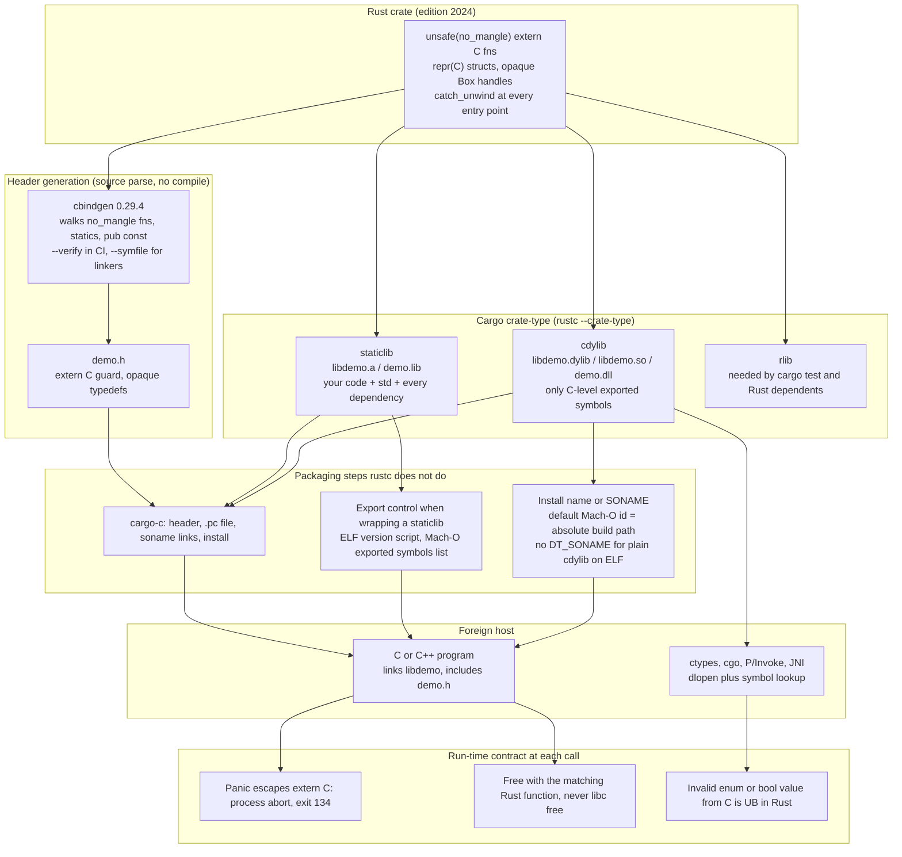

# Rust FFI Packaging: cdylib, staticlib, and Header Generation with cbindgen

> [!summary] Claim:
> A Rust library becomes a C library by three independent acts: a crate type chooses the artifact (`cdylib` for a loadable library, `staticlib` for an archive that carries the Rust runtime), `#[unsafe(no_mangle)] extern "C"` items choose the exported symbols, and a header generator such as cbindgen describes them to C and C++.
> Nothing in the Rust type system polices that contract at the boundary: layout is guaranteed only for `repr(C)`, `repr(transparent)`, and primitive-repr types, a panic that reaches an `extern "C"` frame aborts the process, and memory must be freed by the side that allocated it.
> The packaging work is what the compiler does not do for you: a usable install name or SONAME, a symbol export list when a staticlib is wrapped, a header that is verified against the source, and an ABI version a host can check at run time.
> An expert checks the shipped binary with `nm`, `otool -L` or `readelf -d`, and a C compile of the generated header, never the Rust source alone.



## The Mechanism

### Crate types: what each artifact is

`rustc` produces one artifact per crate type, and one compilation can produce several (The Rust Reference, Linkage).
The command-line `--crate-type` flag overrides every `#![crate_type]` attribute; Cargo passes the `crate-type` array from `[lib]` (Cargo Book, Cargo Targets).
Cargo's default for a normal library is `lib`, and the available values are `bin`, `lib`, `rlib`, `dylib`, `cdylib`, `staticlib`, and `proc-macro`.

| Crate type | File on Linux, macOS, Windows | Consumed by | What it contains |
|---|---|---|---|
| `rlib` | `libfoo.rlib` | `rustc` only | One crate plus metadata, with no upstream dependencies inside; the compiler's own static library form. |
| `dylib` | `.so`, `.dylib`, `.dll` | `rustc` | A Rust dynamic library for Rust-to-Rust dynamic linking, with no stable ABI for other languages to rely on. |
| `cdylib` | `.so`, `.dylib`, `.dll` | Any language that can load a C library | "A dynamic system library ... to be loaded from another language"; only C-level symbols are exported. |
| `staticlib` | `.a` (Linux, macOS, MinGW), `.lib` (MSVC) | A C or C++ linker | All local code plus all upstream dependencies, including the standard library. |

Three properties of `staticlib` matter for packaging, all from the Reference:
1. The compiler never links to a staticlib, so a Rust crate cannot depend on one.
2. It contains the code of every dependency and "exports all public symbols of them", so linking it into a shared library "may need special care": limit the export list with a version script, an exported-symbols list (macOS), or a module definition file (Windows), and drop unused sections with `--gc-sections` or `-dead_strip`.
3. Dynamic dependencies of the archive, such as system libraries, are not recorded in it; `--print=native-static-libs` prints what the final link line must add.

A staticlib requires every upstream dependency to be available as an `rlib`, because "a dynamic library cannot be converted into a static format" (Reference, `link.dependency-staticlib`).
The Reference also states the rule that decides much of the multi-library danger below: "A major goal of the compiler is to ensure that a library never appears more than once in any artifact".

A `cdylib` is a terminal artifact.
Cargo builds only a `[lib]` target's declared crate types, so a crate declared as `crate-type = ["cdylib"]` alone is not importable by its own `tests/` directory: on rustc 1.99.0, macOS arm64 (as of 2026-11), `cargo test` of such a crate failed with `error[E0433]: cannot find module or crate 'cdy' in this scope`, and adding `"rlib"` made the same test pass.
Declare `crate-type = ["cdylib", "staticlib", "rlib"]` when one crate must serve C consumers and Rust tests; the cost is that every `cargo build` links all three.

### What a cdylib exports: rustc's export pipeline

Which symbols leave a `cdylib` is decided in two places in `rustc` (read at commit `b940084d7`, which is rustc 1.99.0).

In `symbol_export.rs`, `crate_export_threshold` gives `Executable`, `StaticLib`, `ProcMacro`, and `Cdylib` the threshold `SymbolExportLevel::C`, and `Rlib` and `Dylib` the level `Rust`.
`symbol_export_level` then classifies each item: if it has an extern indicator (the code calls `contains_extern_indicator`; a `#[no_mangle]` or `#[export_name]` item is the case this note relies on) and is neither a standard-library internal symbol (`RUSTC_STD_INTERNAL_SYMBOL`) nor an externally implementable item, its level is `C` (except statics on Emscripten), and everything else is `Rust` level.
A cdylib exports only level-`C` symbols.

In `linker.rs`, `export_symbols` turns that list into a per-platform instruction, provided the target sets `limit_rdylib_exports`:
- macOS: writes `_symbol` lines into a file and passes `-exported_symbols_list <file>`.
- Windows GNU: writes a `.def` file with an `EXPORTS` section.
- ELF (Linux and most Unix): writes an LD version script, `{ global: sym; ... local: *; };`, and passes `--version-script=<file>` and `--no-undefined-version` (Solaris passes the same script with `-M`, and an executable gets a `--dynamic-list` instead).
- WebAssembly: passes `--no-export-dynamic` and one `--export` per symbol.

The ELF branch is confirmed from the rustc source at `b940084d7` (the `else` arm of `export_symbols` writes the script and passes `--version-script=` and `--no-undefined-version`); this note did not link a Rust `cdylib` for a Linux target, and the version-script mechanism itself is exercised on ELF output in the next section.
The observable consequences on macOS were measured (rustc 1.99.0, macOS 27 arm64, as of 2026-11, reproduced independently on the same toolchain): of the crate's three kinds of function, only the two `#[unsafe(no_mangle)]` ones appear in `nm -gU`, whether or not they are `pub`.

The Reference agrees: `no_mangle` "causes the symbol to be publicly exported from the produced library or object file, similar to the used attribute", and it disables name mangling so "the symbol for the item is the item's identifier".
Export is therefore a property of the attribute, not of `pub`: a private `#[no_mangle] extern "C" fn` is exported (and cbindgen, since 0.26.0, also emits "bindings for non-public extern items if they are `#[no_mangle]`").
A `pub extern "C" fn` without the attribute has a mangled Rust symbol and is not exported.

### Names, ABI strings, and the unsafe attributes

`extern "C"` selects the platform C calling convention; the attribute picks the symbol name.
On Mach-O every C symbol gains a leading underscore, so the C name `demo_abi_version` is `_demo_abi_version` in `nm`.
The Reference lists constraints on `no_mangle`: it applies to statics, free functions, inherent associated functions, and trait impl functions; it cannot be used on a closure or on an item with generic parameters; the name must be ASCII; and with both `no_mangle` and `export_name`, "the symbol name from `export_name` is used, and `no_mangle` has no effect" (rustc lints this combination since 1.85, per RELEASES.md).

`no_mangle`, `export_name`, and `link_section` are unsafe attributes, because the global symbol namespace is shared with every other library in the process.
The Edition Guide demonstrates the hazard: `#[export_name = "malloc"] fn foo() -> usize { 1 }` "crashes on most Unix-like platforms despite containing only safe code".
Timeline from RELEASES.md:
- Rust 1.82 (2024-10-17): stabilized `#[unsafe(no_mangle)]`-style attributes and `unsafe extern` blocks in all editions.
- Rust 1.85 (2025-02-20): stabilized the 2024 edition, where `no_mangle`, `export_name`, `link_section`, and `extern` blocks must be written with `unsafe`; before the 2024 edition the bare forms still compile.
- `cargo fix --edition` migrates through the `unsafe_attr_outside_unsafe` and `missing_unsafe_on_extern` lints, which "will not be able to verify that these attributes are being used correctly".

cbindgen parses the `unsafe(...)` form since 0.28.0 (CHANGES: "Parse unsafe attributes"), and 0.29.0 added a test for `unsafe(no_mangle)`.
The 0.29.4 run in this note used edition 2024 and `#[unsafe(no_mangle)]` on every function and emitted all of them.

### Data layout across the boundary

Rust does not fix the layout of `struct` and `enum` by default, so only types with a guaranteed representation may appear in an exported signature.
- `#[repr(C)]` struct: fields in declaration order, each aligned, total size rounded up to the struct alignment (Reference, `layout.repr.c.struct`).
- `#[repr(C)]` field-less enum: same size and alignment as a C enum with the same discriminants and no fixed underlying type; the Reference calls this "a best guess" because C leaves it implementation defined.
- `#[repr(u8)]`, `#[repr(i32)]`, and similar: fixed integer discriminant, the safer choice for a stable ABI.
- `#[repr(transparent)]`: the ABI of the single non-zero-sized field, which differs from `repr(C)` for a primitive field.
- Data-carrying enums with `repr(C)` or `repr(u8)` map to a tagged union (RFC 2195, which cbindgen follows).
- `Option<&T>`, `Option<&mut T>`, `Option<Box<T>>`, `Option<extern "C" fn(..)>`, `Option<NonNull<T>>`, and `Option<NonZero*>` have the same size, alignment, and call ABI as the inner type, with `T: Sized` required for the reference, `Box`, and `NonNull` cases (std `option` docs, "Representation"), so a nullable pointer or callback is `Option<..>` and not a bare reference.

Values that C produces must be valid Rust values, or the program has undefined behavior the moment the value is produced (Reference, `undefined.validity`): a `bool` must be 0 or 1, a function pointer must be non-null, and "an enum must have a valid discriminant".
A C caller passing `3` for a two-variant `#[repr(C)] enum Color` is therefore not an error code, it is UB.
Accept an integer at the boundary and convert with a checked function when the caller is untrusted.
A `usize` crosses as `uintptr_t` by default; cbindgen's `usize_is_size_t = true` switches to `size_t`.

### Header generation with cbindgen

cbindgen "walks through your crate looking for" `#[no_mangle] pub extern fn` functions, `#[no_mangle] pub static` globals, and `pub const` items, then spiders through the crate for every type those signatures use (cbindgen User Guide).
It parses source text with no compilation, so it does not run the type checker, does not resolve modules, and, in its own words, "does not understand Rust's module system or namespacing": two types with the same name in different modules make its behavior "unspecified".
A type with a guaranteed layout gets a full definition; any other type gets only a forward declaration, which is exactly what an opaque handle wants.

Version facts (as of 2026-11, Both platforms): cbindgen 0.29.4 was published on 2026-06-09 and declares a minimum Rust version of 1.74 (crates.io); its CHANGES file notes `C-unwind` ABI support in 0.26.0, unsafe-attribute parsing in 0.28.0, and a `--symfile` option in 0.28.0.

The type mappings are hard-coded by name, "completely ignoring namespacing": `u8` to `uint8_t`, `usize` to `uintptr_t`, `isize` to `intptr_t`, `bool` to `bool`, `char` to `uint32_t`, `c_void` to `void`, and `MaybeUninit<T>`, `ManuallyDrop<T>`, and `Pin<T>` to `T`.
It cannot express generic functions, anonymous tuples, or wide pointers such as `&dyn Trait` and `&[T]`; generic types are monomorphized and mangled in C mode and become templates in C++ mode.
`repr(packed)` and `repr(align(N))` types are emitted as opaque unless `[layout] packed` or `aligned_n` names a macro.

Two ways to run it, as the guide says: the `cbindgen` program, or the `cbindgen::Builder` library from `build.rs`.
The program makes every packager install it; the library makes users "build cbindgen more frequently (e.g. every time they update their rust compiler)".
Checking a committed header in CI with `--verify` avoids both costs.

Observed with cbindgen 0.29.4 on macOS (as of 2026-11), against the demo crate in the worked example:
- The default language is C++ (guide: `language` "default: C++"), so a C project must set `language = "C"` or pass `--lang c`; `cpp_compat = true` then wraps declarations in `extern "C"`.
- `[export] prefix = "demo_"` renamed types and constants (`demo_Counter`, `demo_DEMO_OK`) but not functions, although the guide says the prefix applies "before the name of every item"; functions already named `demo_counter_new` stayed that way, so prefixing functions is the Rust source's job.
- A `pub extern "C"` function without `no_mangle` is skipped with `WARN: Skipping demo::not_exported - (not 'no_mangle', and has no 'export_name' attribute)`.
- Unsupported signatures are reported as `ERROR:` lines and the function is omitted, but the process still exits 0 (see the shapes run below), so an unchecked pipeline ships a header with missing functions.
- `--verify` regenerates and compares: exit 0 when the committed header matches, and `ERROR: Bindings changed: host/demo.h` with exit status 2 when it does not.
- `--symfile <PATH>` wrote `{ demo_abi_version; demo_counter_new; ... };`, a plain symbol list meant to be handed to a linker.
- `--depfile <PATH>` is documented in `--help` as listing the source files cbindgen traversed, for third-party build systems; it was not run here.

What cbindgen emits for each Rust shape (cbindgen 0.29.4, `--lang c --cpp-compat`, macOS, as of 2026-11):

| Rust item | C output |
|---|---|
| `#[repr(C)] enum Color { Red = 1, Green = 2 }` | `typedef enum Color { Red = 1, Green = 2, } Color;` |
| `#[repr(u8)] enum Shape { Circle(f32), Rect { w, h } }` | `union Shape` with a `Shape_Tag tag` first member, plus `Rect_Body`; the tag is a `uint8_t` typedef unless C23 or C++ |
| `type Callback = Option<extern "C" fn(*mut c_void, i32)>` | `typedef void (*Callback)(void *user, int32_t code);` (nullable) |
| `#[repr(C)] struct Pair(i32, i32)` | `struct Pair { int32_t _0; int32_t _1; }` |
| `#[repr(transparent)] struct Handle(u64)` | `typedef uint64_t Handle;` |
| `#[repr(C, packed)] struct Packed` | `typedef struct Packed Packed;` (opaque) |
| struct with no `repr` | `typedef struct NoRepr NoRepr;` (opaque) |
| `extern "C-unwind" fn` | an ordinary C declaration, with no marker of the unwinding ABI |
| `#[unsafe(no_mangle)] pub static SHAPES_VERSION: u32` (the guide lists only `no_mangle` statics as globals) | `extern const uint32_t SHAPES_VERSION;` |
| `pub const MAX_ITEMS: usize = 16` | `#define MAX_ITEMS 16` |
| `fn f(s: &[u8])`, `fn g(t: (i32, i32))` | `ERROR: Cannot use fn ...`, function omitted, exit status 0 |

The header is validated by compiling it: the generated demo header passed `clang -std=c11 -Wall -Wextra -pedantic -fsyntax-only` and `clang++ -std=c++17 -fsyntax-only` (Apple clang, macOS arm64, as of 2026-11).

### Panics and unwinding at the boundary

A Rust panic is an unwind through Rust frames, and a C frame is not a Rust frame.
Three ABI facts decide what happens (Reference, Panic and Linkage; RELEASES.md):
- Rust 1.71.0 (2023-07-13) stabilized `extern "C-unwind"` and the other `-unwind` ABIs, the ABI string defined by RFC 2945 to permit unwinding across a boundary.
- Rust 1.81.0 (2024-09-05) made an uncaught panic in an `extern "C"` function abort the process (RELEASES.md: "Abort on uncaught panics in `extern "C"` functions"); the 1.71.0 notes had warned that plain `extern "C"` "may change behavior for cross-language unwinding in a future release".
- Unwinding with the wrong ABI is UB (Reference, `panic.unwind.ffi.undefined`): a foreign exception, such as a C++ throw, propagating into a Rust frame called through an `extern "C"` declaration, or a Rust `extern "C-unwind"` function unwinding into code built with `-fno-exceptions`.

Observed on rustc 1.99.0, macOS arm64 (as of 2026-11): a C host calling a plain `extern "C"` function that executes `panic!("boom from Rust")` printed the panic message, then `panic in a function that cannot unwind` (raised at `core/src/panicking.rs:225:5`, followed by a forced stack backtrace), then `thread caused non-unwinding panic. aborting.`, and exited with status 134 (SIGABRT); this was identical for the staticlib-linked and the dylib-linked host, and an independent re-run of the staticlib case reproduced it.
Since Rust 1.91.0 each `panicked at` header also carries the thread ID, as in `thread '<unnamed>' (4609675) panicked at` (RELEASES.md: "Print thread ID in panic message").
The safe default is therefore a process abort, not corruption, but an abort in a host application is still an outage.

The standard pattern is a `catch_unwind` at every exported entry point that can panic, returning an error code:

```rust
catch_unwind(AssertUnwindSafe(|| { /* work */ DEMO_OK })).unwrap_or(DEMO_ERR_PANIC)
```

Observed: with that wrapper, `demo_counter_add(c, UINT64_MAX)` on a counter holding 5 returned 2 (`DEMO_ERR_PANIC`), left the value at 5, and still printed `panicked at src/lib.rs:47:42: counter overflow` to stderr, because the panic hook runs before the unwind is caught.
Set a hook that logs to your host's logger when stderr is not appropriate.

Packaging rules that follow from the Reference:
- With `panic = "abort"` the crate cannot unwind at all, and RFC 2945 states the design goal that switching from `panic=unwind` to `panic=abort` "never creates undefined behavior".
- "If a Rust artifact is potentially unwinding, then all its crates must be built with the unwind panic strategy" (`link.unwinding.prohibited`); `rustc` enforces this when it links, but a library loaded with `dlopen` is not linked by `rustc`, so mixing is the packager's responsibility.
- A foreign unwind caught by `catch_unwind` either aborts or returns `Err` with an opaque payload, and "it is unspecified which will occur"; Rust code built against a different copy of the standard library counts as foreign.
- The `ffi_unwind_calls` lint flags calls to `-unwind` foreign functions, which lets a library stay sound whatever panic runtime is chosen at link time.
- Cargo profile `panic` is ignored for tests, benchmarks, build scripts, and proc macros (Cargo Book, Profiles), so a `cargo test` run does not exercise the abort configuration.

Use `extern "C-unwind"` only when the host language deliberately unwinds through the call, for example a C++ host that throws from a callback and a Rust frame that must run its destructors; declare it on both sides and document it, because cbindgen prints no marker for it.

### Memory allocation and ownership handoff

The only safe rule is that memory is freed by the allocator and the code that allocated it.
- A Rust `Box<T>` handed to C becomes `Box::into_raw` and returns through `Box::from_raw`; C sees an opaque `T *` and never reads inside.
- A string returned as `CString::into_raw` "must be returned to Rust and reconstituted using `CString::from_raw` to be properly deallocated."
  The std docs add: "Specifically, one should not use the standard C `free()` function to deallocate this string."
- `CString::from_raw` also recomputes the length, so C must not shorten the string with an embedded NUL, and a pointer not produced by `into_raw` "is likely to lead to undefined behavior or allocator corruption".
- The reverse direction is symmetric: C-allocated memory is borrowed with `CStr::from_ptr` or copied; Rust must not free it with `Box` or `Vec`.

Rust's default global allocator on Linux and macOS is the system `malloc`, so `free()` on a Rust-allocated pointer often appears to work.
That is an accident of the default: a `#[global_allocator]` such as mimalloc or jemalloc, a different libc in a second library, or a Windows build with a separate CRT turns the same call into heap corruption.
Always export a paired `*_free` function for each allocation the library hands out.
The experiment's `demo_greeting` and `demo_string_free` follow this rule.

Patterns that make ownership checkable:
- Opaque handle plus `*_new`, `*_free`, and accessor functions; every function takes the handle first and returns a status code.
- Caller-allocated buffer with a size query (call once with a null buffer to get the required length), so no allocation crosses the boundary at all.
- A first `struct_size` field in options structs, filled with `sizeof` by the caller, so the library can accept older, smaller structs and a newer library can add fields at the end (a design pattern from system C APIs, not a Rust mechanism).
- Returned borrowed pointers documented with their lifetime (valid until the next call on the handle, or until `*_free`).
- Callbacks as `Option<extern "C" fn(user: *mut c_void, ...)>` plus an opaque user pointer; a panic in the Rust callback body is subject to the same abort rule.

### Linking and loading what Cargo produced

Observed on macOS arm64, rustc 1.99.0, release profile, `crate-type = ["cdylib", "staticlib", "rlib"]` (as of 2026-11):

| Artifact | Size in bytes | Note |
|---|---|---|
| `libdemo.a` | 18,713,920 | includes the standard library; 373 global symbol lines in `nm -gU` |
| `libdemo.dylib` | 389,104 | 9 exported symbols |
| `libdemo.rlib` | 14,072 | metadata plus the crate's own code |
| C host linked to the dylib | 34,120 | |
| C host linked to the staticlib | 1,472,840 | the linker kept only what was reachable |

`--print=native-static-libs` printed `note: native-static-libs: -lSystem -lc -lm` on this host, which is the extra link line a C program needs after the archive.
Other targets need other libraries (the Reference only says the flag "may help"), so capture the list per target at build time.

**Mach-O install name.**
The linker's `-install_name` sets the library's `LC_ID_DYLIB`; the Apple `ld(1)` page says "If this option is not specified, then the -o path will be used".
`rustc`'s `build_dylib` passes `-install_name @rpath/<file>` only when `-C rpath` or the unstable `osx_rpath_install_name` option is set, so a normal cdylib records the absolute path of its build output.
Observed: `otool -D libdemo.dylib` printed `<build dir>/target/release/deps/libdemo.dylib`, and a host linked against it recorded the same absolute path.
After the dylib was moved, running the host failed with `dyld[...]: Library not loaded: <build dir>/target/release/deps/libdemo.dylib` and `Reason: tried: ... (no such file)`.
Setting the identity at link time fixes it: `RUSTFLAGS="-C link-arg=-Wl,-install_name,@rpath/libdemo.1.dylib -C link-arg=-Wl,-compatibility_version,1.0.0 -C link-arg=-Wl,-current_version,1.2.3"` produced `LC_ID_DYLIB` name `@rpath/libdemo.1.dylib` with current version 1.2.3 and compatibility version 1.0.0, and a host linked with `-Wl,-rpath,@executable_path/lib` found the library in a `lib/` directory next to it and ran.
Apple's page notes dyld rejects a program whose recorded compatibility version is greater than the library's, which is the Mach-O counterpart of a SONAME major version.
The macOS minimum OS recorded in `LC_BUILD_VERSION` was `minos 11.0` for the default `aarch64-apple-darwin` target on this host; [[Cpp-macOS-Universal-Binaries-Code-Signing-and-Notarization]] owns universal binaries, signing, and notarization of the result.

**ELF SONAME.**
In the same function, `rustc` passes `-soname=<file name>` only when the crate type is `Dylib`, not `Cdylib` (confirmed from `linker.rs` at 1.99.0: the `-soname=` argument is built only in the `CrateType::Dylib` arm; no Rust cdylib was linked for Linux here).
A plain cdylib therefore has no `DT_SONAME` unless you add `-C link-arg=-Wl,-soname,libdemo.so.1`, and a consumer then records whatever path it linked.
[[Cpp-ABI-Stability-Symbol-Visibility-and-SONAME]] owns what a SONAME promises and [[Execute-Zero-Downtime-Shared-Library-SONAME-Migration]] owns changing one; the Rust-specific part is only that nothing sets it for you.
cargo-c sets it, as described below.

**Linking a staticlib.**
On macOS the static host linked with `clang host.c libdemo.a -lSystem -lc -lm` and ran.
The `-dead_strip` and `--gc-sections` flags the Reference recommends matter most when the archive is wrapped into a shared library (next section).

**Two Rust staticlibs in one program.**
Each staticlib embeds its own copy of the standard library.
On this host a second staticlib (`demo2`, built by the same rustc) linked together with the first into one C program and ran (`65538 3`), because the linker pulled only the archive members it needed and both archives carry identically named standard-library symbols.
Forcing every member of both archives with `-Wl,-force_load,...` for each failed with `duplicate symbol` errors for standard-library members such as `std::io::stdio::stdin`.
So success was incidental to the linker's archive-member rules and to both archives coming from the same compiler; the observation covers archives from a single compiler only, so do not extrapolate the plain-link success to archives built by different rustc versions.
Treat the Reference's rule as the contract: the compiler tries hard never to put a library "more than once in any artifact", and an application that does so through foreign linking owns the consequences.
Ship one Rust staticlib per final binary, built as an umbrella crate that re-exports every Rust component, or give each component its own `cdylib`.

### Symbol visibility when a staticlib is wrapped

When your own build produces the shared library, rustc's export list is not in play, because rustc is not the final linker.
Observed (rustc 1.99.0, Apple ld 27106.1, macOS arm64, as of 2026-11): linking `libdemo.a` into `libwrap.dylib` with `-Wl,-force_load` and no export list exported 1,795 global symbols; adding `-exported_symbols_list` containing the glob `_demo_*` reduced it to 8; and adding `-dead_strip` shrank the file from 1,716,288 to 495,008 bytes.
The `private_but_exported` function was dropped from the 8 because it does not match the glob, which shows that the list, not the Rust attribute, is the authority at this link step.

On ELF, the equivalent tools are a GNU ld version script and `--exclude-libs`:

```text
/* demo.map: pass as -Wl,--version-script=demo.map when linking the shared object */
DEMO_1.0 {
  global:
    demo_*;
  local:
    *;
};
```

The ld manual describes version nodes, `global:` and `local:` blocks, and glob patterns (a name in double quotes is literal), warns that wildcards in a `global:` list are "slightly crazy" except on the last version node, and notes that `--exclude-libs ALL` excludes symbols in all archives from automatic export (ELF and PE ports only).
The script was run once on ELF output (Homebrew LLD 23.1.6 on macOS arm64 linking a hand-compiled x86_64-linux-gnu object, as of 2026-11; this is lld, whose `--version-script` is documented as GNU-compatible, not GNU ld itself).
The object defined `demo_add`, `demo_abi_version`, and `private_but_exported`; `llvm-readelf --dyn-syms --wide` of the shared object linked without and with the script showed:

```text
plain (no script):
     1: 0000000000001330    18 FUNC    GLOBAL DEFAULT     6 demo_add
     2: 0000000000001350    11 FUNC    GLOBAL DEFAULT     6 demo_abi_version
     3: 0000000000001360    11 FUNC    GLOBAL DEFAULT     6 private_but_exported
with --version-script=demo.map:
     1: 0000000000001340    18 FUNC    GLOBAL DEFAULT     8 demo_add@@DEMO_1.0
     2: 0000000000001360    11 FUNC    GLOBAL DEFAULT     8 demo_abi_version@@DEMO_1.0
```

The `local: *;` line hid `private_but_exported`, and `llvm-readelf -V` listed a `DEMO_1.0` version definition.
On a Linux host, verify GNU ld the same way with `readelf --dyn-syms --wide libwrap.so` and `readelf -V libwrap.so`.
Combining your own version script with the one `rustc` generates is linker-dependent: cargo-c's configuration reference says "multiple `--version-script` support is heavily linker dependent", so test the exact toolchain.
Symbol versioning itself, and why a `VERS_1.0` node is an ABI promise, belongs to [[Cpp-Glibc-Symbol-Versioning-and-Portable-Linux-Binaries]].

### Packaging a C library with cargo-c

cargo-c is a Cargo subcommand that builds and installs "C-ABI compatible dynamic and static libraries" with a generated pkg-config file and a C header (cargo-c README).
`cargo cbuild`, `cargo ctest`, and `cargo cinstall --prefix=/usr --destdir=...` do the packaging steps rustc does not.
From its README and `docs/configuration.md`:
- Do not set `crate-type`; cargo-c adds the correct library targets itself.
- Keep the C API behind a `capi` feature so a normal Rust build omits it; the feature must always be present in `Cargo.toml`.
- Header: generated with cbindgen from a `cbindgen.toml` by default (`generation = true`), or copied from `assets/`; it can emit `FOO_MAJOR`, `FOO_MINOR`, and `FOO_PATCH` version constants.
- Library: `version` defaults to the crate version, `versioning = false` disables the versioned links, and `version_suffix_components` selects how many version components form the SONAME suffix (1 with version `0.0.0` gives `.so.0`; 3 puts the full version in the SONAME so "any update is ABI breaking").
- `rustflags = "-Cpanic=abort"` is an available library option.
- pkg-config: name, description, `requires`, and `requires_private` are configurable, so a downstream `pkg-config --cflags --libs foo` works; [[Cpp-CMake-Package-Configs-pkg-config-and-CPS]] owns consuming that file.
- `plugin = true` with `install_subdir` builds a dlopen plugin module instead, and is incompatible with `versioning = true`.

This note did not run cargo-c; everything above is read from its README and `docs/configuration.md` at `master` (as of 2026-11), so check the installed version's `cargo cbuild --help` before relying on an option.

### Tools that generate the boundary instead of hand-writing it

| Tool | Direction | What it generates | Choose it when |
|---|---|---|---|
| cbindgen | Rust to C and C++ headers | Headers only; you write `extern "C"` yourself | You want a plain C ABI that any language can load |
| cargo-c | Rust to a C library package | Header, `.pc`, SONAME links, install layout | You distribute a C-style library to distro packagers |
| CXX | Rust and C++ | Both sides from one bridge module, with checked types | Both ends are in your control and C++ types such as `std::string` matter |
| UniFFI | Rust to Kotlin, Swift, Python | Bindings from an interface description or proc macros | Mobile or scripting hosts and a high-level object model |
| safer_ffi | Rust to C | `#[ffi_export]` macro, safe signatures, header | You want fewer hand-written `unsafe` blocks in the exports |
| Diplomat | Rust to many languages | Bindings through a plugin interface (C, C++, JavaScript, Dart, and others) | One API for several managed hosts |

The READMEs describe each tool's own scope; the table above only places them against cbindgen (as of 2026-11).
CXX's README says its mechanism is "not subject to the many ways that things can go wrong when using bindgen or cbindgen to generate unsafe C-style bindings", which is the honest trade: cbindgen generates what you wrote, and does not check that the Rust side honors it.

## Commands and Numbers to Know

| Item | Value | Platform | Notes |
|---|---|---|---|
| cbindgen release | 0.29.4, published 2026-06-09, MSRV 1.74 (as of 2026-11) | Both | crates.io version listing; CHANGES has an unreleased entry for C string literals. |
| cbindgen run | `cbindgen --config cbindgen.toml --crate demo --output demo.h` (as of 2026-11) | Both | `--lang c` for C; the default language is C++. |
| cbindgen CI gate | `--verify` exits 2 on a stale header, 0 on a match (as of 2026-11) | macOS | Observed with 0.29.4; a clean regeneration printed only a `WARN:` line. |
| cbindgen unsupported types | `ERROR:` lines, function omitted, exit status 0 (as of 2026-11) | macOS | Observed with `&[u8]` and a tuple parameter; add a grep or a C compile of the header to the gate. |
| cbindgen `[export] prefix` | applies to types and constants, not functions (as of 2026-11) | macOS | Observed with 0.29.4; the guide says "every item". |
| Crate types | `bin`, `lib`, `rlib`, `dylib`, `cdylib`, `staticlib`, `proc-macro` (as of 2026-11) | Both | Cargo Book, Cargo Targets. |
| Cargo `[profile]` keys | `panic` = `unwind` or `abort`; `strip` = `none` (documented default), `debuginfo`, `symbols`, or `true`/`false`; `lto` = `false` (thin local), `true` or `fat`, `thin`, `off` (as of 2026-11) | Both | Cargo Book, Profiles; since Cargo 1.77 an unset `strip` in a profile with debuginfo disabled implies `strip = "debuginfo"` (Cargo changelog). |
| C-unwind stable | Rust 1.71.0, 2023-07-13 (as of 2026-11) | Both | RELEASES.md. |
| extern "C" panic abort | Rust 1.81.0, 2024-09-05 (as of 2026-11) | Both | RELEASES.md. |
| unsafe attributes and `unsafe extern` | stable Rust 1.82.0, required by edition 2024 in 1.85.0 (as of 2026-11) | Both | RELEASES.md and Edition Guide. |
| Uncaught panic in `extern "C"` | exit status 134 after `panic in a function that cannot unwind` (as of 2026-11) | macOS | Observed, rustc 1.99.0, arm64. |
| Default Mach-O install name | absolute path of the linker output (as of 2026-11) | macOS | Observed `otool -D`; explained by `ld(1)` and `linker.rs`. |
| ELF SONAME for cdylib | not set by rustc (as of 2026-11) | Linux | Read from `linker.rs` at 1.99.0, not run. |
| `native-static-libs` | `-lSystem -lc -lm` (as of 2026-11) | macOS | `cargo rustc --release --lib --crate-type staticlib -- --print=native-static-libs`, arm64. |
| Exports of a wrapped staticlib | 1,795 without a list, 8 with `_demo_*` (as of 2026-11) | macOS | Observed with Apple ld 27106.1. |
| Size effect of `-dead_strip` on the wrap | 1,716,288 to 495,008 bytes (as of 2026-11) | macOS | Observed; the figure is for this demo and is not a general ratio. |
| Inspect exports | `nm -gU lib.dylib`, `nm -D --defined-only lib.so`, `dumpbin /exports demo.dll` (as of 2026-11) | Both | The first was run; the others are the standard counterparts. |
| Inspect identity | `otool -D lib.dylib`, `readelf -d lib.so`, `otool -L host` (as of 2026-11) | Both | `readelf -d` shows `SONAME` and `NEEDED` on Linux. |
| Check a header | `clang -std=c11 -Wall -Wextra -pedantic -fsyntax-only -I. - <<< '#include "demo.h"'` (as of 2026-11) | Both | Passed for the demo header, with a `clang++ -std=c++17` check too. |

## Multi-Language Comparison

| Concern | C++ library exporting a C API | Python extension or ctypes target | Rust `cdylib` or `staticlib` |
|---|---|---|---|
| Export control | `-fvisibility=hidden` plus `__attribute__((visibility("default")))` on the C API | One exported init symbol per module (`PyInit_<name>`); see [[Python-Wheels-Platform-Tags-Manylinux-and-ABI3]] | `#[unsafe(no_mangle)]` or `#[unsafe(export_name = "...")]`; rustc limits exports to those |
| Header | Hand-written with `extern "C"` guards | `Python.h` on the consumer side; ctypes needs none | cbindgen from source, `--verify` in CI |
| Error across the boundary | A C++ exception must not leave an `extern "C"` function; catch and return a code | Raise in the interpreter or return a status | `catch_unwind` per entry point; an uncaught panic aborts (exit 134) |
| Allocation ownership | Pair `create` and `destroy`; same CRT on both sides | The interpreter owns object memory | `Box::into_raw` and `CString::into_raw` with matching `*_free`; never libc `free` |
| Runtime embedded | libstdc++ or libc++ is a shared dependency | The interpreter | The whole Rust standard library inside a staticlib; inside a cdylib only what is reachable |
| Layout guarantee | Standard layout, `static_assert(sizeof)` | Limited API or version ABI | `repr(C)`, `repr(transparent)`, `repr(u8)`; others are opaque |
| Versioning | SONAME, symbol versions, `inline namespace` | `abi3` tag, wheel tags | Same ELF and Mach-O mechanisms, set by `-C link-arg` or cargo-c, plus an exported `abi_version()` |
| Typical defect | Exceptions across C, ODR in headers | Wrong tag for the binary | Missing install name or SONAME, panic abort in a host, double Rust runtime |

[[Rust-PyO3-and-Maturin-Internals]] covers the case where the host is CPython and the glue is generated instead of hand-written.

## Worked Lab Example

This note has no lab, as the Lab line in its brief says, so there is no `expected/` file or `make verify` target.
The commands below were run by hand once on darwin-arm64 (macOS 27, Apple clang, rustc 1.99.0 (b940084d7 2026-09-28), cbindgen 0.29.4 built with `cargo install --locked`) on 2026-11-21, and the output blocks are from that run with build directories scrubbed.
They have not been re-run on Linux or Windows.
An independent re-run on the same host and toolchain (2026-11-21) reproduced the export list rule, the default `otool -D` path, the `@rpath/libdemo.1.dylib` fix, `native-static-libs`, the guarded and unguarded panic results, `minos 11.0`, and the cdylib-only `cargo test` error; it did not rebuild cbindgen, so the cbindgen output blocks rest on the first run only.
Thread IDs in panic headers are scrubbed to `<tid>`.

The crate, `Cargo.toml`:

```toml
[package]
name = "demo"
version = "1.2.3"
edition = "2024"

[lib]
crate-type = ["cdylib", "staticlib", "rlib"]
```

`cbindgen.toml`:

```toml
language = "C"
include_guard = "DEMO_H"
cpp_compat = true
autogen_warning = "/* Generated by cbindgen. Do not edit. */"
style = "type"
usize_is_size_t = true

[export]
prefix = "demo_"
```

The exported surface in `src/lib.rs` (abridged to the parts the checks use):

```rust
use std::ffi::{CStr, CString, c_char};
use std::panic::{AssertUnwindSafe, catch_unwind};

pub const DEMO_OK: i32 = 0;
pub const DEMO_ERR_NULL: i32 = 1;
pub const DEMO_ERR_PANIC: i32 = 2;

pub struct Counter { value: u64 }                 // opaque: no repr

#[repr(C)]
pub struct Options { pub struct_size: usize, pub start: u64, pub verbose: bool }

#[unsafe(no_mangle)]
pub extern "C" fn demo_abi_version() -> u32 { 0x0001_0002 }

#[unsafe(no_mangle)]
pub extern "C" fn demo_counter_new(opts: *const Options) -> *mut Counter {
    let start = if opts.is_null() { 0 } else { unsafe { (*opts).start } };
    Box::into_raw(Box::new(Counter { value: start }))
}

#[unsafe(no_mangle)]
pub extern "C" fn demo_counter_add(c: *mut Counter, n: u64) -> i32 {
    if c.is_null() { return DEMO_ERR_NULL; }
    catch_unwind(AssertUnwindSafe(|| {
        let c = unsafe { &mut *c };
        c.value = c.value.checked_add(n).expect("counter overflow");
        DEMO_OK
    })).unwrap_or(DEMO_ERR_PANIC)
}

#[unsafe(no_mangle)]
pub extern "C" fn demo_counter_free(c: *mut Counter) {
    if !c.is_null() { drop(unsafe { Box::from_raw(c) }); }
}

#[unsafe(no_mangle)]
pub extern "C" fn demo_greeting(name: *const c_char) -> *mut c_char { /* CString::into_raw */ }

#[unsafe(no_mangle)]
pub extern "C" fn demo_string_free(s: *mut c_char) { /* CString::from_raw */ }

#[unsafe(no_mangle)]
pub extern "C" fn demo_unguarded_panic() -> i32 { panic!("boom from Rust"); }

pub extern "C" fn not_exported() -> i32 { 7 }                      // no no_mangle

#[unsafe(no_mangle)]
extern "C" fn private_but_exported() -> i32 { 8 }                  // private, still exported
```

Step 1, build and generate the header, then read the exports:

```sh
cargo build --release
cbindgen --config cbindgen.toml --crate demo --output host/demo.h
nm -gU target/release/libdemo.dylib | sort -k3
```

Output (darwin-arm64, rustc 1.99.0, cbindgen 0.29.4):

```text
WARN: Skipping demo::not_exported - (not `no_mangle`, and has no `export_name` attribute)
0000000000000930 T _demo_abi_version
000000000000093c T _demo_counter_add
00000000000009e8 T _demo_counter_free
00000000000009fc T _demo_counter_get
0000000000000a08 T _demo_counter_new
0000000000000a6c T _demo_greeting
0000000000000ba4 T _demo_string_free
000000000002e874 T _demo_unguarded_panic
0000000000000bd4 T _private_but_exported
```

The generated header declares the opaque handle as `typedef struct demo_Counter demo_Counter;` and the options struct as `typedef struct { size_t struct_size; uint64_t start; bool verbose; } demo_Options;`; the types and constants carry the `demo_` prefix and the functions do not.

Step 2, link a C host both ways and run it:

```sh
clang -O1 host/main.c -Ihost -Ltarget/release -ldemo -o host_dyn && ./host_dyn
clang -O1 host/main.c -Ihost target/release/libdemo.a -lSystem -lc -lm -o host_static && ./host_static
```

Output (darwin-arm64), identical for both:

```text
abi=0x00010002 value=42 greeting=hello, ffi
```

Step 3, the install-name trap.
Move the dylib out of its build directory and run the dynamic host:

```text
dyld[...]: Library not loaded: <build dir>/target/release/deps/libdemo.dylib
  Referenced from: <...> <build dir>/out/host_dyn
  Reason: tried: '<build dir>/target/release/deps/libdemo.dylib' (no such file), ...
```

Rebuild with an explicit install name and link the host with an rpath to a `lib/` directory beside it:

```sh
RUSTFLAGS="-C link-arg=-Wl,-install_name,@rpath/libdemo.1.dylib \
  -C link-arg=-Wl,-compatibility_version,1.0.0 -C link-arg=-Wl,-current_version,1.2.3" \
  cargo build --release
clang -O1 host/main.c -Ihost -Lout/lib -ldemo -Wl,-rpath,@executable_path/lib -o host_rpath
otool -L host_rpath | sed -n 2p
```

```text
	@rpath/libdemo.1.dylib (compatibility version 1.0.0, current version 1.2.3)
```

Step 4, the panic boundary.
`./host_static panic` calls `demo_unguarded_panic`:

```text
abi=0x00010002 value=42 greeting=hello, ffi
calling unguarded panic

thread '<unnamed>' (<tid>) panicked at src/lib.rs:89:5:
boom from Rust
...
thread '<unnamed>' (<tid>) panicked at /rustc/b940084d7.../library/core/src/panicking.rs:225:5:
panic in a function that cannot unwind
...
thread caused non-unwinding panic. aborting.
exit=134
```

The guarded path, `demo_counter_add(c, UINT64_MAX)` with value 5, printed `add 5 -> 0`, `add UINT64_MAX -> 2`, `value after failure=5`, `add to NULL -> 1`, with the panic message still sent to stderr.
`sizeof(demo_Options)` was 24 in C: an 8-byte `size_t`, an 8-byte `uint64_t`, and a `bool` padded to 8.

Step 5, wrap the staticlib and see the export surface:

```sh
clang -dynamiclib -Wl,-force_load,target/release/libdemo.a -o libwrap_all.dylib
nm -gU libwrap_all.dylib | wc -l
printf '_demo_*\n' > exports.txt
clang -dynamiclib -Wl,-force_load,target/release/libdemo.a \
  -Wl,-exported_symbols_list,exports.txt -o libwrap_lim.dylib
nm -gU libwrap_lim.dylib | wc -l
```

```text
1795
8
```

Step 6, gate the header and see an unsupported signature get dropped:

```sh
cbindgen --config cbindgen.toml --crate demo --output host/demo.h --verify; echo $?
cbindgen --lang c --cpp-compat shapes -o shapes.h; echo $?
```

```text
0
ERROR: Cannot use fn shapes::shapes_slice (Unsupported type: Type::Slice { ... }).
ERROR: Cannot use fn shapes::shapes_tuple (Tuples are not supported types.).
0
```

After a hand edit of one return type, `--verify` printed `ERROR: Bindings changed: host/demo.h` and exited 2.

## Pitfalls

> [!warning] Pitfall 1: A cdylib with no install name or SONAME
> On macOS the default `LC_ID_DYLIB` is the absolute path of the build output, so every consumer records `<build dir>/target/release/deps/libdemo.dylib` and fails with `Library not loaded` once the library moves.
> On ELF, rustc sets `-soname` only for the `dylib` crate type, so a cdylib has none (from `linker.rs`, not run on Linux here).
> Set `-install_name @rpath/libfoo.N.dylib` and `-soname libfoo.so.N` with `-C link-arg`, or let cargo-c do it, and check with `otool -D` and `readelf -d` before release.

> [!warning] Pitfall 2: Trusting cbindgen's exit status
> cbindgen 0.29.4 printed `ERROR: Cannot use fn ...` for a function taking `&[u8]` and a function taking a tuple, omitted both from the header, and exited 0.
> A build that only checks the exit status ships a header missing public functions.
> Fail the gate on any `ERROR:` line, compile the header as C and C++, and run `--verify` against the committed file.

> [!warning] Pitfall 3: Letting a panic reach an `extern "C"` frame
> Since Rust 1.81 this aborts the host process (exit 134 in the run above); before that it was undefined behavior.
> Wrap every exported body that can panic in `catch_unwind`, return a status, and remember that the panic hook still prints to stderr.
> Do not switch to `extern "C-unwind"` to avoid the abort unless the host language is built to unwind through the call.

> [!warning] Pitfall 4: Freeing Rust memory with `free()` or C memory with `Box`
> It often works because the default allocator is the system `malloc`, then fails under `#[global_allocator]` swaps, separate CRTs, or a Windows DLL boundary.
> Export `*_free` for every allocation returned, and never change a string's length from C between `into_raw` and `from_raw`.

> [!warning] Pitfall 5: Using a Rust enum or bool as untrusted input
> `bool` must be 0 or 1, function pointers must be non-null, and an enum must hold a declared discriminant; producing anything else is immediate UB under the Reference.
> Take `u32` or `i32` at the boundary and convert with a checked function, and take `Option<extern "C" fn(..)>` for nullable callbacks.

> [!warning] Pitfall 6: Wrapping a staticlib without an export list
> Linking `libdemo.a` into a shared library exported 1,795 symbols on macOS, including standard-library internals, because the archive "exports all public symbols" of its dependencies.
> Pass an exported-symbols list, a version script plus `--exclude-libs ALL` on ELF, or a `.def` file, and diff `nm` output against the header in CI.

> [!warning] Pitfall 7: Two Rust staticlibs in one process
> The link may succeed when both come from the same rustc and only some archive members are pulled, then fail with `duplicate symbol` errors for standard-library members when the members are forced, as in the `-force_load` run.
> Build one staticlib per final binary from an umbrella crate, or ship separate `cdylib`s, and never rely on archive-member order.

> [!warning] Pitfall 8: A cdylib-only crate that cannot be tested
> `crate-type = ["cdylib"]` alone breaks `tests/` with `cannot find module or crate`; add `"rlib"`.
> Cargo's `panic` profile setting is also ignored for tests, so a suite never runs under `panic = "abort"`.

> [!warning] Pitfall 9: Assuming `pub` or `export-prefix` do what they say
> Export is controlled by `no_mangle` or `export_name`: a private `no_mangle` function was exported and a `pub extern "C"` function without it was not.
> cbindgen's `export.prefix` did not rename functions in 0.29.4, so decide on a `demo_` naming rule in the Rust source.

## At Scale

For one developer, `cargo build --release` plus `cbindgen` is enough to try an idea.
For a team shipping to a C or C++ consumer, the paved road is cargo-c (or an equivalent script) in CI: a header generated and verified, a `.pc` file, versioned SONAME and install name, and a smoke test that compiles and runs a C program against the installed artifacts.
For 1,000 to 50,000 engineers, the failure mode is a boundary that is implicit: every Rust team picks its own panic policy, allocator, and naming, and hosts break when two of those libraries meet in one process.

Decision rules:
1. Choose the artifact by consumer: `cdylib` when the host loads a library at run time or several hosts share it; `staticlib` when the host is one binary and wants no run-time dependency; both when packagers decide.
2. One Rust runtime per process: a single staticlib per binary from an umbrella crate, or separate cdylibs with hidden internals; never link two independently built Rust staticlibs into one executable.
3. Make the C ABI a versioned product: export `abi_version()`, give option structs a `struct_size` field, add functions and never change existing signatures, and give each major version its own SONAME or install name (see [[Versioning-SemVer-CalVer-and-ABI]] and [[Diamond-Dependency-and-Incompatible-ABI-Mitigation]]).
4. Gate the boundary in CI: `cbindgen --verify`, a C compile and a C++ compile of the header, `nm` or `readelf` export diff against an allowlist, `otool -D` or `readelf -d` identity check, and a C smoke test.
5. Catch panics at every export, return status codes, set a project-wide panic hook that logs to the host, and document that `extern "C-unwind"` is reserved for hosts that unwind.
6. Treat edition and compiler upgrades as ABI events: run [[Rust-SemVer-Checks-MSRV-and-Editions]] and re-run the export diff, because a changed rustc changes layout of non-`repr` types and may add exports.
7. Keep build dependencies and build scripts under review: [[Rust-Build-Scripts-and-Sys-Crates]] covers the inbound direction (Rust consuming C), and [[Rust-Dependency-Hygiene-cargo-deny-cargo-audit-and-cargo-vet]] covers what the staticlib drags in.
8. Strip and separate debug information for distribution as [[Cpp-Hardened-Release-Builds-and-Separate-Debug-Symbols]] describes; Cargo's `strip` is documented as defaulting to `none`, but since Cargo 1.77 a profile with debuginfo disabled (the release default) implies `strip = "debuginfo"` when `strip` is unset, so release artifacts lose the standard library's debuginfo unless you set `strip` or `debug` explicitly.

> [!tip] Practice Drill: Make the demo library relocatable and checked
> 1. Create the demo crate, build it, and run `nm -gU` on the dylib; explain from `symbol_export.rs` why `not_exported` is absent and `private_but_exported` is present.
> 2. Link a C host, move the dylib, and read the `dyld` error; then rebuild with `-install_name @rpath/libdemo.1.dylib` and run the host from another directory.
> 3. Call `demo_unguarded_panic` from C and record the exit status; then remove the abort by wrapping the body in `catch_unwind` and prove the host receives status 2.
> 4. Add a function taking `&[u8]`; observe cbindgen's exit status and extend a CI script to fail on `ERROR:`.
> 5. Link the staticlib into a dylib with and without an exported-symbols list and compare `nm -gU | wc -l`.
> 6. On Linux (not done for this note), repeat step 2 with `readelf -d` and `-Wl,-soname`, and apply the version script from this note to check `readelf --dyn-syms`.
> Then read [[Ship-a-Rust-Extension-in-a-Python-Wheel]] for the same boundary with CPython as the host.

## Interview Questions

> [!question] L5: What do `cdylib`, `staticlib`, `rlib`, and `dylib` each produce, and which would you give a C program?
> > [!success]- Answer
> > `rlib` is the compiler's static Rust library, consumed only by `rustc`; `dylib` is a Rust dynamic library with an unstable ABI for Rust-to-Rust linking.
> > `cdylib` is a dynamic library meant to be loaded by another language, exporting only C-level symbols; `staticlib` is an archive containing your code and all upstream crates including the standard library.
> > Give a C program a `cdylib` if it loads or links dynamically, or a `staticlib` if it wants a single binary, and add `rlib` too if Rust tests must import the crate.

> [!question] L5: Predict the output of `nm -gU` and cbindgen for three functions.
> A crate has `pub extern "C" fn a() {}`, `#[unsafe(no_mangle)] extern "C" fn b() {}`, and `#[unsafe(no_mangle)] pub extern "C" fn c() {}`.
> Which names does `nm -gU` show on the cdylib, and which does cbindgen emit?
> > [!success]- Answer
> > `_b` and `_c` appear on macOS, and `a` is absent, because rustc exports only items with an extern indicator (`no_mangle` or `export_name`) at the C level and `a` keeps a mangled name.
> > cbindgen emits `b` and `c` (since 0.26.0 it includes non-public `no_mangle` items) and prints `WARN: Skipping ... a` because it lacks `no_mangle`.
> > Visibility in Rust (`pub`) does not control export; the attribute does.

> [!question] L5: Why does Rust 2024 require `#[unsafe(no_mangle)]`?
> > [!success]- Answer
> > The symbol namespace is global to the process, so a name collision with another library, or with a libc symbol such as `malloc`, is undefined behavior the compiler cannot check.
> > The Edition Guide shows safe-looking code with `#[export_name = "malloc"]` crashing on most Unix systems.
> > Writing `unsafe(...)` marks a proof obligation: no other global function has this name.
> > The forms became available in 1.82 for all editions and mandatory in 2024 (1.85); `cargo fix --edition` adds them but cannot check the obligation.

> [!question] L6: Debug this: a dylib that loads only on the build machine.
> A host links against `libdemo.dylib` and runs on the build machine, but on a colleague's machine it dies with `dyld: Library not loaded: /Users/.../target/release/deps/libdemo.dylib`.
> Why, and what do you change?
> > [!success]- Answer
> > The library's `LC_ID_DYLIB` is the absolute path of the linker output, because `ld` falls back to the `-o` path without `-install_name` and rustc adds `@rpath/` only under `-C rpath`.
> > Every consumer copies that path into its load commands.
> > Rebuild with `-C link-arg=-Wl,-install_name,@rpath/libdemo.1.dylib`, plus compatibility and current versions, link the host with an rpath such as `@executable_path/lib`, and check with `otool -D` and `otool -L`.
> > On Linux the analogous check is `readelf -d` for a `SONAME`, which a plain cdylib lacks.

> [!question] L6: Predict the output of an unguarded panic in an `extern "C"` function.
> A C host calls an exported `extern "C" fn` that executes `panic!("boom")` with no `catch_unwind`, on Rust 1.99.
> What prints and what is the exit status?
> > [!success]- Answer
> > The panic message `boom` with its location prints first, then `panic in a function that cannot unwind`, then `thread caused non-unwinding panic. aborting.`, and the process exits with status 134 (SIGABRT), as measured on macOS arm64.
> > Since Rust 1.81 an uncaught panic in an `extern "C"` function aborts the process.
> > With `catch_unwind` the function returns an error code, but the first line still appears on stderr because the panic hook has already run.

> [!question] L6: Debug this: the CI header job exits 0 but `app_parse` is missing from the header.
> Your CI header job exits 0 and the C team reports the function is missing.
> What happened and how do you stop it?
> > [!success]- Answer
> > cbindgen reports unsupported signatures, such as `&[u8]`, tuples, `&dyn Trait`, or generic functions, as `ERROR:` lines, omits the function, and still exits 0 (observed on 0.29.4).
> > Gate on `ERROR:` in the output, run `cbindgen --verify` against the committed header, compile the header as C and C++, and compare `nm` exports with the header's function list.
> > Fix the signature: pass pointer plus length and rebuild the slice with `slice::from_raw_parts`, and use a `#[repr(C)]` struct instead of a tuple.

> [!question] L6: Why must a C caller not `free()` the string returned by `CString::into_raw`, even when it appears to work?
> > [!success]- Answer
> > The std docs require returning the pointer to Rust and using `CString::from_raw`; `free()` is explicitly forbidden.
> > Appearing to work depends on Rust's default allocator being the system `malloc`; a custom `#[global_allocator]`, another libc or CRT, or a Windows DLL boundary makes it heap corruption.
> > `from_raw` also recomputes the length, so C must not insert or move the NUL.
> > Export a `*_free` function or a caller-allocated buffer API so ownership never crosses.

> [!question] L7: A product links two Rust components, each built as a `staticlib`, into one C++ executable.
> What can go wrong and what do you do?
> > [!success]- Answer
> > Each staticlib carries its own standard library, and the Reference's goal is that a library appears at most once per artifact.
> > A normal link may succeed by luck of archive-member extraction; forcing members (`-force_load`, `--whole-archive`) produced `duplicate symbol` errors for standard-library members in the measured run, and the measurement covers one rustc version only.
> > Two runtimes also mean two panic machineries and foreign-exception rules between them.
> > Combine the components into one umbrella crate and build one staticlib, or ship each as a `cdylib` with hidden internals and a narrow C API.

> [!question] L7: Design the shipping layout of a Rust library for C and C++ consumers on Linux and macOS.
> > [!success]- Answer
> > Use cargo-c or equivalent for a `capi` feature: `cdylib` plus `staticlib`, generated and `--verify`-gated header, `.pc` file, and versioned install names.
> > Set `SONAME` or `install_name` to the major version, add a `-Wl,--version-script` (ELF) and exported-symbols list (Mach-O) where you wrap archives, and export `abi_version()`.
> > Catch panics per entry point, pair every allocation with a free function, and put `struct_size` first in option structs.
> > CI compiles the header in C11 and C++17, runs a C smoke test against the installed prefix, and diffs `nm` exports against an allowlist; the SONAME rules come from [[Cpp-ABI-Stability-Symbol-Visibility-and-SONAME]].

> [!question] L8+: You own the native boundary policy for 300 Rust crates consumed by C++, Python, and Go services.
> What do you standardize and what do you refuse?
> > [!success]- Answer
> > Standardize one boundary crate per product with a C ABI, cbindgen-generated and verified headers, a project-wide panic policy (catch at entry, status codes, logging hook), one allocator rule (paired free functions), and versioning with `abi_version()`, `struct_size`, and a SONAME or install name per major version.
> > Standardize the build: cargo-c or a pinned script, a pinned rustc recorded with each artifact, and the CI gate of header verification, export diff, identity check, and smoke test.
> > Refuse two independently built Rust staticlibs in one process, unreviewed `extern "C-unwind"`, exposing layouts of non-`repr` types, and `crate-type` sets that differ per team.
> > Use CXX or UniFFI where the consumer needs richer types than a C ABI can express, and accept that you then own a second boundary technology.

> [!question] L8+: A 2024-edition upgrade is planned for a library with thousands of downstream C binaries.
> What is the ABI risk and how do you de-risk it?
> > [!success]- Answer
> > The edition itself does not change `extern "C"` symbols or `repr(C)` layouts, but it forces `unsafe(no_mangle)` and `unsafe extern`, and any accompanying compiler bump can change non-`repr` layouts, exports, and the std copy inside a staticlib.
> > Diff `nm` exports and the generated header before and after, run the C smoke tests against the old and new library with the old header, and use `cargo-semver-checks` from [[Rust-SemVer-Checks-MSRV-and-Editions]] for the Rust-visible API.
> > Keep the SONAME or install name unchanged only when the diffs are empty, and otherwise move the major version using [[Execute-Zero-Downtime-Shared-Library-SONAME-Migration]].

## Further Reading

- The Rust Reference, Linkage: the definitive description of each crate type, the staticlib export warning, and the unwinding linkage rules.
- The Rust Reference, Application Binary Interface and Panic: `no_mangle`, `export_name`, and the exact UB rules for unwinding across FFI.
- RFC 2945, The C-unwind ABI: the design goals and the cases that became defined behavior.
- The Rust Edition Guide, Rust 2024 chapters on unsafe attributes and unsafe extern blocks: the reason and migration for the attribute change.
- `rustc_codegen_ssa/src/back/linker.rs` and `symbol_export.rs`: how exports, install names, and version scripts are actually produced; read them at the commit of your rustc.
- cbindgen User Guide and `cbindgen.toml` template: every option with its default, plus the list of types it cannot express.
- cargo-c README and `docs/configuration.md`: the packaging layer for C-ABI libraries, including SONAME and pkg-config settings.
- GNU ld manual, VERSION command and `--exclude-libs`: version-script syntax and archive-symbol hiding for ELF.
- Apple `ld(1)`: `-install_name`, `-compatibility_version`, and `-exported_symbols_list` semantics for Mach-O.
- The Rustonomicon, FFI chapter: the unsafe-Rust view of the same boundary, including callbacks and opaque types.
- READMEs of CXX, UniFFI, safer_ffi, and Diplomat: the alternatives to a hand-written C ABI.

## Related

- Prerequisites: [[Rust-Cargo-Model-Packages-Targets-Features-and-Workspaces]]
- Next: [[Rust-PyO3-and-Maturin-Internals]]
- See also: [[02-Programming-Languages/C++/CPP_Zero_to_Godhood/Volume_09_Specialized_Mastery/Chapter_111_Interoperability/Chapter_111_Interoperability_and_the_Stable_C_ABI|Chapter_111_Interoperability_and_the_Stable_C_ABI]], [[Rust-Build-Scripts-and-Sys-Crates]], [[Cpp-ABI-Stability-Symbol-Visibility-and-SONAME]], [[Cpp-Glibc-Symbol-Versioning-and-Portable-Linux-Binaries]], [[Cpp-CMake-Package-Configs-pkg-config-and-CPS]], [[Cpp-macOS-Universal-Binaries-Code-Signing-and-Notarization]], [[Execute-Zero-Downtime-Shared-Library-SONAME-Migration]], [[Versioning-SemVer-CalVer-and-ABI]], [[Diamond-Dependency-and-Incompatible-ABI-Mitigation]], [[Rust-SemVer-Checks-MSRV-and-Editions]], [[Ship-a-Rust-Extension-in-a-Python-Wheel]]
- Lab: none
