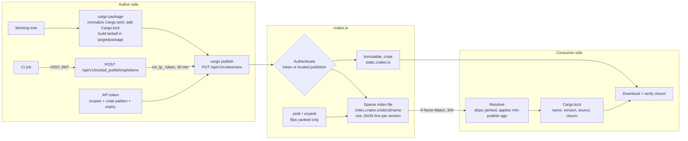
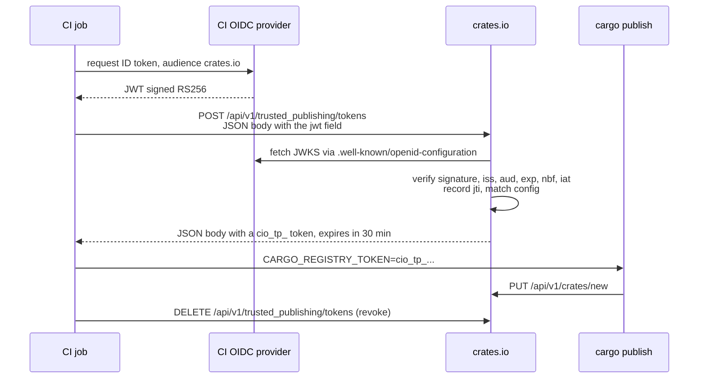

# Rust Publishing: crates.io, RFC 3691 Trusted Publishing, and Private Registries

> [!summary] Claim:
> A published crate version is an immutable tarball plus one index line, and the only field that may change afterwards is `yanked`.
> Cargo reaches that index over plain HTTP files (the sparse protocol), and every trust decision in publishing is an authentication question at one endpoint: `PUT /api/v1/crates/new`.
> RFC 3691 Trusted Publishing replaces a stored long-lived API token with a 30-minute, crate-scoped token that crates.io mints after verifying a signed OIDC identity from the CI provider.
> Cargo 1.100 added the consumer side of the same threat model: `min-publish-age` makes the resolver ignore versions younger than a cooldown, using the `pubtime` field of the index.
> A private registry is the same protocol with `auth-required` set, a credential provider on the client, and source replacement to redirect `crates-io`.



## The Mechanism

### What a publish is: `cargo package`

`cargo publish` is `cargo package` plus an upload.
The Cargo Book lists the packaging steps: load the workspace and check it, create the `.crate`, extract it and build it, and check that build scripts did not modify source files.
Path dependencies are not allowed unless they also carry a `version`; Cargo ignores the `path` key in the published manifest.
`[patch]`, `[replace]`, and `[workspace]` sections are stripped, symlinks are flattened, and `Cargo.toml` is rewritten and normalized.
`Cargo.lock` is always included, and `Cargo.toml.orig` carries the manifest as written.
Cargo 1.84 (2025-01-09) made the lockfile unconditional; before that it was included only for packages with executables or examples.
Cargo 1.81 (2024-09-05) made `.cargo_vcs_info.json` always included when Cargo finds a VCS checkout, even with `--allow-dirty` (changelog, PR #13960); it records the Git commit, a `dirty` flag, and `path_in_vcs`, and the Book calls it a best-effort snapshot that nothing verifies.

The verification build is the part people skip and regret.
It unpacks the tarball into `target/package/<name>-<version>/` and compiles that directory alone, so a file that exists in your checkout but was excluded from the tarball fails here instead of on a stranger's machine.
`--no-verify` skips it.
`cargo publish --dry-run` runs the same steps and stops before the upload; `cargo package` has no `--dry-run` flag because it never uploads.

Which files enter the tarball is decided by `include` and `exclude` in `[package]`.
Sub-packages (any subdirectory with its own `Cargo.toml`) and a `target` directory in the package root are always excluded.
`Cargo.toml`, the lockfile, and the `license-file` are always included, and `include` overrides `exclude`.
`cargo package --list` prints the result without building anything, which makes it the cheapest pre-release check there is.

crates.io adds its own gates on top of Cargo's.
It requires `description` and one of `license` (an SPDX expression) or `license-file`.
The upload limit is 10 MiB for the `.crate`, and the server source sets a 512 MiB unpacked limit, 30,000 tarball entries, and a 1 MiB metadata-file limit (crates.io `src/config/publish_limits.rs`, as of 2026-11).
The publish controller also reads a per-crate `max_upload_size` override, so the 10 MiB figure is a default and not a constant.
Names are first come, first served, ASCII only, and at most 64 characters; a crate has at most 5 keywords and 5 categories.

### The upload: the registry web API

The Cargo Book specifies the registry API that crates.io implements and that every alternative registry must copy to support `cargo publish`.
A publish is a single request: `PUT /api/v1/crates/new` with `Content-Type: application/octet-stream`.
The body is a 32-bit little-endian length, that many bytes of JSON metadata, a second 32-bit little-endian length, and then the `.crate` bytes.
The metadata carries `name`, `vers`, `deps` (each with `version_req`, `explicit_name_in_toml`, `features`, `optional`, `default_features`, `target`, `kind`, `registry`), `features`, `description`, `license`, `repository`, `links`, `rust_version`, and the rest of the manifest fields.
A success response is `{ "warnings": { "invalid_categories": [], "invalid_badges": [], "other": [] } }`.
Errors are `{ "errors": [ { "detail": "..." } ] }`, and Cargo prints `detail` even on a 200.
Cargo 1.96 (2026-05-28) started sending the `Content-Type: application/octet-stream` header explicitly.

The `Authorization` header carries the token as its value, with no `Bearer` prefix in the Cargo specification.
The registry should answer 403 for an invalid token.
The registry is not required to have updated its index before it replies.
That is why `cargo publish` then polls the index and may time out: "This timeout does not affect the upload."
The knob is `publish.timeout`, still unstable behind `-Zpublish-timeout` with a 60 second default (as of 2026-11).

Three behaviors changed recently and affect release scripts.
Cargo 1.83 (2024-11-28) fails fast, before building, if the version is already published.
Cargo 1.90 (2025-09-18) stabilized multi-package publishing: `cargo publish --workspace` or `-p foo -p bar` publishes crates with inter-dependencies in dependency order, and the changelog states that "`cargo publish` is still non-atomic": a server-side error leaves the workspace partially published.
Cargo 1.92 (2025-12-11) soft-deprecated `cargo publish --token`, which puts a secret on a command line; use `CARGO_REGISTRY_TOKEN` or a credential provider.

### Immutability, deletion, and yank

"A publish is generally permanent": a version can never be overwritten and its code cannot be deleted by its authors.
The crates.io policy page lets owners delete a crate only if it has been published for less than 72 hours, or if it has a single owner, fewer than 1000 downloads per month of its life, and no dependents on crates.io (as of 2026-11).
The team can remove content that violates policy, which is how malicious crates leave the index; see [[Case-Study-Left-Pad-and-Registry-Immutability]] for why registries took this stance.

`cargo yank` is the only author-side mutation.
It issues `DELETE /api/v1/crates/{crate}/{version}/yank` (and `PUT .../unyank` for `--undo`), and the registry flips `yanked` in that version's index line.
Per the Book: Cargo will not use a yanked version for any new project or checkout without a pre-existing lockfile, "all existing dependencies continue to work", and the data stays downloadable from the download URL.
Yanking "is not intended for deleting accidentally uploaded secrets"; a leaked credential must be revoked, because the tarball remains public.
The Book's guidance for security issues is to file a RustSec advisory, and for copyright or personal data to write to the crates.io team.

### The sparse index

RFC 2789 (start date 2019-10-18, tracking issue rust-lang/cargo#9069) replaced the Git index with static files over HTTP.
Its motivation is size: the RFC measured the Git index at 176 MiB uncompressed and a clone at 215 MiB, more than 20 times a compressed tarball, and a stateless CI job downloads all of it to use a fraction.
Cargo 1.68 (2023-03-09) stabilized the protocol and Cargo 1.70 (2023-06-01) made it the crates.io default.
A registry URL is sparse when it starts with `sparse+`, and the Book recommends against serving one registry over both protocols because the URL is written into `Cargo.lock`.

The file path for a crate is derived from its lowercased name:

| Name length | Path | Example |
|---|---|---|
| 1 | `1/{name}` | `1/a` |
| 2 | `2/{name}` | `2/cc` |
| 3 | `3/{first char}/{name}` | `3/f/fnv` |
| 4 or more | `{first two}/{next two}/{name}` | `ah/as/ahash` |

`config.json` at the index root carries `dl` (the download template, with markers `{crate}`, `{version}`, `{prefix}`, `{lowerprefix}`, `{sha256-checksum}`; without markers Cargo appends `/{crate}/{version}/download`), `api` (needed for `cargo publish`, no trailing slash), and `auth-required`.

Each file is JSON Lines, one object per version.
`name`, `vers`, `deps`, `cksum` (SHA-256 of the `.crate`), `features`, and `yanked` are the core; `features2` and `v: 2` carry namespaced features and weak dependency features; `links`, `rust_version` (the key is spelled with an underscore), and `pubtime` are optional.
Registries must list each version once, ignoring SemVer build metadata, and must not change lines after publication except `yanked`.
`pubtime` is an RFC 3339 UTC timestamp, stabilized as an index field in Cargo 1.94 (2026-03-05); the changelog says crates.io would backfill existing versions when a new version is published.

Caching is plain HTTP.
Cargo stores `ETag` or `Last-Modified` and replays them as `If-None-Match` or `If-Modified-Since`; if both are present it uses only the `ETag`.
A 304 costs one round trip and no body.
Missing crates answer 404, 410, or 451, and a registry behind a CDN "should implement some form of cache invalidation".
The index is not a consistent snapshot: files update independently, so a stale edge can briefly show a crate that depends on a version the edge has not yet listed; the RFC describes Cargo re-requesting with a cache-busting query in that case.

Observed against the live registry on 2026-11-21 (curl from macOS arm64):

```text
$ curl -sS https://index.crates.io/config.json
{
  "dl": "https://static.crates.io/crates",
  "api": "https://crates.io"
}
$ curl -sSI https://index.crates.io/3/f/fnv
HTTP/2 200
server: AmazonS3
last-modified: Sun, 01 Feb 2026 11:51:50 GMT
etag: "32c46384741390954312c18c030cf844"
cache-control: public,max-age=600
content-type: text/plain
$ curl -sSI -H 'If-None-Match: "32c46384741390954312c18c030cf844"' https://index.crates.io/3/f/fnv | head -1
HTTP/2 304
$ curl -sS https://index.crates.io/3/f/fnv | tail -1
{"name":"fnv","vers":"1.0.7","deps":[],"cksum":"3f9eec918d3f24069decb9af1554cad7c880e2da24a9afd88aca000531ab82c1","features":{"default":["std"],"std":[]},"yanked":false,"pubtime":"2020-05-14T16:06:29Z"}
```

Two things to read off this output.
The fnv line was published in 2020 and already has a `pubtime`, so the backfill reached at least this crate.
The last line of `ahash`, fetched the same way, has the keys `cksum`, `deps`, `features`, `features2`, `name`, `pubtime`, `rust_version`, `v`, `vers`, and `yanked`, so a registry that wants to be a faithful mirror must copy all of them, or downstream cooldowns and MSRV-aware resolution quietly stop working.

### Trusted Publishing (RFC 3691)

RFC 3691 (PR merged 2024-12-13) describes the problem as long-lived tokens: they can lack an expiry (the RFC notes a 90 day default as of 2024-09-12), work from anywhere, and need manual revocation after a leak.
The July 2025 development update announced the implementation: crates.io implements Trusted Publishing with GitHub Actions and "we have built it in a way that allows other CI/CD providers like GitLab CI to be supported".
The first release of a crate must still be published manually with an API token, because a trusted publisher configuration attaches to an existing crate.
Today the crates.io docs page lists GitHub Actions and GitLab CI/CD, and marks GitLab as public beta (as of 2026-11).



What the server checks, from the crates.io source (`src/controllers/trustpub/tokens/exchange/mod.rs` and `crates/crates_io_trustpub/src`, as of 2026-11):

1. The JWT is decoded unverified only to read `iss` and `kid`.
   The issuer must be `https://token.actions.githubusercontent.com` or `https://gitlab.com`, otherwise the answer is a 400 "Unsupported JWT issuer".
   The key is looked up in that issuer's JWKS, which the server loads through OIDC discovery (`{issuer}/.well-known/openid-configuration`, then `jwks_uri`).
2. The signature is verified with RS256, and `iss`, `exp`, and `aud` are required claims; `nbf` is validated.
   The audience must equal the configured value, which defaults to the domain name `crates.io`.
   A leeway of 60 seconds (`JWT_LEEWAY`) applies to `exp`, `nbf`, and `iat`, and an `iat` more than the leeway in the future is rejected.
3. The `jti` is inserted into a used-JTI table, with an expiry of `exp` plus the same 60 second leeway.
   The source comment states the invariant: if the JTI record expired before the signature stopped being acceptable, a stolen JWT could be replayed to mint a fresh token.
   A reused JWT fails with "JWT has already been used".
4. GitHub tokens with `event_name` of `pull_request_target` or `workflow_run` are refused, with a message that points to `push`, `release`, or `workflow_dispatch`.
5. The configuration is matched on the claims below, and every candidate that survives all filters contributes its crate id to the token's scope:

| Provider | Claim used | Matches against | Notes |
|---|---|---|---|
| GitHub | `repository` | owner and name, case-insensitive | Split on the first `/`. |
| GitHub | `repository_owner_id` | numeric id stored at config creation | Mismatch fails with "Please recreate the Trusted Publishing config". |
| GitHub | `workflow_ref` | workflow filename only | Regex `([^/]+\.(yml\|yaml))(@.+)`; the ref after `@` is ignored. |
| GitHub | `environment` | optional environment, case-insensitive | A config with no environment accepts any run, including runs with none. |
| GitLab | `project_path` | namespace and project, case-insensitive | Split on the last `/`, so subgroups belong to the namespace. |
| GitLab | `namespace_id` | id stored lazily on the first exchange | Protects against a deleted namespace being re-registered by someone else. |
| GitLab | `ci_config_ref_uri` | workflow filepath | The full path such as `ci/release.yml`, not just the filename. |
| GitLab | `environment` | optional environment | Same rule as GitHub. |

The token itself is `cio_tp_` plus 31 random alphanumeric characters plus one checksum character; only its SHA-256 is stored, with `expires_at` set 30 minutes ahead, the list of crate ids it may publish, and the run identity (`repository`, `run_id`, `sha` for GitHub).
A fixed prefix with a checksum is the shape that secret scanners can match cheaply, and crates.io uses it: its GitHub secret scanning handler (`src/controllers/github/secret_scanning.rs`) deletes a reported `cio_tp_` token from the token table and sends the crate owners the `trustpub_token_exposed` email (as of 2026-11).
The publish controller treats a `cio_tp_` token specially: it refuses to create a crate ("Trusted Publishing tokens do not support creating new crates. Publish the crate manually, first"), and rejects the upload with `trustpub_crate_mismatch` if the token's crate ids do not include the target crate.
The RFC says configurations default to the `publish-update` scope with no option to change it.
No other endpoint accepts these tokens: only the publish, exchange, revoke, and secret scanning controllers parse `AccessToken`, and the generic authentication path (`authenticate_via_token` in `src/auth.rs`) looks tokens up only in the API token table, so a `cio_tp_` token sent to yank or owner endpoints is refused with 403 "authentication failed" (as of 2026-11).

Configuration lives in the crate's settings.
GitHub fields are repository owner, repository name, workflow filename (must end in `.yml` or `.yaml`, with no directory part), and optional environment.
GitLab fields are namespace, project, workflow filepath, and optional environment.
A crate may have at most 5 GitHub configurations (`MAX_CONFIGS_PER_CRATE` in `github_configs/create.rs`), the creator must be a user owner with a verified email, and the server resolves the GitHub owner id through the GitHub API when the config is saved.
crates.io sends owners email when a config is created or deleted, and a per-crate `trustpub_only` flag (database migration dated 2025-11-19, a checkbox on the crate settings page) makes the publish controller reject ordinary API tokens for that crate with "Crate requires Trusted Publishing".

On GitHub the client side is `rust-lang/crates-io-auth-action` (v1.0.6, published 2026-10-21, runs on Node 24).
It fails early with a clear message if `ACTIONS_ID_TOKEN_REQUEST_URL` is unset, which is what a missing `permissions: id-token: write` looks like.
It derives the audience by stripping `https://` from its `url` input (default `https://crates.io`), asks the runner for an ID token with that audience, POSTs `{"jwt": ...}` to `/api/v1/trusted_publishing/tokens`, registers the returned token as a secret so logs mask it, and exposes it as the `token` output.
Its `post` step sends `DELETE /api/v1/trusted_publishing/tokens` with `Authorization: Bearer <token>`, so the token is revoked when the job ends even if the publish step failed.
GitLab has no action; the crates.io docs show a `curl` of the same endpoint with `id_tokens: CRATES_IO_ID_TOKEN: aud: crates.io`.

A release workflow that uses it, with the checks ordered so the 30 minute clock only starts at the upload:

```yaml
name: release
on:
  push:
    tags: ["v[0-9]*"]
permissions: {}
jobs:
  publish:
    runs-on: ubuntu-latest
    environment: release          # must match the crates.io config if one is set there
    permissions:
      contents: read
      id-token: write             # lets the job request the OIDC JWT
    steps:
      - uses: actions/checkout@<full-commit-sha>
        with:
          persist-credentials: false
      - run: cargo package --locked          # slow verification build, before minting
      - id: auth
        uses: rust-lang/crates-io-auth-action@<full-commit-sha>   # v1.0.6
      - run: cargo publish --locked --no-verify
        env:
          CARGO_REGISTRY_TOKEN: ${{ steps.auth.outputs.token }}
```

Resolve a tag to a commit with `gh api repos/rust-lang/crates-io-auth-action/commits/v1.0.6 --jq .sha`, and pin that.
The crates.io configuration for this workflow is owner, repository, workflow `release.yml`, environment `release`.
Which ref ran the workflow is not part of the match, so an environment with required reviewers or deployment-branch rules is the control that decides who can reach the publish step.

### Tokens without OIDC: scopes, patterns, and credential providers

A crates.io API token carries endpoint scopes, optional crate patterns, and an expiry.
The scope names in the server source are `publish-new`, `publish-update`, `trusted-publishing`, `yank`, `change-owners`, and `crate-owner-invitations`.
A crate pattern is `*`, an exact crate name, or a crate-name prefix ending in `*`; the validator trims one trailing `*` and checks the rest as a crate name.
The publish controller picks `publish-new` or `publish-update` by whether the crate already exists, so a token scoped to `publish-update` plus an exact crate name cannot mint new crates and cannot touch a sibling.
Account-wide tokens for CI were the problem RFC 3691 targets; where Trusted Publishing is unavailable, use one token per crate with `publish-update` only and a short expiry.

Cargo reads the token through a credential provider (stabilized in Cargo 1.74, 2023-11-16, together with `auth-required`):

| Provider | Storage | Notes |
|---|---|---|
| `cargo:token` | `$CARGO_HOME/credentials.toml`, plaintext | The default list is `["cargo:token"]`; it also serves `CARGO_REGISTRY_TOKEN` and `CARGO_REGISTRIES_<NAME>_TOKEN`. |
| `cargo:macos-keychain` | macOS Keychain | |
| `cargo:wincred` | Windows Credential Manager | |
| `cargo:libsecret` | GNOME Keyring, KDE Wallet, KeePassXC | |
| `cargo:token-from-stdout <cmd> <args>` | your command | Reads the token from stdout, trims newlines; no `cargo login` or `cargo logout`. |
| `cargo-credential-1password` and other plugins | external executable | Speaks the credential provider protocol. |

`registry.global-credential-providers` is searched with later entries taking precedence, and `registries.<name>.credential-provider` overrides it for one registry.
If `cargo:token` is not in the list, the `*_TOKEN` environment variables stop working.
The recommended desktop configuration is `["cargo:token", "cargo:libsecret", "cargo:macos-keychain", "cargo:wincred"]`.
The protocol is single-line JSON on stdin and stdout: the provider announces `{"v":[1]}`, Cargo sends requests with `"v":1`, and the operations are `get` (with `operation` of `read` or `publish`, the latter carrying `name`, `vers`, `cksum`), `login`, and `logout`.
A `get` response can mark the token `cache` as `never`, `session`, or `expires`, which is what lets a provider hand out short-lived tokens without Cargo storing them.
A registry token must never sit in a checked-in `.cargo/config.toml`; the Book says `token` should appear only in the credentials file.

### Resolution cooldowns: `min-publish-age`

RFC 3923 (start date 2026-02-23, tracking issue rust-lang/cargo#17009) is the consumer-side control, and it landed this month.
Timeline from the changelog: Cargo 1.94 (2026-03-05) stabilized the `pubtime` index field; Cargo 1.98 (2026-08-20) added `-Zmin-publish-age` on nightly; Cargo 1.99 (2026-10-01) reported the age in the lock message; Cargo 1.100 (2026-11-12) removed the nightly-only `registry.min-publish-age` key, and the Book's "Unstable Features" page for that release states: "Minimum publish-age configuration for dependency resolution was stabilized in Rust 1.100."
Rust 1.100.0 is released (GitHub release 2026-11-12), so the seed's wording "on beta, slated for stable Rust 1.100" is out of date; the feature is stable today.
The 1.100 section of the changelog at that commit has an empty "Added" list, so the stabilization is evidenced by the config and resolver chapters and the Unstable page, not by a changelog bullet.

The stable configuration surface, from the Cargo Book sources at the commit pinned by Rust 1.100.0:

| Key | Default | Meaning |
|---|---|---|
| `registry.global-min-publish-age` | `"0"` (off) | Minimum age for versions from any registry without its own value. |
| `registries.<name>.min-publish-age` | the global value | Per-registry override; ignored if the registry does not support it. |
| `resolver.incompatible-publish-age` | `"deny"` | `deny`: ignore too-new versions unless already in `Cargo.lock`; `allow`: treat them like any other. |

Values are an integer plus `seconds`, `minutes`, `hours`, `days`, `weeks`, or `months`, or `"0"`.
Environment variables are `CARGO_REGISTRY_GLOBAL_MIN_PUBLISH_AGE`, `CARGO_REGISTRIES_<name>_MIN_PUBLISH_AGE`, and `CARGO_RESOLVER_INCOMPATIBLE_PUBLISH_AGE`.
Both the global and resolver keys are marked "Respected as of 1.100+", so a team still on Cargo 1.99 gets no protection from the same `.cargo/config.toml`.
The default is deliberately off: `deny` is the default for `incompatible-publish-age`, but with a global age of `"0"` nothing is too new.
A crates.io-only override: the RFC proposed `registry.min-publish-age`, and PR #17353 removed that key in 1.100; the per-registry form covers crates.io as `[registries.crates-io] min-publish-age = "7 days"`, which the Cargo test suite exercises and lets override the global value (`registries_crates_io` and `registries_crates_io_overrides_global` in `tests/testsuite/min_publish_age.rs` at the 1.100 commit).
I did not run this on the lab host: it has Cargo 1.99.0, which predates the feature.

Semantics from the RFC and resolver chapter:
- A version with a `pubtime` newer than the age is "pubtime-incompatible"; with `deny` the resolver ignores it unless `Cargo.lock` already records it, so existing locks never break.
- If no version satisfies both the requirement and the age, resolution errors, as it does when all matches are yanked; `CARGO_RESOLVER_INCOMPATIBLE_PUBLISH_AGE=allow cargo update <crate> --precise <version>` is the documented escape hatch for an urgent security fix.
- It applies to registry dependencies whose registry publishes `pubtime`, not to git or path dependencies, and not to registries without `pubtime`; a mirror must preserve `pubtime` from the index for the check to work, and local-registry and directory sources usually lack it.
- The RFC says `cargo install` is subject to the age, but the Cargo 1.100 implementation does the opposite for registry installs: `src/ops/cargo_install.rs` calls `set_resolve_honors_publish_age(false)` for non-git, non-path sources, and the tests `cargo_install_ignores_min_publish_age`, `cargo_install_allows_too_new_deps`, and `cargo_install_locked_allows_too_new_dep` show `cargo install foo` picking too-new versions of both the crate and its dependencies; only `cargo install --path` honors the age (as of 2026-11).
- The RFC defers a `fallback` mode (the way `incompatible-rust-versions` does), because of the yank attack: an actor who can publish could publish a malicious version and yank the safe ones, and a `fallback` resolver would then pick the new malicious version.
  `deny` errors instead.

The RFC also states the limit plainly: this "is **not** a full solution to compromised dependencies" and should not be relied on alone.
Its value comes from the gap between publication and detection, which the next section puts numbers on.

### Incidents that shape the design

The 2026-08-20 arrayref attack is the closest match to everything above.
The Rust blog reports that `proc-macro1`, with a build script that downloaded a payload, was reported at 07:15 UTC, and that the popular `arrayref` crate "had recently been republished and made to depend on this crate, with the most recent versions yanked".
Three versions were live for a short time, with times from the post:

| Crate | Published (UTC) | Deleted (UTC) | Online |
|---|---|---|---|
| `arrayref@0.3.10` | 07:15:00 | 08:41:40 | 86 minutes |
| `internment@0.8.7` | 07:34:07 | 09:04:11 | 90 minutes |
| `append-only-vec@0.1.9` | 07:37:49 | 09:25:24 | 107 minutes |

The post says the maintainer's "computer or credentials are likely compromised", says the team "unyanked the maliciously-yanked versions", and does not say how the attacker published or whether Trusted Publishing was involved.
Any cooldown of two hours or more would have kept all three versions out of a fresh resolution, and the `deny`-not-`fallback` design is aimed at the "yank the safe versions" move; the time numbers are from the post and the cooldown conclusion is arithmetic, not a measurement.
The 2025-09-24 `faster_log` and `async_println` case differs: typosquatted logger copies that scanned log files for wallet keys at runtime and "did not execute any malicious code at build time", so a build-script review would not have found them, and they were removed with no dependents.
The 2025-09-12 phishing campaign sent mail from a `rustfoundation.dev` domain that the Foundation does not control, to harvest GitHub credentials; the post reports no evidence of an infrastructure compromise.
Phishable credentials are exactly what a stored token plus a GitHub login represent, and what Trusted Publishing removes from the CI path (the human login that configures it remains).
On 2026-02-13 the team changed its notification policy: it no longer writes a blog post for every malicious crate, always publishes a RustSec advisory for malware removals, and keeps blog posts for malware that sees real usage or exploitation.

### Private registries

A registry is a static sparse index (`config.json` plus per-crate files), a download location for `.crate` files, and, only if you want `cargo publish`, an implementation of the web API.
Setting `"auth-required": true` in `config.json` turns every operation, including index reads and downloads, into an authenticated one.
The Book describes the handshake: Cargo fetches `config.json` first, retries it with the token on a 401, and the server may send `www-authenticate: Cargo login_url="<URL>"`.
For a registry with `auth-required`, Cargo sends the `Authorization` header on download requests, and an authenticated alternate registry requires a credential provider to be configured.

Client configuration is three small pieces:

```toml
# .cargo/config.toml in the repo, or $CARGO_HOME/config.toml for the fleet
[registries.corp]
index = "sparse+https://registry.corp.example/index/"
credential-provider = "cargo:token-from-stdout corp-token-helper"

[registry]
default = "corp"                              # cargo publish with no flags goes here
global-min-publish-age = "7 days"             # Cargo 1.100 and later

[source.crates-io]
replace-with = "corp-mirror"

[source.corp-mirror]
registry = "sparse+https://registry.corp.example/crates-io/"
```

```toml
# Cargo.toml of a proprietary crate
[package]
publish = ["corp"]          # `false` for never publish; a list restricts targets
[dependencies]
internal-lib = { version = "1", registry = "corp" }
```

Rules that govern this:
- `package.publish = ["corp"]` restricts `cargo publish` to that registry, and `false` is the same as an empty list; if `publish` lists exactly one registry, `cargo publish` without `--registry` uses it, and otherwise `registry.default` (default `crates-io`) decides.
  Cargo 1.93 warns when both `package.publish` and `--index` are given.
- A dependency chooses its registry with `registry = "corp"`, and crates.io does not accept packages that depend on other registries.
- Source replacement keys are `replace-with`, `registry`, `local-registry`, `directory`, and `git` (with `branch`, `tag`, `rev`); the replacement must contain the same packages as the original, and `replace-with` may name an alternative registry from `[registries]`.
  Source replacement is for mirrors and vendoring, not for patching, for which `[patch]` is the tool.
  [[Lockfiles-Vendoring-and-Offline-Mirrors]] owns `cargo vendor` and offline mirrors.
- Config files merge from the working directory upward, then `$CARGO_HOME/config.toml`; environment variables beat files and `--config` beats both.

Implementations seen in the docs I could fetch (as of 2026-11):
- Gitea and Forgejo document a Cargo registry per owner: `index = "sparse+https://HOST/api/packages/{owner}/cargo/"` (with a Git index alternative), a personal access token with `write:packages` stored as `token = "Bearer <token>"`, and the `cargo publish --registry` workflow, including yank and search.
- Cloudsmith documents a sparse index at `sparse+https://cargo.cloudsmith.io/WORKSPACE/REPOSITORY/`, an upstream proxy for `https://index.crates.io`, a credential helper it calls the recommended setup, and states that `cargo search` is not supported.
- Azure Artifacts lists Cargo among the package types a feed can host, and its page gives no further Cargo details.
- GitHub Packages' registry list (container, RubyGems, npm, Maven, Gradle, NuGet) does not include Cargo.
- Panamax mirrors rustup and crates.io for offline use; its README shows a Git-style replacement `registry = "http://panamax.internal/crates.io-index"` and does not mention sparse.
- JFrog Artifactory documents Cargo repositories with a sparse index (its page says the Git index is deprecated), a registry URL of the form `sparse+https://<JFrogPlatformURL>/artifactory/api/cargo/<REPO_NAME>/index/`, an identity token stored as `token = "<TOKEN>"` under `[registries.artifactory]` in `credentials.toml`, `cargo publish --registry artifactory`, and a remote repository that proxies and caches `https://index.crates.io`.
- GitLab's package registry documents Cargo as an Experiment behind the feature flag `package_registry_cargo_support`, disabled by default, and not ready for production use.
  It supports the sparse index only, with the trailing slash in `index = "sparse+https://HOST/api/v4/projects/<project_id>/packages/cargo/"` required, and it recommends `credential-provider = "cargo:token"` with the token exported as `CARGO_REGISTRIES_GITLAB_TOKEN="Bearer <token>"` rather than stored in the file.
  The registry is per project, with no group or instance registry.
  `cargo yank`, `cargo search`, and `cargo owner` are listed as unsupported, so a version is removed by deleting the package.
- Kellnr's README describes a self-hosted registry that can act as a proxy and cache for crates.io and can require authentication for crate pulls.
  Its documentation site returned no readable content to my fetches, so this note makes no claim about its index protocol or yank support.

### Release checklist invariants

These are the properties that must hold before a version leaves the building.
Each has a check, and the check is what makes the invariant real.

| Invariant | Public crate | Proprietary crate | Check |
|---|---|---|---|
| The tarball contains what you intend and nothing else | yes | yes | `cargo package --list` reviewed in the PR; a size guard against the registry limit. |
| The tarball builds alone | yes | yes | `cargo package` verification, with `--locked`. |
| Metadata is complete | `description`, `license` required | `publish = ["corp"]` set | `cargo publish --dry-run`. |
| The version is new and the tag matches `Cargo.toml` | yes | yes | Tag workflow compares `GITHUB_REF_NAME` to the manifest version; Cargo 1.83 fails fast on a duplicate. |
| SemVer and MSRV claims hold | yes | yes | See [[Rust-SemVer-Checks-MSRV-and-Editions]]. |
| Publishing needs no long-lived secret | Trusted Publishing, `trustpub_only` | short-lived token from a credential provider | No `CARGO_REGISTRY_TOKEN` in repository secrets after migration. |
| A human gate exists before upload | GitHub environment with reviewers | registry-side approval or environment | Environment name is part of the OIDC claim. |
| A bad release can be contained | yank runbook written | yank runbook written | See [[Contain-and-Roll-Back-a-Bad-Production-Release]]; yank blocks new resolution only. |
| More than one person can recover the crate | two or more named owners | registry ACLs | `cargo owner --list`; team owners can publish and yank but cannot add or remove owners. |
| Dependency policy runs on the lockfile | yes | yes | See [[Rust-Dependency-Hygiene-cargo-deny-cargo-audit-and-cargo-vet]]. |

## Commands and Numbers to Know

| Item | Value | Platform | Notes |
|---|---|---|---|
| Latest stable toolchain | Rust 1.100.0, released 2026-11-12 (as of 2026-11) | Both | GitHub release of rust-lang/rust; the lab host runs Cargo 1.99.0. |
| `.crate` upload limit | 10 MiB (as of 2026-11) | Both | `upload_size` in crates.io `publish_limits.rs`; per-crate override exists. |
| Unpacked size, entries, metadata file | 512 MiB, 30,000, 1 MiB (as of 2026-11) | Both | Same file; entries overridable by `MAX_TARBALL_ENTRIES` on a self-hosted instance. |
| New-crate publish rate | burst 5, then 1 per 10 minutes (as of 2026-11) | Both | crates.io rate-limit page; leaky bucket per user account. |
| New-version publish rate | burst 30, then 1 per minute (as of 2026-11) | Both | Same page. |
| Trusted Publishing token lifetime | 30 minutes (as of 2026-11) | Both | `ACCESS_TOKEN_LIFETIME` in the exchange handler. |
| JWT leeway and `jti` retention | 60 seconds, `exp` plus 60 seconds (as of 2026-11) | Both | `JWT_LEEWAY` in `crates_io_trustpub`. |
| Trusted Publishing token format | `cio_tp_` + 31 alphanumeric + 1 checksum (as of 2026-11) | Both | `access_token.rs`; stored hashed with SHA-256. |
| Max GitHub configs per crate | 5 (as of 2026-11) | Both | `MAX_CONFIGS_PER_CRATE`. |
| Unsupported GitHub events | `pull_request_target`, `workflow_run` (as of 2026-11) | Both | Exchange handler rejects them with a 400. |
| Auth action | `rust-lang/crates-io-auth-action` v1.0.6, 2026-10-21 (as of 2026-11) | Both | GitHub Actions only; the action declares `using: node24`. |
| Token scopes | `publish-new`, `publish-update`, `trusted-publishing`, `yank`, `change-owners`, `crate-owner-invitations` (as of 2026-11) | Both | `EndpointScope` in `scopes.rs`; crate pattern is `*`, a name, or `prefix*`. |
| Sparse index cache header | `cache-control: public,max-age=600` plus `ETag` (as of 2026-11) | Both | Observed on `index.crates.io/3/f/fnv`; 304 on `If-None-Match`. |
| Sparse stable, crates.io default | Cargo 1.68, Cargo 1.70 (as of 2026-11) | Both | Cargo changelog. |
| `pubtime` stable in the index | Cargo 1.94, 2026-03-05 (as of 2026-11) | Both | Optional field; backfilled by crates.io. |
| Multi-package publish stable | Cargo 1.90, 2025-09-18; non-atomic (as of 2026-11) | Both | `cargo publish --workspace`, `-p a -p b`. |
| `Cargo.lock` always packaged | Cargo 1.84, 2025-01-09 (as of 2026-11) | Both | `--exclude-lockfile` exists and is "not for general use". |
| `min-publish-age` | stable in Cargo 1.100; global default `"0"` (as of 2026-11) | Both | `resolver.incompatible-publish-age` defaults to `deny`. |
| Credential providers stable | Cargo 1.74, 2023-11-16 (as of 2026-11) | Both | `registry.global-credential-providers` default `["cargo:token"]`. |
| Dry run behavior | `cargo publish --dry-run` contacts the index; `--offline` fails (as of 2026-11) | macOS | Observed on Cargo 1.99.0; `cargo package --offline` works for a crate with no dependencies. |
| Workspace of 20 new crates | 5 at once, then 15 more at 10 minute intervals, about 150 minutes (as of 2026-11) | Both | Arithmetic from the rate limit, not a measurement. |

## Multi-Language Comparison

| Concern | C++ (Conan, vcpkg) | Python (PyPI) | Rust (crates.io) |
|---|---|---|---|
| Where the index lives | A curated Git repository (the vcpkg registry, the Conan Center index) or a server remote | A server with the Simple API | A static sparse index over HTTP, plus a web API for publish |
| Who can publish | Pull request to a curated repository, or upload to your own remote | The project's owners, with Trusted Publishing and attestations as the CI path, see [[Python-Trusted-Publishing-and-PEP-740-Attestations]] | Crate owners; Trusted Publishing for GitHub Actions and GitLab CI/CD (beta), `trustpub_only` per crate |
| First publish via OIDC | Not applicable | PyPI can create the project at first publish through a pending publisher, which creates the project when first used (PyPI docs) | Not supported: the first release needs an API token |
| Mutating a release | Depends on the remote | A filename is never reused, even after deletion, and yank marks a whole release (PEP 592 `data-yanked`) | Only `yanked` changes; staff deletion under policy |
| Consumer cooldown | Not built in | `uv --exclude-newer` takes an upload-date cutoff (uv 0.11.26 help text) | `registry.global-min-publish-age`, stable in Cargo 1.100, uses `pubtime` |
| Private registry | Conan remote, vcpkg git registry, see [[Cpp-Conan-2-Architecture-and-Binary-Model]] and [[Cpp-vcpkg-Manifests-Registries-and-Binary-Caching]] | An index served by devpi or a cloud vendor | `[registries.<name>]` with `sparse+` index, `auth-required`, credential provider |
| Redirecting the public index | Mirror remotes | `--index-url` | `[source.crates-io] replace-with` |

The Rust column was verified for this note.
The Python cells for first publish, mutation, and cooldown were checked against the PyPI docs, PEP 592, and the `uv --exclude-newer` help text.
The C++ cells state only that policy is set by the remote or a curated repository, and the sibling notes own the detail.

## Worked Lab Example

No lab accompanies this note.
The transcripts below were captured by hand on 2026-11-21 on macOS arm64 with Cargo 1.99.0 and rustc 1.99.0, in a throwaway crate and a throwaway local registry; paths are scrubbed.
I ran each command once and did not repeat them across platforms.

### Packaging a crate

The crate has a `src/lib.rs`, a `tests/it.rs`, a `secrets/token.txt` placeholder, and `exclude = ["secrets/"]`.
`GIT_CEILING_DIRECTORIES` was set so Cargo found no VCS repository.

```text
$ cargo package --list --allow-dirty
Cargo.lock
Cargo.toml
Cargo.toml.orig
src/lib.rs
tests/it.rs
$ cargo package --offline --allow-dirty
   Packaging tde-demo-publish-check v0.1.0 (<crate-dir>)
    Packaged 5 files, 1.4KiB (913B compressed)
   Verifying tde-demo-publish-check v0.1.0 (<crate-dir>)
   Compiling tde-demo-publish-check v0.1.0 (<crate-dir>/target/package/tde-demo-publish-check-0.1.0)
    Finished `dev` profile [unoptimized + debuginfo] target(s) in 1.46s
$ cargo publish --dry-run --allow-dirty        # online, no token configured
    Updating crates.io index
   Packaging tde-demo-publish-check v0.1.0 (<crate-dir>)
    Packaged 5 files, 1.4KiB (913B compressed)
   Verifying tde-demo-publish-check v0.1.0 (<crate-dir>)
   Compiling tde-demo-publish-check v0.1.0 (<crate-dir>/target/package/tde-demo-publish-check-0.1.0)
    Finished `dev` profile [unoptimized + debuginfo] target(s) in 1.74s
   Uploading tde-demo-publish-check v0.1.0 (<crate-dir>)
warning: aborting upload due to dry run
$ cargo publish --dry-run --offline --allow-dirty
error: attempting to make an HTTP request, but --offline was specified
```

Reading it:
- `secrets/` is gone from the tarball, `Cargo.lock` is present in a library crate (the Cargo 1.84 change), and `Cargo.toml.orig` sits beside the normalized `Cargo.toml`.
- No `.cargo_vcs_info.json` appears because Cargo found no repository; inside a Git checkout it would be added.
- The verification build compiled the extracted copy under `target/package/`, not the working tree.
- The normalized manifest gained explicit `build = false`, `autolib = false`, `autobins = false`, `autotests = false`, a `[lib]` table, and an array-of-tables entry for the `it` test target it had discovered.
- `--dry-run` printed "Uploading" and then aborted, and it needed the network to refresh the index.

### A registry in six files

A registry that `cargo build` accepts needs only static files.
This is the layout I served with `python3 -I -m http.server 8787 --bind 127.0.0.1` from the `reg/` directory:

```text
reg/config.json
reg/td/e-/tde-demo-publish-check               # index file, name has 22 chars: td / e- / name
reg/crates/tde-demo-publish-check/tde-demo-publish-check-0.1.0.crate
```

`config.json` was `{"dl":"http://127.0.0.1:8787/crates/{crate}/{crate}-{version}.crate"}` and the index file held one line: the package metadata, `"cksum"` equal to `shasum -a 256` of the `.crate`, `"yanked":false`, `"rust_version":"1.85"`, and `"v":2`.
The consumer crate depended on `tde-demo-publish-check = { version = "0.1", registry = "corp" }`, with `[registries.corp] index = "sparse+http://127.0.0.1:8787/"` in its `.cargo/config.toml` and an isolated `CARGO_HOME`.

```text
$ cargo run
    Updating `corp` index
     Locking 1 package to highest Rust 1.99.0 compatible version
 Downloading crates ...
  Downloaded tde-demo-publish-check v0.1.0 (registry `corp`)
   Compiling tde-demo-publish-check v0.1.0 (registry `corp`)
   Compiling consumer v0.1.0 (<consumer>)
    Finished `dev` profile [unoptimized + debuginfo] target(s) in 1.50s
     Running `target/debug/consumer`
5
$ grep -A3 'name = "tde-demo' Cargo.lock
name = "tde-demo-publish-check"
version = "0.1.0"
source = "sparse+http://127.0.0.1:8787/"
checksum = "87457e8bed24e289d52b03423707ee38f491f4dbe8f8574083fac7e6b7d529d2"
```

The server log for that first run shows exactly three requests, in this order: `GET /config.json`, `GET /td/e-/tde-demo-publish-check`, and `GET /crates/tde-demo-publish-check/tde-demo-publish-check-0.1.0.crate`, all 200.
That is the whole protocol for a read: configuration, one index file for the one crate, one download.

### Yank and checksum behavior

I then edited the index line in place and re-ran Cargo:

```text
# index line changed to "yanked":true, Cargo.lock still present, download cached
$ cargo build --locked
    Finished `dev` profile [unoptimized + debuginfo] target(s) in 0.02s

# same index, Cargo.lock deleted
$ cargo generate-lockfile
    Updating `corp` index
error: failed to select a version for the requirement `tde-demo-publish-check = "^0.1"`
  version 0.1.0 is yanked
location searched: `corp` index
required by package `consumer v0.1.0 (<consumer>)`

# same index, requirement changed to "=0.1.0", Cargo.lock deleted
$ cargo generate-lockfile
error: failed to select a version for the requirement `tde-demo-publish-check = "=0.1.0"`
  version 0.1.0 is yanked

# index restored, cksum changed, registry cache cleared, old Cargo.lock kept
$ cargo build --locked
error: checksum for `tde-demo-publish-check v0.1.0 (registry `corp`)` changed between lock files
...
unable to verify that `tde-demo-publish-check v0.1.0 (registry `corp`)` is the same as when the lockfile was generated
```

Reading it:
- A yank never invalidated the existing lockfile, which is the Book's guarantee, and an exact `=0.1.0` pin did not rescue a fresh resolution; the Book's table says the same.
- The checksum recorded in `Cargo.lock` is the integrity anchor: a mirror that serves a different `cksum` is rejected with the three suspect causes Cargo lists (corrupt lockfile, mirror, or source).
- Everything the demo shows is what a real private registry must implement, plus the publish API and `auth-required`.

## Pitfalls

> [!warning] Pitfall 1: Yank is not a recall
> A yank stops new resolution and leaves every existing lockfile and every direct download untouched.
> It does not remove code or a leaked secret, and the Book says it is not meant for that.
> Revoke the credential, publish a fixed version, file a RustSec advisory, and treat the yanked tarball as public forever.

> [!warning] Pitfall 2: The trusted publisher match ignores the branch and tag
> The server matches repository, workflow filename, and environment; the ref after `@` in `workflow_ref` is discarded, and a config with no environment accepts runs with or without one.
> Anyone who can get a run of a workflow with that filename, on any ref, to reach the publish step can publish.
> Use a GitHub environment with required reviewers or deployment branch rules, set the same environment name in the crates.io config, and keep the workflow's `on:` narrow.
> For a job inside a called reusable workflow, GitHub's standard claims (which include `workflow_ref`) describe the calling workflow and only `job_workflow_ref` names the called one, and crates.io matches `workflow_ref` alone; so the crates.io config must name the caller's filename, and any caller workflow with that filename can reach a shared publish workflow.

> [!warning] Pitfall 3: The 30 minute clock covers the verification build
> The token's `expires_at` is checked when the upload arrives, not when it was minted.
> A slow `cargo publish` that builds for 40 minutes after the auth step would be rejected with an invalid-token error; this follows from the source and I did not reproduce it.
> Package and verify before the auth step, then `cargo publish --no-verify`.

> [!warning] Pitfall 4: First publish, new crates, and `pull_request_target`
> A Trusted Publishing token cannot create a crate, so the first release is a manual publish with an API token.
> `pull_request_target` and `workflow_run` triggers are rejected outright, so a design that publishes from a workflow chained after CI fails with a 400 that names the event.
> Use `push` on a tag, `release`, or `workflow_dispatch`.

> [!warning] Pitfall 5: `cargo publish --workspace` is not atomic, and rate limits bite
> A server error mid-way leaves a partially published workspace, and republishing the same versions fails because versions are immutable.
> A workspace that adds 20 new crates also hits the new-crate limit: 5 at once, then 1 per 10 minutes, about 150 minutes by the arithmetic of the published limits.
> Plan release order, publish new crates ahead of the release day, and bump only what changed.

> [!warning] Pitfall 6: Credential providers silently disable the environment variable
> If `registry.global-credential-providers` omits `cargo:token`, `CARGO_REGISTRIES_<NAME>_TOKEN` is ignored, and the failure looks like an authentication error from the registry.
> Authenticated alternate registries require a provider; the stable fix for CI is a provider list that includes `cargo:token`, or a `cargo:token-from-stdout` command that fetches a short-lived token.

> [!warning] Pitfall 7: A cooldown that your mirror breaks
> `min-publish-age` reads `pubtime` from the registry that served the version.
> A mirror that drops `pubtime`, a `local-registry`, or a vendored `directory` source disables the check without an error, and older Cargo ignores the keys entirely.
> Verify with a known recent version on the mirror, and require Cargo 1.100 or later wherever the policy is meant to apply.

> [!warning] Pitfall 8: Accidental public publish of a private crate
> With no `publish` key and no `registry.default`, `cargo publish` targets crates.io.
> Set `publish = ["corp"]` or `publish = false` on every proprietary crate, and keep `registry.default` out of shared config unless every repository using it means it.

> [!warning] Pitfall 9: Treating the cooldown as the security control
> The RFC says it is not a full solution.
> It does nothing for a malicious version older than the cooldown, for git and path dependencies, for `cargo install` of a registry crate (which ignores the age in Cargo 1.100), or for the build scripts of versions you already locked.
> Pair it with lockfile review and the checks in [[Rust-Dependency-Hygiene-cargo-deny-cargo-audit-and-cargo-vet]].

## At Scale

For one developer, `cargo publish` from a laptop with a scoped token is acceptable, and the habit to build is `cargo package --list` before every release.
For a team of 50, the release moves into a tag-triggered workflow with Trusted Publishing, a protected environment, and no token in repository secrets.
For 1,000 to 50,000 engineers, the work is policy: who may publish, what proves a release came from the right pipeline, and how a consumer limits exposure to a compromised maintainer.

The numbers that shape the decisions:
- The token lifetime is 30 minutes, so long jobs must separate verification from upload.
- The rate limits are per user account: 30 new versions in a burst, 1 per minute afterward, and 5 new crates in a burst, 1 per 10 minutes afterward; a monorepo release of 100 crates takes about 70 minutes after the burst if all are new versions, and hours if many are new.
- The attacker window in the arrayref incident was 86 to 107 minutes from publish to deletion, so a cooldown measured in days is far more than enough to cover the observed detection time, and a cooldown of a few hours covers the observed case.

Decision rules:
1. Public crates: enable Trusted Publishing, set a protected environment on both sides, tick `trustpub_only`, and delete the old API token; keep one break-glass owner with a hardware-backed login.
2. Pin the release workflow's actions by commit and give it only `contents: read` and `id-token: write`; the token is only as safe as the workflow that can mint it.
3. Proprietary crates: a private registry with `auth-required`, `publish = ["corp"]` in every manifest, and short-lived credentials from a credential provider; never ship the registry token in the repository.
4. Redirect `crates-io` to an internal mirror with `[source.crates-io] replace-with`, and require the mirror to preserve `pubtime`, `rust_version`, and `cksum` so cooldowns and MSRV-aware resolution keep working.
5. Set `registry.global-min-publish-age` to a few days in fleet config for CI and developers, keep a documented `allow` override for security fixes, and run a scheduled canary job that resolves with `allow` so you see new versions early.
6. Treat Cargo 1.100 as the floor for the policy and enforce it with a toolchain pin (see [[Rust-Cargo-Model-Packages-Targets-Features-and-Workspaces]]).
7. Record the choices in decision records ([[Packaging-Decision-Records]]) and tie yank and rollback to the release-train process in [[Release-Trains-Backports-and-Artifact-Registries]].

> [!tip] Practice Drill: Build a registry, yank a crate, and break a mirror
> Make a throwaway crate with 3 or more characters in its name, run `cargo package --list --allow-dirty` and `cargo package --allow-dirty`, and note which files are included and why `Cargo.lock` is there.
> Copy the `.crate` into a `reg/crates/<name>/<name>-<version>.crate` tree, write `reg/config.json` with a `dl` template using `{crate}` and `{version}`, and compute the index path with `n=<name>; echo "$(echo $n | cut -c1-2)/$(echo $n | cut -c3-4)/$n"`.
> Write one index line with `cksum` from `shasum -a 256`, serve the directory with `python3 -I -m http.server 8787 --bind 127.0.0.1`, point a second crate at it with `registry = "corp"` and a `sparse+http://127.0.0.1:8787/` index, and use an isolated `CARGO_HOME`.
> Flip `yanked` to true and predict, before running, what `cargo build --locked` and `cargo generate-lockfile` do.
> Corrupt the `cksum` and predict which cache and which lockfile state decide whether Cargo notices.
> Then write the GitHub workflow from the Trusted Publishing section for a fork, decide which claims it presents, and list the three claim mismatches that would make the exchange fail (wrong filename, missing environment, forbidden event).
> Finally read [[Drill-Packaging-Cargo-Feature-Unification-Hazard]] for the consumer-side half of a release that looks fine on the publisher's machine.

## Interview Questions

> [!question] L5: What does `cargo publish` do, and what is inside the `.crate` it uploads?
> > [!success]- Answer
> > It checks `package.publish`, runs `cargo package`, uploads with `PUT /api/v1/crates/new`, and polls the index until the version appears or times out; the timeout does not affect the upload.
> > `cargo package` normalizes `Cargo.toml`, strips `[patch]`, `[replace]`, and `[workspace]`, keeps `Cargo.toml.orig`, always includes `Cargo.lock` since Cargo 1.84, and builds the extracted tarball under `target/package/` to prove it compiles alone.
> > The contents come from `include` and `exclude`, and `cargo package --list` shows them without building.
> > crates.io additionally requires `description` and `license` or `license-file`, and caps the upload at 10 MiB by default.

> [!question] L5: What does yanking a version do, and what does it not do?
> > [!success]- Answer
> > It flips `yanked` in that version's index line, so new resolutions without a lockfile entry skip it and fail if nothing else satisfies the requirement.
> > Existing `Cargo.lock` files keep working and the tarball stays downloadable, so it removes neither code nor leaked secrets.
> > Authors cannot delete versions; deletion is limited to the policy cases (a crate under 72 hours old, or a single-owner, low-download crate with no dependents) and to staff action on policy violations.
> > Use it for broken or unsafe releases, and revoke any leaked credential separately.

> [!question] L5: Where does Cargo find a crate in the sparse index, and how does it avoid re-downloading it?
> > [!success]- Answer
> > The path comes from the lowercased name: `1/a`, `2/cc`, `3/f/fnv`, and `ah/as/ahash` for four or more characters.
> > Cargo stores the `ETag` and sends `If-None-Match`; crates.io answers 304 with no body, as observed on `3/f/fnv` on 2026-11-21.
> > The file is JSON Lines with one object per version, and `yanked` is the only field that changes after publication.
> > `config.json` supplies the download template `dl` and the web API base `api`.

> [!question] L6: Predict the output. A consumer has `Cargo.lock` pinning `tde-demo-publish-check 0.1.0` from a private sparse registry, with the package already in the local cache. The registry then sets `"yanked":true` on that line. What do `cargo build --locked` and `cargo generate-lockfile` (after deleting the lockfile) print, and does `=0.1.0` change the second answer?
> > [!success]- Answer
> > `cargo build --locked` finishes normally (`Finished ... target(s) in 0.02s` in the demo), because a yank does not invalidate an existing lockfile entry.
> > The fresh resolve fails with `failed to select a version for the requirement ... version 0.1.0 is yanked` and `location searched: corp index`.
> > `=0.1.0` does not help: the error is the same with the exact requirement, matching the Cargo Book's table.
> > The fix is to publish a new version or unyank, not to loosen the lockfile.

> [!question] L6: Debug this. The release job runs on `workflow_run` after CI succeeds and fails in the auth step with `Failed to retrieve token from Cargo registry. Status: 400.` What is wrong, and what else could produce a 400 or 403 from the same flow?
> > [!success]- Answer
> > crates.io refuses GitHub tokens whose `event_name` is `pull_request_target` or `workflow_run`, with a message naming the event and suggesting `push`, `release`, or `workflow_dispatch`.
> > Move the publish job to a tag `push` or `release` trigger, with the CI result enforced by branch rules or a required status check.
> > Other 400s: `No Trusted Publishing config found for repository`, a workflow filename mismatch ("does not match the workflow filename ... Expected workflow filenames: ..."), an environment mismatch, a `repository_owner_id` mismatch after an owner or repository was recreated, or `JWT has already been used`.
> > A 403 at upload comes later: `Trusted Publishing tokens do not support creating new crates` for a first publish, `trustpub_crate_mismatch` for a token not scoped to the crate, or an expired token after a long verification build.
> > Without `id-token: write` the action fails earlier, before any request, because `ACTIONS_ID_TOKEN_REQUEST_URL` is unset.

> [!question] L6: Explain why a stolen workflow JWT or access token is hard to abuse in RFC 3691.
> > [!success]- Answer
> > The JWT is bound to an audience (`crates.io`), an issuer, and a short `exp`, and its `jti` is stored until `exp` plus the 60 second leeway so it can be exchanged once.
> > The exchange yields a `cio_tp_` token that lives 30 minutes, is stored only as a SHA-256 hash, and is scoped to the crate ids of the matching configurations, so it cannot publish other crates or create new ones.
> > The match includes the numeric `repository_owner_id` (and GitLab's `namespace_id`), so a recreated account or namespace with the same name does not inherit the config.
> > The action revokes the token in its `post` step, so a leaked token usually dies when the job ends; what remains is control of the workflow itself, which is why environments matter.

> [!question] L6: Design the Cargo configuration for a company with a private registry, developers on laptops, and CI.
> > [!success]- Answer
> > The registry sets `auth-required: true` and implements the publish API; clients get `[registries.corp] index = "sparse+https://..."` and `[source.crates-io] replace-with` for the mirror.
> > Laptops use `registry.global-credential-providers` with the OS keychain providers; CI uses `cargo:token-from-stdout` or a provider plugin that fetches a short-lived token, and `cargo:token` must be in the list if environment tokens are used.
> > Every proprietary manifest sets `publish = ["corp"]` and dependencies set `registry = "corp"`.
> > Put the config in `$CARGO_HOME/config.toml` for fleet defaults and in the repository `.cargo/config.toml` for project settings, and never commit a token.

> [!question] L7: A maintainer's laptop is compromised and the attacker publishes a malicious version and yanks the safe ones. Which controls help, and why does the RFC use `deny` rather than `fallback`?
> > [!success]- Answer
> > Trusted Publishing with `trustpub_only` removes the stored API token, so a stolen token or laptop cannot publish through the API for that crate, and the environment gate requires a second person; if the attacker controls the maintainer's account they can still change the crates.io configuration, which is why owner notifications and a second owner matter.
> > On the consumer side, a cooldown keeps versions younger than the age out of fresh resolution.
> > With `fallback`, a resolver that deprioritizes too-new versions would pick the malicious version after the safe ones are yanked, because it is the only candidate left; `deny` errors instead, so the attacker's yank turns into a visible failure.
> > The arrayref incident (2026-08-20) had versions online for 86 to 107 minutes and the post reports maliciously yanked versions that were later unyanked, so both the window and the yank move are real.

> [!question] L7: A trusted publisher is configured for `release.yml` with no environment. Name three ways code you do not trust could still publish, and the controls that close them.
> > [!success]- Answer
> > The match ignores the ref, so a branch that contains or changes `release.yml` can run it if the triggers allow; narrow `on:` to tags, protect the tag namespace, and require reviewers.
> > A config with no environment accepts runs with or without one, so a job that omits `environment:` still matches; set the environment on both sides and use required reviewers or deployment branch rules.
> > A third-party action in the same job can read the job's ID token; pin actions by commit, give the job minimal permissions, and keep untrusted steps out of the publish job.
> > In a reusable-workflow call `workflow_ref` names the caller and only `job_workflow_ref` names the called workflow (GitHub OIDC docs), and crates.io does not read `job_workflow_ref`, so a shared publish workflow is gated only by the caller's filename and environment; keep the publish job in the release repository's own workflow.

> [!question] L8+: You own 3,000 crates across 40 teams, some public and some private, and Cargo 1.100 just shipped. Plan the move to Trusted Publishing and cooldowns without halting releases.
> > [!success]- Answer
> > Inventory crates by registry and publishing method, and classify them: public with a GitHub or GitLab pipeline, public published by hand, and private.
> > For public crates with pipelines, ship a reference workflow (pinned actions, environment, package-then-publish ordering), migrate a pilot, then tick `trustpub_only` per crate and delete the secrets; manual first publishes remain.
> > For private crates, confirm the registry preserves `pubtime`, `rust_version`, and `cksum`, set `publish = ["corp"]` everywhere with a CI check, and move tokens behind a credential provider.
> > Roll out `registry.global-min-publish-age` in stages (CI canary with `allow`, then developers, then release builds) after pinning toolchains at 1.100 or later, and measure how often the `allow` escape hatch is used.
> > Track the work in decision records and report exceptions as a metric, because a policy that has no exception path gets bypassed.

> [!question] L8+: Argue for or against a fleet-wide cooldown of 14 days.
> > [!success]- Answer
> > For: the observed detection time for the 2026-08-20 attack was under two hours, so a window of days costs little security and may prevent a large class of fast-moving attacks.
> > Against: it delays security fixes unless an override exists, reduces the number of canaries that discover breakage, and has no effect on git, path, local-registry, or non-`pubtime` sources, or on registry `cargo install`; the RFC itself lists slower problem discovery as the main drawback.
> > A defensible policy is a few days by default, an audited `allow` override for security releases, a scheduled `allow` canary build, and a mirror that preserves `pubtime`.
> > The number should come from your own detection and patch latency, not from this note.

## Further Reading

- The Cargo Book, Publishing on crates.io: the packaging steps, metadata requirements, and yank and owner rules.
- cargo-package(1), cargo-publish(1), cargo-yank(1), cargo-owner(1): exact flags and exit behavior.
- The Cargo Book, Registry Index and Registry Web API: the protocols a private registry must implement.
- The Cargo Book, Registries and Registry Authentication, and the Credential Provider Protocol: how tokens reach Cargo.
- The Cargo Book, Source Replacement: mirrors, vendoring, and their limits.
- The Cargo Book, Configuration and Resolver chapters (Cargo 1.100): the `min-publish-age` keys and the pubtime-incompatible rule.
- RFC 2789, Sparse Index: the motivation and caching design behind `sparse+` registries.
- RFC 3691, Security Improvements for CI Publishing to crates.io: the threat model for Trusted Publishing.
- RFC 3923, Cargo min-publish-age: why `deny` and no `fallback`, and the applicability rules.
- crates.io server source (`crates_io_trustpub`, `exchange/mod.rs`, `publish.rs`): the authoritative claim matching.
- `rust-lang/crates-io-auth-action` source: the exact exchange and revocation requests.
- GitHub Docs, OIDC reference: the claims crates.io reads and the `id-token` permission.
- The 2026-08-20 arrayref post and the 2025-09 malicious crate posts: real timelines for the threat model.
- Gitea, Forgejo, and Cloudsmith Cargo registry pages: concrete private registry configurations.

## Related

- Prerequisites: [[Release-Trains-Backports-and-Artifact-Registries]], [[Rust-Cargo-Model-Packages-Targets-Features-and-Workspaces]]
- Next: [[Rust-Binary-Distribution-with-dist-and-Cross-Compilation]]
- See also: [[Lockfiles-Vendoring-and-Offline-Mirrors]], [[Dependency-Resolution-SAT-PubGrub-and-MVS]], [[Rust-SemVer-Checks-MSRV-and-Editions]], [[Rust-Dependency-Hygiene-cargo-deny-cargo-audit-and-cargo-vet]], [[Rust-Build-Scripts-and-Sys-Crates]], [[Python-Trusted-Publishing-and-PEP-740-Attestations]], [[Case-Study-Left-Pad-and-Registry-Immutability]], [[Contain-and-Roll-Back-a-Bad-Production-Release]], [[Packaging-Decision-Records]], [[Drill-Packaging-Cargo-Feature-Unification-Hazard]]
- Lab: none
