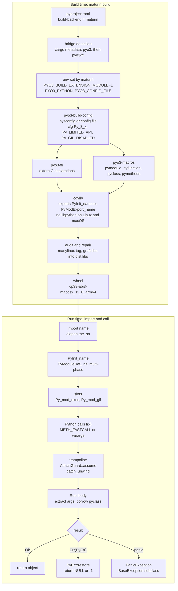
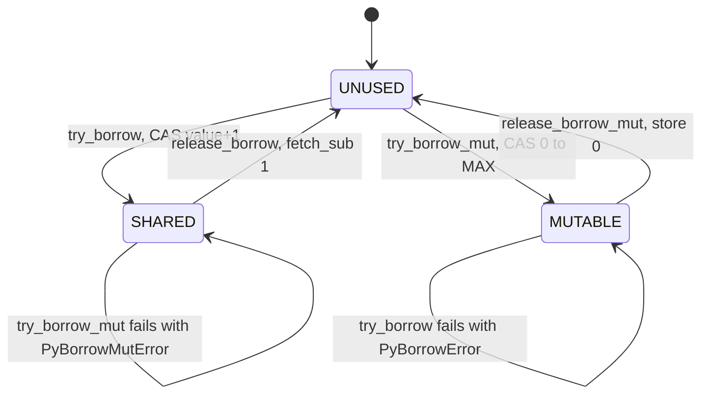

# Rust-Python Interoperability: PyO3 Architecture and Maturin Packaging

> [!summary] Claim:
> PyO3 is a safe-Rust skin over the CPython C API: `pyo3-ffi` declares the C symbols, `pyo3-build-config` decides at build time which Python the code is for, and `pyo3-macros` generate the C-ABI entry points, whose trampoline attaches the thread, catches panics, and turns `Result` into a raised exception.
> Ownership is typed: `Py<T>` is an owned handle with no lifetime, `Bound<'py, T>` is the same handle tied to a proof that the thread is attached, and a `#[pyclass]` carries an atomic borrow flag that is the runtime stand-in for the GIL.
> maturin is the PEP 517 backend that compiles the cdylib with the right environment, picks the stable ABI and platform tag, audits or repairs external libraries, and writes the wheel.
> An expert reads the wheel tag, the module entry symbol, the undefined `Py*` symbols, and the `Cargo.lock` before believing that a Rust extension is portable and thread-safe.



## The Mechanism

This note owns the PyO3 object model, the call path, and the maturin build pipeline.
It hands the `cdylib` and `staticlib` crate types to [[Rust-FFI-Packaging-cdylib-staticlib-and-cbindgen]], the wheel filename grammar and manylinux baselines to [[Python-Wheels-Platform-Tags-Manylinux-and-ABI3]], the free-threaded wheel matrix to [[Python-Free-Threaded-Wheels-and-Wheel-Variants]], the backend comparison to [[Python-Native-Build-Backends-scikit-build-core-meson-python-and-maturin]], and the end-to-end CI and publish procedure to [[Ship-a-Rust-Extension-in-a-Python-Wheel]].
Versions in this note are PyO3 0.30.1 (crates.io, 2026-10-14) and maturin 1.15.0 run locally, with the maturin 1.16.0 source and changelog read for details that moved.

### Four crates and what each one owns

`Architecture.md` in the PyO3 0.30.1 source splits the project into parts, and the split is the first thing to know when reading a build log.

| Crate | Owns | Why it is separate |
|---|---|---|
| `pyo3-ffi` | Hand-written `extern "C"` declarations of the CPython API, with `cfg(Py_3_9)` through `cfg(Py_3_16)`, `cfg(Py_LIMITED_API)`, `cfg(Py_GIL_DISABLED)`, and `cfg(PyPy)` | The maintainers write it by hand, not from a generator, to control how C conventions map to Rust and to cover many interpreter versions in one tree. |
| `pyo3` | `Py<T>`, `Bound<'py, T>`, `Python<'py>`, the concrete types under `src/types`, `PyErr`, `#[pyclass]` support in `pycell` and `pyclass` | Safe abstractions over the raw symbols. |
| `pyo3-macros` and `pyo3-macros-backend` | The proc macros `pymodule`, `pyfunction`, `pyclass`, `pymethods`, and `derive(FromPyObject)` | Code generation, with `#[doc(hidden)]` helpers in `pyo3/src/impl_`. |
| `pyo3-build-config` | Interpreter discovery, the config file, linker arguments | A build dependency of `pyo3` and `pyo3-macros`, also usable from a downstream `build.rs`. |

Two layout facts from `Architecture.md` explain most of the FFI behavior.
`PyAny` is `#[repr(transparent)]` over `UnsafeCell<ffi::PyObject>`, and concrete types such as `PyDict` wrap `PyAny`, so a `&Bound<PyDict>` is a pointer to a real `PyObject` with no extra indirection.
A `#[pyclass]` instance is allocated on the Python heap as a `#[repr(C)]` struct whose first field is the `PyObject` header, followed by the Rust value, which is why casting `*mut ClassObject` to `*mut PyObject` is valid (the file gives the struct as roughly `{ ob_base, inner }`).

### Build-time configuration: which Python is this binary for

PyO3 cannot compile without knowing the Python version, whether the build is free-threaded, and whether it targets the stable ABI, because `pyo3-ffi` is full of `cfg` gates.
`pyo3-build-config` decides this, and the PyO3 guide (building-and-distribution) documents the order and the knobs.

1. The interpreter is the first of: an active virtualenv (or a conda environment through `CONDA_PREFIX`; when both are set PyO3 warns and ignores both), `python` if it is Python 3, then `python3` (`find_interpreter` in `pyo3-build-config` 0.30.1 `src/impl_.rs`).
2. `PYO3_PYTHON` overrides it and is checked first, for example `PYO3_PYTHON=python3.10` or `pypy3`.
3. PyO3 runs that interpreter and reads `sysconfig`; `PYO3_CONFIG_FILE` replaces the detected configuration with a file, and `PYO3_NO_PYTHON` bypasses detection so that only abi3 extensions can be built.
4. `PYO3_PRINT_CONFIG=1 cargo build` prints the resolved configuration and halts the compile, with fields such as `implementation`, `version`, `shared`, `target_abi`, `lib_name`, `lib_dir`, `executable`, `pointer_width`, `build_flags`, and `suppress_build_script_link_lines`.
5. The build script emits `cargo:rerun-if-env-changed` for `PYO3_CONFIG_FILE`, `PYO3_CROSS`, `PYO3_CROSS_LIB_DIR`, `PYO3_CROSS_PYTHON_VERSION`, `PYO3_CROSS_PYTHON_IMPLEMENTATION`, `PYO3_NO_PYTHON`, `PYO3_ENVIRONMENT_SIGNATURE`, `PYO3_PYTHON`, `VIRTUAL_ENV`, `CONDA_PREFIX`, `PATH`, and `PYO3_PRINT_CONFIG` (the guide's example list), so changing the interpreter rebuilds the crate.
   Every variable read through `pyo3_build_config::env_var` registers itself the same way, so `PYO3_BUILD_EXTENSION_MODULE` and `PYO3_USE_RAW_DYLIB` also trigger rebuilds.
   `PYO3_ENVIRONMENT_SIGNATURE` has no other effect than forcing that rebuild, and maturin sets it for the interpreter it builds against.

Whether the cdylib links `libpython` is a separate decision.
`pyo3-build-config::is_linking_libpython_for_target` returns true on Windows, AIX, Android, Cygwin, and iOS, and otherwise true only when the build is not an extension module.
An extension module is signalled by the `PYO3_BUILD_EXTENSION_MODULE` environment variable (or the deprecated `extension-module` Cargo feature).
On Linux and macOS an extension therefore leaves every `Py*` symbol undefined and lets the host interpreter supply them at `dlopen` time, which is what manylinux requires and what lets one wheel load into a statically linked Python.
On macOS the linker must be told that undefined symbols are acceptable, which `add_extension_module_link_args` emits as `-undefined dynamic_lookup` for Darwin targets, and maturin and setuptools-rust pass this for you.
The guide records the reason the env var replaced the feature: the `extension-module` feature disabled linking for all targets, including tests, so `cargo test` failed with undefined `PyExc_*` symbols; maturin 1.9.4 and later set the env var instead.

Three build-system changes in the 0.29 and 0.30 series matter when you read old advice.
Since PyO3 0.29 `pyo3-build-config` no longer inlines configuration in its own build script, and requires a direct dependency on `pyo3` or `pyo3-ffi` to load the configuration that `pyo3-ffi`'s build script resolved, which makes cross-compiling and Bazel or Buck builds consistent (migration guide, 0.28 to 0.29).
On Windows, PyO3 uses `raw-dylib` linking since 0.29.0 so no import library is needed, and `PYO3_USE_RAW_DYLIB=0` (added in 0.29.2) opts out for mixed C and Rust projects that need the full import library; the `generate-import-lib` feature was deprecated in 0.29.0 and is now a no-op (CHANGELOG, migration guide).
Since PyO3 0.30 `InterpreterConfig::from_sysconfigdata` always selects a version-specific ABI and no longer reads the `abi3` or `abi3t` features, per the 0.30.0 changelog.

Cross-compiling cannot execute the target interpreter, so `PYO3_CROSS`, `PYO3_CROSS_LIB_DIR`, `PYO3_CROSS_PYTHON_VERSION`, and `PYO3_CROSS_PYTHON_IMPLEMENTATION` supply what `sysconfig` would have.
An abi3 build needs none of them, because the stable ABI fixes the symbol set; this is why abi3 is the easy path for the matrix in [[Rust-Binary-Distribution-with-dist-and-Cross-Compilation]].

### Module initialization: the export symbol and the slots

Python imports an extension by `dlopen`ing the file and looking up an export named after the module.
PyO3 generates that symbol from `#[pymodule]`, and the module name must match the file stem, or import fails with `ImportError: dynamic module does not define module export function (PyInit_<name>)` (module guide).

Three facts about the generated code come from `src/impl_/pymodule.rs` in 0.30.1.
- Since PyO3 0.28 the macro uses multi-phase initialization (PEP 489): `PyInit_<name>` returns `PyModuleDef_Init(def)`, and the module body runs later in a `Py_mod_exec` slot.
  The migration guide says this is groundwork for per-module state and subinterpreters, which PyO3 does not yet support: `ModuleDef::make_module` compares the current interpreter ID against the first one and raises `ImportError("PyO3 modules do not yet support subinterpreters, ...")` when they differ.
- On Python 3.15 and later the source defines `PyModExport_<name>` (PEP 793, status Final, Python 3.15) that returns the slot array directly, and the `PyInit_<name>` macro expands to nothing only for the combination of Python 3.15, limited API, and free-threaded, which is the `abi3t` build.
  The `cfg` guards say version-specific 3.15 builds export both symbols and `abi3t` builds export only `PyModExport`; this note read that source and did not build it.
- The `Py_mod_gil` slot is set from `gil_used`: `Py_MOD_GIL_NOT_USED` declares the module safe without the GIL, and `Py_MOD_GIL_USED` makes a free-threaded interpreter re-enable the GIL at import with a `RuntimeWarning` naming the module (CPython `Python/import.c`: "The global interpreter lock (GIL) has been enabled to load module '%U', which has not declared that it can run safely without the GIL"; the PyO3 free-threading guide describes the same behavior).
  The default flipped in PyO3 0.28 from "needs the GIL" (0.23 to 0.27) to "does not need it", so every module now claims free-threaded safety unless it writes `#[pymodule(gil_used = true)]`.

The demo in this note built with `abi3-py39` on CPython 3.15.2 exports exactly one symbol, `_PyInit_tde_pyo3_demo`, and imports `_PyModuleDef_Init` (observed, macOS arm64).

### Ownership: Py, Bound, Borrowed, and the attach token

CPython objects are reference counted, and only code that is attached to the interpreter may touch them.
PyO3 encodes both facts in types.

| Type | Holds | Lifetime | Use |
|---|---|---|---|
| `Python<'py>` | Proof that this thread is attached | `'py` | Passed to functions, copied freely, not `Send`. |
| `Py<T>` | An owned strong reference | none | Store in structs, move across threads, keep across `detach`. |
| `Bound<'py, T>` | `(Python<'py>, Py<T>)` in one pointer-sized value | `'py` | Default everywhere; the API is on this type. |
| `Borrowed<'a, 'py, T>` | A reference that is not owned | `'a` and `'py` | Avoids a refcount round trip when the owner outlives the use. |

`Bound` is declared `#[repr(transparent)]` as `Bound<'py, T>(Python<'py>, ManuallyDrop<Py<T>>)` in `src/instance.rs`, and `Python<'py>` is zero-sized, so a `Bound` is one pointer and the token costs nothing at run time.
The guide's rule is to use `Bound<'py, T>` for as much as possible, because it has the complete API and the cheapest calls, and to `unbind()` into `Py<T>` only to store or to cross a `detach`.
The ownership API has a history that old posts still describe: `Bound<T>` arrived in PyO3 0.21, the GIL-ref types (`&PyAny`) were removed in 0.23, `IntoPyObject` unified to-Python conversion in 0.23, and `.cast()` replaced `.downcast()` in 0.27 (migration guide).

**Attach and detach.**
A thread must be attached before calling the C API.
In a GIL build "attached" means holding the GIL, and in a free-threaded build it means having a thread state, and many threads can be attached at once.
`Python::attach(|py| ...)` creates an `AttachGuard`.
The source in `src/internal/state.rs` shows the mechanism: a thread-local `ATTACH_COUNT` tracks nesting, a positive count means attached, and the value `-1` (`ATTACH_FORBIDDEN_DURING_TRAVERSE`) forbids attaching inside a `__traverse__` GC callback.
If the count is zero, PyO3 checks `Py_IsInitialized`, waits for any in-progress initialization, refuses on `Py_IsFinalizing` (3.13 and later), and then calls `PyGILState_Ensure`; the guard's `Drop` calls `PyGILState_Release`.
`py.detach(|| ...)` is the inverse: `SuspendAttach` calls `PyEval_SaveThread` and restores with `PyEval_RestoreThread` in `Drop`, so the thread re-attaches even if the closure panics.
The closure and its result must be `Ungil`, which on stable Rust is `Send`, so the `Python<'py>` token and any `Bound` cannot be captured, and the compiler rejects `println!("{:?}", s)` of a `PyString` inside the closure.
In 0.26 these were renamed from `Python::with_gil` and `Python::allow_threads` (migration guide), which matters when you search old code.

**Reference-count disposal.**
`Drop for Py<T>` is the subtle part.
If the thread is attached it calls `Py_DECREF` immediately; otherwise it pushes the pointer into a global `ReferencePool` (a `Mutex<Vec<Py<PyAny>>>` plus an `AtomicBool` dirty flag) and sets the flag.
The next `AttachGuard` creation or assumption calls `drop_deferred_references`, which loads the flag with relaxed ordering and returns at once when clear, so the hot path costs one atomic load, and the slow path swaps the vector out under the lock and decrefs outside it.
Dropping a Python handle from a plain Rust thread is therefore safe and deferred, not immediate: an object can outlive its Rust owner until some thread next attaches.
The guide's performance chapter says this synchronization can be a significant part of boundary-crossing cost, and offers the `pyo3_disable_reference_pool` cfg, under which a `Py<T>` dropped while detached aborts the process (or leaks it with `pyo3_leak_on_drop_without_reference_pool`).
`Clone for Py<T>` exists only with the `py-clone` feature and panics when detached, with the message "Cannot clone pointer into Python heap without the thread being attached." (source).
Prefer `clone_ref(py)`, which takes the token.

### The `#[pyclass]` borrow checker

A Python object can be reached from any thread and any Python frame at once, so Rust's compile-time aliasing rules cannot see how many `&mut T` exist.
PyO3 restores the guarantee at run time with a flag inside the object, in `src/pycell/impl_.rs`.



- The flag is an `AtomicUsize`: `0` is unused, `usize::MAX` means a mutable borrow, and any other value counts shared borrows.
- `try_borrow` is a compare-exchange loop that increments unless the value is `usize::MAX`; `try_borrow_mut` is one compare-exchange from `0` to `usize::MAX`.
- A failed shared borrow produces `PyBorrowError` ("Already mutably borrowed"), a failed mutable borrow produces `PyBorrowMutError` ("Already borrowed"), and both convert to a Python `RuntimeError`.
- The checker is atomic, not GIL-protected, which is why it stays sound on a free-threaded interpreter.
- A `#[pyclass(frozen)]` has no mutable access, so its slot is `EmptySlot`, whose `try_borrow` always succeeds and whose mutable operations are `unreachable!()`.
  A class that is both `frozen` and `Sync` is reachable without a `Python` token through `Bound::get` and `Py::get`.

The guide states the thread-safety contract: because any thread may drop or read the object, a `#[pyclass]` must be `Send` and `Sync`, and `#[pyclass(unsendable)]` opts out at the price of runtime errors on concurrent access.
It lists three ways to satisfy it: atomics in a `frozen` class, a `Mutex` in a `frozen` class (use `MutexExt::lock_py_attached` if Python code runs under the lock), or a manual and `unsafe` `Send` and `Sync` implementation after review.
RUSTSEC-2026-0177 is the cautionary tale: `PyCFunction::new_closure` required `Send + 'static` but not `Sync`, so a closure wrapped as a Python callable could run concurrently on several Python threads, and PyO3 0.29.0 added the missing bound.

### The call path: trampoline, panics, and errors

`#[pyfunction]` and `#[pymethods]` generate a C function and a `PyMethodDef`.
On Python 3.10 and later, and on any non-limited build, `PyMethodDef::fastcall_cfunction_with_keywords` sets `METH_FASTCALL | METH_KEYWORDS`, and arguments are parsed by `extract_arguments_fastcall` without building a tuple and a dict; the source carries a comment that the abstraction falls back to varargs on older Python versions.
Because the fastcall constructor is gated `#[cfg(any(Py_3_10, not(Py_LIMITED_API)))]`, an `abi3-py39` build does not get the fastcall entry point (derived from the cfg, not measured).

Every generated entry runs through `trampoline` in `src/impl_/trampoline.rs`.
1. `PanicTrap::new("uncaught panic at ffi boundary")` is armed; if anything unwinds out of the trampoline itself, the process aborts rather than unwinding through CPython frames.
2. `AttachGuard::assume()` marks the thread attached (the caller, CPython, already holds the interpreter) and drains the deferred-decref pool.
3. The body runs inside `std::panic::catch_unwind`.
4. `Ok(value)` is returned.
   `Err(PyErr)` is installed with `PyErr::restore(py)` and the slot's error value (`R::ERR_VALUE`, the sentinel the C API treats as failure) is returned.
   A panic payload becomes a `PanicException` and is restored the same way.
5. The trap is disarmed.

`PanicException` (`src/panic.rs`) derives from `BaseException`, "like `SystemExit`", so that it propagates through ordinary `except Exception` handlers.
Its message is the panic payload when it is a `String` or `&str`, and `"panic from Rust code"` otherwise.
The demo shows the type as `pyo3_runtime.PanicException` and `issubclass(..., Exception)` as `False` (observed).
The consequence for a release profile is that `panic = "abort"` skips unwinding entirely, so `catch_unwind` never runs and a Rust panic terminates the interpreter process (Rust semantics; not run for this note).

**Exceptions are values.**
`PyResult<T>` is `Result<T, PyErr>`, `?` propagates, and a `#[pyfunction]` can return any `Result<T, E>` where `E: Into<PyErr>`.
The standard conversions are in `src/err/impls.rs`: `io::Error` maps by kind, and an error wrapping a `PyErr` is unwrapped back to that `PyErr`.

| Rust `io::ErrorKind` | Python exception (0.30.1) |
|---|---|
| `NotFound` | `FileNotFoundError` |
| `PermissionDenied` | `PermissionError` |
| `AlreadyExists` | `FileExistsError` |
| `BrokenPipe`, `ConnectionRefused`, `ConnectionAborted`, `ConnectionReset` | the matching `ConnectionError` subclass |
| `Interrupted`, `WouldBlock`, `TimedOut` | `InterruptedError`, `BlockingIOError`, `TimeoutError` |
| `IsADirectory`, `NotADirectory` | `IsADirectoryError`, `NotADirectoryError` |
| `OutOfMemory` | `MemoryError` |
| anything else | `OSError` |

The conversion builds the exception from the error's message string, so the resulting `OSError` has no `errno`: in the demo `e.errno` is `None` for a `FileNotFoundError` raised from `File::open` (observed).
`From<str::Utf8Error>`, `From<string::FromUtf16Error>`, and `From<char::DecodeUtf16Error>` for `PyErr` were removed in 0.29.0 because they built the wrong exception class, so a `?` on those errors needs an explicit `map_err` (for example `PyUnicodeDecodeError::new_err_from_utf8`, added in the same release); 0.29.0 also fixed `From<FromUtf8Error>` and `From<IntoStringError>`, which had produced `TypeError` (CHANGELOG 0.29.0, PR #5668; migration guide "from 0.28.* to 0.29").

**Conversion cost.**
`FromPyObject` (reworked in 0.27) must return `Result<T, PyErr>`, so a failed `extract` builds a `PyErr`, which is costly.
The performance chapter says to prefer `cast` when the error is discarded, for example when probing `PyList` before falling back to `Vec`.
Strings used as attribute or dict keys should be interned, and PyO3 0.30 interns the keys of derived `IntoPyObject` implementations (changelog).

### Free-threaded CPython

PyO3 has supported the free-threaded build since 0.23, and since 0.28 declares modules compatible by default.
PyO3 0.29.0 dropped 3.13t, so on 0.29 and 0.30 the floor is 3.14t: `MIN_FREE_THREADED_VERSION` is 3.14 in `pyo3-ffi` 0.30.1 `build.rs`, which fails the build with "PyO3 does not support the free-threaded build of CPython versions below 3.14".
Four mechanisms from the free-threading guide and the source matter.

- **Object layout.**
  `pyo3-ffi` defines the free-threaded `PyObject` with `ob_tid`, `ob_mutex`, `ob_gc_bits`, `ob_ref_local` (`AtomicU32`), `ob_ref_shared` (`AtomicIsize`), and `ob_type`, against the single `ob_refcnt` of the GIL layout.
  This is the reason version-specific free-threaded wheels (`cp314t`, and `cp315t` when not using `abi3t`; `cp313t` only from PyO3 0.28 or older) are separate artifacts; see [[Python-Free-Threaded-Wheels-and-Wheel-Variants]].
- **What `'py` means.**
  Holding `Python<'py>` no longer implies exclusion, only attachment, and other threads are attached at the same time.
  Code that used `unsafe` on the assumption that the GIL serializes access is the only source of new unsoundness, and `GILProtected` was deprecated in 0.26 for that reason and no longer exists in the 0.30.1 source; use atomics, `Mutex`, `PyOnceLock`, or `OnceExt` and `MutexExt`, which detach while blocking.
- **Stop-the-world events.**
  The interpreter pauses all attached threads during garbage collection, when `sys.settrace` or `sys.setprofile` is called, during `os.fork()`, and on 3.13 when the first background thread starts to mark immortal objects.
  A thread that blocks while attached can hang the pause, and a thread that tries to attach during a pause while its spawner waits for it deadlocks.
  The rule is the same as on a GIL build: `detach` around long Rust-only work and around anything that needs to re-attach.
- **Borrow errors get easier to hit.**
  The guide's example shows 100 submissions of `next(i)` from a 16-worker pool raising `RuntimeError: Already borrowed` from a `&mut self` method, because no GIL serializes the calls.
  The fix is a `frozen` class with atomics or a lock, or the critical-section API, not retrying.

A module that is not ready declares `#[pymodule(gil_used = true)]`, and users can force the GIL off with `PYTHON_GIL=0` or `-Xgil=0`.

### abi3 and abi3t: the stable-ABI features

`pyo3` exposes `abi3`, version floors `abi3-py39` and up, `abi3t`, and `abi3t-py315` and up.
The wheel-tag consequences live in [[Python-Wheels-Platform-Tags-Manylinux-and-ABI3]]; this section covers what PyO3 does with them.

- PyO3 0.30 supports Python 3.9 and newer (`MINIMUM_SUPPORTED_VERSION` is 3.9 in `pyo3-build-config`, and 0.30.0 dropped 3.8), the minimum `abi3t` version is 3.15, and the MSRV is 1.85 (changelog and crates.io `rust_version`).
- If several `abi3-pyXY` features are set, the lowest wins.
  PyO3 can only link an abi3 version up to the host interpreter's version, so `abi3-py310` fails on a 3.9 host.
- With the stable ABI PyO3 calls functions instead of using macros and loses optimizations that need the exact version.
  The guide's list of unsupported or restricted features under abi3: `text_signature` on classes before Python 3.10, `dict` and `weakref` on classes before 3.9, the buffer API before 3.11, and subclassing native types such as `PyException` before 3.12.
- On a free-threaded interpreter an `abi3` request is not honored.
  The `finalize` step in `pyo3-build-config` warns "Targeting an abi3 build but build_flags contains Py_GIL_DISABLED, falling back to a version-specific free-threaded build", so the artifact is version-specific.
- Enabling both `abi3` and `abi3t` yields an `abi3` extension for Python 3.14 and older and an `abi3t` extension for 3.15 and newer; enabling only `abi3t` yields `abi3t` on 3.15 and version-specific output below that.
  `abi3t` extensions import on both GIL-enabled and free-threaded builds of 3.15 and later, per the guide and PEP 803.
- maturin 1.14 added `abi3t` support (Changelog 1.14.0: "Support pyo3 abi3t features on Python3.15 and PyO3 0.29"), and the maturin bindings page says a single `maturin build` selects one stable-ABI family, so a release that wants both needs two explicit builds, for example `maturin build --interpreter python3.10` and `maturin build --interpreter python3.15t`.
  For Python 3.14 free-threaded it emits a version-specific `cp314-cp314t` wheel.
- The stable ABI is not a soundness boundary.
  RUSTSEC-2026-0013 was memory corruption specific to abi3 on Python 3.12 and later: PyO3 0.28.1 allowed `#[pyclass(extends=PyList)]` under abi3, and subclasses of such classes used the wrong type to find the Rust data, fixed in 0.28.2 (affected 0.28.0 and 0.28.1, per the advisory).

### maturin: from `pyproject.toml` to a wheel

maturin is both a CLI and a PEP 517 build backend (`build-backend = "maturin"`).
The sequence below is read from the maturin 1.16.0 source, with the documentation for flags.

1. **Bridge detection** (`src/bridge/detection.rs`).
   `find_bridge` inspects `cargo metadata`.
   It excludes bench, build-script, example, proc-macro, and test targets, then looks for PyO3 bindings in the order `pyo3`, `pyo3-ffi` (`find_pyo3_bindings`; when both are present the binding is `pyo3`, with build metadata read from `pyo3-ffi`).
   With no `--bindings` it picks: PyO3 with a `cdylib` as `pyo3` bindings; PyO3 with only a `bin` target as `bin`; `uniffi` if that dependency exists; any `cdylib` without PyO3 as `cffi`; a lone `bin` as `bin`; otherwise it fails with "Couldn't detect the binding type".
   `-b/--bindings` accepts `pyo3`, `pyo3-ffi`, `cffi`, `uniffi`, and `bin`; the maturin docs are inconsistent about whether `cffi` is auto-detected (the code does detect it), so name `cffi` and `bin` explicitly in `pyproject.toml`.
   The same function reads the abi3 and abi3t features to decide whether the build is stable-ABI.
2. **Interpreter resolution.**
   `-i/--interpreter` names executables, `-f/--find-interpreter` searches the host; a stable-ABI build needs one interpreter per ABI family, as the abi3 section describes.
3. **Build environment** (`configure_pyo3_env` in `src/compile.rs`).
   For a PyO3 library (not a `bin`) maturin sets `PYO3_BUILD_EXTENSION_MODULE=1`.
   For a runnable interpreter it sets `PYO3_PYTHON` and `PYO3_ENVIRONMENT_SIGNATURE`.
   It writes a config file named `pyo3-config-<triple>-<major>.<minor>[-<abi>].txt` in a `maturin` subdirectory of the target directory and exports `PYO3_CONFIG_FILE` when the build targets a stable ABI on PyO3 0.29 or later, or when the interpreter is not runnable (cross-compiling), unless the user already set that variable.
   The file is rewritten only when its content changes, through a per-process temp file and a rename, so parallel builds sharing a target directory do not see a half-written file and Cargo does not rebuild every time.
4. **macOS deployment target.**
   For non-editable builds, when `MACOSX_DEPLOYMENT_TARGET` is unset, maturin sets it from `[tool.maturin.target.<triple>] macos-deployment-target`, else rustc's default for the triple, and prints which one it used (`macos_deployment_target` in `src/compile.rs` also checks the environment first, which only matters to its other callers).
   The demo printed "Using `MACOSX_DEPLOYMENT_TARGET=11.0` for aarch64-apple-darwin by default" and produced a Mach-O with `LC_BUILD_VERSION minos 11.0` (observed).
5. **Cargo build.**
   `maturin build` uses the `dev` profile unless `-r/--release` or `--profile` is given (the demo log reads "Finished `dev` profile", observed), `maturin develop` also builds in debug by default, and the user guide says builds through `pyproject.toml` are release builds.
   `[tool.maturin] profile` and `editable-profile` set both explicitly.
6. **Binding generation and module layout** (`src/binding_generator/pyo3_binding.rs`).
   maturin names the extension file with the stable-ABI suffix (`.abi3.so` on Unix, `.pyd` on Windows, `_d.pyd` for a Windows debug interpreter) or the interpreter's own library name.
   For a pure Rust project it also writes a package `__init__.py` that star-imports from the native module; the demo wheel contains `tde_pyo3_demo/__init__.py` and `tde_pyo3_demo/tde_pyo3_demo.abi3.so` (observed).
   `module-name = "pkg._native"` places the extension inside a Python package for mixed projects, and `python-source` points at the Python half.
7. **Platform tag and audit.**
   On Linux maturin runs its own reimplementation of `auditwheel`.
   `--compatibility` controls the tag: `pypi` allows only PyPI-uploadable tags, `manylinux2014` or `manylinux_2_24` style values and `musllinux_1_2` pin a policy, and `linux` keeps the native tag; the default is the lowest compatible `manylinux` tag, or plain `linux` when nothing matches.
   `--auditwheel` is `repair`, `check`, `warn`, or `skip`.
   Repair copies external shared libraries into `<dist>.libs/` on Linux and Windows and `<dist>.dylibs/` on macOS (comments in `src/auditwheel/repair.rs`), then patches the artifact with an `$ORIGIN`-relative RPATH on ELF or `@loader_path` on Mach-O, and injects `os.add_dll_directory()` on PE; Linux repair needs `patchelf` (`pip install maturin[patchelf]`).
   The Distribution page notes that rustc since 1.64 requires glibc 2.17, so `manylinux2014` is the floor, and `manylinux1` and `manylinux2010` are unsupported.
   `--zig` links with `zig cc` so a chosen glibc is honored on a newer host, defaulting to `manylinux2014` when no `--compatibility` is given.
8. **Wheel writing.**
   `WheelTag` keeps python, abi, and platform components as sorted sets, so compressed tags print deterministically (1.16.0 "Sort compressed tag sets").
   maturin 1.12 and later include a CycloneDX SBOM per PEP 770 under `.dist-info/sboms/`; the demo wheel contained `tde_pyo3_demo-0.1.0.dist-info/sboms/tde_pyo3_demo.cyclonedx.json` (observed).
   `--compression-method` is `deflated` by default, with `stored`, `bzip2`, and `zstd` as the alternatives; the help text marks `zstd` as supported from Python 3.14 and says only `stored` and `deflated` are compatible with all package managers.
9. **Source distribution.**
   `maturin sdist`, or `--sdist` on `build`, produces a source distribution with the same contents as `cargo package`.
   `--sdist` builds wheels from the sdist to verify that it is complete, and `sdist-generator` is `cargo` (default) or `git`.
   Files that the build needs but Cargo would omit go in `include` with `format = "sdist"`.

**Development loop.**
`maturin develop` builds in debug mode and installs into the active virtualenv, with `--uv` to use uv, `-E` for extras, `-G` for PEP 735 dependency groups, and `--skip-install` for a mixed layout.
PEP 660 editable installs (`pip install -e .`) are supported, and the user guide says that in a mixed Rust and Python layout Python edits take effect without a rebuild.

**Additional outputs.**
`--generate-stubs` (and `maturin generate-stubs`) introspects the built binary to emit `.pyi` files and requires PyO3's `experimental-inspect` feature.
`--pgo` runs a three-phase instrumented build, training command, and optimized rebuild, needing `pgo-command` in `[tool.maturin]`, and `maturin develop --pgo` is supported since 1.15.
`--include-debuginfo` adds `.pdb`, `.dSYM`, or `.dwp` files to the wheel.
`maturin generate-ci github` writes a GitHub Actions workflow, and `trusted-publishing = true` makes it publish with `uv publish --trusted-publishing always`, which connects to [[Python-Trusted-Publishing-and-PEP-740-Attestations]].

### Which versions go together

| Capability | PyO3 | maturin | Source |
|---|---|---|---|
| `Bound<'py, T>` API | 0.21 | any current | PyO3 migration guide |
| GIL refs removed, `IntoPyObject`, free-threaded support | 0.23 | any current | migration guide, free-threading guide |
| `with_gil` renamed `attach`, `allow_threads` renamed `detach` | 0.26 | any current | migration guide |
| `PYO3_BUILD_EXTENSION_MODULE` replaces `extension-module` | 0.26 and later | 1.9.4 and later sets it | building guide, maturin `detection.rs` |
| Modules default to free-threaded safe, multi-phase init | 0.28 | any current | migration guide |
| `abi3t`, `raw-dylib`, `pyo3-build-config` change, 3.13t dropped | 0.29 | 1.14.0 added `abi3t` | migration guide, PyO3 CHANGELOG, maturin Changelog |
| Python 3.8 dropped, MSRV 1.85, `meson-python` support | 0.30.0 | no requirement | PyO3 CHANGELOG |
| PyPy 3.12 | 0.30.1 | `pp80` tag fix in 1.16.0 | PyO3 CHANGELOG, maturin Changelog |

## Commands and Numbers to Know

| Item | Value | Platform | Notes |
|---|---|---|---|
| Latest PyO3 | 0.30.1, published 2026-10-14 (as of 2026-11) | Both | 0.30.0 failed to publish to crates.io, so 0.30.1 added only PyPy 3.12 support. |
| PyO3 MSRV | Rust 1.85 (as of 2026-11) | Both | crates.io `rust_version`; the demo built with rustc 1.99.0. |
| PyO3 minimum Python | 3.9, abi3t 3.15 (as of 2026-11) | Both | `pyo3-build-config` 0.30.1 constants; free-threaded floor 3.14t (`pyo3-ffi` `build.rs`); GraalPy 25.4 minimum per the changelog, although the `MINIMUM_SUPPORTED_VERSION_GRAALPY` constant still reads 25.0. |
| Latest maturin | 1.16.0 on PyPI, 2026-10-29 (as of 2026-11) | Both | The demo ran maturin 1.15.0, installed locally. |
| `PYO3_PRINT_CONFIG=1 cargo build` | Prints resolved config and halts (as of 2026-11) | Both | Fields include `target_abi`, `lib_name`, `build_flags`. |
| `PYO3_BUILD_EXTENSION_MODULE` | Any value skips libpython linking, except on Windows, AIX, Android, Cygwin, iOS (as of 2026-11) | Both | Set automatically by maturin for PyO3 libraries. |
| `PYO3_USE_RAW_DYLIB=0` | Opts out of `raw-dylib` on Windows targets (as of 2026-11) | Both | Cross-compiling Windows needs no import library by default. |
| Interpreter lookup order | virtualenv, `python`, `python3` (as of 2026-11) | Both | Override with `PYO3_PYTHON`. |
| Borrow flag | `AtomicUsize`, `0` unused, `usize::MAX` mutable (as of 2026-11) | Both | `src/pycell/impl_.rs`. |
| Borrow error strings | "Already mutably borrowed", "Already borrowed" (as of 2026-11) | Both | Raised as `RuntimeError`, observed on CPython 3.15.2. |
| Panic exception | `pyo3_runtime.PanicException`, a `BaseException` (as of 2026-11) | Both | Observed on CPython 3.15.2. |
| `detach` threshold | Attach and detach take under a millisecond (as of 2026-11) | Both | The performance chapter's rule of thumb; this note ran no benchmark. |
| `maturin build` default profile | `dev` (as of 2026-11) | Both | Observed with maturin 1.15.0; pass `-r` for release. |
| `maturin --compatibility` default | lowest compatible `manylinux`, else `linux` (as of 2026-11) | Linux | From `maturin build --help`. |
| `maturin --auditwheel` | `repair`, `check`, `warn`, `skip` (as of 2026-11) | Linux | `skip-auditwheel` is deprecated in favor of this. |
| Rust glibc floor | 2.17, so `manylinux2014` at minimum (as of 2026-11) | Linux | maturin Distribution page, rustc 1.64 and later. |
| Demo wheel name | `tde_pyo3_demo-0.1.0-cp39-abi3-macosx_11_0_arm64.whl` (as of 2026-11) | macOS | Observed, ad hoc run, 432,227 bytes for the debug build. |
| Demo `LC_BUILD_VERSION` | `minos 11.0`, `sdk 27.2` (as of 2026-11) | macOS | `vtool -show-build`; the SDK number is this host's. |
| Demo undefined symbols | 88 `_Py*` names plus `__Py_NoneStruct`, no libpython in `otool -L` (as of 2026-11) | macOS | `nm -u`, abi3-py39 debug build. |
| Demo exports | one symbol, `_PyInit_tde_pyo3_demo` (as of 2026-11) | macOS | `nm -gU`. |

## Multi-Language Comparison

The raw C-API row is the contract PyO3 compiles down to; the extended treatment of reference counting and the C-API is in [[02-Programming-Languages/Python/Python_Zero_to_Godhood/Chapter_24_C_Extensions__Python_C-API_Interoperability|Chapter_24_C_Extensions__Python_C API_Interoperability]].
This note has no benchmark, so the comparison covers where checking happens, not how fast it is.

| Concern | C extension (raw C-API) | C++ extension | Rust extension (PyO3) |
|---|---|---|---|
| Reference counting | Manual `Py_INCREF` and `Py_DECREF` on every path, including error paths | RAII wrappers are possible, but the discipline is by convention | `Py<T>` and `Bound<'py, T>` decrement in `Drop`; a leak or double free needs `unsafe` |
| Attached-thread rule | Convention; `PyGILState_Ensure` and save/restore calls written by hand | Same as C | `Python<'py>` token required by the API; `detach` rejects captured tokens through `Ungil` |
| Error signalling | Return NULL or -1 and set the exception, and check every call | Exceptions must be caught and translated before returning into CPython | `PyResult`, `?`, and the trampoline sets the exception and returns the sentinel |
| Panics and aborts across the boundary | A crash is a crash | An exception must be caught and translated before it reaches CPython's C frames | `catch_unwind` turns a panic into `PanicException`; `panic = "abort"` kills the process |
| Aliasing of an object's native data | Unchecked | Unchecked | Atomic borrow flag per instance, or `frozen` plus your own synchronization |
| Module export | Write `PyInit_name` and the method tables | Same, or a binding library | Generated by `#[pymodule]`; `PyModExport` on 3.15 and later |
| Stable ABI | `Py_LIMITED_API` by hand, and one unguarded call breaks it | Same | `abi3` and `abi3t` features gate the API surface |
| Free-threaded safety story | Audit every global and use critical sections | Same | `Send` and `Sync` bounds on `#[pyclass]`; `unsafe` is the remaining risk |
| Build and packaging | setuptools, scikit-build-core, or meson-python | scikit-build-core or meson-python | maturin, or setuptools-rust |
| Typical production failure | Refcount error shows up as a use-after-free under load | Symbol or runtime mismatch at install time | Wheel tag promises more than the binary delivers, or `unsafe` code that assumed the GIL |

The C++ and C columns state language-level properties and were not measured here; the build-backend comparison belongs to [[Python-Native-Build-Backends-scikit-build-core-meson-python-and-maturin]].

Performance in this model is paid in four places, all visible in the PyO3 source read for this note.
1. Each call pays a thread-local counter increment, a `catch_unwind` frame, and one relaxed atomic load for the reference pool.
2. A failed `extract` pays for a `PyErr`, which is why probing with `cast` is cheaper.
3. A drop of a `Py<T>` while detached takes a global mutex and defers the decref.
4. An `abi3` build gives up version-specific inlining and, with a floor below 3.10, the fastcall entry point.

What PyO3 removes is the class of bug that the C-API leaves to review: a missing `Py_DECREF` on one branch, a borrowed reference held across a call that can run Python code, and an exception that is set but not returned.

## Worked Lab Example

This note has no lab in `code/`, and the lab harness was not run.
The crate below was built and exercised once, ad hoc, on darwin-arm64 with CPython 3.15.2 (Homebrew), maturin 1.15.0, and rustc 1.99.0, and the output block is copied from that run; it is not a harness-recorded `expected/` file.
The commands used `--offline` because the sources were already in the local Cargo registry; drop it on a normal machine.

`Cargo.toml`:

```toml
[package]
name = "tde_pyo3_demo"
version = "0.1.0"
edition = "2021"
rust-version = "1.85"

[lib]
name = "tde_pyo3_demo"
crate-type = ["cdylib"]

[dependencies]
pyo3 = { version = "=0.30.1", features = ["abi3-py39"] }
```

`pyproject.toml`:

```toml
[build-system]
requires = ["maturin>=1.14,<2.0"]
build-backend = "maturin"

[project]
name = "tde-pyo3-demo"
version = "0.1.0"
requires-python = ">=3.9"

[tool.maturin]
compatibility = "pypi"
```

`src/lib.rs`:

```rust
use pyo3::exceptions::PyValueError;
use pyo3::prelude::*;
use std::sync::Mutex;

/// Default `#[pyclass]`: runtime borrow checker, like a RefCell.
#[pyclass]
struct Counter {
    n: u64,
}

#[pymethods]
impl Counter {
    #[new]
    fn new() -> Self {
        Counter { n: 0 }
    }

    fn bump(&mut self) -> u64 {
        self.n += 1;
        self.n
    }

    fn peek(&self) -> u64 {
        self.n
    }

    /// Holds `&mut self` while running arbitrary Python code.
    fn bump_then_call(&mut self, cb: &Bound<'_, PyAny>) -> PyResult<u64> {
        self.n += 1;
        cb.call0()?;
        Ok(self.n)
    }
}

/// `frozen`: no borrow flag at all; interior mutability is the author's job.
#[pyclass(frozen)]
struct SafeCounter {
    n: Mutex<u64>,
}

#[pymethods]
impl SafeCounter {
    #[new]
    fn new() -> Self {
        SafeCounter { n: Mutex::new(0) }
    }

    fn bump(&self) -> u64 {
        let mut g = self.n.lock().expect("lock not poisoned");
        *g += 1;
        *g
    }

    fn bump_then_call(&self, cb: &Bound<'_, PyAny>) -> PyResult<u64> {
        let v = self.bump();
        cb.call0()?;
        Ok(v)
    }
}

#[pyfunction]
fn explode() {
    panic!("boom from rust");
}

#[pyfunction]
fn parse_positive(s: &str) -> PyResult<u32> {
    let v: i64 = s
        .parse()
        .map_err(|e| PyValueError::new_err(format!("not an integer: {e}")))?;
    u32::try_from(v).map_err(|_| PyValueError::new_err("must be non-negative"))
}

#[pyfunction]
fn open_missing() -> PyResult<()> {
    std::fs::File::open("/nonexistent-dir-for-demo/file.txt")?;
    Ok(())
}

/// CPU-bound loop with the interpreter detached.
#[pyfunction]
fn spin(py: Python<'_>, n: u64) -> u64 {
    py.detach(|| (0..n).fold(0u64, |a, b| a.wrapping_add(b ^ 0x9e37)))
}

#[pymodule]
mod tde_pyo3_demo {
    #[pymodule_export]
    use super::{explode, open_missing, parse_positive, spin, Counter, SafeCounter};
}
```

`probe.py`:

```python
import sys, threading, zipfile, glob
import tde_pyo3_demo as m

print("python", sys.version.split()[0])
whl = glob.glob(sys.argv[1])[0]
names = zipfile.ZipFile(whl).namelist()
print("wheel members:", [n for n in names if not n.endswith("/")])

# 1. borrow checker: re-entrant access while &mut self is held
c = m.Counter()
try:
    c.bump_then_call(lambda: c.peek())
except Exception as e:
    print("reentrant &self during &mut self:", type(e).__name__, "-", e)
try:
    c.bump_then_call(lambda: c.bump())
except Exception as e:
    print("reentrant &mut self during &mut self:", type(e).__name__, "-", e)
print("after failures, state usable:", c.bump())

# 2. frozen class: no borrow flag, the same re-entrancy is fine
s = m.SafeCounter()
print("frozen re-entrant:", s.bump_then_call(lambda: s.bump()))

# 3. panic -> PanicException, a BaseException
try:
    m.explode()
except Exception:
    print("panic caught by except Exception")
except BaseException as e:
    t = type(e)
    print("panic escaped except Exception; type:", t.__module__ + "." + t.__name__)
    print("  issubclass(Exception):", issubclass(t, Exception), "| message:", e)

# 4. error mapping
for arg in ("12", "x1", "-3"):
    try:
        print("parse_positive(%r) =" % arg, m.parse_positive(arg))
    except Exception as e:
        print("parse_positive(%r) ->" % arg, type(e).__name__, "-", e)
try:
    m.open_missing()
except Exception as e:
    print("io::Error NotFound ->", type(e).__name__, "| errno:", e.errno)

# 5. detach: a second Python thread makes progress while spin() runs
progress = []
def ticker():
    for i in range(50):
        progress.append(i)
t = threading.Thread(target=ticker)
t.start()
m.spin(300_000_000)
t.join()
print("ticker finished all 50 ticks:", len(progress) == 50)
print("extension file:", m.__file__.rsplit("/", 1)[-1])
```

Commands:

```sh
maturin build --out wheels            # add --offline only if the registry is pre-populated
python3 -m venv venv
venv/bin/python -m pip install --no-index --no-deps wheels/*.whl
venv/bin/python -I probe.py "wheels/*.whl" 2>/dev/null
```

### Observed output

Platform: darwin-arm64, CPython 3.15.2, maturin 1.15.0, PyO3 0.30.1, rustc 1.99.0, ad hoc run (as of 2026-11).
The build log ended with `Built wheel for abi3 Python >= 3.9 to ../wheels/tde_pyo3_demo-0.1.0-cp39-abi3-macosx_11_0_arm64.whl`, and `probe.py` printed:

```text
python 3.15.2
wheel members: ['tde_pyo3_demo/__init__.py', 'tde_pyo3_demo/tde_pyo3_demo.abi3.so', 'tde_pyo3_demo-0.1.0.dist-info/METADATA', 'tde_pyo3_demo-0.1.0.dist-info/WHEEL', 'tde_pyo3_demo-0.1.0.dist-info/sboms/tde_pyo3_demo.cyclonedx.json', 'tde_pyo3_demo-0.1.0.dist-info/RECORD']
reentrant &self during &mut self: RuntimeError - Already mutably borrowed
reentrant &mut self during &mut self: RuntimeError - Already borrowed
after failures, state usable: 3
frozen re-entrant: 1
panic escaped except Exception; type: pyo3_runtime.PanicException
  issubclass(Exception): False | message: boom from rust
parse_positive('12') = 12
parse_positive('x1') -> ValueError - not an integer: invalid digit found in string
parse_positive('-3') -> ValueError - must be non-negative
io::Error NotFound -> FileNotFoundError | errno: None
ticker finished all 50 ticks: True
extension file: __init__.py
```

The binary inspection commands gave (same host, same artifact):

```text
$ otool -L tde_pyo3_demo.abi3.so
    @rpath/tde_pyo3_demo.abi3.so
    /usr/lib/libiconv.2.dylib
    /usr/lib/libSystem.B.dylib
$ vtool -show-build tde_pyo3_demo.abi3.so   (excerpt)
    platform MACOS
        minos 11.0
         sdk 27.2
$ nm -gU tde_pyo3_demo.abi3.so
    0000000000006c44 T _PyInit_tde_pyo3_demo
$ nm -u tde_pyo3_demo.abi3.so | grep -c '^_Py'
    88
```

### Reading the output

- The two `RuntimeError` lines are the borrow flag in action: `bump_then_call` holds `&mut self`, so a `&self` call from the callback fails the shared borrow with "Already mutably borrowed", and a `&mut self` call fails the exclusive borrow with "Already borrowed".
  Both are plain `RuntimeError`, and the object stays usable, because the flag is released when the failed method returns (the next `bump()` prints 3, since `bump_then_call` had already incremented the counter twice).
- The `frozen re-entrant` line shows that the `frozen` class has no flag to fail: the same callback pattern succeeds, and correctness is now the `Mutex`'s job.
- The two panic lines show the panic escaping `except Exception`; a service that wraps calls in `except Exception` will not log it and will exit unless something catches `BaseException`.
- The `errno: None` line is the cost of building the exception from a message string.
- The last check proves only that a second Python thread ran while `spin` executed on this build, which has the GIL; it does not prove a speedup, and no timing was taken.
- The inspection block ties the claims to the artifact: no `libpython` dependency, the one `PyInit` export, 88 undefined `Py*` references satisfied by the host, and a `minos` that matches the `macosx_11_0` tag.

### Extending it by hand

- Change `abi3-py39` to `abi3-py310` and rebuild: the wheel becomes `cp310-abi3`, and per the source `#[pyfunction]` entries can now use fastcall.
- Run `PYO3_PRINT_CONFIG=1 cargo build` in the crate to see the resolved `target_abi` and `build_flags`; with a free-threaded interpreter set as `PYO3_PYTHON` the `abi3` request falls back to a version-specific build with the `pyo3-build-config` warning quoted in the abi3 section.
- Add a `Py<PyList>` field to a thread-spawning function and drop it on a plain Rust thread, then attach elsewhere, to watch the deferred decref (use a weak reference or `sys.getrefcount` to see the delay).

## Pitfalls

> [!warning] Pitfall 1: Following a pre-0.26 guide that enables `extension-module`
> The feature disables linking for every target, so `cargo test` and examples fail with undefined `Py*` symbols, most visibly on macOS.
> Since 0.26 PyO3 reads `PYO3_BUILD_EXTENSION_MODULE`, and maturin 1.9.4 and later sets it for you.
> Drop `features = ["pyo3/extension-module"]` from `[tool.maturin]` and the `extension-module` entry in `Cargo.toml` once you are on 0.26 or later; the `pyo3-build-config` source marks the feature deprecated.

> [!warning] Pitfall 2: The `#[pymodule]` name, the crate name, and the `.so` name disagree
> Python looks up `PyInit_<file stem>`.
> A renamed `[lib] name` or a `module-name` that does not match the `#[pymodule]` name gives `ImportError: dynamic module does not define module export function (PyInit_...)`.
> Check with `nm -gU` that the exported symbol has the name you import.

> [!warning] Pitfall 3: Holding `&mut self` while calling back into Python
> Any Python callback, `__getattr__`, `__del__`, or lock handoff can call a method on the same object.
> The result is `RuntimeError: Already borrowed` (reproduced in the Worked Lab Example), and on a free-threaded build the same error appears from plain multithreaded use.
> Copy what you need out of `self`, release the borrow, then call Python, or use a `frozen` class with explicit synchronization.

> [!warning] Pitfall 4: Treating a panic as an `Exception`
> `PanicException` derives from `BaseException`, so `except Exception` and most frameworks' error middleware let it through.
> Under `panic = "abort"` the process dies instead.
> Return `PyResult` for expected failures, reserve panics for bugs, and decide per service whether a `BaseException` handler at the top level is acceptable.

> [!warning] Pitfall 5: Blocking while attached
> A long Rust computation, a blocking socket read, or a `Mutex::lock` held across a wait stalls every other Python thread on a GIL build and stalls stop-the-world events on a free-threaded one.
> Wrap pure-Rust work in `py.detach`, and use `lock_py_attached` or `PyOnceLock` where the blocked thread would otherwise hold the interpreter.
> Detaching has a cost, so the guide's threshold is work that takes milliseconds, not microseconds.

> [!warning] Pitfall 6: Assuming `abi3` also covers free-threaded Python
> On a free-threaded interpreter PyO3 warns and builds version-specific output, and maturin emits `cp314-cp314t` rather than `abi3`.
> A release that only builds on the abi3 interpreter simply has no wheel for 3.14t, and installers fall back to the source distribution.
> Build `abi3`, version-specific free-threaded, and (for 3.15 and later) `abi3t` wheels explicitly, per [[Python-Free-Threaded-Wheels-and-Wheel-Variants]].

> [!warning] Pitfall 7: Shipping the debug profile
> `maturin build` without `-r` compiled the `dev` profile in the demo, and the resulting wheel for a trivial crate was 432,227 bytes (observed, macOS arm64, debug build).
> A debug build keeps unoptimized code and debug info, so the wheel is larger and slower than the same crate built with `--release`.
> Build releases with `maturin build --release` or set `profile = "release"`, and check which profile CI used.
> The maturin documentation says builds driven through `pyproject.toml` are release builds, so `pip wheel .` and a bare `maturin build` use different profiles.

> [!warning] Pitfall 8: A tag that promises more than the binary
> maturin picks the macOS tag from the environment, then `[tool.maturin.target.<triple>]`, then rustc's default, and on Linux the lowest compatible `manylinux` tag, falling back to plain `linux`, which PyPI rejects.
> Vendored C libraries (OpenSSL, zlib) drag in extra shared objects that need repair, and a repair step that cannot lower a too-new glibc requirement fails the build.
> Gate with `--auditwheel check`, an import test on the oldest interpreter and OS, and the drill [[Drill-Packaging-Manylinux-GLIBC-Symbol-Leak]].

> [!warning] Pitfall 9: Callers expect `errno`
> `io::Error` becomes an `OSError` subclass built from a message string, so `e.errno` is `None` (observed).
> Code that branches on `errno` needs the exception built explicitly.
> A tuple argument is the Python convention for `OSError(errno, strerror)`; this was not run for this note.

> [!warning] Pitfall 10: Unreviewed `unsafe` that assumes the GIL
> The default `gil_used` flipped to "free-threaded safe" in 0.28, so a module with `unsafe impl Sync` or `static mut` state that relied on GIL exclusion now claims safety it does not have.
> RUSTSEC-2026-0177 (`new_closure` without `Sync`) and RUSTSEC-2024-0378 (borrowed reads from weak references, a use-after-free, patched in 0.22.4) are the shape of the bugs: an API that lets Python-controlled timing violate a Rust invariant.
> Declare `gil_used = true` until each `unsafe` block is audited.

## At Scale

For one developer, `maturin develop` in a virtualenv is the whole loop, and the tag on the resulting wheel does not matter.
For a team shipping to PyPI or an internal index, the tag is a promise to thousands of hosts, and the fleet problems are the build matrix, the baseline, and the review of `unsafe`.

Matrix arithmetic favors abi3 even more for Rust than for C: each PyO3 build is a full cargo compile of the dependency tree, so the 15 version-specific wheels the Python wheels note computes for five Pythons and three platforms are 15 cargo builds per release.
One `abi3-py39` wheel per platform plus the free-threaded variants cuts this to the platform count plus one or two builds per platform, and a new CPython release works the day it ships.
The cost is the optimization loss described under abi3 and abi3t in the Mechanism, so measure before choosing and keep the version-specific wheels for the one package where a benchmark justifies them.

Decision rules:
1. Default new extensions to `abi3` with the oldest supported CPython as the floor, and add version-specific free-threaded wheels as a separate line; add `abi3t` when the floor reaches 3.15.
2. Pin `pyo3` with `=` in `Cargo.toml` for the abi3 floor you test, commit `Cargo.lock`, and bump PyO3 deliberately; 0.x minor releases are breaking (0.28 flipped free-threaded default, 0.29 changed build configuration, 0.30 dropped Python 3.8), so apply [[Rust-SemVer-Checks-MSRV-and-Editions]] to the upgrade, not just to your own releases.
3. Pin maturin in `[build-system] requires` to a range such as `>=1.14,<2.0`, and in CI to an exact version, because tag and filename logic changed across 1.14 to 1.16 (the changelog lists the Python 3.15 stable-ABI filename suffix and the ordering of compressed tag sets).
4. Build in a pinned manylinux image or with `--zig` and an explicit `--compatibility`, never on a runner whose glibc is whatever the image ships; the pipeline structure is in [[Python-Cross-Platform-Wheel-Pipelines-with-cibuildwheel]] and [[Ship-a-Rust-Extension-in-a-Python-Wheel]].
5. Treat a PyO3 advisory as a rebuild-and-republish event, not an `pip install -U` event: the Rust code is statically linked into each wheel, so the vulnerable version is frozen into every artifact already in circulation.
   The wheel's `.dist-info/sboms/*.cyclonedx.json` and the sdist's `Cargo.lock` are what let you find the affected wheels; run `cargo audit` and `cargo deny` as described in [[Rust-Dependency-Hygiene-cargo-deny-cargo-audit-and-cargo-vet]].
6. Make every `unsafe` block in a `#[pyclass]` carry a comment naming the synchronization that makes it sound, and set `gil_used = true` for modules that have not been audited for free-threaded use.
7. Gate uploads with the wheel checks from the Python wheels note plus a Rust-specific one: import the wheel under `PYTHON_GIL=0` on a free-threaded interpreter and run the multithreaded test that hits every `&mut self` method.
8. For an organization with many extensions, publish one template (workspace `Cargo.toml`, `pyproject.toml`, CI) so the `Cargo.toml` features, the maturin range, and the `[tool.maturin]` profile are identical across projects; feature unification across a workspace is a known hazard, covered in [[Drill-Packaging-Cargo-Feature-Unification-Hazard]] and [[Rust-Cargo-Model-Packages-Targets-Features-and-Workspaces]].

## Practice Drill

> [!tip] Practice Drill: Find the borrow, the panic, and the tag
> Build the demo crate from this note with `maturin build --release`, install the wheel, and reproduce the output block; then work through these.
> First, change `bump_then_call` to copy `self.n` into a local, drop the borrow by taking `&self`, and show which of the two failures disappears.
> Second, add `[profile.release] panic = "abort"` and call `explode()` in a child process; record the exit status and show that no `PanicException` exists.
> Third, run `nm -gU`, `otool -L` (or `ldd`), and `vtool -show-build` (or `readelf -V`) on the extension, and write one sentence per output that ties it to the wheel tag.
> Finally, set `abi3-py310`, rebuild, and show the tag change; then on a free-threaded interpreter, if you have one, show the warning from `pyo3-build-config` and the tag that maturin emits.
> Do the Linux half with [[Drill-Packaging-Manylinux-GLIBC-Symbol-Leak]].

## Interview Questions

> [!question] L5: What are `Py<T>`, `Bound<'py, T>`, and `Borrowed`, and when do you use each?
> > [!success]- Answer
> > `Py<T>` is an owned reference with no lifetime, safe to store and to send between threads, and it can only be used after you attach again.
> > `Bound<'py, T>` is the same pointer plus a `Python<'py>` token, so the compiler knows the thread is attached and the call can skip checks; it carries the full API and is the default.
> > `Borrowed<'a, 'py, T>` is a non-owning view that avoids a refcount increment when the owner outlives the use.
> > Use `Bound` in function bodies and signatures, `unbind()` to `Py` to store a handle or to move it into `py.detach`, and `Borrowed` mostly through PyO3's own APIs.

> [!question] L5: What does `PYO3_BUILD_EXTENSION_MODULE` do, and who sets it?
> > [!success]- Answer
> > It tells `pyo3-build-config` that the cdylib is a Python extension, so on Linux and macOS it does not link `libpython` and leaves `Py*` symbols undefined for the host interpreter to supply, which manylinux requires.
> > Windows, AIX, Android, Cygwin, and iOS still link the Python library or import library.
> > maturin 1.9.4 and later sets it to `1` for every PyO3 library build, and setuptools-rust 1.12 and later does the same.
> > It replaced the `extension-module` feature, which disabled linking for tests as well and broke `cargo test`.

> [!question] L5 (predict the output): What does this print, given the demo's `bump_then_call(&mut self, cb)` that increments `n` and then calls `cb()`?
> ```python
> c = Counter()
> for cb in (lambda: c.peek(), lambda: c.bump()):
>     try:
>         c.bump_then_call(cb)
>     except Exception as e:
>         print(type(e).__name__, "-", e)
> print(c.bump())
> ```
> > [!success]- Answer
> > It prints `RuntimeError - Already mutably borrowed`, then `RuntimeError - Already borrowed`, then `3`.
> > `peek` needs a shared borrow while the method holds the exclusive one, which fails `try_borrow`; `bump` needs another exclusive borrow, which fails the compare-exchange from 0.
> > Each call incremented `n` before the callback ran, so after two calls the final `bump()` returns 3.
> > This is the behavior observed on CPython 3.15.2 with PyO3 0.30.1.

> [!question] L6 (debug this): After a crate rename, `import fast_codec` raises `ImportError: dynamic module does not define module export function (PyInit_fast_codec)` although the wheel installs and the `.so` is present; diagnose it.
> > [!success]- Answer
> > The loader looks up `PyInit_<file stem>`, so the symbol inside the binary does not match the file name.
> > The likely causes are a `#[pymodule]` named `codec` (the symbol is `PyInit_codec`), a `[lib] name` that differs from `module-name`, or a `module-name` with a dotted path that does not match the `#[pyo3(name = ...)]` change.
> > Run `nm -gU` on the `.so` to read the exported `PyInit_*` name, then make `[lib] name`, the `#[pymodule]` name, and `[tool.maturin] module-name` agree.
> > On 3.15 and later also check that you are not looking for `PyInit` in an `abi3t` build, which exports only `PyModExport_<name>`.

> [!question] L6: What does a web worker that wraps calls in `except Exception` see when a `#[pyfunction]` panics, and what changes under `panic = "abort"`?
> > [!success]- Answer
> > The trampoline catches the unwind with `catch_unwind`, converts the payload to a `PanicException`, and restores it as the Python exception.
> > `PanicException` derives from `BaseException`, so `except Exception` does not catch it and it propagates like `SystemExit`; the message is the panic string, or "panic from Rust code" for an unknown payload.
> > Under `panic = "abort"` there is no unwind, so `catch_unwind` never runs and the whole process aborts, which a supervisor must treat as a crash.
> > Return `PyResult` for expected errors and keep panics for invariant violations.

> [!question] L6: Explain `Python::attach` and `Python::detach`, and what `Ungil` enforces.
> > [!success]- Answer
> > `attach` attaches the thread (a `PyGILState_Ensure` on first entry, a thread-local nesting count after that) and gives a `Python<'py>` token.
> > `detach` calls `PyEval_SaveThread`, runs a closure with no interpreter access, and restores with `PyEval_RestoreThread` in a `Drop` so it re-attaches even on panic.
> > The closure must be `Ungil`, which is `Send` on stable, so the `Python` token and `Bound` values cannot be captured; only `Py<T>` and plain Rust data can.
> > Detach around work that takes milliseconds or that blocks, because on a GIL build it frees other threads and on a free-threaded build it lets stop-the-world events proceed.

> [!question] L6: What do you give up with `abi3-py39`, and what does a release need so that free-threaded users are covered?
> > [!success]- Answer
> > PyO3 calls functions instead of version-specific macros, loses optimizations that need the exact version, and, with a floor below 3.10, does not get the fastcall entry point; some features need a higher floor (class `text_signature` before 3.10, buffer API before 3.11, native subclassing before 3.12).
> > On a free-threaded interpreter PyO3 warns and builds a version-specific artifact, so an abi3 wheel never serves 3.14t, and PyO3 0.29 and later refuse to build for 3.13t at all.
> > Build the abi3 wheel with a GIL interpreter, a version-specific `cp314t` wheel with a free-threaded 3.14 interpreter, and, once the floor is 3.15, an `abi3t` wheel that serves both builds; maturin selects one stable-ABI family per `maturin build`, so run the builds explicitly.

> [!question] L7: Walk through what `maturin build` does between your `Cargo.toml` and a wheel file.
> > [!success]- Answer
> > It reads `cargo metadata` and picks the bridge: `pyo3-ffi` or `pyo3` with a `cdylib` is the PyO3 binding, a lone `bin` is a binary package, a `cdylib` without PyO3 is `cffi`, and `uniffi` is detected by dependency.
> > It resolves interpreters, then runs `cargo build` with `PYO3_BUILD_EXTENSION_MODULE=1`, `PYO3_PYTHON`, a `PYO3_CONFIG_FILE` for forced-ABI or cross builds on PyO3 0.29 and later, and a default `MACOSX_DEPLOYMENT_TARGET` on macOS.
> > It names the extension with the stable-ABI suffix or the interpreter's suffix, writes a package `__init__.py` for pure Rust layouts, audits the artifact on Linux (and repairs into `<dist>.libs` with `patchelf`), computes the tag, adds an SBOM, and writes the zip with the chosen compression.
> > The default profile for `maturin build` is `dev`, so `-r` is part of any release command.

> [!question] L7: Why does a free-threaded build make `RuntimeError: Already borrowed` more common, and how do you design the class so it does not happen?
> > [!success]- Answer
> > The borrow flag is an atomic, so it is sound without the GIL, but on a GIL build most calls were serialized and rarely overlapped, while on a free-threaded build 16 threads can hit a `&mut self` method together and all but one fail the compare-exchange.
> > The fix is not retrying; it is deciding the synchronization: make the class `frozen` and use atomics for counters, a `Mutex` for compound state (`lock_py_attached` if Python code runs under the lock), or the critical-section API.
> > A `frozen` class has no borrow flag, `&self` methods are all that exist, and `Send` plus `Sync` on the class are checked by the compiler.
> > Also audit any `unsafe` that relied on the GIL, because the module's `gil_used = false` default asserts that audit already happened.

> [!question] L7: What happens when a `Py<PyList>` is dropped on a Tokio worker thread, and when would you turn off the reference pool?
> > [!success]- Answer
> > The thread is not attached, so `Drop` pushes the pointer onto a global mutex-protected vector and sets a dirty flag; the decref happens the next time any thread attaches and drains the pool.
> > The object therefore lives longer than its Rust owner, which is correct but affects finalizers and memory timing.
> > The pool's synchronization is a measurable part of boundary-crossing cost in call-heavy extensions, so `pyo3_disable_reference_pool` removes it, at the price that dropping a `Py<T>` while detached aborts the process (or leaks with the second cfg).
> > Turn it off only when profiling shows the pool matters and every handle is dropped under `Python::attach`.

> [!question] L8+: You own 150 PyO3 extensions across 4,000 engineers; what do you standardize, and what do you refuse to standardize?
> > [!success]- Answer
> > Standardize the build contract: one maturin version range, a pinned manylinux image or zig setup with an explicit `--compatibility`, the abi3 floor, and a release-profile check in CI; and the upload gates (audit, import test on the oldest interpreter, free-threaded import with `PYTHON_GIL=0`).
> > Standardize dependency control: committed `Cargo.lock`, `cargo audit` and `cargo deny` in CI, the SBOM kept with each wheel, and a runbook that treats a PyO3 advisory as a rebuild and republish of every affected wheel.
> > Standardize the PyO3 upgrade cadence, since 0.x minors break: a monthly bump window and a shared migration checklist from the guide.
> > Refuse to standardize one ABI choice for every package; abi3 is the default, but a hot-path extension may justify version-specific wheels once a benchmark shows it.

> [!question] L8+: When RUSTSEC-2026-0177 (missing `Sync` on `PyCFunction::new_closure`, patched in 0.29.0) lands, how do you determine exposure across published wheels and customers?
> > [!success]- Answer
> > Rust dependencies are statically linked, so exposure is a property of each wheel, not of the environment: `pip install -U` of a dependency changes nothing.
> > Read each release's SBOM from `.dist-info/sboms/` or the sdist's `Cargo.lock` to get the `pyo3` version, intersect with the advisory's range (0.15.0 up to but excluding 0.29.0 for `new_closure`), then check whether the crate calls the affected function, since the advisory lists `PyCFunction::new_closure` and `new_closure_bound` (0.21 to 0.22) as the affected functions.
> > Rebuild and republish patched wheels (a new patch release per supported line), yank only where the exposure is exploitable, and add `cargo audit` as a pre-upload gate.
> > Document the decision in a record per [[Packaging-Decision-Records]], and use [[Contain-and-Roll-Back-a-Bad-Production-Release]] for the rollout.

## Further Reading

- PyO3 User Guide, "Building and distribution": the interpreter lookup order, `PYO3_BUILD_EXTENSION_MODULE`, cross-compiling variables, and the abi3 and abi3t rules this note paraphrases.
- PyO3 User Guide, "Supporting free-threaded CPython" and "`#[pyclass]` thread safety": the safe patterns for shared state and the stop-the-world hazards.
- PyO3 User Guide, "Python object types" and "Performance": the ownership types and the cost model for `extract`, `cast`, and the reference pool.
- PyO3 `Architecture.md` and the 0.30.1 source (`instance.rs`, `marker.rs`, `internal/state.rs`, `pycell/impl_.rs`, `impl_/trampoline.rs`, `impl_/pymodule.rs`): the mechanisms in this note, which read better than any summary.
- PyO3 migration guide and CHANGELOG: the dated list of breaking changes from 0.21 to 0.30, including the ones that change defaults.
- maturin User Guide pages "Bindings", "Distribution", "Configuration", and "Local Development", plus the Changelog: the flag and `pyproject.toml` reference, with the 1.14 to 1.16 changes that touch abi3t, tags, and SBOMs.
- maturin `src/compile.rs`, `src/bridge/detection.rs`, and `src/auditwheel/repair.rs`: the environment, detection, and repair logic in code.
- PEP 793 and PEP 803: the `PyModExport` entry point and the `abi3t` stable ABI that PyO3 targets on 3.15 and later.
- PEP 703: why the free-threaded object layout and attach model look the way they do.
- RustSec advisories for `pyo3`: concrete soundness bugs, useful as a checklist of what to audit in your own `unsafe`.
- CPython documentation, "Extending and Embedding" and "C API Stability": the contract that PyO3 compiles down to and the Limited API list.

## Related

- Prerequisites: [[Rust-FFI-Packaging-cdylib-staticlib-and-cbindgen]], [[Python-Wheels-Platform-Tags-Manylinux-and-ABI3]]
- Next: [[Rust-Dependency-Hygiene-cargo-deny-cargo-audit-and-cargo-vet]]
- See also: [[02-Programming-Languages/Python/Python_Zero_to_Godhood/Chapter_24_C_Extensions__Python_C-API_Interoperability|Chapter_24_C_Extensions__Python_C API_Interoperability]], [[Python-Free-Threaded-Wheels-and-Wheel-Variants]], [[Python-Native-Build-Backends-scikit-build-core-meson-python-and-maturin]], [[Ship-a-Rust-Extension-in-a-Python-Wheel]], [[Rust-Build-Scripts-and-Sys-Crates]], [[Python-Cross-Platform-Wheel-Pipelines-with-cibuildwheel]], [[Drill-Packaging-Manylinux-GLIBC-Symbol-Leak]]
