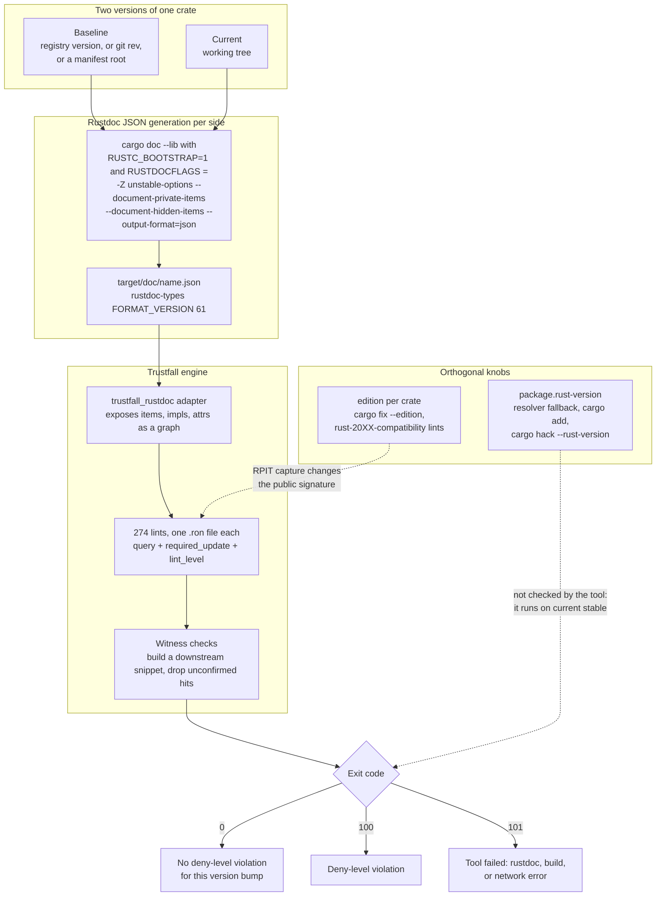

# Rust API Evolution: cargo-semver-checks, MSRV, and Editions

> [!summary] Claim:
> Rust SemVer is a contract about source-level compatibility, and three independent knobs can break it: the public API, the minimum toolchain (`rust-version`), and the per-crate edition.
> `cargo-semver-checks` finds API breaks by diffing two rustdoc JSON files with roughly 270 Trustfall queries, and it is a lower bound on breakage, not a proof of compatibility.
> `rust-version` is only a hint to the resolver unless the lockfile and CI prove it, and an edition bump is silently a signature change when a public `impl Trait` return starts capturing more lifetimes.
> An expert gates a release on four checks: a semver diff against the right baseline, an MSRV build on the oldest toolchain, a feature and target matrix, and a human read of what the tool cannot see.



## The Mechanism

### What SemVer means for a Rust crate

Cargo's resolver treats `^1.2.3` as "any 1.x at or above 1.2.3", so a version number is a machine-read promise that dependents compile unchanged.
The Cargo Book defines three change categories: major (requires a major bump), minor (safe in a minor release), and possibly-breaking (a judgment call, with guidance in the item).
The reference is a list of items, each with an anchor, and it is the classification Cargo documents (as of 2026-11, Both).
RFC 1105 (2015) set the policy that the reference still follows: a change is major if it can break well-formed downstream code, with documented exceptions such as glob imports.

The rules that matter most, with the anchor Cargo uses:

| Change | Category | Anchor |
|---|---|---|
| Remove, rename, or move a public item | Major | `#item-remove` |
| Add a public item | Minor, but can break glob imports | `#item-new` |
| Add a variant to an enum without `non_exhaustive` | Major | `#enum-variant-new` |
| Add a non-defaulted trait item | Major | `#trait-new-item-no-default` |
| Add a defaulted trait item | Possibly-breaking | `#trait-new-default-item` |
| Add any inherent item | Possibly-breaking | `#impl-item-new` |
| Add a public field when no private field exists, or a private field when all fields are public | Major | `#struct-add-public-field-when-no-private`, `#struct-add-private-field-when-public` |
| Add or remove a private field when one already exists | Minor | `#struct-private-fields-with-private` |
| Tighten generic bounds | Major | `#generic-bounds-tighten` |
| Loosen generic bounds | Minor | `#generic-bounds-loosen` |
| Capture more generic parameters in a return-position `impl Trait` | Major | `#generic-rpit-capture` |
| Add `non_exhaustive` to an existing enum, variant, or struct with no private fields | Major | `#attr-adding-non-exhaustive` |
| Raise the minimum Rust version | Possibly-breaking, recommended to treat as minor | `#env-new-rust` |
| Add a Cargo feature | Minor | `#cargo-feature-add` |
| Remove a Cargo feature | Major | `#cargo-feature-remove` |

Three facts about this list are easy to get wrong:
1. The same defaulted-trait-item change is minor in RFC 1105 and possibly-breaking in the Cargo Book, so cite the Cargo Book, which is the current text.
2. The reference has no item for a crate's edition (checked on the full page, 2026-11-21) and none for changing an auto trait (not found on that page), so those rules come from the Rust Reference and from compiler behavior.
3. `#[doc(hidden)]` is not defined as a SemVer exemption on the Cargo SemVer page (not found there), so a hidden item that downstream code can name is still an API the tool must track.

### How each class of break is observable

The compiler enforces SemVer rules by type checking and by name resolution, which is why almost any public change is observable.

- **Added enum variant.**
  A downstream `match` without a wildcard stops being exhaustive and fails with `E0004`.
  `#[non_exhaustive]` makes the wildcard mandatory in other crates, so the variant can be added later; inside the defining crate the attribute has no effect, and downstream code cannot construct a non-exhaustive struct or variant by literal (Rust Reference, `non_exhaustive` section).
  RFC 2008 introduced it; its tracking issue is rust-lang/rust#44109.
- **Added required trait method.**
  Every downstream `impl` fails with `E0046`.
  The mitigation is the sealed-trait pattern: a public trait with a supertrait from a private module that downstream crates cannot name.
  After sealing, adding a method is a minor change, but removing a method or changing its signature is still major (API Guidelines, C-SEALED).
- **Auto-trait leakage.**
  `Send`, `Sync`, `Unpin`, `UnwindSafe`, and `RefUnwindSafe` are auto traits: a struct has the trait if all its fields do, and `*mut T` has a negative `Send` impl (Rust Reference, Auto traits).
  A private field of type `Rc<()>` therefore removes `Send` from the public struct, and the field is not part of the documented API, so a review of the public surface does not see it.
- **Added inherent item.**
  Method resolution prefers an inherent method over a trait method, so a new inherent method silently rebinds downstream calls to a trait method of the same name.
  The worked example below shows the behavior change with no error, only a dead-code warning.
- **Glob conflict.**
  Adding a public name is minor, but two glob imports that both export it make every use of the name ambiguous (`E0659`), which is the case the Cargo Book mentions under `#item-new`.
- **Return-position `impl Trait` capture.**
  Before Rust 2024, a return type `impl Trait` captured only the type parameters and the lifetimes named in its bounds.
  In 2024, "all in-scope generic parameters, including lifetime parameters, are implicitly captured when the `use<..>` bound is not present" (Edition Guide, RPIT lifetime capture).
  Capturing a lifetime ties the returned value to a borrow, so it is a major change, and an edition bump on a library can cause it.

### Rustdoc JSON: the data source

`cargo-semver-checks` does not parse Rust.
It asks rustdoc for a JSON description of the public API, which the rustdoc book calls the experimental JSON format (tracking issue rust-lang/rust#76578).
The format has a version number, `FORMAT_VERSION`, in the `rustdoc-types` crate: 61 in rustdoc-types 0.61.0, published 2026-07-29 per the crates.io API, and still the latest release on 2026-11-21 (as of 2026-11, Both).
The crate documents that the number "is incremented with every breaking change to the API" and that consumers should assert on it.
Each cargo-semver-checks release supports a set of format versions: v0.50.0 added v61 for the latest nightly and dropped v56, and v0.49.0 upgraded to v60 (release notes); `Cargo.toml` on main enables the `trustfall_rustdoc` 0.41.0 features `v57`, `v60`, and `v61`.
The README says the tool supports "the then-current stable and beta" Rust and supports nightly only on a best-effort basis, so a toolchain update can break the tool until a new release lands.

The generation step (`src/data_generation/generate.rs` on main, 2026-11-21) is worth knowing exactly:
1. For a registry baseline it writes a placeholder crate (`placeholder` 0.0.0, `publish = false`, an empty `lib.rs`, an empty `[workspace]`) whose only dependency is `=<version>`, runs `cargo update` on it, and lets Cargo fetch the real crate.
2. It runs `cargo doc --manifest-path <placeholder> --target-dir <dir> --package <name>@<version> --lib`, adding `--target <triple>` when a target is set.
3. It sets `RUSTC_BOOTSTRAP=1`, which lets a stable toolchain accept `-Z` flags, so no nightly toolchain is needed.
4. It sets `RUSTDOCFLAGS` to a prefix of the user's value plus `-Z unstable-options --document-private-items --document-hidden-items --output-format=json --cap-lints=allow`.
5. It sets `RUSTFLAGS` to the user's value plus `--cap-lints=warn -Awarnings`, so that a global `-Dwarnings` does not fail the dependency build.
6. It reads `<target_dir>[/<triple>]/doc/<lib_name>.json`, with `-` in the library name replaced by `_`.
7. It does not choose a toolchain: it uses whatever `cargo`, `rustc`, and `rustdoc` are first on `PATH`, and it records `rustdoc --version` as part of the artifact identity.

Two consequences follow.
Private and hidden items are in the JSON, so the tool can tell whether an item is reachable by a public path, and lints such as `function_now_doc_hidden` and `exhaustive_struct_with_doc_hidden_fields_added` exist to treat hiding as an API event.
The baseline is built from source with your current compiler, so the check measures source compatibility under the toolchain on `PATH`, not under your MSRV.

### Trustfall: lints as queries

Trustfall is a query engine "for querying any kind of data source", with GraphQL syntax and non-standard semantics (README and CONTRIBUTING).
`trustfall_rustdoc` is the adapter that exposes rustdoc JSON items, impls, and attributes as a graph.
Each lint is one `.ron` file under `src/lints/`, a serialized `SemverQuery` with these fields: `id`, `human_readable_name`, `description`, `required_update` (`Major` or `Minor`), `lint_level` (`Deny` or `Allow`), an optional `reference`, `reference_link`, `query`, `arguments`, `error_message`, `per_result_error_template`, and an optional `witness`.
The query is a pair of blocks, `baseline` and `current`, and a lint reports the items that match in one and not in the other.

Three real lints show the range (read from main, 2026-11-21):
- `function_missing`: major, deny, links to `#item-remove`; it flags public functions whose import path exists in the baseline and no longer exists in current.
- `trait_method_added`: major, deny, links to `#trait-new-item-no-default`; it requires the new method in `current` to have no body (`has_body` not true), the method name to be absent from the baseline trait, and the baseline trait to be non-sealed (`public_api_sealed` not true).
  Its sibling `sealed_trait_method_added` is minor and allow-level, which encodes the rule that a sealed trait may grow.
- `auto_trait_impl_added`: minor, allow-level, with the message that removing the trait later "would be a breaking change", and a reference link to the Rust Reference because Cargo's page has no auto-trait item; its counterpart `auto_trait_impl_removed` is major and deny-level.

The tool counts 274 lints in the `add_lints!` list of `src/query.rs` on main, and 274 `.ron` files in `src/lints/` (as of 2026-11-21, Both).
That number moves every release: v0.51.0 (2026-10-03) added six variadic-function lints, and the Rust Project Goals page quotes 245 as of an undated writing.
The file names are a practical index of coverage (counted from the main tree on 2026-11-21): 14 contain `non_exhaustive`, 11 contain `sealed`, 19 contain `doc_hidden`, 15 contain `unsafe`, 12 contain `must_use`, 18 contain `repr`, and 2 contain `auto_trait`.

Some lints use a witness: they generate a minimal downstream program and drop results where the program does not fail, to avoid false positives.
The README states the goal "to not have false positives", and says false positives are bugs.
It also states the opposite limit: the tool will not catch every violation, and the named gaps are breaking type changes of fields and parameters, breaking changes in generics or lifetimes, and breakage that appears only under a subset of features.
The Rust Project Goals page names the two structural blockers for merging the tool into Cargo: type-checking inside lints (issue 149) and linting across crate boundaries (issue 638).

### Choosing the baseline and the version-bump rule

By default the baseline is the previous version on crates.io.
`choose_baseline_version` skips yanked versions and pre-releases when a normal release exists, and for a current crate picks the highest candidate not above the current version (`rustdoc_gen.rs`).
Custom registries are not supported (issue 160), so private registries use `--baseline-rev` or `--baseline-root`.
With `--baseline-rev`, the tool resolves `<rev>^{tree}`, extracts that tree into a directory named by the tree object id, and finds the repository with gix's `discover_with_environment_overrides`, which walks up to `.git/` and honors git's discovery environment variables such as `GIT_DIR` and `GIT_CEILING_DIRECTORIES` (`rustdoc_gen.rs`).
Whether a lint fires depends on the version bump between baseline and current compared with the lint's `required_update`.
`classify_semver_version_change` in `src/check_release.rs` follows Cargo's left-most-non-zero rule: a change of `y` in `0.y.z` counts as major, a change of `z` counts as major in `0.0.z` and minor in `0.y.z` with `y > 0`, and any pre-release difference counts as major.
A major bump satisfies every lint, a minor bump satisfies only `Minor` lints, and a patch bump satisfies none (`supports_requirement` in `src/query.rs`).
When baseline and current have the same version, the tool assumes the minimum next bump (major for `0.0.z`, minor for `0.y.z`, patch otherwise), and `--release-type major|minor|patch` overrides the derived bump.

Exit codes since v0.49.0 (2026-07-18) are `0` (no deny-level violation), `100` (deny-level violations found), and `101` (the check could not complete, for example a rustdoc, build, or network failure).
A CI script that treats every non-zero code as "semver violation" mislabels tool failures, and a script that treats `101` as success ships unchecked code.

### MSRV: `rust-version` and what enforces it

The `package.rust-version` field is a bare version with at least one component, with no operators.
Cargo respects it as of 1.56 (Cargo Book, "MSRV: Respected as of 1.56"), and an older toolchain stops with an error unless `--ignore-rust-version` is passed.
Cargo also checks the field against the edition: edition 2024 requires Rust 1.85, so a lower `rust-version` is rejected at manifest parse time.
`[workspace.package]` can hold `rust-version` for inheritance, which needs Cargo 1.64 or newer.
crates.io reads `rust-version` from the `Cargo.toml` inside the uploaded `.crate`, and the index entry has an optional `rust_version` field.
The `cargo publish` and `cargo package` pages say nothing about `rust-version`, and the only check is the verification build, which runs on the current toolchain (skipped by `--no-verify`).
Run on darwin-arm64 with cargo 1.99.0, a package declaring `rust-version = "1.200"` fails `cargo package` and `cargo publish --dry-run` at that step with `rustc 1.99.0 is not supported by the following package: msrvprobe@0.1.0 requires rustc 1.200`, and `cargo package --no-verify` succeeds.
So the check only catches a toolchain older than the field; it can never catch code that needs a newer compiler than the field claims.

What changed over time, with the Cargo version that shipped it (Cargo changelog and release notes, as of 2026-11, Both):
- 1.56: `rust-version` respected (RFC 2495 proposed it under the name `rust`; the shipped name is `rust-version`).
- 1.78: new lockfiles respect `package.rust-version`, meaning Cargo picks a lockfile format version that the declared MSRV can read (rust-lang/cargo#12861); this does not filter dependency versions.
- 1.79: `cargo add` picks the latest version compatible with `rust-version`.
- 1.84: resolver v3 stabilized, the MSRV-aware resolver, and the config key `resolver.incompatible-rust-versions`.
- 1.85: the 2024 edition, which makes `resolver = "3"` the default.

The resolver is the part that decides whether `rust-version` protects you.
RFC 3537 defines two behaviors for `resolver.incompatible-rust-versions`: `allow` treats incompatible versions like any other, and `fallback` considers incompatible versions only if no compatible version matches.
Resolver `"3"` changes the default from `allow` to `fallback`; resolver `"2"` is the default of edition 2021 and `"1"` is the default otherwise.
The rules that bound it:
1. The setting applies when Cargo picks versions, for `cargo add`, `cargo update`, and lockfile generation, and `CARGO_RESOLVER_INCOMPATIBLE_RUST_VERSIONS` or `--ignore-rust-version` overrides it.
2. It is honored only for the top-level package or workspace, so a library's own edition and resolver do not change how a consumer resolves it.
3. In a workspace, "the resolver will pick the lowest version among workspace members", because there is no `workspace.rust-version` (RFC 3537).
4. If no candidate is compatible, "the resolver won't error but will instead pick a version", so the lockfile can contain a crate that needs a newer compiler than your `rust-version`.
5. Your dependency version requirements are not expected to exclude incompatible versions: Cargo expects each requirement to allow "at least one version compatible with your rust-version", and does not expect "the dependency specification excludes versions incompatible with your `rust-version`" (Cargo Book, Rust Version).
6. RFC 3537 left `cargo install` out on purpose, and says the lockfile-update behavior it defines "does not affect `cargo install`"; Cargo 1.70 added `--ignore-rust-version` to `cargo install` (Cargo changelog).

What the field never does is prove the code builds on that compiler.
RFC 2495 lists this as a drawback: declaring an MSRV "does not guarantee that crate will work correctly".
Verification is a separate job:
- The Cargo CI guide runs `cargo hack check --rust-version --workspace --all-targets --ignore-private` in one job, and notes that `cargo check` catches most API-availability problems.
- `cargo-hack` also accepts `--version-range START..=END` and `--version-step`; `--rust-version` cannot be combined with `--version-range`, and the tool requires Rust 1.85 or newer to install.
- `cargo-msrv` has `find`, `list`, `set`, `show`, and `verify`, bisects by default (`find --linear` searches linearly), and uses `cargo check` as its default check command (cargo-msrv README).
- Clippy's `incompatible_msrv` lint flags use of std APIs newer than the configured MSRV; its source declares it in the `suspicious` group, which is warn by default, added in Clippy 1.78.0 (`clippy_lints/src/incompatible_msrv.rs`), and other Clippy lints document that the project MSRV defaults to the `rust-version` field.
- `-Zminimal-versions` and `-Zdirect-minimal-versions` are nightly-only (tracking issue #5657), and the Book says of the first that it is "not recommended"; no stable minimal-versions flag was found.

Policy is a choice, not a mechanism.
The Cargo Book describes `rust-version` changes as "assumed to be a minor incompatibility" and names an "N-2" example: the latest release with a two-release grace window.
Tokio's README states a policy of at least 6 months, a current MSRV of 1.85, and that the MSRV "is not increased automatically, and only as part of a minor release".
`cargo-semver-checks` states that MSRV bumps are not major changes, and separates a runtime MSRV, bumped in the middle version number, from a compile MSRV, which may change in any release; v0.51.0 declares `rust-version = "1.93"` for both.

### Editions: per-crate language versions

An edition is a per-crate opt-in to backward-incompatible language changes.
The Edition Guide states the guarantee: crates in one edition "must seamlessly interoperate" with crates compiled in another, and a crate's migration is "private", invisible to the ecosystem.
RFC 2052 adds the rule that a compiler supports all extant editions, and that warning-free code on edition N must compile on N+1 with the same behavior.
The editions to date and the compiler that introduced each (Edition Guide):

| Edition | Introduced in | Notes |
|---|---|---|
| 2015 | the original language | Assumed when `edition` is absent from `Cargo.toml`, and the default of `rustc --edition` |
| 2018 | 1.31.0 | The first edition after 2015, from RFC 2052 |
| 2021 | 1.56.0 | RFC 3085; resolver `"2"` default |
| 2024 | 1.85.0, 2025-02-20 | RFC 3501; resolver `"3"` default |

A three-year cadence is the stated plan (RFC 3501), and `rustc --edition` on 1.99.0 accepts only `2015`, `2018`, `2021`, `2024`, and the unstable `future`, so no later edition has shipped.
The next one is being prepared but not announced as of 2026-11: rust-lang/rust has an open `A-edition-2027` label with three issues (for example adding `assert_matches` to the next prelude, opened 2026-10-14 and 2026-10-30), while the Rust blog, `RELEASES.md`, the Edition Guide, and the 2026 Project Goals page contain no announced Rust 2027 edition.

Migration is a mechanical workflow (Edition Guide, "Transitioning an existing project"):
1. `cargo update`, to start from current dependencies.
2. `cargo fix --edition`, which applies the `rust-20XX-compatibility` lint group, for example `rust-2024-compatibility` when moving 2021 to 2024.
3. Edit `Cargo.toml` to `edition = "2024"`.
4. `cargo build` and `cargo test`.
5. `cargo fmt`.
The guide notes that the automatic migration does not update doctests, and the advanced chapter lists `--broken-code`, `--edition-idioms`, `--all-features`, and `--features`; by default `cargo fix` uses `--all-targets`.

An edition also sets a macro's token rules: tokens in a macro body carry the edition of the crate that defined the macro ("edition hygiene"), so a 2015 crate can use `dyn` as an identifier in its macro and a 2018 caller still compiles.
It also sets a floor on the toolchain: 2024 needs Rust 1.85, enforced by Cargo's manifest check.

Rust 2024 contains these changes, with their migration lints (Edition Guide and rustc lint groups):

| Change | Migration lint |
|---|---|
| Return-position `impl Trait` captures all in-scope lifetimes | `impl-trait-overcaptures` |
| `if let` temporary scope | `if-let-rescope` |
| Tail-expression temporary scope | `tail-expr-drop-order` |
| `extern` blocks require `unsafe` | `missing-unsafe-on-extern` |
| `no_mangle`, `export_name`, `link_section` require `unsafe(..)` | `unsafe-attr-outside-unsafe` |
| `unsafe_op_in_unsafe_fn` warns by default | `unsafe-op-in-unsafe-fn` |
| References to `static mut` are denied by default | `static-mut-refs` |
| `Box<[T]>` iterates by value | `boxed-slice-into-iter` |
| `expr` fragment also matches `const` and `_` | `edition-2024-expr-fragment-specifier` |
| `Future` and `IntoFuture` join the prelude | `rust-2024-prelude-collisions` |
| `gen` is a reserved keyword | `keyword-idents-2024`, which rewrites `gen` to `r#gen` |
| `std::env::set_var` and `remove_var` become `unsafe` | `deprecated-safe-2024` |
| Match ergonomics reservations | `rust-2024-incompatible-pat` |
| Reserved guarded string syntax (`#"..."#`, `##`) | `rust-2024-guarded-string-incompatible-syntax` |
| Rust-version-aware resolver is the default | none, no automated migration |

Most of these are internal to the crate.
Only a few can touch a published API: the RPIT capture rule, the macro fragment rule for exported `macro_rules!`, and the reserved `gen` identifier for public names.
The Cargo SemVer page has no edition item, so the rule an expert applies is: an edition bump is a source change like any other, and each public signature must be re-checked for capture.
`cargo fix --edition` can insert `use<..>` to keep the old capture set, and `impl-trait-overcaptures` is in `rust-2024-compatibility` for that reason.
`use<..>` precise capturing is stable since Rust 1.82 (Edition Guide), and adding a parameter to it is the "capture more" major change, while removing one is minor.

### Closing the gap: gates, yanks, and the semver trick

The tool is not yet part of `cargo publish`.
The 2026 Rust Project Goals list "Continue resolving cargo-semver-checks blockers for merging into cargo" as an accepted goal with small asks of the cargo and rustdoc teams (tracking rust-lang/goals#104, cargo champion Ed Page, rustdoc champion Alona Enraght-Moony), and its plan is that `cargo publish` would require compliance by default, with an opt-out flag.
Until then the gate lives in CI.
The official action `obi1kenobi/cargo-semver-checks-action@v2` takes inputs `package`, `exclude`, `manifest-path`, `feature-group` (`all-features`, `default-features`, `only-explicit-features`), `features`, `verbose`, `release-type`, `rust-toolchain`, `rust-target`, `baseline-version`, `baseline-rev`, `baseline-root`, `github-token`, and the cache-key inputs `shared-key` and `prefix-key` (`action.yml` on main).
By default it installs the latest stable Rust and ignores `rust-toolchain.toml`, and it caches the baseline rustdoc per package with a key that includes the runner OS, the rustc version, the tool version, and a hash of the `Cargo.lock` files.

When a breaking change has already shipped as a minor or patch, the Cargo Book's repair path is: publish a compatible release first, then yank.
`cargo yank` "does not delete any data": existing lockfiles keep working and only new dependency edges are blocked, and the yank page's own example publishes the semver-compatible 1.5.1 before yanking 1.5.0 so that dependents keep compiling.
The yank page lists "unintentional SemVer breakages" among the exceptional cases for yanking.
For a deliberate break, the semver trick (David Tolnay) lets two major versions interoperate: publish 0.3.0 with the break, then publish a last 0.2.x that depends on 0.3 and re-exports the unchanged items, so types are identical across the two versions.
Its limits, from the README, are raising the minimum `rustc` and bumping a public dependency that does not itself use the trick.
A public dependency is part of your API: the API Guidelines state that a crate cannot be stable "without all of its public dependencies being stable", and Cargo's `public-dependency` feature (`public = true`, needs Rust 1.83 for the key) is still unstable, tracking rust-lang/rust#44663.

## Commands and Numbers to Know

| Item | Value | Platform | Notes |
|---|---|---|---|
| cargo-semver-checks version | 0.51.0, released 2026-10-03 (as of 2026-11) | Both | Compile and runtime MSRV is Rust 1.93, edition 2024; six variadic-function lints were added. |
| Install | `cargo install cargo-semver-checks --locked` or `cargo binstall cargo-semver-checks` (as of 2026-11) | Both | Not installed on the host that produced this note, so no tool output is shown. |
| Exit codes | `0` clean, `100` deny-level violation, `101` tool failure (as of 2026-11) | Both | Introduced by v0.49.0. |
| Baseline flags | `--baseline-version`, `--baseline-rev`, `--baseline-root`, `--baseline-rustdoc` (as of 2026-11) | Both | Default is the previous crates.io version; custom registries are unsupported (issue 160). |
| Feature flags | `--default-features`, `--only-explicit-features`, `--all-features`, `--features`, `--baseline-features`, `--current-features` (as of 2026-11) | Both | Breakage that exists only under a feature subset is not caught. |
| Target and cfg | `--target <triple>` repeated per target; `RUSTDOCFLAGS="--cfg x" cargo semver-checks` (as of 2026-11) | Both | README examples use `aarch64-apple-darwin` and `x86_64-unknown-linux-gnu`. |
| `--release-type` | CLI flag and action input (`major`, `minor`, `patch`) (as of 2026-11) | Both | Overrides the bump derived from the version numbers (`src/main.rs`, "Overrides" group). |
| Lints on main | 274 in `add_lints!` and 274 `.ron` files (as of 2026-11-21) | Both | Counted from `src/query.rs` and the directory listing, not from the v0.51.0 tag. |
| Rustdoc JSON version | `FORMAT_VERSION = 61`, rustdoc-types 0.61.0 (as of 2026-11) | Both | Bumped on every breaking change to the format. |
| Generation env | `RUSTC_BOOTSTRAP=1`; `RUSTDOCFLAGS` ends with `--cap-lints=allow`; `RUSTFLAGS` ends with `--cap-lints=warn -Awarnings` (as of 2026-11) | Both | From `generate.rs` on main. |
| Action | `obi1kenobi/cargo-semver-checks-action@v2`, `rust-toolchain` default `stable`, `verbose` default `false` (as of 2026-11) | Linux | Examples use `ubuntu-latest`. |
| `rust-version` respected | Cargo 1.56 (as of 2026-11) | Both | `--ignore-rust-version` bypasses it. |
| Lockfile and `cargo add` | Lockfile format choice 1.78, `cargo add` 1.79 (as of 2026-11) | Both | From the Cargo changelog; 1.78 picks a lockfile version the MSRV can read (cargo#12861). |
| MSRV-aware resolver | Resolver `"3"` and `resolver.incompatible-rust-versions`, Cargo 1.84 (as of 2026-11) | Both | `fallback` is the resolver 3 default; `allow` otherwise. |
| Env override | `CARGO_RESOLVER_INCOMPATIBLE_RUST_VERSIONS=allow` (as of 2026-11) | Both | The Cargo CI guide uses it to test latest dependencies. |
| Edition 2024 | Rust 1.85.0, 2025-02-20 (as of 2026-11) | Both | Requires `rust-version >= 1.85`; Cargo rejects lower values. |
| Latest stable Rust | 1.100.0, released 2026-11-12 (as of 2026-11-21) | Both | Six-week cadence; this host runs 1.99.0. |
| MSRV CI | `cargo hack check --rust-version --workspace --all-targets --ignore-private` (as of 2026-11) | Both | From the Cargo CI guide. |
| Workspace inheritance | `[workspace.package] rust-version`, Cargo 1.64 or newer (as of 2026-11) | Both | Members opt in with `rust-version.workspace = true`; the lowest member value wins for resolution. |
| Index field | `rust_version`, optional, no operator (as of 2026-11) | Both | crates.io reads it from the `.crate` manifest. |
| `rustc --edition` default | `2015` (as of 2026-11) | Both | Cargo assumes 2015 when `edition` is missing; `cargo new` writes 2024. |
| Observed MSRV error | `error: rustc 1.99.0 is not supported by the following package:` then `mv@0.1.0 requires rustc 1.300` (2026-11-21) | macOS | Run on cargo 1.99.0, darwin-arm64. |
| Observed edition floor | `rust-version 1.80 is incompatible with the version (1.85.0) required by the specified edition (2024)` (2026-11-21) | macOS | Run on cargo 1.99.0, darwin-arm64. |
| Observed prerelease error | `unexpected prerelease field, expected a version like "1.32"` (2026-11-21) | macOS | For `rust-version = "1.70.0-nightly"`. |

## Multi-Language Comparison

| Concern | C++ | Python | Rust |
|---|---|---|---|
| What a consumer is promised | Binary ABI via SONAME and symbol versions, plus source API | Source API, plus a wheel tag for native code | Source API only, with no stable ABI between compiler versions |
| Declared minimum toolchain | Compiler and standard level per target, set in the build system | `requires-python` in `pyproject.toml` | `package.rust-version`, a hint unless verified |
| Language-version knob | `-std=` per target | The running interpreter | `edition` per crate, mixable across a dependency graph |
| Who enforces the minimum at resolution | The package manager's settings model | pip and uv read `requires-python` | Cargo's resolver, as a preference by default, and a hard error only for the root build |
| Automated API break detection | Binary-level ABI diffing, outside this note | Convention and tests | `cargo-semver-checks` on rustdoc JSON |
| Typical silent break | An ABI break with an unchanged SONAME | A changed default argument or exception type | A private field changing an auto trait, or an RPIT capture change |

The C++ and Python rows are summaries; the owning mechanisms are in [[Cpp-ABI-Stability-Symbol-Visibility-and-SONAME]], [[Cpp-Glibc-Symbol-Versioning-and-Portable-Linux-Binaries]], and [[Python-Packaging-History-and-pyproject-toml]], and the general version-number theory is in [[Versioning-SemVer-CalVer-and-ABI]].
The ABI dimension of Rust is not covered by `cargo-semver-checks`, and the FFI boundary is in [[Rust-FFI-Packaging-cdylib-staticlib-and-cbindgen]].

## Worked Lab Example

This note has no lab in `code/`: the experiments below were run by hand once on 2026-11-21 on macOS 27.3, darwin-arm64, with rustc 1.99.0 and cargo 1.99.0, and only the output of those runs is quoted.
`cargo-semver-checks` is not installed on this host, so no output of the tool itself is shown, and the lint names below come from its source tree.
Each experiment builds a library `lib` in two versions, compiles one downstream program against both with `rustc --extern`, and compares.
An independent re-run of all seven experiments on the same host and toolchain on 2026-11-21 reproduced every output block below exactly.

### Experiment 1: three breaks in one diff

Library v1 and v2 (the diff is the SemVer-relevant part):

```rust
// lib_v1.rs
pub struct Handle { fd: i32 }
impl Handle { pub fn new() -> Handle { Handle { fd: 0 } } }
pub trait Backend { fn name(&self) -> &str; }
pub enum Mode { Fast, Slow }

// lib_v2.rs
use std::rc::Rc;
pub struct Handle { fd: i32, _log: Rc<()> }          // private field, not Send
impl Handle { pub fn new() -> Handle { Handle { fd: 0, _log: Rc::new(()) } } }
pub trait Backend { fn name(&self) -> &str; fn flush(&self); }   // new required method
pub enum Mode { Fast, Slow, Turbo }                              // new variant
```

Downstream code that compiled against v1:

```rust
// user.rs
fn assert_send<T: Send>(_: &T) {}
struct Be;
impl lib::Backend for Be { fn name(&self) -> &str { "be" } }
fn main() {
    let h = lib::Handle::new();
    assert_send(&h);
    let m = lib::Mode::Fast;
    match m { lib::Mode::Fast => {}, lib::Mode::Slow => {} }
}
```

Commands, with the output filtered by `grep -E "^(error|warning)"` (darwin-arm64, rustc 1.99.0, 2026-11-21):

```sh
for v in v1 v2; do
  rustc --edition 2021 --crate-type lib --crate-name lib lib_$v.rs -o liblib_$v.rlib
  rustc --edition 2021 user.rs --extern lib=liblib_$v.rlib -o user_$v 2>&1 | grep -E "^(error|warning)"
done
```

Against v1 the program compiles, with only dead-code warnings.
Against v2 it prints:

```text
error[E0046]: not all trait items implemented, missing: `flush`
error[E0277]: `Rc<()>` cannot be sent between threads safely
error: aborting due to 2 previous errors
```

The enum change is not in that output, although `user.rs` contains a non-exhaustive `match`.
The compiler stops after the type-checking errors and never reaches match checking, so one compile shows two of the three breaks.
A diff-based tool reports all three from the API description, which is the reason to run one.

### Experiment 2: `non_exhaustive`, isolated

```rust
// lib_e1.rs: pub enum Mode { Fast, Slow }
// lib_e2.rs: pub enum Mode { Fast, Slow, Turbo }
// lib_e3.rs: #[non_exhaustive] pub enum Mode { Fast, Slow }
// user_e.rs: match lib::Mode::Fast { lib::Mode::Fast => {}, lib::Mode::Slow => {} }
```

Output of the downstream compile for each library (same filter plus `^ *= note`):

```text
== e1
== e2
error[E0004]: non-exhaustive patterns: `Mode::Turbo` not covered
  = note: the matched value is of type `Mode`
error: aborting due to 1 previous error
== e3
error[E0004]: non-exhaustive patterns: `_` not covered
  = note: the matched value is of type `Mode`
  = note: `Mode` is marked as non-exhaustive, so a wildcard `_` is necessary to match exhaustively
error: aborting due to 1 previous error
```

Library e3 fails for the old downstream code because the attribute was added to an existing enum.
That is the `enum_marked_non_exhaustive` lint (major, deny, `#attr-adding-non-exhaustive`).
The attribute protects only the crates written after it exists: the right time to add it is before the first release.

### Experiment 3: an inherent method changes behavior silently

```rust
// ext_lib1.rs
pub struct Meter(pub u32);
// ext_lib2.rs
pub struct Meter(pub u32);
impl Meter { pub fn get(&self) -> u32 { self.0 } }
// ext_user.rs
trait Get { fn get(&self) -> u32; }
impl Get for lib::Meter { fn get(&self) -> u32 { self.0 + 1 } }
fn main() { println!("{}", lib::Meter(1).get()); }
```

Running the program built against each version prints:

```text
== ext_lib1
2
== ext_lib2
warning: trait `Get` is never used
warning: 1 warning emitted
1
```

The same downstream source prints `2` against v1 and `1` against v2, with no error.
The new inherent `get` outranks the extension trait method.
This is the Cargo Book's possibly-breaking `#impl-item-new`, and a check that only looks for compile errors cannot see it.

### Experiment 4: glob import ambiguity

```rust
// h_a.rs:  pub fn open() {}
// h_b1.rs: pub fn close() {}
// h_b2.rs: pub fn close() {}  pub fn open() {}
// h_user.rs: use a::*; use b::*; fn main() { open(); close(); }
```

Against `b1` the program compiles and against `b2` it prints `error[E0659]: `open` is ambiguous`.
In a separate run, a local `fn close` plus `use lib::*` did not conflict when the library added `close`, because a local definition shadows a glob import, so only two globs conflict.
This is why "add a public item" is a minor change that is occasionally breaking.

### Experiment 5: an edition bump changes a public signature

```rust
// rpit.rs
pub fn first<'a>(v: &'a Vec<u8>, _k: &str) -> impl Iterator<Item = u8> {
    v.clone().into_iter()
}
// rpit_user.rs (always compiled as edition 2021)
fn main() {
    let v = vec![1u8, 2, 3];
    let it;
    {
        let k = String::from("k");
        it = rpit::first(&v, &k);
    }
    println!("{}", it.count());
}
```

The library is compiled twice from the same source, once with `--edition 2021` and once with `--edition 2024`, and the downstream crate stays on 2021:

```text
== rpit edition 2021
== rpit edition 2024
error[E0597]: `k` does not live long enough
error: aborting due to 1 previous error
```

Under 2021 the returned iterator captures neither lifetime, so `k` can die first.
Under 2024 it captures `'a` and the anonymous lifetime of `_k`, so the iterator borrows `k` and the downstream code fails.
The source of `rpit.rs` is identical in both builds, and the edition flag, which Cargo takes from `Cargo.toml`, is the only difference.
Adding `+ use<>` to the return type restores the 2021 capture set; I compiled the 2024 library with `impl Iterator<Item = u8> + use<>` and the same downstream program built.

### Experiment 6: sealing a trait

```rust
// sealed.rs
mod private { pub trait Sealed {} }
pub trait Backend: private::Sealed { fn name(&self) -> &str; }
pub struct Mem;
impl private::Sealed for Mem {}
impl Backend for Mem { fn name(&self) -> &str { "mem" } }
```

A downstream `impl sealed::Backend for Mine` fails with:

```text
error[E0277]: the trait bound `Mine: sealed::private::Sealed` is not satisfied
  = note: `Backend` is a "sealed trait", because to implement it you also need to implement `sealed::private::Sealed`, which is not accessible; this is usually done to force you to use one of the provided types that already implement it
```

After this change a new method on `Backend` is a minor change, which is exactly the distinction between the `trait_method_added` and `sealed_trait_method_added` lints.

### Experiment 7: `rust-version` failures in Cargo

```toml
[package]
name = "mv"
version = "0.1.0"
edition = "2021"
rust-version = "1.300"
```

`cargo check --offline` prints the first two lines below, and `cargo check --offline --ignore-rust-version` finishes with `Finished` (darwin-arm64, cargo 1.99.0):

```text
error: rustc 1.99.0 is not supported by the following package:
  mv@0.1.0 requires rustc 1.300
```

With `edition = "2024"` and `rust-version = "1.80"`, Cargo fails at manifest parsing:

```text
Caused by:
  rust-version 1.80 is incompatible with the version (1.85.0) required by the specified edition (2024)
```

With `rust-version = "1.70.0-nightly"`, the parser rejects the value:

```text
error: unexpected prerelease field, expected a version like "1.32"
```

### Running the real tool

On a machine with network access and Rust 1.93 or newer:

```sh
cargo install cargo-semver-checks --locked
cd path/to/your/crate
cargo semver-checks                      # baseline: previous crates.io version
cargo semver-checks --baseline-rev v1.4.0 --all-features
echo "exit=$?"                           # 0, 100, or 101
```

Expected behavior, from the README and release notes rather than a captured run: a violation prints the lint's `error_message` and the affected items and exits with `100`.

## Pitfalls

> [!warning] Pitfall 1: A green semver check is not proof of compatibility
> The README says the tool will not catch every violation, and names field and parameter type changes, generics and lifetimes, and feature-subset breakage as gaps.
> Experiment 3 shows a behavior change that compiles cleanly, and Experiment 5 is a lifetime-capture change that the README's "generics or lifetimes" gap suggests the tool does not see (inference: verify it on a real diff before relying on it).
> Treat the tool as a lower bound, and keep a human review of every public signature change in the release checklist.

> [!warning] Pitfall 2: The baseline is the previous published version, including a bad one
> If 1.4.0 shipped an accidental break and 1.4.1 fixes it, checking 1.5.0 against 1.4.1 is clean while users on 1.3.x are still broken.
> Yanked versions and pre-releases are skipped when a normal release exists, so a yanked break stops being a baseline.
> Pass `--baseline-version` or `--baseline-rev` for the last known good tag when the history is not clean.

> [!warning] Pitfall 3: Default features hide breakage elsewhere
> Without `--all-features` or an explicit feature group, a break that exists only with a non-default feature never reaches the diff.
> The README also lists breakage that appears only with a feature subset as a known gap, so run `--all-features` and `--default-features` as two passes in CI.
> Run once per `--target` for APIs gated by `cfg(target_os)` or `cfg(target_arch)`, and pass `--cfg` through `RUSTDOCFLAGS` for custom cfgs.

> [!warning] Pitfall 4: Treating exit code 101 as a semver result
> `100` means the tool found a deny-level violation, and `101` means it could not complete, for example a rustdoc failure or a registry outage.
> A wrapper that maps all non-zero codes to "breaking change" sends engineers hunting for an API break that does not exist, and a wrapper that ignores `101` publishes unchecked code.
> Gate on `0`, route `100` to the author, and route `101` to the platform owner.

> [!warning] Pitfall 5: A toolchain update breaks the checker, not your code
> Rustdoc JSON is experimental, and each release of the tool supports a fixed set of format versions.
> The action installs the latest stable Rust by default, so a new stable that bumps the format can fail every PR until the tool is updated.
> Pin both the tool and the toolchain in the release job, and update them together on a schedule.

> [!warning] Pitfall 6: Bumping the edition is a public-API edit
> Experiment 5 shows a downstream compile failure produced by a `Cargo.toml` change alone.
> The Cargo SemVer page has no edition item, so no checklist built from it will flag the change.
> Run `cargo fix --edition` and review every public `impl Trait` return, adding `use<..>` where the old capture set is part of the contract.

> [!warning] Pitfall 7: `rust-version` is not a guarantee on either side
> Cargo's resolver can pick a dependency that needs a newer compiler when no compatible version exists, without an error.
> The field is also never compared to what the code uses, so the first user on the claimed minimum finds the first newer std API.
> Run `cargo hack check --rust-version` in CI on the declared minimum, and add Clippy's `incompatible_msrv`, which reads the same field.

> [!warning] Pitfall 8: The resolver setting of a library does not travel
> Resolver `"3"` is honored only for the top-level package or workspace.
> A library on edition 2024 that tests with fallback resolution proves nothing about what its consumers resolve, because their own resolver decides.
> Test the library with the newest and with the oldest dependency versions your `Cargo.toml` allows, and remember that the Cargo Book lists minimal-versions resolution only as unstable (`-Zminimal-versions`, discouraged by the Book).

> [!warning] Pitfall 9: Private fields change public traits
> `Send` and `Sync` follow from fields you cannot see in the docs.
> Replacing an `Arc` with an `Rc`, or adding a raw pointer, removes `Send` from a type that async runtimes require, and the diff shows only a private change.
> The `auto_trait_impl_removed` lint is major and deny-level, so the tool flags the loss, while `auto_trait_impl_added` is minor and allow-level, so a gained `Send` that you later lose is flagged only at the loss; add `fn assert_send<T: Send>()` tests for the types that matter.

> [!warning] Pitfall 10: Hiding an item is not a free change
> `#[doc(hidden)]` removes an item from the rendered docs but not from the namespace, and the tool runs rustdoc with `--document-hidden-items`, then has 19 lints named `*doc_hidden*` that track it.
> If macros expand to a hidden path, the item is API.
> Name such items with a leading `__`, document the contract in the crate docs, and treat changes as breaking.

## At Scale

For one developer, `cargo semver-checks` before `cargo publish` is enough, and the failure cost is a yanked patch release.
For a team, the paved road is a PR job that runs the semver check against the last release tag, an MSRV job on the declared minimum toolchain, and a release job that repeats both with pinned versions before `cargo publish`.
At 1,000 to 50,000 engineers with hundreds of internal crates, the failure mode is a cascading compile failure in every dependent, so the cost of a false negative is multiplied by the dependency graph.

Sizing facts that change the design:
- The tool builds rustdoc JSON for both sides, so each crate pays one documentation build per side; I did not measure the time, and the action caches the baseline per package with a key that includes the `Cargo.lock` hash.
- Custom registries are unsupported (issue 160), so an internal registry means `--baseline-rev` on the previous release tag, or `--baseline-root` on a checkout of the released source.
- In a workspace, `rust-version` inheritance from `[workspace.package]` gives one declared minimum, and the resolver uses the lowest member value.
- Editions are per crate, so a fleet migrates in dependency order with `cargo fix --edition` per crate, and no flag day is needed (Edition Guide).

Decision rules:
1. Make the semver check a required status on the release branch, with the exit code mapping from Pitfall 4, and pin the tool and the toolchain.
2. Run it twice, with `--all-features` and with the default feature set, and once per supported target triple.
3. Pick one MSRV policy per organization (for example N-2 for libraries and the latest stable for applications), write it in the repository, and enforce it with `cargo hack check --rust-version` and `incompatible_msrv`.
4. Treat an MSRV bump as a minor release, announce it in the changelog, and never ship it in a patch; the Cargo Book recommends treating it as minor, and Tokio ships it only in minor releases.
5. Add `#[non_exhaustive]` to every public enum and struct that may grow, before 1.0, and seal traits that are not meant to be implemented downstream.
6. Review every `impl Trait` return in the diff of an edition migration, and keep `use<..>` where the old capture set is promised.
7. When a break ships, publish a compatible fix first and yank second, as the Cargo yank page advises, and use the semver trick if the break was intended and dependents are many.
8. Keep a witness check of your own for types whose auto traits matter: a compile-time `Send` or `Sync` assertion in the test suite.

> [!tip] Practice Drill: Catch three breaks, then the one the tool cannot
> Create a library crate with a public enum, a public trait, and a struct with a private field, and publish v0.1.0 to a local registry or tag it in git.
> Add a variant, add a required trait method, and add a private non-`Send` field, then run `cargo semver-checks --baseline-rev v0.1.0` and map each report to a lint id and a Cargo Book anchor.
> Reproduce Experiments 3 and 5 on the same crate, run the tool again, and record which changes it does not report.
> Add `#[non_exhaustive]` and a sealed supertrait, and show that the next addition is clean, then remove the seal to see the major report.
> Declare `rust-version`, run `cargo hack check --rust-version`, and use a newer std API to see the failure and Clippy's `incompatible_msrv` warning.
> Then pair it with the dependency-side drill in [[Drill-Packaging-Cargo-Feature-Unification-Hazard]].

## Interview Questions

> [!question] L5: Which of these changes require a major version: adding an enum variant, adding a public function, adding a defaulted trait method, removing a private field from a struct that has two private fields?
> > [!success]- Answer
> > Adding a variant to an enum without `non_exhaustive` is major, because downstream exhaustive matches fail with `E0004`.
> > Adding a public function is minor, with the rare exception of glob-import ambiguity.
> > Adding a defaulted trait method is possibly-breaking in the Cargo Book, because it can create ambiguity with a downstream trait or change object safety; RFC 1105 called it minor.
> > Removing a private field is minor when another private field remains (`#struct-private-fields-with-private`).

> [!question] L5: What does `rust-version` do, and what does it not do?
> > [!success]- Answer
> > Cargo stops with a "not supported by the following package" error on an older toolchain, and `--ignore-rust-version` bypasses it.
> > Since 1.56 it is respected, `cargo add` uses it from 1.79, and resolver `"3"` prefers compatible dependency versions.
> > It never proves that the code builds on that compiler, and the resolver picks an incompatible dependency without error when no compatible version exists.
> > Verify it with `cargo hack check --rust-version` and Clippy's `incompatible_msrv`.

> [!question] L6: How does `cargo-semver-checks` work from invocation to exit code?
> > [!success]- Answer
> > It builds rustdoc JSON for a baseline and the current crate with `cargo doc --lib`, setting `RUSTC_BOOTSTRAP=1` and rustdoc flags for JSON, private items, and hidden items.
> > The baseline comes from the registry by default, or from a git rev or a manifest root, and the format version is `rustdoc-types` 61 as of 2026-11.
> > `trustfall_rustdoc` loads the JSON as a graph, and each of roughly 270 lints is a Trustfall query with `required_update` and `lint_level`, run over a `baseline` and a `current` block.
> > Some lints use witnesses to drop false positives, and the process exits `0`, `100` for deny-level violations, or `101` when the check could not complete.

> [!question] L6: Predict the output.
> A downstream crate defines `trait Get { fn get(&self) -> u32; }`, implements it for the library's `Meter` as `self.0 + 1`, and prints `Meter(1).get()`.
> The library then adds an inherent `fn get(&self) -> u32 { self.0 }`.
> What happens?
> > [!success]- Answer
> > The program still compiles and prints `1` instead of `2`.
> > The compiler warns that the trait `Get` is never used and reports no error, as observed on rustc 1.99.0.
> > Method resolution prefers the new inherent method over the trait method, so the call rebinds.
> > Cargo calls this possibly-breaking (`#impl-item-new`), and a tool that looks for compile errors will not see it, so the review has to.

> [!question] L6: Debug this.
> After a library moves to `edition = "2024"` with no code change, one downstream crate reports `E0597: k does not live long enough` on a call to `first(&v, &k)`, and the semver check was green.
> Why?
> > [!success]- Answer
> > The function returns `impl Iterator<Item = u8>`, and Rust 2024 captures all in-scope lifetimes in that return type, where 2021 captured none that were not named.
> > The result now borrows both arguments, so a downstream value that outlives `k` fails.
> > The Cargo Book lists capturing more parameters in an RPIT as major, so the edition bump was a breaking change in effect.
> > The tool's README lists lifetime changes among the things it does not yet catch, which is a plausible reason the check passed.
> > Fix it by adding `+ use<>` (stable since Rust 1.82) to keep the old capture set, publish it as a patch, and yank the broken release after the fix.

> [!question] L7: A dependency update raised your effective MSRV although `rust-version` is unchanged.
> How does that happen, and how do you stop it?
> > [!success]- Answer
> > The resolver prefers `rust-version`-compatible versions with `fallback`, but when none exists it silently picks a version, and in a workspace it uses the lowest member value.
> > Resolver `"3"` is honored only for the top-level package, so a library's own settings do not constrain its consumers.
> > Existing lockfile entries change only when something re-resolves, such as `cargo update`.
> > Prevent it with a CI job on the declared minimum toolchain using `cargo hack check --rust-version`, review lockfile diffs, and pin the dependency below the incompatible release with an explicit requirement or `cargo update --precise`.

> [!question] L7: Design the release gate for a workspace of 40 crates with optional features, two targets, and an internal registry.
> > [!success]- Answer
> > Run `cargo semver-checks` per publishable package with `--baseline-rev <last release tag>`, because custom registries are unsupported (issue 160).
> > Run it for `--all-features` and for default features, once per target triple, and gate on exit `0`, with `100` going to the author and `101` to the platform team.
> > Add `cargo hack check --rust-version --workspace --all-targets --ignore-private` on a pinned minimum toolchain, plus a build on latest stable.
> > Pin the tool, the toolchain, and the action version, run the gate on the release branch before `cargo publish --dry-run`, and keep a human checklist for edition changes, auto traits, and inherent-method additions.

> [!question] L7: Why can `cargo-semver-checks` never be a complete proof, and what would it take to close the gap?
> > [!success]- Answer
> > Rustdoc JSON describes items and impls, not type-checked behavior, so type changes, lifetimes, and cross-crate inference are outside what a structural diff sees.
> > The README names the gaps, and the Project Goals page names the blockers: type-checking in lints (issue 149) and linting across crate boundaries (issue 638).
> > Witness checks reduce false positives by compiling a downstream snippet, and they cannot prove the absence of every possible downstream program.
> > The plan to merge the tool into `cargo publish` depends on those blockers and on rustdoc JSON stabilization.

> [!question] L8+: Define the MSRV and edition policy for 500 crates owned by 100 teams.
> > [!success]- Answer
> > Set one rule with a written window, for example N-2 for libraries and the latest stable for services, and publish the number in `[workspace.package] rust-version`.
> > Enforce it with `cargo hack check --rust-version`, Clippy `incompatible_msrv`, and a dashboard of declared versus tested minimums.
> > Treat MSRV bumps as minor releases, never in patches, and require a changelog line, as the Cargo Book and Tokio do.
> > Migrate editions per crate in dependency order, require an RPIT capture review on every public signature, and run the semver gate on the edition PR.
> > Accept the downside: a strict window slows adopting new std APIs, and a loose one pushes failures to consumers.

> [!question] L8+: A patch release shipped a breaking change two days ago and 300 dependents failed to compile.
> Plan the repair.
> > [!success]- Answer
> > Do not yank first, because yanking blocks new dependency edges while existing lockfiles still resolve the broken version.
> > Publish a compatible release that restores the old API, as in the yank page's 1.5.1 example, then yank the broken one.
> > If the new API is wanted, release it under the next major version, and use the semver trick so that 0.2.x re-exports 0.3 types and users upgrade in any order.
> > Add the gate that would have caught it: a baseline pointing at the last good tag, an all-features pass, and a human review for what the tool cannot see.
> > Record it with the practices in [[Contain-and-Roll-Back-a-Bad-Production-Release]].

## Further Reading

- Cargo Book, SemVer Compatibility: the normative list of major, minor, and possibly-breaking changes with stable anchors that the tool's lints link to.
- RFC 1105, API Evolution: the reasoning behind the categories, including the glob-import exception.
- Rust Reference, `non_exhaustive` and auto traits: exact semantics for the two attributes and traits that cause most silent breaks.
- Rust API Guidelines, Future proofing: sealed traits, private fields, and why public dependencies bind your stability.
- cargo-semver-checks README, releases, and `src/data_generation/generate.rs`: the supported flags, the exit codes, and exactly how rustdoc JSON is produced.
- Trustfall README and a `src/lints/*.ron` file: the query language behind every lint, and the fastest way to see what a lint checks.
- rustdoc-types `FORMAT_VERSION` documentation: why the checker can lag a toolchain release.
- Cargo Book, Rust Version and Dependency Resolution: the resolver `fallback` behavior and its limits.
- RFC 2495 and RFC 3537: the design history and the drawbacks of an MSRV hint.
- Cargo Book, Continuous Integration: the recommended MSRV job with `cargo hack`.
- Edition Guide, Rust 2024 and RPIT lifetime capture: the migration lints and the capture rule that affects public signatures.
- RFC 2052 and RFC 3501: the rules editions must obey and the cadence.
- Rust Project Goals 2026, cargo-semver-checks: the status and blockers of merging the tool into Cargo.
- dtolnay/semver-trick: the pattern for shipping a breaking change without a flag day.

## Related

- Prerequisites: [[Versioning-SemVer-CalVer-and-ABI]], [[Rust-Cargo-Model-Packages-Targets-Features-and-Workspaces]]
- Next: [[Rust-Publishing-Crates-io-Trusted-Publishing-and-Private-Registries]]
- See also: [[Dependency-Resolution-SAT-PubGrub-and-MVS]], [[Lockfiles-Vendoring-and-Offline-Mirrors]], [[Release-Trains-Backports-and-Artifact-Registries]], [[Diamond-Dependency-and-Incompatible-ABI-Mitigation]], [[Drill-Packaging-Cargo-Feature-Unification-Hazard]], [[Rust-Dependency-Hygiene-cargo-deny-cargo-audit-and-cargo-vet]], [[Rust-FFI-Packaging-cdylib-staticlib-and-cbindgen]], [[Contain-and-Roll-Back-a-Bad-Production-Release]], [[Case-Study-Left-Pad-and-Registry-Immutability]]
