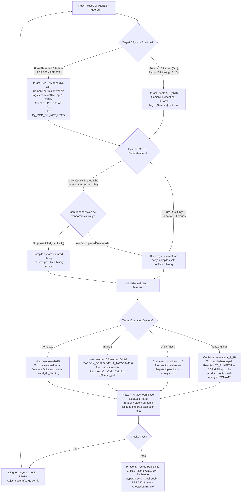

# Playbook: Ship a Rust Extension in a Multi-Platform Python Wheel

> [!summary] Scope
> End-to-end execution guide for compiling, testing, repairing, and publishing a hybrid PyO3 Rust extension as a multi-platform wheel.
> Walks through CI workflow definition, cibuildwheel and maturin invocation, auditwheel repair, free-threaded cp314t target compilation, and Sigstore attestation.
> Provides complete configuration files, build command recipes, and automated verification steps.
> Covers edge cases in dynamic library linking and cross-compilation toolchain setup.

The low-level code generation mechanics and macro expansions of PyO3 are owned by [[Rust-PyO3-and-Maturin-Internals]].
The specification and parsing rules of binary compatibility tags are owned by [[Python-Wheels-Platform-Tags-Manylinux-and-ABI3]].
Container isolation and build matrix scheduling across virtual runners are owned by [[Python-Cross-Platform-Wheel-Pipelines-with-cibuildwheel]].
The mechanics of free-threaded CPython and GIL-free memory models are owned by [[Python-Free-Threaded-Wheels-and-Wheel-Variants]].
Keyless signing, transparency log recording, and OIDC identity assertions are owned by [[Python-Trusted-Publishing-and-PEP-740-Attestations]].
This playbook owns the concrete, end-to-end operational procedure for scaffolding, compiling, auditing, repairing, testing, and publishing a production-grade multi-platform wheel.

## Trigger and Symptoms

Activate this playbook when engineering teams encounter any of the following operational scenarios:

- Shipping a compiled PyO3 native extension to the Python Package Index (PyPI) or an enterprise private wheelhouse.
- Migrating a legacy C, C++, or Cython extension to Rust to enforce memory safety while maintaining drop-in binary compatibility across Linux, macOS, and Windows.
- Expanding an existing Python wheel release matrix to support modern architectures (x86_64 and aarch64/arm64) and operating system baselines (`manylinux_2_28`, `musllinux_1_2`, `macosx_11_0`, `win_amd64`, `win_arm64`).
- Upgrading packaging infrastructure to distribute both CPython Stable ABI (`abi3`) artifacts for mainstream GIL runtimes and specialized versioned wheels for free-threaded CPython (`cp314t` and `cp315t`; cibuildwheel 4.3.4 ships no `cp313t` build identifier) under PEP 703 and PEP 779, with the PEP 803 `abi3t` tag (Final, Python 3.15) as the stable-ABI route for 3.15t and later (as of 2026-11).
- Diagnosing and remediating native runtime import errors reported by users on target systems:
  - `ImportError: /lib/x86_64-linux-gnu/libc.so.6: version 'GLIBC_2.38' not found (required by ...)` caused by building on a host distribution newer than the declared manylinux baseline.
  - `ImportError: ...: undefined symbol: PyExc_...` or silent memory faults when a wheel bearing the `abi3` tag links against non-limited CPython internal symbols.
  - `ImportError: libxyz.so: cannot open shared object file: No such file or directory` caused by distributing a shared object with unvendored dynamic C dependencies or broken `DT_RUNPATH` configurations.
  - `RuntimeWarning: The global interpreter lock (GIL) has been enabled to load module '...', which has not declared that it can run safely without the GIL.` when an extension imported under free-threaded CPython lacks the `Py_MOD_GIL_NOT_USED` slot declaration (message text taken from the CPython 3.14.6t binary).
  - `dyld: Symbol not found: ... / Expected in: /usr/lib/libSystem.B.dylib` when macOS binaries are built with an unpinned `MACOSX_DEPLOYMENT_TARGET` on recent SDKs.
- Implementing modern software supply chain security standards by attaching PEP 740 cryptographically verifiable Sigstore attestations through OpenID Connect (OIDC) Trusted Publishing.

## Decision Tree

The following decision tree governs the compilation strategy, toolchain selection, dynamic library repair pipeline, and publication mechanics for hybrid Python-Rust artifacts:



## Prerequisites

Before executing this playbook, verify the presence, versions, and system permissions of all required toolchains and authentication boundaries.
Execute the following verification sequence in your build or staging environment:

```bash
# 1. Verify Rust toolchain and target architecture (as of 2026-11, Both)
cargo --version
rustc --version

# 2. Verify Python build frontends and packaging tools (as of 2026-11, Both)
python3 --version
maturin --version
cibuildwheel --help >/dev/null && echo "cibuildwheel: OK"

# 3. Verify auditing and binary inspection tools
# Linux: patchelf, readelf, auditwheel
command -v readelf patchelf auditwheel || echo "Audit tools missing on Linux host"

# macOS: otool, install_name_tool, delocate-wheel
command -v otool install_name_tool delocate-wheel || echo "Audit tools missing on macOS host"

# Cross-platform ABI auditing
command -v abi3audit || echo "abi3audit missing: install via pip or brew"
```

The playbook enforces the following version baselines across the deployment pipeline (as of 2026-11).
The `rustc` minimum is PyO3 0.30's MSRV and the `pyo3` minimum is the release that made free-threaded support opt-out (PyO3 `CHANGELOG.md`); the other minimums are this playbook's own floor for a reproducible pipeline, not upstream requirements, and each named minimum release exists on PyPI or as a git tag of `pypa/gh-action-pypi-publish` (checked 2026-11-15).
The verified column is the latest release on PyPI or GitHub on 2026-11-15, or the version executed locally where marked.

| Tool / Component | Minimum Version | Verified Version (as of 2026-11) | Role in Pipeline |
|---|---|---|---|
| `rustc` / `cargo` | 1.85.0 | 1.99.0 (run locally) | Compiles Rust source to native C-compatible dynamic library (`cdylib`). |
| `maturin` | 1.8.0 | 1.15.0 (run locally); 1.16.0 latest | PEP 517 build backend and wheel packager for Rust extensions. |
| `pyo3` | 0.28.0 | 0.30.1 (run locally) | Rust bindings for CPython; enforces `Bound<'py, T>` and free-threading safety. |
| `cibuildwheel` | 4.3.0 | 4.3.4 (source read locally); 4.3.5 latest | Orchestrates cross-platform wheel builds across Docker containers and native VMs. |
| `auditwheel` | 6.8.0 | 6.8.2 | Inspects Linux ELF dependencies, vendors dynamic libraries, and mangles SONAMEs. |
| `delocate` | 0.13.0 | 0.13.0 | Inspects macOS Mach-O headers and vendors dylibs via install name rewriting. |
| `delvewheel` | 1.10.0 | 1.13.2 | Vendors Windows PE dynamic link libraries and patches DLL search paths. |
| `abi3audit` | 0.0.14 | 0.0.26 (run locally) | Scans compiled shared libraries for illegal non-limited CPython API references. |
| `pypa/gh-action-pypi-publish` | 1.11.0 | v1.14.3 (`release/v1` branch) | GitHub Action exchanging OIDC tokens and generating PEP 740 attestations. |

### Access Control and Authentication Prerequisites

- **GitHub Repository Permissions:**
  Workflows executing Trusted Publishing require explicit OpenID Connect (OIDC) token issuance permissions.
  The GitHub Actions workflow job must declare:
  ```yaml
  permissions:
    id-token: write
    contents: read
  ```
- **PyPI Trusted Publisher Configuration:**
  In the target PyPI (or TestPyPI) project administrative console, register a Trusted Publisher with:
  - **Owner:** Your GitHub organization or username (e.g. `example-org`).
  - **Repository name:** Your repository name (e.g. `fast-crc32`).
  - **Workflow name:** The filename of your publishing workflow (e.g. `release.yml`).
  - **Environment name:** `pypi` (recommended to gate publication behind GitHub protected environments).

## Step-by-Step Execution

### Step 1: Scaffold the Hybrid Workspace Configuration

A robust hybrid Python-Rust project separates pure Python packaging metadata (`pyproject.toml`) from low-level compiler instructions (`Cargo.toml`).
The project layout must conform to the following directory structure:

```text
fast_crc32/
|-- Cargo.toml
|-- pyproject.toml
|-- README.md
|-- python/
|   \-- fast_crc32/
|       |-- __init__.py
|       \-- py.typed
|-- src/
|   \-- lib.rs
\-- tests/
    \-- test_crc32.py
```

Configure `pyproject.toml` with `maturin` declared as the PEP 517 build backend, and specify the source paths:

```toml
[build-system]
requires = ["maturin>=1.8,<2.0"]
build-backend = "maturin"

[project]
name = "fast_crc32"
version = "0.1.0"
description = "High-performance CRC32 computation powered by PyO3 and Rust"
readme = "README.md"
requires-python = ">=3.9"
license = { text = "MIT OR Apache-2.0" }
authors = [{ name = "Toolchain Author", email = "author@example.com" }]
classifiers = [
    "Programming Language :: Rust",
    "Programming Language :: Python :: Implementation :: CPython",
    "Programming Language :: Python :: 3",
    "Programming Language :: Python :: 3.9",
    "Programming Language :: Python :: 3.10",
    "Programming Language :: Python :: 3.11",
    "Programming Language :: Python :: 3.12",
    "Programming Language :: Python :: 3.13",
    "Programming Language :: Python :: 3.14",
    "Topic :: System :: Archiving",
    "Typing :: Typed",
]

[tool.maturin]
bindings = "pyo3"
features = ["pyo3/extension-module"]
module-name = "fast_crc32._core"
python-source = "python"
strip = true

[tool.cibuildwheel]
# Build identifiers have no ABI field: cp39-* yields the abi3 wheel that later
# CPython versions reuse; cp314t/cp315t are built by default in cibuildwheel 4.3.4,
# which has no cp313t identifier and no "cpython-freethreading" enable group.
build = ["cp39-*", "cp314t-*", "cp315t-*"]
skip = ["*-musllinux_i686", "*-manylinux_i686", "pp*"]
test-requires = ["pytest"]
test-command = "pytest {project}/tests"

[tool.cibuildwheel.environment]
# Enforce deterministic, reproducible compilation
CARGO_TERM_COLOR = "never"

[tool.cibuildwheel.linux]
# Default manylinux baseline supporting glibc 2.28+ (RHEL 8+, Debian 10+, Ubuntu 20.04+)
manylinux-x86_64-image = "manylinux_2_28"
manylinux-aarch64-image = "manylinux_2_28"
musllinux-x86_64-image = "musllinux_1_2"
musllinux-aarch64-image = "musllinux_1_2"

[tool.cibuildwheel.macos]
# macOS deployment targets matching architecture introduction baselines
environment = { MACOSX_DEPLOYMENT_TARGET = "11.0" }

[tool.cibuildwheel.windows]
# Delvewheel handles dynamic dependency patching for Windows PE binaries
# (cibuildwheel 4.3.4 already defaults to "delvewheel repair -w {dest_dir} -v {wheel}")
repair-wheel-command = "delvewheel repair -w {dest_dir} {wheel}"
```

Configure `Cargo.toml`.
Notice that PyO3 0.30.0 dropped support for Python 3.8 (PyO3 `CHANGELOG.md`, PR 6128), making `abi3-py39` the minimum Stable ABI baseline:

```toml
[package]
name = "fast_crc32"
version = "0.1.0"
edition = "2021"
authors = ["Toolchain Author <author@example.com>"]

[lib]
name = "_core"
crate-type = ["cdylib"]

[dependencies]
# By default, activate abi3-py39 and extension-module.
# Against a free-threaded interpreter PyO3 ignores abi3-py39 and maturin emits a
# version-specific wheel (verified: cp314-cp314t from this manifest on 3.14.6t).
pyo3 = { version = "0.30", features = ["extension-module", "abi3-py39"] }
crc32fast = "1.4"

[features]
default = []
# Not needed for the free-threaded jobs (see the comment above); kept as a hook
# for project-specific code paths
freethreaded = []
```

### Step 2: Implement the Rust Extension with GIL Release and Free-Threaded Safety

Write `src/lib.rs`.
The extension must use PyO3's modern `Bound<'py, T>` API (the legacy `gil-refs` API was removed in PyO3 0.23).
Furthermore, CPU-intensive algorithms should explicitly detach from the interpreter using `py.detach` (renamed from `Python::allow_threads` in PyO3 0.26; the old name no longer exists in 0.30 and fails with `error[E0599]: no method named allow_threads`) so that multi-threaded Python programs can run in parallel on standard interpreters.
On free-threaded Python (CPython 3.14t and later), PyO3 0.28+ declares the `Py_MOD_GIL_NOT_USED` slot by default (free-threaded support became opt-out in 0.28; opt back in with `#[pymodule(gil_used = true)]`); a `cp314t` build of this module imported under `-W error` with `sys._is_gil_enabled()` returning `False`:

```rust
use pyo3::prelude::*;
use pyo3::types::PyBytes;

/// Computes the IEEE 802.3 CRC32 checksum of a byte slice.
/// Releases the GIL during calculation to allow concurrent thread execution.
#[pyfunction]
fn checksum(py: Python<'_>, data: &Bound<'_, PyBytes>) -> u32 {
    let bytes = data.as_bytes();
    py.detach(|| {
        let mut hasher = crc32fast::Hasher::new();
        hasher.update(bytes);
        hasher.finalize()
    })
}

/// Computes the CRC32 checksum and returns a formatted lowercase hex string.
#[pyfunction]
fn checksum_hex(py: Python<'_>, data: &Bound<'_, PyBytes>) -> String {
    let crc = checksum(py, data);
    format!("{:08x}", crc)
}

/// Python C-extension module entrypoint.
/// PyO3 generates the required multi-phase initialization boilerplate and
/// attaches the Py_MOD_GIL_NOT_USED module slot on free-threaded runtimes.
#[pymodule]
fn _core(m: &Bound<'_, PyModule>) -> PyResult<()> {
    m.add_function(wrap_pyfunction!(checksum, m)?)?;
    m.add_function(wrap_pyfunction!(checksum_hex, m)?)?;
    Ok(())
}
```

Write the Python package wrapper `python/fast_crc32/__init__.py`:

```python
"""High-performance CRC32 computation powered by a compiled Rust extension."""

from __future__ import annotations

from fast_crc32._core import checksum, checksum_hex

__all__ = ["checksum", "checksum_hex"]
```

Create an empty marker file `python/fast_crc32/py.typed` to signal PEP 561 type annotation compliance:

```bash
touch python/fast_crc32/py.typed
```

### Step 3: Handle Dynamic Shared Library Dependencies and Binary Repair

If your Rust extension links exclusively to pure Rust crates (such as `crc32fast`), Cargo compiles all code statically into the output `.so`, `.dylib`, or `.pyd` file.
However, when an extension depends on a `-sys` crate (such as `openssl-sys`, `libsqlite3-sys`, or custom C++ libraries), linking behavior decides wheel portability.

#### Strategy A: Static Vendoring Inside Cargo (Preferred)
Whenever possible, instruct `-sys` crates to build their C dependencies from source and link them statically into the cdylib:

```toml
[dependencies]
# Statically links OpenSSL, eliminating runtime libssl.so dependencies
openssl = { version = "0.10", features = ["vendored"] }
```

#### Strategy B: Dynamic Linking and Wheel Repair (Auditwheel, Delocate, Delvewheel)
If static vendoring is impossible due to proprietary licensing or system GPU drivers (e.g. CUDA, OpenCL), you must dynamically link and execute binary repair:

1. **Linux ELF Repair (`auditwheel repair`):**
   When `maturin` builds inside a `manylinux` container, dynamically linked shared libraries outside the manylinux whitelist (defined in `manylinux-policy.json`) cause distribution failures.
   `auditwheel repair` executes the following sequence:
   - Reads ELF `DT_NEEDED` dynamic tags of the extension using `pyelftools` (auditwheel does not shell out to `readelf`).
   - Locates external `.so` dependencies on the filesystem.
   - Copies the shared libraries into `<distribution_name>.libs/` at the root of the wheel (a sibling of the package directory).
   - Invokes `patchelf` to rewrite each dependency's `DT_SONAME` with the first 8 hex characters of its file hash inserted before the first dot (e.g. `libcustom-7f3b89a1.so.1`) to prevent namespace collisions with system libraries (`auditwheel/repair.py`: `shorthash = hashfile(f)[:8]`).
   - Updates the extension binary's `DT_RUNPATH` (or `DT_RPATH`) to `$ORIGIN` joined with the relative path from the extension's directory to the libs directory, so `fast_crc32/_core.abi3.so` gets `$ORIGIN/../fast_crc32.libs`.
   - Renames the wheel filename to reflect the verified policy (e.g. `fast_crc32-0.1.0-cp39-abi3-manylinux_2_28_x86_64.whl`).

2. **macOS Mach-O Repair (`delocate-wheel`):**
   macOS uses Mach-O load commands instead of ELF headers:
   - Scans Mach-O headers for `LC_LOAD_DYLIB` commands pointing to non-system libraries.
   - Copies dependent `.dylib` files into a `.dylibs/` directory inside the package (`fast_crc32/.dylibs/`).
   - Executes `install_name_tool -change` to rewrite library install names from `/usr/local/lib/libfoo.dylib` to a path relative to the loading binary, `@loader_path/.dylibs/libfoo.dylib` for `fast_crc32/_core.abi3.so` (deeper extensions get extra `../` segments).
   - Adjusts `LC_RPATH` load commands to ensure dyld discovers the vendored dependencies at runtime.

3. **Windows PE Repair (`delvewheel repair`):**
   Windows does not support embedded `RPATH` in Portable Executable (PE) binaries:
   - Scans the PE Import Directory Table for dependent DLLs.
   - Copies required third-party DLLs into `fast_crc32.libs/`.
   - Injects a Python initialization hook into `fast_crc32/__init__.py` that calls `os.add_dll_directory()` on Python 3.8+ before the native `.pyd` module is imported.

In `cibuildwheel`, the repair steps run automatically using tool defaults unless explicitly overridden in `pyproject.toml`: cibuildwheel 4.3.4's `resources/defaults.toml` sets `auditwheel repair` on Linux, `delocate-wheel --require-archs {delocate_archs}` on macOS, and `delvewheel repair` on Windows.

### Step 4: Configure the GitHub Actions Multi-Platform Release Pipeline

Construct the production CI workflow file at `.github/workflows/release.yml`.
The workflow uses a matrix strategy spanning Linux, macOS, and Windows.
It uses native GitHub-hosted runners for every target (`ubuntu-24.04`, `ubuntu-24.04-arm` for Linux AArch64, `macos-15` for ARM64, `macos-15-intel` for x86_64, `windows-2025`), so no QEMU emulation is needed; `macos-13` is no longer listed and all `macos-14` images were retired on 2026-11-02 (actions/runner-images README, as of 2026-11):

```yaml
name: Release Multi-Platform Wheels

on:
  push:
    tags:
      - "v*.*.*"
  workflow_dispatch:

permissions:
  contents: read

jobs:
  build_sdist:
    name: Build source distribution (sdist)
    runs-on: ubuntu-24.04
    steps:
      - uses: actions/checkout@v4

      - name: Install Rust toolchain
        uses: dtolnay/rust-toolchain@stable

      - name: Set up Python
        uses: actions/setup-python@v5
        with:
          python-version: "3.12"

      - name: Install maturin
        run: pip install --upgrade maturin

      - name: Build sdist
        run: maturin sdist --out dist

      - name: Upload sdist artifact
        uses: actions/upload-artifact@v4
        with:
          name: dist-sdist
          path: dist/*.tar.gz
          if-no-files-found: error

  build_wheels:
    name: Wheels on ${{ matrix.os }} (${{ matrix.target_arch }})
    runs-on: ${{ matrix.os }}
    strategy:
      fail-fast: false
      matrix:
        include:
          # Linux x86_64
          - os: ubuntu-24.04
            target_arch: x86_64
            cibw_archs: x86_64
          # Linux aarch64 (native GitHub-hosted arm64 runner)
          - os: ubuntu-24.04-arm
            target_arch: aarch64
            cibw_archs: aarch64
          # macOS Apple Silicon (ARM64)
          - os: macos-15
            target_arch: arm64
            cibw_archs: arm64
          # macOS Intel (x86_64)
          - os: macos-15-intel
            target_arch: x86_64
            cibw_archs: x86_64
          # Windows x86_64
          - os: windows-2025
            target_arch: x86_64
            cibw_archs: AMD64

    steps:
      - uses: actions/checkout@v4

      - name: Install Rust toolchain (host)
        uses: dtolnay/rust-toolchain@stable

      - name: Set up Python
        uses: actions/setup-python@v5
        with:
          python-version: "3.12"

      - name: Install cibuildwheel
        run: pip install --upgrade cibuildwheel==4.3.4

      - name: Build and repair wheels
        run: cibuildwheel --output-dir dist
        env:
          CIBW_ARCHS: ${{ matrix.cibw_archs }}
          # Install Rust inside Linux manylinux container if not present
          CIBW_BEFORE_ALL_LINUX: >
            command -v cargo >/dev/null 2>&1 || (curl --proto '=https' --tlsv1.2 -sSf https://sh.rustup.rs | sh -s -- -y --default-toolchain stable && echo 'source $HOME/.cargo/env' >> $HOME/.bashrc)
          CIBW_ENVIRONMENT_LINUX: 'PATH="$HOME/.cargo/bin:$PATH"'

      - name: Audit Stable ABI compliance
        # bash on every OS (windows-2025 defaults to pwsh); fail the job on any
        # violation instead of masking it with "|| echo"
        shell: bash
        run: |
          pip install abi3audit
          shopt -s nullglob
          wheels=(dist/*-abi3-*.whl)
          if [ "${#wheels[@]}" -gt 0 ]; then
            abi3audit --verbose --strict "${wheels[@]}"
          else
            echo "No abi3 wheels in this job"
          fi

      - name: Upload built wheels
        uses: actions/upload-artifact@v4
        with:
          name: dist-wheels-${{ matrix.os }}-${{ matrix.target_arch }}
          path: dist/*.whl
          if-no-files-found: error

  publish:
    name: Publish to PyPI with PEP 740 Attestation
    needs: [build_sdist, build_wheels]
    runs-on: ubuntu-24.04
    environment:
      name: pypi
      url: https://pypi.org/p/fast-crc32
    permissions:
      id-token: write  # Mandatory for PyPI Trusted Publishing OIDC exchange
      contents: read
    steps:
      - name: Download all release artifacts
        uses: actions/download-artifact@v4
        with:
          pattern: dist-*
          path: dist
          merge-multiple: true

      - name: Verify release payload contents
        run: |
          ls -lah dist/
          echo "Total artifact count: $(ls -1 dist/ | wc -l)"

      - name: Publish distributions to PyPI
        uses: pypa/gh-action-pypi-publish@release/v1
        with:
          packages-dir: dist/
          # Attestations are generated and signed automatically via Sigstore when id-token: write is present
          attestations: true
```

## Verification

Execute the following verification commands to inspect built wheels before initiating deployment.

### 1. Wheel Filename and ZIP Metadata Inspection

Unpack the archive and verify that the metadata declares correct compatibility tags:

```bash
# Verify wheel structure using python's zipfile module
python3 -m zipfile -l dist/fast_crc32-0.1.0-cp39-abi3-macosx_11_0_arm64.whl
```

Expected archive layout contains:
- `fast_crc32/__init__.py`
- `fast_crc32/py.typed`
- `fast_crc32/_core.abi3.so` (or `_core.pyd` on Windows)
- `fast_crc32-0.1.0.dist-info/METADATA`
- `fast_crc32-0.1.0.dist-info/WHEEL`
- `fast_crc32-0.1.0.dist-info/RECORD`

Verify `dist-info/WHEEL` contains:
```text
Wheel-Version: 1.0
Generator: maturin (1.15.0)
Root-Is-Purelib: false
Tag: cp39-abi3-macosx_11_0_arm64
```

### 2. Stable ABI Compliance Verification (`abi3audit`)

Run `abi3audit` with strict failure mode.
The tool reads the shared library's dynamic symbol table and matches imported `Py*` symbols against the CPython Limited API database for the targeted version:

```bash
abi3audit --verbose --strict dist/fast_crc32-0.1.0-cp39-abi3-*.whl
```

Output recorded with abi3audit 0.0.26 on darwin-arm64 (2026-11-15; the tool's leading timestamp and status glyph are omitted here), exit status 0:
```text
fast_crc32-0.1.0-cp39-abi3-macosx_11_0_arm64.whl: 1 extensions scanned; 0 ABI version mismatches and 0 ABI violations found
```

If the audit fails, `abi3audit` prints a `Symbol | Version` table naming each offending symbol (for example `_Py_HashPointer | not ABI3`), the summary line reports `1 ABI violations found`, and the exit status is 1.

### 3. Dynamic Symbol and GLIBC Baseline Verification (Linux)

On Linux wheels, inspect the dynamic dependencies and verify symbol versions:

```bash
# Extract the compiled shared library
unzip -q dist/fast_crc32-0.1.0-cp39-abi3-manylinux_2_28_x86_64.whl -d /tmp/whl_inspect

# Check dynamic dependencies and RUNPATH
readelf -d /tmp/whl_inspect/fast_crc32/_core.abi3.so | grep -E 'NEEDED|RUNPATH'

# Check highest GLIBC symbol versions linked
objdump -T /tmp/whl_inspect/fast_crc32/_core.abi3.so | grep 'GLIBC_' | awk '{print $5}' | sort -uV | tail -n 5
```

Verification assertions:
- `DT_NEEDED` entries contain only allowed system libraries (e.g. `libc.so.6`, `libm.so.6`, `libpthread.so.0`).
- The highest `GLIBC_` symbol version does not exceed `GLIBC_2.28`.
- If external shared libraries were vendored, `DT_RUNPATH` contains `$ORIGIN/../fast_crc32.libs`.

### 4. Mach-O Load Command and Deployment Target Verification (macOS)

On macOS wheels, inspect the minimum OS load command and install names:

```bash
# Extract and inspect Mach-O load commands
unzip -q dist/fast_crc32-0.1.0-cp39-abi3-macosx_11_0_arm64.whl -d /tmp/mac_inspect

# Verify LC_BUILD_VERSION minos
otool -l /tmp/mac_inspect/fast_crc32/_core.abi3.so | grep -A 4 LC_BUILD_VERSION

# Verify shared library dependencies
otool -L /tmp/mac_inspect/fast_crc32/_core.abi3.so
```

Expected output confirms `minos 11.0` (matching `MACOSX_DEPLOYMENT_TARGET=11.0`) and verifies that no hardcoded paths outside `/usr/lib` or `@loader_path` exist.
On the lab wheel built by maturin 1.15.0 on macOS 27.3 (2026-11-15), `otool -l` showed `minos 11.0` with `sdk 27.2`, and `otool -L` listed only the module's own `@rpath/fast_crc32._core.abi3.so` install name, `/usr/lib/libiconv.2.dylib`, and `/usr/lib/libSystem.B.dylib`.

### 5. Reproducible Lab Verification Output

The verification script for this playbook was executed against `code/07-Packaging-and-Release/maturin_wheel/`.
The exact output recorded on `darwin-arm64` (Apple Silicon, macOS 27.3, maturin 1.15.0, PyO3 0.30.1, Python 3.15.2, as of 2026-11; re-run byte-identical on 2026-11-15) is copied below:

```text
Wheel Package Name: fast_crc32
Wheel Version: 0.1.0
Python Tag: cp39
ABI Tag: abi3
Platform Family: macosx
Platform Architecture: arm64
WHEEL Wheel-Version: 1.0
WHEEL Root-Is-Purelib: false
Extension Module Path: fast_crc32/_core.abi3.so
Extension ABI Suffix: True
Exported PyInit entrypoint present: True
Test Vector Checksum Match: True
Checksum Decimal Value: 3421780262
Checksum Hex String: cbf43926
Hex String Match: True
Wheel verification result: PASS
```

## Rollback Procedure

Because PyPI enforces strict immutability, release rollbacks require specific operational steps depending on whether an artifact has already been published to the index.

### Incident Scenario A: Defective Build Caught Before Publishing
If a wheel fails `abi3audit`, leaks symbols, or fails test stages during CI execution before the `publish` job triggers:
1. Immediately cancel the running GitHub Actions workflow run:
   ```bash
   gh run cancel <RUN_ID>
   ```
2. Delete the published GitHub release tag locally and remotely:
   ```bash
   git tag -d v0.1.0
   git push origin :refs/tags/v0.1.0
   ```
3. Fix the underlying configuration defect, commit to `main`, and retag the commit.

### Incident Scenario B: Broken Wheel Published to PyPI
PyPI forbids deleting an uploaded wheel and replacing it with another file of the same name.
Attempting to upload an updated `fast_crc32-0.1.0-cp39-abi3-manylinux_2_28_x86_64.whl` will be rejected with HTTP 400 (`File already exists`).

Execute the following three-step emergency remediation:

1. **Yank the Compromised Release (PEP 592):**
   Yanking informs package installers (`pip`, `uv`) that the version is deprecated or broken.
   Installers ignore a yanked release unless it is the only release matching a `==` or `===` specifier (e.g. `fast_crc32==0.1.0`):
   ```bash
   # PyPI documents yanking only through the web UI; neither twine nor a
   # token-authenticated PyPI API exposes it (docs.pypi.org, as of 2026-11).
   open "https://pypi.org/manage/project/fast-crc32/releases/"
   # Options -> Yank, then enter a reason such as:
   # "Critical regression: ABI mismatch causes SIGSEGV on Python 3.12"
   ```
   The optional reason appears on the release page and in the index APIs installers read.

2. **Publish an Emergency Patch Release (`0.1.1`):**
   Do not use post-release tags (such as `0.1.0.post1`) for binary defect fixes, because post-releases sort after the release and cause version ambiguity in strict pinning environments.
   Increment the patch version in `pyproject.toml` and `Cargo.toml`:
   ```toml
   # pyproject.toml
   version = "0.1.1"

   # Cargo.toml
   version = "0.1.1"
   ```
   Push the commit and tag `v0.1.1` to trigger the automated build and release pipeline.

3. **Emergency Credential Revocation (If Supply Chain Compromised):**
   If an unauthorized workflow published malicious wheels via Trusted Publishing:
   - Navigate to `https://pypi.org/manage/project/fast-crc32/settings/publishing/`.
   - Delete the Trusted Publisher mapping linking GitHub Actions to the PyPI project.
   - Any subsequent OIDC token exchange attempts from GitHub Actions will fail at PyPI's `mint-token` endpoint with the `invalid-publisher` error code (valid token, but no corresponding publisher).

## Failure Modes

The following table documents common real-world failure modes, root causes, and corrective actions encountered when distributing compiled Rust wheels:

| Failure Mode | Observable Symptom | Mechanism Root Cause | Corrective Action |
|---|---|---|---|
| Host GLIBC Symbol Leak | `ImportError: libc.so.6: version 'GLIBC_2.38' not found` | Extension compiled directly on a modern Linux host instead of inside a `manylinux` container, linking newer glibc symbols (`__libc_single_threaded`). | Build inside `quay.io/pypa/manylinux_2_28_x86_64` container via `cibuildwheel` or pass `--zig --compatibility manylinux_2_28` to `maturin build`; see [[Drill-Packaging-Manylinux-GLIBC-Symbol-Leak\|GLIBC Leak Drill]]. |
| Stable ABI Leakage | `undefined symbol: _Py_...` or crash on Python 3.12 | Rust code or a C dependency invoked a non-limited CPython API while declaring the `abi3` wheel tag. | Run `abi3audit --strict` in CI, and replace non-limited C-API calls with `pyo3::types` or limited C-API functions (`PyObject_CallMethod`). |
| Missing RPATH in Dynamically Linked `.so` | `ImportError: libfoo.so: cannot open shared object file` | Rust extension linked against a dynamic C library via `-sys` crate without running `auditwheel repair`. | Set Cargo feature to vendor statically (e.g. `features = ["vendored"]`), or configure `auditwheel repair` to bundle external libraries and set `DT_RUNPATH`. |
| Free-Threaded Data Race / Segfault | Segmentation fault or data corruption under multi-threaded execution on `cp313t` / `cp314t` | Extension used unsynchronized mutable static state (`static mut`, or `Cell`/`RefCell` state behind `unsafe impl Sync`) relying on GIL protection (`std::sync::OnceLock` is itself synchronized). | Audit Rust shared state, use `std::sync::Mutex` or atomics, and verify module exports `Py_MOD_GIL_NOT_USED` slot via PyO3; see [[Python-Free-Threaded-Wheels-and-Wheel-Variants\|Free-Threaded Wheels]]. |
| macOS Deployment Target Inflation | `dyld: Symbol not found: ... / Expected in: /usr/lib/libSystem.B.dylib` | Rust compiled on macOS 14/15 host without setting `MACOSX_DEPLOYMENT_TARGET`, emitting high `minos` load commands. | Export `MACOSX_DEPLOYMENT_TARGET=11.0` in `cibuildwheel.environment` or before invoking `maturin build`; see [[Cpp-macOS-Universal-Binaries-Code-Signing-and-Notarization\|macOS Binaries]]. |
| OIDC Trusted Publishing Rejection | Token exchange fails with `invalid-publisher` (valid token, but no corresponding publisher) | PyPI Trusted Publisher registered with a workflow filename or environment name differing from the running CI job. | Verify GitHub Actions workflow filename, repository owner, branch/tag trigger, and environment name match PyPI settings exactly; see [[Python-Trusted-Publishing-and-PEP-740-Attestations\|Trusted Publishing]]. |
| Feature Unification ABI Corruption | Linker symbol conflict or altered data structure layout | Multiple dependencies pulled in the same underlying crate with conflicting feature flags, unifying features unexpectedly. | Run `cargo tree --duplicates`, and isolate conflicting dependencies or pin crate versions in `Cargo.lock`; see [[Drill-Packaging-Cargo-Feature-Unification-Hazard\|Cargo Feature Drill]]. |

## Practice Drill

### Objective
Execute an end-to-end local diagnostic and build exercise: compile a hybrid Rust extension wheel, intentionally trigger and detect an ABI symbol violation, fix the violation, and audit the repaired binary.

### Step 1: Scaffolding and Clean Build
1. Clone or copy `code/07-Packaging-and-Release/maturin_wheel/` to an isolated scratch directory:
   ```bash
   cp -R code/07-Packaging-and-Release/maturin_wheel /tmp/maturin_drill
   cd /tmp/maturin_drill
   ```
2. Build the initial release wheel:
   ```bash
   maturin build --release --out dist
   ```
3. Verify that `python3 verify_wheel.py dist` reports `PASS`.

### Step 2: Injecting an ABI Violation
1. Modify `src/lib.rs` to intentionally invoke an internal CPython symbol that is excluded from the Stable ABI / Limited API.
   With an `abi3` feature active, `pyo3::ffi` does not expose non-limited functions at all, and `PyObject_Hash` is itself part of the Limited API, so declare a private symbol by hand.
   On macOS the extension links with `-undefined dynamic_lookup`, so the build succeeds and only the audit catches it:
   ```rust
   extern "C" {
       // Private CPython symbol, not in the Limited API
       fn _Py_HashPointer(p: *const std::ffi::c_void) -> isize;
   }

   #[pyfunction]
   fn leak_symbol(obj: &Bound<'_, PyAny>) -> isize {
       unsafe { _Py_HashPointer(obj.as_ptr() as *const std::ffi::c_void) }
   }
   ```
   Register `leak_symbol` in the `#[pymodule]` so the linker keeps it.
2. Recompile the wheel:
   ```bash
   maturin build --release --out dist
   ```
3. Run `abi3audit` against the newly produced wheel:
   ```bash
   abi3audit --verbose --strict dist/*.whl
   ```
4. Observe the failure report: `abi3audit` reports `_core.abi3.so has non-ABI3 symbols`, lists `_Py_HashPointer | not ABI3`, and exits 1 (observed with abi3audit 0.0.26 on darwin-arm64, 2026-11-15).

### Step 3: Remediating and Verifying
1. Replace the unsafe pointer hash call with the standard Limited API method:
   ```rust
   #[pyfunction]
   fn safe_hash(obj: &Bound<'_, PyAny>) -> PyResult<isize> {
       obj.hash()
   }
   ```
2. Rebuild the wheel and re-run `abi3audit`:
   ```bash
   maturin build --release --out dist
   abi3audit --verbose --strict dist/*.whl
   ```
3. Confirm that the audit passes cleanly with 0 violations.

## Interview Questions

> [!question] L5
> What is the concrete difference between distributing a wheel tagged `cp39-abi3-manylinux_2_28_x86_64.whl` and distributing wheels tagged `cp312-cp312-manylinux_2_28_x86_64.whl`?
>
> > [!success]- Answer
> > The `abi3` wheel compiles against CPython's Limited API (defined in PEP 384 and PEP 425), using a stable C ABI forward-compatible across minor interpreter releases.
> > A single `cp39-abi3` wheel runs on Python 3.9, 3.10, 3.11, 3.12, 3.13, 3.14, and subsequent versions without requiring recompilation.
> > In contrast, `cp312-cp312` binds directly to CPython 3.12's full internal C-API, requiring separate wheels compiled for every Python minor version (3.9, 3.10, 3.11, etc.).
> > The trade-off is performance and API coverage: the Limited API excludes internal object struct fields and inline optimization macros (such as direct `PyTuple_GET_ITEM`), incurring slight pointer indirection overhead, but dramatically reduces CI build times and artifact repository storage.

> [!question] L5: Predict the Output
> A project publishes a single wheel tagged `fast_crc32-0.1.0-cp39-abi3-manylinux_2_28_x86_64.whl`.
> An engineer installs this wheel on Python 3.14t (free-threaded build compiled with `--disable-gil`).
> Predict what happens during installation, import, and execution.
>
> > [!success]- Answer
> > Installation: `pip` refuses the wheel, because a free-threaded interpreter does not list any `abi3` tag among its supported tags; installing the file directly fails with `ERROR: ... is not a supported wheel on this platform.`, and resolving from an index falls back to the sdist or reports no matching distribution.
> > Import: if the files are forced onto `sys.path` anyway, the `abi3` binary was compiled against the GIL build's object layout, and on CPython 3.14.6t the import fails with `SystemError: init function of _core returned uninitialized object`.
> > Execution: nothing runs; the fix is a dedicated `cp314-cp314t` wheel (the same PyO3 0.30 crate built against 3.14t yields one, imports with the GIL still disabled, and emits no `RuntimeWarning`), or for 3.15t and later an `abi3t` wheel under PEP 803 (Final, Python 3.15).
> > All three outcomes were observed on macOS arm64 with the `macosx_11_0_arm64` equivalent of this wheel on 2026-11-15.
> > The GIL re-enable `RuntimeWarning` is a different case: it fires for a correctly tagged free-threaded wheel whose module does not declare `Py_MOD_GIL_NOT_USED`.

> [!question] L6: Debug This
> A user reports the following traceback when importing your package on a clean Amazon Linux 2 server:
> ```text
> Traceback (most recent call last):
>   File "<stdin>", line 1, in <module>
>   File "/opt/venv/lib/python3.11/site-packages/my_ext/__init__.py", line 2, in <module>
>     from my_ext._core import compute
> ImportError: /lib64/libc.so.6: version `GLIBC_2.28' not found (required by /opt/venv/lib/python3.11/site-packages/my_ext/_core.abi3.so)
> ```
> The wheel was tagged `my_ext-0.1.0-cp39-abi3-manylinux_2_28_x86_64.whl`.
> Why did this error occur, and how do you resolve it?
>
> > [!success]- Answer
> > Root cause: Amazon Linux 2 ships `glibc 2.26` (the AL2 release notes list `glibc-2.26-64.amzn2.0.4` in 2.0.20250414.0, and the AL2023 guide's toolchain table compares AL2's 2.26 with AL2023's 2.34).
> > The wheel declared a compatibility tag of `manylinux_2_28` (PEP 600), requiring `glibc >= 2.28`, so a current pip would never select it on that host.
> > The wheel therefore got there by a forced install (a direct file install with `--no-deps`-style tooling that skips tag checks, a copied venv, or a container image built elsewhere); pip releases older than 20.3 do not understand PEP 600 tags at all and skip such wheels rather than install them.
> > The dynamic loader (`/lib64/ld-linux-x86-64.so.2`) failed during `dlopen()` because the extension referenced glibc symbols versioned at `GLIBC_2.28`.
> > Resolution: If the package must support Amazon Linux 2, you must compile against the older `manylinux2014` baseline (`glibc 2.17`); a `musllinux_1_2` wheel does not help, because it needs a musl dynamic loader that a glibc distribution does not provide.
> > Alternatively, advise the customer to migrate to Amazon Linux 2023, which provides `glibc 2.34`.

> [!question] L6
> How does `auditwheel repair` ensure that bundled shared libraries do not collide with libraries of the same name loaded by other Python packages?
>
> > [!success]- Answer
> > `auditwheel repair` copies dependent `.so` files into `<package>.libs/` and invokes `patchelf` to execute two mutations:
> > 1. SONAME mangling: It computes a cryptographic hash of the library contents and renames the library file and its internal `DT_SONAME` tag (e.g. changing `libcrypto.so.3` to `libcrypto-7f3b89a1.so.3`).
> > 2. Dependency rewriting: It scans the extension binary and rewrites its `DT_NEEDED` entry from `libcrypto.so.3` to `libcrypto-7f3b89a1.so.3`.
> > 3. Search path rewriting: It sets `DT_RUNPATH` in the extension binary to `$ORIGIN/<package>.libs`.
> > This ensures that when `ld.so` loads the extension, it requests the mangled SONAME from the local directory rather than resolving against a potentially incompatible `libcrypto.so.3` previously mapped into memory by another package or the host interpreter.

> [!question] L6
> Why did PyO3 completely remove the `gil-refs` API in version 0.23, and what replaces it?
>
> > [!success]- Answer
> > The legacy `gil-refs` API passed references of type `&'py PyAny`, which implicitly tied object lifetime to a GIL token (`Python<'py>`).
> > Each owned reference was parked in a thread-local pool and only released when the enclosing `GILPool` dropped, which cost memory and time in loops and could not be made sound for free-threaded CPython (PEP 703), where no global lock bounds those lifetimes.
> > PyO3 0.21 introduced the replacement and kept the deprecated API behind a `gil-refs` feature (PR 3707), and 0.23 removed that feature (PyO3 `CHANGELOG.md`, PR 4378).
> > The replacement is the `Bound<'py, T>` smart pointer.
> > `Bound<'py, T>` behaves like an RAII pointer that explicitly owns one Python reference (`Py_DECREF` on drop), and its `'py` lifetime ties it to a thread attached to the interpreter, so the compiler stops it from crossing threads; thread safety of the data behind the object is still the extension author's job under free-threading.

> [!question] L7
> Explain how PEP 740 Digital Attestations and Sigstore keyless signing protect the Python packaging supply chain compared to legacy PGP signatures.
>
> > [!success]- Answer
> > Legacy PGP signatures on PyPI suffered from critical operational defects: maintainers stored long-lived private keys on local developer laptops, keys were rarely rotated, revocation mechanisms (CRLs/OCSP) did not scale, and signatures only proved that a specific PGP key signed a blob without proving where or how the blob was compiled.
> > PEP 740 replaces PGP with Sigstore keyless signing integrated via OpenID Connect (OIDC) Trusted Publishing:
> > 1. Ephemeral certificates: CI runners (e.g. GitHub Actions) request a short-lived OIDC identity token from GitHub asserting the repository, workflow file, commit SHA, and triggering event.
> > 2. Fulcio CA exchange: The runner presents the token to Sigstore's Fulcio certificate authority, which issues an X.509 certificate valid for minutes, binding the ephemeral public key to the OIDC identity.
> > 3. Rekor transparency log: The signature over the wheel's SHA-256 hash is recorded in Rekor, an immutable, append-only transparency log.
> > 4. Index verification: PyPI stores the attestation bundle alongside the wheel.
> > Downstream consumers can cryptographically verify that the exact binary wheel on PyPI was built directly from source commit `abc` in repository `org/repo` via workflow `release.yml`, eliminating credentials theft and compromised developer workstation attack vectors.

> [!question] L7
> An enterprise Python monorepo compiles a PyO3 Rust extension that links against a custom internal C++ library built with CMake.
> During CI, Linux builds succeed, but macOS arm64 builds fail with:
> `Undefined symbols for architecture arm64: "std::__1::basic_string<char, ...>::~basic_string()"`
> What is the root cause, and how do you structure the build pipeline to resolve it?
>
> > [!success]- Answer
> > Root cause: When `rustc` links a `cdylib` crate targeting `aarch64-apple-darwin`, the default linker invocation uses the C compiler driver (or `clang`) without implicitly adding the C++ standard library runtime (`-lc++`).
> > If the Rust extension binds to C++ object files or static archives built by CMake, undefined references to `libc++` symbols remain unfulfilled during dynamic library linking.
> > Resolution:
> > 1. In the build script (`build.rs`) of the Rust crate that links the C++ library, emit explicit cargo linker flags:
> >    `println!("cargo:rustc-link-lib=c++");` on macOS (`println!("cargo:rustc-link-lib=stdc++");` on Linux).
> > 2. Ensure CMake compiles the C++ code with `-stdlib=libc++` and matches `MACOSX_DEPLOYMENT_TARGET=11.0` so ABI symbol mangling and deployment target versions align across the C++ and Rust compilation stages.

> [!question] L8+
> Design an automated release engineering architecture for an enterprise financial analytics platform shipping 40+ polyglot (Python, Rust, C++) native extensions across 15,000 servers.
> How do you guarantee zero downtime, binary reproducibility, and defense against silent ABI memory corruption?
>
> > [!success]- Answer
> > Architecture:
> > 1. Hermetic Build Orchestration: Use Bazel or pinned Nix environments for developer builds, and `cibuildwheel` in GitHub Actions for packaging.
> > All compiler toolchains (`rustc`, `clang`, `zig`) are pinned by cryptographic hash in lockfiles.
> > 2. Dual-Track ABI Strategy:
> >    - Standard services deploy `cp39-abi3` wheels with limited C-API bounds.
> >    - Low-latency pricing engines deploy dedicated `cp314t` free-threaded wheels compiled with `-C target-cpu=native`.
> > 3. CI Gate Verification:
> >    - Execute `abi3audit --strict` on all Stable ABI wheels.
> >    - Run ELF/Mach-O inspection checking `DT_RUNPATH`, `DT_NEEDED`, and maximum `GLIBC` versions.
> >    - Differential symbol checks: compare symbol export tables (`readelf -s`) against the previous release to block unintended symbol leakage.
> > 4. Canary and Progressive Rollout:
> >    - Publish wheels to an internal devpi/Artifactory repository.
> >    - Deployment orchestrator runs canary worker nodes consuming the new wheel.
> >    - Canary nodes monitor Prometheus metrics: memory allocator fragmentation, unhandled signals (`SIGSEGV`, `SIGBUS` via kernel ebpf probes), and thread lock contention.
> > 5. Supply Chain and Provenance:
> >    - Enforce PEP 740 Sigstore digital attestations.
> >    - Target servers run admission validation agents verifying the Rekor transparency log entry before allowing `pip` or `uv` to install the wheel.

## Further Reading

- PEP 427: The Wheel Binary Package Format 1.0, https://peps.python.org/pep-0427/.
  The canonical specification of the wheel ZIP archive structure, `.dist-info` layout, and `RECORD` file validation.
- PEP 384: Defining a Stable ABI, https://peps.python.org/pep-0384/.
  Foundational specification establishing CPython's Limited API and the `abi3` binary interface promise.
- PEP 600: Future 'manylinux' Platform Tags for Portable Linux Built Distributions, https://peps.python.org/pep-0600/.
  Defines the glibc version-based manylinux tag schema (`manylinux_${GLIBCMAJOR}_${GLIBCMINOR}`).
- PEP 703: Making the Global Interpreter Lock Optional in CPython, https://peps.python.org/pep-0703/.
  Architectural design and C-API modifications for free-threaded CPython execution.
- PEP 740: Index support for digital attestations, https://peps.python.org/pep-0740/.
  Specifies index-hosted digital attestations, Sigstore provenance bundles, and verification semantics for PyPI.
- PEP 779: Criteria for supported status for free-threaded Python, https://peps.python.org/pep-0779/.
  Formal governance criteria and timeline for moving free-threaded Python from experimental to supported (phase II) status.
- PEP 803: abi3t: Stable ABI for Free-Threaded Builds, https://peps.python.org/pep-0803/.
  Final PEP (resolved 2026-03-30, Python 3.15) defining the `abi3t` wheel tag and `.abi3t.so` suffix for free-threaded CPython; PyO3 0.29 added the `abi3t` and `abi3t-py315` features.
- Maturin User Guide: Distribution, https://www.maturin.rs/distribution.html.
  Comprehensive documentation on cross-compiling, auditwheel integration, and wheel packaging with Maturin.
- PyO3 User Guide: Supporting Free-Threaded CPython, https://pyo3.rs/main/free-threading.html.
  Best practices for writing thread-safe Rust extensions, managing `Bound<'py, T>`, and declaring module slots.
- cibuildwheel Documentation, https://cibuildwheel.pypa.io/en/stable/.
  Reference manual for multi-platform build matrix automation, container environments, and test hooks.

## Related

- Prerequisites: [[Rust-PyO3-and-Maturin-Internals]], [[Python-Cross-Platform-Wheel-Pipelines-with-cibuildwheel]], [[Python-Trusted-Publishing-and-PEP-740-Attestations]]
- Next: [[Execute-Zero-Downtime-Shared-Library-SONAME-Migration]]
- Lab: `code/07-Packaging-and-Release/maturin_wheel/` (requires: network)
