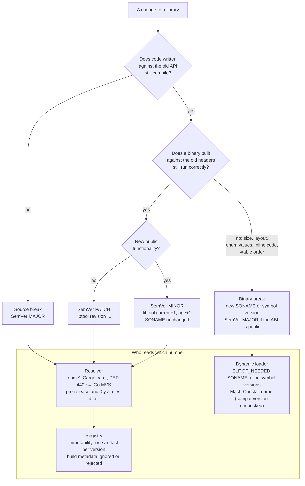

# Versioning: SemVer 2.0.0, CalVer, and ABI Compatibility

> [!summary] Claim:
> A version string carries three different contracts, read by three different machines: a release identity read by registries, a compatibility claim read by dependency resolvers, and a binary interface read by the dynamic loader.
> SemVer 2.0.0 defines only the first two: an 11-rule grammar with a total precedence order in which build metadata is ignored and pre-releases sort below their release, plus a promise that MAJOR moves on every incompatible change to a declared public API.
> CalVer replaces the compatibility claim with a date, which is honest about cadence and silent about breakage.
> Neither scheme describes the ABI: appending a struct field or inserting an enumerator is source compatible and binary breaking, so native libraries carry a second, independent version in the SONAME, the Mach-O compatibility version, symbol versions, or an inline namespace.
> The expert keeps the numbers decoupled, picks the scheme from who consumes the version, and gates releases with tools that check the binary, not the changelog.



## The Mechanism

### 1. One string, three contracts

A release version names an immutable artifact: SemVer Rule 3 says the contents of a released version "MUST NOT be modified", and registries enforce it (crates.io keeps yanked versions as a "permanent archive", and [[Case-Study-Left-Pad-and-Registry-Immutability]] owns the npm unpublish history).
A compatibility claim tells a resolver which other versions it may substitute; this is what `^1.2.3`, `~=1.4`, and Go's minimal version selection consume, and [[Dependency-Resolution-SAT-PubGrub-and-MVS]] owns how resolvers search that space.
A binary interface tells the dynamic loader whether an already-compiled program may bind to this file; on ELF that is the `DT_SONAME` copied into each consumer's `DT_NEEDED`, plus symbol version requirements.
The three contracts change at different times.
A C library can add a function (SemVer MINOR, no new SONAME), fix a bug that changes observable behavior (SemVer PATCH, which some consumers experience as a break), or reorder a private struct that a public inline function reads (no API change at all, an ABI break).
Most versioning failures are a mismatch between which contract the producer bumped and which contract the consumer relied on.

### 2. SemVer 2.0.0, rule by rule

SemVer 1.0.0 was tagged in the `semver/semver` repository on 2011-09-07 and 2.0.0 on 2013-06-18; the spec text has not changed in substance since, and it is published under CC BY 3.0.
The keywords follow RFC 2119.
The eleven numbered rules, condensed but faithful to the published text:
1. Software using SemVer MUST declare a public API, in code or documentation, and it SHOULD be precise and comprehensive.
2. A normal version is `X.Y.Z` of non-negative integers with no leading zeroes, and each element MUST increase numerically: `1.9.0 -> 1.10.0 -> 1.11.0`.
3. A released version's contents MUST NOT be modified; any change is a new version.
4. Major version zero is initial development: "Anything MAY change at any time."
5. `1.0.0` defines the public API.
6. PATCH MUST be incremented if only backward-compatible bug fixes are introduced, where a bug fix is "an internal change that fixes incorrect behavior."
7. MINOR MUST be incremented for new backward-compatible public functionality and MUST be incremented when any public API is marked deprecated; it MAY include patch-level changes, and PATCH resets to 0.
8. MAJOR MUST be incremented for any backward-incompatible change to the public API; MINOR and PATCH reset to 0.
9. A pre-release is a hyphen plus dot-separated identifiers of `[0-9A-Za-z-]`, non-empty, numeric identifiers without leading zeroes; it has lower precedence than its normal version and "might not satisfy the intended compatibility requirements."
10. Build metadata is a plus sign plus dot-separated identifiers of the same alphabet, non-empty; it "MUST be ignored when determining version precedence."
11. Precedence compares major, minor, patch numerically, then pre-release identifiers by the sub-rules in section 3 of this note.

Three consequences of the wording are easy to miss.
Rule 7 makes deprecation a MINOR event, and the FAQ asks for at least one minor release containing the deprecation before the removal in a major release.
Rules 6 to 8 are conditioned on `x > 0`, so nothing in the spec says what a change from `0.2.4` to `0.2.5` means; every ecosystem filled that gap differently (section 6).
Rule 9 allows leading zeroes nowhere in numeric pre-release identifiers, but the BNF defines `<build identifier>` as `<alphanumeric identifier> | <digits>`, so `1.0.0+001` is valid while `1.0.0-001` is not.

The BNF admits exactly the four shapes `core`, `core-pre`, `core+build`, and `core-pre+build`.
The FAQ adds three answers that matter in tooling:
- `v1.2.3` is not a semantic version; the `v` is a tag-name convention, as in `git tag v1.2.3`.
- There is no size limit, though "A 255 character version string is probably an overkill"; node-semver enforces `MAX_LENGTH = 256` and `MAX_SAFE_INTEGER` (2^53 - 1) per numeric component (`internal/constants.js`, 7.8.6).
- A backward-incompatible change shipped as a minor release is fixed by a new patch release that restores compatibility, never by modifying the released version.

The FAQ's numbered-group regular expression, quoted from the spec:

```text
^(0|[1-9]\d*)\.(0|[1-9]\d*)\.(0|[1-9]\d*)(?:-((?:0|[1-9]\d*|\d*[a-zA-Z-][0-9a-zA-Z-]*)(?:\.(?:0|[1-9]\d*|\d*[a-zA-Z-][0-9a-zA-Z-]*))*))?(?:\+([0-9a-zA-Z-]+(?:\.[0-9a-zA-Z-]+)*))?$
```

In Python, `\d` matches any Unicode decimal digit unless the pattern is compiled with `re.ASCII`.
On CPython 3.15.2, `re.fullmatch(r"[1-9]\d*", "1\u0663")` is true without `re.ASCII` and false with it, and `int("\u0663")` is 3, so the regex pasted verbatim accepts and silently converts an Arabic-Indic digit (checked on this host, 2026-11-14).

### 3. Precedence as an algorithm

Rule 11 defines a total preorder on versions, and a total order once build metadata is dropped:
1. Compare `(major, minor, patch)` as integers, left to right.
2. If they are equal and exactly one side has a pre-release, that side is lower: `1.0.0-alpha < 1.0.0`.
3. If both have pre-releases, walk the identifiers pairwise until one differs:
   - Two numeric identifiers compare as integers.
   - Two alphanumeric identifiers compare "lexically in ASCII sort order".
   - A numeric identifier is always lower than an alphanumeric one.
   - If every shared identifier is equal, the longer list is higher.
4. Build metadata never participates.

A standard-library implementation, written for this note and run once on CPython 3.15.2 (macOS 27.3 arm64, 2026-11-14), not part of a recorded lab:

```python
"""SemVer 2.0.0 parsing and precedence (Rules 2, 9, 10, 11), standard library only."""
import functools
import re

# The numbered-group regex from the SemVer 2.0.0 FAQ, restricted to ASCII digits.
SEMVER_RE = re.compile(
    r"^(0|[1-9]\d*)\.(0|[1-9]\d*)\.(0|[1-9]\d*)"
    r"(?:-((?:0|[1-9]\d*|\d*[a-zA-Z-][0-9a-zA-Z-]*)"
    r"(?:\.(?:0|[1-9]\d*|\d*[a-zA-Z-][0-9a-zA-Z-]*))*))?"
    r"(?:\+([0-9a-zA-Z-]+(?:\.[0-9a-zA-Z-]+)*))?$",
    re.ASCII,
)


def parse(text):
    m = SEMVER_RE.match(text)
    if m is None:
        raise ValueError(f"not SemVer 2.0.0: {text!r}")
    major, minor, patch, pre, build = m.groups()
    return (int(major), int(minor), int(patch),
            tuple(pre.split(".")) if pre else (),
            tuple(build.split(".")) if build else ())


def _cmp_ident(a, b):
    a_num, b_num = a.isdigit(), b.isdigit()
    if a_num and b_num:                       # 11.4.1: numeric compare
        return (int(a) > int(b)) - (int(a) < int(b))
    if a_num != b_num:                        # 11.4.3: numeric < alphanumeric
        return -1 if a_num else 1
    return (a > b) - (a < b)                  # 11.4.2: ASCII order


def compare(x, y):
    a, b = parse(x), parse(y)
    if a[:3] != b[:3]:                        # 11.2: major, minor, patch numerically
        return -1 if a[:3] < b[:3] else 1
    pa, pb = a[3], b[3]
    if not pa or not pb:                      # 11.3: a pre-release sorts below the release
        return (not pa) - (not pb)
    for ia, ib in zip(pa, pb):                # 11.4: identifier by identifier
        c = _cmp_ident(ia, ib)
        if c:
            return c
    return (len(pa) > len(pb)) - (len(pa) < len(pb))  # 11.4.4: longer set wins
    # Build metadata (a[4], b[4]) never reaches the result: Rule 10.


if __name__ == "__main__":
    vs = ["1.0.0", "1.0.0-rc.1", "1.0.0-beta.11", "1.0.0-beta.2", "1.0.0-beta",
          "1.0.0-alpha.beta", "1.0.0-alpha.1", "1.0.0-alpha", "1.0.0-rc10",
          "1.0.0-rc9", "1.0.0-RC.2", "1.0.0-0", "1.0.0-1a"]
    print(" < ".join(sorted(vs, key=functools.cmp_to_key(compare))))
    print("1.0.0+a vs 1.0.0+b:", compare("1.0.0+a", "1.0.0+b"))
```

Its output on that run:

```text
1.0.0-0 < 1.0.0-1a < 1.0.0-RC.2 < 1.0.0-alpha < 1.0.0-alpha.1 < 1.0.0-alpha.beta < 1.0.0-beta < 1.0.0-beta.2 < 1.0.0-beta.11 < 1.0.0-rc.1 < 1.0.0-rc10 < 1.0.0-rc9 < 1.0.0
1.0.0+a vs 1.0.0+b: 0
```

The cost is O(k) in the number of identifiers, with no allocation beyond the split; a fleet resolver parses once and compares tuples.
The function is a comparator, not a key, because "numeric below alphanumeric" makes a per-identifier key a tagged union; `(0, int)` versus `(1, str)` tuples work as a key if a sort key is needed.

### 4. Pre-release hazards

The precedence rules produce four orderings that surprise people, and all four appear in the output of section 3:
- `rc10 < rc9`: a single alphanumeric identifier compares as a string, and `'1' < '9'`; write `rc.10` and `rc.9` so the number is its own numeric identifier.
- `RC.2 < alpha`: ASCII puts every uppercase letter before every lowercase letter, so a team that mixes `RC` and `rc` reorders its own candidates.
- `0 < 1a < RC.2`: `1a` contains a letter and is alphanumeric, so it sorts as a string; `0` is numeric and sorts below every alphanumeric identifier.
- `alpha < alpha.1 < alpha.beta`: a longer identifier list wins only after every shared position is equal, and at position 2 the numeric `1` is lower than the alphanumeric `beta`.

Ordering is only half the hazard; the other half is which ranges admit a pre-release at all, and here the spec is silent and every ecosystem chose differently:
- node-semver 7.8.6 admits a pre-release only if "at least one comparator with the same `[major, minor, patch]` tuple also has a prerelease tag", unless `includePrerelease` is set.
  `^1.2.3` desugars to `>=1.2.3 <2.0.0-0`; the `-0` is the lowest possible pre-release of 2.0.0, which keeps `2.0.0-rc.1` out of the range even with `includePrerelease`, because `2.0.0-rc.1 > 2.0.0-0`.
- Cargo excludes pre-releases unless the requirement names one, and then admits newer pre-releases of the same `major.minor.patch` plus later releases: `1.0.0-alpha` matches `1.0.0-beta` and `1.2.0`, but not `1.0.1-alpha`.
- PEP 440 implicitly excludes pre-releases "unless they are already present on the system, explicitly requested by the user, or if the only available version that satisfies the version specifier is a pre-release", and `<V` "MUST NOT allow a pre-release of the specified version unless the specified version is itself a pre-release."
- Go has no ranges: `go.mod` records minimum versions, and minimal version selection never upgrades to a pre-release on its own.

The PEP 440 fallback clause is not evaluable on a single version, and Python's `packaging` changed how it answers.
In `packaging` 25.0, `SpecifierSet(">=1.0").contains("2.0rc1")` is `False` and `SpecifierSet(">=1.0").filter(["2.0rc1"])` is `[]`.
In `packaging` 26.0 (released 2026-01-20, changelog entry "PEP 440 handling of prereleases for `Specifier.contains`, `SpecifierSet.contains`, and `SpecifierSet.filter`", pull 897) and 26.3, `contains` returns `True` and `filter(["2.0rc1"])` returns `['2.0rc1']`, while `filter(["1.5", "2.0rc1"])` still returns `['1.5']` (all three run on this host, 2026-11-14).
Code that used `contains` as a pre-release gate changed behavior on a dependency upgrade without changing a line.

### 5. Build metadata invariants

Rule 10 says build metadata is ignored for precedence and that "two versions that differ only in the build metadata, have the same precedence."
It does not say they are equal, and implementations disagree on equality, which is where bugs live:
- node-semver: `compare('1.0.0+a', '1.0.0+b')` is `0`; the separate `compareBuild` returns `-1`; `satisfies('1.2.3+build', '=1.2.3')` is `true`.
- Rust `semver` 1.0.28: `Version` implements `Eq` and `Ord` including build metadata, so `1.0.0+a != 1.0.0+b` and `cmp` is `Less`, while `cmp_precedence` is `Equal`; a `BTreeSet<Version>` therefore keeps both, and `VersionReq` matching ignores metadata.
- Go `x/mod/semver` v0.43.0: `Compare("v1.0.0+a", "v1.0.0+b")` is `0`, and `Canonical("v2.0.0+incompatible")` is `v2.0.0`, so canonicalization deletes metadata.
- Cargo: the manifest reference says metadata "is for informational purposes only and is generally ignored by Cargo," and the dependency guide says it "should not be used in version requirements."

Registries turn the precedence tie into an identity rule.
crates.io pull 6518, merged 2023-05-30, prevents publishing "similar versions that only differ in build metadata," noting roughly 600 such versions already in the database; Cargo 1.83 began checking for the collision client-side (cargo issue 15031).
PyPI goes further: PEP 440 has no build metadata, its `+label` is a local version, local versions sort after the public version (`1.0 < 1.0+abc.5 < 1.0.post456`), and the spec says that the Python Package Index, being intended solely for upstream projects, "MUST NOT allow the use of local version identifiers."
The invariant to design for: never use build metadata to distinguish two artifacts that a consumer could receive under one version; use a new version, or a separate artifact coordinate such as a wheel's platform tag.

### 6. Major version zero and the left-most non-zero rule

SemVer gives `0.y.z` no semantics, so ecosystems adopted the convention that the left-most non-zero component is the compatibility boundary.
Cargo documents it directly: "Versions are considered compatible if their left-most non-zero major/minor/patch component is the same," which makes `0.2.3 := >=0.2.3, <0.3.0` and `0.0.3 := >=0.0.3, <0.0.4`.
The Cargo SemVer guide says "0.0.z releases are always major changes."
node-semver's caret is the same rule, and both implementations agree that `0.3.0` does not satisfy `^0.2.3` and `0.0.4` does not satisfy `^0.0.3` (checked with node-semver 7.8.6 and `semver` 1.0.28).
PEP 440 has no caret; `~=0.2.3` means `>=0.2.3, ==0.2.*`, which happens to coincide.

Go encodes the major version in the import path instead: "Starting with major version 2, module paths must have a major version suffix like `/v2`," implementing the import compatibility rule that packages with the same import path must be backward compatible.
`v0` and `v1` share the unsuffixed path, `gopkg.in/` paths use a `.v2` suffix, and repositories that tagged `v2.0.0` before modules are consumed as `v2.0.0+incompatible`.
`module.CheckPathMajor("v2.1.0", "")` in `x/mod` v0.43.0 returns `version "v2.1.0" invalid: should be v0 or v1, not v2`.
Because distinct major versions are distinct modules, Go builds can link `v1` and `v2` of one library side by side; Cargo also links two semver-incompatible versions of a crate side by side, and its resolver guide warns that types from the two copies "are considered different by the Rust compiler" and that a `downcast_ref` across them "will fail at runtime."

### 7. Ecosystem dialects: who is actually SemVer

| Property | SemVer 2.0.0 | npm (node-semver 7.8.6) | Cargo (`semver` 1.0.28) | Go modules (`x/mod` v0.43.0) | PEP 440 (`packaging` 26.3) |
|---|---|---|---|---|---|
| Leading `v` | not part of the version | stripped: `valid('v1.2.3')` is `1.2.3` | rejected | required: `IsValid("1.2.3")` is false | accepted and normalized away |
| Short forms | invalid (`1.2`) | ranges only | requirements only | accepted: `v1.2` canonicalizes to `v1.2.0` | `1.0` equals `1.0.0` by zero padding |
| Leading zeros | invalid | invalid (`loose` accepts) | invalid | invalid | normalized: `2026.04.01` is `2026.4.1` |
| Pre-release form | `-alpha.1` | `-alpha.1` | `-alpha.1` | `-alpha.1` | `a1`, `b1`, `rc1`, `.devN`; `1.0.0-rc.1` normalizes to `1.0.0rc1` |
| Arbitrary pre-release identifiers | yes | yes | yes | yes | no: `1.0.0-x.7.z.92` is `InvalidVersion` |
| Post-releases | none | none | none | none | `.postN`, sorted after the release |
| Build metadata | ignored in precedence | ignored by `compare` | in `Eq`/`Ord`, ignored by `cmp_precedence` | ignored, stripped by `Canonical` | no metadata; `+local` sorts higher and PyPI rejects it |
| Epoch | none | none | none | none | `N!`, discouraged since Jan 2026 |

PEP 440 says the `Major.Minor.Patch` part of SemVer (clauses 1 to 8) is "fully compatible" with it, and that SemVer pre-release and build suffixes are "not permitted in the public version field."
Its ordering inside one release is `.devN < aN < bN < rcN < (release) < .postN`, with `c` treated as `rc`.

### 8. Calendar Versioning

CalVer is not a specification of semantics but a vocabulary for date-derived segments, first published on calver.org in 2016 (spec 16.6), revised in 2019 (19.7), and revised again as spec 26.0 in 2026.
Its tokens (spec 26.0):

| Token | Meaning | Examples |
|---|---|---|
| `YYYY` | full year | 2006, 2016, 2106 |
| `YY` | short year, relative to 2000 | 6, 16, 106 |
| `0Y` | zero-padded year | 06, 16, 106 |
| `M`, `0M` | short and zero-padded month | 1 to 12, 01 to 12 |
| `W`, `0W` | short and zero-padded week | 1, 33, 52; 01, 33, 52 |
| `D`, `0D` | short and zero-padded day | 1 to 31, 01 to 31 |
| `MAJOR`, `MINOR`, `MICRO` | ordinary counters | Ubuntu uses none, pip uses `MINOR.MICRO` |
| `MODIFIER` | optional text tag | `dev`, `rc1` |
| `[...]` | optional trailing segment | `YYYY.0M.0D[.MICRO]` |

Spec 26.0 deprecated the doubled spellings `MM`, `WW`, and `DD`, which earlier revisions used for the short forms, because most date formats read a doubled letter as two digits; old configurations keep their meaning, so `YY.MM.MICRO` is `YY.M.MICRO`.
Date segments are 1-based where counters are 0-based, UTC and the Gregorian calendar are assumed, and weeks are ambiguous enough (`strftime` `%W`, `%U`, ISO 8601 `%V`) that a scheme using them must name its definition; weeks exclude months and days.
Real schemes, as calver.org lists them: Ubuntu `YY.0M` (26.04 LTS, supported until 2031), JetBrains `YYYY.MINOR.MICRO`, pip `YY.MINOR.MICRO`, Twisted `YY.M.MICRO`, certifi `YYYY.0M.0D`, yt-dlp `YYYY.0M.0D[.MICRO]`, the IANA tz database as a year plus letters (`a` to `z`, then `za`), and Apple's 2025 move of every OS to a year-based major (iOS 18 to iOS 26, macOS 15 to macOS 26).

CalVer deliberately says nothing about breaking changes: the FAQ answers "What about breaking changes?" with "CalVer deliberately does not attempt to communicate breaking changes."
Projects pair it with a time-based deprecation policy instead; Twisted requires "one year and two releases" between deprecating and removing an API, and NVIDIA's Legate (`YY.0M.PP`) promises API and ABI stability within each month version.

Padding is the mechanical trap.
A padded segment is invalid SemVer, so `26.04.0` fails strict parsers: Rust `semver` reports `invalid leading zero in minor version number`, Go reports `IsValid("v26.04.0") = false`, and node-semver 7.8.6's `coerce('26.04')` returns `null` because `coerce` copies the matched digits, `04` included, into a strict `parse` (all checked on this host, 2026-11-14).
PEP 440 normalizes padding away, so PyPI lists yt-dlp's tag `2026.08.19` as `2026.8.19`, and dpkg and rpm compare numerically.
calver.org's guidance follows: pad only when versions live in filenames or image tags that sort lexically (with padding, `26.04` sorts before `26.10`), and never pad for Cargo or Go.
NVIDIA's GPU Operator moved from SemVer `1.11` to `22.9.0` and states that "Zero padding is omitted for month to be still compatible with semantic versioning."

Switching schemes breaks monotonicity in one direction only.
CalVer to SemVer goes backwards (`1.0 < 2014.04`); PEP 440's fix is an epoch (`1!1.0` sorts after every epoch-0 version), but the spec now says "Use of nonzero epochs is discouraged" (January 2026) and recommends continuing in epoch zero with a jump, "the version 2026.x could be unambiguously followed by 3000.x."
SemVer to CalVer goes forward for free when the year exceeds the old major, which is why RAPIDS could jump from `0.19` to `21.06.00`.
A `YYYY.MINOR.MICRO` scheme without padding is syntactically valid SemVer, so caret resolvers treat every new year as a major version, which is the right default for a project that only breaks on year boundaries and the wrong one for a project that breaks in any release.

### 9. API compatibility versus ABI compatibility

KDE's binary compatibility policy states the distinction precisely: a library is binary compatible "if a program linked dynamically to a former version of the library continues running with newer versions of the library without the need to recompile," and source compatible if the program "needs to be recompiled to run with a new version of library but doesn't require any further modifications."
SemVer's "public API" is usually read as the source contract, but a C or C++ library that ships a shared object has a binary contract whether or not it documents one, and the compiler bakes parts of the header into every consumer:
- `sizeof` and field offsets of every type the consumer allocates, embeds, or passes by value.
- Enumerator values, `#define` constants, and `constexpr` values.
- The bodies of inline functions and templates instantiated in the consumer.
- Default arguments, which are evaluated at the call site; KDE notes that changing them "requires recompilation to use the actual new default argument values."
- Vtable slot indices, derived from the declaration order of virtual functions.
- The calling convention and the mangled symbol name, which in C++ encodes parameter types, cv-qualifiers, and namespaces.

Changes that keep source compatibility and break binary compatibility (KDE "You cannot..." list unless noted):

| Change | Why old binaries break |
|---|---|
| Add a data member to a class or struct the consumer can allocate | Consumer's `sizeof` and array strides are stale; the library writes past the end (this note's worked example) |
| Reorder or retype non-static data members | Offsets baked into consumer code point at the wrong field |
| Insert an enumerator before existing ones | Consumer passes old integer values that now mean something else (this note's worked example) |
| Append an enumerator that forces a larger underlying type | KDE lists appending as allowed "Exception: if that leads to the compiler choosing a larger underlying type" |
| Add a virtual function to a non-leaf class, or reorder virtuals | Vtable slots shift; subclasses and callers index the wrong slot |
| Add the first virtual function to a class | Adds a vptr, changing size and every offset |
| Inline a previously out-of-line function | Old binaries still call the exported symbol, which may now be gone |
| Add a parameter with a default argument | Mangled name changes; the old symbol disappears |
| Change a member function's const or volatile qualifier | Mangled name changes |
| Remove `noexcept` (unless it was unconditionally false) | Part of the function type since C++17; callers may have omitted unwind paths |
| Change the base class list | Base offsets and `this` adjustments change |
| Build with a different `_GLIBCXX_USE_CXX11_ABI` value | `std::string` and `std::list` have different layouts (section 10) |

The reverse also exists: KDE lists adding an overload to a non-overloaded function as binary compatible but not source compatible, because `&func` becomes ambiguous.
Rust inverts the emphasis entirely: rustc has no stable ABI between compiler versions (error E0514, "Dependency compiled with different version of `rustc`"), every dependent crate is recompiled, and so the Cargo SemVer guide is a source-compatibility guide.
That is why Cargo classifies "repr(C) add, remove, or change a private field" as Minor even though, in its own words, "this may change the size and alignment of the type"; in a C shared library the same change is an ABI break if any consumer allocates the type.
The guide still lists true layout breaks as Major for types with a well-defined layout: adding `repr(packed)` or `repr(align)`, reordering public fields of a `repr(C)` type, or removing `repr(C)` or `repr(transparent)`.
[[Rust-SemVer-Checks-MSRV-and-Editions]] owns how `cargo-semver-checks` enforces these rules.

Hyrum's Law bounds every one of these lists from above: "With a sufficient number of users of an API, it does not matter what you promise in the contract: all observable behaviors of your system will be depended on by somebody."
A release can be SemVer-correct and still break consumers through performance, error message text, iteration order, or packaging metadata.
The `is-promise` incident is a clean example of the last kind.
Version 2.1.0 had been current since 2015-09-06; 2.2.0, published 2020-04-25 at 15:03 UTC as a minor release, added `"type": "module"` and an `exports` map with targets lacking the `./` prefix (`{"import": "index.mjs", "require": "index.js"}`).
Node 13.12 rejected the map with `ERR_INVALID_PACKAGE_TARGET`, breaking every `require` through caret ranges such as `^2.1.0`.
2.2.1 (17:55 UTC) fixed the targets and dropped `type`, and 2.2.2 (18:08 UTC) removed `exports` entirely; the API of the function never changed (npm registry metadata and is-promise issue 13).
[[Dependency-Management-Theory-and-Hyrums-Law]] owns the organizational consequences.

The empirical base rate is better than folklore suggests but not zero.
Ochoa, Degueule, Falleri, and Vinju replicated an earlier Maven Central study with a bytecode-level breaking-change detector and found that, across 119,879 library upgrades and 293,817 clients, 83.4% of upgrades comply with SemVer and only 7.9% of clients are affected by breaking changes (Empirical Software Engineering 27, article 61, 2022).

### 10. How native ABIs are versioned

On ELF, the unit of binary compatibility is the SONAME.
Debian Policy (v4.7.4.1, chapter 8) defines the mechanism: the linker copies the library's `SONAME` into the consumer's `NEEDED` entry, the loader opens a file by that name, and the SONAME "should change any time an interface is removed from the shared library or the signature of an interface ... is changed," but "need not, and indeed normally should not, change if new interfaces are added."
The runtime package name tracks the SONAME (`libz.so.1` lives in `zlib1g`, and `libgdbm.so.3.0.0` in `libgdbm3`) so that old and new ABIs can be co-installed during a transition; [[Execute-Zero-Downtime-Shared-Library-SONAME-Migration]] owns that procedure and [[Cpp-ABI-Stability-Symbol-Visibility-and-SONAME]] owns visibility and `DT_NEEDED` resolution.

GNU libtool turns the SONAME into arithmetic on three integers, `current:revision:age`, passed as `-version-info`:
- `current` is the newest interface number implemented, `revision` the implementation number of that interface, and `age` how many older interfaces are also implemented, so the library supports interfaces `current - age` through `current`.
- The update rules, applied once immediately before a public release: if the source changed at all, increment `revision`; if any interface was added, removed, or changed, increment `current` and reset `revision` to 0; if interfaces were added, increment `age`; if interfaces were removed or changed, reset `age` to 0.
- On GNU/Linux, `ltmain.in` computes `major = current - age` and the file suffix `.so.$major.$age.$revision`, and `libtool.m4` sets `soname_spec='$libname$release$shared_ext$major'`; so `-version-info 3:12:1` produces `libfoo.so.2.1.12` with SONAME `libfoo.so.2`.
- On Darwin, the same `3:12:1` produces `libfoo.2.dylib` with `-compatibility_version 4 -current_version 4.12`, because libtool adds 1 to `current` ("Darwin ld doesn't like 0 for these options").
- The manual says: "**Never** try to set the interface numbers so that they correspond to the release number of your package," and offers `-release` for embedding a package version, warning that "every release of your package will not be binary compatible with any other release."

The SONAME major is therefore `current - age`, which rises only when `age` resets, which happens only on removal or change: SemVer MAJOR and SONAME major move together only if the project's public API is exactly its ABI.

Symbol versioning lets one SONAME live forever.
glibc keeps `libc.so.6` and exports new implementations under new version nodes while keeping old ones for old binaries; on x86_64, `sysdeps/x86_64/multiarch/memcpy.c` declares `versioned_symbol (libc, __new_memcpy, memcpy, GLIBC_2_14)`.
libstdc++ has been `libstdc++.so.6` since GCC 3.4.0, which the ABI policy page marks "Incompatible with previous", and is still `libstdc++.so.6` in GCC 16.1.0 (`libstdc++.so.6.0.34`), with symbol version nodes running from `GLIBCXX_3.4` to `GLIBCXX_3.4.34` and `CXXABI_1.3` to `CXXABI_1.3.17`.
A binary needing `GLIBCXX_3.4.32` fails to load on a system whose `libstdc++.so.6` stops at `GLIBCXX_3.4.30`, with the same SONAME on both; [[Cpp-Glibc-Symbol-Versioning-and-Portable-Linux-Binaries]] and [[Symbol-Versioning-IFUNC-and-Linker-Scripts]] own the `.gnu.version_d` and `.gnu.version_r` mechanics.

Inline namespaces version the C++ standard library at the type level.
GCC 5.1 introduced a second libstdc++ ABI for C++11-conforming `std::string` (no copy-on-write) and `std::list` (O(1) `size()`), kept the SONAME, and put the new types in an inline namespace, so the new list is `std::__cxx11::list<int>` and both ABIs coexist in one library.
`_GLIBCXX_USE_CXX11_ABI` selects the ABI per translation unit, defaults to 1 in GCC's default configuration ("some GNU/Linux distributions configured GCC 5 differently"), and is independent of `-std`.
The manual's diagnostic: undefined references to symbols mentioning `std::__cxx11` or `[abi:cxx11]` mean objects were compiled with different values of the macro.
The mangled name does not always change, because "a class with a `std::string` member variable will have the same mangled name whether compiled with the old or new ABI," which is why GCC offers `-Wabi-tag`.
libc++ uses the same technique: its ABI version is a build-time setting, `1` is "the stable default" and `2` the unstable next version, and each ABI-breaking change sits behind its own `_LIBCPP_ABI_*` macro; on this host Apple clang 21.0.0 mangles `std::string` as `NSt3__112basic_string...`, which demangles to `std::__1::basic_string` (checked 2026-11-14).

Microsoft made the opposite trade-off in 2015: the MSVC build tools v140, v141, v142, v143, and v145 (Visual Studio 2015 through 2026) are binary compatible, under three restrictions from the Microsoft Learn page (updated 2025-10-29):
- The linker must be at least as new as the newest build tools used for any input.
- The Visual C++ Redistributable must be at least as new as the newest build tools used by any component.
- Objects compiled with `/GL` or linked with `/LTCG` are not compatible across any versions, including minor updates.

Mach-O carries a compatibility version in every `LC_ID_DYLIB` and copies it into each consumer's `LC_LOAD_DYLIB`, but the loader no longer enforces it.
In dyld-852, `ImageLoader.cpp` throws `Incompatible library version: %s requires version %d.%d.%d or later, but %s provides version %d.%d.%d` only when `enforceCompatVersion()` is true, and `MachOFile.cpp` makes that false for libraries whose minimum OS is macOS 10.14, iOS or tvOS 12, watchOS 5, or bridgeOS 3 or newer.
The dyld-1378 sources iterate the linked dylibs' `compatVersion` without comparing it, and the string no longer exists in the tree.
On macOS 27.3 arm64, a program linked against a dylib with `compatibility version 2.0.0` loaded and ran against a replacement with `compatibility version 1.0.0` without any loader message (run once on this host, 2026-11-14; not a recorded lab).
On modern Apple platforms, the install name is the only loader-enforced version boundary, and compatibility checking is the producer's job.

Python's CPython ABI is versioned by minor release (`cp312`) with `abi3` as the stable subset; [[Python-Wheels-Platform-Tags-Manylinux-and-ABI3]] owns that contract.

### 11. Mapping SemVer onto a library with an ABI

The working rule for a native library: the package version follows SemVer over the documented API and behavior, and the binary interface has its own version that moves on every binary break, whether or not the API changed.
- A binary break with no API change (a private member added to a by-value struct) is a new SONAME and, if the ABI is part of the declared public API, a SemVer MAJOR.
- An API addition with no binary break is SemVer MINOR and libtool `current+1:0:age+1`, with the SONAME unchanged.
- A deprecation is SemVer MINOR (Rule 7) and no ABI event.
- An API removal is SemVer MAJOR and a new SONAME, unless symbol versioning keeps the old symbol.

Libraries that want MINOR releases to stay binary compatible design for it up front, with the KDE recipe: an opaque d-pointer (pimpl) for all private data, non-inline constructors and a non-inline virtual destructor, explicit underlying types on enums, reserved virtual slots or a versioned extension interface, and `-fvisibility=hidden` with an explicit export list.
[[Diamond-Dependency-and-Incompatible-ABI-Mitigation]] owns the cross-language isolation strategies when two consumers need incompatible ABIs in one process.

### 12. Choosing a scheme

The deciding question is who consumes the version and what they do with it:
- A library consumed through a range-based resolver (npm, Cargo, pip with `~=`) needs SemVer, because the resolver acts on the compatibility claim; a CalVer library on these resolvers either breaks every year boundary or lies.
- An application, OS, dataset, or service consumed by humans and support contracts benefits from CalVer, because the date answers "how old is this and is it still supported" and no resolver substitutes one version for another.
- A large framework whose parts deprecate independently (Twisted) can use CalVer plus a time-based deprecation window, at the cost of making every upgrade a policy question rather than a range check.
- A native shared library needs a package version (either scheme) plus an ABI version (SONAME and symbol versions), never one number pretending to be both.
- An API offered over the network (Stripe's dated API versions, `YYYY-0M-0D.MODIFIER`) can pin consumers to a date because the server runs every version at once.

## Commands and Numbers to Know

| Item | Value | Platform | Notes |
|---|---|---|---|
| SemVer release dates | 1.0.0 tagged 2011-09-07, 2.0.0 tagged 2013-06-18 (as of 2026-11) | Both | `semver/semver` git tags; license CC BY 3.0. |
| node-semver limits | `MAX_LENGTH = 256`, numeric component at most 2^53 - 1 (as of 2026-11) | Both | node-semver 7.8.6 `internal/constants.js`; a 257-character version is `null`. |
| npm caret | `^1.2.3` is `>=1.2.3 <2.0.0-0`; `^0.2.3` is `>=0.2.3 <0.3.0-0`; `^0.0.3` is `>=0.0.3 <0.0.4-0` (as of 2026-11) | Both | `new semver.Range('^1.2.3').range` prints the desugared form. |
| npm pre-release rule | admitted only if a comparator with the same `[major, minor, patch]` has a pre-release (as of 2026-11) | Both | Overridden by `includePrerelease` / `--include-prerelease`. |
| Cargo default requirement | `1.2.3 := >=1.2.3, <2.0.0`; `0.0.3 := >=0.0.3, <0.0.4` (as of 2026-11) | Both | Cargo Book, Specifying Dependencies; bare `*` is rejected by crates.io. |
| Cargo duplicate check | `cargo tree -d` lists crates resolved at more than one version (as of 2026-11) | Both | Each semver-incompatible copy is a distinct type to rustc. |
| crates.io metadata rule | versions differing only in build metadata are rejected since 2023-05-30 (as of 2026-11) | Both | crates.io pull 6518; Cargo 1.83 checks before upload. |
| PEP 440 suffix order | `.devN < aN < bN < rcN < release < .postN` (as of 2026-11) | Both | `c` sorts as `rc`; `~=` cannot take a single segment (`~=1` is invalid). |
| PEP 440 `~=` | `~=2.2` is `>=2.2, ==2.*`; `~=1.4.5` is `>=1.4.5, ==1.4.*` (as of 2026-11) | Both | Append `.0` to tighten: `~=2.2.0` is `==2.2.*`. |
| `packaging` pre-release change | `SpecifierSet(">=1.0").contains("2.0rc1")` is `False` in 25.0, `True` in 26.0 and 26.3 (as of 2026-11) | Both | packaging 26.0 released 2026-01-20, pull 897. |
| PEP 440 epochs | `1!1.0` sorts after all epoch-0 versions; nonzero epochs discouraged since Jan 2026 (as of 2026-11) | Both | Prefer a jump such as `2026.x` to `3000.x`. |
| Go pseudo-version | `vX.Y.(Z+1)-0.yyyymmddhhmmss-abcdefabcdef`, 12-hex-digit commit prefix, UTC commit time (as of 2026-11) | Both | `module.PseudoVersion("v1", "v1.2.3", t, "daa7c04131f5")` gives `v1.2.4-0.20191109021931-daa7c04131f5`. |
| Go major suffix | `/v2` and higher required in the module path; `+incompatible` for pre-modules v2+ tags (as of 2026-11) | Both | `module.CheckPathMajor` in `x/mod` v0.43.0. |
| libtool mapping | `-version-info c:r:a` gives `libX.so.(c-a).a.r`, SONAME `libX.so.(c-a)` (as of 2026-11) | Linux | `ltmain.in` `linux)` case and `libtool.m4` `soname_spec`. |
| libtool on Darwin | `c:r:a` gives `libX.(c-a).dylib`, `-compatibility_version c+1 -current_version c+1.r` (as of 2026-11) | macOS | `ltmain.in` `darwin)` case. |
| libstdc++ SONAME | `libstdc++.so.6` from GCC 3.4.0 through GCC 16.1.0 (`.so.6.0.34`) (as of 2026-11) | Linux | Symbol versions `GLIBCXX_3.4` to `GLIBCXX_3.4.34`, `CXXABI_1.3` to `CXXABI_1.3.17`. |
| `_GLIBCXX_USE_CXX11_ABI` | `1` by default since GCC 5.1 in GCC's default configuration (as of 2026-11) | Linux | Per translation unit; distributions may change the default. |
| libc++ ABI version | `1` stable default, `2` unstable; mangled as `std::__1` (as of 2026-11) | Both | `LIBCXX_ABI_VERSION` CMake option; `_LIBCPP_ABI_*` per-change macros. |
| MSVC binary compatibility | v140 to v145 (VS 2015 to 2026) mutually compatible; `/GL` and `/LTCG` never (as of 2026-11) | Windows | Linker and Redistributable must be at least as new as the newest toolset used. |
| dyld compatibility version | not enforced: skipped for minOS 10.14+ in dyld-852, check absent in dyld-1378 (as of 2026-11) | macOS | Observed on macOS 27.3 arm64; `otool -L` still prints both versions. |
| `abidiff` exit code | bit field: 1 error, 2 usage error, 4 ABI change, 8 incompatible ABI change (as of 2026-11) | Linux | 4 without 8 means a human must review; libabigail reads ELF and DWARF. |
| `readelf -d libfoo.so` | prints `(SONAME)` and `(NEEDED)` entries (as of 2026-11) | Linux | The loader's view of the ABI version. |
| `otool -L app` | prints each dependency's install name with compatibility and current version (as of 2026-11) | macOS | `otool -D lib.dylib` prints the library's own install name. |
| Maven Central compliance | 83.4% of 119,879 upgrades comply with SemVer; 7.9% of clients affected (as of 2026-11) | Both | Ochoa et al., Empirical Software Engineering, 2022. |

## Multi-Language Comparison

| Concern | C and C++ (native shared libraries) | Python | Rust | Go | JavaScript (npm) |
|---|---|---|---|---|---|
| Package version grammar | none built in; projects choose SemVer or CalVer, distributions add their own (`dpkg`, `rpm`) | PEP 440, normalized | SemVer 2.0.0, strict (`semver` crate) | SemVer with required `v`, short forms allowed | SemVer 2.0.0 (node-semver), `v` stripped |
| Compatibility boundary used by the resolver | none; the loader uses the SONAME | whatever the specifier says (`~=`, `<`) | left-most non-zero component (caret default) | major version, encoded in the import path | left-most non-zero component (caret, the `npm install` default) |
| Pre-releases in ranges | not applicable | excluded unless requested or the only match | only if the requirement names a pre-release of the same `x.y.z` | never selected by MVS on its own | only if a comparator has a pre-release on the same `x.y.z` |
| Two majors in one program | possible with distinct SONAMEs, risky with shared symbols | impossible in one environment (one version per distribution name) | normal: distinct crates, distinct types | normal: `/v2` is a different module | normal: nested `node_modules` copies |
| ABI contract | SONAME, symbol versions, inline namespaces, Mach-O install name | CPython ABI per minor (`cp312`), `abi3` stable subset | none between rustc versions (E0514); `repr(C)` and `extern "C"` for FFI | none for Go packages; each build compiles from source | none; source distribution |
| What a SemVer MAJOR protects | API only; ABI needs its own version | API of the distribution | source compatibility across a recompile | import path identity | API of the package |
| Breaking-change detector | `abidiff` (libabigail), `abi-compliance-checker` | none standard; import tests | `cargo-semver-checks` | `gorelease` (`x/exp`, experimental) | type-level tools only |

`gorelease` is mentioned here as an experimental tool in `golang.org/x/exp` and was not run for this note.

## Worked Example

This note has no lab, so nothing below is in a golden file.
Every output block was captured once on macOS 27.3 arm64 on 2026-11-14 with the tool versions named, and the commands are given so you can re-run them.

### Part 1: precedence and range checks across four implementations

The same 13 pre-release strings from section 3 were sorted by node-semver 7.8.6 (`semver.sort`), Rust `semver` 1.0.28 (`Vec<Version>::sort`), Go `golang.org/x/mod/semver` v0.43.0 (`sort.Slice` with `semver.Compare`, inputs prefixed with `v`), and the reference implementation in section 3.
All four produced the same order:

```text
1.0.0-0 < 1.0.0-1a < 1.0.0-RC.2 < 1.0.0-alpha < 1.0.0-alpha.1 < 1.0.0-alpha.beta < 1.0.0-beta < 1.0.0-beta.2 < 1.0.0-beta.11 < 1.0.0-rc.1 < 1.0.0-rc10 < 1.0.0-rc9 < 1.0.0
```

Derive two of the comparisons by hand to check the rules, not the tools:
1. `1.0.0-alpha.1` versus `1.0.0-alpha.beta`: the cores are equal, both are pre-releases, position 1 is `alpha` versus `alpha` (equal), position 2 is `1` (numeric) versus `beta` (alphanumeric), and Rule 11.4.3 makes numeric lower, so `alpha.1 < alpha.beta`.
2. `1.0.0-rc10` versus `1.0.0-rc.1`: position 1 is `rc10` versus `rc`; both are alphanumeric, ASCII comparison reaches the end of `rc` first, and a string that is a prefix of another sorts lower, so `rc.1 < rc10`.

The range checks disagree where the spec is silent:

| Version | Requirement | node-semver 7.8.6 | Cargo `semver` 1.0.28 | `packaging` 26.3 (PEP 440 spelling) |
|---|---|---|---|---|
| `2.0.0-rc.1` | `^1.2.3` (PEP 440: `>=1.2.3,<2`) | false | false | false |
| `2.0.0-rc.1` | `<2.0.0` | false, true with `includePrerelease` | false | false (`<2.0` against `2.0rc1`) |
| `1.3.0-beta` | `^1.2.3` | false, true with `includePrerelease` | false | not tested |
| `1.0.0-beta` | Cargo `1.0.0-alpha` | not tested | true | not tested |
| `1.0.1-alpha` | Cargo `1.0.0-alpha` | not tested | false | not tested |
| `2.0rc1` | `>=1.0` | not tested | not tested | true (`False` in `packaging` 25.0) |
| `0.3.0` | `^0.2.3` | false | false (`0.2.3`) | not applicable |
| `1.2.3+build` | `=1.2.3` | true | true | `1.0+local` in `==1.0`: true |

The `includePrerelease` row shows the purpose of the `-0` upper bound: `<2.0.0` admits `2.0.0-rc.1` once the tuple rule is lifted, while `^1.2.3` (`<2.0.0-0`) still does not.

### Part 2: a source-compatible change that breaks the binary

`v1/cfg.h` and `v2/cfg.h` describe the same API; v2 appends a struct field and inserts an enumerator, and every v1 call site still compiles against v2:

```c
/* v1/cfg.h */
#include <stdint.h>
enum cfg_level { CFG_LOW, CFG_HIGH };
struct cfg { int32_t timeout_ms; int32_t retries; };
void cfg_init(struct cfg *c);
const char *cfg_level_name(enum cfg_level l);

/* v2/cfg.h */
#include <stdint.h>
enum cfg_level { CFG_LOW, CFG_MEDIUM, CFG_HIGH };   /* v2 inserted CFG_MEDIUM */
struct cfg { int32_t timeout_ms; int32_t retries; int32_t backoff_ms; };  /* v2 appended a field */
void cfg_init(struct cfg *c);
const char *cfg_level_name(enum cfg_level l);
```

The library source is shared; v2 is built with `-DHAS_BACKOFF`:

```c
#include "cfg.h"
void cfg_init(struct cfg *c) {
  c->timeout_ms = 1000; c->retries = 3;
#ifdef HAS_BACKOFF
  c->backoff_ms = 250;
#endif
}
const char *cfg_level_name(enum cfg_level l) {
  switch (l) {
  case CFG_LOW: return "LOW";
#ifdef HAS_BACKOFF
  case CFG_MEDIUM: return "MEDIUM";
#endif
  case CFG_HIGH: return "HIGH";
  }
  return "?";
}
```

The application places two structs in an array, so the effect of a stale `sizeof` is deterministic:

```c
#include <stdio.h>
#include "cfg.h"
int main(void) {
  struct cfg c[2] = {{0, 0}, {42, 7}};
  cfg_init(&c[0]);
  printf("sizeof(struct cfg) seen by app: %zu\n", sizeof(struct cfg));
  printf("c[1] = {timeout_ms=%d, retries=%d} (app set {42, 7})\n", c[1].timeout_ms, c[1].retries);
  printf("cfg_level_name(CFG_HIGH) = %s\n", cfg_level_name(CFG_HIGH));
  return 0;
}
```

Build v1, link the app, then replace only the library with v2 under the same install name (Apple clang 21.0.0; `/usr/bin/cc` because the interactive shell aliases `cc`):

```sh
cc -dynamiclib -Iv1 v1/cfg.c -o lib/libcfg.1.dylib -install_name @rpath/libcfg.1.dylib -compatibility_version 1.0 -current_version 1.0
cc -Iv1 app.c -Llib -lcfg.1 -Wl,-rpath,@executable_path/lib -o app_v1hdr
./app_v1hdr
cc -dynamiclib -DHAS_BACKOFF -Iv2 v2/cfg.c -o lib/libcfg.1.dylib -install_name @rpath/libcfg.1.dylib -compatibility_version 1.0 -current_version 1.1
./app_v1hdr
cc -Iv2 app.c -Llib -lcfg.1 -Wl,-rpath,@executable_path/lib -o app_v2hdr
./app_v2hdr
```

Output, macOS 27.3 arm64, captured once on 2026-11-14:

```text
== app built against v1, running on v1
sizeof(struct cfg) seen by app: 8
c[1] = {timeout_ms=42, retries=7} (app set {42, 7})
cfg_level_name(CFG_HIGH) = HIGH
== same app binary, library replaced by v2 (same install name)
sizeof(struct cfg) seen by app: 8
c[1] = {timeout_ms=250, retries=7} (app set {42, 7})
cfg_level_name(CFG_HIGH) = MEDIUM
== app recompiled against v2 header, no source change
sizeof(struct cfg) seen by app: 12
c[1] = {timeout_ms=42, retries=7} (app set {42, 7})
cfg_level_name(CFG_HIGH) = HIGH
```

Reading it:
- The old binary allocated 8 bytes per `struct cfg`; v2's `cfg_init` wrote `backoff_ms = 250` at offset 8, which is `c[1].timeout_ms`, so the library silently corrupted the caller's neighboring object.
- The old binary passed the integer 1 for `CFG_HIGH`; in v2, 1 is `CFG_MEDIUM`, so the library returned a wrong but plausible answer instead of crashing.
- Recompiling with no source change fixed both, which is the definition of source compatible and binary incompatible.
- No loader complained, because the install name did not change; this release needed a new install name (`libcfg.2.dylib`) or a SONAME bump on ELF.

A second run tested the Mach-O compatibility version: a program built against `libcfg.1.dylib` with `-compatibility_version 2.0` (the v2 library) was run against a v1 build with `-compatibility_version 1.0`.
`otool -L` on the program showed `@rpath/libcfg.1.dylib (compatibility version 2.0.0, current version 2.0.0)`, and the run printed `cfg_level_name(CFG_HIGH) = ?` and exited 0, with no `Incompatible library version` error, as section 10's reading of the dyld source predicts.

## Pitfalls

> [!warning] Pitfall 1: Single-identifier numbered pre-releases
> `1.0.0-rc10` sorts below `1.0.0-rc9`, and `1.0.0-RC.2` below `1.0.0-alpha`, in every conforming implementation.
> A CI job that publishes `rc10` makes a resolver prefer `rc9`, and a promotion script that picks "the highest candidate" ships the wrong build.
> Always separate the counter (`rc.10`) and pick one case.

> [!warning] Pitfall 2: Treating build metadata as identity
> Rust `semver` counts metadata in `Eq`, node-semver's `compare` ignores it, Go's `Canonical` deletes it, and crates.io rejects a second upload that differs only in metadata.
> A pipeline that publishes `1.4.0+linux` and `1.4.0+macos` as separate artifacts loses one of them or produces two that a resolver cannot tell apart.
> Put platform and build identity in the artifact coordinate (file name, tag, OCI digest), not the version.

> [!warning] Pitfall 3: Assuming `0.y.z` means "anything goes" to resolvers
> The spec says anything may change in `0.y.z`, but Cargo and npm carets read `0.2.4 -> 0.2.5` as compatible and auto-upgrade to it.
> A breaking change in a `0.y.Z` release breaks every caret consumer on the next lock refresh.
> Bump the left-most non-zero component for breaks, and cut 1.0.0 once anyone depends on you in production, as the SemVer FAQ advises.

> [!warning] Pitfall 4: Bumping the SONAME with the package major, or not at all
> Tying `-version-info` to the release number is the abuse the libtool manual forbids: every release becomes binary incompatible, and distributions rebuild every consumer.
> The opposite failure is the worked example: an ABI break shipped under an unchanged SONAME, which corrupts memory with no loader error.
> Compute `current:revision:age` from interface changes, and gate releases with `abidiff` (exit bit 8 means incompatible).

> [!warning] Pitfall 5: Trusting the Mach-O compatibility version
> dyld stopped enforcing `compatibility_version` for libraries targeting macOS 10.14 and later, and an older library loads under a newer consumer without a message.
> A macOS plugin host that relies on the check to reject stale plugins will instead run them.
> Change the install name for breaks, and check versions explicitly at load time (for example an exported `lib_abi_version()` the host compares).

> [!warning] Pitfall 6: Padded CalVer on strict SemVer resolvers
> `26.04.0` is not SemVer; Cargo and Go reject it, and node-semver's `coerce('26.04')` returns `null` rather than repairing it.
> A project that tags `YY.0M.MICRO` and then publishes to crates.io or a Go proxy discovers this at release time.
> Use unpadded `YY.M.MICRO` wherever a SemVer parser reads the version, and pad only filenames and image tags.

> [!warning] Pitfall 7: Using a library predicate as a policy gate
> `packaging` 26.0 changed `SpecifierSet(">=1.0").contains("2.0rc1")` from `False` to `True` to implement PEP 440's "only available version" clause.
> Code that called `contains` to keep pre-releases out of production started admitting them after a routine upgrade.
> Pass `prereleases=False` explicitly, and pin the library that implements your policy.

> [!warning] Pitfall 8: Mixing `_GLIBCXX_USE_CXX11_ABI` values
> Objects compiled with 0 and 1 link if they share no `std::string` in a signature, and fail with `std::__cxx11` undefined references if they do.
> The silent case is a class with a `std::string` member, whose mangled name does not change while its layout does.
> Fix the value fleet-wide in the toolchain file and enable `-Wabi-tag` on code that crosses library boundaries.

> [!warning] Pitfall 9: Forgetting that packaging metadata is API
> `is-promise` 2.2.0 changed no function, only `package.json` (`"type": "module"` and an invalid `exports` map), and broke `require` for caret consumers within minutes.
> Entry points, `exports` maps, wheel tags, `Requires-Python`, MSRV, and feature flags are all observable surface.
> Test the packed artifact in a clean consumer before publishing, not the source tree.

## At Scale

For a single developer, the version is a communication device, and the failures are cosmetic until someone else depends on the package.
For a team, the version becomes an input to resolvers, so the release process must compute it from evidence: a changelog classifier for the API, `cargo-semver-checks` or `abidiff` for the contract, and an immutable registry.
For 1,000 to 50,000 engineers, the number of consumers makes Hyrum's Law the dominant force: every observable behavior is depended on, and the cost of a break scales with the fan-in, not with the size of the change.

The arithmetic of a breaking release shows why large organizations avoid them.
If a library has 2,000 direct dependents and a MAJOR release forces each to spend one engineer-hour on migration, the release costs 2,000 engineer-hours, before transitive dependents that cannot upgrade until their direct dependency does.
In Cargo, Go, and npm, both majors can coexist during that migration; in Python and with C shared libraries that share symbols, they usually cannot, so the migration must be a single coordinated step or must use renamed packages or symbol versions.

Decision rules:
1. Libraries consumed through range resolvers use SemVer, and the release tool computes the bump from an API diff, never from a human's guess.
2. Applications, images, OS releases, datasets, and internal services use CalVer (`YYYY.M.MICRO` unpadded where a SemVer parser may read it), paired with a published support window.
3. Every native shared library carries an ABI version separate from its package version, bumped by `abidiff` evidence, with symbol versioning for libraries that must never change SONAME.
4. Registries are immutable: no re-publish, no metadata-only duplicates, yank instead of delete, and a recorded digest for every version.
5. Pre-releases never enter production resolution: explicit opt-in flags off, `rc.N` with a separated counter, and pre-release tags excluded from promotion scripts.
6. Monorepos that build everything at head (one version of each library) remove the resolver from the problem but not the ABI: prebuilt binaries, plugins, and caches still need ABI versions.
7. Breaking releases of widely used libraries ship with an overlap: the old major receives security fixes for a stated window, and a Cargo-style "semver trick" re-export or a Go `/v2` path lets both coexist.

## Practice Drill

> [!tip] Practice Drill: Version a native library honestly for three releases
> Start from the worked example's `libcfg` and write release 1.0.0 with libtool `-version-info 0:0:0`.
> Release 1.1.0 adds `cfg_set_backoff()` without changing `struct cfg`: compute the new `current:revision:age`, build on Linux, and confirm with `readelf -d` that the SONAME is still `libcfg.so.0`.
> Release 2.0.0 is the worked example's v2: compute the libtool triple again, confirm the SONAME moves to `libcfg.so.1`, and run `abidiff` between the two `.so` files built with `-g` to see exit bit 8 set.
> Then rewrite `struct cfg` as an opaque pointer with accessor functions, repeat the v2 change, and show that `abidiff` now reports a compatible change and the old binary runs correctly.
> Finally, publish the three versions to a local npm or Cargo registry as `1.0.0`, `1.1.0`, `2.0.0-rc.1`, `2.0.0-rc.10`, and `2.0.0-rc.9`, and predict, then verify, which version `^1.0.0` and `>=2.0.0-rc.1` select.
> Continue with [[Drill-Packaging-Cpp-Silent-ABI-Break-Across-Shared-Libraries]].

## Interview Questions

> [!question] L5: What are the SemVer 2.0.0 precedence rules, and where does build metadata fit?
> > [!success]- Answer
> > Compare major, minor, and patch numerically; if equal, a version with a pre-release is lower than one without.
> > Between two pre-releases, compare dot-separated identifiers left to right: numeric identifiers as integers, alphanumeric ones in ASCII order, numeric lower than alphanumeric, and a longer list higher when all shared identifiers are equal.
> > Build metadata is ignored for precedence, so `1.0.0+a` and `1.0.0+b` have equal precedence, but implementations differ on equality: Rust's `semver` treats them as unequal, node-semver's `compare` as equal.
> > Registries such as crates.io refuse to publish both.

> [!question] L5 (predict the output): What does `semver.sort(['1.0.0-rc.1', '1.0.0-rc10', '1.0.0-rc9', '1.0.0-RC.2', '1.0.0'])` return in node-semver?
> > [!success]- Answer
> > `1.0.0-RC.2 < 1.0.0-rc.1 < 1.0.0-rc10 < 1.0.0-rc9 < 1.0.0`.
> > `RC.2` comes first because uppercase ASCII letters sort before lowercase.
> > `rc.1` sorts below `rc10` because `rc` is a prefix of `rc10`, and `rc10` below `rc9` because single alphanumeric identifiers compare as strings and `'1' < '9'`.
> > The release `1.0.0` is last because every pre-release is lower than its release.

> [!question] L5: What does a caret mean for `^0.2.3` and `^0.0.3`, and why is that not what the SemVer spec says?
> > [!success]- Answer
> > npm and Cargo treat the left-most non-zero component as the compatibility boundary, so `^0.2.3` is `>=0.2.3 <0.3.0` and `^0.0.3` is exactly `>=0.0.3 <0.0.4`.
> > SemVer Rule 4 says that in `0.y.z` "Anything MAY change at any time," and Rules 6 to 8 only apply when the major is greater than zero.
> > So the ecosystems invented semantics the spec left undefined, and a breaking change in `0.2.5` breaks caret consumers even though it complies with the spec.

> [!question] L6: Why does `^1.2.3` desugar to `<2.0.0-0` in node-semver instead of `<2.0.0`?
> > [!success]- Answer
> > By SemVer precedence, `2.0.0-rc.1 < 2.0.0`, so `<2.0.0` contains every pre-release of 2.0.0.
> > node-semver's tuple rule usually hides them, because no comparator in `<2.0.0` has a pre-release on `2.0.0`, but `includePrerelease` lifts that rule.
> > `2.0.0-0` is the lowest possible pre-release of 2.0.0 (numeric `0` is the smallest identifier), so `<2.0.0-0` excludes all of them in every mode.
> > On this note's run, `2.0.0-rc.1` satisfied `<2.0.0` with `includePrerelease` and did not satisfy `^1.2.3`.

> [!question] L6: Give three changes that keep a C library source compatible but break binary compatibility, and explain the mechanism of each.
> > [!success]- Answer
> > Appending a field to a struct that consumers allocate: consumers' `sizeof` is baked in, so the library writes past their allocation, as the worked example's `c[1].timeout_ms = 250` shows.
> > Inserting an enumerator: consumers pass the old integer values, which now name a different constant, so `CFG_HIGH` arrived as `CFG_MEDIUM`.
> > Changing a macro, `static inline` function, or default argument: the old value or body is compiled into consumers and never updated.
> > Each needs a new SONAME or install name, or a design that hides layout behind an opaque pointer.

> [!question] L6: How do libtool's `current:revision:age` numbers become a SONAME, and how should they change for an added function and for a removed one?
> > [!success]- Answer
> > On GNU/Linux the file is `libX.so.(c-a).a.r` and the SONAME is `libX.so.(c-a)`.
> > Adding a function: increment `current`, reset `revision` to 0, increment `age`, so `3:12:1` becomes `4:0:2` and the SONAME stays `libX.so.2`.
> > Removing a function: increment `current`, reset `revision`, reset `age` to 0, so `3:12:1` becomes `4:0:0` and the SONAME becomes `libX.so.4`.
> > The manual forbids setting these from the package release number, because interface changes and releases happen at different times.

> [!question] L7 (debug this): After a SemVer MINOR upgrade of `libcfg` from 1.4.0 to 1.5.0 with the same SONAME, a service that never crashes prints `timeout_ms=250` for an object it set to 42 and logs `CFG_HIGH` as `MEDIUM`; what happened, and how do you prove it?
> > [!success]- Answer
> > The service binary was compiled against 1.4.0 headers and is running against 1.5.0, which appended a field to `struct cfg` and inserted an enumerator.
> > The library's `cfg_init` writes the new field at offset 8, which in the service's array layout is the next object's `timeout_ms`; the stale enum value 1 now means `CFG_MEDIUM`.
> > Prove it by diffing the two releases' headers or running `abidiff` on the two `.so` files with debug info (expect the incompatible-change bit), and by recompiling the service unchanged against 1.5.0 headers, which makes both symptoms disappear.
> > The fix is a SONAME bump (or reverting the layout change in a 1.5.1), followed by an opaque type so future fields do not change the ABI.

> [!question] L7: Why would a Python service that constrains `foo>=1.0` install `foo 2.0rc1` in one environment but not in another?
> > [!success]- Answer
> > PEP 440 excludes pre-releases unless they are installed, requested, or "the only available version that satisfies the version specifier."
> > In the environment that got `2.0rc1`, the index visible to the installer had no final release satisfying the full set of constraints, for example because another requirement excluded every final `foo`, or because a mirror only carried the pre-release.
> > Tool versions also matter: `packaging` 26.0 changed `SpecifierSet.contains` and `filter` to implement that clause, so code using them as a gate behaves differently from 25.0.
> > Fix it with an explicit pre-release policy (`--pre` off, `prereleases=False`), a lockfile, and a constraint that excludes the next major (`<2`).

> [!question] L7: Why can glibc and libstdc++ keep one SONAME for decades while still changing their ABIs?
> > [!success]- Answer
> > They version individual symbols instead of the whole library: each export carries a version node such as `GLIBC_2.14` or `GLIBCXX_3.4.34`, and the loader binds a consumer to the node recorded at link time.
> > A changed function gets a new node while the old implementation stays exported for old binaries, so `libstdc++.so.6` has served GCC 3.4.0 through 16.1.0.
> > Type-level changes such as the C++11 `std::string` use an inline namespace (`std::__cxx11`), so both layouts coexist under different mangled names.
> > The cost is that forward compatibility is lost: a binary requiring a newer node fails to load on an older system with the same SONAME.

> [!question] L8+: Define the versioning policy for a company with a C++ SDK shipped as shared libraries, a Python client, a Rust core, and a public HTTP API.
> > [!success]- Answer
> > The C++ SDK gets SemVer over its documented API plus an independent ABI version: SONAME from libtool-style arithmetic, symbol versions for long-lived libraries, opaque types and an export map, and `abidiff` in CI blocking any incompatible change without a SONAME bump.
> > The Python client gets PEP 440 versions mapped from SemVer, `abi3` wheels where it has native code, and an explicit pre-release policy in every resolver configuration.
> > The Rust core gets SemVer enforced by `cargo-semver-checks`, a declared MSRV, and a `repr(C)` C ABI with its own version if it is shipped as a `cdylib`.
> > The HTTP API gets dated CalVer versions pinned per client and run side by side on the server, with a published deprecation window, because a network API can serve every version at once.
> > Across all of them: immutable registries, no metadata-only artifacts, and a release tool that computes the bump from evidence.

> [!question] L8+: A widely used internal library must make a breaking change.
> How do you ship it across 5,000 engineers without a flag day?
> > [!success]- Answer
> > Ship the deprecation first as a MINOR release with the replacement API, so consumers can migrate while still on the old major.
> > Release the new major so it can coexist: a new Go module path, a new Cargo major plus a "semver trick" point release of the old major that re-exports shared types, or a new SONAME and package name for native code.
> > Measure adoption from build graphs, migrate the long tail with automated refactoring, and keep security fixes on the old major for a stated window.
> > Where coexistence is impossible (one-version Python environments, C libraries with shared global symbols), schedule the change per deployment unit and use renamed packages or symbol versions rather than a single global cutover.

## Further Reading

- Semantic Versioning 2.0.0 (semver.org): the 11 rules, the BNF grammar, and the FAQ regex this note quotes.
- Calendar Versioning (calver.org, spec 26.0): the token vocabulary, the padding guidance, and the case studies.
- PyPA Version specifiers specification: PEP 440 ordering, normalization, `~=`, pre-release handling, and the 2026 epoch guidance.
- The Cargo Book, Specifying Dependencies and SemVer Compatibility: the left-most non-zero rule and a change-by-change Major and Minor catalogue for Rust.
- The Cargo Book, Dependency Resolution: unification, duplicate crates, and the version-incompatibility hazards.
- node-semver README: the range grammar, caret and tilde desugaring, and the pre-release tuple rule.
- Go Modules Reference: canonical versions, pseudo-versions, major version suffixes, and `+incompatible`.
- GNU Libtool manual, Library interface versions: the `current:revision:age` rules and the warning against release-numbered interfaces.
- Debian Policy Manual, Chapter 8: when a SONAME must change and how runtime package names follow it.
- libstdc++ Dual ABI and ABI Policy pages: inline-namespace ABI versioning and the 20-year `libstdc++.so.6` history.
- KDE Binary Compatibility Issues With C++: the canonical do and do-not list for C++ shared libraries.
- libabigail `abidiff` manual: how to turn ABI review into a CI exit code.
- Microsoft Learn, C++ binary compatibility 2015-2026: the opposite design choice and its restrictions.
- Hyrum's Law: why behavior outside the declared API still constrains versioning.
- Ochoa et al., Breaking Bad? (Empirical Software Engineering, 2022): measured SemVer compliance in Maven Central.

## Related

- Prerequisites: none
- Next: [[Dependency-Resolution-SAT-PubGrub-and-MVS]]
- See also: [[17-Cloud-AI-Engineering/Volume_06_Infrastructure_as_Code_and_Delivery/Chapter_02_Enterprise_Module_Design_and_Abstraction_Layers|Chapter_02_Enterprise_Module_Design_and_Abstraction_Layers]], [[02-Programming-Languages/C++/CPP_Zero_to_Godhood/Volume_08_Advanced_Systems/Chapter_102_Linking_Loading_ABI/Chapter_102_Linking_Loading_ABI_and_WPO|Chapter_102_Linking_Loading_ABI_and_WPO]], [[Cpp-ABI-Stability-Symbol-Visibility-and-SONAME]], [[Cpp-Glibc-Symbol-Versioning-and-Portable-Linux-Binaries]], [[Symbol-Versioning-IFUNC-and-Linker-Scripts]], [[Cpp-Itanium-ABI-Object-Model-Vtables-and-RTTI]], [[Diamond-Dependency-and-Incompatible-ABI-Mitigation]], [[Execute-Zero-Downtime-Shared-Library-SONAME-Migration]], [[Drill-Packaging-Cpp-Silent-ABI-Break-Across-Shared-Libraries]], [[Rust-SemVer-Checks-MSRV-and-Editions]], [[Python-Wheels-Platform-Tags-Manylinux-and-ABI3]], [[Release-Trains-Backports-and-Artifact-Registries]], [[Case-Study-Left-Pad-and-Registry-Immutability]], [[Dependency-Management-Theory-and-Hyrums-Law]]
