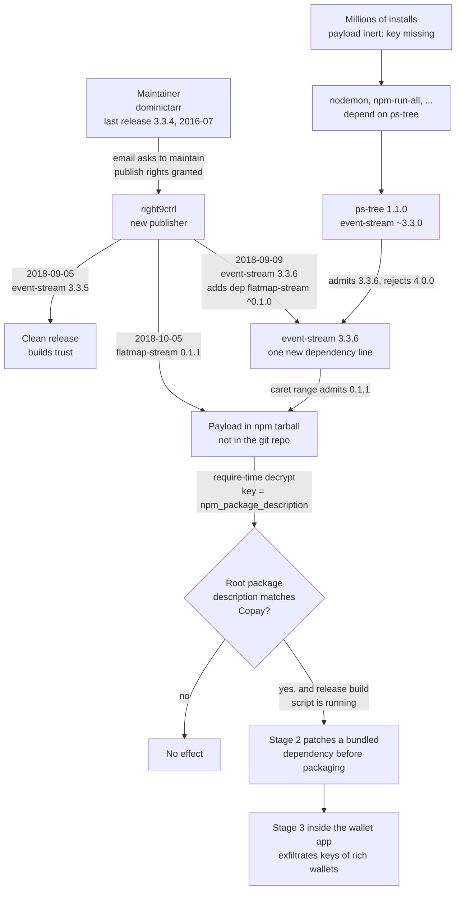

# Case Study: event-stream and Open-Source Maintainer Burnout Exploitation

> [!summary] Scope
> Analysis of the November 2018 event-stream npm incident where an unvetted maintainer handoff enabled targeted malicious payload injection via the flatmap-stream transitive dependency.
> Details how SemVer caret ranges propagated the malicious version to millions of downstream installs, while the payload activated only inside the Copay bitcoin wallet build to steal wallet keys.
> Extracts governance models for enterprise maintainer succession and automated delta-auditing.
> Examines the structural challenges of uncompensated open-source maintenance.

> [!summary] Claim:
> The attacker never compromised an account.
> They asked a tired maintainer for the keys, got publish rights to `event-stream` (about 8.9 million npm downloads in November 2018), added one line to `package.json` that depended on a new package, `flatmap-stream@^0.1.0`, and then published the actual payload as a later patch release of that package, `0.1.1`, which the caret range admitted without any change to `event-stream` itself.
> The payload decrypted itself with a key that existed only in one victim's build environment (the `description` of the root package), so it was inert everywhere else, and it was surfaced by a runtime deprecation warning and a volunteer reading a minified file, not by any scanner.
> The durable lessons are that publish rights are a transferable asset with no vetting step, that a range is a standing authorization to run code you have not seen, and that a review process which reads diffs of the packages you depend on, plus a policy that fires on publisher change, is the control that would have caught it.



## Incident Timeline

All times are UTC where a source gives one.
Registry timestamps come from the npm packument read on 2026-11-21 (macOS, arm64), commit timestamps from the GitHub REST API on the same day, and the rest from the cited postmortems.

| When | Event | Source |
|---|---|---|
| 2011-08-22 | `event-stream` first published to npm by Dominic Tarr | npm packument `time.created` |
| 2016-06-01 | `ps-tree@1.1.0` published with dependency `event-stream: ~3.3.0` (the range that later admits `3.3.6`) | npm packument for ps-tree |
| 2016-07-17 07:24 | `event-stream@3.3.4`, the last release by Tarr and the last benign release on the 3.3 line | npm packument, `_npmUser` |
| 2018, date not stated | A user, later identified as `right9ctrl`, emails Tarr and asks to maintain the module; Tarr grants access | Tarr in issue 116: "he emailed me and said he wanted to maintain the module, so I gave it to him" |
| 2018-09-05 05:27 | `event-stream@3.3.5`, the first release by `right9ctrl`, 780 calendar days after `3.3.4`; five of its seven dependency ranges are loosened to carets | npm packument |
| 2018-09-05 05:40 | `hugeglass/flatmap-stream` repository created; one commit `a0d127c` "First commit" at 08:26 | GitHub API |
| 2018-09-05 08:23 | `flatmap-stream@0.1.0` published, three minutes before the repository's only commit | registry dates quoted by `joepie91` in issue 116 (2018-11-26 17:30 UTC) |
| 2018-09-09 08:07 | Commit `e316336` "add flat map" adds `"flatmap-stream": "^0.1.0"` to `package.json` and two lines to `index.js` | GitHub API |
| 2018-09-09 08:28 | `event-stream@3.3.6` published; this is the only version GitHub's advisory lists as affected | npm packument (since removed), GHSA-mh6f-8j2x-4483 |
| 2018-09-16 11:20 | `event-stream@4.0.0` published with no `flatmap-stream` dependency, a major bump | npm packument, Snyk |
| 2018-09-29 06:55 | `event-stream@4.0.1` published, still without the dependency | npm packument |
| 2018-10-05 08:20 | `flatmap-stream@0.1.1` published with the injected payload | Snyk timeline; time from the registry dates quoted in issue 116 |
| 2018-10-29 | A `nodemon` user (`jaydenseric`) reports a deprecation warning; Snyk's timeline records this as an early signal | Snyk timeline |
| 2018-11-15 20:10 | `flatmap-stream@0.1.2` published; the issue 116 opening post says the latest version removes the injection | registry dates quoted in issue 116 |
| 2018-11-20 21:26 | FallingSnow opens event-stream issue 116 after reading the minified file | GitHub API |
| 2018-11-22 06:35 | Tarr answers in the issue and says he no longer has publish rights | GitHub API |
| 2018-11-26 (morning) | npm Security is notified; `flatmap-stream` and `event-stream@3.3.6` are removed from the registry; npm takes ownership of `event-stream` | npm post |
| 2018-11-26 | GHSA-mh6f-8j2x-4483 published at 23:58 (Critical, CVSS 9.8, no CVE); `ps-tree@1.1.1` (18:15) and `1.2.0` (19:39) pin `event-stream` to `=3.3.4`; issue 116 closed at 20:22 | GHSA page, npm packument, GitHub API |
| 2018-11-27 | npm blog post "Details about the event-stream incident"; the last push to the GitHub repository is at 10:44 UTC (REST API `pushed_at`), and the repository is now archived (the API reports `archived: true` and gives no archive date, so none is claimed) | npm post, GitHub REST API |
| 2018-11-29 | `flatmap-stream@0.0.1-security` placeholder published by an npm staff account | npm packument |
| 2018-12-06 | Snyk post-mortem published | Snyk |

The gap that matters is between 2018-10-05 (payload published) and 2018-11-26 (removal): 52 days.
Count from the dates above, not from a source that states it.

## Mechanism Root Cause

### 1. The handoff: publish rights have no succession protocol

npm identifies a publisher by account, and any account listed in a package's maintainers can publish new versions, add maintainers, and publish at any version.
There is no review, no cooling-off period, no second signature, and no notification to dependents when the publisher set changes.
Tarr's account of the event is short.
He says the new publisher emailed to ask to maintain the module, that he gave it away, that he gets nothing from maintaining it, and that he has not used it for years (issue 116, comments on 2018-11-22).
He also says he first tried to transfer the GitHub repository, but GitHub refused because the account already had a fork, so the git repository stayed under his name while the npm package belonged to someone else.

This is the property to remember: the repository on GitHub and the package on npm are two separate objects with two separate access control lists, and consumers install the second one.
A reader who trusted `github.com/dominictarr/event-stream` as the provenance of what they installed was trusting the wrong thing.
The registry metadata does record who published each version, as the packument below shows; this note makes no claim about how many tools act on that field.

The publisher change is plainly visible in registry metadata.
This script prints each version's publisher and flags the first change (macOS arm64, Python 3.15.2, run against the live registry on 2026-11-21; versions removed by npm in 2018 no longer appear):

```python
#!/usr/bin/env python3
"""List, per published version of an npm package, who published it and when, and flag publisher changes.

Reads the registry packument (https://registry.npmjs.org/<name>), which carries
versions[v]._npmUser (the account that ran `npm publish`) and time[v] (publish time).
Usage: publisher_changes.py PACKAGE [SINCE_YEAR]
"""
import json
import sys
import urllib.request


def main(argv):
    if len(argv) not in (2, 3):
        print(__doc__, file=sys.stderr)
        return 2
    name = argv[1]
    since = argv[2] if len(argv) == 3 else "0000"
    url = "https://registry.npmjs.org/" + name
    with urllib.request.urlopen(url, timeout=30) as resp:
        doc = json.load(resp)
    rows = []
    for ver, meta in doc["versions"].items():
        when = doc["time"].get(ver, "?")
        user = (meta.get("_npmUser") or {}).get("name", "?")
        rows.append((when, ver, user))
    rows.sort()
    prev = None
    for when, ver, user in rows:
        if when[:4] < since:
            prev = user
            continue
        flag = "  <-- publisher changed from %s" % prev if prev and user != prev else ""
        print("%s  %-7s %s%s" % (when[:19], ver, user, flag))
        prev = user
    return 0


if __name__ == "__main__":
    sys.exit(main(sys.argv))
```

```text
$ python3 -I publisher_changes.py event-stream 2016
2016-06-18T23:39:10  3.3.3   dominictarr
2016-07-17T07:24:09  3.3.4   dominictarr
2018-09-05T05:27:47  3.3.5   right9ctrl  <-- publisher changed from dominictarr
2018-09-16T11:20:20  4.0.0   right9ctrl
2018-09-29T06:55:49  4.0.1   right9ctrl
```

The `3.3.6` row is absent because npm removed that version from `versions`, so the table shows the handoff but not the compromised release; the packument's `time` map still records `3.3.6` at 2018-09-09T08:28:59Z.
Two further facts from the same packument are weak signals worth recording: the first release after the handoff loosened five of its seven dependency ranges to caret (for example `through` from `~2.3.1` to `^2.3.8`, while `map-stream` went from `~0.1.0` to exactly `0.0.7`), and it arrived 780 calendar days after the previous release.
A burst of activity on a dormant package is a signal by itself.

### 2. The graph change: one line adds a new, unreviewed dependency

The diff that introduced the dependency is small enough to read in full.
Commit `e316336` ("add flat map", 2018-09-09 08:07 UTC) changed `package.json` by one line and `index.js` by two (it also touched `package-lock.json`, six lines added and one removed, and added a test):

```diff
   "dependencies": {
     "duplexer": "^0.1.1",
+    "flatmap-stream": "^0.1.0",
     "from": "^0.1.7",
```

```diff
   , from = require('from')
+  , flatmap = require('flatmap-stream')
   , duplex = require('duplexer')
...
 es.from = from
+es.flatmap = flatmap
 es.duplex = duplex
```

Nothing about this is suspicious in isolation.
A flatMap function had been requested in the project's issue tracker since 2014 (issue 73), a streaming library gaining one is plausible, and the commit adds a test, `test/flatmap.asynct.js`.
The 3.3.6 version-bump commit (`5999958`, 08:17 UTC) changes one line each of `package.json` and `package-lock.json`.
The package was published 11 minutes after that commit.

What a reviewer of this diff cannot see is the content of `flatmap-stream`, because the diff names it only by a range.
The package was new: its GitHub repository `hugeglass/flatmap-stream` was created on 2018-09-05, four days earlier, has a single commit, and lists the author as "Antonio Macias" in `package.json`; `flatmap-stream@0.1.0` reached the registry at 08:23 that day, three minutes before that commit.
Its `main` field points at `index.min.js`, a minified file, not at the readable `index.js` that sits next to it.
(As of 2026-11, on that commit, the repository's `index.min.js` is 1,011 bytes and contains neither the string `npm_package_description` nor `createDecipher`; I grepped it.
The published `0.1.1` tarball cannot be fetched any more, the registry returns 404 for it, so the claim that the payload lived in the tarball and not in git rests on the issue 116 analysis and the Snyk and npm write-ups, not on my own diff.)

### 3. The propagation: a caret range is a standing authorization

`flatmap-stream@0.1.1` did not exist when `event-stream@3.3.6` was published.
It was published on 2018-10-05, 26 days later, and it reached victims without any new release of `event-stream`, because `^0.1.0` admits it.
The npm range grammar, as `node-semver` implements it, says a caret allows changes that do not modify the left-most non-zero element of the `[major, minor, patch]` tuple, so below 1.0.0 it pins the minor.
This is the exact output of `node-semver` 7.8.5 as bundled with npm 11.20.0 on Node v26.13.1 (macOS arm64, 2026-11-21), from a script that only calls `new semver.Range(r)` and `semver.satisfies`:

```text
^0.1.0   => >=0.1.0 <0.2.0-0
^3.3.4   => >=3.3.4 <4.0.0-0
~3.3.0   => >=3.3.0 <3.4.0-0
=3.3.4   => 3.3.4
^0.0.3   => >=0.0.3 <0.0.4-0
flatmap-stream versions admitted by ^0.1.0:
  0.1.0 true
  0.1.1 true
  0.1.2 true
  0.2.0 false
event-stream versions admitted by ps-tree@1.1.0 range ~3.3.0:
  3.3.4 true
  3.3.5 true
  3.3.6 true
  4.0.0 false
maxSatisfying(~3.3.0 over all) = 3.3.6
```

Two propagation mechanisms stack.
First, `ps-tree@1.1.0` (published 2016-06-01 by an unrelated maintainer, years before the incident) depended on `event-stream: ~3.3.0`.
Under that range the highest satisfying version in November 2018 was `3.3.6`, and `nodemon` depends on `ps-tree` (through `pstree.remy`, whose `1.1.0` declares `ps-tree: ^1.1.0`), so a developer tool with a very large install base picked up `event-stream@3.3.6` on any fresh resolution without having changed a line.
Second, within `3.3.6`, the `flatmap-stream` range floated, so the poisoned `0.1.1` arrived by the same fresh resolution until `0.1.2` superseded it on 2018-11-15; a lockfile written in that window kept `0.1.1` after that date.

The attacker then released `event-stream@4.0.0` on 2018-09-16 without the dependency.
Issue 116 describes this as a second commit that "removes the injection and bumps a major version".
The effect is that `~3.3.0` consumers kept resolving the poisoned `3.3.6`, while anyone who looked at the package's newest version found a clean one.
(The package's `latest` dist-tag during the window is not recorded anywhere I could read; that the tag pointed at the clean 4.x line is an inference from npm's default behavior of `npm publish`, not a fact I verified.)

A lockfile would have broken this chain.
A project that had `package-lock.json` (or `npm-shrinkwrap.json`) committed and installed with `npm ci` got exactly the versions in the file, and `npm ci` "will exit with an error, instead of updating the package lock" when the two disagree.
The owner of [[Lockfiles-Vendoring-and-Offline-Mirrors]] explains the mechanism.
Lockfiles do not make a bad version safe; they make the moment of exposure the moment someone regenerates the lock, which is a reviewable event.
Installing without a lockfile, or running `npm install` after editing `package.json`, takes whatever the registry says is newest within the range, and for a build pipeline that does that on every run, exposure begins on the day a bad version is published.

### 4. The payload: a decryption key that existed in exactly one place

Everything below about payload behavior comes from public analyses that agree with each other: the issue 116 thread (including the decrypted source posted by `maths22` at 2018-11-26 18:24 UTC and prettified by `joepie91` at 18:29 UTC, which I read through the GitHub API), the npm post, and Snyk's post-mortem.
I did not execute the payload and the tarball is no longer retrievable, so these details are as the cited analysts report them.

**Stage 1 ran at require time, not install time.**
There was no `install` or `postinstall` script.
The code ran when something did `require('flatmap-stream')`, which `event-stream` did on load.
That is why `npm install --ignore-scripts` would not have helped: the setting's documented effect is that "npm does not run scripts specified in package.json files", and no script was involved.
A control that disables lifecycle scripts defends against a different attack class, the one in [[Case-Study-Shai-Hulud-and-Self-Replicating-Registry-Worms]].

**The ciphertext was disguised as test data and the key was environmental.**
npm's write-up states that the code read AES-encrypted data from a file disguised as a test fixture, took the `description` of the importing root package from an environment variable that npm sets automatically, and used it as the decryption key.
Snyk gives the variable: "The decryption code looked for the key in an environment variable named npm_package_description", which "is set by npm in the root package's description".
In the npm of 2018, running a script set `npm_package_*` variables from the root `package.json`, so `npm_package_description` was the `description` field of the project that started the script, not of `flatmap-stream` or `event-stream`.
That behavior has changed: the npm scripts documentation says that "in npm 7 and later, most package.json fields are no longer provided as environment variables", and lists only `name`, `version`, `bin`, `engines`, `config`, and `npm_package_json` (as of 2026-11, Both).
With a root `package.json` whose `description` is `"A Secure Bitcoin Wallet"`, a script that prints `process.env.npm_package_description` and `process.env.npm_package_name` printed this under npm 11.20.0 on Node v26.13.1 (macOS arm64, 2026-11-21):

```text
$ npm run show --silent
undefined envdemo
```

So on a current npm the description variable is absent, `name` is still set, and a payload keyed on `npm_package_description` would decrypt with a missing password even inside the one project it targeted.
The change dates from npm 7, per the scripts documentation quoted above.
In the issue 116 de-obfuscation, FallingSnow first tried the description of `ps-tree`, `'Get all children of a pid'`, which is a natural wrong guess because that is the immediate dependent.
Another participant, `maths22`, brute-forced candidate descriptions of npm packages and found the key to be the string "A Secure Bitcoin Wallet" (Snyk's account), which is the description of the Copay project.
The cipher call was `require('crypto')['createDecipher']('aes256', key)`, per the issue text.
`createDecipher` derives key and IV from the password using a single round of MD5 with no salt, which the Node.js documentation gives as the reason the function was deprecated and, in Node 22, removed.

Any machine where the root package description differed, which is every machine except Copay's build, decrypted garbage, failed or did nothing, and left no trace.
npm's own statement is that "running the payload in any other environment has no effect".
This is a deliberate evasion design: sandboxes, scanners, and anyone running the code to see what it does, get nothing, and the key is not in the package, so static analysis of the tarball alone cannot recover the plaintext.
The same property is why the community needed an outside guess to decrypt it, 52 days after `0.1.1` was published (2018-10-05 to 2018-11-26), and why no automated analysis flagged it.

**Stage 2 was a build-time file patcher gated on the command line.**
The decrypted stage 2 (the "Initial payload" in `joepie91`'s prettified post in issue 116) is a function exported from the module that receives the second ciphertext as its argument `e`.
Its first statement is `if(!/build\:.*\-release/.test(process.argv[2]))return;`, so it did nothing unless the first argument after the script path in the running Node process's command line (`process.argv[2]`) contained `build:` followed later by `-release`.
The regular expression has no `$` anchor and no `^` anchor, so any string containing that shape matches.
It then read the `description` from `process.env.npm_package_description`, read `./node_modules/@zxing/library/esm5/core/common/reedsolomon/ReedSolomonDecoder.js`, decrypted the second ciphertext with the same key, and wrote the original file contents plus the decrypted code back to that file.
It saved and restored the file's access and modification times with `utimesSync` and registered a `process.on("exit")` handler that wrote the original contents back, so after the build finished the file in `node_modules` was byte-identical to the clean one.
The whole function sits in a `try` block whose `catch` is empty, so a wrong key or a missing file produced no output at all.
The leading `/*@@*/` marker is how the patcher detects and removes its own earlier injection when run twice.
This is why the compromise belongs to the build, not to the machine of anyone who merely installed a transitive dependency: the shipped app differed from the source tree, and after the build the source tree, including `node_modules`, was clean again.
The shape (a clean source repository, a build step that injects, a binary that differs) recurs in [[Case-Study-SolarWinds-Orion-SUNBURST]].

**Stage 3 ran inside the wallet app on end users' devices.**
The code appended to `ReedSolomonDecoder.js` was bundled into the Copay app, so it ran in the app's JavaScript context, in Cordova on mobile, Electron on desktop, or a browser.
From the posted source:

- It read the wallet `profile` and, per wallet, `balanceCache-<walletId>` from Cordova file storage, `localStorage`, or `chrome.storage.local`.
- For each `livenet` wallet it parsed the balance and skipped the wallet when `btc` was below 100 or `bch` was below 1000, so wallets at or above 100 BTC or 1000 BCH were taken.
  npm and Snyk state the thresholds as "above 100 BTC or 1000 BCH"; the posted code uses `<` for the skip, which makes the boundary inclusive.
- It encrypted the wallet's JSON with a hard-coded RSA public key in 200-character chunks (`crypto.publicEncrypt`) and sent it by plain HTTP `POST` to port 8080, path `/c`, on two hosts stored as hex strings: `636f7061796170692e686f7374` decodes to `copayapi.host`, and `3131312e39302e3135312e313334` decodes to `111.90.151.134`.
- It monkey-patched `getKeys` on `bitcore-wallet-client/lib/credentials.js` so that when a flagged wallet's keys were next derived, it also posted the function's argument and the wallet's `xPubKey` to path `/p`.
  In Copay that argument is how the wallet password reaches key derivation, which I did not verify in the wallet source, so I record only what the payload does: it posts that argument.

Hex-encoding the hostnames, chunking the ciphertext, and encrypting with a public key mean that a network capture of the exfiltration shows opaque bytes to two hosts, and a static string search of the minified bundle for the hostnames finds nothing.
The same code is why the earlier decryption key mattered: stage 3 is the part that touches the keys, and it existed only inside Copay's release artifacts.

The pattern, in one sentence: the target selection was done by the cryptography and a command-line regex, which means that the attacker needed no list of victims and no network call to decide who was one.

### 5. Copay: the victim's own chain and lockfile

Reading the `bitpay/wallet` repository (the Copay source) through the GitHub API on 2026-11-21 shows how the code got into builds.
In both `v5.0.2` (commit `f53e5388`, 2018-10-26) and `v5.1.0` (commit `e7f3a087`, 2018-11-14) the manifest declared `npm-run-all` `4.1.2` and the lockfile recorded this chain, all with exact versions:

```text
npm-run-all 4.1.2  requires  ps-tree 1.1.0
ps-tree 1.1.0      requires  event-stream 3.3.6
event-stream 3.3.6 requires  flatmap-stream 0.1.1
```

`npm-run-all` supplies the `run-s` command used by the release scripts:

```text
"build:ios-release":     "run-s env:prod && ionic cordova build ios --release ..."
"build:desktop-release": "run-s env:prod && ionic-app-scripts build --prod"
"final:ios":             "run-s build:ios-release open:ios"
"final:android":         "run-s build:android-release sign:android run:android-release"
"final:desktop":         "run-s build:desktop-release && ... electron-builder -mwl"
```

My reading of how these interact with the gate (an inference from the posted code and these scripts, not a statement by any analyst): the payload tests `process.argv[2]` of the Node process that loads `event-stream`, and `run-s` is that process, loading `ps-tree` and hence `event-stream`.
In `final:ios`, `run-s` receives `build:ios-release` as its first argument, so the regular expression matches and the patch is installed.
In `build:ios-release` run directly, the first argument is `env:prod`, which does not match.
So the developer or CI job that ran `npm run final:ios` armed the payload, and the job that ran `npm run build:ios-release` did not.

This changes the lockfile story from earlier.
Copay did have a lockfile, and the lockfile is what guaranteed that every build installed the poisoned version: it recorded `flatmap-stream 0.1.1` at `v5.0.2`, 21 days after that version was published, so a lock regeneration after 2018-10-05 had captured it.
A lock protects you from the next unreviewed version and preserves the last one you accepted, including a bad one.
The control is the review of the lock diff when it changes, which is the delta audit below, not the existence of the file.
The chain was removed from the lockfile in Copay's `v5.2.2` (the tag points at the merge of pull request 9348 on 2018-11-26 19:36 UTC, whose description says it "Removes package `npm-run-all` and dependencies"): the `v5.2.2` lockfile contains none of `npm-run-all`, `event-stream`, or `flatmap-stream`.

BitPay's staff said on 2018-11-26 that "the malicious code was deployed on versions 5.0.2 through 5.1.0 of our Copay and BitPay apps", that "the BitPay app was not vulnerable to the malicious code", that a security update 5.2.0 was released, and that users should not run or open Copay from 5.0.2 through 5.1.0; they also said they were "still investigating whether this code vulnerability was ever exploited against Copay users" (comments by `matiu` on `bitpay/wallet` issue 9346).
An earlier comment that day (19:03 UTC) had said the code "was not deployed in any platform"; it was amended in place to say that some platforms had been released with the affected code, and superseded by the 22:36 UTC statement, which is a normal property of a live incident.
I found no confirmed figure for funds lost and state none.
The wallet's `description` is `"A Secure Bitcoin Wallet"` at `v5.1.0`, which is the decryption key `maths22` found.
(In the same thread `maths22` first named the target as the npm package `copay-dash`, and BitPay's `matiu` described `copay-dash` as a fork of the Copay project; I did not investigate how the fork relates to the key.)

### 6. Why this reached "millions of installs" and still harmed a few

The download count is a bound on exposure, not on harm.
The npm registry download API reports 8,937,795 downloads of `event-stream` for 2018-11-01 through 2018-11-30 and 8,177,043 for the week 2026-11-14 through 2026-11-20, both read on 2026-11-21.
Those counts are for all versions and cannot be split by `3.3.6` from the API I used, so treat the November figure as the scale of the package, not as the number of poisoned installs.
Snyk gives "8 million downloads" for `event-stream` as well.
The payload did nothing on the overwhelming majority of those installs.
The number of people harmed was a function of the targeting, not of the distribution, which is the point of the design.

## Detection Gap

Why did nothing catch this for 52 days?

| Control | Why it did not fire |
|---|---|
| Unit and integration tests | The tests of `event-stream`, `flatmap-stream`, and every dependent exercise behavior, and on every machine except one the payload does nothing, so every assertion passes. A test suite proves absence of regression, not absence of extra behavior. |
| Linters and static analysis | The payload was in a minified file, the strings were AES ciphertext, and the key was not in the package. A linter sees an array of hex strings and a call to `crypto`. |
| Code review of the dependency diff | The diff in the project that added the dependency is one `package.json` line and two `index.js` lines. The review surface of the later release was a different repository, `flatmap-stream`, that no `event-stream` reviewer was looking at, and whose Git history did not contain the payload (a single commit). |
| Comparing the tarball with the git tag | The comparison would have found it, since the published artifact contained code the repository did not, but nobody was doing this routinely. This is the detection that [[Drill-Supply-Chain-Detect-Tarball-vs-Git-Tag-Backdoor]] teaches. |
| Vulnerability scanners | There was no advisory, because the advisory could not exist before someone found the problem. GHSA-mh6f-8j2x-4483 was published on 2018-11-26, the day of removal. A database of known vulnerabilities is a lagging indicator by construction. |
| Registry-side scanning | None of the sources reports an automated registry check flagging it. A scanner that runs or inspects the package without the victim's environment variable sees only ciphertext and a failed decryption. |
| Runtime sandboxing | The execution happened during the victim's own build with the developer's privileges, and then in the wallet app, which legitimately holds keys. |
| Install-time protection | No lifecycle script was used. |
| Provenance | The registry's PGP signature over package metadata (the `npm-signature` field in the packument) attests what the registry served, not which source commit or build produced the tarball, and npm had no build attestation in 2018: npm package provenance entered public beta on 2023-04-19 (GitHub blog, "Introducing npm package provenance"). See [[SLSA-Framework-Build-and-Source-Tracks]] for what a link from the artifact to a source commit would have shown. |

What did find it was incidental.
Snyk's timeline records a `nodemon` user reporting a deprecation warning on 2018-10-29.
The Node.js deprecations document gives `crypto.createDecipher` a runtime deprecation in Node v11.0.0 (DEP0106; documentation-only in v10.0.0), so a project running a Node 11 build would have printed a warning attributable to this call.
That the warning was caused by `flatmap-stream` is Snyk's account of the timeline, and I could not independently confirm that the reported warning came from this payload.
The relevant lesson, which is verified, is that DEP0106 reached end-of-life in Node v22.0.0, and `typeof require('crypto').createDecipher` prints `undefined` on Node v26.13.1 (macOS arm64, 2026-11-21).
The same payload could not decrypt itself on a current Node, which would have turned its stealth into a loud failure on any victim who ran a recent runtime.

Humans found it by reading a minified file because a dependency started warning.
The two non-automated facts are that a person with spare time noticed, and that the package had a public issue tracker where a strange observation could be published.
Detection depended on a volunteer, which is the same structural fact as the cause.

## Remediation and Fix

What was done in November 2018, verified against the registry and the postmortems:

- npm Security removed `flatmap-stream` and `event-stream@3.3.6` from the registry and took ownership of `event-stream`; the current `maintainers` list in the packument is the `npm` account only.
- npm published `flatmap-stream@0.0.1-security`, a two-file holding package published by an npm staff account, so that the name cannot be re-registered by an attacker and `npm install flatmap-stream` resolves harmlessly.
- `ps-tree` released `1.1.1` and `1.2.0` the same day, both depending on `event-stream: =3.3.4`.
  The fix for a poisoned range is an exact pin to the last version someone had audited, which is a tighter range than any caret or tilde.
- GitHub published GHSA-mh6f-8j2x-4483, Critical, CVSS 9.8 (CVSS:3.1/AV:N/AC:L/PR:N/UI:N/S:U/C:H/I:H/A:H), weakness CWE-506 Embedded Malicious Code, with no CVE assigned.
  It lists `event-stream = 3.3.6` as affected and 4.0.0 as patched, advises users on the 3.x line to downgrade to 3.3.4, and says to remove `flatmap-stream` outright because it has no patched version.
- npm directed users to `npm audit` to find the dependency, and Microsoft's Azure DevOps team (Buck Hodges, 2018-11-28) writes that "on November 26, 2018, the npm package manager released security advisory 737 regarding the flatmap-stream package" (the advisory page itself refused the fetch).
- Copay told users on 5.0.2 through 5.1.0 not to open the app and to send all funds to "a brand new wallet on version 5.2.0" with the `Send Max` feature, "not by restoring using the wallet's twelve word phrase", because a restored wallet reuses the stolen key.
  Copay's own fix for the cause was to delete `npm-run-all` and everything under it in pull request 9348 (`v5.2.2`), because the chain, not a single package, was the entry point.

For a team today the immediate procedure is in [[Respond-to-a-Compromised-Transitive-Dependency]]; this note adds only the case-specific evidence.
A one-line check for the 2018 shape is `npm ls event-stream flatmap-stream`, which a commenter in issue 116 gave as the test and which listed `event-stream@3.3.6` over `flatmap-stream@0.1.2` in the example tree posted there.
The issue identifies `0.1.1` as the version containing the code, reports that the later `0.1.2` removed the injection, and advises that no later version of the package can be trusted.
Rotating credentials is not enough for the wallet: a key stolen once cannot be un-stolen, so the remediation of the victim class is to move funds to a new key, which is what Copay's advice was.

## Architectural Lessons

### 1. Treat a publisher change as a security event

The control with the best cost to benefit ratio in this incident is a policy that fires when the set of accounts able to publish a dependency changes, or when a dependency's first release by a new publisher appears.
The data for it is in the registry packument (`_npmUser`, `maintainers`, per-version `time`), as the script above shows.
Decision rule: a dependency whose publisher set changed within the last 90 days is quarantined (not blocked) until a human with context has read the diff of that publisher's first release against the last release by the previous one.
The threshold of 90 days is a policy choice and not a measured constant.
The trade-off is false positives: legitimate handoffs happen constantly, and every one will page a reviewer, so the rule applies only to packages that are in the production graph and are under a volume or privilege threshold you define.
The deeper control belongs to [[Enterprise-Third-Party-Code-Ingestion-and-Quarantine-Architecture]], which owns the quarantine mechanism.

### 2. Audit the delta, not the package

Reviewing 8.9 million downloads' worth of code from scratch is impossible, but reviewing what changed since the last version you accepted is feasible.
The lockfile diff is the review surface, and it can be made machine-readable.
This is a complete working delta printer for `package-lock.json` files (lockfileVersion 2 or 3), which reports new names, changed versions, and removed names, and exits non-zero when a new package name appears:

```python
#!/usr/bin/env python3
"""Report what changed between two npm package-lock.json files (lockfileVersion 2 or 3).

Usage: lockdelta.py OLD.json NEW.json
Exit status: 0 no new package names, 1 at least one new package name, 2 usage error.
"""
import json
import sys


def load(path):
    with open(path, encoding="utf-8") as fh:
        doc = json.load(fh)
    out = {}
    for key, meta in doc.get("packages", {}).items():
        if not key:  # "" is the root project
            continue
        name = key.rsplit("node_modules/", 1)[-1]
        out.setdefault(name, set()).add(meta.get("version", "?"))
    return out


def main(argv):
    if len(argv) != 3:
        print(__doc__, file=sys.stderr)
        return 2
    old, new = load(argv[1]), load(argv[2])
    added = sorted(set(new) - set(old))
    removed = sorted(set(old) - set(new))
    changed = sorted(n for n in set(old) & set(new) if old[n] != new[n])
    for n in added:
        print("NEW     %s@%s" % (n, ",".join(sorted(new[n]))))
    for n in changed:
        print("CHANGED %s %s -> %s" % (n, ",".join(sorted(old[n])), ",".join(sorted(new[n]))))
    for n in removed:
        print("REMOVED %s@%s" % (n, ",".join(sorted(old[n]))))
    print("summary: %d new, %d changed, %d removed" % (len(added), len(changed), len(removed)))
    return 1 if added else 0


if __name__ == "__main__":
    sys.exit(main(sys.argv))
```

The two fixture lockfiles below are synthetic and hand-written, not real project locks.
The first models the 3.3.5 to 3.3.6 step, the second the later float of the transitive dependency from `0.1.0` to `0.1.1` after a re-resolution:

```text
== step 1: dependency added ==
NEW     flatmap-stream@0.1.0
CHANGED event-stream 3.3.5 -> 3.3.6
summary: 1 new, 1 changed, 0 removed
exit=1
== step 2: same direct deps, transitive patch bump ==
CHANGED flatmap-stream 0.1.0 -> 0.1.1
summary: 0 new, 1 changed, 0 removed
exit=0
```

(macOS arm64, Python 3.15.2, 2026-11-21.)
Step 1 is the check working: a new name fires the gate.
Step 2 is the check failing, and it is the important output.
The second step is exactly where the payload arrived, and the script exits 0 because no new package name appeared.
A gate on new names alone approves the incident.
The auditor has to treat every changed version of a transitive dependency as a review unit, which means the review queue has to be sized for the churn of the whole graph, and that cost is the real objection to delta-auditing.
Mitigations for the volume are to rank by risk (a dependency with a single publisher, a recent publisher change, no repository tag matching the version, a minified `main`, or use of `crypto`, `child_process`, or network APIs in the diff), to share audits across organizations the way `cargo vet` and `cargo-crev` do for Rust, and to buy time with a cooldown.

### 3. Make the registry artifact comparable to the source

The tarball must be reconstructible from a tagged commit, and the consumer must be able to check that.
In this incident, a differ run over the `0.1.1` tarball and the repository would have shown a payload with no source.
[[Reproducible-Builds-as-a-Security-Control]] owns the mechanism, and [[SLSA-Framework-Build-and-Source-Tracks]] owns the attestation that binds an artifact to a build and source.
Neither existed for npm in 2018, so the practical control then was a diff of the unpacked tarball against the previous version, which is exactly the delta audit above applied to the artifact and not to the lockfile.
Whether registry-side provenance for npm packages would change this today is outside this note; see [[Sigstore-Keyless-Signing-Cosign-Fulcio-and-Rekor]] for the signing mechanism itself.

### 4. Ranges, locks, and cooldowns

| Setting | Effect on this incident | Cost |
|---|---|---|
| Exact pin in the application manifest and committed lockfile, install with `npm ci` | The poisoned `0.1.1` is never installed until someone regenerates the lock | Dependency updates become explicit work |
| Exact pin of transitive dependencies through overrides or a vendored mirror | Closes the gap where the range in a library's manifest floats the transitive version | Each library's intended range is overridden; you now own compatibility |
| Time-based cooldown for newly published versions (npm's `--before` option installs "only versions that were available on or before" a time) | `flatmap-stream@0.1.1` was published on 2018-10-05 and found on 2018-11-20 to 2018-11-26, so a 7-day cooldown would have moved first exposure to about 2018-10-12 and left 39 or more days of exposure; a cooldown helps only when it is longer than the time to detection | Delays real security fixes; apply it asymmetrically, longer for versions from a new publisher |
| `ignore-scripts=true` | No effect here; the payload used no lifecycle script | Breaks packages that need a build step |
| Private mirror with an allowlist and manual promotion | Nothing reaches the build until a human or a policy promotes it | An operations team and a promotion SLA |

The row on cooldowns needs an honest reading.
In this incident the payload stayed undetected for 46 to 52 days after publication, so a cooldown short of about two months would not have prevented exposure for anyone who resolved fresh after it expired.
A cooldown is effective against attacks that are found within days, such as the ones in [[Case-Study-Shai-Hulud-and-Self-Replicating-Registry-Worms]], and weak against a deliberately quiet one.
The control that addresses a quiet one is the delta audit.
[[Versioning-SemVer-CalVer-and-ABI]] and [[Dependency-Resolution-SAT-PubGrub-and-MVS]] give the resolver side of why a range resolves the way it does, and [[Case-Study-Left-Pad-and-Registry-Immutability]] covers the registry-side counterpart in which a maintainer's action on a tiny package broke the ecosystem.

### 5. Maintainer succession is a governance problem, not a trust problem

The failure was a missing process, not a bad person in the usual sense.
Tarr's statements describe a maintainer with no remaining incentive: he did not use the package, was not paid for it, and received an email from someone willing to take it over.
An enterprise that depends on thousands of such packages has to decide what it does about the fact that its production graph rests on volunteers whose circumstances change.

A succession model with decision rules:

1. **Inventory the single-maintainer packages in the production graph** with the registry's `maintainers` field and rank them by blast radius (how many of your services load them and with what privileges).
   Review the top of the list quarterly.
2. **Fund or adopt the ones that matter.**
   For a package your business cannot lose, the options are to sponsor the maintainer, to contribute a second maintainer from your organization (with the maintainer's consent and the project's governance), to fork and own an internal copy, or to replace it.
   Choose by cost of the alternative, not by the package's popularity.
3. **Require a handoff protocol for packages you control**: two maintainers on every release, a written succession note in the repository, publish access that is revoked when a maintainer leaves, and a delay between the addition of a new maintainer and that maintainer's first publish.
4. **Detect handoffs for packages you do not control** with the publisher-change monitor above, and respond with the delta audit rather than with an alert that nobody reads.
5. **Inline trivial functions instead of depending on them.**
   A stream library that gains a `flatmap` function is carrying surface area that a project could own in a file.

The economic observation is the maintainer's own, and I do not extend it with survey statistics because I did not fetch a primary source for any.
In issue 116 (2018-11-26 22:30 UTC) Tarr wrote that he created the code "for fun", that he "gave it away because it was easy to do so", and that "if it's not fun anymore, you get literally nothing from maintaining a popular package".
He described a module as "a piece of digital property, a right that can be transferred", where you can "easily share the code, but no one wants to share the responsibility for maintaining that code".
He also said that sharing publish rights had been a "widespread community practice" since the early days of node and npm, and proposed two fixes: pay the maintainers, and take part in maintaining what you depend on.
A package that registered 8,937,795 downloads in November 2018 was maintained by a person who said he gets nothing for it.
That mismatch is what made one email a sufficient attack: the cost to the attacker was a message and some patience, and the cost to the maintainer of saying yes was nothing.
The cost of the grant landed on everyone downstream, and none of them were party to the decision.

> [!warning] Pitfalls:
> - **Believing the repository is the package.** The GitHub repository and the npm package had different owners from 2018-09-05, and the payload was never in the former.
> - **Scoring risk by download count.** `event-stream` was in the most-trusted tier by every popularity metric, and popularity is the attacker's target selection, not a safety signal.
> - **Reading only the dependency you added.** The payload was in a package added four days earlier by someone you had just trusted, so the review has to include every new transitive name.
> - **Gating on new package names only.** The payload arrived as a patch-level version change of an already-accepted name, and the delta printer above exits 0 on it.
> - **Relying on `--ignore-scripts`.** There was no lifecycle script; code ran at `require` time.
> - **Treating a clean latest version as evidence.** The attacker released a clean major version while the poisoned one stayed the highest match for `~3.3.0`.
> - **Running a decrypt-and-run sample to see what it does.**
>   The key was the victim's environment, so a sandbox shows nothing, and the sample would have run for real had the environment matched.
>   Analyze with the key hypothesis, not by execution on a real build host.
> - **Writing the incident off as an npm problem.** Every ecosystem with a publish-rights model that has no handoff control has this exposure; see [[Dependency-Confusion-Typosquatting-and-Registry-Attacks]] for the registry attacks that need no handoff at all.

> [!tip] Practice Drill:
> Pick one production service and its lockfile from 90 days ago.
> Run a delta printer like `lockdelta.py` between that lockfile and today's, then for each changed or new name run `publisher_changes.py` and flag any name whose first publisher after 2024 differs from its previous one.
> For two of the flagged names, unpack the tarball with `npm pack <name>@<version>` into a fresh empty directory and diff it against the git tag the package's `repository` field names.
> Write down how many minutes it took per package; that number is your delta-audit cost model.
> The forensic version of this exercise is [[Drill-Supply-Chain-Detect-Tarball-vs-Git-Tag-Backdoor]].

## Interview Questions

> [!question] L5: Why did `ps-tree@1.1.0`, published in 2016, expose its users to a package that did not exist yet?
>
> > [!success]- Answer
> > It declared `event-stream: ~3.3.0`, which `node-semver` expands to `>=3.3.0 <3.4.0-0`, so any 3.3.x release published later is admitted on a fresh resolution.
> > In November 2018 the highest satisfying version was the poisoned `3.3.6`, and `nodemon` and other tools depend on `ps-tree`.
> > A range is a standing authorization for the publisher of every future matching version, and `ps-tree` had signed that authorization two years earlier.
> > The fix `ps-tree` shipped was `=3.3.4`, an exact pin.

> [!question] L5: Does `npm install --ignore-scripts` protect against the event-stream payload? Why or why not?
>
> > [!success]- Answer
> > No.
> > The payload had no `install` or `postinstall` script; it ran when `event-stream` required `flatmap-stream` at module load.
> > `ignore-scripts` documents that npm does not run scripts specified in package.json files, and none was involved.
> > What does help is a committed lockfile with `npm ci`, a review of the delta, and a policy on publisher changes.

> [!question] L5: Predict the output: what does `semver.satisfies("0.1.1", "^0.1.0")` return, and what does `semver.satisfies("0.2.0", "^0.1.0")` return?
>
> > [!success]- Answer
> > `true` and `false`.
> > Below 1.0.0 a caret allows changes that do not modify the left-most non-zero element, so `^0.1.0` expands to `>=0.1.0 <0.2.0-0`.
> > `0.1.1` is a patch bump inside it, and `0.2.0` is outside.
> > A reader expecting `^0.1.0` to behave like `^1.1.0` (which admits `1.9.9`) is surprised the other way: the 0.x rule is narrower, and it still admitted the one version that mattered.

> [!question] L6: The `event-stream` diff that added the dependency was one `package.json` line and two `index.js` lines, and the payload was not in `event-stream` at all. Where would you have had to look, and what would you have found?
>
> > [!success]- Answer
> > In the `flatmap-stream` tarball, specifically `main`, which pointed at `index.min.js`.
> > The `hugeglass/flatmap-stream` repository had a single commit and its `index.min.js` did not contain the payload, so reading the git repository would have shown nothing wrong.
> > Unpacking the published tarball and diffing it against the repository, or against the previous version, would have shown the extra minified code and the ciphertext fixture.
> > Signals that should have raised review priority even without reading the code: a package a few days old, a single-commit repository, a minified entry point, and the new publisher on the parent.

> [!question] L6: Debug this: a CI step fails the build when `python3 lockdelta.py main.lock pr.lock` exits non-zero, a PR bumps only `flatmap-stream` from `0.1.0` to `0.1.1`, and the build passes; is the tool wrong, and what do you change?
>
> > [!success]- Answer
> > The tool did what it says: exit 1 means a new package name, and a version change is not a new name, so the output reports `CHANGED` and exits 0.
> > The gate is wrong for the threat, because the payload in this incident arrived as exactly that kind of change.
> > Make the CI policy fail on any `CHANGED` line for a package that is not on an allowlist of auto-approved bumps, or route every changed transitive version to the review queue ranked by risk signals.
> > The price is review volume, so pair it with a ranking and a shared-audit source.

> [!question] L6: Why did the payload decrypt with `npm_package_description`, and what did that choice do to the defenders?
>
> > [!success]- Answer
> > The variable is set by npm from the root package's `package.json`, so the key existed only where the root project was the Copay wallet; elsewhere the decryption produced garbage and nothing ran.
> > That gave the attacker precise targeting with no victim list and no network call, and it denied analysts the plaintext: a sandbox run showed no behavior, and the key was not in the package.
> > It took an outside guess, brute-forcing package descriptions, to recover it, 52 days after publication.
> > The trade-off the attacker accepted is that the payload is useless if the target renames the project description.

> [!question] L7: Design a maintainer-succession control for a company with 40,000 transitive npm dependencies, and say what it costs.
>
> > [!success]- Answer
> > Compute a risk score per package from the registry packument (number of maintainers, last publisher change, release cadence, repository-tag match) and the internal blast radius (services and privileges that load it).
> > Apply a quarantine to a version when the publisher set changed or a dormant package suddenly released, and release it from quarantine after a human reads the diff of the new publisher's first release against the last release by the previous one.
> > For the top few hundred packages by blast radius, sponsor, co-maintain, fork, or replace, chosen by the cost of the alternative.
> > Costs: reviewer time, false positives on legitimate handoffs, a promotion latency that delays real security fixes (so allow an expedited path with a second approver), and the operations burden of a mirror.
> > The weak point is that the monitor sees accounts, not people, so an attacker who is added slowly and publishes benign releases for months defeats a threshold on recency; the diff review, not the alert, is the real control.

> [!question] L7: A 7-day cooldown on newly published versions was proposed as the fix for this class. Would it have stopped event-stream, and what would?
>
> > [!success]- Answer
> > Not alone.
> > `flatmap-stream@0.1.1` was published on 2018-10-05 and was not detected until 2018-11-20 to 2018-11-26, 46 to 52 days later, so a project that resolved it on day 8 was exposed in full.
> > A cooldown works when the community detects attacks within days, as with noisy worms, and fails against a payload designed to be silent.
> > What would have stopped it is a delta audit of the new transitive dependency (new, minified, single-commit, with a crypto call and an unexplained fixture) or a policy that blocked a dependency whose parent changed publisher until review.
> > Cooldowns buy time for others to find things, and the cost is that you are free-riding on them.

> [!question] L8+: You own supply chain policy for a platform with thousands of services. Argue for or against paying open-source maintainers of critical single-maintainer packages, using this incident, and say how you would know it worked.
>
> > [!success]- Answer
> > For: the attack cost was one email because the maintainer had no remaining incentive and said so in public.
> > A funded, co-maintained package raises the cost of a handoff attack from one message to sustained social engineering of an organization, and gives you a person to call when a version looks wrong.
> > Against: money does not fix the verification gap, since a funded maintainer can still be phished, and payment can create a coupling and a dependence on one vendor-side relationship you have to manage.
> > My position is to fund selectively and pair it with controls that do not depend on any person's goodwill: delta audits, publisher-change monitoring, and a mirror.
> > Measure it with leading indicators, not with the absence of incidents: the share of production-graph packages with two or more active maintainers, median time from publisher change to a completed diff review, and the fraction of version changes reviewed before reaching production.
> > An absent incident is not evidence, because the original attack was invisible for 52 days.

> [!question] L8+: The payload's key came from the victim's environment. Is that design defeatable by a defender at scale, or can the defender only cut propagation?
>
> > [!success]- Answer
> > Both partially.
> > The defender cannot recover the plaintext from the artifact alone, because the key is outside it, but can enumerate the key space cheaply when it is a small structured field such as a package description, which is what the community did.
> > A registry could run each new version through a detonation environment that varies `npm_package_*` variables across the descriptions of popular root packages, which is feasible but expensive and defeated by keying on a less guessable value such as a path, a hostname, or a repository URL.
> > The structural defense is to remove the ability to run arbitrary decrypt-and-run code at build time: build in a hermetic environment with no network egress and a read-only source tree, so that stage 2 cannot patch a dependency and stage 3 cannot be fetched or exfiltrated.
> > That moves the defense to the build, as in [[Reproducible-Builds-as-a-Security-Control]], which is where this attack did its damage.

## References

- Issue 116 on the `dominictarr/event-stream` repository, "I don't know what to say.", opened 2018-11-20 by FallingSnow: https://github.com/dominictarr/event-stream/issues/116
- npm, "Details about the event-stream incident", 2018-11-27: https://blog.npmjs.org/post/180565383195/details-about-the-event-stream-incident
- Snyk, "A post-mortem of the malicious event-stream backdoor", 2018-12-06: https://snyk.io/blog/a-post-mortem-of-the-malicious-event-stream-backdoor/
- GitHub Advisory Database, GHSA-mh6f-8j2x-4483 (no CVE): https://github.com/advisories/GHSA-mh6f-8j2x-4483
- The introducing commit, `e316336`: https://github.com/dominictarr/event-stream/commit/e316336
- The flatmap-stream repository, single commit `a0d127c`: https://github.com/hugeglass/flatmap-stream/tree/a0d127c
- Node.js DEP0106 (`crypto.createCipher` and `createDecipher`): https://github.com/nodejs/node/blob/v22.x/doc/api/deprecations.md
- `node-semver` README, caret and tilde semantics: https://github.com/npm/node-semver
- npm `ci` and `config` documentation: https://docs.npmjs.com/cli/v10/commands/npm-ci

## Related

- Prerequisites: [[Dependency-Confusion-Typosquatting-and-Registry-Attacks]]
- Next: [[Case-Study-Codecov-Bash-Uploader-and-TJ-Actions]]
- See also: [[Respond-to-a-Compromised-Transitive-Dependency]], [[Enterprise-Third-Party-Code-Ingestion-and-Quarantine-Architecture]], [[Lockfiles-Vendoring-and-Offline-Mirrors]], [[Versioning-SemVer-CalVer-and-ABI]], [[Case-Study-Left-Pad-and-Registry-Immutability]], [[Drill-Supply-Chain-Detect-Tarball-vs-Git-Tag-Backdoor]], [[Case-Study-XZ-Utils-Backdoor-CVE-2024-3094]], [[Supply-Chain-Decision-Records]]
- Lab: none
