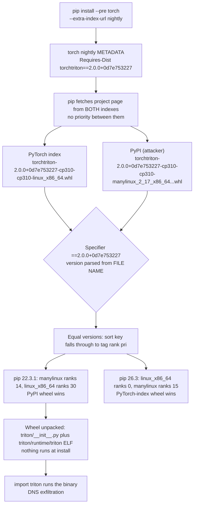

# Case Study: PyTorch torchtriton Compromise and Enterprise Dependency Confusion

> [!summary] Scope
> This note analyzes the December 2022 compromise of PyTorch-nightly on Linux through its `torchtriton` dependency, and places it next to Alex Birsan's 2021 dependency confusion research.
> A project shipped an internal-by-convention package on its own index, never claimed the name on PyPI, and pinned it exactly.
> An unrelated party registered the name on PyPI with the exact same version string, and pip chose the PyPI wheel by tag rank, not by a higher version and not by any index priority.
> The note reaches the Explain, Debug, and Decide at Scale rungs: it re-derives the selection from pip's source, measures it on two pip versions, and ends with the mitigations that actually remove the ambiguity.
> It hands the general registry-attack taxonomy to [[Dependency-Confusion-Typosquatting-and-Registry-Attacks]], the hands-on exploit and fix to [[Drill-Supply-Chain-Exploit-and-Fix-Dependency-Confusion]], and the organizational perimeter to [[Enterprise-Third-Party-Code-Ingestion-and-Quarantine-Architecture]].

What an expert knows cold about this incident:

- The popular explanation ("pip prefers the higher version on PyPI") is wrong for torchtriton.
  The nightly torch wheels required `torchtriton==2.0.0+<10 hex chars>`, and the attacker uploaded a file with that exact version string.
- Both candidates had equal versions, so pip's sort key fell through to the wheel tag rank.
  In pip 22.3.1 the PyPI `manylinux_2_17_x86_64` wheel outranked the self-built `linux_x86_64` wheel on the PyTorch index.
- A version pin constrains a version, never a source.
  Only a source constraint (one index, a per-package index pin, or a hash) removes the ambiguity.
- The payload ran at `import triton`, not at install, because wheels have no install-time code hook.
- PEP 708, the standards-track attempt to fix this class of bug at the repository API, was Rejected in 2026 without ever being implemented (as of 2026-11).

## Incident Timeline

All times are UTC unless noted.
Rows marked with a source in parentheses are quoted from that source; rows marked "measured" were observed while writing this note.

| Date | Event | Source |
|---|---|---|
| 2021-02-09 | Birsan publishes the dependency confusion write-up: more than 35 organizations affected across npm, PyPI, and RubyGems. | Birsan |
| 2022-10 | `torchtriton` has been part of a PyTorch experimental feature "since October 2022". | Checkmarx |
| 2022-12-14 | The PyTorch nightly index lists `torchtriton` at five pins (`0d7e753227`, `5ca1ed0101`, `af76c989eb`, `db3aa1d1fb`, `f16138d447`), each as `cp37` to `cp311` wheels tagged `linux_x86_64`. | Wayback capture of the nightly index, measured |
| 2022-12-17 | The PyPI account `pytorch-experimental` is created and `torchtriton` 0.1.0 is published under it. | Checkmarx |
| 2022-12-25 to 2022-12-30 | Window in which PyTorch says Linux nightly installs via pip were affected. | PyTorch blog |
| 2022-12-26 | `torchtriton` 2.0.0 appears on PyPI: `cp37` to `cp311` `manylinux_2_17_x86_64.manylinux2014_x86_64` wheels of 19.7 MB each, file names carrying the local label `+0d7e753227`. | Wayback capture of PyPI, measured |
| 2022-12-30 ~16:40 GMT | PyTorch learns of the malicious package. | PyTorch blog |
| 2022-12-30 | PR 91539 renames the dependency to `pytorch-triton`; the companion `pytorch/builder` commit `6d4caac` does the same in `manywheel/build_cuda.sh`. | PR and commit |
| 2022-12-30 | `torchtriton` 3.0.0 (a 1.1 kB `py3-none-any` wheel with the description "This is not the real torchtriton package but uploaded here to discover dependency confusion vulnerabilities") appears on PyPI from the attacker's account. | Wayback capture, Checkmarx |
| 2022-12-30 21:35:55 | `pytorch-triton` 0.0.1 (1,462 bytes, `py3-none-any`) is uploaded to PyPI as a name reservation, owner `malfet`. | PyPI JSON |
| 2022-12-31 | PyTorch publishes the disclosure. | PyTorch blog |
| 2023-01-01 05:15 | PyPI's `torchtriton/2.0.0/` release page still lists the five 2.0.0 wheels, with "Newer version available (3.0.0)". | Wayback capture 20230101051504, measured |
| 2023-01-05 09:37 | The first archived capture of `pypi.org/project/torchtriton/` that returns HTTP 404; the last 200 capture is 2023-01-01 12:35. | Wayback CDX index, measured |
| 2023-01-04 | The Register reports a person claiming the package was a security research project and that collected data was deleted. | The Register |
| 2026-11-21 | `https://pypi.org/simple/torchtriton/` returns `"files": []` and `"versions": []`, with `project-status` `active`. The name exists and holds no files. | PyPI Simple API, measured |

Two discrepancies in the public record are left as they are.
PyTorch's window starts on December 25, while PyPI and Checkmarx date the 2.0.0 upload December 26; none of the fetched sources explains the one-day gap, and this note does not guess at it.
Download counts disagree: Checkmarx reports "around 2.8 thousand" downloads of the malicious package, Wiz reports "over 3,000", and Wiz puts `torch` at about 1.5 million downloads in the same period.

## Mechanism Root Cause

### The pieces that were in place

Four independent facts combined; removing any one would have prevented the compromise.

1. **The package lived on a custom index and nowhere else.**
   PyTorch built `torchtriton` from a pinned commit of the Triton repository with `build_triton_wheel.py`.
   That script patches Triton's `setup.py` to `name="torchtriton"` and `version="2.0.0+<first 10 characters of the commit hash>"`, then runs `setup.py bdist_wheel`.
   The result is a wheel with the local version label `+0d7e753227` and, because no `auditwheel` step ran, the build host's native tag `linux_x86_64`.
   The nightly index page listed exactly such files (`torchtriton-2.0.0+0d7e753227-cp310-cp310-linux_x86_64.whl` and its siblings).
2. **The torch wheels pinned it exactly.**
   `setup.py` carried `extras_require['dynamo'] = ['torchtriton==2.0.0+' + triton_pin[:10], 'jinja2']`.
   The binary build scripts went further: in `pytorch/builder`, `manywheel/build_cuda.sh` exported `PYTORCH_EXTRA_INSTALL_REQUIREMENTS="torchtriton==2.0.0+${TRITON_SHORTHASH}"` on Linux when the variable was empty, under the comment "TODO: Remove me when Triton has a proper release channel".
   So Linux CUDA nightly wheels declared a hard dependency, which is why a plain `pip install --pre torch ...` pulled `torchtriton`.
   In the same builder commit, `manywheel/build.sh` dispatches to `build_cuda.sh`, `build_rocm.sh`, and `build_cpu.sh`, and only `build_cuda.sh` sets the variable; `build_rocm.sh`, `build_cpu.sh`, and `build_common.sh` mention neither Triton nor `PYTORCH_EXTRA_INSTALL_REQUIREMENTS` (fetched at commit 6d4caac).
   So the hard dependency was a CUDA-build property.
   After the rename, a commenter on PR 91539 observed that `pip3 install --pre torch --extra-index-url .../nightly/cpu` did not install `pytorch-triton`, because it was an optional dependency, while the `[dynamo]` extra did.
3. **The name was unclaimed on PyPI.**
   Nothing stopped anyone from registering `torchtriton` on `pypi.org`.
   PEP 708 names this as the root condition: "the name of torchtriton was not claimed on PyPI".
4. **The install command merged namespaces.**
   Users installed nightlies with `--extra-index-url https://download.pytorch.org/whl/nightly/...`, so pip searched PyPI and the PyTorch index together.
   The pip documentation says so directly: pip looks "on PyPI (or the index given as `--index-url`, if not disabled via `--no-index`), in the local filesystem, and in any additional repositories specified via `--find-links` or `--extra-index-url`.
   There is no priority in the locations that are searched."
   The same page warns that using `--extra-index-url` for private packages "is unsafe" and names the class: "dependency confusion".

### Why the exact pin did not help

Birsan's 2021 recipe was to publish `library 9000.0.0` and let "the higher version number" win.
That cannot work against `torchtriton==2.0.0+0d7e753227`, because 9000.0.0 does not satisfy the specifier.
The attacker instead copied the pin.
PEP 440 defines the matching rule: if the specifier has a local version label, "the local version labels of candidate versions MUST be considered ... using a strict string equality comparison"; if the specifier is public (`==2.0.0`), candidate local labels are ignored.
Measured with the `packaging` copy vendored in pip 26.3 (darwin-arm64):

```text
SpecifierSet("==2.0.0+0d7e753227").contains("2.0.0")              -> False
SpecifierSet("==2.0.0+0d7e753227").contains("2.0.0+0d7e753227")   -> True
SpecifierSet("==2.0.0+0d7e753227").contains("2.0.0+5ca1ed0101")   -> False
SpecifierSet("==2.0.0").contains("2.0.0+0d7e753227")              -> True
SpecifierSet("==2.0.0+0d7e753227").contains("3.0.0")              -> False
```

The pin is public by construction: it sits in the `Requires-Dist` metadata of every nightly torch wheel and in the file names on the index page.
An attacker watching the nightly index could read the current pin and publish a file whose name carries it.

PEP 440 also says the Python Package Index "MUST NOT allow the use of local version identifiers", yet the archived PyPI page lists release `2.0.0` whose wheel file names carry `+0d7e753227`.
The sources fetched here do not establish how PyPI admitted that in 2022; the current Warehouse upload code (`warehouse/forklift/legacy.py`, as of 2026-11) rejects local versions in uploaded metadata with a "use of local versions" error, so this note states only the observed file names.
What matters for the mechanism is verified in pip's source: `LinkEvaluator.evaluate_link` takes the candidate version from the wheel file name (`version = wheel.version`, in both pip 22.3.1 and 26.3), so the file name alone made the PyPI file satisfy the local-label pin.

### The tie-break: wheel tag rank decided

With both files at version `2.0.0+0d7e753227`, pip's candidate sort key decided.
`CandidateEvaluator._sort_key` in `package_finder.py` returns this tuple, and the best candidate is the maximum (the source is identical in 22.3.1 and 26.3):

```text
(has_allowed_hash, yank_value, binary_preference, candidate.version, pri, build_tag)
```

`pri` is `-wheel.find_most_preferred_tag(supported_tags, ...)`, the negated position of the wheel's best tag in the interpreter's ordered tag list, so an earlier tag is more preferred.
Within equal versions `pri` decides.
The PyPI wheel carried `manylinux_2_17_x86_64.manylinux2014_x86_64`; the PyTorch-index wheel carried `linux_x86_64`.
`packaging.tags._linux_platforms` in pip 22.3.1 yields `manylinux` tags, then `musllinux`, then the bare `linux` tag last.
So the attacker's wheel ranked higher without any index priority existing at all.
The PyTorch post says "Since the PyPI index takes precedence"; that is the symptom as users saw it, not the rule.



### Measurement: the same candidates under pip 22.3.1 and pip 26.3

This was run once per pip version (as of 2026-11, darwin-arm64, CPython 3.15.2).
The host is macOS, so the script patches the platform probes `packaging.tags` reads to simulate a Linux x86_64 CPython 3.10 host with glibc 2.31; only pip's tag generation and candidate ranking run, no network.
The candidates are the real file names from the archived index pages.

Excerpt of the script (the rank printout and unused imports are omitted; the URL host and path do not matter, only the file name):

```python
import platform, sysconfig
from pip._internal.index.package_finder import CandidateEvaluator
from pip._internal.models.candidate import InstallationCandidate
from pip._internal.models.link import Link
from pip._internal.models.target_python import TargetPython
from pip._internal.utils.compatibility_tags import get_supported
from pip._vendor.packaging.specifiers import SpecifierSet
from pip._vendor.packaging import _manylinux as pm

platform.system = lambda: "Linux"
sysconfig.get_platform = lambda: "linux-x86_64"
platform.machine = lambda: "x86_64"
pm._get_glibc_version = lambda: (2, 31)

def pick(spec, cands):
    tp = TargetPython(py_version_info=(3, 10, 0), abis=None, implementation="cp")
    ev = CandidateEvaluator.create("torchtriton", target_python=tp,
                                   specifier=SpecifierSet(spec))
    inst = [InstallationCandidate("torchtriton", v, Link(u)) for v, u in cands]
    best = ev.compute_best_candidate(inst).best_candidate
    return best.link.filename if best else None

NIGHTLY = "https://download.pytorch.org/whl/nightly/torchtriton-2.0.0%2B0d7e753227-cp310-cp310-linux_x86_64.whl"
PYPI = "https://files.pythonhosted.org/torchtriton-2.0.0%2B0d7e753227-cp310-cp310-manylinux_2_17_x86_64.manylinux2014_x86_64.whl"
DUMMY3 = "https://files.pythonhosted.org/torchtriton-3.0.0-py3-none-any.whl"
both = [("2.0.0+0d7e753227", NIGHTLY), ("2.0.0+0d7e753227", PYPI)]
print(pick("==2.0.0+0d7e753227", both))
print(pick("==2.0.0+0d7e753227", both + [("3.0.0", DUMMY3)]))
print(pick("", both + [("3.0.0", DUMMY3)]))
```

Measured output, darwin-arm64 host simulating linux x86_64, pip 22.3.1 (the current pip when the attack happened; pip 23.0 shipped 2023-01-30):

```text
pip 22.3.1
rank   14 / 726  cp310-cp310-manylinux_2_17_x86_64
rank   15 / 726  cp310-cp310-manylinux2014_x86_64
rank   30 / 726  cp310-cp310-linux_x86_64
pin ==2.0.0+0d7e753227, both indexes: torchtriton-2.0.0+0d7e753227-cp310-cp310-manylinux_2_17_x86_64.manylinux2014_x86_64.whl
pin ==2.0.0+0d7e753227, 3.0.0 also present: torchtriton-2.0.0+0d7e753227-cp310-cp310-manylinux_2_17_x86_64.manylinux2014_x86_64.whl
unpinned, 3.0.0 also present: torchtriton-3.0.0-py3-none-any.whl
```

Measured output, darwin-arm64 host simulating linux x86_64, pip 26.3 (released 2026-11-02):

```text
pip 26.3
rank   15 / 726  cp310-cp310-manylinux_2_17_x86_64
rank   16 / 726  cp310-cp310-manylinux2014_x86_64
rank    0 / 726  cp310-cp310-linux_x86_64
pin ==2.0.0+0d7e753227, both indexes: torchtriton-2.0.0+0d7e753227-cp310-cp310-linux_x86_64.whl
pin ==2.0.0+0d7e753227, 3.0.0 also present: torchtriton-2.0.0+0d7e753227-cp310-cp310-linux_x86_64.whl
unpinned, 3.0.0 also present: torchtriton-3.0.0-py3-none-any.whl
```

Reading the two blocks:

- Under pip 22.3.1 the pinned install takes the PyPI wheel, reproducing the incident.
  The `3.0.0` file the attacker published on December 30 is irrelevant to a pinned install, because the specifier excludes it.
- Under pip 26.3 the same candidates resolve to the PyTorch-index wheel.
  The cause is a `packaging` change, not a pip security feature: the packaging 26.3 changelog (2026-08-03) says "Prefer native `linux_*` platform tags over `manylinux` and `musllinux` tags on Linux", and pip 26.3 vendors packaging 26.3.
- The flip is accidental protection.
  An attacker who retags the file `linux_x86_64` makes the tag ranks equal, and then the maximum is the first maximal element in pip's candidate list, which depends on discovery order.
  This tie order was read from the source (`max(candidates, key=self._sort_key)`, identical in 22.3.1 and 26.3) and follows from Python's documented `max()` rule ("If multiple items are maximal, the function returns the first one encountered"); it was not run against a real retagged file, and the safe conclusion is that nothing in the sort key distinguishes sources.
- The unpinned case shows the Birsan shape: when versions differ, the higher version (`3.0.0`) wins regardless of tags.

The absolute ranks (14, 15, 30, 726) depend on the simulated glibc 2.31 and CPython 3.10; the relative order is what the incident turned on.

### Execution: import time, not install time

Installing a wheel runs no project code, so unlike Birsan's npm `preinstall` scripts the attacker needed the package to be imported.
Checkmarx reports that the malicious wheel was "an exact replica" of the original with two differences: an ELF binary at `triton/runtime/triton` (C++, x86-64 Linux) and a few Python lines added to `__init__.py` that execute it.
The PyTorch post confirms the trigger: "The malicious binary is executed when the triton package is imported, which requires explicit code to do and is not PyTorch's default behavior."
In the PyTorch source at the PR 91539 head commit `3eff3440b4a2` (2022-12-30), the import sites are in `torch/_inductor`: `has_triton()` in `utils.py` runs `import triton` when CUDA is available, `triton_ops/autotune.py` imports it under that guard, and `codegen/triton.py` emits `import triton` into generated kernels.
That matches the blog's wording: code reaches `triton` through the inductor backend of `torch.compile` on a CUDA machine, not through a bare `import torch`; this note did not enumerate every other import path.
The pip 26.3 release notes state the general rule: pip "has never considered installing untrusted wheels safe", because Python's import system is dynamic.

The package presented the real project's metadata: author `Philippe Tillet`, MIT license, classifiers copied from the upstream, and homepage `https://github.com/openai/triton/`.
Checkmarx calls the GitHub link "StarJacking": it makes the PyPI page inherit the stars of a popular repository.

### The payload

From the PyTorch disclosure, the binary's `main`:

| Collected | How |
|---|---|
| Nameservers | `/etc/resolv.conf` |
| Hostname, user, directory | `gethostname()`, `getlogin()`, `getcwd()` |
| Environment variables | the whole environment |
| Files | `/etc/hosts`, `/etc/passwd`, the first 1,000 files in `$HOME/*`, `$HOME/.gitconfig`, `$HOME/.ssh/*` |

Exfiltration used encrypted DNS queries to `*.h4ck[.]cfd` through the DNS server `wheezy[.]io`.
File upload was limited to files smaller than 99,999 bytes; the first-1,000-files cap applies to `$HOME` but "all files < 99,999 bytes in the .ssh directory" are uploaded.
The binary's SHA-256 is `2385b29489cd9e35f92c072780f903ae2e517ed422eae67246ae50a5cc738a0e`.
Checkmarx reported that at publication no antivirus vendor on VirusTotal flagged it.
The uploader's later statement, relayed by The Register, claims a failed security research project and deletion of the data; Wiz notes the claim "has not been verified", and exfiltrating environment variables and SSH material is not research behavior either way.

### Comparison with Birsan's 2021 research

| Dimension | Birsan, 2020-2021 | torchtriton, 2022 |
|---|---|---|
| Authorization | Every target authorized testing via bug bounty or private agreement | None |
| Ecosystems | npm (about 75% of callbacks), PyPI, RubyGems | PyPI only |
| How names were found | `package.json` fragments in public JS bundles, GitHub, forums | Open-source project; the internal name and pin are public in the index and wheel metadata |
| Winning rule | Higher version (`9000.0.0`) on the public registry | Exact version match, then tag rank |
| Code execution | npm `preinstall` script | `import triton` running an ELF |
| Exfiltration | Hex-encoded DNS queries, username, hostname, path | DNS queries carrying environment and SSH files |
| Root cause named | `--extra-index-url`, Artifactory virtual repos | `--extra-index-url`, unclaimed public name |
| Outcome | Bounties of $30,000 each from Shopify, Apple, PayPal; $40,000, the Azure bounty program's maximum, from Microsoft | Disclosure, rename, no bounty |

Birsan's article already said the fix for pip was to change `--extra-index-url` to `--index-url`, and that mixing internal and public libraries in a virtual repository used the same vulnerable algorithm.
PyTorch's two-index design was exactly the pattern he warned about 22 months earlier.

### Commands and Numbers to Know

| Item | Value | Platform |
|---|---|---|
| Current pip at the time of the attack | 22.3.1, released 2022-11-05; 23.0 followed 2023-01-30 | Both |
| First pip vendoring packaging with native-`linux_*`-first ordering | 26.3, released 2026-11-02, vendoring packaging 26.3 (2026-08-03) (as of 2026-11) | Linux |
| Tag rank of `linux_x86_64` for CPython 3.10, simulated glibc 2.31 | 30 of 726 in pip 22.3.1, 0 of 726 in pip 26.3 (measured, as of 2026-11) | Linux (simulated) |
| pip's rule across indexes | No priority; best match by version, then the sort key (pip docs, as of 2026-11) | Both |
| `--index-url` default | `https://pypi.org/simple`; env var `PIP_INDEX_URL` (as of 2026-11) | Both |
| `--extra-index-url` | Adds indexes to the search; env var `PIP_EXTRA_INDEX_URL` (as of 2026-11) | Both |
| `--no-index` with `--find-links` | Searches only the listed local or HTML locations; env vars `PIP_NO_INDEX`, `PIP_FIND_LINKS` (as of 2026-11) | Both |
| Hash-checking mode | Enabled by `--require-hashes` or by any requirement carrying `--hash`; applies to all requirements and to transitive dependencies (as of 2026-11) | Both |
| `--uploaded-prior-to` | Added in pip 26.0 (2026-01-30); effective only when the index supplies `upload-time` (as of 2026-11) | Both |
| uv default across indexes | `first-index`, set by `--index-strategy` or `UV_INDEX_STRATEGY` (as of 2026-11) | Both |
| Malicious wheel size | 19.7 MB per Python version, `cp37` to `cp311` | Linux x86_64 |
| Payload limits | Files under 99,999 bytes; first 1,000 files of `$HOME` | Linux |
| Malicious download count | About 2.8 thousand (Checkmarx) or over 3,000 (Wiz) | Linux |
| PEP 708 status | Rejected (as of 2026-11) | Both |

## Detection Gap

Why nothing existing caught this:

- **Functional tests pass.** Checkmarx describes the malicious package as keeping "all the functionality of the original", so a test suite that exercises Triton behaves identically with the attacker's wheel.
  The malicious behavior is additive and runs once at import.
- **No source assertion exists in the install path.** pip's version specifier, tag matching, and `requires-python` checks answer "is this file acceptable", not "did this file come from the index I meant".
  Nothing failed, so nothing logged an anomaly.
- **The pin looked like a security control.** An exact pin to a commit-derived version reads as immutable.
  It is immutable in version space and says nothing about provenance.
- **The nightly flow had no hashes.** Hash-checking mode would have rejected a file whose digest was not in the requirements; the index page links PyTorch served carried no digests and the nightly torch wheels pinned versions only.
  Nightly torch builds are new dev versions every day, so a hash lockfile is not how they were normally consumed.
- **The name was never reserved.** A defensive upload of a one-file placeholder on PyPI costs minutes; PyTorch did it only after the incident (`pytorch-triton` 0.0.1 on 2022-12-30).
- **Static scanning was blind.** The payload was a compiled ELF with no antivirus detections at publication (Checkmarx), and the Python change was a few lines in `__init__.py`.
- **Egress allowed it.** The exfiltration channel was DNS to attacker-run infrastructure.
  A developer workstation or CI runner that resolves arbitrary names through an unrestricted resolver gives a binary a path out even when HTTP egress is filtered; Birsan chose DNS for the same reason.
- **Discovery was external.** PyTorch "learned" of the package at about 16:40 GMT on December 30, four days after the upload, and the remediation PR was opened the same day.
  The public record does not say who reported it.

## Remediation and Fix

### What PyTorch did (December 30 to 31, 2022)

1. Renamed the dependency: PR 91539 changed `extras_require['dynamo']` to `pytorch-triton==2.0.0+<pin>` and the companion `pytorch/builder` commit changed `PYTORCH_EXTRA_INSTALL_REQUIREMENTS` the same way, so new nightlies no longer asked for the poisoned name.
2. Claimed the new name on PyPI with a dummy package (`pytorch-triton` 0.0.1, 1,462 bytes, uploaded 2022-12-30T21:35:55Z) so the rename did not recreate the hole one name over.
3. Pulled every nightly package that depended on `torchtriton` from `download.pytorch.org` "until further notice".
4. Contacted the PyPI security team to take ownership of the `torchtriton` name and delete the malicious release.
   As of 2026-11-21 the Simple API shows the name with zero files, consistent with removal.
   The Wayback CDX index bounds the removal: the project page returned 200 at 2023-01-01 12:35 UTC and 404 at 2023-01-05 09:37 UTC; no fetched source records the exact time inside that window.
5. Published user guidance: uninstall and purge.

```sh
pip3 uninstall -y torch torchvision torchaudio torchtriton
pip3 cache purge
```

### Checking a machine

PyTorch's published one-liner looks for the dropped binary at `PYTHON_SITE_PACKAGES/triton/runtime/triton`.
An equivalent that is easier to read, run once here on darwin-arm64 with no `triton` installed, printed `not affected`:

```sh
python3 -c "import importlib.util, pathlib; s = importlib.util.find_spec('triton'); p = pathlib.Path(s.submodule_search_locations[0]) / 'runtime' / 'triton' if s else None; print('affected' if p and p.is_file() else 'not affected')"
```

`find_spec` on a top-level name locates the package without executing it.
A positive result means rotate everything the process could read: SSH keys, the `$HOME` dotfiles it could reach, and every secret in the environment (Wiz: scan the affected resources and rotate discovered keys).
Treat the machine as compromised for data that fit under the 99,999-byte limit, which includes typical private key files.
Hash-match the binary against `2385b29489cd9e35f92c072780f903ae2e517ed422eae67246ae50a5cc738a0e` as an additional signal; a miss does not clear a host because the attacker could rebuild the ELF.

### What changed afterwards in PyTorch's packaging (verified at 2026-11-21)

- `torch` 2.0.0 on PyPI declares `triton (==2.0.0) ; platform_system == "Linux" and platform_machine == "x86_64"` and `torch` 2.9.0 declares `triton==3.5.0` with the same markers.
  Both name `triton`, a PyPI project whose owners the PyPI JSON lists as `ptillet`, with maintainers `atalman` and `malfet`.
- The stable release path therefore uses one namespace, PyPI, owned by the project, which is the structural fix for the stable channel.
- The nightly index still serves a `pytorch-triton` project (`https://download.pytorch.org/whl/nightly/pytorch-triton/`, newest file `3.6.0+git8fedd49b` uploaded 2025-12-09, fetched 2026-11-21) and a separate `triton` project, so a nightly install can still depend on the PyTorch index for that name; this note did not inspect current nightly wheel metadata.
  The name is reserved on PyPI by the 0.0.1 placeholder; wherever a second index remains, the mitigation matrix below applies.

## Architectural Lessons

### The invariant

A name is only meaningful together with the registry that owns it.
Installers that flatten several registries into one namespace turn "any registry may serve this name" into a trust assumption; the first party to register the name on the most open registry then wins ties the maintainer never thought about.
PEP 708 states the same observation: "there is no globally unique namespace that all Python package names come from".

### Mitigation matrix across tools (as of 2026-11)

| Tool | Control | Default behavior | Note |
|---|---|---|---|
| pip | Single `--index-url` pointing at a proxy that serves both internal and public packages | `--extra-index-url` merges namespaces | The proxy must enforce the internal-name policy; see below |
| pip | `--require-hashes` or `--hash` per requirement | Off unless any requirement has a hash | Protects only artifacts whose digests were captured from a trusted source; digests for a poisoned file lock in the poison |
| pip | `--no-index --find-links <dir>` | Not default | Vendored wheelhouse; no registry at all |
| uv | `first-index` index strategy | Default | For each package, stops at the first index that has it, so an internal name present on the internal index cannot resolve to PyPI |
| uv | `explicit = true` on an index and `tool.uv.sources` pin | Not default | Index is used only for packages pinned to it; docs show `torch = { index = "pytorch" }` |
| uv | `unsafe-best-match` | Opt-in only | Closest to pip's behavior; the docs say it exposes users to dependency confusion |
| Poetry | `primary`, `supplemental`, `explicit` source priorities | Sources without a priority are primary; configuring a primary source disables implicit PyPI | `explicit` sources are consulted only for packages that name them |
| Azure Artifacts | Per-package "Allow External Versions" | Disabled by default | Blocks versions from public upstreams for a name unless a feed owner enables it |
| npm | Scopes (`@org/name`) | Names are unscoped by default | A scope is a namespace owned by an account or organization |

The strongest controls remove the second candidate before ranking: pin the package to one index (uv `tool.uv.sources`, Poetry `explicit`), or route all resolution through one internal proxy that never falls through to the public registry for names the organization owns.
Hash pinning is a different control that works after the fact, and only if hashes are generated before any untrusted candidate exists.

### What PEP 708 proposed and why it matters that it was rejected

PEP 708 (Donald Stufft, created 2023-02-20) extended the Simple Repository API to version 1.2 with two project-level metadata items:

- `meta.tracks` (HTML `pypi:tracks`): an extending repository, under operator control, declares that its project tracks the same project at other repository URLs.
- `alternate-locations` (HTML `pypi:alternate-locations`): a project owner declares the repositories that together form one namespace, and all listed locations must agree.

Its non-normative discovery recommendation was: gather files from all repositories, filter by known hashes, apply any explicit user-selected repositories, then error unless tracks or alternate-locations metadata allows merging all the repositories where files were found, then filter by platform and resolve.
Under that rule, torchtriton on PyPI plus the PyTorch index would have been an installation error, not a silent choice.
The PEP also warns that without a user-side explicit configuration option, users "end up in a DoS situation in cases like torchtriton".
It was provisionally accepted with conditions (a Warehouse implementation, an implementation in a repository other than PyPI, and a pip implementation) and then Rejected "after three years in the provisionally accepted state ... because the required conditions for acceptance were never met" (PEP header lists Post-History 2026-04-02).
The consequence is operational: as of 2026-11 no standard makes pip refuse a cross-index name collision, so every organization that runs a private index owns that control itself.

### Decision rules at scale (1,000 to 50,000 engineers)

- **Rule 1: one resolution endpoint.**
  Developers and CI point `PIP_INDEX_URL` at an internal proxy and nothing else; `--extra-index-url` is banned in lint over `requirements*.txt`, `pip.conf`, Dockerfiles, and CI YAML.
  Downside: the proxy becomes critical infrastructure and must be fast and highly available.
- **Rule 2: the proxy enforces namespaces, not the client.**
  Internal names are served only from internal storage; a request for an internal name never reaches the public upstream.
  Azure Artifacts' per-package "Allow External Versions" (default off) is one concrete implementation; other proxies need an equivalent rule, which should be tested per product: Birsan wrote in 2021 that "multiple customers have stated" Artifactory's virtual repositories use the same vulnerable algorithm as `--extra-index-url`, and this note did not re-test current Artifactory behavior.
- **Rule 3: reserve the names you own on every public registry.**
  A placeholder on PyPI, npm, and crates.io for each internal package costs near nothing and removes the squatting target.
  This is what PyTorch did after the incident; it must not wait for one.
- **Rule 4: when a package must come from a second index, pin it to that index, not to a version.**
  Use uv `tool.uv.sources` with `explicit = true`, Poetry `explicit`, or a wheelhouse.
- **Rule 5: lock with hashes for production, and generate them inside the trusted perimeter.**
  Hash-checking mode makes pip refuse any file whose digest is not listed, and it applies to transitive dependencies too.
- **Rule 6: restrict DNS egress from build and developer environments.**
  Resolve through an internal resolver with allow-lists or anomaly detection on high-entropy long labels; DNS was the exfiltration channel in both Birsan's research and this incident.
- **Rule 7: treat cooldowns as a complement.**
  pip 26.0 added `--uploaded-prior-to` (as of 2026-11, effective only for indexes supplying `upload-time`), which ignores files uploaded after a cutoff.
  It would have delayed adoption of the attacker's brand-new upload by the cooldown length but removes no ambiguity, since an attacker can upload early and wait.
  See [[Enterprise-Third-Party-Code-Ingestion-and-Quarantine-Architecture]] for cooldown and quarantine design.

> [!warning] Pitfalls
> - **Pinning is not provenance.** `==` and even local version labels constrain what version is acceptable, not where it comes from.
>   If the pinned version string is guessable or published, an attacker can mirror it.
> - **Newer pip may hide a latent bug.** pip 26.3 resolving back to the PyTorch index is a side effect of tag ordering in `packaging` 26.3. Do not treat an upgrade as remediation; an equal-tag upload restores the ambiguity.
> - **`pip download` and lock generation are installs too.** Generating a lockfile with an ambiguous index configuration records the attacker's digest as the trusted one.
> - **Local version labels are a smell on shared indexes.** PEP 440 reserves them for private builds and tells public indexes not to accept them; a dependency on a `+hash` version means the name has no public release channel, which is exactly when it must be reserved publicly.
> - **A vendor blog's one-line cause is a hypothesis.** "PyPI takes precedence" and "the higher version wins" are both folklore; the cause here required reading the sort key.

> [!tip] Practice Drill
> Reproduce the tie-break yourself on any machine without network access to the attacker's file.
> 1. Create two venvs with `python3 -m venv a b`, install `pip==22.3.1` into one and `pip==26.3` into the other.
> 2. Run the script excerpt above with each venv's interpreter and `python -I`, and compare the `rank` lines and the pinned pick with the measured blocks in this note.
> 3. Change `PYPI` to a `linux_x86_64` tag and predict which wheel wins before running; then read `max(candidates, key=self._sort_key)` in `package_finder.py` to explain the result.
> 4. Then do the hands-on exploit and fix in [[Drill-Supply-Chain-Exploit-and-Fix-Dependency-Confusion]].
> Expected: the pinned pick is the PyPI manylinux file under 22.3.1 and the nightly `linux_x86_64` file under 26.3, with the ranks shown above if you simulate the same host.

For what to do when a compromised package is already installed across a fleet, use [[Respond-to-a-Compromised-Transitive-Dependency]].
For attestations that would let a consumer prove which build produced an artifact, see [[SLSA-Framework-Build-and-Source-Tracks]] and [[Sigstore-Keyless-Signing-Cosign-Fulcio-and-Rekor]]; neither would have stopped this attack alone, because the problem was source ambiguity, not build integrity.

## References

Primary and archival sources fetched while writing this note.
Wayback URLs are pinned to the capture timestamp used.

- PyTorch Foundation, Compromised PyTorch-nightly dependency chain between December 25th and December 30th, 2022: `https://pytorch.org/blog/compromised-nightly-dependency/` - the disclosure, payload description, IOC hash, and mitigation list.
- pytorch/pytorch pull request 91539, Rename torchtriton: `https://github.com/pytorch/pytorch/pull/91539` - the remediation change and the discussion of `[dynamo]`.
- pytorch/builder commit 6d4caac: `https://github.com/pytorch/builder/commit/6d4caac` - the `PYTORCH_EXTRA_INSTALL_REQUIREMENTS` line and the TODO comment about a Triton release channel.
- Nightly index, pre-incident capture: `https://web.archive.org/web/20221214173055/https://download.pytorch.org/whl/nightly/torchtriton/` - proves the five pins and the `linux_x86_64` tags.
- PyPI page captures: `https://web.archive.org/web/20230101051504/https://pypi.org/project/torchtriton/2.0.0/` (the 2.0.0 files, sizes, author, and homepage) and `https://web.archive.org/web/20230101032148/https://pypi.org/project/torchtriton/` (the 3.0.0 disclaimer); the CDX index dates the 404.
- PyPI Simple API for `torchtriton` and JSON for `pytorch-triton`, `triton`, `torch`: `https://pypi.org/simple/torchtriton/` - current state of the name and the ownership of `triton`.
- Alex Birsan, Dependency Confusion (archived 2021-02-09): `https://web.archive.org/web/20210209185918/https://medium.com/@alex.birsan/dependency-confusion-4a5d60fec610` - the original research, root causes, and bounty figures.
- Checkmarx, PyTorch compromise analysis (archived 2023-01-01): `https://web.archive.org/web/20230101150147/https://medium.com/checkmarx-security/py-torch-a-leading-ml-framework-was-poisoned-with-malicious-dependency-e30f88242964` - the `__init__.py` change, StarJacking, account creation, and timeline.
- The Register, PyTorch dependency poisoned with malicious code: `https://www.theregister.com/2023/01/04/pypi_pytorch_dependency_attack` - the uploader's statement and PyTorch's quoted wording.
- Wiz Research, Malicious PyTorch dependency torchtriton: `https://www.wiz.io/blog/malicious-pytorch-dependency-torchtriton-on-pypi-everything-you-need-to-know` - the download comparison and the remediation advice.
- PEP 708: `https://peps.python.org/pep-0708/` - the tracks and alternate-locations design and its Rejected status.
- PEP 440: `https://peps.python.org/pep-0440/` - local version labels and the matching rule.
- pip documentation, `pip install` and Secure installs: `https://pip.pypa.io/en/stable/cli/pip_install/` and `https://pip.pypa.io/en/stable/topics/secure-installs/` - "no priority", the `--extra-index-url` warning, and hash-checking mode.
- pip source, `package_finder.py` at 22.3.1 and 26.3: `https://pypi.org/project/pip/` - the sort key and `find_all_candidates`.
- pip news and packaging changelog: `https://pip.pypa.io/en/stable/news/` and `https://packaging.pypa.io/en/stable/changelog.html` - release dates, `--uploaded-prior-to`, and the native `linux_*` tag preference.
- uv indexes, Poetry repositories, Azure Artifacts upstream behavior, npm scopes: `https://docs.astral.sh/uv/concepts/indexes/`, `https://python-poetry.org/docs/repositories/`, `https://learn.microsoft.com/en-us/azure/devops/artifacts/concepts/upstream-behavior`, `https://docs.npmjs.com/about-scopes` - the mitigation matrix entries.

No CVE or GitHub security advisory identifier appears in any fetched source; OSV queries for `torchtriton` and `pytorch-triton` on PyPI returned empty results on 2026-11-21 (the GitHub advisories API was rate limited), so the incident is tracked here by the PyTorch disclosure alone.

## Interview Questions

> [!question] L5: The nightly torch wheels pinned `torchtriton==2.0.0+0d7e753227`. Why did the pin not protect users?
> > [!success]- Answer
> > A specifier selects acceptable versions; it does not name a source.
> > With `--extra-index-url`, pip collects files for `torchtriton` from PyPI and the PyTorch index, then applies the specifier to the version parsed from each file name.
> > The attacker's PyPI wheel was named with the same local label `+0d7e753227`, so it satisfied the pin exactly (PEP 440 compares local labels by string equality).
> > Both files matched, and pip chose between them by its sort key.

> [!question] L5: What does `--extra-index-url` do compared with `--index-url`, and what does pip's documentation say about priority?
> > [!success]- Answer
> > `--index-url` replaces the base index (default `https://pypi.org/simple`); `--extra-index-url` adds indexes to the set pip searches.
> > The documentation says there is "no priority in the locations that are searched": every location is checked and the best match by version is selected, and it labels the extra-index approach for private packages unsafe, naming dependency confusion.
> > The fix in a pip-only world is one index (a proxy) or `--no-index --find-links` for a wheelhouse.

> [!question] L5: You installed a PyTorch nightly on Linux on December 27, 2022. What do you do?
> > [!success]- Answer
> > Check for the dropped file at `site-packages/triton/runtime/triton` (a positive means the wheel was the attacker's), uninstall `torch torchvision torchaudio torchtriton`, run `pip cache purge`, and move to a nightly newer than December 30, 2022.
> > If the binary was present and `triton` was ever imported, assume the exfiltrated set left the machine: the environment variables, `/etc/hosts`, `/etc/passwd`, the first 1,000 files in `$HOME`, `.gitconfig`, and everything under `.ssh` smaller than 99,999 bytes.
> > Rotate SSH keys and every secret in the environment.
> > If `triton` was never imported the binary never ran, but the safe response is the same rotation if there is any doubt.

> [!question] L6: Predict the output. With pip 26.3's vendored `packaging`, what do these print?
> > ```python
> > from pip._vendor.packaging.specifiers import SpecifierSet as S
> > print(S("==2.0.0+0d7e753227").contains("2.0.0"))
> > print(S("==2.0.0").contains("2.0.0+0d7e753227"))
> > print(S("==2.0.0+0d7e753227").contains("2.0.0+5ca1ed0101"))
> > ```
> > [!success]- Answer
> > It prints `False`, `True`, `False` (measured on darwin-arm64).
> > A specifier with a local label requires the candidate's label to match exactly and a candidate without a label does not match.
> > A public specifier ignores candidate local labels, so `==2.0.0` accepts `2.0.0+anything`; that is why dependency declarations that omit the label are even easier to hijack with a labeled upload.
> > The third line shows a different pin on the same index does not match, which is why the attacker had to track the current pin.

> [!question] L6: Debug this. Security says "our `requirements.txt` pins `acme-billing==3.2.1`, so dependency confusion is impossible", yet a drill shows the public registry's file was installed.
> > ```text
> > --index-url https://pypi.org/simple
> > --extra-index-url https://pkgs.example.internal/simple
> > acme-billing==3.2.1
> > ```
> > [!success]- Answer
> > The pin fixes the version, not the source, so the attacker uploaded `acme-billing` 3.2.1 to the public registry.
> > Both files satisfy `==3.2.1`, and pip ranks them by `has_allowed_hash`, yank state, binary preference, version, tag rank, and build tag; a `manylinux` wheel beats a `linux_x86_64` wheel on pip versions before packaging 26.3, and equal candidates fall to list order.
> > Fix: make the internal proxy the only `--index-url` and have it refuse to serve public files for `acme-` names; reserve the name on the public registry; add `--require-hashes` with digests generated from the internal artifact.
> > Verify by uploading a decoy to a test registry and confirming the install fails or still selects the internal file.

> [!question] L6: PyTorch's post says "the PyPI index takes precedence". Is that accurate, and what actually decided?
> > [!success]- Answer
> > It is not a pip rule: the pip documentation says there is no priority among locations.
> > With the pin, both files were acceptable and tied on version, so the tag component of the sort key decided: `pri` is the negated position of the wheel's best tag in the interpreter's ordered tags, and in pip 22.3.1 (`packaging` 21.3) `manylinux` tags were ranked before the bare `linux_x86_64` tag.
> > Measured: the PyPI wheel's tag ranked 14 and the PyTorch-index wheel's tag ranked 30 of 726 for a simulated CPython 3.10 Linux x86_64 host.

> [!question] L7: pip 26.3 resolves the same candidates to the PyTorch-index wheel. Is the attack class dead on current pip? How would an attacker adapt?
> > [!success]- Answer
> > No.
> > The flip comes from `packaging` 26.3 preferring native `linux_*` tags over `manylinux`; pip's sort key itself is unchanged and still has no source component.
> > An attacker who also tags the file `linux_x86_64`, or targets an installation where the internal wheel is `py3-none-any` and the public one is a platform-tagged wheel, restores the ambiguity, and the winner then depends on candidate order and wheel tag detail.
> > The unpinned case is worse: a higher version always wins regardless of tags (`3.0.0` won in both pip versions in the measurement).
> > The control must be a source constraint, not a hope about tag ordering.

> [!question] L7: PEP 708 was provisionally accepted and then Rejected. What did it try to do, why does its rejection matter, and what do you do instead?
> > [!success]- Answer
> > It added `tracks` and `alternate-locations` metadata to the Simple API (version 1.2) so an installer could error when files for one name appear in multiple repositories unless the metadata proves they are the same logical project.
> > It was rejected because its acceptance conditions, implementations in Warehouse, another repository, and pip, were not met in three years.
> > The result is that no PyPA standard stops the merge; the control is local: single resolution endpoint, per-package index pinning, namespace enforcement in the proxy, name reservation, and hash locks.
> > Treat PEP 708 as the design reference for what a proxy should implement internally.

> [!question] L8+: You run a fleet of 20,000 developers and CI jobs with an internal PyPI, an internal npm registry, and GPU wheels on a vendor index. Design the resolution architecture so a torchtriton-style incident cannot recur.
> > [!success]- Answer
> > Put one internal proxy in front of every registry and make it the only configured endpoint for pip, uv, Poetry, and npm, enforced by managed config files and network policy that blocks direct public registry access from build and developer networks.
> > In the proxy, mark each internal name or scope as internal-only: requests never fall through to a public upstream, and the vendor GPU index is mounted as its own repository path mapped to an explicit allow-list of project names.
> > Reserve every internal name on every public registry with a placeholder, and run a scheduled job that diffs internal names against public registries and alerts on any non-placeholder release.
> > Require hash-locked installs (`--require-hashes`, `uv.lock`) for production, with digests created from proxy artifacts; add a cooldown on newly published public versions for the quarantine path.
> > Restrict DNS egress from builders to an internal resolver with alerts on long high-entropy labels, and keep an inventory query ("which hosts installed package X from which source") so response is hours, not days.
> > The tradeoffs are the proxy's availability and policy upkeep and the friction on teams that need a new public package; budget a fast-path review for the latter.

> [!question] L8+: After an incident like this, how do you decide whether to keep a private index at all versus publishing the packages publicly?
> > [!success]- Answer
> > Compare the cost of owning namespace enforcement against the cost of a public release channel.
> > The incident's own history is evidence: PyTorch's stable path moved to `triton` on PyPI, a single namespace owned by the project, which removes the cross-registry ambiguity for stable users.
> > Keep a private or vendor index only for artifacts PyPI cannot host or must not host (very large GPU builds, non-redistributable binaries, nightlies); for those, pin per package to the index and reserve the public name.
> > If the package is open and its consumers are external, publishing it to the public registry under a name you own is the simpler, more robust design.

## Related

- Prerequisites: [[Dependency-Confusion-Typosquatting-and-Registry-Attacks]]
- Next: [[Case-Study-Shai-Hulud-and-Self-Replicating-Registry-Worms]]
- See also: [[Drill-Supply-Chain-Exploit-and-Fix-Dependency-Confusion]], [[Enterprise-Third-Party-Code-Ingestion-and-Quarantine-Architecture]], [[Respond-to-a-Compromised-Transitive-Dependency]], [[SLSA-Framework-Build-and-Source-Tracks]], [[Sigstore-Keyless-Signing-Cosign-Fulcio-and-Rekor]]

