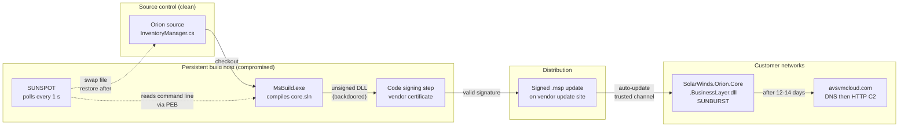
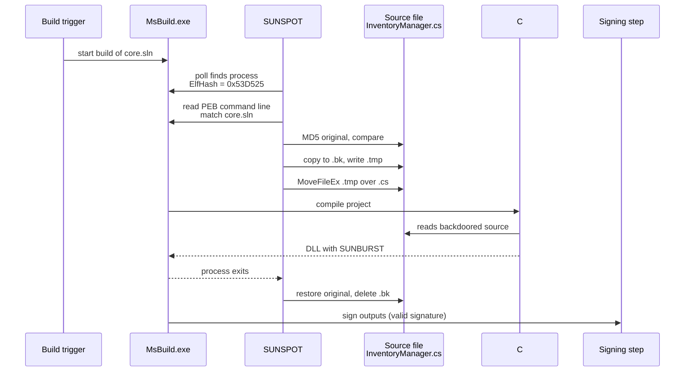

# Case Study: SolarWinds Orion SUNBURST Build System Infiltration

> [!summary] Claim:
> The SolarWinds source repository was clean; the backdoor existed only in the compiler's view of one file, for the few minutes a build ran.
> An implant on the build host (CrowdStrike: SUNSPOT) polled once a second for `MsBuild.exe`, read its command line out of process memory, swapped one C# file for a backdoored copy, waited for the compile, and restored the original.
> The signing step ran afterwards on the poisoned output, so Authenticode, the vendor certificate, and the update channel all vouched for malware.
> A signature attests to who signed the bytes; only independent rebuilds, isolated ephemeral builders, and provenance checked against source attest to what the bytes came from.



## Incident Timeline

All dates are as stated by the cited primary source.
Where a source contradicts another, both are shown.

| Date | Event | Source |
|---|---|---|
| 2019-09 | Earliest suspicious activity SolarWinds identified on its internal systems | SolarWinds blog 2021-01-11 |
| 2019-10 | A SolarWinds release "appears to have contained modifications designed to test the perpetrators' ability to insert code into our builds"; the unpatched 2019.4 release is described as containing test modifications and not impacted by SUNBURST | SolarWinds blog 2021-01-11; SolarWinds Security Advisory |
| 2020-02-20 | An updated injection source begins inserting SUNBURST into Orion releases; the SUNSPOT binary carries a build timestamp of 2020-02-20 11:40:02 UTC | SolarWinds blog; CrowdStrike |
| 2020-03-24 | `SolarWinds.Orion.Core.BusinessLayer.dll` signed with certificate serial `0f:e9:73:75:20:22:a6:06:ad:f2:a3:6e:34:5d:c0:ed` | FireEye |
| 2020-03 to 2020-06 | Trojanized Orion releases shipped; trojanized updates were "digitally signed from March - May 2020" and posted to the vendor update site | 8-K; Senate testimony; FireEye |
| 2020-06 | The attackers removed SUNBURST from the SolarWinds environment | SolarWinds blog |
| 2020-12-12 | SolarWinds informed of the attack | SolarWinds blog |
| 2020-12-13 | FireEye publishes the SUNBURST analysis; CISA issues Emergency Directive 21-01 | FireEye; CISA |
| 2020-12-14 | SolarWinds files Form 8-K: notice sent on 2020-12-13 to "approximately 33,000" active maintenance customers; believed affected installations "fewer than 18,000" | SEC 8-K |
| 2020-12-17 | CISA alert AA20-352A first published | CISA |
| 2021-01-06 | ED 21-01 Supplemental Guidance v3 lists affected builds | CISA |
| 2021-01-07 | SolarWinds publishes its "Secure by Design" plan | SolarWinds blog |
| 2021-01-11 | CrowdStrike publishes the SUNSPOT analysis in coordination with SolarWinds | CrowdStrike |
| 2021-02-23 | SolarWinds CEO testifies to the Senate Select Committee on Intelligence | Senate testimony |
| 2021-03-08 | Original SolarWinds code-signing certificate revoked | SolarWinds Security Advisory |
| 2021-04-15 | AA20-352A updated: "The U.S. Government attributes this activity to the Russian Foreign Intelligence Service (SVR)" | CISA |
| 2021-05-12 | Executive Order 14028 signed; Section 4 targets software supply chain security | Federal Register |
| 2022-02 | NIST publishes SSDF v1.1 (SP 800-218) | NIST |

Facts the sources give that are easy to get wrong:

- The 8-K says the vulnerability existed in updates released between March and June 2020 and "was introduced as a result of a compromise of the Orion software build system and was not present in the source code repository".
- "Fewer than 18,000" is the number of customers SolarWinds believed had an installation containing the vulnerability, not the number of victims; the sources fetched here do not give a count of customers the actors went on to exploit.
- The CEO testimony says only three Orion Platform versions released between March and June 2020 were affected.
  CISA Supplemental Guidance v3 lists five builds, including two release candidates (below), so the two counts are not contradictory but count different things.
- Attribution differs by author.
  CrowdStrike tracks the activity as StellarParticle and, at publication, attributed it to no known adversary.
  The FireEye post carries a 2022-05 note that UNC2452, the cluster it tracked, was merged into APT29.
  The US Government attributes it to the SVR.

### Affected builds (as of 2021-01-06, CISA Supplemental Guidance v3)

| Orion Platform build | `SolarWinds.Orion.Core.BusinessLayer.dll` version |
|---|---|
| 2019.4 HF5 | 2019.4.5200.9083 |
| 2020.2 RC1 | 2020.2.100.12219 |
| 2020.2 RC2 | 2020.2.5200.12394 |
| 2020.2 | 2020.2.5300.12432 |
| 2020.2 HF1 | 2020.2.5300.12432 |

The ED original text says "affected versions are 2019.4 through 2020.2.1 HF1".
The FireEye post names one distribution package: `CORE-2019.4.5220.20574-SolarWinds-Core-v2019.4.5220-Hotfix5.msp` (hash `02af7cec58b9a5da1c542b5a32151ba1`), containing a DLL with hash `b91ce2fa41029f6955bff20079468448` (the post does not label the algorithm; 32 hex characters suggests MD5).

## Mechanism Root Cause

The root cause is an integrity boundary that did not exist: nothing between "source in the repository" and "bytes the signing key signs" was independently verified.
The attacker needed only code execution on the build host with enough privilege to read another process's memory and rewrite a file the compiler was about to read.
How the actors first got into the SolarWinds network is not stated in any source fetched for this note; SolarWinds describes only investigation partners and no confirmed initial-access vector.

### Stage 1: SUNSPOT lives on the build host

Facts below are from CrowdStrike's analysis of the SUNSPOT sample unless marked otherwise.

| Property | Value |
|---|---|
| On-disk name | `taskhostsvc.exe`, internally named `taskhostw.exe`, masquerading as a Windows binary |
| SHA-256 | `c45c9bda8db1d470f1fd0dcc346dc449839eb5ce9a948c70369230af0b3ef168` |
| Persistence | Scheduled task set to run at host boot |
| Single-instance mutex | `{12d61a41-4b74-7610-a4d8-3028d2f56395}` |
| Stop-signal mutex | `{56331e4d-76a3-0390-a7ee-567adf5836b7}`; if it exists, SUNSPOT waits for in-flight injection threads and exits |
| Log file | `C:\Windows\Temp\vmware-vmdmp.log`, entries RC4-encrypted with a 16-byte hard-coded key, delimited by `32 78 A5 E7 1A 79 91 AC` |
| Config and payload | AES-128-CBC blobs (target solution name `core.sln`, target file paths relative to the solution directory, replacement source), key identical to the RC4 key, fixed IV |
| Privilege | Adds `SeDebugPrivilege` to its own token, needed to read other processes' memory |
| Poll interval | Process list scanned every second |
| Concurrency cap | At most 256 tampering threads tracked (log step 21) |

CrowdStrike notes the AES key and IV also appear in binaries of several popular video games, and calls it plausible that this was chosen to make static detections on those values impractical.

### Stage 2: finding the right build

1. Enumerate processes once a second.
2. Hash each process name with ElfHash and compare to `0x53D525`, the value for lowercase `msbuild.exe` (reproduced below).
3. For each match, spawn a thread.
4. In that thread, call `NtQueryInformationProcess` to get the target's Process Environment Block (PEB) pointer, follow it to `_RTL_USER_PROCESS_PARAMETERS`, and read the full command line out of the remote process's memory.
5. Parse the command line and look for the Orion solution path (the encrypted constant that decrypts to `core.sln`; log step 30 if that decryption fails).

Hashing the name instead of comparing a string keeps the string `msbuild.exe` out of the binary (inference).
Reading the command line from process memory needs no file artifact, only a handle open and a read (inference).

### Stage 3: the swap

The sequence of operations on a match, with the log step numbers CrowdStrike publishes:

1. Decrypt the target relative path (step 2 on failure), create the full path (step 3), get the original file size (step 4).
2. MD5 the original file (step 5) and compare to a hard-coded expected value (step 6).
3. Decrypt the replacement source (step 7), MD5 it (step 8), compare to a hard-coded value (step 9).
   In the analyzed sample the backdoored source MD5 is `5f40b59ee2a9ac94ddb6ab9e3bd776ca`.
4. Copy the original to `InventoryManager.bk` (step 10).
5. Write the backdoored source to `InventoryManager.tmp` (step 11).
6. `MoveFileEx` the `.tmp` over `InventoryManager.cs` (step 12).
7. Append a timestamped entry to the log, then wait for `MsBuild.exe` to exit.
8. Restore the original source and delete the `.bk` file.



Design consequences, labeled as inference where the source does not say them directly:

- The MD5 gate on the original file is a version lock.
  If a developer edits `InventoryManager.cs`, the hash no longer matches, SUNSPOT does nothing, and the attacker loses the build rather than risking a compile error.
  CrowdStrike states the purpose: causing build errors "would very likely prompt troubleshooting actions" and lead to discovery.
- The write-to-`.tmp`-then-`MoveFileEx` pattern makes the swap a single directory operation, so the compiler cannot observe a half-written file (inference).
- Restoring the file after the build means a `git status` or `git diff` run after the build shows a clean tree.
  The repository, the checkout, and the post-build tree are all clean; only the compiler's read is poisoned.
- The stop-signal mutex exists because killing SUNSPOT mid-operation could leave a build error behind (CrowdStrike).
- Edits are wrapped in `#pragma warning disable` and `#pragma warning restore` so the attacker's code adds no compiler warnings (CrowdStrike).
- The injected source was "likely sanitized": generic variable names, pre-obfuscated strings, no comments or disabled code, like a decompilation (CrowdStrike).

### Stage 4: what was injected

Microsoft and CrowdStrike describe the same hook.
The injected code adds one call inside the legitimate `RefreshInternal` method of `SolarWinds.Orion.Core.BusinessLayer.BackgroundInventory.InventoryManager`, in a try/catch that starts a background thread:

```csharp
// Shape quoted by CrowdStrike (see References); not compilable on its own.
try {
    if (!OrionImprovementBusinessLayer.IsAlive) {
        Thread th = new Thread(OrionImprovementBusinessLayer.Initialize) { IsBackground = true };
        th.Start();
    }
} catch (Exception) {
}
```

- The backdoor class is `SolarWinds.Orion.Core.BusinessLayer.OrionImprovementBusinessLayer`.
  Microsoft counts "13 subclasses and 16 methods" and describes it as "almost 4,000 lines of code".
- The hook runs on a separate thread so the normal flow of `RefreshInternal` is unchanged (Microsoft).
- The DLL is loaded by `SolarWinds.BusinessLayerHost.exe` or `SolarWinds.BusinessLayerHostx64.exe` (FireEye).

Microsoft places the insertion "before the final stages of the software build, which would include digitally signing the compiled code", and says the signed DLL "enhances its ability to run privileged actions" while keeping a low profile.
Microsoft also says the October 2019 activity tested this capability "by adding empty classes".

### Stage 5: what ran at customers (compact)

This belongs to the implant, not the build, so only the facts that explain the detection gap are listed.
All from FireEye unless noted.

| Behavior | Detail |
|---|---|
| Dormancy | Runs only if the DLL filesystem write time is at least 12 to 14 days old; the exact threshold is selected randomly from an interval and rechecked by a legitimate recurring background task |
| Process gate | Process name lowercased, hashed with FNV-1a 64-bit, XORed with `6605813339339102567`; `17291806236368054941` matches `solarwinds.businesslayerhost` |
| Environment gates | Machine must be domain joined; config key `ReportWatcherRetry` must not be `3`; blocklisted processes, services, and drivers (hashed names) make it retry later |
| Services | Blocklisted services disabled by setting `HKLM\SYSTEM\CurrentControlSet\services\<name>\Start` to `4` |
| Connectivity | Resolves `api.solarwinds.com` before proceeding |
| C2 stage 1 | DGA subdomain of `avsvmcloud[.]com` under four `appsync-api.<region>` suffixes; CNAME response gives the C2 host; A-record ranges including `10.0.0.0/8`, `172.16.0.0/12`, `192.168.0.0/16`, and `20.140.0.0/15` terminate the implant |
| Delays | Between DGA lookups: 1 to 3 minutes, 30 to 120 minutes, or up to 420 to 540 minutes (9 hours) on error |
| C2 stage 2 | HTTP masquerading as the Orion Improvement Program protocol; JSON keys `userId`, `sessionId`, `steps`; `EventType` hard-coded to `Orion`, `EventName` to `EventManager` |
| Commands | 18 job values, 0 `Idle` through 17 `Reboot`, including `RunTask`, `WriteFile`, `SetRegistryValue`, `DeleteFile` |
| Follow-on | TEARDROP memory-only dropper loading Cobalt Strike BEACON (FireEye); hands-on-keyboard activity including renamed Windows administrative tools such as `adfind.exe` used for domain enumeration, and a C2 subdomain that differs for every affected device (Microsoft) |

### Reproducing two numbers from the primary sources

Both constants below are published by the vendors, so they can be checked offline.
This block was run once on `darwin-arm64` with Python 3.15.2 (as of 2026-11); it is not a repository lab.

```python
def elf(name):
    h = 0
    for c in name.encode("ascii"):
        h = ((h << 4) + c) & 0xFFFFFFFF
        g = h & 0xF0000000
        if g:
            h ^= g >> 24
        h &= ~g & 0xFFFFFFFF
    return h

def fnv1a64(b):
    h = 14695981039346656037
    for c in b:
        h = ((h ^ c) * 1099511628211) & 0xFFFFFFFFFFFFFFFF
    return h

for n in ("MsBuild.exe", "msbuild.exe"):
    print(f"elf({n!r}) = {elf(n):#08x}")
print(fnv1a64(b"solarwinds.businesslayerhost") ^ 6605813339339102567)
```

```text
elf('MsBuild.exe') = 0x733525
elf('msbuild.exe') = 0x53d525
17291806236368054941
```

- `0x53d525` equals the value CrowdStrike reports for the process-name check, and CrowdStrike's own Figure 1 gives `b'msbuild.exe'` as the test input, so the comparison is against the lowercase name (whether the implant lowercases names before hashing is inference); the mixed-case spelling hashes to `0x733525`.
- `17291806236368054941` equals the value FireEye reports for `solarwinds.businesslayerhost`, which confirms the FNV-1a 64-bit offset basis, prime, and XOR constant used here.
- The ElfHash implementation above is the classic System V ELF hash with an explicit 32-bit mask; CrowdStrike's Figure 1 Python omits the mask, and running that figure verbatim gives the same `0x53d525` and `0x733525` (re-run 2026-11-21, Python 3.15.2).

## Detection Gap

Why each normal control saw nothing:

| Control | What it inspects | Why it missed |
|---|---|---|
| Code review and PR approval | Commits in the repository | The repository was clean (8-K); the change never existed as a commit |
| Static analysis and SAST on source | Repository or checkout contents | Run on the clean tree; the swap happened after checkout and was reverted after the compile |
| Compiler warnings and build failures | Compile output | Edits sat inside `#pragma warning disable`/`restore`; the MD5 gate prevented replacement into an unexpected file, so no compile error appeared |
| Unit and integration tests | Behavior of the built artifact | The backdoor sleeps 12 to 14 days, exits on analysis tools, requires a domain-joined host, and masquerades its traffic; a test run in minutes on a lab host sees none of it (analysis; the sources do not say what tests SolarWinds ran) |
| Code signing | Publisher identity and byte integrity since signing | Signing ran after the injection (Microsoft); the signature was valid because the signer was authentic and the bytes were exactly what was signed |
| Update-channel trust | Origin of the package | Customers fetched an official signed update from the vendor site |
| Endpoint defense on customer hosts | Process, driver, and service behavior | The implant checked for analysis tools, AV components, and security drivers (hashed blocklists) and disabled listed services |
| Network defense on customer hosts | Egress | DNS to a subdomain of a legitimate-looking name, then HTTP shaped as the Orion Improvement Program protocol with JSON and steganographic response bodies; SolarWinds testimony cites the attackers' "stealthy use of U.S.-based cloud services" |
| Build log review | Errors and warnings | Log entries by the implant were encrypted with RC4 into a file disguised as a VMware log |

What would have caught it, in practice: host telemetry on the build server (a boot-time scheduled task running a binary named like `taskhostw.exe` from an unexpected path, `SeDebugPrivilege` plus `ReadProcessMemory` against `MsBuild.exe`, transient `.bk` and `.tmp` files beside a source file), and an independent rebuild whose output hash differs from the shipped DLL.
The first is a classic EDR detection on a server that should be locked down; the second needs the build to be deterministic.

The timeline gap is as important as the technical one.
The first activity in the sources dates to 2019-09, the SUNBURST-bearing builds to 2020-02-20 onward, and SolarWinds learned of it on 2020-12-12.
About eight and a half months passed between the 2020-03-24 signing of the trojanized DLL and the 2020-12-12 notification, and the first suspicious activity dates about fifteen months before that notification.

## Remediation and Fix

### What SolarWinds did (as stated by SolarWinds)

- Released hotfixes that remove the backdoored component; the advisory snapshot lists 2020.2.1 HF 2 as not affected by SUNBURST, with a certificate-revocation action, and recommends upgrading to 2020.2.5.
- Revoked the old code-signing certificate on 2021-03-08 and re-signed the Orion Platform and other products "with new digital certificates".
- Reset credentials for all users in the corporate and product development domains, including privileged accounts and "all accounts used in building the Orion Platform".
- Enforced multi-factor authentication for remote and cloud access, deployed additional threat hunting on development endpoints, and added least-privilege access, network segmentation, and encryption in development environments.
- Moved to "parallel build systems and environments with stricter access controls" and mechanisms "to allow for reproducible builds from multiple independent pipelines", stating that this "will further improve the integrity of our software beyond code-signing practices which have proven to be inadequate".
- Added "additional automated and manual checks to ensure that our compiled releases match our source code after the completion of the compile process".

### What CISA required of customers (ED 21-01, issued 2020-12-13)

- Action 1: forensically image memory or the host OS of affected instances and analyze stored network traffic.
- Action 2: "disconnect or power down SolarWinds Orion products, versions 2019.4 through 2020.2.1 HF1, from their network"; agencies were also prohibited from (re)joining the Windows host OS to the enterprise domain and had to block all traffic to and from hosts, external to the enterprise, where any version of Orion had been installed.
- Supplemental Guidance v3 (2021-01-06): any agency accepting the risk of running Orion "must run at least version 2020.2.1 HF2".
- As of 2026-11 the ED page carries a notice dated 2026-01-08 that CISA concluded the purposes were met and sunset the directive and all required actions.

### Mandiant's customer-side guidance

- Preserve impacted devices and rebuild on the latest versions rather than upgrade in place.
- Isolate SolarWinds servers, block internet egress from them, and restrict connectivity to Tier 0 assets.
- Restrict local administrator accounts and change passwords for accounts with access to the servers.
- Review network device configurations if Orion manages network infrastructure.
- Detection resources: the `mandiant/sunburst_countermeasures` repository.

### Detection content a defender can reuse (from the primary sources)

| Layer | Indicator |
|---|---|
| Build host file | `C:\Windows\Temp\vmware-vmdmp.log` |
| Build host mutex | `{12d61a41-4b74-7610-a4d8-3028d2f56395}`, `{56331e4d-76a3-0390-a7ee-567adf5836b7}` |
| Build host binary | `taskhostsvc.exe` SHA-256 `c45c9bda8db1d470f1fd0dcc346dc449839eb5ce9a948c70369230af0b3ef168` |
| Orion source (poisoned) | SHA-256 `0819db19be479122c1d48743e644070a8dc9a1c852df9a8c0dc2343e904da389` |
| Customer host | DLL hash `b91ce2fa41029f6955bff20079468448` (algorithm unlabeled by FireEye) |
| DNS | Subdomains under `appsync-api.<region>.avsvmcloud[.]com` |
| YARA | CrowdStrike published `CrowdStrike_SUNSPOT_01` (key and IV bytes), `_02` (mutex strings), `_03` (log format strings) |
| ATT&CK | T1195.002 Compromise Software Supply Chain (FireEye); for SUNSPOT T1053.005, T1140, T1027, T1480, T1036, T1057, T1565.001 (CrowdStrike) |

## Architectural Lessons

### Lesson 1: a signature is not provenance

Authenticode answers: did the holder of this private key sign these bytes, and have they changed since? (Microsoft: Authenticode "identifies the publisher" and "verifies the software has no changes since it was signed and published".)
It does not answer: were these bytes produced from the reviewed source by an uncompromised builder?
When the attacker sits upstream of the signing step, a valid signature is a property of the attack, not evidence against it.
See [[Sigstore-Keyless-Signing-Cosign-Fulcio-and-Rekor]] for what keyless signing adds (identity binding and a transparency log, still downstream of the build) and [[In-Toto-Layouts-Link-Metadata-and-DSSE-Attestations]] for the layer that links signed steps to expected inputs.

### Lesson 2: the build host is a production system holding the signing path

Anything with code execution on the builder can edit what the compiler reads and, usually, reach the signing key.
The SSDF is explicit: PO.5 asks to "ensure that all components of the environments for software development are strongly protected from internal and external threats", naming development, build, test, and distribution environments (NIST SP 800-218 v1.1).
PO.5.1 examples include minimizing direct human access to toolchain systems such as build services, minimizing internet access to what is necessary, and segmenting environments from each other and from production.
EO 14028 Section 4(e)(i) lists "using administratively separate build environments" and "auditing trust relationships", and the SSDF's EO 14028 mapping table maps both of those subsections, 4e(i)(A) and 4e(i)(B), to PO.5.1 (PO.5.2 appears for other 4e(i) items such as (C), (E), and (F)).

### Lesson 3: what each control would have changed

| Control | Effect on a SUNSPOT-class attack | Residual weakness |
|---|---|---|
| Ephemeral, isolated builder (SLSA Build L3 "Isolated") | The spec requires that no build persist or influence the environment of a subsequent build and that overlapping builds not alter each other; SLSA's own threat example is a malicious build that "listens for another build and swaps out source files". A boot-time scheduled task on a long-lived host is exactly what ephemeral provisioning removes | An attacker who compromises the platform control plane or its admins is outside the L3 guarantee; the spec lists "Compromise build platform admin" as a verification matter that depends on consumers trusting the platform's controls |
| Trusted control plane generates provenance (L2/L3) | The signing key and provenance never touch the worker, so a worker-level implant cannot forge them (spec: "Steal cryptographic secrets") | Provenance is only a claim about what was built; a consumer must verify it against expectations |
| Independent reproducible rebuild | The poisoned DLL's hash would differ from a rebuild made on a clean second pipeline; SolarWinds names this exact remedy | Only works if the build is deterministic and the second pipeline is independent in identity, credentials, and network; see [[Reproducible-Builds-as-a-Security-Control]] |
| Hermetic build (no network) | Limits what a compromised build can fetch or send | Does not stop a local file swap by a resident process; SLSA v1.2 states "Hermetic" roughly means no network access and is not a Build L3 requirement |
| Read-only, content-addressed inputs | A source tree mounted read-only to the build user, with the compiler fed by digest, removes the file-swap primitive | Needs a builder architecture that supports it; does not cover a compromised compiler or tool |
| EDR on the build server | `SeDebugPrivilege` plus remote memory read of `MsBuild.exe`, boot-time task, odd binary path are high-signal on a server with a fixed job | Attackers tune to the host's baseline; a detection is not a prevention |
| SBOM | Records component inventory, not the integrity of how the DLL was produced | Would not have shown the injected code; see [[SBOM-Standards-SPDX-CycloneDX-and-VEX]] |

Be precise about the seed's list "isolated, ephemeral, and hermetic".
Isolation and ephemerality prevent this class of attack; hermeticity addresses a different one (undeclared network inputs) and would not by itself have stopped a local source swap.
Independent verification is the control that does not depend on the builder being honest.

### Lesson 4: reproducibility is the cheapest independent witness for .NET

For C# the Roslyn compiler is "fully deterministic when the `/deterministic` option is specified (this is the default in the .NET SDK)" (as of 2026-11, Windows and Unix hosts).
Its documented inputs include the sequence of command-line parameters, the precise compiler version, the current full directory path (reducible to a relative path), the full paths of source files (normalizable with `/pathmap`), and the binary contents of every file passed, directly or indirectly, such as source files and referenced assemblies.
A poisoned `InventoryManager.cs` is an input difference, so a clean rebuild from the tagged commit produces different bytes.
Which project style SolarWinds' Orion build used, and whether its output was deterministic, is not stated in any source fetched; the claim here is about what a deterministic pipeline would offer, not about what SolarWinds had.
Practical caveats: compare before signing, or compare Authenticode image hashes, which by the PE format specification exclude the signature-related areas because a signature "can be added to or removed from an image without affecting the overall integrity of the image"; normalize paths with `/pathmap`, and pin the compiler and reference assembly versions.

### Lesson 5: the same pattern recurs at other layers

- A tarball built differently from the tagged source is the xz pattern: [[Case-Study-XZ-Utils-Backdoor-CVE-2024-3094]].
- A distribution-time script modification is the Codecov pattern: [[Case-Study-Codecov-Bash-Uploader-and-TJ-Actions]].
- Hardening the CI itself is covered in [[OpenSSF-Scorecard-and-CI-CD-Pipeline-Hardening]] and [[Audit-and-Harden-a-GitHub-Actions-Release-Pipeline]].
- The vendor-side responsibilities live in [[SLSA-Framework-Build-and-Source-Tracks]]; consumer-side gating lives in [[Enterprise-Third-Party-Code-Ingestion-and-Quarantine-Architecture]].

### Numbers to know (as of 2026-11)

| Fact | Value | Platform |
|---|---|---|
| SLSA Build track levels in v1.2 | Build L1, L2, L3; L3 adds "Unforgeable" provenance and "Isolated" | Both |
| Roslyn `/deterministic` | Default in the .NET SDK | Both |
| ED 21-01 | Issued 2020-12-13; sunset notice dated 2026-01-08 | n/a |
| SSDF | v1.1, published 2022-02, practice PO.5 for environments | n/a |
| SUNSPOT poll interval and thread cap | 1 second, 256 threads | Windows |
| SUNBURST dormancy | 12 to 14 days from DLL write time | Windows |

### At Scale

From one team to 1,000 to 50,000 engineers, the decision rules are:

- Count the paths to the signing key.
  If any host with a general-purpose agent or human shell session can reach the key or the signing service, the build is as trustworthy as that host.
  Rule: signing happens in a dedicated service that accepts artifacts plus provenance from a builder identity, never a shell step on the builder itself.
- Separate by blast radius, not by team.
  One long-lived build host serving many products turns one implant into a fleet compromise; per-build ephemeral workers bound it to one build.
- Require two independent pipelines for products whose compromise reaches customer privilege (agents, update clients, network management).
  Cost: roughly double the build compute and a determinism engineering effort.
  Decision: pay it for tier-0 products; use provenance verification plus EDR for the rest.
- Treat a mismatch between pipelines as a stop-ship incident, not a flaky test.
- Verify as a consumer too: the vendor's signature says nothing about the vendor's build, so for privileged software gate on provenance, SBOM, and sandboxed canary installation; see [[Supply-Chain-Decision-Records]].
- Fleet-wide: network egress from management servers (Mandiant recommends blocking internet egress from Orion servers) is cheap and removes a whole C2 class.

## Pitfalls

> [!warning] Pitfalls:
> - Concluding "we verify signatures, so we are safe": the SolarWinds DLL verified.
> - Running SAST and review only on the repository: the tampering happens between checkout and compile.
> - Checking the tree after the build: the implant restored the original file, so a post-build diff is clean.
> - Treating the compile as trusted because it succeeded: the hash gates were written precisely so the build would succeed.
> - Standing up a "second pipeline" that shares the same credentials, source mirror, or build host image: one foothold compromises both and the hashes agree.
> - Believing hermetic builds fix this: no network access does not stop a resident process rewriting a local file.
> - Stamping SLSA L3 on a platform whose admins can SSH into running builds: the spec treats admin compromise as a verification concern, so consumers must trust the platform's controls.
> - Over-trusting an IOC list: the hashes above identify one sample; the durable detections are behaviors (memory reads of the compiler, source files changing between checkout and compile).

> [!tip] Practice Drill:
> Take a CI job in your organization that builds and signs an artifact.
> Write down every principal that can write to the source checkout between clone and compile, and every principal that can reach the signing credential.
> Then check whether a rebuild on a different host produces identical bytes (before signing) using the commands in [[Reproducible-Builds-as-a-Security-Control]], and attempt the provenance exercise in [[Drill-Supply-Chain-Verify-and-Reject-Forged-SLSA-Provenance]].

## Interview Questions

### L5

**Q1. A reviewer says "our release DLL is signed with our company certificate, so tampering would be detected."**
What is wrong with that statement for the SolarWinds case?

> [!success]- Answer
> Signature verification proves the bytes are unchanged since signing and that the signer holds the key.
> SolarWinds' tampering happened before signing, in the compile step, so the signature covered malicious bytes.
> Microsoft states the malicious code was inserted before the final stages of the build, which include digital signing.
> The vendor's own conclusion, in testimony, was that its "code-signing practices ... have proven to be inadequate" and that independent reproducible builds were needed on top.

**Q2. Predict the output.**
Using the ElfHash function in this note, what do `elf("MsBuild.exe")` and `elf("msbuild.exe")` print, and why does that matter to how SUNSPOT identifies the compiler?

> [!success]- Answer
> `0x733525` and `0x53d525`.
> CrowdStrike reports the comparison constant `0x53D525`, which equals the lowercase form.
> So SUNSPOT compares against the hash of the lowercase name (CrowdStrike's Figure 1 test input is `b'msbuild.exe'`); a case-sensitive comparison of the display name `MsBuild.exe` would never match.
> It also keeps the plain string `msbuild.exe` out of the binary.

**Q3. The repository for the release was clean.**
Where was the backdoor, and which two moments bound its existence on disk?

> [!success]- Answer
> In the content of `InventoryManager.cs` as read by the compiler.
> It exists from the `MoveFileEx` of `InventoryManager.tmp` over the source file until SUNSPOT restores the original after `MsBuild.exe` exits.
> The original is held in `InventoryManager.bk` during that window.

### L6

**Q4. Debug this.**
A team claims their pipeline is hardened; identify at least four defects relative to the SolarWinds lessons.

```bash
# nightly-release.sh runs on a long-lived Windows build server as a local admin
git clone "$REPO_URL" src && cd src
msbuild core.sln /p:Configuration=Release
signtool sign /f "$SIGNING_PFX" /p "$PFX_PASSPHRASE" bin/Release/*.dll
aws s3 cp bin/Release/ "s3://updates-example/" --recursive
```

> [!success]- Answer
> 1. Long-lived host: an implant such as SUNSPOT persists by scheduled task across builds; use an ephemeral isolated builder per build.
> 2. The signing key is readable by the build user on the same host; any process able to reach it can sign arbitrary bytes.
>    Move signing to a service that accepts artifact plus provenance from the builder identity.
> 3. It signs `bin/Release/*.dll`, whatever is present, not a digest produced by a verified build step.
> 4. No check that the compile inputs match the commit: record and compare the digest of every compiler input, or build the same commit on a second independent pipeline and compare pre-signing hashes.
> 5. No provenance is generated or verified; consumers cannot tell what built the DLL.
> 6. The build user is a local admin, which is what grants `SeDebugPrivilege`-class capabilities to an implant.
> 7. Publication is a direct recursive copy with no gate between signing and the update channel.

**Q5. Why does SLSA Build L3 address the "implant on the build host" pattern, and what does it explicitly not promise?**

> [!success]- Answer
> L3 "Isolated" requires that a build cannot access the platform's secrets, that overlapping builds cannot influence each other, that one build cannot persist or influence the environment of a subsequent build (an ephemeral environment per build), and that the build cannot poison a cache used by another.
> The threat page's example of a malicious build that swaps out another build's source files is this pattern.
> It does not promise that a producer cannot run a risky build, does not require hermetic builds, and the platform's own administrators and control plane are outside the guarantee; consumers must decide whether to trust the platform's controls.

**Q6. Why is hashing the original source file (MD5) inside SUNSPOT interesting to a defender?**

> [!success]- Answer
> It makes the implant version-locked: if `InventoryManager.cs` changes, the check fails and nothing is injected (CrowdStrike log step 6).
> That is evasion design, not a defense, but it gives defenders a detection angle: the implant logs failures, and a changed target file means the attackers must update the implant, which means touching the host again.
> It also explains why the injection never produced build errors.

### L7

**Q7. Design an independent verification pipeline for an agent that runs as SYSTEM on customer machines.**
What must be independent, and what failure would make the two pipelines agree on a poisoned artifact?

> [!success]- Answer
> Independence in identity provider and credentials, network segment, builder image and base OS, source fetch path (clone directly from the canonical repo by commit hash, not through a shared mirror), and ideally personnel with admin rights.
> Compare pre-signing artifact hashes (or Authenticode image hashes, which exclude the signature-related areas of the PE file) on a deterministic build with pinned compiler and reference assemblies and normalized paths (`/pathmap` for Roslyn).
> Failure modes: a shared compromised input such as a package mirror or the same base image, a shared admin, a nondeterministic build that trains teams to ignore mismatches, or both pipelines hosted by the same platform control plane.
> A mismatch must page a human and block publication.

**Q8. Your CEO asks: "If we had adopted SLSA Build L3, would SolarWinds have been prevented?" Give a calibrated answer.**

> [!success]- Answer
> It would have removed the specific mechanism: a resident process rewriting source files on a long-lived build host and reaching the provenance signing key.
> It would not have covered compromise of the build platform's control plane or admins, and provenance only helps if a consumer or an internal gate verifies it against expectations of the right source and builder.
> Pair it with an independent rebuild for the highest-risk products and with EDR on the platform.
> Also note SLSA v1.2 does not require hermetic builds, so "L3" does not imply no-network builds.

### L8+

**Q9. A vendor tells you its update channel is signed and its build is "SLSA L3". As a customer with 40,000 servers running its agent, what do you require before auto-updates?**

> [!success]- Answer
> Provenance you verify yourself (builder identity, source repo and commit, build parameters) and not only a signature; policy on which builder identities you accept; an SBOM for the update; a staged rollout with canary hosts on isolated networks with egress logging; blocked internet egress for management servers (Mandiant's recommendation); a contractual attestation per EO 14028 Section 4(e)(ix) style conformity statements; and a plan for rapid disablement.
> The vendor claim reduces risk only to the extent the controls are verifiable.
> Tie the policy to a recorded decision as in [[Supply-Chain-Decision-Records]].

**Q10. What did the incident change in US policy, and where does that policy still fall short on the build-system problem?**

> [!success]- Answer
> EO 14028 Section 4 (2021-05-12) directed NIST to produce guidance covering secure software development environments (4(e)(i): administratively separate build environments, auditing trust relationships, MFA and conditional access, monitoring), artifacts demonstrating conformance, SBOMs, and attestation of conformity to secure development practices.
> NIST SSDF v1.1 PO.5 and PS practices carry these into controls.
> The shortfall: an attestation of conformity is a claim by the supplier; it does not independently verify the artifact, which is the gap reproducible and independently verified builds close.

## References

- CrowdStrike Intelligence Team, SUNSPOT: An Implant in the Build Process, 2021-01-11: https://www.crowdstrike.com/en-us/blog/sunspot-malware-technical-analysis/
- FireEye, Highly Evasive Attacker Leverages SolarWinds Supply Chain to Compromise Multiple Global Victims With SUNBURST Backdoor, 2020-12-13: https://cloud.google.com/blog/topics/threat-intelligence/evasive-attacker-leverages-solarwinds-supply-chain-compromises-with-sunburst-backdoor
- Microsoft, Analyzing Solorigate, the compromised DLL file that started a sophisticated cyberattack, 2020-12-18: https://www.microsoft.com/en-us/security/blog/2020/12/18/analyzing-solorigate-the-compromised-dll-file-that-started-a-sophisticated-cyberattack-and-how-microsoft-defender-helps-protect/
- SolarWinds, New Findings From Our Investigation of SUNBURST, 2021-01-11: https://www.solarwinds.com/blog/new-findings-from-our-investigation-of-sunburst
- SolarWinds, Our Plan for a Safer SolarWinds and Customer Community, 2021-01-07: https://www.solarwinds.com/blog/our-plan-for-a-safer-solarwinds-and-customer-community
- SolarWinds Security Advisory (snapshot of 2021-04-06): https://www.solarwinds.com/sa-overview/securityadvisory
- SolarWinds Form 8-K, 2020-12-14: https://www.sec.gov/Archives/edgar/data/1739942/000162828020017451/swi-20201214.htm
- Ramakrishna written testimony, Senate Select Committee on Intelligence, 2021-02-23: https://www.intelligence.senate.gov/wp-content/uploads/2024/08/sites-default-files-documents-os-sramakrishna-022321.pdf
- CISA Emergency Directive 21-01: https://www.cisa.gov/news-events/directives/ed-21-01-mitigate-solarwinds-orion-code-compromise-closed
- CISA Alert AA20-352A: https://www.cisa.gov/news-events/cybersecurity-advisories/aa20-352a
- Executive Order 14028, Federal Register 2021-10460: https://www.federalregister.gov/documents/2021/05/17/2021-10460/improving-the-nations-cybersecurity
- NIST SP 800-218 SSDF v1.1: https://csrc.nist.gov/pubs/sp/800/218/final
- SLSA v1.2 Threats and mitigations: https://slsa.dev/spec/v1.2/threats
- SLSA v1.2 Build requirements: https://slsa.dev/spec/v1.2/build-requirements
- Roslyn Deterministic Inputs: https://github.com/dotnet/roslyn/blob/main/docs/compilers/Deterministic%20Inputs.md

## Related

- Prerequisites: [[SLSA-Framework-Build-and-Source-Tracks]], [[Reproducible-Builds-as-a-Security-Control]]
- Next: [[Case-Study-Event-Stream-and-Maintainer-Handoff]]
- See also: [[Sigstore-Keyless-Signing-Cosign-Fulcio-and-Rekor]], [[In-Toto-Layouts-Link-Metadata-and-DSSE-Attestations]], [[Case-Study-XZ-Utils-Backdoor-CVE-2024-3094]], [[Case-Study-Codecov-Bash-Uploader-and-TJ-Actions]], [[OpenSSF-Scorecard-and-CI-CD-Pipeline-Hardening]], [[Audit-and-Harden-a-GitHub-Actions-Release-Pipeline]], [[Enterprise-Third-Party-Code-Ingestion-and-Quarantine-Architecture]], [[Supply-Chain-Decision-Records]], [[SBOM-Standards-SPDX-CycloneDX-and-VEX]], [[Drill-Supply-Chain-Verify-and-Reject-Forged-SLSA-Provenance]]
- Lab: none
