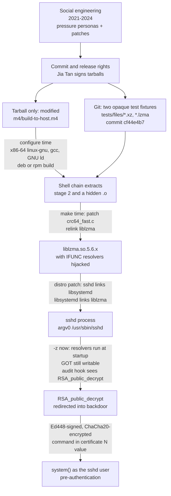

# Case Study: The xz-utils Multi-Year Social Engineering Backdoor (CVE-2024-3094)

> [!summary] Scope
> Deep forensic analysis of the CVE-2024-3094 compromise of xz-utils 5.6.0 and 5.6.1.
> Traces the multi-year social engineering effort to gain maintainer trust, the injection of obfuscated test files, build-time extraction via build-to-host.m4 in release tarballs, and the runtime ELF IFUNC hooking of OpenSSH RSA_public_decrypt.
> Derives foundational principles for verifying build script integrity and eliminating tarball discrepancies.
> Synthesizes long-term security implications for open-source infrastructure governance.

> [!summary] Claim:
> The backdoor was a three-layer relay that crossed four trust boundaries.
> A pseudonymous contributor earned commit and release rights over roughly two and a half years, then shipped release tarballs whose `m4/build-to-host.m4` was not the code in git.
> That macro unpacked an object file hidden in two binary test fixtures, linked it into `liblzma`, and at load time replaced `RSA_public_decrypt` inside `sshd` through a GNU IFUNC resolver and a dynamic-linker audit hook.
> It was caught by a database engineer who noticed a 0.5 second login slowdown, not by any test, scanner, signature, or review.

## Incident Timeline

Dates are from the cited public timelines and are day-granular; none of the sources used here give a time of day or timezone for the commits.
Commit hashes are included only where two independent sources agree on them.

### Phase 1: building a persona (2021 to 2022)

| Date | Event | Source |
|---|---|---|
| 2005 to 2008 | Lasse Collin designs the `.xz` format and `liblzma`; he remains the sole maintainer until Jia Tan's arrival | Cox timeline |
| 2021-10-29 | First patch from "Jia Tan" to the xz-devel list (an `.editorconfig` file) | Cox timeline |
| 2021-11-29 | Second patch, fixing a reproducible-build problem | Cox timeline |
| 2022-04-19 | Jia Tan posts a patch to xz-devel ("String to filter and filter to string") | xz-devel msg00553, Cox timeline |
| 2022-04-22 | First email from "Jigar Kumar" pressuring Lasse; four of Jia's patches have been merged by then | Cox timeline |
| 2022-05-19 | "Dennis Ens" asks whether the XZ for Java port is maintained; Lasse answers the same day that Jia "might have a bigger role in the future" | Cox timeline |
| 2022-05-27 | Jigar Kumar, in the "String to filter" thread: "Over 1 month and no closer to being merged." | xz-devel msg00565 |
| 2022-06-07 | Jigar Kumar, in the "XZ for Java" thread: "Progress will not happen until there is new maintainer." | xz-devel msg00566 |
| 2022-06-08 | Lasse replies that he has "longterm mental health issues" and that this is an unpaid hobby project | Cox timeline |
| 2022-06-10 | First commit authored as "Jia Tan" ("Tests: Created tests for hardware functions") | Cox timeline |
| 2022-06-21 | Dennis Ens suggests passing on maintainership of XZ for C "so you can give XZ for Java more attention" | Cox timeline |
| 2022-06-29 | Lasse: Jia "is practically a co-maintainer already" | Cox timeline |
| 2022-09-27 | Jia writes the 5.4.0 release summary | Cox timeline |
| 2022-10-28 | Jia is added to the Tukaani GitHub organization | Cox timeline |
| 2022-12-30 | Jia merges commits directly to the repository, which is evidence of commit access | Cox timeline |
| 2023-01-11 | Lasse tags his last release, v5.4.1 | Cox timeline |
| 2023-03-18 | Jia tags the first release signed by Jia, v5.4.2 | Cox timeline |

Lasse Collin's own account states the boundary of access: only he had access to the main `tukaani.org` site and `git.tukaani.org`, while Jia Tan "only had access to things hosted on GitHub", including the `xz.tukaani.org` subdomain (Collin incident page, as of 2025-01-17).
That subdomain mattered: it was the project's public face and the place release tarballs were published for downstream packagers.

### Phase 2: preparing the hooks (2023 to early 2024)

| Date | Event | Source |
|---|---|---|
| 2023-03-20 | Jia updates the Google `oss-fuzz` configuration to send bug reports to Jia | Cox timeline |
| 2023-06-22 | A pair of patches from "Hans Jansen" adds GNU IFUNC selection for CRC functions; Lasse merges them, and the final commit is reworked by Lasse and merged by Jia | Cox timeline |
| 2023-07-07 | Jia opens `google/oss-fuzz` PR 10667, "xz: Disable ifunc to fix Issue 60259.", stating "ifunc is not compatible with -fsanitize=address"; oss-fuzz maintainer `jonathanmetzman` approves and merges it the same day | oss-fuzz PR 10667 |
| 2024-01-11 | Lasse (GitHub `Larhzu`) renames `crc_clmul.c` to `crc_x86_clmul.h` in commit `419f55f9` ("liblzma: Avoid extern lzma_crc32_clmul() and lzma_crc64_clmul()."); the backdoor scripts later grep this header by name. The Cox timeline has no entry for this date, and no primary source ties the rename to the backdoor's development, so none is claimed here | tukaani-project/xz commit 419f55f9 |
| 2024-01-19 | Jia moves the project web site to GitHub Pages | Cox timeline |

The IFUNC patch was a legitimate-looking performance feature: it selected a CLMUL-accelerated CRC at load time.
Its practical effect for the attacker was a code-execution hook that runs inside the dynamic linker before `main()` in a process that loads `liblzma` with eager binding, as Debian's `sshd` did.

### Phase 3: the attack (2024-02 to 2024-03)

| Date | Event | Source |
|---|---|---|
| 2024-02-23 | Commit `cf44e4b7f5dfdbf8c78aef377c10f71e274f63c0` ("Tests: Add a few test files") adds `tests/files/bad-3-corrupt_lzma2.xz` and `tests/files/good-large_compressed.lzma`; Freund notes they are not used by any test in 5.6.0 | Freund, Cox |
| 2024-02-24 | v5.6.0 is tagged and built; its tarball carries the malicious `m4/build-to-host.m4` | Cox timeline |
| 2024-02-26 | Debian uploads xz-utils 5.6.0-0.1 to unstable | Cox timeline |
| 2024-02-27 | Jia emails the Fedora maintainer about updating Fedora 40 | Cox timeline |
| 2024-02-28 | A "subtle typo" breaks Landlock detection (Cox); Sam James identifies commit `328c52da8a2bbb81307644efdb58db2c422d9ba7`, which put a stray `.` in the CMake Landlock check; Kaspersky dates the CMake sabotage commit 2024-02-26 instead | Cox, Sam James FAQ, Kaspersky |
| 2024-02-29 | `teknoraver` opens systemd PR 31550 to dynamically load compression libraries (LZ4, ZSTD, LZMA) instead of linking them, motivated by initramfs size; Cox: "It appears that this would have defeated the attack." | Cox, systemd PR 31550 |
| 2024-03-04 | Red Hat distribution packagers see Valgrind errors in `_get_cpuid` | Cox timeline |
| 2024-03-05 | The systemd pull request is merged (by Daan De Meyer); Debian adds xz-utils 5.6.0-0.2 to testing; Jia commits two IFUNC bug fixes | Cox timeline, systemd PR 31550 |
| 2024-03-08 | Jia commits a purported fix for the Valgrind errors; Cox calls it "a misdirection, but an effective one" | Cox timeline |
| 2024-03-09 | Updated test fixtures are committed and v5.6.1 is tagged | Cox timeline |
| 2024-03-20 | Lasse sends Linux kernel patches listing himself and Jia as xz maintainers | Cox, LWN 967866 |
| 2024-03-25 | "Hans Jansen" returns and files Debian bug 1067708 asking for the 5.6.1 update | Cox, Boehs |
| 2024-03-27 | Debian updates to 5.6.1 | Cox timeline |
| 2024-03-28 | Jia files Ubuntu bug 2059417 asking for 5.6.1 days before the beta freeze | Cox, Boehs |

### Phase 4: discovery and response (2024-03-28 onward)

| Date | Event | Source |
|---|---|---|
| 2024-03-28 | Andres Freund reports to Debian security and then `distros@openwall`; Red Hat assigns CVE-2024-3094 | Cox, Freund |
| 2024-03-28 | Debian reverts to `5.6.1+really5.4.5-1`; Arch Linux switches 5.6.1 to build from git | Cox timeline |
| 2024-03-29 | Public disclosure on oss-security; CISA, Red Hat, Debian (DSA-5649-1) and GitHub publish advisories | Freund, CISA, Debian DSA |
| 2024-04-02 | Lasse's GitHub account is reinstated; both Jia's and Lasse's accounts had been suspended | Collin incident page |
| 2024-04-09 | The xz git repositories are available on GitHub again | Collin incident page |
| 2024-05-29 | New, clean XZ Utils releases are published | Collin incident page |

CVSS 3.1 base score 10.0 (Critical), vector `CVSS:3.1/AV:N/AC:L/PR:N/UI:N/S:C/C:H/I:H/A:H`, weakness CWE-506 (Embedded Malicious Code), as listed by Red Hat and the GitHub Advisory Database; Red Hat marks its scores "preliminary and subject to review."
The NVD record (read through the NVD CVE API, published 2024-03-29) gives the same 10.0 score and vector from both NIST (primary) and Red Hat (secondary), and lists CWE-506 from Red Hat.

### How the social engineering worked

The effort is best read as an attack on a single scarce resource: the attention and morale of one unpaid maintainer.
- **Manufactured urgency.** Accounts that never appear elsewhere (Jigar Kumar, Dennis Ens) complained in public that patches were stalled and that "Progress will not happen until there is new maintainer."
  LWN reports that these accounts "are widely thought to have been sock puppets."
- **A relief valve.** The same campaign supplied a helpful, technically competent contributor (Jia) as the obvious answer to the complaint.
  Lasse's 2022-06-08 reply about mental health and the unpaid hobby project shows the pressure landing.
- **Incremental credentialing.** Patches, then a release summary, then GitHub organization membership, then direct commit rights, then release signing: each step is small and defensible, and each is a trust grant the project never had a policy to bound.
- **Downstream pressure at the end.** In the weeks before disclosure, new identities (Hans Jansen) and Jia himself asked Debian, Ubuntu and Fedora packagers to take 5.6.x quickly, which is the step that moves a backdoor from a git tarball into distribution testing branches.
- **Defensive sabotage.** LWN reports that Jia edited `.github/SECURITY.md` "in an attempt to contain the disclosure" of vulnerabilities, redirected `oss-fuzz` reports, and disabled Landlock detection in the build.

Attribution is unresolved.
LWN says speculation about state backing "does not seem to be going out too far on any sort of limb" and also that "We may never know" who was behind it.
Boehs's open-source intelligence on timezones and VPN addresses is third-party inference and is not relied on here.

## Mechanism Root Cause

There was no memory-safety bug and no logic error in `xz`.
The root cause is that three separate assumptions were all false at once:
1. The release tarball is the git tag plus generated files.
2. A build recipe in a release is the maintainer's code, so the build system is not an attack surface.
3. A compression library that `sshd` does not call cannot compromise `sshd`.

### Stage 0: why `liblzma` ended up inside `sshd`

Upstream OpenSSH does not link `liblzma`.
Freund explains that Debian and several other distributions patch OpenSSH to support systemd notification, and `libsystemd` depends on `lzma`.
Sam James's FAQ identifies the widely used patch as openssh-portable pull request 375 and states that vanilla upstream OpenSSH "isn't affected unless one of its dependencies links `liblzma`."
Distributions without that patch (Arch, Gentoo, NixOS per the Cox timeline) were not exploitable through `sshd`, although Gentoo still saw crashes from the IFUNC bug.
This is a transitive-dependency exposure: the vulnerable edge in the graph was `sshd -> libsystemd -> liblzma`, and no manifest of `sshd`'s declared dependencies listed it.
See [[SBOM-Standards-SPDX-CycloneDX-and-VEX]] for why a package-level SBOM of OpenSSH would not have shown the edge.

### Stage 1: the carrier files in git

Commit `cf44e4b7f5dfdbf8c78aef377c10f71e274f63c0` added two files that look like deliberately corrupt and large compression test cases, which any decompressor test suite legitimately contains:
- `tests/files/bad-3-corrupt_lzma2.xz` is the first-stage carrier.
- `tests/files/good-large_compressed.lzma` is the second-stage carrier.

Neither is executable on its own.
Lasse Collin's page says the files "are harmless without the trigger code that was never included in the Git repository."
Red Hat says the same in other words: the second-stage artifacts are in the git repository, the M4 macro that triggers their use is not.
This split is why a review of the git history alone could never show the full attack, and why a `git clone` build was safe.

### Stage 2: the trigger in `m4/build-to-host.m4`

Autotools tarballs conventionally contain a generated `configure` script and the `m4` macros it was built from.
The malicious file `m4/build-to-host.m4` exists only in the 5.6.0 and 5.6.1 tarballs (Freund, Red Hat, GitHub advisory).
Cox's analysis of the script shows:
1. A modified copy of the gnulib `build-to-host` macro, whose `serial` line moves from 3 to 30 and whose copyright year changes to "2023-2024".
2. A grep over `$srcdir` for a marker of the form `####` plus five alphanumeric characters plus `####`.
   Cox says this matches only `tests/files/bad-3-corrupt_lzma2.xz`.
3. A `tr`-based path mapping and a sed construct that acts as `cat`, whose output is decompressed with `xz -d`.
4. An `AC_CONFIG_COMMANDS` hook that evaluates the result, so decompression and execution happen when `configure` runs.

The test-suite README describes the file as one that "should decompress if `--single-stream` is used", which is the cover story for a corrupt fixture.
Cox shows that its middle stream "has been corrupted by swapping the byte values unswapped by the `tr` command", so after the `tr` step plain `xz -d` yields `####Hello####`, the stage-2 shell script, and `####World####`.
That is why it can masquerade as a "corrupt LZMA2" test fixture.

### Stage 3: the gates in the decoded script

The decoded configure-time script only proceeds when all of the following hold (Cox, "The xz attack shell script"; Freund's de-obfuscation lists the same conditions):

| Gate | Effect |
|---|---|
| `config.status` is present and `enable_shared` is `yes` | Builds only shared `liblzma` |
| `build` matches `^x86_64` and ends in `linux-gnu` | x86-64 glibc Linux only; Cox says 5.6.1 added an explicit `uname` Linux check as well |
| `HAVE_FUNC_ATTRIBUTE_IFUNC` is defined | The IFUNC code path must be compiled in |
| `src/liblzma/check/crc64_fast.c`, `crc32_fast.c` and `crc_x86_clmul.h` contain the expected resolver call text, and the header contains `__get_cpuid(` | Source layout must match the sed edits that follow |
| `$GCC` is `yes`, `$CC` is `gcc`, and `$LD -v` reports GNU ld | Rules out clang and lld builds |
| both test fixtures exist | Needs the full tarball |
| `debian/rules` exists, or `RPM_ARCH` is `x86_64` | Only Debian and RPM package builds; Freund says this is "likely aimed at making it harder to reproduce" |

The final row is the most important design choice by the attacker: a developer who builds from the tarball with `./configure && make` on a laptop gets a clean `liblzma`.
Only the distribution build recipes that produce the binaries people install trigger the payload.

### Stage 4: the decode chain and make-time edits

Cox's decode of the second-stage carrier (the 5.6.0 values also appear in Freund's post):
- `xz -dc` on `good-large_compressed.lzma`, then a chain of `head` calls that alternately discard 1024 bytes and keep 2048 bytes (Cox: "16 times total" in 5.6.1) ending in a shorter final read: 939 bytes in 5.6.1 and 724 in 5.6.0.
- A `tail -c +` offset (31233 in 5.6.1, 31265 in 5.6.0), then a `tr` byte substitution, then `xz -F raw --lzma1 -dc`, piped to `/bin/sh`.
- In 5.6.1 the decoded script gained an "extension mechanism": it scans `tests/files/` for magic strings, extracts the bytes between them, deciphers, decompresses and evaluates them.
  Cox notes that the two make-time magic strings had no matching test file in the tree, so the mechanism was prepared for later updates without another change to the m4 file.

At `configure` time the script edits `src/liblzma/Makefile` and `libtool`:
- It inserts variables named like `am__test`, `am__dist_setup` and `am__test_dir` that look like ordinary Automake internals and that pipe the carrier through `xz -d | $(SHELL)` during the link step.
- It appends `-Wl,--sort-section=name,-X` to `liblzma_la_LDFLAGS`, extends that same string to `-Wl,--sort-section=name,-X,-z,now` if `LDFLAGS` lacks `-z,now`, and sets libtool's `pic_flag` to `" -fPIC -DPIC -fno-lto -ffunction-sections -fdata-sections"`.

At `make` time, when `.libs/liblzma_la-crc64_fast.o` and `crc32_fast.o` exist:
1. A stream-cipher style `awk` program decrypts a further blob from the carrier; Cox relays @nugxperience's identification of it "as an RC4-like decryption function", and his listing shows a 256-entry state table and a second loop of 8192 iterations in 5.6.1 and 4096 in 5.6.0.
2. `xz -dc --single-stream` and two `head` calls write out `liblzma_la-crc64-fast.o`, the attacker's object file.
   This file was never checked in; Florian Weimer extracted it in isolation from a built library.
3. `sed` patches `crc64_fast.c`: the resolver's call is renamed to `_is_arch_extension_supported`, and a block inserted after the `crc_x86_clmul.h` include declares `_get_cpuid`, a function Cox says is "provided by the backdoor .o"; `crc_x86_clmul.h` itself is only grepped, not edited.
4. The patched source is compiled with `-r` (partial link) to merge it with the backdoor object into the original `.libs/liblzma_la-crc64_fast.o`.
   `crc32_fast.c` receives the same `sed` edits and is recompiled into `.libs/liblzma_la-crc32_fast.o`, but without the backdoor object.
5. After a trial relink, the script removes `.libs/liblzma.a`, `liblzma.la`, `liblzma.lai` and `liblzma.so*` whatever the outcome (Cox: "No matter what, remove the libraries"), leaving the doctored objects in `.libs/` for the build's own link step.
   The script keeps backups of the original objects and restores them on failure, which keeps a failed attack invisible.

### Stage 5: IFUNC resolvers and the early-execution window

A GNU indirect function is an ELF symbol whose address is computed by a resolver function at load time instead of fixed at link time.
`liblzma` uses this for `lzma_crc32` and `lzma_crc64` so the dynamic loader can pick a CLMUL, SSSE3 or generic implementation based on `cpuid`.
(Resolution "at load time" by a "resolver function that returns a pointer to the selected implementation function" is the GCC `ifunc` attribute documentation; `-z relro` creates a segment "that should be made read-only after relocation" and `-z now` marks the object so the dynamic linker resolves all symbols at start, per the GNU ld documentation; `LD_BIND_NOT` makes the loader "not update the GOT" and PLT after resolving a function symbol, per ld.so(8); Linux.)

Freund's analysis fixes the sequence:
1. `sshd` on Debian is linked with `-Wl,-z,now`, so all symbols are resolved at startup and IFUNC resolvers run then.
2. `liblzma`'s symbols are resolved before many other libraries and before the main `sshd` binary's symbols.
3. The backdoor replaces `crc32_resolve()` and `crc64_resolve()` with code that calls `_get_cpuid()`.
   The first call increments a "completed" counter and returns an ordinary result; the second call, inside `crc64_resolve()`, does the real work.
4. At that moment the GOT is not yet mapped read-only: "It is possible to change the got.plt contents at this stage because it has not (and can't yet) been remapped to be read-only."
   With `-z relro` the loader remaps the GOT read-only after relocation, so this window is the only time a library can rewrite it without special privileges.
5. To resolve symbols in libraries not yet loaded, the backdoor installs an audit hook into the dynamic linker, observable via `_rtld_global_ro._dl_naudit`.
   The hook is called from `_dl_audit_symbind` and waits for `RSA_public_decrypt@....plt` to be resolved.
6. When that happens the backdoor overwrites the `RSA_public_decrypt` PLT entry with its own code, outside the audit mechanism, and also alters the `sym.st_value` and return value so that `_dl_audit_symbind()` does nothing; Freund says he does not know why.
   The hook then uninstalls itself.
7. The 5.6.1 build removed symbol names to hinder analysis.

Freund observed `LD_BIND_NOT=1` appearing to disable the backdoor, which this note does not explain further.
Further hook targets that only secondary analyses report are not described here.

Why this design is hard to see: nothing in `sshd`'s own text is modified, no `LD_PRELOAD` is set, no file on disk other than `liblzma.so` differs, and the redirect target is installed before any debugger or tracer typically attaches.

### Stage 6: the payload and its authentication

Freund traced a public-key login: `ssh_rsa_verify` calls `RSA_public_decrypt`, which now lands in `liblzma`, which calls `RSA_get0_key` in `libcrypto` to inspect the key, "presumably to perform normal authentication."
Since this happens before authentication, "it seems likely to allow some form of access or other form of remote code execution."

The payload format was reverse engineered afterwards by Anthony Weems's `xzbot`, which is the source for the following; it is an analysis, and its author marks several request types as unknown:
- The backdoor is triggered by an SSH certificate whose CA signing key `N` value carries a payload.
- The payload is encrypted and signed with the attacker's Ed448 key.
  The first 32 bytes of the 57-byte Ed448 public key act as the ChaCha20 key, so anyone can decrypt captured attempts but only the private key holder can sign valid ones.
- An outer header holds `a` (32 bit), `b` (32 bit) and `c` (64 bit) and then a 240 byte ciphertext; the request type is `a * b + c`, values above 3 are ignored.
  Type 2 "executes null-terminated payload with system()."
- The signature is an RFC 8032 Ed448 signature over the magic value, the fixed fields, the command, and "the first 32 bytes of the sha256 hash of the server's hostkey", which binds a payload to one target host.
- Successful exploitation "does not generate any INFO or higher log entries."

`xzbot` demonstrates this by replacing the attacker's Ed448 key in a copy of `liblzma.so.5.6.1` with a key whose seed is known, then sending a crafted certificate to a patched, locally running `sshd`; a `bpftrace` watch shows `sshd` calling `system()` with `id > /tmp/.xz`.
It is a research demonstration against a modified binary, not a way to use the real backdoor.

### Stage 7: the environmental gates and anti-analysis

Freund's observed requirements for the backdoor to run:
- the `TERM` environment variable is not set,
- `argv[0]` is `/usr/sbin/sshd`,
- `LD_DEBUG` and `LD_PROFILE` are not set,
- `LANG` is set,
- some debugging environments such as `rr` "appear to be detected", and plain `gdb` "appears to be detected in some situations, but not others."

Freund's reproduction command was `env -i LANG=en_US.UTF-8 /usr/sbin/sshd -D`.
Freund noted that starting `sshd` outside systemd did not initially show the slowdown, "despite the backdoor briefly getting invoked", which he attributes to countermeasures that make analysis harder.

### Numbers to know

| Quantity | Value | Source and platform |
|---|---|---|
| `time ssh nonexistant@localhost`, before the update | 0.299 s real | Freund, Debian sid, 2024-03 |
| Same command with the backdoored library | 0.807 s real | Freund, Debian sid, 2024-03 |
| `env -i LANG=C /usr/sbin/sshd -h` | about 0.5 s, versus about 0.01 s with `TERM=foo` or `LD_DEBUG=statistics` | Freund, older system, 2024-03 |
| Affected upstream releases | 5.6.0 and 5.6.1 | CISA, Red Hat, Collin |
| Debian packages containing the backdoor | 5.5.1alpha-0.1 (uploaded 2024-02-01) up to 5.6.1-1, in testing, unstable and experimental; stable not affected | Debian DSA-5649-1 |
| Debian fixed version string | `5.6.1+really5.4.5-1` | Debian DSA-5649-1 |
| Red Hat statement | packages only in Fedora 41 and Rawhide; no RHEL versions affected | Red Hat, 2024 |
| Other distributions that briefly shipped it | Debian sid, Fedora Rawhide, Fedora 40 beta, openSUSE Tumbleweed, Kali; NixOS unstable shipped it but was not vulnerable | LWN 967192 |
| Window between first malicious commit and discovery | 2024-02-23 to 2024-03-28, 34 days | Cox timeline, arithmetic |
| Window between Jia's first xz-devel patch and discovery | 2021-10-29 to 2024-03-28, about 2 years 5 months | Cox timeline, arithmetic |
| CVSS 3.1 | 10.0 Critical, CWE-506 | Red Hat, GitHub advisory |

## Detection Gap

Every control that normally protects a library missed this, for a specific reason.

| Control | Why it did not catch it |
|---|---|
| Unit and integration tests | The tests exercise `liblzma` functions, not `sshd` authentication. The fixtures looked like legitimate corrupt-input cases, and the payload ran only in a package build on x86-64 glibc. |
| Code review of git commits | The trigger macro was never in git. The git commits showed two opaque fixtures, a plausible IFUNC optimization, and a plausible CMake tweak. A reviewer cannot read an encrypted blob. |
| Two-person review | One of the two maintainers was the attacker; the other was the over-stretched original. Review by a conspirator satisfies any review-count rule. |
| Signed releases | Tarballs were "created and signed by Jia Tan" (Collin). A signature authenticates the signer, not the content. |
| Fuzzing | `oss-fuzz` builds were from git, where the trigger did not exist, and IFUNC had been disabled for fuzzing builds in 2023-07 on the stated ground that it is incompatible with `-fsanitize=address`. The `oss-fuzz` maintainer who merged it (`jonathanmetzman`) later wrote that "This patch did not prevent OSS-Fuzz from finding the backdoor", because the tarball-only code was not in the git branch OSS-Fuzz cloned, and added "In hindsight, this does not 'look good to me'." |
| Static analysis and malware scanners | The decoded payload existed only as a transient intermediate during `make`; the shipped files were compressed and encrypted data and shell glue. |
| Build reproducibility checks | A reproducible-build comparison between a git-derived build and the tarball build would have diverged, but few distributions did that comparison, and the attacker gated the payload to exactly the Debian and RPM build paths. See [[Reproducible-Builds-as-a-Security-Control]]. |
| Valgrind in downstream CI | It did flag errors (Red Hat packagers, 2024-03-04), but the attacker answered within days with a "fix" (2024-03-08), converting a detection signal into a trust signal. |
| Runtime monitoring | Successful exploitation logs nothing at INFO or higher. The anomaly was CPU time during login. |

What finally worked was an engineer investigating a benchmark noise problem in Debian sid: higher CPU use in `sshd` logins and Valgrind errors, followed by perf tracing with Intel PT, then reading the code that was running (Freund).
Freund describes himself as "*not* a security researcher, nor a reverse engineer."
The lesson for detection design is that this was found through performance observability on a rolling-release system, and that the catch depended on the attacker's code being slow.

Timing near-misses also mattered.
The systemd change to load compression libraries dynamically was merged 2024-03-05 and first released in systemd v256 on 2024-06-11 ("The liblz4, libzstd, liblzma, libkmod, libgcrypt dependencies have been changed from regular shared library dependencies into dlopen() based ones", v256 release notes); 5.6.1 was tagged four days after the merge.
`sshd` splitting arrived in OpenSSH 9.8 (2024-07-01), described below.

## Remediation and Fix

### Immediate response (2024-03)

- **Downgrade.** CISA advised downgrading "to an uncompromised version", naming "XZ Utils 5.4.6 Stable" as an example.
  Debian reverted the package to the upstream 5.4.5 code under the version string `5.6.1+really5.4.5-1` so that package managers would treat it as newer than the bad 5.6.1-1.
- **Rebuild.** Debian shut down builds on 2024-03-30 to rebuild on Debian stable (Cox timeline).
  Arch switched 5.6.1 to build from git instead of the tarball on 2024-03-28.
- **Detection script.** Vegard Nossum's `detect.sh` was attached to Freund's post for finding affected `liblzma` binaries.
- **Hunt.** CISA asked organizations to hunt for malicious activity and report positive findings.
  Because exploitation leaves no log lines, hunting meant version inventory and binary hashing rather than log search.
- **Repository.** GitHub suspended both maintainers' accounts; Lasse's was reinstated 2024-04-02, the repositories returned to GitHub on 2024-04-09 (Collin), and the `xz.tukaani.org` CNAME was removed and will not be restored.
  Lasse wrote that "the Git repository will *not* be rebased", so the malicious commits remain in history.
  Clean releases followed on 2024-05-29.

### Structural fixes since

| Change | Status (as of 2026-11) |
|---|---|
| systemd PR 31550 "Dynamically load compression libraries": LZ4, ZSTD and LZMA are loaded on demand, so `libsystemd` no longer pulls `liblzma` into every linking process | Merged 2024-03-05 (PR page, Cox); first released in systemd v256, 2024-06-11 (v256 release notes; Linux) |
| OpenSSH 9.8 splits the server into a listener binary `sshd` and a per-session binary `sshd-session`, and removes the options for disabling privilege separation and re-execution | Released 2024-07-01 (OpenSSH release notes; Linux and BSD) |
| OpenSSH 9.8 `PerSourcePenalties` | "controlled by a new sshd_config(5) PerSourcePenalties option and is on by default" (OpenSSH release notes, 9.8) |
| Upstream systemd notification without linking `libsystemd` | OpenSSH 9.8 portable adds "support for notifying systemd on server listen and reload, using a standalone implementation that doesn't depend on libsystemd" (OpenSSH 9.8 release notes, bz2641; Sam James FAQ calls it "non-library integration"; Linux) |

Two of these are worth separating.
The systemd change reduces the blast radius of any one compression library across thousands of linked processes; it was motivated by initramfs size, not security, and still helped.
The OpenSSH split does not stop the audit-hook technique, because the hook targets the process that links `liblzma`; it narrows what code runs in the pre-authentication process and is a mitigation rather than a fix.
I have not verified in this session whether the split removes `liblzma` from the listener process on any specific distribution.

## Architectural Lessons

### 1. The tarball is not the repository

The single most reusable control is to treat any difference between a release archive and the corresponding `git archive` of the tag as a finding, and to explain every extra file.
For autotools projects, expected differences are the generated `configure`, `Makefile.in`, `aclocal.m4` and imported `m4/` macros.
The check therefore cannot be a path allowlist; it must compare content against a regeneration of those files from the tag using pinned autotools and gnulib versions, because the malicious file had a legitimate name and a legitimate-looking `serial` bump.
The exercise for this is in [[Drill-Supply-Chain-Detect-Tarball-vs-Git-Tag-Backdoor]].
The lasting counter-pattern is to build from the git tag and run `autoreconf` yourself, as Arch did within a day.
Cost: the build now needs the autotools toolchain, and generated-file differences are noisy until a baseline is established.

### 2. Reproducibility is a detection control only if you compare

[[Reproducible-Builds-as-a-Security-Control]] explains the mechanism.
Here, two independent builds (one from the tarball, one from the tag with regenerated autotools output) would have produced different `liblzma.so`, and the difference would have led straight to the injected object.
The attacker anticipated builds in a hostile reproduction setting and gated to Debian and RPM builds, which is a reminder that a reproducibility check must run the same build recipe the distributor uses, not an approximation.

### 3. Signatures and attestations bind identity, not intent

A signature from the maintainer was valid.
A SLSA provenance document would also have been valid, because the build ran as designed from inputs the maintainers controlled (see [[SLSA-Framework-Build-and-Source-Tracks]]); its Source track is where two-party review and retained history belong, and neither helps when the second party is the attacker.
Keyless signing under an identity ([[Sigstore-Keyless-Signing-Cosign-Fulcio-and-Rekor]]) records who, and a transparency log would have recorded the release, but not whether the content differed from the tag.
Use provenance to prove "this artifact came from this source revision by this builder," and add a separate check that "this source revision equals the reviewed tree."

### 4. Governance is a security boundary

The attack succeeded by exploiting maintainer burnout, a normal condition for critical open-source components.
Controls that follow:
- Track "bus factor" and maintainer-change events as risk signals.
  A new maintainer on a critical dependency, a transfer of release signing or CI contact addresses, and a burst of downstream integration requests are a pattern.
  The same maintainer-handoff pattern appears in [[Case-Study-Event-Stream-and-Maintainer-Handoff]].
- Treat "commit rights" and "release rights" as separate grants.
  In xz the person who could sign tarballs could ship content not in git.
- Funding and relief for critical maintainers is a control, not charity.
  The pressure personas worked because Lasse had no one to share the load with.
- Scorecard-style signals ([[OpenSSF-Scorecard-and-CI-CD-Pipeline-Hardening]]) such as review counts, contributor diversity and maintenance activity describe a project's health; reasoning from how those checks work (not from running them on xz here), a second reviewer who is the attacker passes a review-count check.

### 5. Dependency graph visibility has to include dynamic linking

The exploit path crossed a dynamic-link edge that was created by a distribution patch, not by upstream.
Inventory must cover what a binary actually loads (`ldd`, `readelf -d`, `/proc/PID/maps`), not what its project declares.
See [[SBOM-Standards-SPDX-CycloneDX-and-VEX]] for what a package SBOM captures and [[Enterprise-Third-Party-Code-Ingestion-and-Quarantine-Architecture]] for ingestion rules that should apply to the build recipes of foundational libraries, not only to their source.

### 6. Reduce what loads into privileged processes

`sshd` loaded a compression library it never called.
Lazy loading with `dlopen` of optional features, and narrower linking reduce the number of libraries whose load-time code runs in a sensitive process.
The `-z now` hardening flag helped the attacker here because it forced resolver execution at startup; it remains a good hardening default overall, and the lesson is that load-time code in any dependency is code execution before `main()`.

### 7. Respond with version-string discipline

Debian's `+really` version suffix made the downgrade installable through normal package ordering.
Incident runbooks should plan for version-ordering traps when reverting.
See [[Respond-to-a-Compromised-Transitive-Dependency]] for the organization-level playbook and for how to inventory exposure when the vulnerable package is not a direct dependency.

> [!warning] Pitfalls:
> - **Believing "not in git" means "not in our build."** Most distribution and many internal builds consume tarballs; verify what your build ingests.
> - **Allowlisting generated paths.** A rule that ignores `m4/` or `configure` differences hides the exact location of this attack; compare content to a regeneration instead.
> - **Equating a valid signature with a safe artifact.** The signer was the attacker.
> - **Over-learning the specifics.** Next time it will not be `RSA_public_decrypt` or IFUNC; it will be any load-time or build-time hook that executes before the scrutiny begins.
> - **Dismissing a performance anomaly in a security-sensitive path.** Both the 2023 and 2024 evidence were first visible as a slowdown or sanitizer noise.
> - **Quoting Boehs or other OSINT attribution as fact.** The identity of the actor is unresolved; keep the technical lesson separate from speculation.

### At Scale

| Scale | Decision rule |
|---|---|
| One developer | Prefer `git clone` at a verified tag plus your own `autoreconf` for any build whose output you will run privileged; do not run `./configure` from a downloaded tarball of a critical library without diffing it against the tag. |
| 100 to 1,000 engineers | Build base images from sources pinned by commit, not tarball URL; require every vendored third-party archive to carry a recorded `git archive` comparison; add a CI job that lists the dynamic dependencies of every privileged service binary and alerts on changes. |
| 1,000 to 50,000 engineers | Run an internal source-rebuild pipeline for the top foundational libraries (compression, TLS, SSH, libc, systemd), with two independent builders and a bit-for-bit comparison; treat maintainer-change events upstream as incidents that trigger a delay (cooldown) before ingesting new releases; fund or staff upstream maintenance for libraries you cannot replace. |

Decision rule for a cooldown: delay ingestion of a new release of a foundational library long enough for downstream distributions and security researchers to exercise it, and shorten that delay only for security fixes verified against a diff.
Downside: a cooldown also delays legitimate fixes, which is why it pairs with a fast path for verified security patches.
The xz attacker had 34 days between first malicious commit and discovery, and Debian testing had the package for under a month before the report, so a cooldown of that order would not have been a certain defense; it would have raised the chance of independent detection.

> [!tip] Practice Drill
> Run [[Drill-Supply-Chain-Detect-Tarball-vs-Git-Tag-Backdoor]], which has you compare a release tarball against its tag and find an injected build macro.
> Then, for any critical library you ship, write down the answer to three questions: where does its release tarball come from, who can sign it, and what is the difference between the tarball and `git archive` of its tag?

## Interview Questions

### L5

**1. What was different between the xz 5.6.0 release tarball and the git repository, and why does it matter?**

> [!success]- Answer
> The release tarball contained a modified `m4/build-to-host.m4` that is not tracked in git.
> That macro located `tests/files/bad-3-corrupt_lzma2.xz` and ran its decompressed contents when `configure` ran.
> It matters because reviewing or cloning the repository gives you a clean build, while the tarball gives you the backdoor, so the artifact people install was not the artifact that was reviewed.

**2. Why was `liblzma` loaded into `sshd` at all?**

> [!success]- Answer
> Upstream OpenSSH does not use `liblzma`.
> Debian, Fedora and others patched OpenSSH to notify systemd, which links `libsystemd`, and `libsystemd` linked `liblzma`.
> Distributions without that patch, such as Arch and Gentoo, were not exploitable through `sshd`.

**3. Predict the output.
A toy script uses a marker of the same shape as the xz selector: `grep -nE '^####[[:alnum:]]{5}####$'`. 
It is run on five input lines: `####Hello####`, `####Hello####x`, `###Hello###`, `####Hi####`, `####World####`.
Which lines are printed, and what does this say about how the real selector chose a single file?**

> [!success]- Answer
> It prints lines 1 and 5 (`1:####Hello####` and `5:####World####`).
> I ran this toy once on macOS arm64 (BSD `grep`) and that was the output with exit status 0.
> Line 2 fails the end anchor, line 3 has too few `#`, and line 4 has only two alphanumerics between the markers.
> The toy is not the original expression; Cox's description of the real one is a `####` plus five alphanumerics plus `####` pattern that matched exactly one file in the tree.
> Selecting one file by a content marker means the macro does not need a hard-coded file name that a reviewer would grep for.

### L6

**4. Debug this.
A team added a release-integrity check: `diff <(tar tf xz-5.6.0.tar.gz | sed 's|^[^/]*/||' | sort) <(git ls-tree -r --name-only v5.6.0 | sort)`.
It reports about a hundred extra files in the tarball, so they added `grep -v '^m4/'` and `grep -v '^configure$'` to quiet it, and the check goes green on 5.6.0.
What is wrong?**

> [!success]- Answer
> The filter hides the exact location of the attack.
> `m4/build-to-host.m4` is one of the files the filter removes, and `configure` is generated from it.
> A listing comparison only shows which paths differ, so it cannot show a changed file that has a legitimate name.
> A correct check regenerates the autotools outputs from the tag with pinned autotools and gnulib versions, then compares content, and treats any remaining difference in a file that exists on both sides as a finding.
> Expect noise at first; baseline it per project and per release, and review the baseline diff itself.

**5. Explain why the backdoor ran inside `sshd` before `sshd` could authenticate anyone, and what role `-z now` played.**

> [!success]- Answer
> `liblzma` exported `lzma_crc32` and `lzma_crc64` as GNU IFUNC symbols whose resolvers the dynamic loader runs during relocation.
> The backdoor replaced those resolvers.
> `sshd` is linked with `-Wl,-z,now`, so all symbols, including IFUNC targets, resolve at startup, and `liblzma`'s are resolved before the main binary's.
> At that point the GOT is still writable because `-z relro` has not yet remapped it, so the backdoor can change the `RSA_public_decrypt` entry.
> Eager binding thus gave the attacker an early, reliable execution window; `LD_BIND_NOT=1` appeared to disable it (Freund).

**6. Why did the attacker restrict the payload to Debian and RPM package builds on x86-64 with gcc and GNU ld?**

> [!success]- Answer
> Fewer environments means fewer researchers and fewer build bots would execute it.
> A developer's laptop build from the tarball would be clean, and builds with clang, lld or other architectures would be clean.
> Freund notes the `debian/rules` or `RPM_ARCH` condition is "likely aimed at making it harder to reproduce."
> The trade-off for the attacker is that the compromise reaches only the distributions that package the library, which is where most `sshd` binaries come from.

### L7 and L8+

**7. Your organization's rule is "two approvals on every change and signed releases." Explain how xz passed that bar and what control would have been needed instead.**

> [!success]- Answer
> Approvals are satisfied if the second approver is the attacker or is manipulated, and the signature was legitimately produced by the attacker.
> The real controls are about content and provenance of the build: build from a reviewed commit by your own pipeline; verify that the release artifact equals a regeneration from that commit; require independent rebuilds for foundational libraries; and treat maintainer and signing-key changes as events that reset trust.
> Add the human layer: track maintainer-change and downstream-pressure patterns on critical dependencies, and give those projects support.
> The downside is cost: independent rebuilds and tarball regeneration require infrastructure and expertise, so apply them where the blast radius justifies it (privileged, network-facing, or foundational code).

**8. Design an ingestion policy for third-party foundational libraries that would have stopped or delayed xz 5.6.x reaching production.**

> [!success]- Answer
> Rules, in order of value:
> 1. Build from source at a tag you have pinned by commit hash, not from a URL to a tarball; run the autotools generation step yourself.
> 2. Compare the vendor tarball against your regeneration for every release; fail on content differences you cannot explain.
> 3. Rebuild with two independent builders and compare the binaries bit for bit; a difference blocks promotion (see [[Reproducible-Builds-as-a-Security-Control]]).
> 4. Quarantine new releases of foundational libraries for a cooldown in a sandbox environment that runs the real services (including `sshd` login timing and Valgrind) before promotion (see [[Enterprise-Third-Party-Code-Ingestion-and-Quarantine-Architecture]]).
> 5. Alert on changes to the dynamic dependency set of privileged binaries (new `NEEDED` entries or new libraries in `/proc/PID/maps`).
> 6. Record upstream maintainer and release-signing changes as risk events.
> Limitation: none of these stop an attacker who also controls reviewed git content and has patience; they raise detection probability and cost.
> Note what would not help: more signing, because the signer was the attacker.

**9. A colleague says "this was a failure of open source." Argue the case for and against, and say what the evidence supports.**

> [!success]- Answer
> For: it exploited the lack of resources and process in a volunteer project, and downstream consumers adopted a critical dependency with no verification of the maintainer chain.
> Against: it was found within weeks by a developer who could read the code and the build system; a closed-source library with the same insider would not have been inspectable by an outsider, and proprietary supply chains (see [[Case-Study-SolarWinds-Orion-SUNBURST]]) show similar build-time compromises.
> The evidence supports a narrower claim: the failure was in how critical infrastructure depends on under-resourced maintainers and on unverified release artifacts.
> It was detected through openness (source, public builds, public mailing lists), and exploited through a governance gap.

**10. Which detection signals existed in 2024-02 and 2024-03, and which would you automate?**

> [!success]- Answer
> Existing signals: Gentoo crashes in 5.6.0 (2024-02-24); Red Hat Valgrind errors in `_get_cpuid` (2024-03-04); Jia's upstream Valgrind "fix" (2024-03-08); a login that took 0.807 s instead of 0.299 s (Freund, Debian sid); a tarball macro absent from git; a binary test fixture that no test used; an IFUNC change in a compression library that had no need for it.
> Automate: tarball-versus-regeneration diffing; listing fixtures not referenced by any test; alerts on new IFUNC resolvers in a dependency update; startup and login latency benchmarks for privileged daemons with a threshold; Valgrind or sanitizer clean runs as a gate where a regression must be explained.
> Do not claim: that these would certainly have caught it.
> The Valgrind signal was explained away within days, so the automation also needs a rule that a suppression or "fix" for a sanitizer error in a dependency update requires an independent review.

## References

- Andres Freund, "backdoor in upstream xz/liblzma leading to ssh server compromise", oss-security, 2024-03-29: https://www.openwall.com/lists/oss-security/2024/03/29/4 (original disclosure, discovery narrative, runtime analysis, timings)
- Russ Cox, "Timeline of the xz open source attack", 2024: https://research.swtch.com/xz-timeline (dated sequence with commit references)
- Russ Cox, "The xz attack shell script", 2024: https://research.swtch.com/xz-script (build-time stage-by-stage decode)
- Lasse Collin, XZ Utils backdoor incident page: https://tukaani.org/xz-backdoor/ (maintainer's account of access, suspension and clean releases)
- Red Hat, CVE-2024-3094: https://access.redhat.com/security/cve/CVE-2024-3094 (CVSS vector, CWE-506, tarball versus git statement, affected Fedora versions)
- GitHub Advisory GHSA-rxwq-x6h5-x525: https://github.com/advisories/GHSA-rxwq-x6h5-x525 (CVSS, CWE, description)
- CISA alert, 2024-03-29: https://www.cisa.gov/news-events/alerts/2024/03/29/reported-supply-chain-compromise-affecting-xz-utils-data-compression-library-cve-2024-3094 (government guidance: downgrade to 5.4.6 and hunt)
- Debian DSA-5649-1: https://lists.debian.org/debian-security-announce/2024/msg00057.html (affected Debian suites and fixed version string)
- Sam James, FAQ gist: https://gist.github.com/thesamesam/223949d5a074ebc3dce9ee78baad9e27 (dependency path through OpenSSH systemd patch; Landlock note)
- `xzbot`: https://github.com/amlweems/xzbot (payload format, Ed448 and ChaCha20 findings, demo)
- Kaspersky GReAT, "XZ backdoor story" parts 1 and 2: https://securelist.com/xz-backdoor-story-part-1/112354/ and https://securelist.com/xz-backdoor-story-part-2-social-engineering/112476/ (secondary analysis; parts of these pages were only read in truncated form)
- LWN articles 967180, 967192 and 967866: https://lwn.net/Articles/967180/ , https://lwn.net/Articles/967192/ , https://lwn.net/Articles/967866/ (reporting on discovery, affected distributions, and community consequences)
- `xz-devel` messages 553, 565 and 566: https://www.mail-archive.com/xz-devel@tukaani.org/msg00553.html , https://www.mail-archive.com/xz-devel@tukaani.org/msg00565.html , https://www.mail-archive.com/xz-devel@tukaani.org/msg00566.html (Jia's patch and the pressure emails)
- `google/oss-fuzz` PR 10667: https://github.com/google/oss-fuzz/pull/10667 (the IFUNC disable and the later discussion)
- `systemd/systemd` PR 31550: https://github.com/systemd/systemd/pull/31550 (dynamic loading of compression libraries)
- OpenSSH 9.8 release notes: https://www.openssh.org/txt/release-9.8 (the `sshd-session` split, `PerSourcePenalties`, and libsystemd-free notification)
- NVD CVE API record: https://services.nvd.nist.gov/rest/json/cves/2.0?cveId=CVE-2024-3094 (NIST and Red Hat CVSS scores, CWE-506)
- systemd v256 release notes: https://github.com/systemd/systemd/releases/tag/v256 (first release with `dlopen()`-based compression libraries)

## Related

- Prerequisites: [[Reproducible-Builds-as-a-Security-Control]], [[OpenSSF-Scorecard-and-CI-CD-Pipeline-Hardening]]
- Next: [[Case-Study-SolarWinds-Orion-SUNBURST]]
- See also: [[Drill-Supply-Chain-Detect-Tarball-vs-Git-Tag-Backdoor]], [[Respond-to-a-Compromised-Transitive-Dependency]], [[Enterprise-Third-Party-Code-Ingestion-and-Quarantine-Architecture]], [[SLSA-Framework-Build-and-Source-Tracks]], [[Sigstore-Keyless-Signing-Cosign-Fulcio-and-Rekor]], [[SBOM-Standards-SPDX-CycloneDX-and-VEX]], [[Case-Study-Event-Stream-and-Maintainer-Handoff]]
