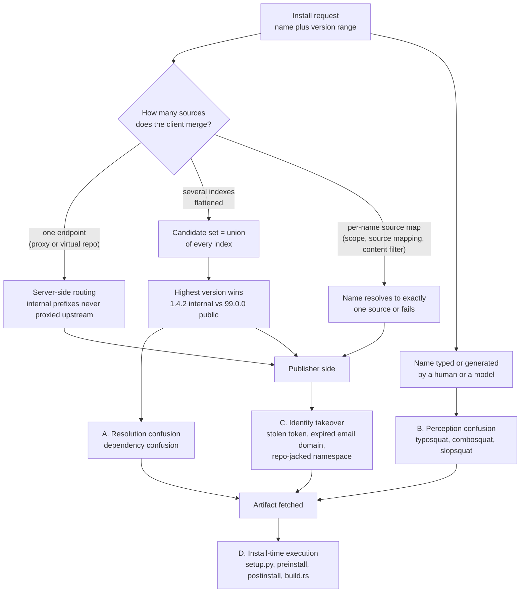

# Registry Attacks: Dependency Confusion, Typosquatting, and Account Hijacking

> [!summary] Claim:
> A package name is a claim on a registry, not an identity, and installers turn that claim into code execution with very little checking.
> Four distinct failures hide under "registry attack": resolution confusion (two indexes answer for one name and the highest version wins), perception confusion (a name that looks right to a human or a model), identity takeover (an account, an expired email domain, or a renamed GitHub namespace changes hands), and install-time execution (a hook runs before anyone reads the code).
> Defenses attach to one failure each: per-name routing for resolution, normalization and review for perception, 2FA and trusted publishing for identity, and default-deny hook policies for execution.
> An expert configures the client and the repository manager so that an internal name can only ever be answered by the internal source, and treats every lockfile as proof of content but not of origin.



## The Mechanism

### Why a name is not an identity

Every language ecosystem separates three things that humans collapse into one word, the "package": a name, a registry that serves it, and a publisher who owns it.
A manifest records only the name and a version range, for example `corp-billing>=1.4` or `"pplogger": "^1.0.0"`.
The installer must then decide which registry answers.
PEP 708 states the root cause for Python plainly: there is no globally unique namespace, each repository is its own namespace, and installers implicitly flatten several namespaces into one when given an abstract name such as `spam` (PEP 708, Motivation).
A concrete name would be `pypi.org:spam` or `example.com:spam`, and the flattening step is where the vulnerability lives.

Which ecosystems flatten by default, and which can be configured not to, determines the entire defensive posture.
The rest of this note walks the four failure classes in that order, then maps each ecosystem's controls.

### Class A: dependency confusion (resolution confusion)

Alex Birsan's February 2021 research is the canonical demonstration.
The trick, as reported by Malwarebytes: internal package names leak through public artifacts, in the reported case a PayPal `package.json` on GitHub that listed `express` (public) beside `pplogger` (private).
Birsan registered the unclaimed private names on the public npm registry, then repeated the idea for PyPI and RubyGems.
His packages used install-time code to "phone home", and because corporate networks block direct egress, they exfiltrated through DNS lookups rather than a direct connection.
He also tested what happens when the public package carries a higher version than the private one, and the higher public version was preferred, which raised the success rate.
Malwarebytes reports 35 affected companies, including Microsoft, Apple, Yelp, PayPal, Shopify, Netflix, Tesla, and Uber, and about $130,000 in bug bounties (as of the 2021-02 reporting; Birsan's own post was not retrievable by automation, see Further Reading).

The mechanism has three requirements, all met by default configurations:
1. The internal name is not claimed on the public registry, so anyone can publish it.
2. The client consults the public registry for that name, either because it is the default index or because it was added as an extra source.
3. The client's selection rule prefers the attacker's candidate, which for "highest version wins" means publishing a very large version number.

Condition 3 is the important one for Python.
The pip documentation says: "There is no priority in the locations that are searched. Rather they are all checked, and the 'best' match for the requirements (in terms of version number) is selected" (pip, `pip install` reference).
The same page carries a warning on `--extra-index-url`: using it to search for private packages is unsafe, a class of issue "known as dependency confusion", because an attacker can publish the same name to a public index and have it chosen instead.
The Worked Example reproduces this with two local indexes, without network access.

#### How each installer picks a source

The comparison that matters is not features but the answer to one question: when two sources know a name, who wins, and can the client be told to refuse the ambiguity?

**pip.**
`--index-url` sets the base index and `--extra-index-url` adds more; all are merged and the best version wins.
There is no per-package source pinning in pip itself.
The documented safe pattern is a single `--index-url` pointing at a proxy that serves both internal and mirrored public content, so the client sees one namespace and the server decides.
`--no-index` with `--find-links` removes the index entirely for vendored installs.

**uv.**
uv searches in the order indexes are defined, with command-line indexes before configuration-file indexes, and the index marked `default = true` (PyPI unless replaced) is "always treated as lowest priority, regardless of its position" (uv, Package indexes).
Its default `--index-strategy` is `first-index`: "Search for each package across all indexes, limiting the candidate versions to those present in the first index that contains the package."
The uv documentation states the intent directly: this exists to prevent dependency confusion, and it cites the December 2022 torchtriton attack.
The other strategies are `unsafe-first-match` (prefer the first index with a compatible version, even if newer versions exist elsewhere) and `unsafe-best-match`, which the docs describe as "closest to pip's behavior" and exposed to dependency confusion.
Per-package pinning uses `[tool.uv.sources]` with `index = "name"`, and an index marked `explicit = true` is only consulted for packages pinned to it.
Two documented details bite in practice.
First, under `first-index` uv by default stops at a 401 or 403 from an index (configurable per index with `ignore-error-codes`, and ignored for 403s from the PyTorch index) but always continues past a 404, which cannot be overridden, so an index that returns 403 for "not found" changes the outcome.
Second, named indexes referenced by `tool.uv.sources` must be defined in the project's `pyproject.toml`, not on the command line or in user configuration.

**Poetry.**
Sources have a priority class: `primary`, `supplemental`, or `explicit` (the last two introduced in Poetry 1.5.0).
Configuring any primary source disables the implicit PyPI source.
Supplemental sources are searched only if no higher-priority source yields a compatible distribution, and Poetry's own documentation warns that someone could publish a package to a primary source that shadows a package in your supplemental source.
Explicit sources are consulted only for packages whose dependency entry names that source, for example one added with `poetry add --source`.
Within a priority class, sources are tried in order of appearance in `pyproject.toml`.

**npm.**
The registry is a single configured URL, and scopes provide the per-name mapping: `npm config set @myco:registry=http://reg.example.com` sends every `@myco/*` install and publish to that registry, "Scopes have a many-to-one relationship with registries: one registry can host multiple scopes, but a scope only ever points to one registry" (npm, Scope).
Each npm user or organization owns a scope and "only you can add packages in your scope", and publishing to `@org` requires creating an organization with that name first.
That gives a pre-claim mechanism: create the organization named after your internal scope on the public registry, so nobody else can publish under it.
Unscoped names have no such protection, which is exactly the `pplogger` problem.
Authentication keys such as `_authToken` must be scoped to a registry URI such as `//registry.npmjs.org/:`, so "npm will never send credentials to the wrong host" (npm, .npmrc).
Two npm details affect trust.
The lockfile's `resolved` field is a tarball URL, and `registry.npmjs.org` there is "a magic value meaning the currently configured registry" (npm, package-lock.json).
The `replace-registry-host` config, default `npmjs`, rewrites lockfile dist URLs from `registry.npmjs.org` to the configured registry.
So the lockfile `integrity` (sha512 or sha1 SRI) binds content, and the lockfile does not bind origin host.
Finally, omitting the `@` in `npm install myorg/pkg` makes npm "attempt to install from GitHub" (npm, Scope), a one-character change that moves the source from the registry to a repository.

**pnpm and Yarn.**
pnpm's `namedRegistries` aliases record those packages in the lockfile under registry-qualified keys of the form `<name>@<registryName>:<version>`, so another registry that publishes the same name and version cannot be substituted quietly (pnpm, Mitigating supply chain attacks).
Yarn Berry maps scopes with `npmScopes` and credentials with `npmRegistries`.
Yarn's `enableImmutableInstalls` makes the install refuse any lockfile change and defaults to true on CI.

**Go.**
Module paths are repository URLs, so there is no flat name space to confuse across registries; the attack surface moves to proxies and domains.
The defaults are `GOPROXY=https://proxy.golang.org,direct` and `GOSUMDB=sum.golang.org`.
`GOPRIVATE` is a glob list of private module path prefixes that "acts as a default value for GONOPROXY and GONOSUMDB" (Go Modules Reference).
The reference documents a leak: with `GOPROXY=https://proxy.corp.example.com,https://proxy.golang.org`, a typo such as `corp.example.com/secret-product/typo@latest` makes the corporate proxy answer 404 or 410, and the go command then falls back to the public proxy "transmitting the secret-product path in the request URL".
If the private proxy returns any other error code, the command stops and does not fall back.
Private modules matched by `GOPRIVATE` or `GONOSUMDB` are accepted without checksum database verification, which is correct for private code and is also why the private proxy must be trusted.
For public modules, each downloaded zip or `go.mod` hash is compared against the main module's `go.sum` and, when absent, the checksum database, so an already-recorded version cannot silently change.

**NuGet.**
By default NuGet searches every configured source, and "when a package exists on multiple sources, it may not be deterministic which source the package will be downloaded from" (NuGet, Package Source Mapping).
Package Source Mapping (NuGet 6.0 and later, .NET SDK 6.0.100 and later) maps package ID patterns to sources in `nuget.config`, and once any mapping exists, every package including transitive ones must match a pattern.
Patterns are exact IDs or prefixes ending in `*`; the most specific pattern wins, an exact ID beats any prefix, and a lone `*` has the lowest precedence and acts as the default source.
Its documented limit: mappings apply during restore, install, and update, but metadata commands such as `dotnet package add` and `dotnet list package --outdated`, `--deprecated`, or `--vulnerable` still send package IDs to all configured sources, including public ones.
Older tooling ignores the configuration.

**Maven and Gradle.**
Maven's POM `repositories` are additive to the Super POM's central repository ("you will also get the standard set of repositories as defined in the Super POM"), and `settings.xml` mirrors redirect them.
A mirror with `<mirrorOf>*</mirrorOf>` sends every repository to one URL, which is the Maven form of a single endpoint.
There can be "at most one mirror for a given repository", Maven "will not aggregate the mirrors but simply picks the first match", and the guide says to use a repository manager for a combined view.
Whitespace matters in the list syntax: `!repo1, *` mirrors nothing, while `!repo1,*` mirrors everything but `repo1`.
Gradle searches repositories in declaration order and, once a repository supplies a module's metadata, takes its artifacts from that repository.
Gradle's `content { includeGroup(...) }` filter restricts what a repository may serve, and `exclusiveContent { forRepository { ... } filter { includeGroup(...) } }` makes a repository the only source for matching modules.
On the publishing side, Maven Central ties a `groupId` namespace to DNS: the Central Portal validates domain ownership with a TXT record on the exact domain (for `com.example` it checks `example.com`), and `io.github.<username>` namespaces verify through GitHub.
That makes the public namespace for a reversed domain claimable only by whoever controls the domain, which in turn ties the namespace's safety to that domain not lapsing (an inference from the documented design, discussed under identity takeover).

**Cargo.**
A crate depends on a non-default registry per dependency: `other-crate = { version = "1.0", registry = "my-registry" }`, with the registry's index URL in `.cargo/config.toml`.
Naming the registry in the dependency entry is a per-name source map, which is the property the other ecosystems retrofit.
`crates.io` "does not accept packages that depend on crates from other registries."
Source replacement is a different feature: Cargo assumes the replacement source is byte-identical to the original and states a replacement source "is not allowed to have crates which are not present in the original source", so it is a mirror or vendoring tool, not a way to add private crates.

**Bundler.**
A Gemfile may have one global `source`; multiple global sources were deprecated in Bundler 1.13.
Source priority is: the source attached to the gem (`:source`, `:path`, `:git`), then the parent's source for implicit gems, then the global source, and if multiple global sources are specified they are "prioritized from last to first" with a warning and an eventual error (RubyGems Guides, Gemfile).
The `source "https://gems.example.com" do ... end` block is the per-name form.

**Conan (C++).**
`conan remote add` accepts `-ap/--allowed-packages`, a list of recipe reference patterns this remote may serve, and `--index` to position the remote in the remote list.
The pattern list is a per-name source filter in the same family as Gradle content filters.
This note did not verify Conan's full resolution order, so it states only these documented options.

#### Why a standard fix is not coming for Python

PEP 708 proposed repository "tracks" metadata, so a repository could declare that a project on it extends a project elsewhere, and installers could refuse unexplained cross-repository merges.
It was provisionally accepted with three required conditions: an implementation in PyPI (Warehouse), an implementation in at least one other repository, and an off-by-default implementation in pip.
Its status page now reads Rejected: "After three years in the provisionally accepted state, the PEP has been rejected, because the required conditions for acceptance were never met" (PEP 708, as of 2026-11).
Consequence: for Python there is no protocol-level protection, and safety is the sum of client configuration (uv's `first-index`, `explicit` indexes, Poetry's `explicit`), repository-manager routing, and hash pinning.

### Class B: perception confusion (typosquatting and its relatives)

Typosquatting is the best-known sub-case, and the research shows it is the minority mechanism in taxonomy terms.
Neupane et al. (USENIX Security 2023) coded 1200+ documented attacks into 13 confusion categories and found that attackers "use a variety of mechanisms, many of which work at semantic, rather than syntactic, level".
Their Table 2 gives the categories with examples that are worth memorizing because each needs a different detector:

| Category | Example from the paper |
|---|---|
| Prefix/suffix augmentation | `dateutil` to `python3-dateutil` |
| Sequence reordering | `python-nmap` to `nmap-python` |
| Delimiter modification | `active-support` to `activesupport` |
| Grammatical substitution | `serialize` to `serializes` |
| Scope confusion | `@cicada/render` to unscoped `cicada-render` |
| Semantic substitution | `bz2file` to `bzip` |
| Asemantic substitution | `discord.js` to `discord.app` |
| Homophonic similarity | `uglify-js` to `uglyfi.js` |
| Simplification | `urllib3` to `urllib` |
| Alternate spelling | `colorama` to `colourama` |
| Homographic replacement | `django` to `diango` |
| 1-step Damerau-Levenshtein | `express` to `experss` |
| Familiar term abuse (no single target) | `applogger-ruby` |

Their detectors, evaluated on the whole npm set, produced "1 warning per 100M+ package pairs" for the selected rules, with 77% of sampled matches judged potentially or highly confusing and 18% highly confusing, and most pairs were not flagged by existing tools.
Two entries deserve emphasis.
Scope confusion is the typosquat of a namespace: an attacker publishes the unscoped name a developer might type when the real package is `@org/name`.
Combosquatting (prefix/suffix augmentation) is cheap to automate and defeats edit-distance filters, because `python3-dateutil` is far from `dateutil` in edit distance.

PyPI documents what it does on the registry side.
It normalizes new project names by "removing separators like `.`, `_`, and `-`, and treating easily-confused characters (like `l`, `i`, and `1`, or `o` and `0`) as identical", compares the result with existing projects, and rejects collisions; it also rejects names matching Python standard library module names (PyPI docs, Common Security Attacks).
PyPI says plainly: "These checks don't catch every typosquat."
The separator rule is the PEP 503 normalization (runs of `-`, `_`, `.` collapse to one `-`, lowercased), and PEP 503 requires clients to request the normalized URL, so `Corp_Billing` and `corp-billing` are one project.
The confusable-character rule is PyPI policy beyond PEP 503 and is not part of the Simple API.

A newer sub-case is slopsquatting: PyPI's guidance is to "always check package names from LLM output, as an attacker could register a malicious package that an LLM may hallucinate".
The structural fix is the same as for human typos: a package name should enter a manifest only through a review that checks it exists, is the intended project, and has an expected publisher, and the install should come from a lockfile so a name is resolved once.

Policy backstops exist but are slow.
PEP 541 lists name squatting ("package has no functionality or is empty") among reasons PyPI may remove a project, and npm's Package Name Disputes policy prohibits name squatting.
Neither prevents the first malicious install; both shorten the exposure window after a report.

### Class C: identity takeover

When the name and registry are right, the publisher can still change.
Three takeover paths recur, and they are architecturally different.

**Account compromise via credentials or stolen tokens.**
GitHub's npm security plan after the September 2025 Shai-Hulud incident describes "a surge in damaging account takeovers on package registries" in which attackers publish through maintainer accounts, and lists the planned changes: local publishing with required 2FA, granular tokens with a seven-day lifetime, trusted publishing, deprecating classic tokens, and removing the option to bypass 2FA for local publishing (GitHub Blog, 2025-09-22; these are announced plans, so check the current npm docs before relying on a given default).
The self-replicating worm mechanics belong to [[Case-Study-Shai-Hulud-and-Self-Replicating-Registry-Worms]].
Trusted publishing removes the long-lived token: PyPI pioneered it in April 2023, followed by RubyGems (December 2023), crates.io (July 2025), npm (July 2025), and NuGet (September 2025), per the same GitHub post.
npm's trusted publishing uses OIDC from GitHub Actions, GitLab CI/CD, or CircleCI, and a package can configure up to 10 trusted publishers (npm Docs, as of 2026-11).
A related npm control is staged publishing: `npm stage publish` submits a package to a staging area that a maintainer with 2FA reviews and approves before it goes live (npm Docs, as of 2026-11).
Provenance and attestation mechanics belong to [[Sigstore-Keyless-Signing-Cosign-Fulcio-and-Rekor]] and [[SLSA-Framework-Build-and-Source-Tracks]].

**Expired email domain (domain resurrection).**
The ctx incident is the clean reference case, from the Python Security Response Team's postmortem:
1. The domain hosting the email address of ctx's owner account had expired at an unknown time.
2. A password reset was attempted for the owner account on 2022-05-10.
3. The domain was registered by someone else at 2022-05-14T18:40:05Z.
4. The password reset succeeded at 18:52:40Z, 12 minutes after registration, and the owner account had no multi-factor authentication.
5. Malicious uploads began at 19:18:36Z on 2022-05-14, adding code that base64-encoded `os.environ` values and sent them to an attacker-controlled host.
6. PyPI removed the malicious releases and froze the account on 2022-05-24, about 27,000 estimated downloads of malicious versions, mostly from mirrors syncing.
The postmortem notes that version pinning and hash-checking mode "would prevent this attack, which depends on users automatically upgrading to the latest available version".
In August 2025 PyPI described the systemic fix: it checks domains for expiry, treats an email as no longer verified when its domain enters the expiration phases, and will not issue a password reset to an unverified address.
PyPI had unverified over 1,800 addresses since early June 2025, checks domains in use daily after an initial bulk check in April 2025, and warns this "isn't a perfect solution"; it cannot detect a domain transfer that does not involve expiry (PyPI Blog, 2025-08-18).
PyPI's analysis of the registrar lifecycle gives the window an attacker waits for: a renewal grace period of 0 to 45 days, a redemption period of 30 days, then 5 days of pending delete, before release.
Accounts with activity after 2024-01-01 have 2FA enabled, so a domain takeover alone also needs the second factor or a full account recovery.
Package registries that rely on email for recovery and have no such check inherit the same hole.

**Repository and namespace hijacking (repo-jacking).**
Many manifests name a GitHub `owner/repo` instead of a registry package: git dependencies in npm, Go module paths such as `github.com/owner/repo`, GitHub Actions `uses:` lines, and badges or download URLs.
GitHub's documentation describes the primitive.
After a username change, "your old username becomes available for anyone else to claim", and references to your repositories redirect, but "if the new owner of your old username creates a repository with the same name as your repository, that will override the redirect entry and your redirect will stop working" (GitHub Docs, About username changes).
Renaming a repository redirects clones, fetches, and web links, but "if you create a new repository under your account in the future, do not reuse the original name of the renamed repository", or the redirect breaks; GitHub also does not redirect calls to an action in a renamed repository.
GitHub's mitigation is retirement: when a transferred repository had more than 100 clones or more than 100 uses of GitHub Actions in the prior week, or is a Marketplace action, GitHub permanently retires the owner and repository name combination so it cannot be recreated (GitHub Docs, Transferring a repository).
Read the threshold as a statement about what GitHub protects: a niche dependency below those numbers can still be re-created by whoever claims the old username.
The attack therefore needs three conditions: a manifest pinned to a name rather than a commit, an owner who renamed or deleted their account, and a repository under the retirement thresholds.
Mitigations that work regardless: pin git dependencies to a full commit SHA (npm records "the full git url with commit sha" in the lockfile), keep the hash of the fetched artifact (`go.sum`), and vendor or mirror the source.

**A neighboring case: a domain that serves code.**
polyfill.io is not a registry, but it shows the same identity failure at a CDN: a Chinese company bought the domain and the GitHub account in February 2024, and Sansec reported on 2024-06-25 that the domain, embedded by 100,000 or more sites, was injecting malware on mobile devices through any site that loaded `cdn.polyfill.io`.
Cloudflare rewrote the endpoint on 2024-06-27 and Namecheap put the domain on hold, per Sansec's updates.

**Account hijack that publishes malicious versions.**
The GitHub Advisory Database entry for `ua-parser-js` (CVE-2021-4229, published 2021-10-22) records three malicious versions, 0.7.29, 0.8.0, and 1.0.0, patched in 0.7.30, 0.8.1, and 1.0.1, and instructs that any computer with the package installed "should be considered fully compromised".
The advisory text does not itself describe how the attacker obtained publish rights; the event is the reference example of a trusted name carrying malicious versions, which is why version pinning plus cooldowns apply.

### Class D: install-time execution (the amplifier)

Classes A to C get a malicious artifact into the install; hooks make that artifact run immediately, with the developer's or CI's credentials.
Birsan's research depended on it: npm "allows arbitrary code to be executed automatically when a package is installed" (Malwarebytes).

| Ecosystem | When foreign code runs | Control (as of 2026-11, per vendor docs) |
|---|---|---|
| npm | `preinstall`, `install`, `postinstall`, and `prepare` for git or non-registry sources | `--ignore-scripts`; `allowScripts` policy (see the npm script policy paragraph in this section) |
| pnpm | dependency build scripts | blocked unless listed in `allowBuilds`; `strictDepBuilds` on by default |
| Yarn Berry | dependency postinstall scripts | `enableScripts: false` is the documented default |
| pip | pip "involves running arbitrary code from distributions" by default (Secure installs page) | `--only-binary :all:` disallows source distributions; hash mode |
| Cargo | `build.rs` is compiled and executed "just before building the package" | review and vendoring, cargo-vet in [[Enterprise-Third-Party-Code-Ingestion-and-Quarantine-Architecture]] |
| Go | no per-package install hook is documented in the Go Modules Reference excerpts reviewed here | checksum database, `go.sum` |

npm's script policy is the newest of these and is easy to over-claim, so read the documentation literally.
The npm 11 CLI documents an `allowScripts` field in `package.json` that records which dependencies may run install scripts, maintained with `npm approve-scripts`, `npm deny-scripts`, and `npm install-scripts`.
The `npm approve-scripts` page states: "In the current release, this field is advisory: install scripts still run by default, but installs print a list of packages whose scripts have not been reviewed. A future release will block unreviewed install scripts."
Making it enforcing today requires `strict-allow-scripts=true`, which turns unreviewed entries into a hard install error; entries explicitly set to `false` are skipped silently.
`--ignore-scripts` and `--dangerously-allow-all-scripts` both override the policy.
By default approvals are pinned (`pkg@1.2.3`) with `allow-scripts-pin` true, so a compromised new version of an approved package must be re-approved.
pnpm's documentation gives the rationale for default deny: "if a dependency did not require a build in the past, it won't suddenly run a malicious script if a compromised version is published."
For Python, pip's own Secure installs page states that by default pip "involves running arbitrary code from distributions", and offers `--only-binary :all:` to disallow source distributions.
`--only-binary` fails the install for packages without a binary distribution, so it is a policy decision about which packages may be built from source.

Cooldowns are the delay-based complement to hook policy.
npm's `min-release-age` (days; default `null`) installs only versions older than the window and errors if none qualify, and it can block `npm audit fix` when the fix is newer than the window; the `before` config takes an exact date.
pnpm's `minimumReleaseAge` defaults to 1440 minutes (one day), `trustPolicy: no-downgrade` rejects a release whose trust evidence (trusted publisher, provenance) is weaker than earlier releases, and `blockExoticSubdeps` (default on) refuses git or tarball-URL transitive dependencies.
npm's `allow-git` (default `all`) can be set to `none` or `root` to restrict git dependencies.
The enterprise quarantine design that combines these belongs to [[Enterprise-Third-Party-Code-Ingestion-and-Quarantine-Architecture]].

### Defense architecture: one endpoint, per-name routing

The strongest generic pattern is to remove the client's choice.
Developers and CI point every ecosystem at a single repository-manager URL, and the manager decides which upstream may answer which names.
Two vendor features implement the routing:
- JFrog Artifactory virtual repositories take Ant-like include and exclude patterns; the documentation's own example is a virtual repository of remote repositories with an exclude pattern set to the organization's group ID, so "any attempt to access your internal artifact from a remote repository would be rejected", and the patterns apply to all users including admins.
- Sonatype Nexus routing rules are BLOCK or ALLOW matchers using Java regular expressions against request paths, one rule per proxy repository (a rule may be reused across proxies), and the documentation warns about regular expression denial of service and points to Repository Firewall for complex policy.
Azure Artifacts has a package-level control of the same kind: the "Allow Externally-Sourced Versions" setting is disabled by default, so versions from an upstream such as nuget.org or npmjs.com do not enter the feed for a package until a feed owner enables it, and the setting does not affect versions already saved.
The failure mode of this pattern is that routing is only as good as the list of internal names: an unlisted internal namespace falls through to the public upstream.
The remedy is naming discipline (internal packages share a reserved prefix, group ID, or scope) and an inventory that compares internal names against public registries, the job of tools such as the open-source `confused` checker from Visma's security team.

### Pre-claiming names

Pre-claiming reserves the public name of an internal package so nobody else can.
Mechanisms that exist, per the vendor documents cited in the sources:
- npm: create the organization that owns the scope (`@acme`).
- Maven Central: verify the reversed-domain namespace with a DNS TXT record.
- PyPI, RubyGems, crates.io: register the project name.
For PyPI the tension is policy: PEP 541 allows removal of a project that is "name squatting (package has no functionality or is empty)", so a defensive reservation should be a real minimal distribution with accurate metadata, and it should not be relied on as the control.
Pre-claiming is defense in depth, not the primary control, because it requires winning a race for each name, covers only registries you remember, and does nothing for typosquats of your names.

## Commands and Numbers to Know

| Item | Value | Platform | Notes |
|---|---|---|---|
| pip index merge | all indexes merged, best version wins, no priority (as of 2026-11, pip 26.3 docs) | Both | `--extra-index-url` for private names is documented as unsafe. |
| pip hash mode | `--require-hashes`; implied by any `--hash` in a requirements file (as of 2026-11, pip 26.3) | Both | All requirements and dependencies need hashes and pins; `--no-require-hashes` was added in pip 26.2. |
| pip source builds | `--only-binary :all:` (as of 2026-11, pip 26.3) | Both | Packages with no wheel fail. |
| uv default strategy | `first-index` (as of 2026-11, uv docs; latest release 0.13.9, capture used 0.11.26) | Both | `unsafe-first-match` and `unsafe-best-match` are opt-in; env var `UV_INDEX_STRATEGY`. |
| uv default index | lowest priority regardless of order (as of 2026-11, uv docs) | Both | `--default-index` is the fallback, `--index` entries are tried first. |
| uv explicit index | `explicit = true` plus `[tool.uv.sources] pkg = { index = "name" }` (as of 2026-11) | Both | Index must be defined in `pyproject.toml`. |
| Poetry priorities | `primary`, `supplemental`, `explicit`; the last two from 1.5.0 (as of 2026-11) | Both | Any primary source disables implicit PyPI. |
| npm scope routing | `npm config set @scope:registry=URL` (as of 2026-11, npm 11) | Both | One scope maps to exactly one registry. |
| npm lockfile fields | `resolved`, `integrity` (sha512 or sha1 SRI) (as of 2026-11, npm 11) | Both | Integrity binds content, not origin host. |
| npm install scripts | run by default; `allowScripts` advisory, enforced with `strict-allow-scripts=true` (as of 2026-11, npm 11 docs) | Both | `ignore-scripts` default false. |
| npm cooldown | `min-release-age` days, default `null`; `before` date (as of 2026-11, npm 11) | Both | Can block `npm audit fix`. |
| npm unpublish | 72 hours for new packages with no dependents; later only if under 300 weekly downloads, single owner, no dependents (as of 2026-11) | Both | After unpublishing all versions, 24 hours before any new publish of the name. |
| npm trusted publishers | up to 10 per package (as of 2026-11) | Both | GitHub Actions, GitLab CI/CD, CircleCI. |
| pnpm defaults | `minimumReleaseAge` 1440 minutes, `strictDepBuilds` on, `blockExoticSubdeps` on (as of 2026-11) | Both | Per pnpm.io supply-chain page. |
| Yarn Berry defaults | `enableScripts: false`; `enableImmutableInstalls` true on CI (as of 2026-11) | Both | Per Yarn `.yarnrc.yml` reference. |
| Go defaults | `GOPROXY=https://proxy.golang.org,direct`, `GOSUMDB=sum.golang.org` (as of 2026-11, Go reference) | Both | `GOPRIVATE` defaults `GONOPROXY` and `GONOSUMDB`; proxy fallback on 404 and 410 only. |
| NuGet source mapping | NuGet 6.0, .NET SDK 6.0.100 (as of 2026-11) | Both | Every package, including transitive, must match once enabled. |
| Azure Artifacts | external versions disabled by default (as of 2026-11) | Both | Owner-controlled per package. |
| Gradle filter | `exclusiveContent` plus `includeGroup` (as of 2026-11) | Both | Search follows declaration order. |
| Cargo per-dependency registry | `registry = "name"` in the dependency (as of 2026-11) | Both | crates.io refuses crates depending on other registries. |
| Bundler global source | one allowed; multiple deprecated since 1.13 (as of 2026-11) | Both | Use `source` blocks. |
| GitHub retirement threshold | more than 100 clones or more than 100 Actions uses in the week before transfer (as of 2026-11) | Both | Marketplace actions are also retired. |
| PyPI expired-domain check | daily; over 1,800 emails unverified since 2025-06 (as of 2025-08-18) | Both | Domain transfers without expiry are not detected. |
| ctx timeline | reset 12 minutes after domain registration, about 27,000 estimated malicious downloads (2022) | Both | From the PSF postmortem. |

## Multi-Language Comparison

Because this concern spans package ecosystems, the table compares the per-name source control each one offers, which is the control that matters for resolution confusion.

| Ecosystem | Default when two sources know a name | Per-name source control | Install-time code | Identity and namespace notes |
|---|---|---|---|---|
| Python (pip) | best version across all indexes | none; use one proxy endpoint | pip runs arbitrary code from distributions by default (Secure installs page) | flat names, PyPI normalizes and rejects confusables and stdlib names |
| Python (uv, Poetry) | uv `first-index`; Poetry per priority class | uv `explicit` + `tool.uv.sources`; Poetry `explicit` + `--source` | not researched here | PEP 708 rejected, no protocol fix |
| JavaScript (npm, pnpm, Yarn) | one registry URL; scopes route | `@scope:registry`, pnpm `namedRegistries`, Yarn `npmScopes` | scripts run by default on npm; blocked by default on pnpm and Yarn Berry | scope is owned by a user or org; unscoped names are open |
| Rust (Cargo) | crates.io unless a dependency names a registry | `registry = "name"` per dependency | `build.rs` always runs | crates.io cannot depend on other registries |
| Go | proxy then VCS; path is the identity | `GOPRIVATE`, `GONOPROXY`, `GONOSUMDB` | no install hook documented | checksum database; repo-jacking attacks the path |
| Java (Maven, Gradle) | Gradle: declaration order; Maven adds the Super POM central repository | Gradle `exclusiveContent`; Maven `mirrorOf` plus a repository manager | not researched here | reverse-DNS namespace verified by DNS TXT |
| .NET (NuGet) | all sources, nondeterministic | Package Source Mapping | not researched here | package ID prefix patterns |
| Ruby (Bundler) | global source, multi-source deprecated | `source` blocks, `:source` per gem | not researched here | one global source rule |
| C++ (Conan) | remote list with `--index` positioning; full resolution order not verified here | `--allowed-packages` per remote | not researched here | none documented in the pages reviewed |

Cells marked "not researched here" are deliberate: those facts were not verified for this note and are not asserted.

## Worked Example

This note has no lab, and nothing in this section is committed under `code/`.
The block shows one throwaway capture, run once on 2026-11-21 on darwin-arm64: pip 26.2.2 on Homebrew CPython 3.15.2, and uv 0.11.26 (which chose CPython 3.14.6 for its `--target` install).
The setup is two local PEP 503 indexes built in a temporary directory, with no network: an internal index holding `corp-billing 1.4.2` and a public index holding `corp-billing 99.0.0`.
Each wheel is an inert pure-Python wheel whose `__init__.py` sets `ORIGIN` to its index, so the importing process can report which one was installed.
The example isolates the resolution decision and says nothing about hook execution, because the wheels were built to be inert.
The builder script is a throwaway and is not reproduced; its hashes vary per run, so they are scrubbed to `<sha256>` in the blocks, and long lines were cut by the capture filter.

Runs against pip, with `<I>` and `<P>` standing for the internal and public `file://` index URLs:

```
$ pip install --no-deps --target T --index-url <I> --extra-index-url <P> corp-billing
Looking in indexes: file://<TMP>/internal/simple/, file://<TMP>/public/simple/
Processing <TMP>/public/simple/corp-billing/corp_billing-99.0.0-py3-none-any.whl
Successfully installed corp-billing-99.0.0
exit=0 imported ORIGIN=public-99.0.0

$ pip install --no-deps --target T --index-url <I> corp-billing
Looking in indexes: file://<TMP>/internal/simple/
Processing <TMP>/internal/simple/corp-billing/corp_billing-1.4.2-py3-none-any.whl
Successfully installed corp-billing-1.4.2
exit=0 imported ORIGIN=internal-1.4.2

$ pip install ... --index-url <I> --extra-index-url <P> -r req.txt    # req.txt: corp-billing==1.4.2 --hash=sha256:<internal>
Successfully installed corp-billing-1.4.2
exit=0 imported ORIGIN=internal-1.4.2

$ pip install ... --index-url <I> --extra-index-url <P> -r req.txt    # req.txt: corp-billing==99.0.0 --hash=sha256:<internal>
Processing <TMP>/public/simple/corp-billing/corp_billing-99.0.0-py3-none-any.whl (from -r <TMP>/req.txt (line 1))
ERROR: THESE PACKAGES DO NOT MATCH THE HASHES FROM THE REQUIREMENTS FILE. (line truncated in capture)
    corp-billing==99.0.0 from file://<TMP>/public/simple/corp-billing/corp_billing-99.0.0-py3-none-any.whl#sha256=<sha256> (line truncated in capture)
        Expected sha256 <sha256-internal>
             Got        <sha256-public>
exit=1 imported ORIGIN=(not installed)
```

Runs against uv, using `uv pip install --no-cache --target T`:

```
$ uv pip install --index <I> --default-index <P> --index-strategy first-index corp-billing
   + corp-billing==1.4.2
imported ORIGIN=internal-1.4.2

$ uv pip install --index <I> --default-index <P> --index-strategy unsafe-best-match corp-billing
   + corp-billing==99.0.0
imported ORIGIN=public-99.0.0

$ uv pip install --default-index <I> --index <P> --index-strategy first-index corp-billing     # roles inverted
   + corp-billing==99.0.0
imported ORIGIN=public-99.0.0
```

The last uv run, which reversed the roles of the two flags, was an accident of the first attempt and is kept because it is the most instructive result.
Reading the output:
1. pip with two indexes installed `99.0.0` from the public index, because version ordering is the only tie-breaker.
2. The same pip command with only the internal index installed `1.4.2`, which is the single-endpoint defense in miniature.
3. A pinned requirement with the internal wheel's hash installed `1.4.2` with both indexes still configured, and the same hash against a `==99.0.0` pin failed with the hash-mismatch error, so hash mode converts a silent substitution into a hard failure.
4. uv's default `first-index` strategy chose the internal index when the internal index was an `--index` entry, and `unsafe-best-match` chose `99.0.0`, reproducing pip's behavior.
5. uv's `--default-index` is the lowest-priority index, so putting the public index there is safe and putting the internal index there is not; the third uv run picked the public wheel under the safe-sounding `first-index` strategy because the "default" index sat last and the public one was listed as `--index`.

What this does not show: the hash run proves the check, but the hash for a real lockfile is recorded at lock-generation time, so a lockfile generated while the attacker's version was being served locks in the attacker's hash.
Generate lockfiles only against the single trusted endpoint.

## Pitfalls

> [!warning] Pitfall 1: `--extra-index-url` as a private-index mechanism
> The most common root cause of Python dependency confusion is the multi-index recipe copied from a vendor's setup page.
> Replace it with one `--index-url` to a repository manager that proxies public names, and verify with `pip download` against a name you control.

> [!warning] Pitfall 2: Reading uv's "default" as the preferred index
> In uv, the default index is lowest priority, and `first-index` protects only names present on an earlier index.
> Mark the private index `explicit = true` and pin each private package with `tool.uv.sources`, so that a typo or a missing mapping fails instead of falling to PyPI.

> [!warning] Pitfall 3: A lockfile is proof of content, not of origin
> npm's integrity hash and `go.sum` bind bytes, but npm lockfile URLs are rewritten to the configured registry by default and the `registry.npmjs.org` host is a placeholder.
> The trust decision happens at lock generation, so regenerate lockfiles only through the trusted endpoint and review lockfile diffs for new hosts and new packages.

> [!warning] Pitfall 4: Fall-through on 404
> Go's documented fallback from a private proxy to `proxy.golang.org` on 404 or 410 leaks the private path, and uv always continues past 404.
> A private index that returns 403 for "not found" behaves differently from one that returns 404 under uv's `first-index`.
> Configure private prefixes with `GOPRIVATE`, and make private indexes return the status code the client expects.

> [!warning] Pitfall 5: Mapping tools that do not cover every command
> NuGet Package Source Mapping applies to restore, install, and update, and `dotnet package add` and `dotnet list package --outdated` (also `--deprecated` and `--vulnerable`) still send package IDs to every configured source.
> A "private" ID typed into those commands leaks to public feeds.

> [!warning] Pitfall 6: Whitespace and regex in routing
> Maven's `!repo1, *` mirrors nothing because of the space, and Nexus routing matchers are Java regular expressions that can be expensive.
> Test routing with the product's test-path tool before relying on it.

> [!warning] Pitfall 7: Assuming npm scope ownership you never claimed
> A private scope used only through `@acme:registry=` is unprotected if the organization `acme` is still free on the public registry, and a CI job missing the `.npmrc` mapping would then ask the public registry.
> Create the organization on the public registry, and keep the mapping in a committed project `.npmrc`.

> [!warning] Pitfall 8: Pre-claim placeholders that violate policy
> An empty reserved PyPI project can be removed under PEP 541, which lists name squatting among the reasons.
> Publish a minimal, honestly described package and monitor the name.

> [!warning] Pitfall 9: Pinning the name but not the repository identity
> Go module paths, npm git dependencies, and GitHub Actions references name `owner/repo`, and a changed owner can be re-claimed, because the old username becomes available and a new repository with the same name overrides the redirect.
> Pin to commit SHAs and keep checksums, and treat a path whose owner renamed as a migration to be done deliberately.

> [!warning] Pitfall 10: Cooldowns that block the fix
> npm's `min-release-age` can stop `npm audit fix` from installing a patch that is newer than the window, exit non-zero, and tell you to add the package to `min-release-age-exclude`.
> Define an emergency exception path before enabling the window.

## At Scale

For one developer, the realistic controls are a lockfile, `npm ci` or `pip --require-hashes` in CI, `--ignore-scripts` for unfamiliar packages, and typing package names from a verified source.
For a team of 50, add a committed project config (`.npmrc`, `pyproject.toml`, `nuget.config`) that declares sources and mappings, so a fresh clone cannot resolve differently from CI.
For 1,000 to 50,000 engineers, individual client configuration cannot be audited, and policy has to move to the server and to the CI image.

Decision rules:
1. Give each ecosystem exactly one resolution endpoint, a repository manager, and make that the only egress for package traffic; client files then name one URL, not several.
2. On the manager, serve every internal namespace (prefix, group ID, scope) only from the hosted internal repository and block it on every proxied upstream, using Artifactory exclude patterns, Nexus routing rules, or Azure Artifacts' disabled external versions.
3. Reserve internal namespaces, with a prefix convention, so routing can be written as one rule; reserve the public names too (organization, DNS-verified namespace, placeholder) as defense in depth.
4. Require lockfiles and frozen installs in CI: `npm ci` (fails on a lockfile mismatch and never writes the lockfile), `pip --require-hashes`, Yarn `enableImmutableInstalls`.
5. Make install-script execution allowlisted: pnpm `allowBuilds`, Yarn default, npm `strict-allow-scripts` with reviewed `allowScripts` entries; Python builds from source only for approved packages.
6. Apply a cooldown to new public versions, with a documented emergency override, and combine it with provenance or trusted-publisher checks where the ecosystem offers them.
7. Require 2FA and trusted publishing for every internal and open-source package you publish, and audit the email domains of maintainer accounts for expiry.
8. Run a scheduled inventory that checks every internal name against every public registry you consume, and treat a hit as an incident per [[Respond-to-a-Compromised-Transitive-Dependency]].

Costs to state plainly: a repository manager is a single point of failure for builds and needs its own high-availability and security posture; routing rules must be maintained as namespaces change; a cooldown delays legitimate security fixes; and default-deny scripts create review work for packages with native builds.
The cross-ecosystem design is the subject of [[Supply-Chain-Decision-Records]], and the detection and hardening of the pipeline around it is [[OpenSSF-Scorecard-and-CI-CD-Pipeline-Hardening]].

> [!tip] Practice Drill: Exploit and fix a confusion locally
> Do the guided version in [[Drill-Supply-Chain-Exploit-and-Fix-Dependency-Confusion]].
> To warm up first, build two local file indexes as in the Worked Example, show pip choosing the higher public version, then fix it three ways in turn: a single index, `--require-hashes` with a pinned hash, and uv with `explicit = true` and `tool.uv.sources`.
> For each fix, record which input still lets the attack succeed (for example, a lockfile generated while both indexes were live).

## Interview Questions

> [!question] L5: What is dependency confusion, and why did Birsan's attack work against so many companies?
> > [!success]- Answer
> > It is an attack in which a build resolves an internal package name against a public registry and installs the attacker's package.
> > It worked because internal names leaked through public manifests, those names were unclaimed on public registries, and installers merge sources and prefer the highest version.
> > Install-time hooks on npm then ran his code on installation, and DNS gave a way out through firewalls.
> > Reported scope: 35 companies and about $130,000 in bounties (Malwarebytes, 2021).

> [!question] L5: Predict the output.
> `corp-billing 1.4.2` is on the internal index and `corp-billing 99.0.0` is on the public index.
> What does each command install?
> ```
> pip install --index-url INTERNAL --extra-index-url PUBLIC corp-billing
> pip install --index-url INTERNAL corp-billing
> uv pip install --index INTERNAL --default-index PUBLIC corp-billing
> uv pip install --index INTERNAL --default-index PUBLIC --index-strategy unsafe-best-match corp-billing
> ```
> > [!success]- Answer
> > 99.0.0 (public), 1.4.2 (internal), 1.4.2 (internal), 99.0.0 (public).
> > pip merges both indexes and picks the best version, so the public package wins.
> > With one index there is nothing to merge.
> > uv's default `first-index` limits candidates to the first index that has the package, and the `--default-index` is lowest priority.
> > `unsafe-best-match` restores pip's behavior.
> > This matches the captured run in the Worked Example (pip 26.2.2, uv 0.11.26, darwin-arm64).

> [!question] L5: Why do registries' typosquat checks not stop most package-confusion attacks?
> > [!success]- Answer
> > Because most attacks are not small edit-distance changes.
> > Neupane et al. found 13 categories in 1200+ attacks, many semantic: adding `python3-` to a name, reordering segments, dropping the scope, or using familiar terms.
> > PyPI's normalization handles separators, confusable characters, and standard-library names, and the PyPI docs themselves say these checks do not catch every typosquat.

> [!question] L6: Debug this.
> A team configures uv with `--default-index https://corp.example/simple` and `--index https://pypi.org/simple`, runs the default strategy, and still gets the public `corp-billing 99.0.0`.
> Why, and how do you fix it permanently?
> > [!success]- Answer
> > The default index is always lowest priority, so the explicit `--index` (PyPI here) is consulted first, and `first-index` stops at the first index that has the name.
> > The roles are inverted; the captured third uv run in the Worked Example reproduces the failure.
> > A durable fix does not rely on ordering: define the corporate index in `pyproject.toml` with `explicit = true`, pin each private package with `[tool.uv.sources] corp-billing = { index = "corp" }`, and make PyPI the default.
> > Then an unmapped private name fails to resolve instead of quietly resolving publicly.

> [!question] L6: Your internal npm packages are unscoped, like `pplogger`.
> What are your options, and what does each cost?
> > [!success]- Answer
> > Best: rename to a scope you own, create that organization on the public registry, and map the scope with `@scope:registry` in a committed `.npmrc`; cost is a coordinated rename across consumers.
> > Interim: block the unscoped names on the proxy's public upstream with a routing or exclude rule so a public package of that name cannot be fetched, and pre-register the names publicly.
> > Pre-registering alone does not stop future internal names or typosquats.
> > Add `npm ci` and review lockfile diffs.

> [!question] L6: Go runs with `GOPROXY=https://proxy.corp,https://proxy.golang.org`.
> A developer mistypes a private module path.
> What happens, and how do you stop the leak?
> > [!success]- Answer
> > If the private proxy answers 404 or 410, go falls back to `proxy.golang.org` and sends the full path in the request URL, leaking that the path exists; any other error from the private proxy stops the command without fallback.
> > Set `GOPRIVATE` for the private prefixes (which also sets `GONOPROXY` and `GONOSUMDB`), or use a single trusted proxy as `GOPROXY` and keep `GONOSUMDB` set for private modules.
> > Make the private proxy return the right status codes.

> [!question] L6: Walk through the ctx compromise and name the control that breaks each link.
> > [!success]- Answer
> > Expired email domain, then re-registration, then password reset 12 minutes later, then malicious uploads that read `os.environ`.
> > Breaks: registry-side expired-domain checks (PyPI now unverifies such emails), 2FA on the owner account (it had none), trusted publishing in place of tokens or passwords, and on the consumer side version pinning and hash checking, which the postmortem says would have prevented the install.
> > The 27,000 estimated downloads were mostly mirrors syncing, which is why mirrors need their own cooldown.

> [!question] L7: Design package ingestion for 5,000 engineers across Python, npm, Maven, and Go.
> What do you build, and where does it fail?
> > [!success]- Answer
> > One repository manager per ecosystem as the only egress, internal namespaces reserved by prefix, hosted-only for those prefixes with upstream blocks, public names pre-claimed, frozen installs and hash pinning in CI, script allowlists, a cooldown with an emergency path, and trusted publishing for what you publish.
> > It fails where the namespace list is incomplete (an unlisted internal name falls through), where a team bypasses the manager with a local config, where lockfiles are generated off-manager, and where the manager becomes a single point of build failure.
> > Detect bypass with network egress rules and a scheduled name-inventory job.

> [!question] L7: PEP 708 was rejected.
> What does that mean for your Python policy?
> > [!success]- Answer
> > The proposed protocol-level protection, repository "tracks" metadata, never reached its required implementation conditions, so there is no standard way for an installer to know a cross-index merge is unintended.
> > Policy must rely on client controls (uv `explicit` indexes and `first-index`, Poetry `explicit` sources), a single endpoint with server-side routing, and hash-pinned lockfiles.
> > Do not plan around a future spec.

> [!question] L7: How does repo-jacking work against a Go module or GitHub Action, and what does GitHub's retirement rule protect?
> > [!success]- Answer
> > If an owner renames their account, the old username becomes claimable; a new repository with the old name overrides the redirect, so a manifest naming `owner/repo` now points at the claimant's code.
> > GitHub retires the owner/repo combination for transferred repositories with more than 100 clones or more than 100 Actions uses in the prior week, or Marketplace actions, so popular names are protected and niche ones are not.
> > Pin commit SHAs, keep `go.sum` and vendor, and treat an owner rename as a migration event.

> [!question] L8+: Your CISO wants a seven-day cooldown on all new public versions.
> Argue the position and the exceptions.
> > [!success]- Answer
> > A delay window is cheap and works against the common case where malicious versions are removed within hours or days, and pnpm and npm now ship the control natively (pnpm default one day).
> > The costs are slower security patches (npm documents `min-release-age` blocking `audit fix`), delayed access to legitimate fixes, and a false sense of safety against slow-burn compromises such as long-planned maintainer takeovers.
> > Require an exception path with a named approver for advisories rated critical, apply the window at the repository manager so it covers every client, pair it with trusted-publisher and provenance checks, and measure how many installs were delayed.
> > Make the number a decision recorded in [[Supply-Chain-Decision-Records]] rather than a default.

## Further Reading

- PEP 708 (Rejected): the clearest statement of why flat namespaces cause the attack and why a protocol fix did not ship.
- pip `pip install` reference and Secure installs: the documented merge rule, the `--extra-index-url` warning, and hash-checking mode.
- uv, Package indexes: index strategies, `explicit`, and the 401, 403, 404 behavior.
- Poetry, Repositories: the primary, supplemental, and explicit priority classes and their warning.
- npm Docs, Scope, `.npmrc`, config, scripts, `approve-scripts`, Unpublish Policy, Trusted publishing: scope routing, credentials per registry, install-script policy, and publishing controls.
- pnpm, Mitigating supply chain attacks: the default-deny build script, cooldown, and trust policy model.
- Go Modules Reference: GOPROXY fallback, GOPRIVATE, and the checksum database.
- NuGet Package Source Mapping: pattern precedence and its documented gaps.
- Gradle, Filtering Repository Content: `exclusiveContent` and `includeGroup`.
- Maven Central, Register a Namespace: DNS-verified namespaces.
- The Cargo Book, Registries and Source Replacement: per-dependency registries and why source replacement is not a private-registry tool.
- JFrog virtual repositories and Sonatype Nexus routing rules: server-side namespace routing.
- PyPI docs, Common Security Attacks, and the PyPI blog on domain resurrection: registry-side defenses and their stated limits.
- Python Security Response Team, ctx postmortem: a minute-level timeline of a domain-resurrection takeover.
- GitHub Docs on renaming, transferring, and changing usernames: the primitives behind repo-jacking.
- Neupane et al., Beyond Typosquatting (USENIX Security 2023): the 13-category taxonomy and detectors.
- Alex Birsan, Dependency Confusion: How I Hacked Into Apple, Microsoft and Dozens of Other Companies (Medium, 2021, https://medium.com/@alex.birsan/dependency-confusion-4a5d60ffec61): the original write-up, which blocked automated retrieval for this note, so the Birsan details in this note are taken from Malwarebytes's report of it.

## Related

- Prerequisites: none
- Next: [[OpenSSF-Scorecard-and-CI-CD-Pipeline-Hardening]]
- See also: [[19-Shell-and-Unix-Engineering/17-Security/Supply-Chain-Pinning-and-Verification|Supply Chain Pinning and Verification]], [[Drill-Supply-Chain-Exploit-and-Fix-Dependency-Confusion]], [[Case-Study-PyTorch-torchtriton-and-Dependency-Confusion]], [[Case-Study-Shai-Hulud-and-Self-Replicating-Registry-Worms]], [[Case-Study-Event-Stream-and-Maintainer-Handoff]], [[Enterprise-Third-Party-Code-Ingestion-and-Quarantine-Architecture]], [[Supply-Chain-Decision-Records]], [[Respond-to-a-Compromised-Transitive-Dependency]], [[SBOM-Standards-SPDX-CycloneDX-and-VEX]], [[Sigstore-Keyless-Signing-Cosign-Fulcio-and-Rekor]], [[SLSA-Framework-Build-and-Source-Tracks]]
- Lab: none
