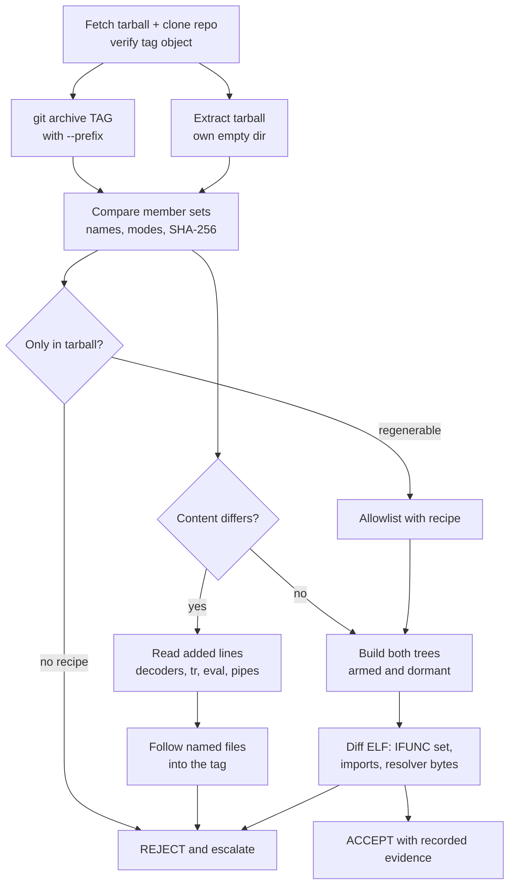

# Drill: Detect a Malicious Release Tarball Payload Hidden from Git

> [!summary] Scope
> Hands-on forensic drill recreating an xz-style discrepancy where an upstream release archive contains modified build scripts that do not exist in the source Git repository tag.
> Guides the engineer through unpacking artifacts, diffing the tarball against `git archive` of the tag (with diffoscope as the heavy tool), proving which difference is the trigger, and analyzing the injected ELF IFUNC resolver in the built library.
> Builds rapid forensic triage capability when auditing release tarballs.
> Includes an automated scenario and a negative control; the scenario is benign and models the CVE-2024-3094 shape, not its payload.

> [!abstract] The one-paragraph version
> A release tarball is an output of a release script, not a view of a git tag.
> Autotools-style releases legitimately contain files git does not track, so the audit is a classification problem: every byte that differs from `git archive` of the tag must be explained by a recipe you can re-run.
> In CVE-2024-3094 the single unexplained difference was one extra macro file in the tarballs of xz 5.6.0 and 5.6.1, while the encoded payload sat in the tagged tree as innocent-looking binary test fixtures.
> Source diffs find the trigger; only an ELF-level diff of the built artifact shows what the trigger did.

## Reproduction

The lab lives at `code/08-Software-Supply-Chain/tarball_backdoor_detection/` and needs Linux with glibc (`# requires: linux`).
Run it from `code/` with `bash 08-Software-Supply-Chain/tarball_backdoor_detection/run.sh`, or through the harness with `make verify LAB=tarball_backdoor_detection`.
It needs git, python3, GNU make, a C compiler, GNU `base64` and `tr`, and binutils `readelf`.
The pinned lab container (as of 2026-11, Linux ubuntu:24.04 image per `code/_harness/linux-labs.Dockerfile`) provides all of them: the `apt-get install` list names binutils, gcc, make, python3, and git (git was added to the list on 2026-11-21 after the first verification found it missing), and the lab probes each required tool up front and exits 127 naming the first one it cannot find.
It will not work on musl systems such as Alpine, which do not implement GNU IFUNC.
It needs no network access and everything it builds is benign.

### What the scenario builds

| Piece | File | Real-world analog |
|---|---|---|
| Tagged tree `v1.0.0` | `scenario.py` builds a one-commit repo | The xz git repository at a release tag |
| Inert fixture in git | `tests/files/bad-corrupt-header.dat` (rot13 then base64 of C source) | `tests/files/bad-3-corrupt_lzma2.xz` and `good-large_compressed.lzma` |
| Trigger only in the tarball | one extra line appended to `build-aux/host-hook.sh` | the extra `m4/build-to-host.m4` content in the 5.6.0 and 5.6.1 tarballs |
| Build-host guard | `PKG_BUILD=1` and `uname -s` is Linux | host checks on x86-64 linux-gnu, GCC, GNU ld, and Debian or RPM packaging |
| Payload | a replacement `src/crc_fast.c` whose IFUNC resolver sets a counter | replaced `crc32_resolve` and `crc64_resolve` resolvers in liblzma |
| Legitimate generated files | `ChangeLog`, `.tarball-version` | `configure`, `Makefile.in`, and other dist-time output |
| Archive semantics traps | `.github` marked `export-ignore`, `src/gitrev.txt` marked `export-subst` | attributes that make `git archive` differ from a checkout |
| Negative control | `libtoyz-1.0.0-clean.tar.gz` with only the generated extras | a clean release |

### Lab stages

| Stage | What runs | What it proves |
|---|---|---|
| 0 | `scenario.py` builds the repo, tag, backdoored tarball, and clean control | deterministic inputs (fixed commit date, sorted root-owned tar members, gzip mtime 0) |
| 1 | `tarball_audit.py` compares the tarball to `git archive` of the tag, plus a naive blob baseline | the trigger is the only unexplained difference; the naive baseline reports false positives |
| 2 | the same audit on the clean control | the audit can pass; stage 1 is not a check that always fails |
| 3 | three builds: git tree, tarball with the trigger dormant, tarball with the trigger armed | the trigger is conditional; the armed build rewrites a tracked source file |
| 4 | `elf_ifunc.py` diffs the two libraries and `readelf` cross-checks the IFUNC count | symbol names can match while resolver code differs |
| 5 | `driver.c` loads each library and prints the effect counter before and after the first lookup | behavior can match while the footprint differs |

What this repository has actually recorded (as of 2026-11-21): stages 0 and 1 were run once on darwin-arm64 during drafting (they use only git and python3), and the stage 1 block below is that capture.
An independent verification run on darwin-arm64 (git 2.55.0, Python 3.15.2, 2026-11-21) reproduced the stage 1 block byte for byte with exit status 3, and stage 2 printed `verdict: PASS (0 findings)` with exit status 0.
Stages 3 to 5 need Linux and a compiler that supports IFUNC, were not run here, and have no expected file yet; nothing in this note asserts their output.
The integrator records `expected/linux-<arch>.txt` from the pinned container; replace the block below with the recorded stage 1 text when that exists.

## Observed Symptom

### The field symptom (xz, 2024)

Nobody saw a diff.
Freund, benchmarking a Debian sid machine, saw sshd logins consuming unexpected CPU and valgrind errors in the sshd process, then traced them into liblzma.
His post reports `time ssh nonexistant@...` rising from about 0.299 s to about 0.807 s, and `sshd -h` taking about 0.5 s normally but about 0.01 s when `TERM=foo` or `LD_DEBUG=statistics` was set, because the backdoor declines to run in that environment.
The post lists the preconditions: `TERM` is unset, `argv[0]` is `/usr/sbin/sshd`, `LD_DEBUG` and `LD_PROFILE` are unset, `LANG` is set, and debugging environments such as rr appear to be detected (source: Freund, oss-security 2024-03-29).
The NEWS entry for 5.6.1 says "someone had forgot to run Valgrind", a reference to the fix for exactly those errors.
The reportable fact is how thin the signal was: a 0.5 s delay found by a person who was not looking for a backdoor.

### The drill symptom

The release engineer's question is simpler: "does this tarball contain anything the tag does not explain".
Stage 1 of the lab answers it for the scenario (darwin-arm64, stages 0 and 1 only, one-off capture; not yet an `expected/` file):

```text
== audit: release tarball ==
files in tarball: 11, files in git archive of v1.0.0: 9
git archive binds to tag commit via pax header: yes
tarball carries a commit id header: no (cannot bind it to a commit)
only in tarball, allowlisted generated files: 2 ['.tarball-version', 'ChangeLog']
only in tarball, unexpected: 0 []
only in git archive: 0 []
executable bit differs: 0 []
content differs: 1
  build-aux/host-hook.sh: +1 -0 lines
    suspicious constructs in added lines: ['base64 decode', 'redirect into source tree', 'tr substitution']
    added lines name tracked files: ['src/crc_fast.c', 'tests/files/bad-corrupt-header.dat']
    + test "x${PKG_BUILD:-}" = x1 && test "$(uname -s)" = Linux && base64 -d < tests/files/bad-corrupt-header.dat | tr 'A-Za-z' 'N-ZA-Mn-za-m' > src/crc_fast.c
verdict: FAIL (1 finding)
naive baseline (git blobs of the tag, no archive semantics):
  only in git: ['.github/workflows/ci.yml']
  content differs: ['build-aux/host-hook.sh', 'src/gitrev.txt']
  false positives versus the archive baseline: 2 ['.github/workflows/ci.yml', 'src/gitrev.txt']
```

Two things to read off it.
The audit found one real discrepancy and the naive comparison found three, of which two are false positives.
That is why the baseline is `git archive`: `export-ignore` removed `.github`, and `export-subst` rewrote `src/gitrev.txt`.

## Progressive Hint Ladder

> [!tip]- Hint 1 - Pick the right baseline
> Do not compare the tarball with a checkout of the tag, and do not compare it with `git ls-tree`.
> Compare it with `git archive --format=tar --prefix=NAME-VERSION/ TAG`, because that is what git itself would publish for the tag, including `export-ignore` and `export-subst`.
> Extract both into separate empty directories and pass them to your tools as arguments.

> [!tip]- Hint 2 - Classify the file lists before reading any content
> Make three lists: only in the tarball, only in the archive, in both.
> Files only in the tarball are expected for generated artifacts, but each must have a regeneration recipe.
> Files only in the archive should be empty; if not, the release step dropped tracked files.

> [!tip]- Hint 3 - Diff the files in both lists, smallest first
> In the scenario exactly one file is in both lists with different bytes, and it is not C source: it is a build script.
> Read the added lines, not the file.
> Ask what each added construct does: a decoder (`base64 -d`, `xz -d`), a byte-substitution (`tr`), a redirect into the source tree, a pipe into a shell.

> [!tip]- Hint 4 - Follow the reference into the tagged tree
> The added line names a data file that is tracked in git and passes audit as an ordinary file.
> Decode it by hand (rot13 undone with `tr`, then base64) and compare with the tracked `src/crc_fast.c`.
> The trigger lives only in the tarball, the payload lives only in git, and neither file looks malicious alone.

> [!tip]- Hint 5 - Build both ways and learn the guard
> Build the git tree, the tarball with the guard unsatisfied, and the tarball with the guard satisfied.
> A guard keyed on packaging variables is why a developer's build from the tarball can look clean while a distribution's build is not.
> Check whether the armed build modified a tracked source file in its own tree.

> [!tip]- Hint 6 - Diff the built libraries by function bytes, not by symbol names
> The dynamic symbol table of the armed library has the same names and types as the clean one, because the implant replaces the body of an existing IFUNC resolver.
> Compare the resolver size and the `.text` bytes, list `STT_GNU_IFUNC` symbols with `readelf --dyn-syms -W`, and decide which resolvers a compression library is entitled to have.

> [!success]- Solution
> **Diagnosis.**
> The tarball differs from the tag in exactly one place, `build-aux/host-hook.sh`, where one line is appended.
> That line runs only when `PKG_BUILD=1` on Linux, decodes the tracked fixture `tests/files/bad-corrupt-header.dat`, and writes the result over the tracked source file `src/crc_fast.c` before `make` collects its source list.
> The decoded text is the same C file with a modified IFUNC resolver `resolve_crc`, which writes a counter when the dynamic linker runs it.
>
> **Evidence chain.**
> 1. File lists: two only-in-tarball files, both explained by the generated-file allowlist; zero only-in-archive.
> 2. Content: one differing file, a build script, with an added line containing three decoder and redirect constructs and naming two tracked files.
> 3. Cross-reference: one of the named files is a tracked data fixture, and decoding it yields a source file equal to the tracked one except for the resolver body and one added static helper, `stage_two` (checked by decoding the fixture with `base64 -d | tr` and diffing against the tracked `src/crc_fast.c`).
> 4. Build behavior: the dormant tarball build is expected to match the git build byte for byte, and the armed build is expected to differ (stage 3 prints both comparisons; this note records no result for them because stage 3 has not been run on Linux).
> 5. ELF: IFUNC names match, resolver size and `.text` bytes differ (stage 4).
> 6. Control: the clean tarball passes stage 2 with zero findings, so the audit is able to say yes.
>
> **Resolution.**
> Reject the tarball.
> Build from `git archive` of the tag, or from a tarball regenerated by you from the tag, and pin the version that way.
> Report the discrepancy upstream and to your distribution security contact through the channel in [[Respond-to-a-Compromised-Transitive-Dependency]].
> Quarantine any artifact built from the tarball and rebuild it from the tag.
>
> **What not to conclude.**
> A passing audit proves the tarball is explained by the tag, not that the tag is benign.
> The payload in the scenario lives in the tag, and the next section shows why that is a separate review problem.

## Core Takeaway

A release tarball is a separately produced artifact whose only provenance link to source control is the publisher's say-so.
The detection control is mechanical: differ the tarball against `git archive` of the tag, classify every difference, and require a regeneration recipe for each tarball-only byte.
The owning concept is [[Reproducible-Builds-as-a-Security-Control]], which covers determinism and diffoscope; this note applies it to the source-to-tarball hop that the build-reproducibility discussion usually leaves out.
For the runtime half of the incident, see [[Case-Study-XZ-Utils-Backdoor-CVE-2024-3094]].

## Deep Dive: Three Artifacts That Get Confused

### The tag, the archive, and the tarball

| Artifact | Produced by | Contents determined by | Carries a commit id |
|---|---|---|---|
| Tag or commit | `git tag`, `git commit` | the tree object (content-addressed) | it is the commit |
| `git archive` output | git | tree plus `.gitattributes` plus commit time | yes, in a global pax header for tar output |
| Release tarball | the project's release script (often `make dist`) | whatever that script copies, generates, or edits | only if the script adds one |

What the git-archive documentation guarantees (as of 2026-11, Both):
- With a commit or tag, entry mtimes are the commit time; with a tree id they are the current time (`--mtime=<time>` overrides).
- The commit id is stored in a global extended pax header for tar output and can be read with `git get-tar-commit-id`; in ZIP it is a file comment.
- `tar.umask` restricts entry permissions and defaults to `0002`, which turns off the world write bit.
- `export-ignore` keeps files out of the archive, and `export-subst` expands `$Format:...$` placeholders when adding the file.
- `tar.gz` and `tgz` formats are built in and use an internal gzip implementation.
- `--add-file` and `--add-virtual-file` inject content that is not in the tree, so a hand-assembled "archive" can carry extras that the options visibly show.

What it does not guarantee: reproducible-builds.org states that `git archive` "does not guarantee deterministic output", and recommends `git archive --format=tar TAG | gzip -6 -n` to pin the compressor.
Consequence for the audit: compare member names, modes, and content hashes, never the compressed file's checksum.

### Why tarballs legitimately differ from the tag

Projects that use GNU Autotools ship pre-generated `configure` scripts, `Makefile.in` files, and similar output so that a builder needs only a shell and a compiler.
Those files are not in version control, so a non-empty diff is normal.
The Automake manual ("Basics of Distribution", as of 2026-11, source `doc/automake.texi`) says the `dist` rule generates a gzipped `tar` file named `${PACKAGE}-${VERSION}.tar.gz`, that all source files and all `Makefile.am` and `Makefile.in` files are included automatically, and that files read by `configure`, files pulled in through `m4_include`, a built-in list of common files (for example `COPYING` and the helper scripts that `automake --add-missing` installs), and `AUTHORS ChangeLog INSTALL NEWS README README-alpha THANKS` are distributed when present.
Its "Checking the Distribution" section says `make distcheck` first makes a distribution and then, operating from it, does a VPATH build with the source directory read-only, runs `make check`, installs into a temporary directory and runs `make installcheck`, checks uninstall and `distclean`, and finally makes another tarball to ensure the distribution is self-contained.
Both describe what the maintainer's tree contained at release time, not what the tag contains, so neither can stand in for a comparison against `git archive`.
The operational consequence does not depend on the manual: a tarball-only file is trustworthy only if you can regenerate it from the tag with a pinned toolchain and get the same bytes.

### Why a signature does not rescue you

The tukaani page states that the malicious 5.6.0 and 5.6.1 tarballs "were created and signed by Jia Tan" and that tarballs signed by the original maintainer were created by him.
A signature binds an identity to bytes.
It does not bind those bytes to a commit.
Signature checks belong in the pipeline (see [[Sigstore-Keyless-Signing-Cosign-Fulcio-and-Rekor]] and [[Git-Hooks-and-Cryptographic-Signing]]), but they answer "who published this", not "what is in it".

## Deep Dive: The Real Shape of CVE-2024-3094

Only the facts the drill depends on are here; the full narrative belongs to [[Case-Study-XZ-Utils-Backdoor-CVE-2024-3094]].

| Fact | Value | Source |
|---|---|---|
| Affected releases | xz 5.6.0 and 5.6.1 tarballs | Freund; tukaani.org; CISA |
| 5.6.0 date | 2024-02-24 | Cox timeline; NEWS |
| 5.6.1 date | 2024-03-09 | Cox timeline; NEWS |
| Test-file commit | `cf44e4b7f5dfdbf8c78aef377c10f71e274f63c0`, dated 2024-02-23 | Freund names the commit; Cox dates it |
| Updated test files | commit `74b138d2`, 2024-03-09 | Cox timeline |
| Discovery and disclosure | discovered 2024-03-28, public 2024-03-29 | Cox timeline |
| Cleanup release | 5.6.2, 2024-05-29: "Remove the backdoor (CVE-2024-3094)" | NEWS |
| Where the trigger lived | extra `m4/build-to-host.m4` in the tarballs; NEWS: "It's enabled only in the release tarballs" | Freund; Cox; NEWS |
| CVSS v3.1 | 10.0, vector `CVSS:3.1/AV:N/AC:L/PR:N/UI:N/S:C/C:H/I:H/A:H` as listed by Red Hat, which calls the scores preliminary | Red Hat |
| Red Hat exposure | only Fedora 41 and Fedora Rawhide in its community ecosystem; no RHEL versions | Red Hat |
| CISA advice | downgrade to an uncompromised version, naming 5.4.6 Stable | CISA |

NVD (via the CVE API 2.0, as of 2026-11): published 2024-03-29, and both the NVD primary score and the Red Hat CNA score are 10.0 CRITICAL with the same vector as above.

### Trigger and payload, as Freund describes them

- The injected macro text is "not in the upstream source of build-to-host, nor is build-to-host used by xz in git", per Freund.
- It runs at the end of `configure`, reads data from test `.xz` files in the repository, and can modify the generated `src/liblzma/Makefile`.
- The resulting make rule reads the first fixture through `sed`, a `tr` byte substitution, and `xz -d`, and feeds the result to a shell; a second stage extracts a further payload from `good-large_compressed.lzma` through `xz` and a shell.
- The script only acts on x86-64 Linux with `linux-gnu` in the build triplet, requires GCC and GNU ld, and requires either `debian/rules` to exist or `RPM_ARCH` to equal `x86_64`; Freund's reading is that the packaging condition is "likely aimed at making it harder to reproduce".
- The extracted object replaces the compiled CRC code: the ifunc resolvers `crc32_resolve()` and `crc64_resolve()` gain a call to `_get_cpuid()`, which used to be static inline and now carries the payload.
- The resolvers run at startup because sshd is linked with `-Wl,-z,now`, and the post says the backdoor does not appear to work with `LD_BIND_NOT=1`.
- Because liblzma resolves before sshd's own symbols and the GOT is read-only under `-Wl,-z,relro`, the payload installs an audit hook into the dynamic linker, waits for `RSA_public_decrypt@....plt`, and rewrites that PLT entry to its own code, then uninstalls the hook.
- Florian Weimer extracted `liblzma_la-crc64-fast.o`, and Vegard Nossum wrote `detect.sh` to test whether an ssh binary is likely affected (both attached to Freund's post).

Not stated by the primary sources I could read, and therefore not asserted: whether `-fno-omit-frame-pointer` played any role, and the exact name of the glibc audit-hook internals beyond what Freund quotes (`_dl_audit_symbind`).

### Map from CVE to drill

| CVE-2024-3094 | Drill | Detection lesson |
|---|---|---|
| Trigger only in the tarball | one appended hook line | tarball-only or tarball-modified build scripts are the high-value finding |
| Payload in tagged binary fixtures | rot13+base64 fixture in git | the tag can hold the payload; review binary test data and who references it |
| Guard on distro packaging | `PKG_BUILD=1` | a build that does not trigger tells you nothing |
| Replaced IFUNC resolvers | rewritten `resolve_crc` | symbol names match; compare resolver bytes |
| Audit hook redirecting a PLT entry | not modeled | read [[Dynamic-Linking-PLT-GOT-and-Loaders]] and [[Symbol-Versioning-IFUNC-and-Linker-Scripts]] |

## Deep Dive: The Detection Procedure



### Stage 0: bind the tarball to a commit you trust

- Verify the tag before using it: a lightweight tag can be moved, an annotated or signed tag is a stronger anchor (see [[Git-Hooks-and-Cryptographic-Signing]]).
- Record the commit hash the tag resolves to in your audit evidence, so a later tag move is visible.
- Make the baseline with `--prefix` equal to the tarball's top-level directory so member names line up.

### Stage 1: member-set comparison

```sh
# Run from a scripts directory, not from inside extracted data; each extraction goes in its own empty dir.
git -C "$REPO" archive --format=tar --prefix=libtoyz-1.0.0/ v1.0.0 | tar -x -C "$WORK/a"
tar -xzf libtoyz-1.0.0.tar.gz -C "$WORK/b"
diff -rq "$WORK/a/libtoyz-1.0.0" "$WORK/b/libtoyz-1.0.0"
```

`diff -rq` lists names that differ or exist on one side only.
Complexity is linear in the number of files plus bytes hashed; the cost is dominated by reading both trees once.
For the lab the audit does it in Python so that a hash comparison ignores mtimes and ownership that `tar` extraction adds.

Hostile-archive hygiene the lab applies (and any real tool must): reject absolute paths and `..` components, reject members outside the expected prefix, and flag symlinks, hardlinks, and device nodes, because a tarball that adds a symlink under `tests/` can redirect a later write.
Extract untrusted archives into a fresh directory with an extraction filter that refuses unsafe members (Python 3.12 added the `filter` argument to `tarfile.extractall`, the docs note it may be backported to older versions as a security update and recommend testing `hasattr(tarfile, 'data_filter')`, and since 3.14 the default filter is `data`; the lab reads members in memory and extracts only through `tar` into scratch directories).

### Stage 2: classify tarball-only files

| Class | Example | Required evidence |
|---|---|---|
| Generated, regenerable | `configure`, `Makefile.in`, `ChangeLog` | rerun the generator from the tag in a pinned container and compare |
| Vendored from another project | gnulib m4 macros in `m4/` | compare against the pinned upstream copy of that file |
| Metadata | `.tarball-version` | matches the release version |
| Binary blob | prebuilt `.o`, `.a`, `.so` | reject unless the source is also shipped and rebuilds to the same bytes |
| Anything else | | reject |

The vendored-file row is the xz row.
Freund's observation that the injected text "is not in the upstream source of build-to-host" means a diff against upstream gnulib's copy of the macro would have shown the addition, even though the file legitimately exists in many tarballs.
`m4/build-to-host.m4` is a gnulib file (defining `gl_BUILD_TO_HOST`, per the gnulib tree), so that upstream copy exists to diff against.
Which gnulib commit a project vendored is the part you must read from the project's own records.
The gnulib manual (`doc/gnulib-tool.texi`, as of 2026-11) says `gnulib-tool --import` copies source files, creates a `Makefile.am` to build them, and generates `gnulib-comp.m4` and `gnulib-cache.m4`, and that by default the source code is copied into `lib/` and the M4 macros into `m4/` (overridable with `--source-base` and `--m4-base`).
So a vendored macro in `m4/` is a copy made at import time, and a maintainer can edit it afterwards without any tool objecting.

### Stage 3: read changed files by their added lines

The lab flags these constructs in added lines: base64 decode, `tr` with quoted sets, `eval`, a pipe into `sh` or `bash`, `xz`/`lzma` decompression, `head -c` slicing, and a redirect into a `src/` path.
Treat any hit as an escalation, never a verdict: legitimate build scripts use several of these.
The strongest single signal is a script line that decodes a tracked non-source file and writes into the source tree, which is the shape in both the scenario and the Freund description.

### Stage 4: cross-reference binary fixtures

A payload in a tracked fixture passes a source-only audit.
The lab reports which tracked files the added lines name; the follow-up is human work.
- Who added the fixture, in which commit, and with what stated purpose?
- Does any test or build step in the tag actually consume it?
- Does it decode as what its extension claims (an `.xz` fixture named as "corrupt" must decompress to an error, not to shell text)?
The Freund post makes the equivalent point: the committed files "were not even used for any 'tests' in 5.6.0".
Cox's timeline dates the commit that added them to 2024-02-23, the day before the 5.6.0 release.

### Stage 5: build both ways

Build three trees: the git archive, the tarball with the guard unsatisfied, and the tarball with the guard satisfied by the packaging variables you suspect.
- A byte-identical dormant build is evidence the trigger is conditional, not that it is absent.
- A tracked source file that differs after the build from what the archive contained means the build rewrites inputs; real builds should not.
- Do the build in a container with no credentials and no network, per [[Enterprise-Third-Party-Code-Ingestion-and-Quarantine-Architecture]].

### Stage 6: diff the built ELF

`elf_ifunc.py` is a 112-line ELF64 little-endian reader built from the glibc `elf.h` constants: `STT_FUNC` is 2, `STT_GNU_IFUNC` is 10 (aliased to `STT_LOOS`), and a symbol's `st_info` byte holds the binding in the high four bits and the type in the low four.
The `Elf64_Sym` layout is `st_name`, `st_info`, `st_other`, `st_shndx`, `st_value`, `st_size` (note that 64-bit order differs from `Elf32_Sym`).
The lab compares four properties of the two libraries:

| Check | Catches | Misses |
|---|---|---|
| Defined dynamic symbols (name, type, binding) | an added exported function or a type change such as FUNC to IFUNC | a modified body behind an unchanged name |
| Imported (undefined) symbols | a payload that newly calls `dl_iterate_phdr`, `dlsym`, or similar | a payload that walks loader structures by hand without imports |
| IFUNC set and resolver sizes | a new or resized resolver | a same-size patch |
| `.text` hash and whole-file equality | any code change | nothing in code, but noisy across toolchain versions |

The scenario is built so the first two checks agree and the last two differ; stage 4 prints which actually did on Linux, and until that output is recorded this note does not claim a result for it.
`readelf --dyn-syms -W` is the independent oracle: the lab counts IFUNC entries with `awk '$4 == "IFUNC"'` and prints both counts so a bug in the Python reader cannot hide.

### Why resolvers are an attractive hook

- An IFUNC symbol's `st_value` is the address of its resolver, a function the dynamic linker calls to pick the implementation.
- That call happens inside the loader during relocation processing, before the application's `main`, in a process that may have no other code running yet.
- Freund's trace shows the payload relying on this: its code runs as part of resolver execution because sshd is linked with `-z now`.
- Separately, `rtld-audit(7)` documents that an audit library's `la_symbind64` may return a value other than `sym->st_value` "to direct control to an alternate location", which is the documented mechanism for redirecting a binding; Freund describes the xz payload installing an audit hook instead of loading an audit library.
- The glibc IFUNC wiki (sourceware.org/glibc/wiki/GNU_IFUNC, as of 2026-11) says the resolver is called by the dynamic loader during early startup, that the choice is fixed for the lifetime of the process, and that references go through `R_*_IRELATIVE` relocations.
- The same page lists resolver restrictions: with `-Wl,-z,now` or `LD_BIND_NOW=1` symbols are resolved at startup, so calling an external function such as `strlen` from a resolver "may lead to a segfault because the PLT is not yet resolved", and that this may work on x86_64 but is no guarantee on AArch64 or PPC64; a resolver must not be compiled with `-fstack-protector-all` or sanitizers such as asan; under lazy binding the resolver may run at any point and must be as safe as the function it implements.
- The lab's resolver deliberately uses only direct calls inside its own object, which stays inside those restrictions.
- The gABI symbol-table chapter and the GCC `ifunc` attribute entry were not used for these restrictions; the wiki page is the source.

### Using diffoscope

diffoscope compares archives and directories recursively, including ELF binaries (as of 2026-11, per diffoscope.org; Both).
The flags below are from the Debian man page for diffoscope 161, while diffoscope.org lists release 339 (2026-11-13) as current (as of 2026-11), so confirm each with `diffoscope --help` on the installed version:

```sh
diffoscope --exclude-directory-metadata=yes --new-file --text - "$WORK/a/libtoyz-1.0.0" "$WORK/b/libtoyz-1.0.0"
echo "exit: $?"
```

- `--exclude-directory-metadata` takes `auto`, `yes`, `no`, or `recursive`; the default compares metadata when both inputs are directories, so set it deliberately.
- `--new-file` treats absent files as empty, which makes tarball-only files show their full contents.
- `--max-report-size` defaults to 41943040 bytes (40 MiB) and `0` disables the limit.
- Exit status is 0 for identical inputs, 1 for different, 2 for trouble; wrapper scripts must not treat 1 as a tool failure.
- The lab does not run diffoscope, because the pinned lab image does not install it (the Dockerfile lists binutils, gcc, make, python3 and others, not diffoscope); the Python audit stands in for it on the member-set question, and diffoscope is the right tool for a large real tarball or for the ELF diff of rebuilt binaries.

## Pitfalls

> [!warning] Pitfalls
> - **Comparing to a checkout.** `git checkout TAG` ignores `export-ignore` and `export-subst`; the lab's naive baseline reports 2 false positives on a 9-file archive.
>   Alert fatigue is how a real finding gets waved through.
> - **Allowlisting by directory.** "Everything under `m4/` is generated" hid the xz trigger.
>   Allowlist exact files with a recipe and a hash.
> - **Source-only review.** In the scenario and in CVE-2024-3094 the payload is a tracked data file and the changed file is a build script; a review that reads only `.c` and `.h` files sees nothing.
> - **Trusting a clean build.** The trigger is conditional.
>   A build that does not arm it proves nothing about the artifact other people build.
> - **Trusting a signature.** The malicious xz tarballs were signed by the account that made them.
> - **Hash-comparing archives.** `git archive` does not guarantee deterministic output, and gzip adds its own variation.
>   Compare members.
> - **Treating the missing commit id as noise.** An autotools tarball usually lacks the global pax header, so nothing in the file ties it to the tag; record the commit you compared against.
> - **Moved or lightweight tags.** If the tag can move, your baseline can move under you.
>   Pin the commit hash.
> - **Mode and metadata noise.** Tar extraction adds mtimes and ownership; compare hashes and the executable bit, not `ls -l`.
> - **Reading only the symbol table.** A rewritten resolver has the same name and type as the original.
> - **Extracting into your working directory.** Untrusted archives belong in their own empty directory, with scripts kept elsewhere and paths passed as arguments.

## At Scale

From one developer to 1,000-50,000 engineers the question changes from "is this tarball clean" to "which releases do we audit, and who is paged".

| Scale | Decision rule |
|---|---|
| One developer | Prefer upstream's git tag via `git archive` when the project builds from it; use the tarball only with a diff you have read |
| Team | Run the audit in CI on every dependency bump that changes a tarball hash; fail on any unexplained difference |
| Organization | Run a central ingestion service: fetch tarball and tag, compute the classification, auto-accept only when the diff is a subset of allowlisted regenerable files and the regenerated bytes match, queue the rest for human review |
| Distribution or platform | Build from the tag where possible (Arch Linux changed its xz package to build from Git on 2024-03-28 per Cox), and treat a project that cannot be built from its tag as a risk to be priced |

- Cache audit results by (name, version, tarball SHA-256, tag commit); the audit is a pure function of those, so it is safe to reuse.
- Size the human queue by the diff, not the package: a one-line change to a build script is a ten-minute review, an unexplained 300 KB generated file is not.
- Put a cooldown between publication and adoption so the community gets time to find what the audit misses; [[Enterprise-Third-Party-Code-Ingestion-and-Quarantine-Architecture]] owns that design.
- When a diff is found after adoption, switch to [[Respond-to-a-Compromised-Transitive-Dependency]]: inventory first, rebuild from the tag second, rotate credentials third.
- Do not attempt to eliminate the tarball trust problem with provenance alone: SLSA-style provenance attests a build, not the contents of an upstream release; see [[SLSA-Framework-Build-and-Source-Tracks]] for what it does bound.
- Reproducible build infrastructure is the long-term fix, because it turns "explain the diff" into "rebuild and compare"; see [[Hermetic-and-Reproducible-Builds]].

Rollout note: start in report-only mode for a quarter, measure the false-positive rate per ecosystem, and only then block.
Do not publish a blocking rule before you can state its false-positive rate.

## Practice Drill

> [!tip] Practice Drill
> Run the lab, then change one thing at a time and predict the audit and ELF output before running again.
> 1. Move the added line into a second file under `build-aux/`.
>    Which audit lines change?
> 2. Replace the added line's `tr` with `xz -d` on a real compressed fixture.
>    Which suspicious-construct labels fire?
> 3. Add the trigger to the clean control's `ChangeLog` generation instead.
>    Does an allowlisted file hide it?
>    (It should, which is the point of allowlisting by recipe, not by name.)
> 4. Strip the built library with `strip --strip-unneeded` and rerun the ELF diff.
>    What can no longer be read from `.symtab`?
> 5. Arm the guard with `PKG_BUILD=1` on a non-Linux host and explain why nothing happens.
> 6. Run `diffoscope` on the two source trees and the two libraries and compare its output with the lab's.
Then read [[Drill-Supply-Chain-Exploit-and-Fix-Dependency-Confusion]] for the registry-side counterpart.

## Interview Questions

### L5

> [!question] 1. Why do you diff a release tarball against `git archive` of the tag instead of a checkout?
> [!success]- Answer
> `git archive` applies `export-ignore` and `export-subst` and normalizes modes, so it is the form of the tag that git itself would ship.
> A checkout keeps `.git`, ignored paths, and unexpanded `$Format:...$` placeholders, producing false positives.
> The lab's naive baseline reports `.github/workflows/ci.yml` and `src/gitrev.txt` as discrepancies, both of which the archive baseline explains.

> [!question] 2. A tarball contains `configure` and `Makefile.in`, which are not in git.
> Is that a finding?
> [!success]- Answer
> Not by itself.
> Autotools projects ship generated files so users do not need the generator.
> It becomes a finding if you cannot regenerate those files from the tag with a pinned toolchain and get the same bytes.

> [!question] 3. Predict the output.
> In the lab's stage 1 the audit exits with which status and why?
> What does stage 2 print for the verdict?
> [!success]- Answer
> Status 3, because there is one finding: `build-aux/host-hook.sh` differs from the archive.
> Stage 2, the clean control, differs from the archive only by the two allowlisted files `ChangeLog` and `.tarball-version`, so it prints `verdict: PASS (0 findings)` and exits 0.
> The captured darwin-arm64 run of stage 1 shows `verdict: FAIL (1 finding)` with exit status 3, and the verification run of stage 2 printed `verdict: PASS (0 findings)` with exit status 0.

### L6

> [!question] 4. Debug this: a teammate "verifies" a tarball with the commands below and reports no problems.
> What is wrong with the method?
> ```sh
> git clone https://example.org/libfoo.git && cd libfoo && git checkout v1.0.0
> tar xzf ../libfoo-1.0.0.tar.gz -C /tmp
> diff -rq . /tmp/libfoo-1.0.0 | grep -v '^Only in .: .git' | grep -v 'configure'
> ```
> [!success]- Answer
> - The baseline is a checkout, so export attributes are ignored and the output is noisy; the noise is why the author added `grep -v` filters.
> - `grep -v configure` hides every path containing "configure", including `configure.ac` and any macro named like it; filtering by substring is an allowlist by name without a recipe.
> - Dropping `Only in .: .git` is fine, but nothing checks that the tag still points to the commit you intended; clone and tag may have moved.
> - It compares only file lists and "differs" lines, never reads the added lines, and builds nothing, so a conditional build-script trigger is not examined.
> - The fix is a baseline of `git archive --prefix=...`, an exact-file allowlist with regeneration, a pinned commit hash, and reading every changed file's added lines.

> [!question] 5. The audit passes but the built library behaves oddly.
> What do you check next, and why can the symbol table look normal?
> [!success]- Answer
> Build from the tag and from the tarball and diff the ELF files.
> An IFUNC resolver replaced in place keeps its symbol name and type, so `readelf --dyn-syms` is unchanged; compare resolver sizes and `.text` bytes, imports, and `readelf --dyn-syms -W | awk '$4 == "IFUNC"'`.
> Also check whether the tag itself contains a payload: a clean tarball means the tarball is explained by the tag, not that the tag is clean.

> [!question] 6. Why did the xz trigger include conditions on x86-64 Linux, GCC, GNU ld, and Debian or RPM packaging?
> [!success]- Answer
> It narrowed execution to builds by the distributions the attacker wanted, which are builds from release tarballs through packaging systems.
> Freund notes the packaging condition was likely aimed at making reproduction harder, because a developer building from a plain checkout never arms it.
> Defensively, it means a clean local build is weak evidence, and you must build with the environment the real consumers use.

### L7

> [!question] 7. Design an organization-wide control that would have caught this class of attack without relying on a human noticing a 0.5 s delay.
> [!success]- Answer
> - Ingest both the tarball and the tag; compute the tarball-versus-`git archive` classification automatically.
> - Auto-accept only a diff that is a subset of regenerable generated files whose regenerated bytes match, and vendored files that match their pinned upstream copy.
> - Treat any modified build script, any tarball-only script, and any tracked binary fixture newly referenced by a script as a review gate.
> - Build in a network-less container with distribution-like variables armed, and diff the ELF output against a build from the tag.
> - Add a cooldown before adoption and prefer a build from the tag where upstream supports it.
> - Limits: it does not detect a payload that lives entirely in reviewed git history; that needs maintainer-trust and review controls (see [[Case-Study-XZ-Utils-Backdoor-CVE-2024-3094]]).

> [!question] 8. A vendor says their tarballs are signed, so the audit is unnecessary.
> Respond.
> [!success]- Answer
> A signature proves who produced the bytes, not that the bytes equal the tag.
> The malicious xz tarballs were created and signed by the account that held release rights.
> A signature check is necessary for authenticity and insufficient for integrity of content versus source; keep both controls, and require a recorded commit hash and diff report as the evidence of the second.

### L8+

> [!question] 9. You own the build for 20,000 engineers and cannot rebuild everything from tags.
> How do you prioritize where the tarball audit is mandatory?
> [!success]- Answer
> Rank by blast radius and by how the artifact loads: code that runs in privileged or network-facing processes, code loaded early by the dynamic linker (anything providing IFUNCs or constructors in widely linked libraries), and anything with a tarball-only build step.
> Within that, rank by upstream signals: a single maintainer, recent maintainer or release-rights changes, and build scripts modified in the tarball.
> Cover the top tier with the full audit and ELF diff; cover the rest with the cheap member-set classification; accept the residual risk explicitly in a decision record ([[Supply-Chain-Decision-Records]]) and revisit when the false-positive rate is measured.

> [!question] 10. What are the limits of this whole approach, and what would you add?
> [!success]- Answer
> It proves the tarball is explained by a tag; it does not prove the tag is benign, and review of binary fixtures and of who changed what is a social and process problem.
> It misses payloads whose trigger is entirely inside tracked, reviewed-looking source.
> Add reproducible rebuilds with an independent builder to compare outputs ([[Reproducible-Builds-as-a-Security-Control]]), provenance for your own builds ([[SLSA-Framework-Build-and-Source-Tracks]]), and runtime detection such as the latency and valgrind anomalies that actually found xz.

## Further Reading

- Freund, oss-security 2024-03-29: the primary disclosure, with the de-obfuscated script and the ifunc and audit-hook analysis.
- Cox, Timeline of the xz open source attack: the dated sequence from 2021 to the 2024 disclosure.
- tukaani.org/xz-backdoor and the NEWS entries for 5.6.0, 5.6.1, and 5.6.2: the maintainer's own statements, including "enabled only in the release tarballs".
- Red Hat and CISA advisories: scope, CVSS, and the recommended downgrade.
- git-archive and gitattributes documentation: the semantics the baseline depends on.
- reproducible-builds.org archives guidance: how to make tar and gzip output deterministic, and why `git archive` tar output is only "typically stable" while its internal gzip is not.
- diffoscope manual: the flags and exit codes for archive and directory comparison.
- `rtld-audit(7)` and glibc `elf/elf.h`: the audit interface and the symbol-type constants the lab reader uses.

## See Also

- [[Reproducible-Builds-as-a-Security-Control]] for determinism and diffoscope.
- [[Case-Study-XZ-Utils-Backdoor-CVE-2024-3094]] for the full incident.
- [[Symbol-Versioning-IFUNC-and-Linker-Scripts]], [[Dynamic-Linking-PLT-GOT-and-Loaders]], and [[ELF-Mach-O-and-PE-Object-Formats]] for the loader mechanisms behind Stage 6.
- [[Enterprise-Third-Party-Code-Ingestion-and-Quarantine-Architecture]] and [[Respond-to-a-Compromised-Transitive-Dependency]] for the organizational response.

## Related

- Prerequisites: [[Reproducible-Builds-as-a-Security-Control]]
- Next: [[Drill-Supply-Chain-Exploit-and-Fix-Dependency-Confusion]]
- Lab: `code/08-Software-Supply-Chain/tarball_backdoor_detection/` (requires: linux)
