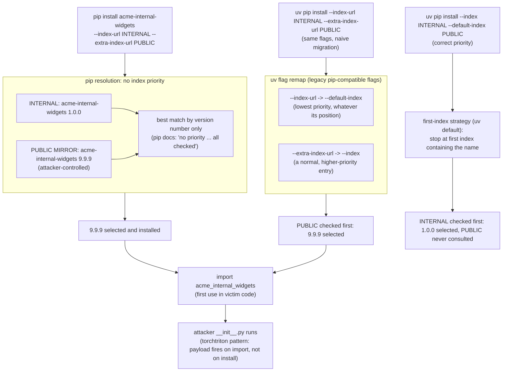

# Drill: Exploit and Remediate a Package Dependency Confusion Vulnerability

The general attack taxonomy (typosquatting, repo-jacking, maintainer takeover, install-script hooks) is owned by [[Dependency-Confusion-Typosquatting-and-Registry-Attacks]].
The historical torchtriton incident this drill reenacts is owned by [[Case-Study-PyTorch-torchtriton-and-Dependency-Confusion]].
This drill owns one narrow, hands-on question: given a real multi-index resolver, exactly which configurations let a same-named public package win over a private one, and which configurations provably do not.
It runs the attack against `pip` and `uv`, the two resolvers a Python engineer meets daily, and proves a result that is not folklore: migrating a working `pip` invocation to `uv` by keeping the same flag names does not inherit `uv`'s advertised safety, because `uv` remaps those flag names to different priority slots.



## Reproduction

The reproducible lab is at `code/08-Software-Supply-Chain/dependency_confusion_repro/`.

```bash
cd code/08-Software-Supply-Chain/dependency_confusion_repro
TOOLCHAIN_LABS_NETWORK=1 bash run.sh
```

It declares `# requires: network` because it opens two loopback HTTP servers and drives real `pip` and `uv` resolution against them; no byte ever reaches a host beyond `127.0.0.1`, and no package in the lab is fetched from the real PyPI.

| File | Role |
| :--- | :--- |
| `build_registry.py` | Hand-builds two PEP 503 simple-index registries and two real wheels for a project named `acme-internal-widgets`, using only the standard library: no `setuptools`, no build backend, no network. |
| `run.sh` | Starts both registries on fixed loopback ports, runs four install scenarios (A-D) against `pip` and `uv`, imports the installed package in each, and reports the resolved version and whether the payload fired. |

The two wheels differ only in version number and in what their `__init__.py` does on import:
- `acme_internal_widgets-1.0.0-py3-none-any.whl`, served only by the internal registry, writes a benign `INTERNAL_IMPORT_OK` marker.
- `acme_internal_widgets-9.9.9-py3-none-any.whl`, served only by the public-mirror registry (standing in for the real PyPI), writes a `DEPENDENCY_CONFUSION_RCE_FIRED` marker; the comment in `build_registry.py` and the Model Solution below explain why this fires on import rather than on install.
Both wheels are built by hand against the Binary distribution format and Recording installed packages specifications (the `METADATA`, `WHEEL`, and `RECORD` files inside `*.dist-info`), not generated by `setuptools` or `pip wheel`, so the lab never needs a build backend or network access to construct its fixtures.

## Observed Symptom

A platform team runs this command in a build step, intending to install an internal package while still falling back to PyPI for everything else:

```bash
pip install --index-url http://127.0.0.1:51730/ \
            --extra-index-url http://127.0.0.1:51731/ \
            --target ./vendor acme-internal-widgets
```

(In the lab, `51730` is the internal index and `51731` stands in for the public registry; in production the internal URL is a real artifact repository and the public one is `https://pypi.org/simple/`, reached implicitly whenever `--extra-index-url` is used without `--index-url` disabling it.)

The install log looks completely ordinary (captured verbatim from this command against the lab's two registries, pip 26.2.2, macOS arm64, 2026-11-22):

```text
Looking in indexes: http://127.0.0.1:51730/, http://127.0.0.1:51731/
Collecting acme-internal-widgets
  Downloading acme_internal_widgets-9.9.9-py3-none-any.whl (1.3 kB)
Installing collected packages: acme-internal-widgets
Successfully installed acme-internal-widgets-9.9.9
```

Nothing here says `error`, `warning`, or `untrusted`.
The only anomaly a reviewer could catch by eye is the version number: the internal package was never tagged `9.9.9` by anyone on the team.
The recorded lab run (darwin-arm64, Python 3.15.2, pip 26.2.2, uv 0.11.26, recorded 2026-11-21) confirms exactly this outcome; from `expected/darwin-arm64.txt`:

```text
== Scenario A: pip, --index-url (internal) + --extra-index-url (public mirror) ==
A: installed_version=9.9.9 payload_fired=yes
pip has no index priority: it merges both indexes and takes the highest version number.
VULNERABLE: the public mirror's 9.9.9 wins over the internal 1.0.0, and its import-time payload runs.
```

`payload_fired=yes` means the lab's independent check, run after the install and outside pip entirely, found the marker file that only the 9.9.9 package's `__init__.py` writes: the attacker's code executed the moment something did `import acme_internal_widgets`, which for a real dependency is nearly immediate.

## Progressive Hint Ladder

> [!tip]- Hint 1: Compare the two `--index-url` runs
> Scenario B in the same lab run drops `--extra-index-url` entirely and installs the identical package name from the identical internal index.
> `expected/darwin-arm64.txt` records `B: installed_version=1.0.0 payload_fired=no` for that run.
> The only difference between A and B is whether a second index was ever mentioned on the command line.

> [!tip]- Hint 2: Read what pip's own documentation says about "no priority"
> The pip install reference states plainly: "Pip looks for packages ... on PyPI (or the index given as `--index-url` ...), ... and in any additional repositories specified via `--find-links` or `--extra-index-url`."
> It continues: "There is no priority in the locations that are searched."
> "Rather they are all checked, and the 'best' match for the requirements (in terms of version number ...) is selected."
> pip's own `pip install` examples section separately warns: "Using the `--extra-index-url` option to search for packages which are not in the main repository (for example, private packages) is unsafe."
> "This is a class of security issue known as dependency confusion."
> That warning was added in pip 21.1 (2021-04-24).
> The pip 21.1 changelog records it under Improved Documentation as "Add warning about `--extra-index-url` and dependency confusion" (pypa/pip#9647).

> [!tip]- Hint 3: The version number is the entire decision
> "Best match" in pip's resolver means the highest version satisfying the requirement specifier, nothing about which index is more trusted.
> An attacker who can publish to the second index therefore wins by publishing literally any higher version number than whatever the internal team last tagged; `9.9.9` is a convenient, obviously-not-real example, but `2.0.1` would have worked the same way against `1.0.0`.

> [!tip]- Hint 4: "uv is safe by default" is a claim about priority order, not about flag names
> uv's documentation says its default `index-strategy` is `first-index`: "stop at the first index on which a given package is available."
> Scenario C in the lab uses the exact same `--index-url` / `--extra-index-url` flags as the vulnerable pip command, run through `uv pip install` instead.
> `expected/darwin-arm64.txt` records `C: installed_version=9.9.9 payload_fired=yes` for that run too.
> If "first index" is supposed to protect you, which index does uv think is first here?

> [!tip]- Hint 5: Read uv's own mapping of the legacy flags
> uv's indexes documentation states: "`--index-url` and `--extra-index-url` can be thought of as unnamed `[[tool.uv.index]]` entries, with `default = true` enabled for the former."
> It continues: "In that context, `--index-url` maps to `--default-index`, and `--extra-index-url` maps to `--index`."
> It also states: "The default index is always treated as lowest priority, regardless of its position in the list of indexes."
> Re-derive which URL uv treats as highest priority when you pass `--index-url INTERNAL --extra-index-url PUBLIC`.

## Model Solution

> [!success]- Solution
> **Root cause.** This is PyPI-ecosystem dependency confusion (Birsan, 2021): a name that exists on two indexes with no cryptographic or namespace binding between "the internal team's `acme-internal-widgets`" and "whatever is published under that string on the index everyone also points at."
> Two independent facts compound into remote code execution:
>
> 1. **pip has no index trust ordering.**
>    The `pip install` reference is explicit that `--index-url` and every `--extra-index-url` are "all checked," and the winner is the highest version number across the union, full stop.
>    Listing the internal index first on the command line has zero effect on priority; it is not a priority list, it is a set.
> 2. **Arbitrary code runs on `import`, not only on `pip install`.**
>    A wheel's install step (per the Binary distribution format specification) is "Unpack ... Spread": unzip the archive, move `.data/` subtrees into place, rewrite shebangs.
>    No application code runs during that step.
>    But the very first `import acme_internal_widgets` anywhere in the codebase executes `acme_internal_widgets/__init__.py` top to bottom, with the full privileges of whatever process does the importing.
>    This is exactly the torchtriton mechanism: PyTorch's own postmortem states "the malicious binary is executed when the triton package is imported," not when `pip install` completes.
>    A source distribution is different: it must be built before it can be installed, and the build backend is arbitrary code that runs during the `pip install` itself, before any import.
>    A wheel-only policy such as `--only-binary :all:` (pip install reference: "Do not use source packages") refuses that path, but it does nothing for the import-time variant demonstrated here.
>
> **Fix for pip.** Remove `--extra-index-url` and point `--index-url` only at the index that is actually supposed to own the name (Scenario B, `installed_version=1.0.0 payload_fired=no`).
> If packages must legitimately come from two indexes, pin each one to its index explicitly with `--index-url` per invocation or, in a `requirements.txt` workflow, use `--require-hashes` (pip docs, Secure installs) so an unexpected artifact fails on hash mismatch regardless of which index served it; hash pinning closes the "but someone changed index priority in CI" failure mode that flag-based fixes alone leave open.
>
> **Fix for uv.** The trap in Scenario C is that a `pip`-to-`uv` migration that keeps the same flag spelling silently inverts priority, because uv's own documentation defines `--index-url` as the lowest-priority "default" index and `--extra-index-url` as a higher-priority named index, "regardless of its position in the list."
> The correct uv invocation uses the current, non-deprecated flags and puts the internal index in the high-priority slot: `--index INTERNAL --default-index PUBLIC` (Scenario D, `installed_version=1.0.0 payload_fired=no`).
> Equivalently, in `pyproject.toml`, declare the internal index as a named `[[tool.uv.index]]` entry (optionally `explicit = true` so nothing resolves from it unless a `tool.uv.sources` entry pins to it by name) and let PyPI remain the implicit `default`.
> Either way, the fix is never "trust uv's defaults"; it is "verify which URL is actually in the high-priority slot," because the two legacy flags do not mean what their pip-compatible names suggest.
>
> **General remediation, beyond this one flag fix:** reserve the name on the public index (an empty, maintainer-owned placeholder beats an unclaimed name every time), and treat index configuration as an artifact under the same review and CI gate as code, not an environment variable a developer sets once and forgets, since Scenario C shows that a "safe" tool used the "wrong" way reproduces the exact same compromise as the naively unsafe one.

## Deep Dive: Why the Resolvers Disagree

### 1. The Simple Repository API gives no index any special status

Every one of `pip`, `uv`, and the lab's mock registries speaks the same wire protocol: PEP 503 / the Simple Repository API.
The root of an index is a valid HTML5 page with one anchor per project; `/<project>/` is a valid HTML5 page with one anchor per file, href pointing at the download location, optionally carrying a `#sha256=...` fragment.
Nothing in this protocol carries a notion of "this index is authoritative for this name."
A client that queries two conforming indexes for the same normalized project name gets two independent, equally valid answers back, and the protocol itself offers no tiebreaker.
The tiebreaker, whatever it is, is entirely a property of the client, which is exactly why `pip` and `uv` can and do disagree.

### 2. pip's tiebreaker: version-only, index-blind

pip's resolver treats `--index-url`, every `--extra-index-url`, and any `--find-links` location as one flat candidate pool.
Per the `pip install` reference, candidates are compared purely "in terms of version number," and the highest satisfying version wins, independent of which URL it came from or in what order it was named on the command line.
This design is deliberate and old: it predates the 2021 publication of dependency-confusion research, and pip has not changed the default (as of 2026-11, the pip 26.3 reference still says "There is no priority in the locations that are searched"), choosing instead to document the risk (pip 21.1, 2021-04-24, added the `--extra-index-url` warning cited above) and to let users opt into safety by never passing `--extra-index-url` in the first place.

### 3. PEP 708: the protocol fix that did not ship

PEP 708 proposed extending the Simple Repository API with repository "tracks" and "alternate locations" metadata, so a repository operator could declare "this project here is the same project as that one over there," letting an installer refuse an unexpected cross-repository substitution by default.
After three years in a provisionally-accepted state, the PEP's own page now carries a top-of-page notice: "the PEP has been rejected, because the required conditions for acceptance were never met" (the PEP's Provisional Acceptance section made acceptance conditional on implementations in PyPI/Warehouse, in at least one other repository, and in pip, the last one off by default).
Curiously, as fetched in 2026-11, the Simple Repository API specification's own version history still lists "API version 1.2: Added repository 'tracks' metadata, declared with PEP 708" without a note that the declaring PEP was later rejected; the two pages have not been reconciled.
The practical conclusion for an engineer today is unaffected by that inconsistency: with the PEP rejected, no installer is obliged to honor tracks metadata (neither the pip 26.3 nor the uv index documentation describes any support for it), so do not design a remediation that assumes it exists.

### 4. uv's tiebreaker: first-index by priority, but priority is a separate axis from "index vs extra-index"

uv's default `index-strategy` is `first-index`: resolve each package against the first index (in priority order) on which it is found at all, and never even look at the others for that package.
uv's own documentation states the purpose directly: "The intent is to prevent 'dependency confusion' attacks."
Priority order in uv is governed by two independent rules, both confirmed directly against uv's indexes documentation:
- "Indexes are prioritized in the order in which they're defined... with indexes provided via the command line taking precedence over those in the configuration file."
- "The default index is always treated as lowest priority, regardless of its position in the list of indexes."
The second rule is the one that bites in Scenario C.
uv's own docs map the legacy, pip-compatible flags onto this model explicitly: `--index-url` becomes the one `default = true` index, lowest priority unconditionally, and `--extra-index-url` becomes an ordinary named `--index` entry, higher priority than the default by the second rule, regardless of where it appears in the argument list.
An engineer who lifts a working `pip install --index-url INTERNAL --extra-index-url PUBLIC` into `uv pip install` with the identical flags has therefore flipped which index uv checks first, without changing a single character that looks security-relevant.
Re-running Scenario C's command with `uv pip install -v` against the lab registries (uv 0.11.26, 2026-11-22) shows the effect directly: every request in the debug log goes to the public-mirror port `51731`, and the internal index on `51730` is never queried for `acme-internal-widgets` at all.
The fix is not a uv bug fix; it is reading uv's own documented semantics for those two flags before assuming "pip-compatible" means "pip-equivalent."

### 5. Why the payload fires on `import`, not on `pip install`, for a wheel

The Binary distribution format specification defines wheel installation as exactly two phases: "Unpack" (extract the archive) and "Spread" (move `*.data/` subtrees to their destination, patch `#!python` shebangs, update `RECORD`, compile installed `.py` files to `.pyc`).
Neither phase executes any Python code from inside the package; byte-compiling a module parses it but does not run it.
The only code that ever runs is whatever is in `__init__.py` (or any submodule), and that code runs only when something imports it.
That is why the lab's `run_scenario` helper installs, then separately runs `python3 -c "import acme_internal_widgets"` and checks for the marker file: the install step alone proves nothing about code execution for a wheel-only package.
This is also exactly what PyTorch's postmortem reports for torchtriton: "the malicious binary is executed when the triton package is imported... which requires explicit code to do and is not PyTorch's default behavior."
The compromise sat latent in installed environments until something imported `triton`.
The older, still-viable variant runs earlier: a malicious sdist's `setup.py` can override the `install` `Command` class to run arbitrary code the moment `pip install` builds it, before any application ever imports anything.
Both variants are "dependency confusion" in the sense of this drill; they differ only in which line in the kill chain fires the payload.
A defense that only inspects installed files, without ever importing or building them, will miss both.

## Ecosystem Comparison: Who Can Even Have This Bug

| Ecosystem | Default resolution model | Structural exposure | Primary remediation |
| :--- | :--- | :--- | :--- |
| Python (`pip`) | Flatten all configured indexes into one pool, pick highest version | High: no index has inherent priority | Single `--index-url`, no `--extra-index-url`; `--require-hashes` for CI |
| Python (`uv`) | Ordered priority list, `first-index` strategy by default | Medium: safe only if priority order is actually correct; legacy pip-compatible flags invert it | Use `--index` / `--default-index` (or named `[[tool.uv.index]]`, optionally `explicit = true`), verify order explicitly |
| npm | Each `@scope` binds to exactly one registry; unscoped names resolve against the single configured registry | Low for scoped names (no merge to confuse); real exposure is an unscoped internal name claimed on the public registry | Publish internal packages under an org `@scope`, and bind that scope to the private registry: `npm config set @myco:registry=https://reg.example.com` |
| Cargo (Rust) | A dependency resolves against exactly one registry: `crates.io` by default, or a named registry given explicitly per-dependency (`registry = "name"` in `Cargo.toml`) | Low by default: no implicit multi-registry search exists to confuse | Avoid blanket `[source.crates-io] replace-with = ...`; scope alternate registries to the specific dependencies that need them |

The structural pattern across all four: dependency confusion exists wherever a resolver can, by default, substitute one source for another based on something weaker than an explicit, unambiguous binding (a version number, in pip's case; a legacy flag name, in a naive uv migration).
It is largely absent where the ecosystem makes the name-to-source binding explicit and one-to-one, as npm scopes and Cargo's per-dependency `registry` key both do.
`npm`'s and Cargo's SBOM and namespace conventions beyond this comparison, and the broader catalog of registry attacks (typosquatting, repo-jacking, maintainer-account takeover), belong to [[Dependency-Confusion-Typosquatting-and-Registry-Attacks]] and [[SBOM-Standards-SPDX-CycloneDX-and-VEX]], not to this drill.

## Core Takeaway

A package index speaks a name-and-version protocol with no concept of trust; trust has to be imposed by the client, and "the client defaults to something safe" is a claim about one specific client's specific defaults, not a property of the ecosystem.
The single most dangerous idea in this whole class of bug is "I configured two indexes and listed the trusted one first," because neither pip nor a naive uv migration treats command-line order as priority, each for a different, independently verifiable reason.
Verify priority with an actual resolution, the way this drill's Scenario C shows, rather than trusting a tool's reputation for safety or the visual order of your own flags.
The broader registry-attack taxonomy this scenario sits inside is owned by [[Dependency-Confusion-Typosquatting-and-Registry-Attacks]]; forging the provenance attestations that are supposed to make a build's inputs auditable is the next drill, [[Drill-Supply-Chain-Verify-and-Reject-Forged-SLSA-Provenance]].

## Commands and Numbers to Know

| Command / Fact | Platform | Value `(as of 2026-11)` | Why it matters |
| :--- | :--- | :--- | :--- |
| `pip install --index-url URL` | Both | pip 26.2.2 (lab) | Sole index; no `--extra-index-url` means nothing else is even queried. |
| `pip install --index-url A --extra-index-url B` | Both | pip 26.2.2 (lab) | Both indexes merged into one pool; highest version across the pool wins, per the `pip install` reference's "no priority" language. |
| `pip install --require-hashes` | Both | Added pip 8.0; `--no-require-hashes` added pip 26.2 | Forces every requirement, including transitive ones, to carry a local `--hash`; an index substitution with a different artifact fails the hash check regardless of version number. |
| `pip install --only-binary :all:` | Both | pip docs, Secure installs | Blocks sdist builds, so a malicious `setup.py install`-command override cannot run; does not stop an import-time payload inside an otherwise-valid wheel. |
| `uv pip install --index A --default-index B` | Both | uv 0.11.26 (lab) | Non-deprecated flags: `--index` entries are higher priority than the single `--default-index`, "regardless of its position in the list." |
| `uv pip install --index-url A --extra-index-url B` | Both | uv 0.11.26 (lab); `uv pip install --help` marks both "(Deprecated: use `--default-index` / `--index` instead)" | Deprecated, pip-compatible flags that invert priority from what their names suggest: `--index-url` maps to `--default-index` (lowest priority) and `--extra-index-url` maps to `--index` (higher priority), per uv's own indexes documentation. |
| `UV_INDEX_STRATEGY` / `--index-strategy` | Both | uv 0.11.26; values `first-index` (default), `unsafe-first-match`, `unsafe-best-match` | `unsafe-best-match` is "the closest to pip's behavior" and reintroduces the same exposure pip has by default. |
| `npm config set @scope:registry=URL` | Both | npm CLI v11 docs | Binds one scope to exactly one registry; "a scope only ever points to one registry," so there is no multi-registry merge to confuse for scoped names. |
| `[source.crates-io]` / `replace-with` | Both | Cargo Book, Source Replacement | Only replaces the *default* source; per-dependency `registry = "name"` in `Cargo.toml` is the normal way to bind one dependency to one alternate registry without a blanket substitution; the Cargo Book states source replacement "is not appropriate for situations such as patching a dependency or a private registry." |
| PEP 503 project URL normalization | Both | `re.sub(r"[-_.]+", "-", name).lower()` (name-normalization spec) | `Acme_Internal.Widgets`, `acme-internal-widgets`, and `ACME-INTERNAL-WIDGETS` are the identical index lookup key; case or separator games do not create a safe-looking alias. |
| Wheel filename escaping | Both | Binary distribution format spec | Distribution name component is the normalized name with every run of `-_.` collapsed to `_` and lowercased; `acme-internal-widgets` becomes `acme_internal_widgets` in the `.whl` filename and `.dist-info` directory name. |
| PEP 668 `externally-managed-environment` | Both | pip raises this error for a bare `pip install` into a system interpreter without `--target`/`--break-system-packages`/a venv | Encountered directly while building this lab: a probe install without `--target` into the system Python failed with this error before ever reaching the registries; it is unrelated to dependency confusion but will interrupt a naive repro attempt. |

## Pitfalls

> [!warning] "I listed the internal index first" is not a priority claim in pip
> pip's resolver does not read command-line order as priority at all; it unions every index and picks by version number.
> Putting `--index-url` before `--extra-index-url` changes nothing about which one wins; only removing `--extra-index-url` does.

> [!warning] A "pip-compatible" uv flag is not a pip-equivalent flag
> `uv pip install` accepting `--index-url` and `--extra-index-url` is a compatibility shim for syntax, not for semantics.
> uv's own documentation defines the mapping precisely (`--index-url` to `--default-index`, lowest priority always; `--extra-index-url` to `--index`, higher priority), and that mapping inverts what a pip user would expect from the names.
> Audit every `uv pip install` / `uv add --index*` invocation that was copy-pasted from a pip command for this specific substitution before trusting it.

> [!warning] Hash pinning a `requirements.txt`, but not the transitive closure
> `--require-hashes` fails loudly if any dependency, including a transitive one, lacks a local `--hash`.
> A partially-hashed file is not a safety net with gaps; pip's own secure-installs documentation calls a partially-hashed file "likely an error," because one unhashed line is exactly where an index substitution hides.

> [!warning] "It's a wheel, not an sdist, so there's no `setup.py` to worry about" is only half the threat model
> Blocking sdists with `--only-binary :all:` closes the install-time `setup.py` override vector.
> It does nothing for the import-time vector this drill demonstrates: a pure wheel with an ordinary `__init__.py` is a completely valid, spec-conformant package that still runs arbitrary code the instant anything imports it.

> [!warning] Reserving the name on the public index is necessary, not sufficient
> An empty placeholder package under the internal project's exact name on PyPI blocks a brand-new attacker from claiming that specific string.
> It does nothing about a resolver configuration that already searches a different, unreserved mirror, a typo-adjacent name, or a scope the internal team does not control; treat it as one control among several, not the fix.

## At Scale

At organizations running hundreds of internal Python packages across many build and CI systems, auditing every `pip install` and `uv pip install` invocation by hand does not scale.
- **Forbid `--extra-index-url` in CI by policy, not convention:**
  Lint CI configuration (and any `pip.conf` / `uv.toml` committed to a repository) for `extra-index-url` and `[tool.uv.index]` entries missing `explicit = true`; fail the build on a match rather than relying on every engineer remembering the rule from this drill.
- **Pin index configuration by review, not by local environment variable:**
  `PIP_EXTRA_INDEX_URL` and `UV_INDEX` read from a developer's shell are invisible to code review; require index configuration to live in a committed, reviewed file (`pip.conf`, `pyproject.toml`'s `[[tool.uv.index]]`).
- **Reserve the namespace on every public index the organization's language ecosystems touch**, as a standing control alongside, not instead of, index-priority hardening; see [[Enterprise-Third-Party-Code-Ingestion-and-Quarantine-Architecture]] for the quarantine and ingestion architecture this fits into.
- **Gate release pipelines on hash-pinned, single-index installs**, and treat any CI job that still passes `--extra-index-url` or an uninverted `uv` flag pair as a finding in the same audit that covers [[Audit-and-Harden-a-GitHub-Actions-Release-Pipeline]].
- **Decision rule:** if a build step needs packages from two indexes, name both explicitly, per dependency, with the resolver's native non-deprecated mechanism (`uv`'s `[[tool.uv.index]]` with `tool.uv.sources` pins, or two separate pip invocations against two single-index configurations); never rely on "the first one listed" in any resolver without having verified, the way this drill's lab does, which index that resolver actually checks first.

## Practice Drill

> [!tip] Practice Drill: Invert the Attack
> 1. Run `TOOLCHAIN_LABS_NETWORK=1 bash run.sh` in `code/08-Software-Supply-Chain/dependency_confusion_repro/` and confirm all four scenarios match `expected/darwin-arm64.txt`.
> 2. Edit `build_registry.py` so the internal registry serves version `2.0.0` instead of `1.0.0`, keeping the public mirror at `9.9.9`.
> 3. Predict, then confirm, that Scenario A and Scenario C are unchanged (the public mirror still wins on version number and on uv's inverted priority), while Scenario B and D still resolve to the internal version, now `2.0.0`.
> 4. Now edit the public mirror's version down to `0.0.1`, lower than the internal `1.0.0` (restore that first).
> 5. Predict whether Scenario A still installs the malicious package.
>    It does not: pip's "best match" is a version comparison, not "whichever index answered," so a dependency-confusion attack that cannot out-version the real package fails against pip's default merge.
>    It still succeeds in Scenario C if the naive uv flag mapping is still in play, because uv never compares versions across indexes under `first-index`, only priority order.
> 6. Fix Scenario C's command to use `--index` / `--default-index` and confirm it now resolves to whichever index you placed as `--index`, independent of version number.

## Interview Questions

> [!question] L5
> Why does adding `--extra-index-url` to a `pip install` command create a security exposure even if the internal index is listed first with `--index-url`?
>
> > [!success]- Answer
> > pip's resolver does not treat index order as priority.
> > Per the `pip install` reference, every configured index is checked and the "best match... in terms of version number" is selected from the union of all of them.
> > Listing one index first on the command line has no effect on this comparison; only removing the other index from consideration (dropping `--extra-index-url`) does.

> [!question] L5
> What specifically did pip add in version 21.1 (2021-04-24), and why that specific year?
>
> > [!success]- Answer
> > pip 21.1 added an explicit warning in its documentation about `--extra-index-url` and dependency confusion.
> > The changelog lists it under Improved Documentation as "Add warning about `--extra-index-url` and dependency confusion" (pypa/pip#9647).
> > 2021 is also the year Alex Birsan published the dependency-confusion research that gave the attack class its name; pip's response was documentation, not a behavior change, and as of 2026-11 the pip 26.3 reference still describes the multi-index search as having "no priority."

> [!question] L5
> A wheel contains no `setup.py`.
> Does that mean installing it cannot execute attacker-controlled code?
>
> > [!success]- Answer
> > No.
> > Per the Binary distribution format specification, wheel installation is "Unpack" and "Spread" only, so the install step itself runs no package code.
> > But any `__init__.py` or module inside the wheel runs in full the first time anything imports it, which for a real dependency happens almost immediately after install; this is exactly the mechanism PyTorch's postmortem describes for torchtriton.

> [!question] L6 (predict the output)
> Given the lab's two registries (internal: `acme-internal-widgets==1.0.0`; public mirror: `acme-internal-widgets==9.9.9`), what does each of these four commands install, assuming each `--target` directory starts empty?
> 1. `pip install --index-url INTERNAL --extra-index-url PUBLIC --target t1 acme-internal-widgets`
> 2. `pip install --index-url INTERNAL --target t2 acme-internal-widgets`
> 3. `uv pip install --index-url INTERNAL --extra-index-url PUBLIC --target t3 acme-internal-widgets`
> 4. `uv pip install --index INTERNAL --default-index PUBLIC --target t4 acme-internal-widgets`
>
> > [!success]- Answer
> > 1. `9.9.9`: pip merges both indexes and picks the higher version, independent of flag order.
> > 2. `1.0.0`: only one index is configured, so there is nothing to confuse it with.
> > 3. `9.9.9`: uv maps `--index-url` to the lowest-priority default and `--extra-index-url` to a higher-priority named index, so PUBLIC is checked first under uv's default `first-index` strategy.
> > 4. `1.0.0`: INTERNAL is now the higher-priority `--index` entry, so `first-index` stops there and never considers PUBLIC.
> > This is exactly what `run.sh` records in `expected/darwin-arm64.txt` as Scenarios A, B, C, and D.

> [!question] L6 (debug this)
> A team migrates a CI job from `pip install --index-url https://pkg.internal.example/simple/ --extra-index-url https://pypi.org/simple/ myteam-widgets` to `uv pip install` with the identical flags, to speed up the build.
> Builds get faster and green for months.
> Then a security review runs the job with `uv pip install -v` and finds that every resolution of `myteam-widgets` first queries `https://pypi.org/simple/myteam-widgets/`, gets a 404 because nobody has ever published that name on PyPI, and only then falls through to `pkg.internal.example`.
> What is actually wrong with this configuration, independent of whether an attack has happened yet?
>
> > [!success]- Answer
> > The migration kept pip's flag spelling but inherited uv's different semantics for those flags: `--index-url` became uv's lowest-priority `default` index and `--extra-index-url` became a higher-priority named `--index` entry.
> > Under uv's default `first-index` strategy, the higher-priority index (PyPI, via `--extra-index-url`) is checked before the internal index, so `myteam-widgets` will resolve from PyPI, at any version number, the moment anyone publishes that name there.
> > The system has been dependency-confusion-vulnerable since the migration; the only reason nothing bad happened yet is that nobody had claimed `myteam-widgets` on PyPI.
> > The fix is `uv pip install --index https://pkg.internal.example/simple/ --default-index https://pypi.org/simple/`, which restores the internal index to the actual highest-priority slot.

> [!question] L6
> Why does npm's scope-to-registry binding make the classic pip-style dependency confusion structurally harder, rather than merely discouraged by convention?
>
> > [!success]- Answer
> > npm's own documentation states that "scopes have a many-to-one relationship with registries: one registry can host multiple scopes, but a scope only ever points to one registry."
> > Once an internal package is published under an organization scope (`@acme-internal/widgets`) and that scope is bound with `npm config set @acme-internal:registry=https://reg.example.com`, there is no second registry for npm to merge against for that scope at all, by construction, not by policy.
> > The residual exposure moves entirely to unscoped names: an internal package published without a scope resolves against whatever single registry is configured, so the npm-specific mitigation is "never publish an internal package unscoped," not "configure index priority correctly," because there is no priority axis to misconfigure once a name is properly scoped.

> [!question] L7+
> Design a CI gate that would have caught the Scenario C misconfiguration (uv, naive flag migration) before it ever merged, without banning `--extra-index-url` outright for teams still on pip.
>
> > [!success]- Answer
> > 1. For any committed CI configuration or `pyproject.toml` invoking `uv pip install` or `uv add`, statically flag any use of the deprecated `--index-url` / `--extra-index-url` pair (or `UV_INDEX_URL` / `UV_EXTRA_INDEX_URL`) and require the non-deprecated `--index` / `--default-index` or `[[tool.uv.index]]` instead, since the deprecated pair's priority mapping is the exact defect class.
> > 2. Independently, run a resolution-order probe in CI: for each internal package name, query every configured index directly and assert that the internal index's response is the one the resolver actually installs, rather than trusting flag inspection alone; this catches configuration drift (e.g., someone reordering a `pyproject.toml` list) that static linting of flag names would miss.
> > 3. Fail the build if the probe's installed source does not match the declared internal index, with the failure message naming the exact flag or config key to fix, mirroring the diagnostic language in this drill's Model Solution rather than a bare non-zero exit.

> [!question] L8+
> A platform team owns both a Python monorepo (pip and uv, mixed across services) and a Node monorepo (npm, with internal packages under `@acme-internal`).
> They ask you to design one dependency-confusion control that generalizes across both ecosystems, given that pip merges indexes by version, uv merges by a priority list with a historical flag-mapping trap, and npm binds each scope to exactly one registry with no merge at all.
> What is the one control, and why does it work despite the three ecosystems having structurally different resolution models?
>
> > [!success]- Answer
> > The one control that generalizes is: every internal package name must be bound to its source by an explicit, reviewed, per-name or per-scope declaration, never by an implicit multi-source search of any kind, and that declaration must be enforced in CI by actually resolving and checking the source, not by inspecting flag syntax.
> > For pip, that means a single `--index-url` per install context, with no `--extra-index-url`, enforced by CI linting plus a resolution probe (see the L7+ answer).
> > For uv, that means named `[[tool.uv.index]]` entries with explicit priority, `explicit = true` where the internal index should never be a fallback, and the same resolution probe, since uv's own flag-mapping history shows that reading configuration syntax is not sufficient to prove priority.
> > For npm, the ecosystem already enforces one-registry-per-scope structurally ("a scope only ever points to one registry," per npm's own scope documentation), so the control is simply: every internal package must be published under an organization `@scope` bound to the private registry, and no internal package may ever be published unscoped, because an unscoped name resolves against whichever single registry is configured, which is the attacker's target if that registry is the public one.
> > The control generalizes because it targets the actual invariant each attack breaks (an implicit, searchable, substitutable binding between name and source), not any one resolver's specific flag names or defaults, which is also why "trust the tool's default" failed for uv in Scenario C: the default was fine, the binding was not explicit.

## Further Reading

- Python Packaging Authority, *Simple repository API*, https://packaging.python.org/en/latest/specifications/simple-repository-api/.
  The canonical wire protocol every Python index speaks, including the version history that shows PEP 708's "tracks" metadata never became load-bearing.
- Donald Stufft, *PEP 708 - Extending the Repository API to Mitigate Dependency Confusion Attacks*, https://peps.python.org/pep-0708/.
  The protocol-level fix that was proposed, provisionally accepted for three years, and ultimately rejected; read the Rejection section first.
- Astral Software Inc., *Using multiple package indexes*, https://docs.astral.sh/uv/concepts/indexes/.
  The exact priority rules this drill's Scenario C and D depend on, including the legacy-flag-to-new-flag mapping.
- The pip developers, *pip install*, https://pip.pypa.io/en/stable/cli/pip_install/.
  The "no priority... all checked" language that makes Scenario A's outcome a documented default, not a bug.
- PyTorch Foundation, *Compromised PyTorch-nightly Dependency Chain*, https://pytorch.org/blog/compromised-nightly-dependency/.
  The real incident this drill's import-time payload mechanism reenacts, written by the team that lived through it.
- npm Docs contributors, *About scopes*, https://docs.npmjs.com/cli/v11/using-npm/scope.
  The structural reason npm's scoped-package model mostly avoids this bug class by construction.

## Related

- Prerequisites: [[Dependency-Confusion-Typosquatting-and-Registry-Attacks]]
- Next: [[Drill-Supply-Chain-Verify-and-Reject-Forged-SLSA-Provenance]]
- Lab: `code/08-Software-Supply-Chain/dependency_confusion_repro/` (requires: network)
