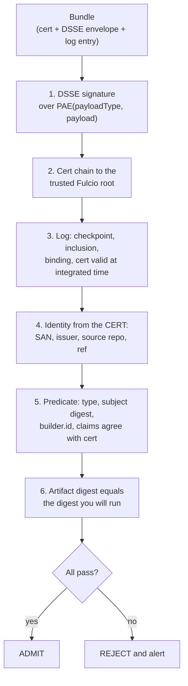

# Drill: Verify and Reject Forged SLSA Provenance Attestations

> [!summary] Scope
> Investigative exercise inspecting a signed binary accompanied by an in-toto DSSE attestation claiming SLSA L3 build provenance.
> Guides the engineer through using cosign and slsa-verifier to inspect Fulcio certificate subject alternative names, decode Rekor log entries, detect an unauthorized builder workflow identity, and reject the artifact at deployment time.
> Teaches cryptographic provenance verification without relying on blind trust.
> Provides sample forged and legitimate bundles for comparative inspection.

The drill hands you 13 bundles.
Every one of them has a valid-looking DSSE signature, a Rekor entry, and a predicate that says "built by the trusted SLSA builder".
One is real.
Your job is to write the verifier that admits that one and rejects the other twelve, and to say which check caught which forgery.



## Reproduction

The lab is `code/08-Software-Supply-Chain/slsa_verification/`.
It needs `python3` and the `openssl` command line tool, no network, and no root.

```sh
cd code
python3 -m _harness.verify 08-Software-Supply-Chain/slsa_verification/
# or, directly:
bash 08-Software-Supply-Chain/slsa_verification/run.sh
```

What the lab builds, entirely offline:

- A toy Fulcio: a CA that issues 10-minute ECDSA P-256 code-signing certificates carrying the real Fulcio extension OIDs (1.3.6.1.4.1.57264.1.8, .9, .11, .12, .13, .14, .20).
  Certificates are hand-encoded DER (`toyx509.py`), so validity windows are fixed and the output is deterministic.
- A toy Rekor: an RFC 6962 Merkle tree (`toylog.py`) that accepts any entry from anyone, with a signed checkpoint.
- A verifier (`drill.py`) that runs 14 independent checks on each bundle and never short-circuits, so the output is a matrix of which control catches which attack.
- 13 bundles: one legitimate and 12 forged or misused.

What the lab is not: it is not cosign, slsa-verifier, or `gh attestation verify`.
The bundle format is a simplified model, not the Sigstore bundle protobuf.
The real tools' flags in this note are quoted from their help output and documentation, and were not run against these bundles (see the report for what was and was not executed).

## Observed Symptom

The release engineer's report says the binary ships with SLSA L3 provenance, that it is signed, and that it is in the transparency log.
The scanner is green.

The lab's section 1 shows what the legitimate certificate really says, decoded from DER.
This output was recorded on `darwin-arm64` (macOS, Python 3.15, OpenSSL 4.1) as of 2026-11:

```text
== 1. The legitimate certificate, decoded from DER ==
SAN (identity)            : https://github.com/example-org/trusted-builder/.github/workflows/build_slsa3.yml@refs/tags/v1.0.0
Issuer v2 (1.8)           : https://token.actions.githubusercontent.com
Build Signer URI (1.9)    : https://github.com/example-org/trusted-builder/.github/workflows/build_slsa3.yml@refs/tags/v1.0.0
Runner Environment (1.11) : github-hosted
Source Repo URI (1.12)    : https://github.com/example-org/payments-agent
Source Repo Digest (1.13) : 3f1c9a7e5b2d4c6a8e0f1b3d5c7a9e2f4b6d8c0a
Source Repo Ref (1.14)    : refs/tags/v1.4.2
Build Trigger (1.20)      : push
validity                  : 2026-11-10T12:00:00Z for 10 minutes
code-signing EKU          : True
openssl parses the DER and reads the same SAN: True
DSSE PAE prefix           : DSSEv1 28 application/vnd.in-toto+json 725 <payload bytes>
```

The lab then verifies all 13 bundles.
Recorded on `darwin-arm64`, as of 2026-11:

```text
== 3. Verification matrix: 13 bundles x 14 independent checks ==
checks: dsse_signature cert_chain cert_window tlog_checkpoint tlog_inclusion tlog_binding identity_san identity_issuer predicate_type subject_digest builder_id source_repo source_ref claims_vs_cert
S00 legitimate                       ADMIT  -
S01 payload-swapped-after-signing    REJECT dsse_signature,tlog_binding
S02 genuine-bundle-on-other-binary   REJECT subject_digest
S03 rogue-fulcio-ca                  REJECT cert_chain
S04 attacker-workflow-lies           REJECT identity_san,builder_id,source_repo,claims_vs_cert
S05 same-org-ci-workflow             REJECT identity_san,builder_id,source_ref,claims_vs_cert
S06 trusted-builder-evil-source      REJECT source_repo
S07 trusted-builder-branch-build     REJECT source_ref
S08 signed-after-cert-expiry         REJECT cert_window
S09 borrowed-log-entry               REJECT tlog_binding
S10 corrupted-inclusion-proof        REJECT tlog_inclusion
S11 wrong-predicate-type             REJECT predicate_type
S12 rogue-log-checkpoint             REJECT tlog_checkpoint
admitted 1 of 13; failed-check sets match the expectation for every bundle: True
```

Read the matrix column by column rather than row by row.
A gate that only checks "the signature verifies and the entry has a valid inclusion proof" (the `dsse_signature` and `tlog_inclusion` columns) rejects only S01 and S10.
Counting those two columns in the matrix above, that gate would admit 11 of 13 bundles.
That count is read off the matrix, not printed by the lab.

Your task: reproduce this matrix with a verifier you write yourself, then explain every REJECT line.

## Progressive Hint Ladder

> [!tip]- Hint 1 - Which bytes do you actually trust?
> Make a two-column list.
> Column one: fields whose value was fixed by a key you chose to trust (here, the Fulcio root and the log key).
> Column two: fields that were merely signed by whoever held the leaf key.
> The DSSE payload, including `builder.id`, is in column two.
> The certificate extensions are in column one, but only after the chain verifies.

> [!tip]- Hint 2 - Order matters, but not for the reason you think
> The matrix evaluates every check independently, so order does not change the verdict.
> Order matters for what you may read.
> Do not read the SAN, the issuer extension, or any `1.3.6.1.4.1.57264.1.*` value as an identity until the chain check has passed.
> S03 carries a perfect SAN and perfect extensions, and fails only `cert_chain`.

> [!tip]- Hint 3 - Pin the identity as a whole, exactly
> "Signed by something in `example-org`" is not an identity.
> S05 is signed by a real workflow in the right organization and the right repository, and is rejected only because the workflow file and ref differ.
> If you use a regular expression, anchor it with `^` and `$` and escape the dots.
> Section 4 of the lab output shows an unanchored regex accepting a lookalike organization.

> [!tip]- Hint 4 - Two sources of repository truth must agree
> The certificate says which repository and ref the OIDC token was minted for.
> The predicate says which repository and ref the builder claims it built.
> S06 has an honest predicate and a genuine builder, built from the attacker's repository.
> S04 and S05 have lying predicates.
> Compare the policy to the certificate, and then compare the predicate to the certificate.

> [!tip]- Hint 5 - The log proves existence, not authorization
> Look at what the log accepted: entries from the legitimate build, from the rogue CA (S03), and from the attacker's own workflow (S04).
> An inclusion proof only says "this exact entry is in a tree this log key signed".
> Ask what ties the entry to this bundle (S09), what time the log observed it (S08), and whose key signed the tree head (S12).

> [!tip]- Hint 6 - Write the expected table first
> Before running your verifier, write down for each of the 12 negative bundles the single check (or the small set of checks) that should fail.
> Then diff your verifier's matrix against it.
> A bundle that fails for a different reason than you predicted is a finding, not a pass.

## Model Solution

> [!success]- Solution
> The solution has three parts: the trust model, the 14 checks mapped to the 12 forgeries, and the same controls expressed in the real tools.
>
> ### Part 1 - The trust model: what is signed by whom
>
> A Sigstore-style provenance bundle carries three independent artifacts, and each answers a different question.
>
> | Artifact | Who controls its content | What it can prove |
> |---|---|---|
> | Fulcio certificate | The CA, from the OIDC token claims of the build job | Which workload (workflow file, ref, repo, commit, runner) held the signing key at issuance |
> | DSSE envelope and payload | Whoever holds the leaf private key | That the workload signed these exact bytes |
> | Rekor entry and checkpoint | The log operator, over whatever anyone submits | That this entry existed in a tree at a time |
>
> The SLSA v1.2 verification page says it the same way: verify the signature "using the roots of trust, resulting in a list of recognized public keys", check the statement subject against the artifact digest, check `predicateType` is `https://slsa.dev/provenance/v1`, and look up the Build Level "in the roots of trust, using the recognized public keys and the builder.id, defaulting to SLSA Build L1".
> The consequence is the crux of this drill: "SLSA L3" is not a field in the provenance.
> It is the level your verifier's root-of-trust table assigns to a (signer identity, builder.id) pair.
> A predicate that says "L3" or names a famous builder in `builder.id` proves nothing by itself.
>
> The SLSA provenance v1 spec states the same rule from the producer side: "Consumers MUST accept only specific signer-builder pairs" (section Builder).
> GitHub's CLI manual states it for attestations produced inside Actions: only `signature.certificate` and `verifiedTimestamps` hold values that "cannot be manipulated by the workflow that originated the attestation", while `statement.predicate` can be falsified by an attacker who controls the workflow's execution context.
>
> ### Part 2 - The 14 checks and the forgery each one catches
>
> | Check | What it verifies | Caught by it |
> |---|---|---|
> | `dsse_signature` | ECDSA signature over PAE(payloadType, payload) verifies under the leaf certificate's public key | S01 |
> | `cert_chain` | Leaf is signed by the trusted CA key, issuer name matches, code-signing EKU present, leaf is not a CA | S03 |
> | `cert_window` | Log-observed integrated time is within the leaf's notBefore and notAfter | S08 |
> | `tlog_checkpoint` | Checkpoint is signed by the trusted log key and names the expected origin and tree size | S12 |
> | `tlog_inclusion` | RFC 9162 audit path recomputes the checkpoint root from the leaf hash | S10 |
> | `tlog_binding` | The logged body equals one recomputed from this bundle's cert, payload, and signature digests | S01, S09 |
> | `identity_san` | The certificate's SAN URI equals the one trusted builder identity exactly | S04, S05 |
> | `identity_issuer` | The OIDC issuer extension (1.3.6.1.4.1.57264.1.8) equals the trusted issuer | none here (all bundles use GitHub's issuer) |
> | `predicate_type` | Statement `_type` and `predicateType` are the ones policy accepts | S11 |
> | `subject_digest` | SHA-256 of the artifact you will run appears in the statement subjects | S02 |
> | `builder_id` | `runDetails.builder.id` equals the trusted builder and equals the certificate's SAN | S04, S05 |
> | `source_repo` | Certificate extension 1.12 and the predicate's `externalParameters.repository` both equal the expected repository | S04, S06 |
> | `source_ref` | Certificate extension 1.14 and the predicate's `externalParameters.ref` both equal the expected tag | S05, S07 |
> | `claims_vs_cert` | The predicate's repository, ref, and git commit equal certificate extensions 1.12, 1.14, 1.13 | S04, S05 |
>
> `identity_issuer` catches nothing in this corpus, which is itself a finding: a check that no test case can fail is a check you cannot trust to be wired up.
> In the real world it matters when the same Fulcio instance serves several OIDC issuers, because an identity string like an email address or a URI is only meaningful together with the issuer that vouched for it.
>
> #### The forgeries, one by one
>
> **S01 payload-swapped-after-signing.**
> The attacker edits the subject digest in the payload to the implant's digest after the legitimate build signed.
> The edited `subject_digest` check passes against the implant, because the attacker made it so.
> The signature check and the log binding catch it: the signature was computed over different payload bytes, and the logged `payloadSha256` no longer matches.
> DSSE puts a second rule here: "implementations MUST NOT re-parse the envelope after verification to pull out the payload".
> The lab decodes the payload once and uses those same bytes for both the signature check and the JSON parse.
>
> **S02 genuine-bundle-on-other-binary.**
> Nothing in the bundle is wrong.
> The bundle just describes a different artifact.
> Only `subject_digest` fails, which is why "verify the provenance" without "against the digest of the bytes you will execute" is not verification.
> The in-toto Statement spec says subjects are "matched purely by digest, regardless of content type", and slsa-verifier's README warns about the time-of-check to time-of-use gap for mutable image tags: pass an immutable reference.
>
> **S03 rogue-fulcio-ca.**
> The attacker runs their own CA with the same subject name and mints a leaf with the exact trusted SAN and every extension correct.
> The signature verifies, the log accepts the entry, the predicate is perfect.
> Only the chain to the trusted root fails.
> This is the case that makes the order rule from Hint 2 concrete: certificate contents are attacker-chosen until the chain verifies.
> The trusted root comes from your root of trust, not from the bundle: the Sigstore bundle spec says signers MUST NOT include root CA certificates in bundles.
>
> **S04 attacker-workflow-lies.**
> The attacker runs a workflow in their own repository and gets a real Fulcio certificate for it.
> The predicate they sign claims the trusted builder and the trusted repository.
> Four checks fail, and they are four different ways of noticing the same thing: the SAN is not the trusted builder, `builder.id` does not match the SAN, the certificate's source repository is not ours, and the predicate disagrees with the certificate.
> This is the scenario the `gh attestation verify` manual describes when it says to use a "trusted builder" whose "execution cannot be influenced by input provided through the caller workflow".
>
> **S05 same-org-ci-workflow.**
> The signer is `ci.yml` on `refs/heads/main` in the correct organization and repository, triggered by a pull request.
> A check scoped to the organization or repository (the `--owner` or `--repo` style of check) cannot tell it from the release workflow.
> The `gh` manual says so directly: "Ideally, the path of the signer workflow is also validated using the --signer-workflow or --cert-identity flags".
> This is the realistic insider-adjacent case, for example an attacker with write access to a branch but not to the release process.
>
> **S06 trusted-builder-evil-source.**
> The builder is genuine, the predicate is honest, the SAN matches exactly.
> The attacker simply pointed the real builder at their own repository.
> Only the source-repository check fails.
> This is why slsa-verifier requires `--source-uri` and why SLSA's "Step 2: Check expectations" lists the canonical source repository as a required comparison: "To prevent an adversary from building from an unofficial fork".
>
> **S07 trusted-builder-branch-build.**
> Right builder, right repository, wrong ref: `refs/heads/dev` rather than the release tag.
> Only `source_ref` fails.
> slsa-verifier exposes this as `--source-tag`, `--source-versioned-tag`, and `--source-branch`; `gh attestation verify` exposes `--source-ref` and `--source-digest`.
>
> **S08 signed-after-cert-expiry.**
> Fulcio certificates are valid for 10 minutes (Sigstore CA overview).
> The verifier therefore cannot ask "is the certificate valid now"; it asks "was the certificate valid when the signature was made".
> The only trustworthy answer to "when" is a time you did not get from the signer: the log's integrated time or an RFC 3161 signed timestamp.
> The Sigstore bundle spec says a verifier MUST verify that the signature was computed at the time the certificate was valid.
> In the lab, the log observed the entry one hour after the 10-minute certificate expired, and only `cert_window` fails.
> The lab puts `integratedTime` inside the logged leaf, so the checkpoint covers it; in real Rekor v1 the integrated time is authenticated by the entry's inclusion promise (signed entry timestamp), and sigstore-go accepts it as a verified timestamp only when that promise is present (`VerifyTlogEntry`, `tlog.go`).
> That is the signature of a stolen or retained ephemeral key being used late.
>
> **S09 borrowed-log-entry.**
> The attacker attaches another artifact's genuine, valid log entry and inclusion proof to this bundle.
> `tlog_inclusion` and `tlog_checkpoint` pass, because that entry really is in the tree.
> `tlog_binding` fails, because the logged body does not commit to this bundle's certificate, payload, and signature.
> sigstore-go enforces this for Rekor v1 entries field by field: "transparency log signature does not match" and "transparency log certificate does not match" (`VerifyTlogEntry`, `tlog.go`).
>
> **S10 corrupted-inclusion-proof.**
> One bit flipped in the audit path.
> The recomputed root does not match the checkpoint root, so `tlog_inclusion` fails.
>
> **S11 wrong-predicate-type.**
> A genuine signer attached a `https://slsa.dev/provenance/v0.2` predicate where policy requires v1.
> The two predicates have different shapes (v1 moved `parameters` to `externalParameters`, `materials` to `resolvedDependencies`, and so on), so a verifier written for one that silently accepts the other would be checking fields that mean something different.
> `gh attestation verify` enforces `https://slsa.dev/provenance/v1` by default, and `cosign verify-blob-attestation` takes `--type`.
>
> **S12 rogue-log-checkpoint.**
> The attacker ran their own log and signed its tree head.
> The inclusion path is internally consistent with that checkpoint, so `tlog_inclusion` passes.
> Only the check that the checkpoint is signed by the trusted log key fails.
> An inclusion proof verified against a root you took from the same bundle proves nothing.
>
> ### Part 3 - Matching the real tools
>
> The toy verifier (`verify_bundle` in `drill.py`, under 80 lines) implements the same classes of check the real tools run on a Sigstore bundle.
> Here is each real tool's surface for the same controls.
> Every flag below was read from the tool's own help output or documentation (cosign v3.1.4 was run locally with `--help` only; the other two were not installed and were read from their documentation).
>
> **cosign v3.1.4, bundle format, offline with a pinned root (as of 2026-11, macOS):**
>
> ```sh
> cosign verify-blob-attestation \
>   --bundle payments-agent.sigstore.json \
>   --trusted-root trusted_root.json \
>   --certificate-identity 'https://github.com/example-org/trusted-builder/.github/workflows/build_slsa3.yml@refs/tags/v1.0.0' \
>   --certificate-oidc-issuer 'https://token.actions.githubusercontent.com' \
>   --type slsaprovenance1 \
>   ./payments-agent
> ```
>
> What it covers: bundle signature, chain to the trusted root, log inclusion, certificate identity and issuer, the `--type` predicate type, and (because `--check-claims` defaults to true) that the blob's SHA-256 is in the statement subjects.
> What it does not cover: source repository, ref, or commit.
> The `verify-blob-attestation` help lists no `--policy` flag (the sibling `verify-attestation` does), and the source of `verify_blob_attestation.go` carries a `// TODO: Add policies` comment.
> Your gate must therefore parse the verified predicate and compare `externalParameters` and `resolvedDependencies` itself.
> The help also lists `--certificate-github-workflow-repository` and `--certificate-github-workflow-ref`, which compare GitHub-specific certificate fields.
> The Fulcio directory marks the GitHub-specific extensions 1.3.6.1.4.1.57264.1.2 to .6 as deprecated in favor of the provider-generic ones, and those two flags read exactly the deprecated ones: 1.3.6.1.4.1.57264.1.5 (GitHub Workflow Repository) and .6 (GitHub Workflow Ref), as raw strings (`pkg/cosign/certextensions.go` in cosign and `pkg/fulcio/certificate/extensions.go` in sigstore-go, `main` as of 2026-11).
> Prefer comparing the provider-generic extensions 1.12 and 1.14 in your own gate, and confirm the deprecated ones are populated before relying on those flags.
> Two flags to treat as alarms in CI: `--insecure-ignore-tlog` and `--insecure-ignore-sct`, both documented in the help as skipping a verification.
> Setting `--check-claims=false` verifies only the DSSE envelope, per its help text, and discards the artifact binding (S02).
>
> **slsa-verifier (as of 2026-11, from the README):**
>
> ```sh
> slsa-verifier verify-artifact payments-agent \
>   --provenance-path payments-agent.intoto.jsonl \
>   --source-uri github.com/example-org/payments-agent \
>   --source-tag v1.4.2
> ```
>
> The README documents `--source-uri` (required for artifacts), `--source-tag`, `--source-versioned-tag`, `--source-branch`, `--builder-id`, `--build-workflow-input`, and `--print-provenance`, which writes the verified statement to stdout "to pipe into policy engines".
> `--source-uri` supports only GitHub URIs.
> The README documents verification for specific supported builders, such as the slsa-github-generator reusable workflows, and does not describe a way to register an arbitrary builder identity.
> Our toy builder (`example-org/trusted-builder`) is not one of them, so this command illustrates the shape, not something that would pass against the lab's bundles.
> The README's `verify-github-attestation` command, for the `attest-build-provenance` action, is "currently limited" to two Bazel-related builder IDs.
>
> **GitHub CLI (as of 2026-11, from the manual):**
>
> ```sh
> gh attestation verify ./payments-agent \
>   --repo example-org/payments-agent \
>   --signer-workflow example-org/trusted-builder/.github/workflows/build_slsa3.yml \
>   --source-ref refs/tags/v1.4.2 \
>   --deny-self-hosted-runners
> ```
>
> `--repo` or `--owner` is the minimum; `--signer-workflow`, `--signer-repo`, `--signer-digest`, `--source-ref`, `--source-digest`, `--cert-identity`, and `--cert-identity-regex` tighten it.
> The default predicate type is `https://slsa.dev/provenance/v1` and the default OIDC issuer is `https://token.actions.githubusercontent.com`.
> `--deny-self-hosted-runners` maps to the Runner Environment extension (1.3.6.1.4.1.57264.1.11), which GitHub documents as `github-hosted` or `self-hosted` (the flag sets the expected `RunnerEnvironment` in `pkg/cmd/attestation/verify/policy.go`).
> One subtle point from the manual: when you load attestations from disk with `--bundle`, `--repo` and `--owner` are compared only with the names recorded in the certificate at creation time, so a later rename or ownership change cannot be detected offline.
> The Fulcio extensions 1.15 (Source Repository Identifier) and 1.17 (Source Repository Owner Identifier) exist to carry immutable IDs; pin them if your verifier exposes them.
>
> ### Part 4 - The Merkle half, in one paragraph
>
> The log checks are RFC 9162 section 2.1.3.2 and RFC 6962 section 2.1, nothing more exotic.
> A leaf hash is `SHA-256(0x00 || entry)` and an interior hash is `SHA-256(0x01 || left || right)`, which gives domain separation between leaves and nodes.
> A tree of n leaves splits at the largest power of two smaller than n, so its shape is fixed by n alone.
> Verifying an inclusion proof walks the audit path, combining each sibling on the left or right depending on the low bit of the index, and succeeds only if the walk consumes exactly the whole path (`sn == 0`) and lands on the signed root.
> The lab's section 2 recorded on `darwin-arm64`, as of 2026-11:
>
> ```text
> == 2. Toy Rekor: RFC 6962 tree, open for anyone to append ==
> log size 17, legitimate entry at index 4
> inclusion proof length for the legitimate entry: 5 hashes
> RFC 9162 verifier, sizes 1..20: 210/210 valid proofs accepted, 210/210 wrong-root proofs rejected
> ```
>
> In a 17-leaf tree the split point is 16, so index 4 sits in the full 16-leaf left subtree, which contributes 4 sibling hashes, and the lone 17th leaf contributes the fifth.
> Proof length grows as about log2 of the tree size, which is why a client can verify inclusion in a log of billions of entries with a few dozen hashes and a single signature check on the checkpoint.
>
> ### Part 5 - The regular expression trap
>
> The lab's section 4, recorded on `darwin-arm64`, as of 2026-11:
>
> ```text
> == 4. Identity regex anchoring (re.search is unanchored, like Go MatchString) ==
> SAN              weak-regex  strict-regex
> legit            ACCEPT      ACCEPT
> lookalike-owner  ACCEPT      reject
> tag-suffix       ACCEPT      reject
> ```
>
> The weak regex is `example-org/trusted-builder/.github/workflows/build_slsa3.yml@refs/tags/v.*`.
> It is a substring of `https://github.com/evil-example-org/trusted-builder/.github/workflows/build_slsa3.yml@refs/tags/v9.9.9`, and its trailing `v.*` accepts any tag text.
> The strict regex is `^https://github\.com/example-org/trusted-builder/\.github/workflows/build_slsa3\.yml@refs/tags/v[0-9]+\.[0-9]+\.[0-9]+$`.
>
> The unanchored behavior is not a toy artifact.
> sigstore-go documents it in the `SubjectAlternativeNameMatcher` comment: "regexp matching is not anchored by default; use ^...$ if you intend to match the entire SAN value", and the same note appears on the issuer matcher (`pkg/verify/certificate_identity.go`).
> The cosign `CheckCertificatePolicy` function in `pkg/cosign/verify.go` compiles the identity regular expression and calls `regex.MatchString`, which is also unanchored.
> Prefer exact `--certificate-identity` and `--certificate-oidc-issuer`.
> Use a regular expression only when the identity genuinely varies (the tag in the SAN), and then anchor and escape it.

## Core Takeaway

Provenance verification is a policy decision over a small set of unforgeable facts.
The unforgeable facts are the certificate contents (after the chain verifies against a root you pinned) and the log's observed time (from a log key you pinned).
Everything in the predicate is a claim by whoever held the signing key, and is useful only when it agrees with the certificate and with your expectations for that package.
Reject unless every one of these holds: the chain verifies, the identity is exactly the builder and ref you trust, the source repository and ref are the ones you expect, the log entry is bound to this bundle and was observed inside the certificate's 10-minute window, and the subject digest equals the digest of the bytes you are about to run.

The owning concept notes are [[SLSA-Framework-Build-and-Source-Tracks]] for what Build L3 does and does not cover, and [[Sigstore-Keyless-Signing-Cosign-Fulcio-and-Rekor]] for how the certificate and log are produced.
The envelope and statement layers are owned by [[In-Toto-Layouts-Link-Metadata-and-DSSE-Attestations]].

## Commands and Numbers to Know

Every row is stamped `(as of 2026-11)` with its platform.
Rows taken from documentation were read on 2026-11-21 and not executed.

| Item | Value | Platform | Source |
|---|---|---|---|
| Fulcio certificate lifetime | 10 minutes (as of 2026-11) | Both | Sigstore CA overview |
| Fulcio extension arc | `1.3.6.1.4.1.57264.1.N`; N=8 Issuer (V2), 9 Build Signer URI, 11 Runner Environment, 12 Source Repository URI, 13 Source Repository Digest, 14 Source Repository Ref, 15 Source Repository Identifier, 17 Source Repository Owner Identifier, 20 Build Trigger, 23 Deployment Environment (as of 2026-11) | Both | Fulcio `docs/oid-info.md` |
| Fulcio value encodings | .1 to .6 raw strings, .7 a DER SAN OtherName, .8 to .24 DER UTF8String (as of 2026-11) | Both | Fulcio `docs/oid-info.md` |
| Deprecated Issuer extension | `1.3.6.1.4.1.57264.1.1`, raw string, deprecated in favor of .8 (as of 2026-11) | Both | Fulcio `docs/oid-info.md` |
| DSSE PAE | `"DSSEv1" SP LEN(type) SP type SP LEN(body) SP body`, spec version 1.0.2 (as of 2026-11) | Both | DSSE protocol |
| DSSE `keyid` | Unauthenticated hint, MUST NOT drive security decisions (as of 2026-11) | Both | DSSE protocol |
| Statement type | `https://in-toto.io/Statement/v1` (as of 2026-11) | Both | in-toto Statement spec |
| SLSA provenance predicate | `https://slsa.dev/provenance/v1` (as of 2026-11) | Both | SLSA v1.0 provenance |
| Sigstore bundle media type | `application/vnd.dev.sigstore.bundle.v0.3+json` (as of 2026-11) | Both | sigstore_bundle.proto |
| Rekor v1 status | Maintenance mode; Rekor v2 is tile-based; v2 entries must carry an inclusion proof (as of 2026-11) | Both | Rekor README, sigstore-go `tlog.go` |
| Rekor public instance | 99.5% availability SLO; 100KB attestation upload limit (as of 2026-11) | Both | Rekor README |
| cosign used for flag checks | v3.1.4, build date 2026-10-20, `--help` output only (as of 2026-11) | macOS | local `cosign version` |
| `cosign verify-blob-attestation` | `--bundle`, `--trusted-root`, `--certificate-identity[-regexp]`, `--certificate-oidc-issuer[-regexp]`, `--type`, `--check-claims` (default true), `--insecure-ignore-tlog`, `--insecure-ignore-sct`, no `--policy` (as of 2026-11) | macOS | local `--help` |
| `gh attestation verify` defaults | predicate type `https://slsa.dev/provenance/v1`, issuer `https://token.actions.githubusercontent.com`, `--limit 30` (as of 2026-11) | Both | gh manual |
| `slsa-verifier verify-artifact` | `--provenance-path`, `--source-uri`, `--source-tag`, `--source-versioned-tag`, `--source-branch`, `--builder-id`, `--build-workflow-input`, `--print-provenance` (as of 2026-11) | Both | slsa-verifier README |
| slsa-github-generator reference rule | Reusable workflows MUST be referenced by `@vX.Y.Z` tag, not by hash or short tag (as of 2026-11) | Both | generator README |
| Lab: bundles and checks | 13 bundles, 14 checks, 1 admitted (as of 2026-11) | macOS (darwin-arm64) | lab output |
| Lab: Merkle self-check | 210 of 210 inclusion proofs for tree sizes 1 to 20 (as of 2026-11) | macOS (darwin-arm64) | lab output |

## Pitfalls

> [!warning] Pitfalls:
> - **Treating `builder.id` as authenticated.**
>   It is a payload field.
>   Bind it to the certificate SAN, as the lab's `builder_id` check does, and look the SLSA level up in your own table.
> - **Verifying the signature but not the chain.**
>   S03 passes everything except the chain.
>   Pin the Fulcio root (and the log key) from a TUF-distributed trusted root, never from the bundle.
> - **Scoping identity to an org or repo.**
>   S05 passes an org-level or repo-level filter, and S06 passes any check that looks only at the builder.
>   Pin the workflow path and the ref, and the source repository, as separate checks.
> - **Unanchored identity regular expressions.**
>   See the lookalike-owner row above.
>   Go's `MatchString` and Python's `re.search` are substring matches.
> - **Checking validity at "now".**
>   A 10-minute certificate is always expired by the time you verify.
>   Compare to the log's integrated time or a signed timestamp.
> - **Trusting a log entry without binding it.**
>   Validate that the logged body commits to this bundle's signature and certificate (S09).
> - **Accepting a root taken from the same bundle.**
>   A self-consistent inclusion proof against a self-supplied checkpoint is S12.
> - **Reusing the verified digest for a mutable reference.**
>   The slsa-verifier README warns about verifying `image:tag` and then running `image:tag`.
>   Resolve to a digest once, verify that digest, and run that digest.
> - **Using `--insecure-ignore-tlog`, `--insecure-ignore-sct`, or `--check-claims=false` in a gate.**
>   Each removes a control from the matrix.
>   If you need them for a private deployment without a public log, run your own log and trusted root instead.
> - **Trusting the predicate because the builder is "trusted".**
>   The builder is trusted only for the fields it controls.
>   SLSA's provenance spec says `internalParameters` are trusted only because the platform is trusted and "need not be verified downstream", while `externalParameters` are untrusted and "MUST be verified downstream", and verifiers SHOULD reject unrecognized or unexpected fields in them.
> - **Assuming L3 covers the platform operator.**
>   The v1.2 verification page states Build L3 "does not cover compromise of the build platform itself, such as by a malicious insider".
> - **Self-hosted runners in the trust base.**
>   The provenance spec notes each self-hosted runner may deserve its own builder identity because not all runners are trusted by all consumers.
>   `--deny-self-hosted-runners` or a check on extension 1.11 closes the easy gap.
> - **Mixing predicate versions.**
>   The generic generator's README on `main` documents a v0.2 predicate and a v0.1 Statement example (as of 2026-11), while `gh attestation verify` defaults to the v1 predicate type.
>   Know which one your producers emit before you write the policy (S11).

## At Scale

From one repository to 1,000 to 50,000 engineers, the verifier stays the same and the bookkeeping around it changes.

- **Expectations become data, not flags.**
  SLSA's verifying-artifacts page names three ways to form expectations: trust on first use, defined by the producer, and defined in source.
  A fleet needs a store mapping package name to (trusted builder identity, expected source repository, allowed refs, accepted predicate types), with changes reviewed by two parties.
  A mapping that the producer can edit unilaterally turns S04 into a policy update.
- **Verify at three points, and keep them different.**
  The same page lists the package ecosystem at upload, the consumer at download, and a monitor.
  Registry-time verification protects every client and is recommended "whenever possible", but only verification outside the registry covers a compromised registry (its threat G), and only consumer-side verification covers compromise in transit (threat I).
  Admission-time verification at deployment is the control this drill models.
- **Distribute the trusted root like a key, not like a flag.**
  The root must be updatable (Rekor v1 is in maintenance mode and Rekor v2 is a different log design) and pinned.
  A stale root fails closed; a missing root must also fail closed (`cosign` errors out with a request to supply `--trusted-root` when none is available, per `verify_blob_attestation.go` on `main` as of 2026-11).
- **Decision rules.**
  Under about 20 services: exact identity flags in CI, one script, no policy engine.
  Between 20 and a few hundred: a central expectations file in version control, checked by a shared admission step, with the identity strings generated rather than hand-typed.
  Beyond that: expectations per package owned by the producing team, a monitor that re-verifies the fleet continuously and publishes a verification summary (SLSA VSA), and an alert on any change to a package's builder identity or source repository.
  These thresholds are judgment, not measurements.
- **Plan for log outages and size limits.**
  Online lookups by artifact hash depend on the log's availability (the public Rekor instance advertises a 99.5% SLO), so deployment gates should verify from a bundle that carries its own inclusion proof and checkpoint, and fetch nothing at deploy time.
  The public instance's 100KB attestation limit means very large predicates need your own log.
- **Revocation is short-lived by construction, but history is not.**
  A leaked workflow identity is dangerous for the 10-minute certificate life, but a leaked OIDC trust (for example a compromised repository with a valid release workflow) is dangerous indefinitely.
  Log monitors that watch for new entries under your identity catch unexpected signing.
  See [[Audit-and-Harden-a-GitHub-Actions-Release-Pipeline]] for the producer-side controls and [[Respond-to-a-Compromised-Transitive-Dependency]] for the response when a verified artifact is later found malicious.
- **Provenance is not source review.**
  A fully verified L3 bundle for the correct repository and tag still ships whatever is in that repository.
  The next drill in this track, [[Case-Study-XZ-Utils-Backdoor-CVE-2024-3094]], shows a compromise that passes every check in this note because the malicious change arrived through the legitimate source path.
  [[Reproducible-Builds-as-a-Security-Control]] is the complementary control that checks the build, not only its identity.

## Practice Drill

> [!tip] Practice Drill:
> 1. Run the lab, then add a 14th bundle of your own and predict its failing set before running.
>    Good candidates: a `self-hosted` runner (set extension 1.11 to `self-hosted` and add a policy check), a wrong issuer (extension 1.8 not GitHub's), a certificate with two SAN URIs, and a payload with an extra unrecognized `externalParameters` key.
> 2. Break the verifier on purpose: delete the `cert_chain` call, then confirm S03 is admitted.
>    Do this for each check and record which bundle becomes admitted.
>    A check whose removal admits nothing is a dead check.
> 3. Replace the exact SAN comparison with the weak regex from section 4 and show which scenario becomes admitted.
>    Then anchor the regex but leave the dots unescaped, and show it still accepts a SAN with `githubXcom` in place of `github.com`.
>    Explain why an exact string comparison removes this whole class of mistakes.
> 4. Given a real public bundle for a project you depend on, write the expectations (identity, issuer, source repository, ref pattern, predicate type) by reading the certificate first, then run the real `cosign`, `slsa-verifier`, or `gh attestation verify` with exactly those flags.
>    The lab does not do this step; it needs network access.

## Interview Questions

> [!question] L5: A bundle has a valid DSSE signature and a verifying Rekor inclusion proof, so what has that established and what has it not?
>
> > [!success]- Answer
> > It established that the holder of the leaf private key signed these payload bytes, and that this entry existed in a tree the log key signed.
> > It did not establish who the key holder is, which needs the certificate chained to a trusted root and an identity policy.
> > It did not establish that the signature was made inside the certificate's validity window, which needs the log's integrated time.
> > It did not establish that the entry belongs to this bundle, which needs a comparison of the logged body to the bundle.
> > The log is open to any submitter, so in the lab the attacker's entries (S03, S04) have valid inclusion proofs.

> [!question] L5: What is DSSE's pre-authentication encoding and why does it exist?
>
> > [!success]- Answer
> > The signature is over `"DSSEv1" SP LEN(type) SP type SP LEN(body) SP body`, not over the body alone.
> > That binds the payload type to the signature, so a payload valid as one type cannot be replayed as another.
> > The length prefixes remove any ambiguity about where the type ends and the body begins.
> > The `keyid` field is not authenticated and must not drive a security decision.
> > A verifier must use the same decoded bytes for the signature check and for parsing, and never re-decode the envelope afterwards.

> [!question] L5: Predict the output of this check of the lab's weak and strict identity regexes against a lookalike SAN.
>
> ```python
> import re
> weak = r"example-org/trusted-builder/.github/workflows/build_slsa3.yml@refs/tags/v.*"
> strict = (r"^https://github\.com/example-org/trusted-builder/\.github/workflows/build_slsa3\.yml"
>           r"@refs/tags/v[0-9]+\.[0-9]+\.[0-9]+$")
> san = "https://github.com/evil-example-org/trusted-builder/.github/workflows/build_slsa3.yml@refs/tags/v9.9.9"
> print(bool(re.search(weak, san)), bool(re.search(strict, san)))
> ```
>
> > [!success]- Answer
> > It prints `True False`.
> > `re.search` finds `weak` as a substring starting at `example-org/...` inside `evil-example-org/...`, and the trailing `.*` accepts any tag text.
> > `strict` is anchored at the start, so `https://github.com/` must be followed directly by `example-org`, which `evil-example-org` is not.
> > The lab's section 4 shows the same two outcomes in its `lookalike-owner` row.
> > Go's `MatchString`, which cosign and sigstore-go use for identity regexes, is also unanchored.

> [!question] L6: Debug this gate, which passes a forged bundle: what is wrong with the command below?
>
> ```sh
> cosign verify-blob-attestation \
>   --bundle b.sigstore.json \
>   --trusted-root trusted_root.json \
>   --certificate-identity-regexp 'github.com/example-org/.*' \
>   --certificate-oidc-issuer-regexp '.*' \
>   --type slsaprovenance1 \
>   ./payments-agent
> ```
>
> > [!success]- Answer
> > There are three defects, in order of damage.
> > The identity regex is unanchored and scoped to the organization, so it accepts any workflow in the organization (S05) and any lookalike path containing the string (the evil-example-org case).
> > The issuer regex `.*` accepts any OIDC issuer, which defeats the point of binding an identity to an issuer.
> > Nothing checks the source repository or ref, because `verify-blob-attestation` has no policy flag, so the predicate must be parsed and compared separately (S06, S07).
> > The fix is an exact `--certificate-identity` naming the trusted builder workflow and ref, an exact `--certificate-oidc-issuer`, and a separate comparison of `externalParameters.repository` and `ref` in the verified statement.
> > Also confirm the gate verifies the exact file that will be deployed, since the blob digest check is what binds the bundle to it.

> [!question] L6: Fulcio certificates live for 10 minutes, so how does verification work a day later and what breaks it?
>
> > [!success]- Answer
> > The verifier checks that the signature was made while the certificate was valid, using a time the signer cannot forge.
> > That time is the log's integrated time, authenticated by the log key's signature over the entry (the inclusion promise, or signed entry timestamp), or an RFC 3161 signed timestamp from a trusted timestamp authority.
> > A checkpoint signature alone does not authenticate the integrated time.
> > The bundle spec requires verifiers to check validity at signing time.
> > Verification breaks when a bundle has no verifiable time source, when the log key is not in the trusted root, or when the verifier trusts an unsigned timestamp.
> > sigstore-go's source comment is explicit that a timestamp taken only from an inclusion proof, without signed metadata, must not be used.
> > S08 in the lab is the case where the log observed the entry an hour after the certificate expired.

> [!question] L6: Why is `gh attestation verify --owner example-org` not enough, and which additions close S05 and S07?
>
> > [!success]- Answer
> > Owner scope checks the source repository owner recorded in the certificate.
> > In the lab it would reject S04 and S06, whose source repository belongs to `mallory-labs`.
> > It cannot separate S05 (a CI workflow on `main` in the same organization and repository) from the real release, and it also accepts a genuine build of any other repository in the organization.
> > Add `--repo` to pin the repository, `--signer-workflow` or `--cert-identity` to pin the workflow that signed, and `--source-ref` or `--source-digest` to pin what it built.
> > The manual says the more precisely you specify the identity the stronger the guarantee, and recommends validating the signer workflow path.

> [!question] L7: Design the org-wide policy for admitting provenance-bearing artifacts: where do expectations live, who can change them, and what do you alert on?
>
> > [!success]- Answer
> > Expectations are per package name: exact trusted builder SAN and issuer, source repository (and immutable repository ID if the verifier exposes it), allowed ref pattern, predicate type, build type, and allowed `externalParameters` keys.
> > SLSA names three ways to populate them: trust on first use, defined by the producer, and defined in source.
> > Use producer-defined expectations with two-party review for changes, because a producer that can edit its own expectations unilaterally defeats the control.
> > Use trust on first use only with alerts on any difference between consecutive versions' provenance.
> > Treat a change in builder identity, source repository, or the set of `externalParameters` as a security event.
> > Verify at admission and continuously with a monitor, fail closed on a missing or stale trusted root, and keep exception flags such as `--insecure-ignore-tlog` out of the production path.

> [!question] L7: What does SLSA Build L3 give you in this drill, and what does it not?
>
> > [!success]- Answer
> > L3 requires the build platform to protect the provenance signing key and isolate builds, so a tenant cannot forge provenance or persist between builds.
> > In the lab this is the difference between S00, where the trusted builder generates the predicate, and S04, where the tenant's own workflow signs a predicate it wrote.
> > It does not cover a malicious operator of the platform, the content of the source (the xz-utils case), or typosquatting.
> > It says nothing unless your verifier maps the signer identity to a level in your own root-of-trust table.

> [!question] L7: The transparency log is down or you must verify in an air-gapped cluster, so what do you ship with the artifact and what do you pin?
>
> > [!success]- Answer
> > Ship a bundle that carries the certificate, the DSSE envelope, and the log entry with its inclusion proof and signed checkpoint.
> > Verify offline against a pinned trusted root holding the Fulcio CA chain and the log public key.
> > sigstore-go requires an inclusion proof and/or promise per entry, and an inclusion proof for Rekor v2 entries.
> > Offline verification cannot detect a repository rename or ownership transfer after signing, which the `gh` manual calls out for `--bundle`, so pin immutable repository and owner IDs and not only names.
> > The risk you accept is a stale trusted root and no freshness signal about the log, which you mitigate with a short root refresh interval and a monitor on the connected side.

> [!question] L8+: An attacker can mint certificates from your trusted Fulcio root for arbitrary identities, so which of the 12 forgeries become undetectable and what is your detection story?
>
> > [!success]- Answer
> > If the attacker controls issuance under a root you trust, S03 becomes S00: every certificate-derived check passes and a perfect forged bundle is admitted.
> > The remaining defenses are outside the bundle.
> > One is a monitor that compares issued certificates against actual build records, using the certificate transparency log and the SCTs that verifiers can require (cosign has `--insecure-ignore-sct`, and sigstore-go has `VerifySignedCertificateTimestamp`).
> > Another is an independent rebuild, covered in [[Reproducible-Builds-as-a-Security-Control]], and a tested procedure for rotating the trusted root.
> > This is why SLSA says Build L3 assumes you trust the build platform, and why the verifier's trust table and not the provenance defines the level.
> > The ADR-level choice between keyless and key-managed signing is covered in [[Supply-Chain-Decision-Records]].

> [!question] L8+: Your producers emit SLSA v0.2 predicates but your gate is written for v1, so how do you migrate without a window where forged v0.2 provenance is accepted?
>
> > [!success]- Answer
> > Make the predicate type an explicit allow-list entry per package rather than a global switch.
> > Add a v1 verifier path with its own field mapping (`externalParameters`, `resolvedDependencies`, `runDetails.builder.id`).
> > Keep the v0.2 path only for packages that have not migrated, and make it at least as strict on identity and source checks.
> > Reject any bundle whose `predicateType` is not listed for that package (S11), and track migration per package so the v0.2 allow-list only shrinks.
> > The SLSA v1.0 spec documents the field mapping from v0.2 in its "Migrating from 0.2" section.

## Further Reading

- SLSA v1.2 "Build: Verifying artifacts" (https://slsa.dev/spec/v1.2/verifying-artifacts) - the normative verification procedure, root-of-trust table, and expectation models this note implements.
- SLSA v1.0 Build Provenance (https://slsa.dev/spec/v1.0/provenance) - the predicate schema, the `externalParameters` rules, and "Consumers MUST accept only specific signer-builder pairs".
- DSSE protocol (https://github.com/secure-systems-lab/dsse/blob/master/protocol.md) - exact PAE definition and the no-re-parse rule.
- in-toto Statement v1 (https://github.com/in-toto/attestation/blob/main/spec/v1/statement.md) - the subject-matching semantics and the envelope's middle layer.
- Fulcio `docs/oid-info.md` (https://github.com/sigstore/fulcio/blob/main/docs/oid-info.md) - the extension directory and the OIDC claim mapping per CI provider.
- sigstore-go `pkg/verify` (https://github.com/sigstore/sigstore-go/tree/main/pkg/verify) - reference implementation of the tlog, SCT, and identity checks, including the regex anchoring note.
- slsa-github-generator `SPECIFICATIONS.md` (https://github.com/slsa-framework/slsa-github-generator/blob/main/SPECIFICATIONS.md) - the non-forgeability argument for reusable-workflow builders and the four detailed verification steps.
- slsa-verifier README (https://github.com/slsa-framework/slsa-verifier) - flags, supported builders, and the TOCTOU warning.
- `gh attestation verify` manual (https://cli.github.com/manual/gh_attestation_verify) - which JSON fields are unforgeable and how to pin the signer workflow.
- RFC 6962 section 2.1 and RFC 9162 section 2.1.3.2 - Merkle tree definition and the inclusion verification algorithm the lab implements.

## Related

- Prerequisites: [[SLSA-Framework-Build-and-Source-Tracks]], [[Sigstore-Keyless-Signing-Cosign-Fulcio-and-Rekor]]
- Next: [[Case-Study-XZ-Utils-Backdoor-CVE-2024-3094]]
- Lab: `code/08-Software-Supply-Chain/slsa_verification/`
- See also: [[In-Toto-Layouts-Link-Metadata-and-DSSE-Attestations]], [[Reproducible-Builds-as-a-Security-Control]], [[Audit-and-Harden-a-GitHub-Actions-Release-Pipeline]], [[Supply-Chain-Decision-Records]], [[Respond-to-a-Compromised-Transitive-Dependency]], [[Drill-Supply-Chain-Detect-Tarball-vs-Git-Tag-Backdoor]]
