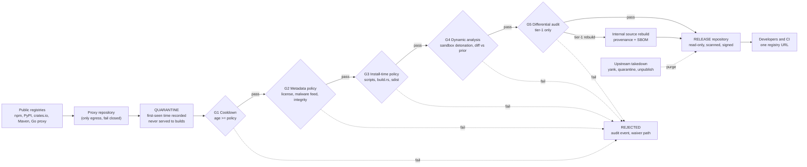
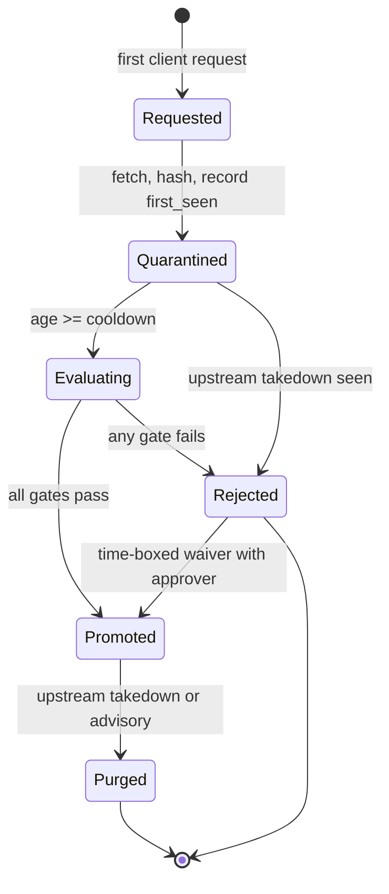

# Enterprise Architecture: Third-Party Code Ingestion and Quarantine

> [!summary] Claim:
> An enterprise never lets a developer or CI job talk to a public registry: every artifact enters through a proxy that holds it in quarantine until a ladder of gates promotes it to a release repository.
> The cheapest gate with the best evidence is time: most recorded registry compromises were removed within hours or days, so a publication-age cooldown enforced at the proxy removes most of the exposure.
> Time does not stop slow attacks like xz, so the ladder adds install-time execution control, sandboxed dynamic analysis, differential human audit of changes, and internal rebuilds for the components that matter most.
> The expert design is a state machine with machine-decidable promotion criteria, an audited exception path for security fixes, and a takedown path that purges what upstream withdrew.



## The Mechanism

### The threat model the perimeter is built for

Three attack shapes dominate the incidents this pillar studies, and each is stopped by a different gate.

- **Short-lived malicious publication.** An attacker steals a maintainer credential or abuses a CI workflow and publishes a bad version, and the registry or maintainer removes it quickly.
  William Woodruff tabulated the exposure window of ten attacks in "We should all be using dependency cooldowns": xz-utils about 5 weeks, Ultralytics 12 hours (phase 1) and 1 hour (phase 2), tj-actions 3 days, chalk under 12 hours, Nx 4 hours, rspack 1 hour, num2words under 12 hours, Kong Ingress Controller about 10 days, web3.js 5 hours.
  His headline is "8/10 attacks had windows of opportunity of less than a week", and a footnote says xz-utils is the only one of the ten that a 14-day cooldown would not have stopped.
  He also calls cooldowns "obviously, not a panacea".
  The sample is ten hand-picked public incidents, so it supports "most", not a rate you can plan capacity on.
  The cooldown gate (G1) owns this shape.
- **Install-time code execution.** The payload runs when the package manager unpacks or builds the dependency, before any application code or test touches it.
  CISA's September 2025 alert on the npm worm describes credential theft and self-propagation through exactly this channel (details in the case-study note [[Case-Study-Shai-Hulud-and-Self-Replicating-Registry-Worms]]).
  The install-policy and detonation gates (G3, G4) own this shape.
- **Slow trust capture.** A maintainer is groomed or replaced over months, and the malicious change arrives in a normal-looking release.
  No cooldown helps, because nobody notices for weeks (see [[Case-Study-XZ-Utils-Backdoor-CVE-2024-3094]] and [[Case-Study-Event-Stream-and-Maintainer-Handoff]]).
  Differential audit (G5) and internal source rebuild with tarball-versus-tag comparison own this shape, and they are expensive, so they are applied by tier.

Name resolution attacks (dependency confusion, typosquatting) are a fourth shape that is owned by [[Dependency-Confusion-Typosquatting-and-Registry-Attacks]].
The ingestion architecture here assumes that note's controls (scoped namespaces, a single virtual repository) as its gate zero, and does not re-derive them.

### Zones and the quarantine state machine

The architecture has three zones.

1. **Public**: the upstream registries.
   Only the proxy tier may reach them, enforced by network egress rules.
2. **Quarantine**: the proxy's remote repositories and cache.
   Artifacts here are stored and evaluated but are not resolvable by builds.
3. **Release**: a repository of promoted artifacts, read-only for consumers.

The Enduring Security Framework report "Recommended Practices for Managing Open Source Software and Software Bill of Materials" (NSA, ODNI, CISA, December 2023) describes the same shape in its section on a company-internal secure open-source repository.
It says controls should ensure "packages cannot be added outside of the approved processes", suggests different policies for repositories (looser for developer workstations and CI, more restrictive for release build systems), and says an adopted component moves into "a protected, read-only repository that is continuously scanned and monitored for vulnerabilities".
NIST SSDF 1.1 PW.4.1 gives the control in one line: "Establish one or more software repositories to host sanctioned and vetted open-source components."

Each (ecosystem, package, version) is a state machine.



Two properties matter more than the drawing.

- **Fail closed.** If the evaluation service is down, requests for new components must not pass through.
  Sonatype Repository Firewall documents exactly this: with quarantine enabled and the service unavailable, "requests for new components are immediately placed in quarantine until they are evaluated and released".
- **New components only.** Sonatype states Repository Firewall "only quarantines newly requested components", so a component already in the proxy cache is audited, not blocked.
  The consequence for design: turning the gate on does not clean the existing cache, so the rollout must include a sweep of what is already cached.

Sonatype also documents a short blind spot: new public components are "unknown for less than 5 minutes before they are identified", and it recommends blocking unknown components for that reason.
Generalize it: any gate that depends on an external reputation feed has a latency, and the quarantine state exists to cover that latency.

### G1: the publication-age cooldown

A cooldown refuses to resolve any version published less than N time units ago.
The idea is old but support in package managers is recent, and it is in every major client as of 2026-11, with different units, scopes and failure behavior.
Those differences are where the production bugs are.

#### Per-tool semantics (as of 2026-11, Both)

| Tool | Setting | Unit and format | Scope and edge cases |
|---|---|---|---|
| npm 11.10.0+ | `min-release-age` | days, number, default `null` (off) | Errors if no version satisfies the range. `npm audit fix` keeps the vulnerable version, warns and exits non-zero if the fix is too recent. `min-release-age-exclude` (names or minimatch globs, added in 11.17.0; an excluded package's own dependencies are still filtered). `before` is the absolute-date form and wins over `min-release-age` set in the same source; a dist-tag that fails the filter resolves to the most recent version less than or equal to that tag. |
| pnpm 10.16+ | `minimumReleaseAge` | minutes | All dependencies including transitive. Built-in default became 1440 (1 day) in pnpm 11. `minimumReleaseAgeExclude` takes names, globs, and exact versions. Re-applied to existing lockfile entries unless `trustLockfile: true`. Reads the registry metadata `time` field. |
| Yarn 4.10.0+ | `npmMinimalAgeGate` | duration string (`"1w"`, `"3h"`, `"30m"`); a bare number is minutes | A newer version "will not be considered for installation". Default became `1d` in 4.15.0, and 4.17.0 allows a per-`npmScopes` value. `npmPreapprovedPackages` exempts packages from all package gates, not only the age gate. |
| Bun 1.3+ | `[install] minimumReleaseAge` | seconds (number) or duration such as `3d` | New resolution only: packages already in `bun.lock` are unchanged. `minimumReleaseAgeExcludes` accepts names or exact `name@version`. Reads the registry `time` field, and a version with no `time` passes. |
| uv 0.9.17+ | `exclude-newer` | RFC 3339 timestamp, `24 hours`, `1 week`, `30 days`, or ISO 8601 (`P7D`); months and years rejected | Compared against each artifact's upload time using PEP 700 `upload-time`, and an index without it makes the files unavailable unless the package (`exclude-newer-package <pkg>=false`) or the index (`[[tool.uv.index]] exclude-newer = false`) is opted out. The relative cutoff is stored as a timestamp in `uv.lock`. `exclude-newer-package` overrides per package. Registry sources only, not Git. |
| pip 26.0+ | `--uploaded-prior-to` | ISO 8601 datetime (a duration such as `P3D` since 26.1) | Only effective on indexes that provide upload-time metadata. Env var `PIP_UPLOADED_PRIOR_TO`. |
| Cargo 1.100+ | `registry.global-min-publish-age` | `"7 days"` style string, default `"0"` | Resolver ignores versions published more recently unless already in `Cargo.lock`. Source is the index `pubtime` field (stable since Cargo 1.94), which crates.io backfills gradually. Per-registry override `registries.<name>.min-publish-age`. |
| Renovate | `minimumReleaseAge` | string such as `"3 days"` | Per version, via status check `renovate/stability-days`. `internalChecksFilter` default `strict`. Renovate itself does not manage transitive dependencies; for npm (`--before`), pnpm, Yarn, Cargo and Poetry it passes an age to the package manager during lock file generation. |
| Dependabot | `cooldown.default-days` and `semver-{major,minor,patch}-days` | days | Default of 3 days applies to version updates since 2026-07-14 on github.com. Version updates only, never security updates. `include` and `exclude` take up to 150 items each. |
| Go, Maven | none native | | Go proposal 76485 was opened 2025-11-27 and is in Proposal-Hold since 2026-06-25, with the Go team saying it will first try cooldown at the module proxy layer. No native Maven setting was found (as of 2026-11). |

Sources for every row are in the frontmatter, and the cross-tool unit trap is the first thing to remember: the same bare number means days in npm, minutes in pnpm and Yarn, and seconds in Bun, so a value copied between configurations changes the window by a factor of 1,440 or 86,400.

#### Where the timestamp comes from, and why it matters

Every client trusts a publish time that the registry reports.
pnpm and Bun read the packument `time` field, uv reads PEP 700 `upload-time` per file, and Cargo reads the index `pubtime`.
Three consequences follow.

- **Missing timestamps.** The tools disagree on what a missing time means.
  Bun lets a version with no `time` pass.
  pnpm's `minimumReleaseAgeIgnoreMissingTime` defaults to true (skip the check), and when false resolution fails.
  Renovate's `minimumReleaseAgeBehaviour` default is `timestamp-required`, which holds an update that has no release timestamp, and before Renovate 42 a missing timestamp counted as passed.
  uv treats an upload-time-less distribution as unavailable.
  A private or mirrored registry that strips these fields silently changes the policy per client.
- **Per-artifact versus per-version.** uv compares the upload time of each distribution file, not the version's first release.
  A version first uploaded as an sdist and later given a new wheel can be partly visible.
- **The proxy has a better clock than the client.** A proxy that records `first_seen` when it first fetched a version owns a timestamp the upstream cannot forge, and can enforce `min(upstream_publish, first_seen + N)` semantics.
  Recording its own clock is a design choice made here, not something the tools above document, but it is the only way to apply one rule across every client that ignores the setting.

#### Lockfile semantics

A cooldown is a resolution-time filter, and what it does to a version already resolved differs.

- Cargo keeps versions already in `Cargo.lock`.
- Bun leaves packages already in `bun.lock` unchanged.
- uv stores the computed cutoff timestamp in `uv.lock` and changes it only on a new resolution (`--upgrade`, `--refresh`).
- pnpm re-applies `minimumReleaseAge` and `trustPolicy` to every lockfile entry on install unless `trustLockfile: true` is set, which is unsafe if outsiders can edit the lockfile.

The practical meaning is that a client-side cooldown protects the moment of change (a bot PR, an `update`), not a repository that already pinned the bad version.
A proxy gate protects both, because it controls what the lockfile's URL can serve.

#### Exceptions and the security-update bypass

Every ecosystem lets security fixes through, and each in its own way.

- Renovate: "Security updates bypass any `minimumReleaseAge` checks", using `vulnerabilityAlerts.minimumReleaseAge` which is null by default.
  The package manager's own age setting still applies during the lockfile update, so a fix younger than that setting shows an artifact error in the PR.
- Dependabot: `cooldown` is version updates only, and the default cooldown "does not apply to security updates", which "still open immediately".
- npm: `npm audit fix` refuses the too-recent fix, warns and exits non-zero rather than bypassing (since 11.18.0); the documented way through is adding the package to `min-release-age-exclude` or relaxing the window.
- Cargo: the documented override for an urgent fix is the environment variable `CARGO_RESOLVER_INCOMPATIBLE_PUBLISH_AGE=allow` together with `cargo update -p <crate> --precise <ver>` (the config key is `resolver.incompatible-publish-age`, values `deny` (default) and `allow`).

The enterprise rule that follows: a security-fix exception is not a gate bypass.
The version still enters quarantine, still passes G2 through G4, and the exception only waives G1, with a named approver and an expiry.
JFrog Curation models this exactly: waivers carry a duration of 1 to 365 days (permanent if none is set), the shortest wins with several decision owners, and expiry restores enforcement.
Attackers can also publish a malicious version dressed as a security fix, which is the reason the other gates must still run.

#### Choosing the window

The window is a trade-off between exposure and the staleness of patched dependencies.
The evidence available here is the ten-attack table above, which says a 7-day cooldown would have covered eight of ten and a 14-day cooldown nine of ten (derived from Woodruff's windows and footnote), and that the unsolved case is a slow compromise.
Curation's "Package version is immature" condition takes a configurable number of days on the conditions page, and the JFrog how-to for deprecated and outdated packages lists three built-in strictness levels, permissive, moderate and strict, that block versions released less than 2, 14 or 30 days ago, with a custom condition for any other threshold (as of 2026-11), which shows vendors treat the window as a tier knob.
The decision rule used later in this note: a short default window for everything, a long window for the runtime dependency tier, and an emergency path that is audited, not silent.

### G2: metadata and reputation policy at the proxy

Commercial and open proxies evaluate policy when a component is first requested.

**JFrog Curation** evaluates at the curated remote repository.
Each policy has exactly one condition, and the actions are Block and Dry Run.
The documented condition catalogue includes malicious package, CVE with CVSS, OpenSSF score, package integrity violation, license allow and block lists, "no identified license", "Package version is immature", "only a single version", and aged-package conditions (a version more than 2 years old with no newer version, or more than 180 days older than the latest).
Scopes are organization, project, specific repositories, package type, or selected groups, and an audit event is logged for every inspected package at Platform > Curation > Audit Log.
A Dry Run policy never blocks a package in a pending state, which is how you measure a policy before enforcing it.
The documentation does not state the HTTP status a blocked client receives, so build the client-side message path yourself and test it.

**Sonatype Repository Firewall** quarantines when a policy's action is Fail at the Proxy stage.
Warn only sends an email, and No Action only shows the violation in the audit report.
Clients get an error with a link to the component details, and build logs often show only a 403, while NuGet gets 409 and Pub gets 451.
For npm and PyPI, queries for the latest version "are only answered with the versions that are approved by your policy", which is the proxy-side equivalent of resolving "latest" under a cooldown.
Release works by waiving the violation (the "Proxy Failing" action) and re-evaluating.
Components are released automatically when the failing violations are no longer open, and an hourly task (default, tunable through `automaticQuarantineReleaseTimeIntervalInMinutes`) watches components quarantined in the last 14 days, after which release is manual only.
Auto-release only follows certain condition types, one of which is Age (measured from when Sonatype first cataloged the component, not the upstream publish time, in rolling 24-hour intervals), which is the Sonatype form of a cooldown.

**Open-source proxies** have weaker policy engines, and the design choice is what they cache and what happens when upstream disappears.

- Pulp's `on_demand` policy fetches metadata at sync and the artifact on first client request, `streamed` does not save the artifact, and `immediate` (default) downloads everything at sync.
- Verdaccio's uplinks have `cache` (default true), `max_fails` (default 2), `fail_timeout` (default 5m) and `timeout` (default 30s).
- Athens has download modes `sync`, `async` (returns 404 now and fetches in the background), `none` (404 for versions not in storage), and `NetworkMode = "offline"` disables upstream version lookups.
- The Go ecosystem has the best-specified proxy protocol: `GOPROXY` falls back on 404 or 410 with a comma and on any error with a pipe, "This error handling behavior lets a proxy act as a gatekeeper for unknown modules" (a proxy can return 403 for modules not on an approved list), and `GOSUMDB` (default `sum.golang.org`) is a transparent log that detects a proxy serving different bytes to different users.
  `GONOSUMDB` and `GONOPROXY` default to `GOPRIVATE`, so private module paths bypass the public checksum log by design.

The policy-engine gap in open-source proxies is the reason many enterprises put a cooldown filter in front of them, and the Go team's statement that cooldown will be tried at the proxy layer first confirms the direction.

### G3: controlling install-time and build-time execution

A package manager can execute code from the dependency at several moments.
Each ecosystem differs in what is on by default, and the defaults changed repeatedly in 2025 and 2026.

#### npm family (as of 2026-11, Both)

- npm runs `preinstall`, `install`, `postinstall`, then `prepublish` (deprecated), `preprepare`, `prepare`, `postprepare` on `npm install`.
  If `binding.gyp` exists and no `install` or `preinstall` script is defined, npm defaults `install` to a node-gyp compile.
- `ignore-scripts` (default `false`) turns off all of them, and it overrides the allowlist flags.
- npm now has an allowlist: the `allowScripts` field in the root `package.json`, managed by `npm install-scripts approve|deny|ls|prune`.
  Approvals are pinned to `pkg@version` by default (`allow-scripts-pin`), denials are name-only, and a `false` entry beats a later `approve --all`.
  Matching uses the resolved identity (registry, git, file, tarball), not the name the package reports, so aliases match the underlying package.
- Enforcement is version dependent.
  npm 11.16.0 shipped phase one (advisory listing of unreviewed packages, scripts still run by default).
  npm 12.0.0 (2026-07-08) blocks dependency lifecycle scripts by default unless the root `allowScripts` policy allows them, requires `npm rebuild` after approving, runs root `preinstall` before dependencies are installed, and sets `allow-git` and `allow-remote` to `"none"` by default.
  `strict-allow-scripts` turns a warning into a hard error, and `dangerously-allow-all-scripts` is the escape hatch the docs call a migration measure.
- pnpm 10.0.0 stopped running dependency lifecycle scripts by default (allow with `onlyBuiltDependencies`).
  `pnpm approve-builds` arrived in 10.1.0.
  pnpm 11.0.0 replaced the older settings with `allowBuilds` (a map of matcher to true or false), made `strictDepBuilds` default to `true` so unreviewed build scripts fail the install, and defaulted `blockExoticSubdeps` to `true`.
- Bun does not run arbitrary lifecycle scripts by default and runs only packages in `trustedDependencies`, with a curated default list of popular packages that applies to npm packages only (git, file and link dependencies must be listed explicitly).
- Yarn Berry's `enableScripts` defaults to `false` since 4.14.0 (2026-04-16, "Makes `enableScripts: false` the default"), so Yarn no longer runs third-party `postinstall` scripts by default; 4.13.0 and earlier default to `true`, so the pinned Yarn version decides.

Fleet policy implication: pin the package manager version in the toolchain image, because "default off" is a property of the version, and a stale CI image silently runs scripts.

#### Python

- A source distribution is built by a PEP 517 backend in a subprocess, and with no `pyproject.toml` or no `build-backend` key tools revert to legacy `setup.py` behavior (or `setuptools.build_meta:__legacy__`).
  Building an sdist is therefore code execution from the package.
- The control is to refuse builds: `pip install --only-binary :all:` excludes source distributions, and uv has `no-build` (default `false`), `no-build-package`, `no-binary`, `only-binary`.
- A wheel is installed by unpacking: the binary distribution format spec says it may be installed "by simply unpacking into site-packages with the standard 'unzip' tool", and "Wheel does not contain setup.py or setup.cfg".
  That is not the same as "no code ever runs".
  The `site` module executes `.pth` lines starting with `import` with `exec()` at every interpreter startup (unless `-S`), and because a wheel installs files into site-packages, a `.pth` file shipped in a wheel reaches that mechanism (this combination is an inference from the two documents).
  The `site` docs describe a deprecation path: `import` lines in `.pth` are deprecated in Python 3.15, silently ignored in 3.18 and 3.19, and produce a warning in 3.20.
  The same release adds `.start` files in site-packages, startup entry points that `site` executes at startup, so the deprecation moves startup code execution to a new file type rather than removing it.
- Hash-checking mode (`--require-hashes`, or `--hash` on any requirement) requires pinned `==` versions and hashes for every dependency including transitive ones, and it makes an unhashed dependency an error.
  uv has `require-hashes` (default `false`) and `verify-hashes` (default `true`, validates hashes that are present).
  Hash pinning proves "these bytes", not "these bytes are safe", so it complements the quarantine and does not replace it.

#### Rust

The Cargo book says a `build.rs` is compiled and executed "just before building the package", and the Rust Reference says procedural macros have "the same security concerns that Cargo's build scripts have".
A malicious crate therefore runs on the build machine at compile time, with the build user's authority, even if it is never called at runtime.
This is why cargo-vet's `safe-to-run` criterion exists (below), and why Rust builds of tier-1 code should run in an isolated builder with no credentials.

#### Detonation: dynamic analysis in a sandbox

Static policy cannot see a payload that is fetched or decoded at install time.
Detonation means installing the package in an instrumented sandbox and recording what it does.

- **OpenSSF Package Analysis** runs a scheduler fed by OpenSSF package-feeds, a worker, and a loader that writes to BigQuery.
  Its README says sandboxing "via gVisor containers ensures the packages are isolated", and "Detonating a package inside the sandbox allows us to capture strace and packet data".
  The source defines three phases: install, import and execute, and the default runs install and import only (execute is not default and not supported by every ecosystem), with analysis modes `static` and `dynamic` both on by default.
  It records per-phase file, socket and command summaries (from strace), DNS analysis, and file-write summaries.
  The supported ecosystems in source are crates.io, npm, packagist, pypi and rubygems.
  Results go to the public BigQuery dataset `ossf-malware-analysis:packages.analysis`.
- **OpenSSF package-feeds** emits new-package events from PyPI, npm, goproxy, rubygems and crates, to GCP Pub/Sub or stdout, as versioned JSON.
- **DataDog GuardDog** is a static scanner: YARA rules over source and detector rules over metadata, a risk when a capability and a threat indicator co-occur in a file (cross-file matches get lower severity), with output in JSON or SARIF.
  Its README says it covers PyPI, npm, Go, crates.io, RubyGems, GitHub Actions and VS Code extensions, and that scans run in a kernel sandbox (Landlock on Linux, Seatbelt on macOS) unless `--no-sandbox` is given, and that the sandbox is required by default, so a scan fails rather than running unprotected on a platform without it (as of 2026-11).

Design points for the in-house detonation stage (design guidance, not vendor claims):

1. **Diff behavior, not just detect it.** The unit of decision is "version N+1 does something version N did not", such as a new outbound DNS name, a new spawned process, or a write outside the package directory.
   Without a baseline, ordinary native builds look like malware.
2. **Egress is the signal and the risk.** The sandbox needs a fake network that records attempted connections, because a real network gives the payload a chance to exfiltrate or fetch a stage two.
3. **Evasion is expected.** A payload can sleep, check for a sandbox, or trigger on a date or environment variable.
   Detonation raises the attacker's cost, and a clean result is evidence, not proof, which is why it sits behind a cooldown that gives the community time to notice.

### G5: differential human audit with cargo-vet

Some code, such as a crypto library or a build tool, deserves a human read.
Reading every version of every dependency does not scale, so the working model is audit once, then audit the diff.

cargo-vet (Mozilla, v0.10.4 as of 2026-11, published 2026-11-18) records audits in a repository directory `supply-chain/`.

| File | Holds | Notes |
|---|---|---|
| `audits.toml` | your audits, custom criteria, `[[trusted.CRATE]]` entries | importable by other projects |
| `config.toml` | `default-criteria`, `[imports.*]`, `[policy.*]`, `[exemptions.*]` | not importable |
| `imports.lock` | extracted data from imported audit sets | generated, "an implementation detail" |

- **Criteria.** Two built-ins: `safe-to-run` (can be compiled, run and tested on a workstation or in controlled automation without surprising consequences such as unexpected filesystem access, installing software, untrusted network endpoints, or crypto mining) and `safe-to-deploy` ("will not introduce a serious security vulnerability to production software exposed to untrusted input").
  `safe-to-deploy` implies `safe-to-run`, and `default-criteria` defaults to `safe-to-deploy`.
  Custom criteria live in `[criteria.NAME]` in `audits.toml` with a required `description` or `description-url` and optional `implies`.
- **Audit entries.** The table header is the crate name, for example `[[audits.bar]]`, with exactly one of `version = "1.2.3"` (a full audit), `delta = "1.2.3 -> 1.2.4"` (a diff audit, which may run backward), or `violation = "*"` (a version requirement recording a failure, which rejects the dependency even if it is in `exemptions`).
  `criteria` is required, `who` and `notes` are optional.
- **Delta audits are the scaling mechanism.** The resolver "selects the smallest" review path when several exist.
  `cargo vet diff` yields a diff against the last reviewed version (`--mode` is `local`, `diff.rs`, or `custom_url=URL`), `cargo vet inspect` fetches the source, and `cargo vet certify` records the audit (the auditor must confirm the criteria by typing "yes").
- **Exemptions.** `cargo vet init` auto-exempts all existing dependencies so the first run is green, which means the initial state is unaudited code.
  The book says leaning on exemptions "frequently undermines the value provided by the tool".
- **Imports and federation.** `[imports.NAME] url = "https://..."` (HTTPS required) pulls another organization's `audits.toml`.
  Built-in criteria have the same meaning everywhere, so `safe-to-deploy` audits import implicitly, and custom foreign criteria are discarded unless mapped with `[imports.NAME.criteria-map]`.
  `exclude = [crates]` drops a source's entries for named crates.
  Imports are not transitive: "this mechanism is not transitive", an intentional limit that "keeps trust relationships direct".
  The public registry (`registry.toml` in the cargo-vet repository, by pull request) listed these audit sets as of 2026-11: actix, ariel-os, bytecode-alliance, embark-studios, fermyon, google, isrg, mozilla, zcash.
  Google's README disclaims that its audits "should not be construed as reflecting material safety or security properties of Rust crates".
- **Trusted publishers.** `[[trusted.CRATE]]` with `criteria`, `start`, and an `end` at most one year in the future, keyed by the crates.io numeric `user-id`.
  The book treats it as a heuristic: the trusted publisher "isn't checked" and may not have written or reviewed all the code.
- **Wildcard audits.** `[[wildcard-audits.foo]]` with `start`, `end` and `criteria` certifies any version published in the window, and `cargo vet renew --expiring` renews entries expiring within six weeks.
- **CI.** The documented step is `cargo vet --locked` (`--locked` skips fetching new imported audits, `--frozen` avoids the network entirely and requires `--locked`).
- **Source mismatch.** The book warns "there's no guarantee that the code in the repository matches the bits submitted to crates.io", and reviewers read the crates.io content.
- **Limits, stated or unstated.** Audits are human claims ("there is no real way to check their work"), `safe-to-deploy` "do[es] not require a full review", reviewers must "review enough to fully reason about the behavior of all unsafe blocks and usage of powerful imports", and the book says nothing explicit about build scripts beyond requiring that crates that "generate deployed code (e.g. build dependencies or procedural macros)" meet the criteria for the output.
  It does not discuss native C dependencies, and it makes no malicious-code guarantee.
  I found no npm or PyPI tool with the same shared human-audit-set model and enforcement (as of 2026-11), so non-Rust ecosystems need an in-house equivalent: a reviewed-versions table keyed by (ecosystem, name, version, criteria, reviewer) enforced at the proxy.

### G6: internal source rebuild for the components that matter

A binary from a registry is only as trustworthy as that registry's account security.
NIST SSDF 1.1 PW.4.1 example 8 says: "If the integrity or provenance of acquired binaries cannot be confirmed, build binaries from source code after verifying the source code's integrity and provenance."
Internal rebuild turns the supplier's artifact into your artifact, with your own provenance.

Options ordered by cost:

1. **Consume a curated vendor build.** Google Assured Open Source Software offers packages that Google builds in its own pipeline with signed, tamper-evident provenance, SBOMs in industry formats such as SPDX, and the docs state SLSA level 3 requirements.
   The free tier covers Python, Go and Java, and the Premium tier adds npm (release notes dated 2026-08-03).
   The docs show it still in service as of 2026-11, and the listed catalog is a subset of public packages, so most of an enterprise's graph is not covered.
2. **Rebuild from the upstream tag.** Fetch source from version control at the tag, verify integrity (commit signatures, tag pinned by hash), build in your hermetic builder, and publish to the release repository with provenance.
   Compare against the upstream tarball: a release tarball containing files not in the tag is the xz shape, owned by [[Drill-Supply-Chain-Detect-Tarball-vs-Git-Tag-Backdoor]].
3. **Reproduce and compare.** Where the upstream build is reproducible, the strongest check is bit-for-bit equality between your rebuild and theirs, covered in [[Reproducible-Builds-as-a-Security-Control]].
4. **Fork and own.** Last resort for abandoned or unfixably risky dependencies.

The provenance you generate should follow [[SLSA-Framework-Build-and-Source-Tracks]], be signed per [[Sigstore-Keyless-Signing-Cosign-Fulcio-and-Rekor]], and carry an SBOM per [[SBOM-Standards-SPDX-CycloneDX-and-VEX]].

#### Upstream attestations are signals, not gates

Use what upstream publishes, but know what it proves.

- PyPI PEP 740 attestations carry an in-toto v1 Statement whose subject is the distribution filename with a SHA-256 digest, with predicate types SLSA Provenance and "PyPI Publish Attestation"; PyPI accepts at most two per file, one per predicate type.
  The Publish attestation proves publication through a specific Trusted Publisher.
- npm provenance requires npm CLI 9.5.0 or later, a cloud-hosted GitHub Actions or GitLab runner, `id-token: write` and a matching `repository` field, is created with `npm publish --provenance`, is signed through Sigstore, and is verified with `npm audit signatures`.
  The npm docs say provenance "doesn't guarantee the package is free of malicious code".
- npm trusted publishing needs npm CLI 11.5.1 or later and Node 22.14.0 or later; providers are GitHub Actions (GitHub-hosted runners), GitLab CI/CD (GitLab.com shared runners) and CircleCI (cloud), with self-hosted runners not supported (as of 2026-11), and CircleCI generates no provenance (npm trusted publishing docs, as of 2026-11).
- PyPI trusted publishing mints a project-scoped API token that expires 15 minutes after creation.

An attestation proves where a build ran.
It does not prove the source was benign, and an account-takeover attacker who publishes through the legitimate workflow gets valid provenance.
The gate rule that does work: if version N had provenance and version N+1 does not, hold N+1 (downgrade detection), because the tokens-and-account attack path produces unattested releases.
Verification mechanics are owned by [[In-Toto-Layouts-Link-Metadata-and-DSSE-Attestations]] and [[Drill-Supply-Chain-Verify-and-Reject-Forged-SLSA-Provenance]].

### Promotion criteria as a decision function

Promotion must be machine-decidable, or the quarantine becomes a ticket queue that people route around.
A version is promoted when every gate that applies to its tier returns pass.

| Gate | Evidence | Fail action | Waivable by |
|---|---|---|---|
| G0 Identity | resolved from the approved upstream and namespace only | reject | nobody (fix the config) |
| G1 Cooldown | `now - first_seen >= window(tier)` and upstream publish time old enough | hold (not reject) | security owner, expiry required |
| G2 Metadata | license allow list, malware feed clear, integrity ok, abandoned/EOL signals | reject | owner of the dependency |
| G3 Install policy | no lifecycle scripts, or exactly the approved set; no sdist build, or approved builder | reject | security owner |
| G4 Behavior | sandbox install and import produce no new network, process or out-of-tree writes versus previous version | reject | security owner |
| G5 Audit | delta audit exists for tier-1 dependencies | hold | audit board |
| G6 Provenance | attestation present if previous version had one; rebuilt artifact matches or is signed by internal builder | reject or hold | architecture owner |

A tier is assigned per dependency: tier 1 (runtime code on a trust boundary: parsers, crypto, network stacks), tier 2 (other runtime), tier 3 (dev and test tooling, which still runs on developer machines with credentials).
Tier 3 is not low risk, since the worm in [[Case-Study-Shai-Hulud-and-Self-Replicating-Registry-Worms]] harvested developer credentials, so tier 3 gets cooldown, install policy and detonation but not audit.

### Governance for zero-day compromises

The architecture reduces the number of incidents and does not replace the response process.
The governing documents make three requirements that this design implements.

- NIST SSDF 1.1 PW.4.1 (acquire and maintain well-secured components) and PW.4.4 ("Verify that acquired commercial, open-source, and all other third-party software components comply with the requirements, as defined by the organization, throughout their life cycles").
  The words "throughout their life cycles" mean promotion is not a one-time event: a promoted version can be revoked, and the system needs a purge path.
- NIST SP 800-161 Rev. 1 describes obtaining open source software "from vetted and approved libraries", and its CM-10(1) enhancement says to track OSS use and to "Evaluate and periodically audit the OSS's supply chain".
- The ESF report recommends one reviewed ingestion process and a protected, read-only repository for adopted components.

Operational rules (recommended design):

1. **Takedown propagation.** Upstream registries remove or hide bad releases in different ways, and a proxy keeps serving what it cached.
   PyPI quarantine makes a project "not installable (hidden from simple index)", is set by PyPI administrators, and PEP 792 status markers (`active`, `archived`, `quarantined`) appear as `pypi:project-status` in the HTML index and a `project-status` object in the JSON API.
   PEP 592 yank means installers "must ignore yanked files" when a non-yanked version satisfies the request, and a mirror may omit yanked files.
   `cargo yank` "does not delete any data", leaves the crate downloadable through the registry's download link, and does not affect existing lockfiles.
   npm unpublish is allowed within 72 hours if nothing depends on the package, and after that only if there are no dependents, fewer than 300 downloads in the last week, and a single owner, and a used `package@version` can never be reused.
   Maven Central does not remove or modify published components.
   The Go mirror "can continue to serve source code that is no longer available from the original locations", which is useful for reproducibility and the reverse of what you want for a withdrawn bad release.
   Therefore the proxy must subscribe to takedown signals (advisories, status markers, yank flags) and move the artifact to Purged, not wait for the cache to expire.
2. **Break-glass.** A named role can release a quarantined version immediately, with a ticket, an expiry, and a full audit event, and the release is re-evaluated when the expiry lapses.
3. **Blast-radius queries.** The release repository logs which build resolved which version (from the lockfile and the SBOM), so an incident starts with a query, not a scan.
   The incident procedure itself is owned by [[Respond-to-a-Compromised-Transitive-Dependency]].
4. **Credential rotation on exposure.** If a compromised version ever reached a runner, rotate the credentials present on that runner.
   CISA's mitigation list for the npm worm was: pin to versions produced before 2025-09-16, rotate credentials, mandate phishing-resistant MFA.

### Hardening your own publication path

The ingestion perimeter protects consumers, and the same organization is also a publisher whose compromise hurts others.
GitHub's npm response is a model of what to apply to internal registries: its 2025-09-22 plan lists granular tokens with limited lifetime, trusted publishing, deprecating classic tokens, shifting away from TOTP 2FA, and disallowing tokens by default for publishing.
By the 2025-12-09 changelog, all npm classic tokens were revoked, `npm login` issues session tokens that "automatically expire after two hours", and write-capable granular tokens are limited to 90 days.
The CI side is owned by [[OpenSSF-Scorecard-and-CI-CD-Pipeline-Hardening]] and [[Audit-and-Harden-a-GitHub-Actions-Release-Pipeline]].

## Commands and Numbers to Know

All entries (as of 2026-11) and platform Both unless noted.

| Item | Value | Platform |
|---|---|---|
| npm cooldown | `min-release-age=<days>`, npm 11.10.0+ | Both |
| pnpm cooldown | `minimumReleaseAge: <minutes>` in `pnpm-workspace.yaml`, built-in default 1440 in pnpm 11 | Both |
| Bun cooldown | `[install] minimumReleaseAge = <seconds>` in `bunfig.toml` | Both |
| Yarn cooldown | `npmMinimalAgeGate: "1w"` in `.yarnrc.yml`, Yarn 4.10.0+, default `1d` since 4.15.0, bare number in minutes | Both |
| Yarn scripts | `enableScripts` default `false` since 4.14.0 | Both |
| uv cooldown | `exclude-newer = "7 days"` in `uv.toml` or `pyproject.toml`, relative form since 0.9.17 | Both |
| pip cooldown | `pip install --uploaded-prior-to <ISO 8601>`, pip 26.0+ | Both |
| Cargo cooldown | `[registry] global-min-publish-age = "7 days"`, Cargo 1.100 (2026-11-12) | Both |
| Dependabot default cooldown | 3 days for version updates since 2026-07-14, none for security updates | Both |
| Renovate status check | `renovate/stability-days`, `internalChecksFilter` default `strict` | Both |
| npm scripts off | `ignore-scripts=true` or the `allowScripts` policy (default block in npm 12.0.0) | Both |
| pnpm scripts | off by default since 10.0.0, `allowBuilds` and `strictDepBuilds=true` in 11.0.0 | Both |
| Python no source builds | `pip install --only-binary :all:`, uv `no-build` | Both |
| Python hash pinning | `pip install --require-hashes -r requirements.txt` | Both |
| cargo-vet CI step | `cargo vet --locked` | Both |
| cargo-vet latest | v0.10.4, published 2026-11-18 | Both |
| Go checksum log | `GOSUMDB=sum.golang.org` default, `GONOSUMDB` defaults to `GOPRIVATE` | Both |
| Go vendoring | `-mod=vendor`, default when `go.mod` says go 1.14 or higher and a `vendor` directory exists | Both |
| Sonatype auto-release window | hourly check, components quarantined in the last 14 days | Both |
| JFrog waiver length | 1 to 365 days, permanent if unset | Both |
| JFrog immature presets | 2, 14, 30 days (permissive, moderate, strict) (JFrog how-to, as of 2026-11) | Both |
| npm unpublish | 72 hours rule, then no dependents and under 300 weekly downloads | Both |
| PyPI trusted-publishing token | expires 15 minutes after creation | Both |
| Cooldown evidence | 8 of 10 recorded attacks had windows under a week | Both |

## Multi-Language Comparison

| Concern | C++ | Python | Rust |
|---|---|---|---|
| Source of third-party code | No single registry: vendored source, Git submodules, package managers, distro packages | PyPI wheels and sdists | crates.io (source crates) |
| Code executing at install or build | the dependency's build system (CMake, Make, scripts) on every build | sdist builds via PEP 517 backend; `.pth` lines at startup | `build.rs` and procedural macros at compile time |
| Cooldown support | client has none in general, so the proxy or source mirror must enforce time; Dependabot lists vcpkg as `default-days` only | uv `exclude-newer`, pip `--uploaded-prior-to`, Renovate, Dependabot | Cargo `registry.global-min-publish-age` (1.100), Renovate, Dependabot |
| Human audit tooling | internal review of the vendored diff | none verified beyond scanners (as of 2026-11) | cargo-vet with shared audit sets, cargo-crev |
| Refuse risky execution | do not run vendor build scripts outside an isolated builder | `--only-binary :all:`, uv `no-build` | isolated builder with no credentials for `build.rs` |
| Pin and verify bytes | commit hash pins, internal mirror of source archives | `--require-hashes`, uv `require-hashes` | `Cargo.lock` checksums, `cargo vet --locked` |
| Internal rebuild | the natural default: you already compile from source | rebuild wheels from sdist or tag in your builder | rebuild from crates.io source or Git tag |

The C++ column is the weakest evidence in this note, because no single mechanism spans the ecosystem.
It is stated as architecture, not as a verified tool feature.

## Worked Example: A Promotion Decision Trace (no lab)

This note has no lab, and the configurations and traces below were not executed for it.
They show the intended wiring and are checked against the documentation cited above.

**Scenario.** A bot proposes `widget-lib` 4.2.1 for a service whose build runs on npm and whose security-critical component is Rust.
The version was published 20 hours ago.

1. **Client cooldown, defense in depth.** The repository ships these settings so a developer laptop does not need the proxy to be correct.

   ```ini
   # .npmrc  (days)
   min-release-age=7
   ignore-scripts=true
   ```

   ```yaml
   # pnpm-workspace.yaml  (minutes: 7 days = 10080)
   minimumReleaseAge: 10080
   minimumReleaseAgeStrict: true
   ```

   ```toml
   # uv.toml
   exclude-newer = "7 days"
   ```

   ```toml
   # .cargo/config.toml
   [registry]
   global-min-publish-age = "7 days"
   ```

   Note `minimumReleaseAgeStrict: true`: the built-in default is non-strict, and non-strict falls back to a non-compliant version when nothing old enough exists.
2. **Bot configuration.**

   ```json
   { "packageRules": [ { "matchPackageNames": ["*"], "minimumReleaseAge": "7 days" } ] }
   ```

   ```yaml
   # .github/dependabot.yml
   updates:
     - package-ecosystem: "npm"
       directory: "/"
       schedule: { interval: "daily" }
       cooldown:
         default-days: 7
   ```

3. **Proxy trace for `widget-lib` 4.2.1** (hypothetical values).

   | Step | Observation | Result |
   |---|---|---|
   | Request | first fetch, `first_seen` recorded | state Quarantined |
   | G1 | age 20 hours, window 7 days | Hold |
   | Wait | 7 days pass, no takedown signal | Evaluating |
   | G2 | license allowed, malware feed clear, integrity ok | pass |
   | G3 | package declares `postinstall` | reject unless in `allowScripts` |
   | Exception | owner approves `widget-lib@4.2.1` in the root policy with ticket | pass |
   | G4 | sandbox install: new DNS lookup to an unknown name versus 4.2.0 | reject |
   | Result | state Rejected, audit event written, owner notified | blocked |

4. **Rust tier-1 trace.** The service depends on `fastparse` 1.9.0.
   `supply-chain/audits.toml` already contains a full audit of 1.8.0, so the reviewer runs `cargo vet diff fastparse 1.8.0 1.9.0`, reads the diff, and records:

   ```toml
   [[audits.fastparse]]
   who = "Reviewer Name <reviewer@example.com>"
   criteria = "safe-to-deploy"
   delta = "1.8.0 -> 1.9.0"
   notes = "Reviewed diff; no new unsafe, no build.rs change, no new dependencies."
   ```

   CI runs `cargo vet --locked`, and a crate version with no audit chain and no exemption fails the build.

This trace is the order to read the gates in: cheapest and most objective first (identity, age, metadata), then execution policy, then behavior, then human review.

## Pitfalls

> [!warning] Pitfall 1: The same number means different windows in different tools
> `min-release-age=1440` in npm is 1,440 days (about 3.9 years), while `minimumReleaseAge: 1440` in pnpm and `npmMinimalAgeGate: 1440` in Yarn are one day and `minimumReleaseAge = 1440` in Bun is 24 minutes.
> Standardize the policy in one place (the proxy) and generate client files from it, with the unit in a comment.

> [!warning] Pitfall 2: Non-strict fallback silently disables the cooldown
> pnpm's built-in 1440-minute default is non-strict, and non-strict falls back to a non-compliant version when no version is old enough.
> Set `minimumReleaseAge` explicitly (which makes strict default to true) when the policy must hold.

> [!warning] Pitfall 3: A client cooldown does not protect a repository that already pinned the bad version
> Cargo keeps versions already in `Cargo.lock`, Bun leaves `bun.lock` entries unchanged, and uv changes the cutoff only on a new resolution.
> Enforce at the proxy so a stale lockfile URL cannot fetch a withdrawn version.

> [!warning] Pitfall 4: Missing publish timestamps change the rule
> Bun passes a version with no `time`, pnpm skips the check by default, Renovate holds it under `timestamp-required`, uv treats it as unavailable.
> A mirror that strips `time`, `upload-time` or `pubtime` changes behavior per client, and Renovate holds updates from registries with no timestamps (GHCR, Quay, Git tags) indefinitely.

> [!warning] Pitfall 5: Security-update paths bypass the age gate
> Renovate security updates and Dependabot security updates skip the cooldown, so a malicious version dressed as a fix goes straight to a pull request.
> Keep G2 through G4 mandatory on the exception path.

> [!warning] Pitfall 6: Turning on quarantine does not clean the cache
> Sonatype quarantines only newly requested components.
> Sweep and re-evaluate what is already cached, or the old, unreviewed content stays served.

> [!warning] Pitfall 7: "Default off" for scripts depends on the version
> npm blocks dependency lifecycle scripts by default only from 12.0.0, pnpm from 10.0.0, and Yarn from 4.14.0.
> A CI image with an old package manager runs scripts you believed were off, so pin the tool version.

> [!warning] Pitfall 8: Wheels are not code-free
> Unpacking a wheel runs no build backend, but a `.pth` file with an `import` line executes at interpreter startup, and from Python 3.15 a `.start` entry-point file does the same by design.
> Hash pinning and `--only-binary` do not address that, and detonation and install-diffing do.

> [!warning] Pitfall 9: cargo-vet exemptions are the unaudited baseline
> `cargo vet init` exempts everything, so a green check means "nothing new since the baseline".
> Track the exemption count and burn it down, and treat `cargo vet suggest` output as the backlog.

> [!warning] Pitfall 10: A mirror that outlives upstream serves withdrawn releases
> The Go mirror intentionally keeps serving source no longer available upstream, and a yanked or hidden release can stay cached in a proxy.
> Build a purge path keyed on takedown signals.

> [!warning] Pitfall 11: Provenance is not an absolution
> npm's docs say provenance does not guarantee a package is free of malicious code, and a takeover through the legitimate workflow yields valid provenance.
> Use presence and downgrade as a signal, never as promotion by itself.

## At Scale

From one developer to 1,000 to 50,000 engineers, the controls that work change.

- **One developer.** Client settings suffice: `min-release-age`, `exclude-newer`, `ignore-scripts`, `--only-binary`, `--require-hashes`.
  The cost is a few config lines and the failure mode is forgetting them on a new machine.
- **A team of 50.** Add a Renovate or Dependabot cooldown so human-driven updates are paced, and commit the client settings.
  Client config drifts here, which is where pnpm's strict versus non-strict and the unit mismatch start to bite.
- **1,000 engineers.** A proxy is mandatory.
  Network egress denies the public registries, the proxy enforces G0 through G2, and a central policy file generates client config.
  The queue of exceptions starts to matter: set an SLA and an owner for the waiver queue, or developers route around it with vendored copies and personal registries.
- **10,000 to 50,000 engineers.** Tiering and automation carry the load.
  Add detonation as a pipeline stage with per-ecosystem behavior baselines, dependency tiers owned by teams, internal rebuild for tier 1, and federated review (cargo-vet imports of public audit sets cut the review set; for other ecosystems, a shared internal reviewed-versions table).
  The ESF report suggests different repositories with different policies for developer workstations, CI, and release builds, which at this scale becomes a real topology: a looser exploration repository that can never feed a release build.
  Staffing is the constraint: audits are human time, so the audit board's throughput sets how many tier-1 dependencies can exist.

Decision rules (recommended design):

1. Apply cooldown to everything, with the window by tier, because it is the only gate with near-zero marginal cost per package.
2. Apply the install-script policy to everything, with an allowlist owned by the package consumer team.
3. Apply detonation to every new version in tier 1 and tier 2, and to every new package in tier 3.
4. Apply differential audit only to tier 1.
5. Apply internal rebuild when the package is tier 1 and the upstream does not publish verifiable provenance or reproducible output.
6. Measure the gates: time in quarantine, waiver count, waiver age, and the fraction of promotions that needed an exception.
   A rising exception rate means the window is wrong for the business, and fix the window before adding people to the queue.

Trade-offs, stated plainly: a cooldown delays legitimate fixes, quarantine adds a first-fetch latency, detonation has false positives on native builds, differential audit is human-limited, and internal rebuild adds a toolchain you must maintain and secure like any other builder.
The decision records for these choices are in [[Supply-Chain-Decision-Records]].

> [!tip] Practice Drill: Break your own perimeter
> Pick one internal service and answer, with evidence from its lockfile and CI config: which registry URL does the build use, can it reach a public registry, what happens if a version published an hour ago is requested, which dependencies run scripts at install time, and which Rust or native dependencies run code at build time.
> Then run the hands-on exercises [[Drill-Supply-Chain-Exploit-and-Fix-Dependency-Confusion]] and [[Drill-Supply-Chain-Detect-Tarball-vs-Git-Tag-Backdoor]] against the same service and add the missing gate for each failure.

## Interview Questions

> [!question] L5: Why does a dependency cooldown stop most registry compromises, and which does it not stop?
> Answer below.

> [!success]- Answer
> Most recorded attacks were detected and removed within hours or days, so a window longer than the exposure means the bad version is gone before it resolves.
> In Woodruff's ten-attack table, eight had windows under a week, and the only one a 14-day cooldown would miss is xz-utils, at about five weeks.
> It does not stop slow compromises where nobody notices for weeks, or a malicious change in a long-trusted maintainer's release.
> Those need differential audit and rebuild-and-compare.
> The sample is ten public incidents, so call it strong evidence, not a rate.

> [!question] L5: A teammate sets `minimumReleaseAge: 1440` in pnpm and `min-release-age=1440` in npm and says both mean one day. Is that right?
> Answer below.

> [!success]- Answer
> No.
> pnpm's `minimumReleaseAge` is in minutes, so 1440 is one day.
> npm's `min-release-age` is in days, so 1440 is about 3.9 years, which makes almost every version ineligible and makes resolution error out when no version satisfies the range.
> Bun uses seconds, so 1440 there is 24 minutes.
> Yarn's `npmMinimalAgeGate` treats a bare number as minutes, like pnpm.
> Generate client configs from one policy and write the unit in a comment.

> [!question] L5: What does a package manager run on install, and how do you turn it off in npm, pnpm and pip?
> Answer below.

> [!success]- Answer
> npm runs `preinstall`, `install`, `postinstall` (and `prepare` and related) for dependencies; pnpm did the same before 10.0.0.
> npm: `ignore-scripts=true`, or from npm 12.0.0 the default block unless the root `allowScripts` policy allows the package.
> pnpm: off by default since 10.0.0, with `allowBuilds` and `strictDepBuilds=true` in 11.0.0.
> pip: `--only-binary :all:` refuses source distributions, whose PEP 517 build or legacy `setup.py` is code execution.
> Remember a wheel's `.pth` `import` lines still run at interpreter startup.

> [!question] L6: Predict the behavior: a repository has `.npmrc` with `min-release-age=1440` and `pnpm-workspace.yaml` with `minimumReleaseAge: 1440`. Which one is stricter, and what happens with npm if the newest version satisfying a dependency's range is 3 days old?
> Answer below.

> [!success]- Answer
> npm is far stricter: 1,440 days against pnpm's 1,440 minutes (one day).
> With npm, if no version satisfying the range is at least 1,440 days old, the command errors.
> A dependency whose newest satisfying version is 3 days old, and which has no older satisfying version, makes the install fail.
> With pnpm, the 3-day-old version passes the one-day gate.
> If pnpm's value were the built-in default, non-strict mode would fall back instead of failing, which is another difference: setting the value explicitly makes strict default to true.

> [!question] L6: Debug this: Renovate is configured with `"minimumReleaseAge": "3 days"` for all packages, and image updates from `ghcr.io` never produce a pull request, while npm updates do. The Dependency Dashboard shows them pending. Why, and what are the fixes?
> Answer below.

> [!success]- Answer
> Renovate's `minimumReleaseAgeBehaviour` defaults to `timestamp-required` (since Renovate 42), which holds an update that has no release timestamp.
> GHCR, Quay, Git tags and refs and other non-Docker-Hub registries do not provide a timestamp in Renovate's datasources, so those updates are held indefinitely.
> Fixes: set `minimumReleaseAgeBehaviour: "timestamp-optional"` in a package rule for those datasources (it raises the update with a Dependency Dashboard warning), or mirror the images through a registry that has timestamps, or enforce the age at the proxy where you control `first_seen`.
> Whichever you choose, the age rule must still be enforced somewhere for those updates.

> [!question] L6: How does cargo-vet scale audits across versions and across organizations, and what does it not prove?
> Answer below.

> [!success]- Answer
> Delta audits (`delta = "1.8.0 -> 1.9.0"`) let a reviewer read only the diff, and the resolver picks the smallest review path.
> Imports (`[imports.NAME] url = ...`) bring in other organizations' audit sets (the public registry lists Mozilla, Google, Bytecode Alliance and others), with built-in criteria meaning the same everywhere and custom criteria discarded unless mapped with `criteria-map`.
> Imports are not transitive, and exemptions record unaudited code (`cargo vet init` exempts everything).
> It does not prove the code is benign: audits are human claims, `safe-to-deploy` does not require a full logic review, the repository can differ from the crates.io bytes, and the book makes no malicious-code guarantee or native-code claim.

> [!question] L6: Why must the proxy record its own `first_seen` time instead of trusting the registry's publish time?
> Answer below.

> [!success]- Answer
> Clients differ on missing times (Bun passes, pnpm skips by default, Renovate holds, uv treats as unavailable), mirrors can strip the fields, and uv judges per artifact, so client behavior diverges.
> A proxy clock is one the upstream cannot influence, and it applies one rule to all clients, including clients with no cooldown feature (Go and Maven have none native, as of 2026-11).
> The design rule: promote when both the upstream publish time and `now - first_seen` satisfy the window.
> This is a design choice of the architecture, not a documented feature of the tools.

> [!question] L7: Design the exception path for a zero-day fix that must ship in two hours without gutting the quarantine.
> Answer below.

> [!success]- Answer
> Waive only G1, never G2 through G4: the version still enters quarantine, gets the malware, install-script and behavior checks, and a diff against the previous version by a human on call.
> A named approver releases it with an expiry (JFrog waivers are 1 to 365 days and revert on expiry, and Sonatype waivers are best scoped and time-based), and the audit log records who and why.
> Reason: Renovate and Dependabot security updates bypass their cooldowns, so the attacker's best move is a malicious "security fix".
> After the incident, the release is re-evaluated at expiry and the exception count feeds the window review.

> [!question] L7: Why can wheels and `.pth` files undermine an "install runs no code" policy, and what mitigates it?
> Answer below.

> [!success]- Answer
> The wheel spec describes installation as unpacking into site-packages, and the `site` module executes `.pth` lines beginning with `import` at every interpreter startup (unless `-S`).
> So a wheel that ships a `.pth` runs code at startup, not at install, and hash pinning and `--only-binary` do not detect it.
> Mitigation: scan wheel contents for `.pth` and `.start` files in the gate, and detonate with an import phase (Package Analysis defaults to install and import).
> Newer interpreters do not remove the risk: the `site` docs deprecate `.pth` `import` lines in 3.15 (silently ignored in 3.18 and 3.19, a warning in 3.20) but add `.start` startup entry points in the same release, so the gate must look for both.

> [!question] L8+: You own ingestion for 40,000 engineers across Rust, Python, npm, Go and C++. What do you standardize, what do you leave to teams, and how do you measure success?
> Answer below.

> [!success]- Answer
> Standardize: one egress path, one proxy tier with fail-closed quarantine and `first_seen`, one policy file that generates client configs, tier definitions, install-script allowlists, a takedown purge path, and an audited waiver system.
> Leave to teams: tier assignment proposals within rules, audit effort for tier 1 (federated where an ecosystem has tooling, like cargo-vet, otherwise a shared reviewed-versions table), and the dependency owner's waiver approvals.
> Build versus buy: buy the policy engine (Curation or Firewall) and the long-tail malware feeds, build the behavior baseline and the tier-1 rebuild, because those encode your risk.
> Measure: median time in quarantine, exception rate and waiver age, the share of tier-1 dependencies with delta-audit coverage, share of builds resolved from the release repository, time from upstream takedown to purge, and blast-radius query time.
> A rising exception rate is the leading indicator that the window is wrong.

> [!question] L8+: Argue for or against internal source rebuilds of all third-party dependencies.
> Answer below.

> [!success]- Answer
> For: SSDF PW.4.1 example 8 prescribes building from verified source when binary integrity or provenance cannot be confirmed, a rebuild gives you your own provenance and defeats a swapped registry binary, and it enables tarball-versus-tag comparison (the xz shape).
> Against: it moves the trust boundary to your builder rather than removing it, every ecosystem needs hermetic builds and a toolchain you must secure, native and generated sources make rebuilds fragile, and it does not detect a malicious source change in the tag itself.
> Recommendation: rebuild tier 1 and any component with no verifiable upstream provenance, consume curated vendor builds (such as Assured OSS, a subset of public packages) where they exist, and use cooldown, install policy and detonation for the long tail.
> Record the rationale as a decision record.

## Further Reading

- [We should all be using dependency cooldowns](https://blog.yossarian.net/2025/11/21/We-should-all-be-using-dependency-cooldowns) - the ten-attack window table behind the cooldown argument, and its caveats.
- [The cargo-vet Book](https://mozilla.github.io/cargo-vet/) - criteria, delta audits, imports, exemptions and CI usage, with the trust-model limits.
- [npm config reference](https://docs.npmjs.com/cli/v11/using-npm/config) - `min-release-age`, `before`, `ignore-scripts` and the script-allowlist flags.
- [pnpm dependency-resolution settings](https://pnpm.io/settings/dependency-resolution) - strict versus non-strict, missing-time behavior, and lockfile re-checks.
- [uv resolution concepts](https://docs.astral.sh/uv/concepts/resolution/) - `exclude-newer`, `upload-time`, and the lockfile cutoff.
- [Cargo config reference](https://doc.rust-lang.org/cargo/reference/config.html) - `registry.global-min-publish-age` and `resolver.incompatible-publish-age`.
- [Renovate minimum release age](https://docs.renovatebot.com/key-concepts/minimum-release-age/) - status check, `internalChecksFilter`, timestamp behavior and datasource support.
- [Dependabot options reference](https://docs.github.com/en/code-security/dependabot/working-with-dependabot/dependabot-options-reference) - `cooldown` keys and the security-update exception.
- [OpenSSF Package Analysis](https://github.com/ossf/package-analysis) - the sandboxed dynamic analysis design and its phases.
- [JFrog Curation conditions](https://docs.jfrog.com/security/docs/list-of-available-conditions.md) - condition catalogue and waiver model.
- [Sonatype Repository Firewall quarantine](https://help.sonatype.com/en/firewall-quarantine.html) - fail-closed quarantine and auto-release semantics.
- [NIST SP 800-218 SSDF 1.1](https://csrc.nist.gov/pubs/sp/800/218/final) - PW.4 tasks on acquiring and verifying third-party components.
- [ESF: Managing Open Source Software and SBOM](https://www.cisa.gov/sites/default/files/2023-12/ESF_SECURING_THE_SOFTWARE_SUPPLY_CHAIN%20RECOMMENDED%20PRACTICES%20FOR%20MANAGING%20OPEN%20SOURCE%20SOFTWARE%20AND%20SOFTWARE%20BILL%20OF%20MATERIALS.pdf) - the internal-repository ingestion model.
- [CISA: npm ecosystem compromise](https://www.cisa.gov/news-events/alerts/2025/09/23/widespread-supply-chain-compromise-impacting-npm-ecosystem) - the primary incident alert and mitigation list.

## Related

- Prerequisites: [[Dependency-Confusion-Typosquatting-and-Registry-Attacks]], [[OpenSSF-Scorecard-and-CI-CD-Pipeline-Hardening]]
- Next: [[Supply-Chain-Decision-Records]]
- See also: [[17-Cloud-AI-Engineering/Volume_08_Security_Identity_and_the_Data_Perimeter/Chapter_05_Software_Supply_Chain_Security_SLSA_and_Sigstore|Chapter_05_Software_Supply_Chain_Security_SLSA_and_Sigstore]]
- Siblings: [[SLSA-Framework-Build-and-Source-Tracks]], [[Reproducible-Builds-as-a-Security-Control]], [[Respond-to-a-Compromised-Transitive-Dependency]], [[Case-Study-Shai-Hulud-and-Self-Replicating-Registry-Worms]]
