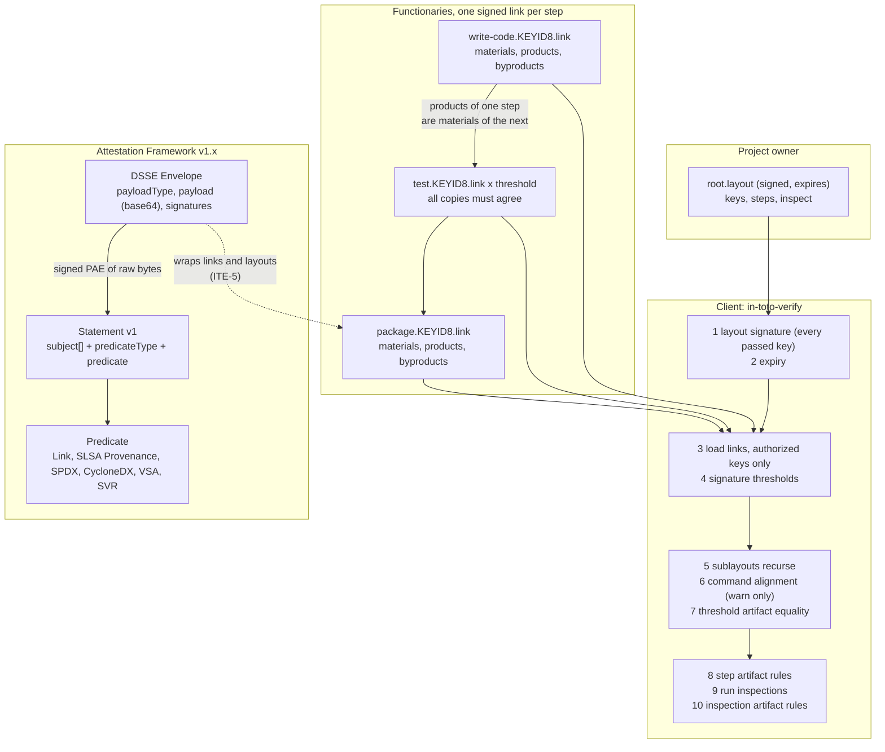

# in-toto Architecture: Supply Chain Layouts, Link Metadata, and DSSE

> [!summary] Claim:
> in-toto verifies a whole pipeline instead of one artifact: a project owner signs a layout that names every step, the keys allowed to perform it, and artifact rules tying each step's materials to earlier steps' products, and each functionary signs a link recording the hashes of what it consumed and produced.
> The client verifies the layout signature, its expiry, every link signature and threshold, and every rule, then runs the layout's inspections on the delivered files, so a product altered between steps fails a hash match instead of going unnoticed.
> DSSE signs `PAE(payloadType, payload)` over the raw payload bytes, which removes canonicalization and binds the payload type to the signature, and the in-toto Attestation Framework wraps a Statement (subjects bound to a typed predicate) in that envelope.
> A layout is an ordered, multi-party policy; a single attestation is one signed claim, so SLSA provenance, SBOMs, and verification summaries need a separate policy decision about identity, predicate type, and subject digest.



## The Mechanism

in-toto answers a question that per-artifact signing cannot: was every step that the project owner required performed, by the party the owner authorized, on exactly the bytes the previous step produced?
Everything in this note follows from that question.
The normative text is the in-toto Specification v1.0.0 (dated 2023-06-02), the in-toto-python 3.1.0 reference implementation (`verifylib.py` is the executable form of the verification algorithm), the DSSE 1.0.2 protocol, and the Attestation Framework v1.2.
[[SLSA-Framework-Build-and-Source-Tracks]] owns the SLSA levels and threat model; this note owns the formats and algorithms that SLSA provenance is carried in.

### 1. Why it exists and what it promises

The 2019 USENIX Security paper by Torres-Arias, Afzali, Kuppusamy, Curtmola, and Cappos motivated in-toto with the observation that supply chain defenses secured individual steps (signed commits, reproducible builds, update frameworks) but not the links between them.
The specification states the defender's goals as: no step was changed, removed, or added relative to what the project owner intended, and the product came from the designated owner.
It lists five system properties: final product authentication and integrity, process compliance and auditability, traceability and attestation, step authentication, and task and privilege separation.

The specification is equally explicit about what it does not do (Section 1.5.2):

- It assumes functionaries and the project owner are not malicious, and it does not protect against a functionary who unwittingly introduces a vulnerability while following every step as designed.
- It does not protect against two colluding or deceived developers who jointly introduce a vulnerability.
- Integrity is bit-for-bit equality of artifact contents; file permissions and timestamps are neither recorded nor verified.
- It does not judge the layout: a layout with no code review and a build on an untrusted server is valid but insecure, and tools built on in-toto may block it independently.
- It does not protect against replay of older, not-yet-expired layouts; the specification recommends The Update Framework (TUF) to bootstrap the right layout (ITE-2 and ITE-3).

The paper's evaluation (measured by the authors in 2019 on three deployments, not by this note): of 30 historical supply chain compromises from January 2010 to January 2019, 23 involved no key compromise and would not have affected any of the three deployments; the paper reports that the deployments could have addressed between 83% and 100% of the historical attacks.
Treat those numbers as the authors' analysis of specific deployments, not a property of every layout.

### 2. Roles and the final product

There are three roles.

- The project owner writes the layout and signs it with the layout key.
- A functionary is a person or automated process identified by the public key that signs its link metadata; the functionary performs a step.
- The client verifies the final product, which is the layout, the link metadata, the target files, and any additional metadata that inspections need.

A functionary may delegate part of the chain to another party by producing a sublayout in place of a link, and then acts as project owner for that sublayout (Section 2.1.4).
A step may be a part of several supply chains, so link metadata is deliberately not bound to one layout (Section 3.1.2).
The minimum final product is one layout, one link, and one target file.

### 3. The layout

A layout is a signed JSON object with `_type: "layout"`, an `expires` date, an optional `readme`, a `keys` map from KEYID to public key, a `steps` list, and an `inspect` list.

**Keys.**
A key object is `{keytype, scheme, keyval}` with the public part in `keyval`.
The specification defines three signing methods used by the reference implementation: `rsa` with scheme `rsassa-pss-sha256` (PEM, at least 2048 bits), `ed25519` with scheme `ed25519` (hex string), and `ecdsa` with scheme `ecdsa-sha2-nistp256` (PEM); it says the framework is not restricted to these.
The KEYID is the hexadecimal SHA-256 of the canonical JSON form of the public key object, which makes it a 64-character string.
Dates use `YYYY-MM-DDTHH:MM:SSZ` in UTC.

**Expiry.**
Clients MUST NOT trust an expired layout; `expires` is the instant after which the layout is expired.
In the reference code `verify_layout_expiration` raises `LayoutExpiredError` when the parsed expiry is less than or equal to now.

**Steps.**
Each step has `name` (unique across steps and inspections), `threshold`, `expected_materials`, `expected_products`, `pubkeys` (the KEYIDs allowed to sign links for the step), and `expected_command`.
The threshold is the number of valid links from distinct authorized functionaries that must exist and agree.
`expected_command` is advisory: the specification says a compromised functionary can forge it, for example by changing `PATH`, and that a mismatch should only produce a warning.
`verify_command_alignment` implements exactly that: it logs a warning and continues.

**Inspections.**
An inspection has `name`, artifact rules, and `run`, a command the client executes during verification.
A return value of 0 is success; any other value halts verification.
The reference implementation runs each inspection through `in_toto_run` with materials and products both set to `["."]`, so an inspection records the whole working directory, and then persists a `<name>.link` file when `persist_inspection_links` is true, which is the library default and which the `in-toto-verify` CLI does not override.

### 4. Link metadata

A link records one step execution: `_type: "link"`, `name`, `command`, `materials`, `products`, `byproducts`, and `environment`.

- `materials` and `products` map an artifact name (usually a path) to a hash object such as `{"sha256": "..."}`.
- `byproducts` is opaque and is not checked by default verification; at minimum it carries `stdout`, `stderr`, and `return-value` (an integer).
- `environment` is opaque; the specification recommends `variables`, `filesystem` (for example an mtree listing), and `workdir`.

The link file name is `<step name>.<KEYID prefix>.link`.
The specification says the prefix is the first six bytes of the KEYID; the reference implementation formats `{step_name}.{keyid:.8}.link`, which is the first eight hexadecimal characters (`models/link.py`, FILENAME_FORMAT), and the Attestation Framework envelope spec also says `<keyid[0:8]>`.
The prefix exists so that links for a step with threshold above 1 do not collide on disk.

`in_toto_run` records artifacts with `record_artifacts_as_dict`.
The defaults in `settings.py` (in-toto-python 3.1.0) are `ARTIFACT_EXCLUDE_PATTERNS = ["*.link*", ".git", "*.pyc", "*~"]` and `LINK_CMD_EXEC_TIMEOUT = 10` seconds.
Exclude patterns use gitignore-style matching (pathspec `gitwildmatch`) without negation and without special treatment of `/` or `**`, and an excluded directory excludes everything beneath it.
`record_artifacts_as_dict` follows symlinked files and, by default, not symlinked directories, but `in_toto_run` and `in_toto_record` always pass `follow_symlink_dirs=True`, so the CLIs do follow symlinked directories and record the symlink name, not the target (`runlib.py`, 3.1.0).
Hashing optionally normalizes line endings; `--lstrip-paths` strips path prefixes so that names match across machines.

Two operational facts follow.
A step that takes more than the timeout fails unless `--run-timeout` is raised, and `in-toto-verify --inspection-timeout` defaults to the same constant.
A link records only what the functionary told the tool to track (`--materials` and `--products`), so an untracked input is invisible to every rule.

### 5. Artifact rules

Rules connect steps.
The grammar is:

```text
MATCH <pattern> [IN <source-prefix>] WITH (MATERIALS|PRODUCTS) [IN <destination-prefix>] FROM <step>
CREATE <pattern> | DELETE <pattern> | MODIFY <pattern> | ALLOW <pattern> | DISALLOW <pattern> | REQUIRE <artifact-name>
```

Rules live in `expected_materials` and `expected_products` and are applied in order to a queue of the step's recorded materials or products, like firewall rules.
A rule that consumes an artifact removes it from the queue so later rules cannot consume it.
Consuming has no effect on its own; only `DISALLOW` (matches something still in the queue) and `REQUIRE` (named artifact absent from the queue) can fail verification.

| Rule | Consumes an artifact when | Source in `verifylib.py` |
| :--- | :--- | :--- |
| `MATCH` | the destination link exists, the destination has an artifact at the (prefix-adjusted) path, and the hash objects are equal | `verify_match_rule` |
| `CREATE` | the name is a product and not a material of this step | `verify_create_rule` |
| `DELETE` | the name is a material and not a product of this step | `verify_delete_rule` |
| `MODIFY` | the name is both a material and a product and the hash objects differ | `verify_modify_rule` |
| `ALLOW` | the pattern matches | `verify_allow_rule` |
| `DISALLOW` | never consumes; raises `RuleVerificationError` if the pattern matches anything left | `verify_disallow_rule` |
| `REQUIRE` | never consumes; raises if the literal name is not in the queue | `verify_require_rule` |

Details that decide whether a layout is safe:

- **There is an implicit `ALLOW *` at the end of each rule list** (Section 4.3.3.1).
  Without a final `DISALLOW *`, any unconsumed artifact passes.
  The Worked Lab Example transcript shows a smuggled product accepted by a layout without the terminal `DISALLOW *` and rejected by the same links under a layout with it.
- `MATCH` consumes an artifact only when the destination hash equals the source hash; a mismatch does not fail by itself, it leaves the artifact in the queue for a later `DISALLOW *` to catch.
- `REQUIRE` takes a literal artifact name, not a pattern (the code comment cites issues 193 and 152).
- Patterns follow glob conventions in the specification; the reference implementation uses Python `fnmatch.filter`, where `*` also matches `/`.
- In `MATCH`, `IN <source-prefix>` restricts and strips the prefix on this step's artifact names before pattern matching, so the glob cannot reach into the prefix; `IN <destination-prefix>` is prepended to the globbed path when looking up the destination artifact.
- Rules compare names and hashes only; they cannot see permissions or timestamps.

### 6. The verification algorithm

The `in_toto_verify` docstring in `verifylib.py` lists the order; the specification (Section 5.2) describes a coarser version of the same flow (layout signature, expiry, link loading with sublayout recursion, step rules, inspections, inspection rules) and does not list the threshold or command-alignment stages separately:

1. Verify layout signatures.
2. Verify layout expiration.
3. Substitute placeholders in the layout (optional parameter substitution).
4. Load link metadata.
5. Verify link signatures with keys in the layout.
6. Recurse into sublayouts.
7. Soft-verify command alignment (warning only).
8. Verify threshold artifact constraints.
9. Process step product and material rules.
10. Execute inspection commands and generate inspection links.
11. Process inspection product and material rules.

What each stage does and why the order matters:

- **Layout signature.**
  `verify_metadata_signatures` requires at least one verification key and requires that every passed key has a valid signature on the layout; it is an all-of-n check, not a threshold.
  `in-toto-verify` documents the same: "For each passed key the layout must carry a valid signature."
- **Link loading.**
  `load_links_for_layout` tries to open a file for each authorized KEYID of each step (and for the subkeys of a key that lists them), skips missing files, and fails early with `LinkNotFoundError` if fewer than `threshold` files exist.
  Authorized does not mean required: only authorized key prefixes are even looked for, so a link signed by an unlisted key is simply never loaded.
- **Signature thresholds.**
  `verify_link_signature_thresholds` keeps only links whose key is authorized for that step and whose signature verifies, and it counts distinct main keys: links signed by different subkeys of one main key count once.
  Failing leaves `ThresholdVerificationError`.
  A code comment notes the check relies on the layout not listing the same key under two KEYIDs.
- **Threshold artifact equality.**
  `verify_threshold_constraints` runs for steps with a threshold above 1 and requires that all surviving links report identical materials and products, so a functionary that disagrees with its peers fails the step.
- **Step rules before inspections.**
  The code comment states why: processing step rules first guarantees inspection commands do not run on compromised target files, at the cost that step `MATCH` rules cannot reference inspection artifacts.
  Inspection rules, by contrast, may reference both steps and inspections.
- **Inspections run code.**
  The `run` command executes on the verifier's machine with the verifier's privileges, so the layout signature is also the authorization to run that command.

**Sublayouts.**
A step may be satisfied by a layout instead of a link, signed by the key authorized for that step.
The verifier recurses into a directory named `<step name>.<KEYID prefix>`, verifies the sublayout with the signing key as its only layout key, and replaces it with a summary link: the materials of the first step in the sublayout's step list and the products of the last (`get_summary_link`).
That derivation assumes the steps are listed in execution order, which is a convention of the summary and not a general rule (see the GHSA-p86f-xmg6-9q4x discussion in section 7).
Inspections inside a sublayout are verified from signed links if present, otherwise run during recursion, and their artifacts are not passed to the upper layer.

**Key lifecycle.**
The docstring is explicit that verification does not consult key creation time, revocation status, or usage flags, and does not contact external sources; revoking a key means the owner signs a new layout without it.

### 7. Known gaps and the advisory

GHSA-p86f-xmg6-9q4x, "Functionaries Do Not Perform Verification" (High, published 2023-04-04, affected specification versions up to 0.9), describes an attack where someone modifies a product in transit so that it compromises the next functionary, which then signs a link listing the original benign hashes as its materials while having actually consumed the tampered files.
Full verification at the client then sees a consistent chain.
The advisory's example is a `tag` step producing source files and a `build` step consuming them, with the attacker altering the source between them.
The in-toto position is that a malicious functionary can always do harm to what it produces, but this lets it also compromise later functionaries and hide where the compromise happened.
Partial verification by each functionary before it acts was considered and not adopted into the specification, for reasons the advisory lists: step order in a layout does not necessarily reflect execution order, rules may reference any step, functionaries otherwise need no access to other metadata, and layouts cannot define inspections to run mid-way.
Specification Section 5.3.5 describes the supported mitigations: give each functionary the preceding links and keys and have it verify hashes before running, or use a sublayout to verify materials before the next step.
Thresholds address the remaining scenario of a product made by a compromised functionary.
The advisory's own recommended workaround is orthogonal: sandbox functionaries so that the routine that generates and signs link metadata is strictly separated from the step's code, because `in-toto-run` signs in the parent process and runs the step in a subprocess that otherwise inherits its privileges (files, environment variables, the signing key); it notes this matches SLSA's non-forgeable provenance requirement.
It also lists a custom "verify only the preceding link" feature in the reference implementation (in-toto PR 589) and says relying on it is not recommended, because it needs out-of-band agreement on which link precedes and who may sign it.

Other limits that matter in practice:

- A forged `expected_command`, `byproducts`, or `environment` is not detected by default verification.
- Replay of an older valid layout and omission of newer links are out of band (TUF, or your own freshness mechanism).
- A compromised signing key for a threshold-1 step can sign any link the layout's rules accept, so rules must constrain what that step may touch.

### 8. DSSE: what is signed and why

The Dead Simple Signing Envelope (DSSE) protocol 1.0.2 (2024-05-10) defines:

```text
SIGNATURE = Sign(PAE(UTF8(PAYLOAD_TYPE), SERIALIZED_BODY))
PAE(type, body) = "DSSEv1" SP LEN(type) SP type SP LEN(body) SP body
```

`SP` is ASCII 0x20, `LEN` is the ASCII decimal byte length with no leading zeros, and `+` in the specification means concatenation.
The specification's test vector is `DSSEv1 29 http://example.com/HelloWorld 11 hello world`.

The JSON envelope is `{"payload": base64(body), "payloadType": ..., "signatures": [{"keyid": ..., "sig": base64(sig)}]}`.
Parsing rules: `payload`, `payloadType`, `signatures`, and `signature.sig` are required even if empty; `keyid` is optional and unset equals empty; consumers ignore unknown fields.
Either standard or URL-safe base64 is allowed and verifiers MUST accept either.

Design reasons, from the DSSE Background document:

- The previous in-toto and TUF scheme signed canonical JSON.
  That limits payloads to JSON, relies on canonicalization (two different payloads could share a canonical form, and attacks on other canonicalizers exist), and forces the verifier to parse before verifying.
- The payload type is inside the signed bytes.
  Without it a signer could be induced to sign a message that a verifier later reads as a different type (the Background's example is CBOR versus protobuf).
- PAE is a length-prefixed, version-tagged encoding of exactly two inputs, so no choice of `type` and `body` can produce another valid pair's bytes.
  It is a simplified ASCII form of PASETO's PAE with a fixed number of inputs and a `DSSEv1` version string.
- The signature covers raw bytes, not base64 text, because base64 exists only to fit bytes into a JSON string.
- Rejected alternatives: raw signatures (fragile, key reuse across message types), JWS (history of vulnerable implementations), PASETO (JSON-only and mandates ed25519).

Rules for verifiers:

- `keyid` is an unauthenticated hint that MUST NOT be used for a security decision; it may only narrow which keys to try.
- Verify first, then check that the payload type is supported, then parse.
- Implementations MUST ensure that the bytes verified are the bytes passed to the application, and MUST NOT re-parse the envelope after verification to extract the payload.
- A `(t, n)` envelope is valid when at least `t` distinct trusted keys among `n` verify; signatures that fail are skipped, not fatal, and the count is over unique keys.

ITE-5 made the envelope pluggable.
It requires an envelope to support multiple signatures, and recommends (SHOULD) an authenticated payload type, avoidance of canonicalization, no parse-before-verify, not requiring signing key algorithms inside the signature, and a key hint.
It also says the in-toto team MUST switch to DSSE by default while supporting the old envelope during a transition period.
Its transition pseudocode accepts both formats and tells them apart by the presence of `payload` (new) or `signed` (old); for DSSE the `payloadType` for links and layouts is `application/vnd.in-toto+json`.
In in-toto-python 3.1.0, `in-toto-run --use-dsse` is documented as "experimental", the default writer is still the older `Metablock` form with a top-level `signed` object, and `Envelope.from_signable` serializes with `json.dumps(sort_keys=True)` rather than canonical JSON, with a comment that this is deliberate (as of 2026-11, Both).

### 9. The Attestation Framework: Envelope, Statement, Predicate, Bundle

The Attestation Framework (spec v1.2, release v1.2.0 on 2026-03-18) re-expresses "a signed claim about an artifact" in layers, independent of layouts.

**Envelope layer.**
DSSE is recommended.
Requirements: `signatures` array, a key hint SHOULD be present, `payload` SHOULD be the Statement, and `payloadType` MUST be signed with it.
`payloadType` MUST be `application/vnd.in-toto+json` or `application/vnd.in-toto.<predicate>+json`, where `<predicate>` matches the predicate spec filename without extension.
Consumers SHOULD NOT trust the media type as the predicate type; they rely only on `predicateType` in the authenticated Statement.
The release notes for v1.2.0 record two envelope changes: the spec now meets ITE-5, and the predicate-specific media type was added to the allowed payload types.
A Sigstore Bundle with a DSSE envelope is called out as not currently ITE-5 compliant because `sigstore_bundle.proto` says "DSSE envelopes in a bundle MUST have exactly one signature", while ITE-5 requires multiple-signature support; a COSE_Sign envelope is compliant and COSE_Sign1 is not.
Storage names: a single envelope SHOULD use `.json`, named `<step-name>.json` for in-toto-verify, or `<step>.<keyid[0:8]>.json` when several functionaries sign the same step; the storage media type is `application/vnd.in-toto.<predicate>+dsse`.

**Statement layer.**

```json
{
  "_type": "https://in-toto.io/Statement/v1",
  "subject": [ { "name": "<NAME>", "digest": { "sha256": "<HEX>" } } ],
  "predicateType": "<URI>",
  "predicate": { }
}
```

- `subject` is an array of ResourceDescriptors and each MUST have `digest`; subjects are assumed immutable.
- `name` is a producer and consumer convention; use `_` or leave it unset when meaningless; if set, `name` and `uri` SHOULD be unique within `subject`.
- Subject artifacts are matched purely by digest regardless of content type; the spec links an open issue (number 28) on that.
- `predicate` is optional and unset equals empty.

**Predicate layer.**
The predicate type is a TypeURI that SHOULD include a version and need not resolve; TypeURIs are unregistered, and namespacing by URI prevents collisions.
Common field types: ResourceURI (RFC 3986, scheme and authority lowercase, `pkg:` and `git+https:` recommended), Timestamp (RFC 3339 in UTC with `Z`), DigestSet, and ResourceDescriptor.

**ResourceDescriptor.**
Fields: `name`, `uri`, `digest`, `content`, `downloadLocation`, `mediaType`, `annotations`.
All are optional but at least one of `uri`, `digest`, or `content` MUST be present.
`content` SHOULD stay under 1 KB.
A descriptor with `digest` is assumed to describe an immutable artifact, and which field the digest is checked against is defined by the predicate.

**DigestSet.**
A map from algorithm name to value, usually one entry; multiple entries support algorithm agility.
Named algorithms (`sha256`, `sha512`, `sha3_256`, `blake2b`, `sha1`, `md5`, and others, using NIST names lowercased with `-` replaced by `_`) use lowercase hex.
`dirHash` digests a directory tree's contents for Go-module-style archives.
The spec STRONGLY RECOMMENDS a commonly accepted, cryptographically secure algorithm and says applications SHOULD NOT accept `md5`; v1.2.0 clarified that non-cryptographic digests may use custom value encoding.

**Parsing, versioning, and the monotonic principle.**

- Consumers MUST ignore unrecognized fields; extension fields SHOULD use collision-resistant names and MUST NOT change the meaning of other fields.
- Versions follow SemVer 2; the TypeURI carries only the major version (0.X counts as major), so a consumer treats the URI as opaque.
  Parsing a newer minor message as an older minor, or the reverse, must remain semantically correct.
- A policy is monotonic if ignoring an attestation or a field can never turn DENY into ALLOW.
  The spec's example: instead of "deny if a has-vulnerabilities attestation exists", prefer "deny unless a no-vulnerabilities attestation exists".
  This is what makes ignoring unrecognized fields safe, and it is why a missing attestation must be treated as absence of evidence.

**Bundle.**
A bundle is a JSON Lines file of envelopes, one per line, named `<filename>.intoto.jsonl`, with media type `application/vnd.in-toto.bundle`.
Consumers MUST ignore unrecognized lines and processing MUST NOT depend on order.
The spec warns that the bundle is not authenticated as a whole: each line is signed, so an attacker may delete valid attestations, replay obsolete ones, or inject irrelevant ones without detection.
The spec says predicates that follow the monotonic principle are not harmed by deletion, and requires consumers to ignore attestations with unrecognized keys, types, subjects, or predicates, which blunts injection; replay of an obsolete but valid attestation is left to the policy (for example a freshness check on a timestamp field).

**Validation model** (the `docs/validation.md` pseudocode, in prose):
decode the envelope and reject on failure; for each signature and each recognized attester key, accept if the signature verifies and record the attester name; reject if no attester matched; require the payload type to be an in-toto type; decode the Statement and require `_type` to equal `https://in-toto.io/Statement/v1`; compute matched subjects as those whose digest set has an acceptable algorithm whose value equals the hash of the artifact; reject if none matched; return the predicate type, predicate, matched subjects, and attester names to a policy engine.
The framework deliberately stops there: identity pinning and predicate semantics belong to the policy.

### 10. Predicates and how they relate to layouts

The vetted predicate list in `spec/predicates` (as of 2026-11) is: CycloneDX, Link, Reference, Release, Runtime Traces, SCAI Report, SLSA Provenance, SLSA Verification Summary, SPDX2 and SPDX3, Simple Verification Result, Test Result, and VULNS.

**Link predicate v0.3** (`https://in-toto.io/attestation/link/v0.3`) is the bridge from layouts to attestations.
Its schema is the old link with `_type` replaced by `predicateType`, `products` replaced by `subject`, and `materials` as a list of ResourceDescriptors each with `name` and `digest`.
The `name` field names the step, and for each step in a layout one signed link attestation (or more, per the threshold) must be presented.
The page gives the conversion: products map from `subject[*].name` to digest, materials from `predicate.materials[*].name` to digest.

**SLSA Provenance v1** (`https://slsa.dev/provenance/v1`, SLSA v1.2 spec, status Approved) puts `buildDefinition` (`buildType`, `externalParameters`, `internalParameters`, `resolvedDependencies`) and `runDetails` (`builder.id`, `builder.version`, `builderDependencies`, `metadata.invocationId`, `startedOn`, `finishedOn`, `byproducts`) in the predicate.
Required for Build L1 are `buildDefinition` and `runDetails`; within them `buildType`, `externalParameters`, `builder`, and `builder.id`.
`externalParameters` are untrusted, MUST be verified downstream, and MUST be complete at Build L3; verifiers SHOULD reject unrecognized fields there.
`internalParameters` are set by the trusted platform and need not be verified.
[[SLSA-Framework-Build-and-Source-Tracks]] owns the levels; a layout step that builds an artifact can be satisfied by a provenance attestation, but SLSA provenance describes one build, not a multi-party chain.

**VSA** (`https://slsa.dev/verification_summary/v1`) records that a verifier checked an artifact against a policy.
Predicate fields: `verifier.id` (required; consumers accept only specific signer and verifier pairs), `timeVerified`, `resourceUri`, `policy` (a ResourceDescriptor with `uri`, SHOULD have `digest`), `inputAttestations`, `verificationResult` (`PASSED` or `FAILED`), `verifiedLevels` (at most one level per SLSA track), `dependencyLevels` (counts per level; set-but-empty means no dependencies; unset or null means no claim), and `slsaVersion`.
It lets a consumer delegate a decision to a verifier it trusts instead of replaying every attestation.

**Simple Verification Result v0.2** (`https://in-toto.io/attestation/svr/v0.2`, new in the v1.2.0 release) is a framework-neutral variant: `verifier.id`, a required `verifier.policies` array (empty array when no policy can be referenced), `timeCreated`, and a `properties` list.

**SBOM and vulnerability predicates.**
The SPDX predicate page redirects to `spdx3.md` and keeps the SPDX 2 predicate in `spdx2.md`; the CycloneDX predicate (`https://cyclonedx.org/bom`) carries a CycloneDX BOM as the predicate with the subjects being the described artifacts.
The VULNS predicate defines scanner, database, and result metadata so that a verifier can judge how trustworthy and fresh a scan is.
[[SBOM-Standards-SPDX-CycloneDX-and-VEX]] owns the SBOM and VEX formats.
VEX statements are carried as in-toto predicates in practice, but there is no VEX predicate in the vetted predicate list; cosign's own table maps `--type openvex` to the namespace `https://openvex.dev/ns` and `--type vuln` to cosign's own `https://cosign.sigstore.dev/attestation/vuln/v1`, which is a different type URI from the in-toto VULNS predicate (as of 2026-11).

### 11. Layouts versus attestation policy

A layout is a self-contained policy language for a multi-party pipeline: it names steps, authorized keys per step, thresholds, and hash-level connections between steps, and the verifier needs nothing else.
An attestation verifier in the cosign or GitHub CLI style instead evaluates a signer identity (a certificate identity and OIDC issuer, or a public key), a predicate type, and a subject digest, and leaves the rest to your policy (cosign accepts Rego or CUE policies).
`gh attestation verify` enforces `https://slsa.dev/provenance/v1` by default, requires `--owner` or `--repo`, and defaults the certificate OIDC issuer to `https://token.actions.githubusercontent.com` (as of 2026-11, Both).
Choosing between them is a scale and trust decision, covered under At Scale; [[Sigstore-Keyless-Signing-Cosign-Fulcio-and-Rekor]] owns how keyless certificates and the transparency log supply the signer identity.

## Commands and Numbers to Know

| Item | Value | Platform and date | Why it matters |
| :--- | :--- | :--- | :--- |
| in-toto specification | 1.0.0, dated 2023-06-02; adheres to ITE-4 and ITE-5 | Both (as of 2026-11) | The layout, link, and rule semantics |
| in-toto-python | 3.1.0, released 2026-05-04 | Both (as of 2026-11) | Reference implementation; 3.0.0 required securesystemslib 1.0 and removed deprecated key arguments |
| in-toto-golang | v0.11.0, released 2026-05-04 | Both (as of 2026-11) | Go implementation |
| Attestation Framework | spec v1.2, release v1.2.0 on 2026-03-18; Statement type `https://in-toto.io/Statement/v1` | Both (as of 2026-11) | Envelope, Statement, Predicate, Bundle |
| DSSE | protocol and envelope 1.0.2, 2024-05-10 | Both (as of 2026-11) | PAE and JSON envelope |
| PAE of type `application/vnd.in-toto+json` and body `{}` | `DSSEv1 28 application/vnd.in-toto+json 2 {}` | Both (as of 2026-11) | Exact bytes that are signed |
| Link file name | `<step>.<first 8 hex of KEYID>.link` in in-toto-python; spec prose says six bytes | Both (as of 2026-11) | Threshold links must not collide |
| KEYID | hex SHA-256 of canonical JSON of the public key object, 64 characters | Both (as of 2026-11) | Identifies a functionary in layouts |
| RSA minimum | 2048 bits | Both (as of 2026-11) | Spec Section 4.2.1 |
| `ARTIFACT_EXCLUDE_PATTERNS` | `["*.link*", ".git", "*.pyc", "*~"]` | Both (as of 2026-11) | Files never recorded unless overridden |
| `LINK_CMD_EXEC_TIMEOUT` | 10 seconds; `in-toto-run --run-timeout`, `in-toto-verify --inspection-timeout` | Both (as of 2026-11) | Slow steps and inspections fail by default |
| `in-toto-verify` exit codes | 0 pass, 1 verification failed, 2 bad arguments | Both (as of 2026-11) | CI gating |
| `in-toto-verify --verification-keys` | every passed key must have signed the layout | Both (as of 2026-11) | n-of-n layout signing |
| `in-toto-run --use-dsse` | documented as experimental in 3.1.0 help | Both (as of 2026-11) | Default metadata is not yet DSSE |
| Bundle | `*.intoto.jsonl`, media type `application/vnd.in-toto.bundle` | Both (as of 2026-11) | Not authenticated as a whole |
| ResourceDescriptor `content` | SHOULD be under 1 KB | Both (as of 2026-11) | Keeps attestations small |
| Sigstore Bundle DSSE | exactly one signature | Both (as of 2026-11) | Not ITE-5 compliant per the attestation spec |
| cosign `--type` | `slsaprovenance`, `slsaprovenance02`, `slsaprovenance1`, `link`, `spdx`, `spdxjson`, `cyclonedx`, `vuln`, `openvex`, `custom`, or a URI; default `custom` | Both (as of 2026-11) | Predicate type selection |
| CNCF status | accepted 2019-08-14, Incubating 2022-03-10, Graduated 2025-02-10 | Both (as of 2026-11) | Project maturity |
| Datadog deployment measurements (authors, 2019, laptop with an Intel i7-6500U) | metadata about 19% of repository storage, layout 42 KB versus 148 KB of links, verification under 0.6 s | Authors' hardware (as of 2019) | Order of magnitude only; not re-measured here |

## Multi-Language Comparison

| Concern | Python (in-toto 3.1.0) | Go (in-toto-golang, attestation bindings, go-witness) | Rust and C++ |
| :--- | :--- | :--- | :--- |
| Layout and link verification | Reference implementation: `in_toto.verifylib`, CLIs `in-toto-run`, `in-toto-record`, `in-toto-verify`, `in-toto-sign` | in-toto-golang v0.11.0 provides the verification library | The attestation repository ships Rust bindings (new in v1.2.0); no layout verifier is claimed here |
| Attestation Statement types | Bindings generated from the protobuf definitions | Go bindings are the most mature per the attestation README | Rust bindings exist (the README lists Go, Python, Rust, and Java); for C++ the integration point is the protobuf definitions, and the README lists no first-party C++ binding (as of 2026-11) |
| DSSE | `securesystemslib.dsse.Envelope` used by `in_toto.models.metadata.Envelope` | `go-securesystemslib/dsse`; go-witness has a DSSE package; Sigstore has its own Go DSSE signer | Implement PAE directly: it is a one-line format and the spec lists a test vector |
| Signing keys | PKCS8 and SPKI PEM files, GPG, or a securesystemslib `Signer` (since 2.2.0) | KMS and hardware-backed signers through Sigstore libraries | Any signature primitive; DSSE places no restriction |
| Failure mode to watch | The 10 second timeout, legacy `signed` metadata by default | Verifying a different payload slice than the one signed | Re-parsing the envelope after verification |

## Worked Lab Example

There is no lab under `code/` for this note, and no `make verify` check covers it.
The output in this section was captured once in this session by a throwaway script (Python 3.15.2, in-toto 3.1.0 with securesystemslib 1.6.0, macOS Darwin arm64) using deterministic ed25519 test keys, all in-toto metadata written as DSSE links via `--use-dsse`, and a layout written as a DSSE envelope.
Treat it as a transcript that matches the in-toto-python 3.1.0 code cited in this note, not as a harness-verified result.
Verbose logs are filtered to the lines that matter; the "differs from expected command" warnings (one per step, because the layout left `expected_command` at the `Step` default, an empty list) are omitted from every block in this section.

The pipeline is Alice (`write-code`), Carol and Dave (`test`, threshold 2), and Bob (`package`), with a final-product directory holding the layout, the links, and `foo.tar.gz`.
The layout, in the in-toto-python 3.1.0 API:

```python
from in_toto.models._signer import load_crypto_signer_from_pkcs8_file
from in_toto.models.layout import Layout, Step, Inspection
from in_toto.models.metadata import Envelope

lay = Layout(); lay.expires = "2030-01-01T00:00:00Z"
kid = {n: lay.add_functionary_key_from_path(f"keys/{n}.pub")["keyid"] for n in names}
def step(name, signers, threshold, mats, prods):
    s = Step(name=name, threshold=threshold, pubkeys=[kid[x] for x in signers])
    for r in mats:  s.add_material_rule_from_string(r)
    for r in prods: s.add_product_rule_from_string(r)
    lay.steps.append(s)
step("write-code", ["alice"], 1, ["DISALLOW *"], ["CREATE foo.py", "DISALLOW *"])
step("test", ["carol", "dave"], 2,
     ["MATCH foo.py WITH PRODUCTS FROM write-code", "DISALLOW *"], ["DISALLOW *"])
step("package", ["bob"], 1,
     ["MATCH foo.py WITH PRODUCTS FROM write-code", "DISALLOW *"],
     ["CREATE foo.tar.gz", "DISALLOW *"])
insp = Inspection(name="inspect_tarball", run=["python3", "-c",
    "import tarfile;tarfile.open('foo.tar.gz').extractall('.', filter='data')"])
for r in ["MATCH foo.tar.gz WITH PRODUCTS FROM package", "ALLOW root.layout", "DISALLOW *"]:
    insp.add_material_rule_from_string(r)
for r in ["MATCH foo.py WITH PRODUCTS FROM write-code", "ALLOW foo.tar.gz",
          "ALLOW root.layout", "DISALLOW *"]:
    insp.add_product_rule_from_string(r)
lay.inspect.append(insp)
env = Envelope.from_signable(lay)
env.create_signature(load_crypto_signer_from_pkcs8_file("keys/alice.pem"))
env.dump("root.layout")
```

Each step is recorded with the CLI, for example Bob's step (`-m` and `-p` name the tracked artifacts; the command packs `foo.py` into a deterministic tarball):

```bash
in-toto-run -n package --signing-key keys/bob.pem --use-dsse -q \
  -m foo.py -p foo.tar.gz -- python3 -c "<pack foo.py into foo.tar.gz>"
```

Verification, run in the final-product directory:

```bash
in-toto-verify -v -l root.layout --verification-keys keys/alice.pub --link-dir .
```

**Observation 1: the final product and the happy path (darwin-arm64).**

```text
files in final product: foo.tar.gz package.c3f860ca.link root.layout
                        test.3336b222.link test.8bf5a507.link write-code.7ab6b86c.link
[happy] exit=0
   Skipping threshold verification for step 'write-code' with threshold '1'...
   Skipping threshold verification for step 'package' with threshold '1'...
   The software product passed all verification.
```

The log has a skip line for each threshold-1 step and none for `test`, which has a threshold of 2 and so went through the artifact-equality check in `verify_threshold_constraints`.
The link names carry exactly eight hexadecimal characters of the KEYID.

**Observation 2: what a DSSE link looks like on disk, and what the signature covers (darwin-arm64).**

```text
top-level keys: ['payload', 'payloadType', 'signatures']
payloadType: application/vnd.in-toto+json
signatures[0] keys: ['keyid', 'sig']
payload _type: link name: package
materials: {"foo.py": {"sha256": "03e693d9f2f687e0f40e36a8df7fcb4d1c22974012b7c2a55c000eb30f305824"}}
products keys: ['foo.tar.gz']
byproducts: {"return-value": 0, "stderr": "", "stdout": ""}
PAE prefix: b'DSSEv1 28 application/vnd.in-toto+json 583 {"_ty'
independent verify, real payloadType: True
independent verify, swapped payloadType: False
```

The two `independent verify` lines come from checking Bob's signature with the `cryptography` library directly, outside in-toto, over a hand-built `DSSEv1 <len> <type> <len> <payload>` string.
Swapping only `payloadType` to `application/vnd.in-toto.provenance+json` breaks the signature, which is the confusion-attack protection the DSSE Background describes.

**Observation 3: attacks and mistakes, each producing a different error (darwin-arm64).**

```text
[swap_tarball] exit=1       foo.tar.gz replaced after packaging
   RuleVerificationError: 'DISALLOW *' matched the following artifacts: ['foo.tar.gz']
[tamper_between] exit=1     foo.py modified between write-code and package
   RuleVerificationError: 'DISALLOW *' matched the following artifacts: ['foo.py']
[missing_link] exit=1       write-code link deleted
   LinkNotFoundError: Step 'write-code' requires '1' link metadata file(s), found '0'.
[edited_link] exit=1        payload edited, signature kept
   Skipping link. Broken link signature with keyid 'c3f860ca...' for step 'package'
   ThresholdVerificationError: Step 'package' requires at least '1' links validly signed by different authorized functionaries. Only found '0'
[expired] exit=1            layout expires 2020-01-01
   LayoutExpiredError: Layout expired
[threshold_disagree] exit=1 Dave tested a different foo.py than Carol
   ThresholdVerificationError: Links 'test.8bf5a507.link' and 'test.3336b222.link' have different artifacts!
[unauthorized_packager] exit=1  package link signed by Mallory, not Bob
   LinkNotFoundError: Step 'package' requires '1' link metadata file(s), found '0'.
[wrong_layout_key] exit=1   layout verified with Carol's public key
   SignatureVerificationError:
```

Reading the first two lines: the swapped tarball does not fail at a `MATCH` rule; the inspection's `MATCH foo.tar.gz WITH PRODUCTS FROM package` quietly consumes nothing, and the terminal `DISALLOW *` on the inspection's materials is what raises.
In the tamper-between case the failure is in the `package` step's materials: Bob's link honestly records the tampered `foo.py`, the `MATCH` against Alice's product hash fails to consume it, and `DISALLOW *` raises.
The unauthorized packager case shows that the verifier never even loads a link from an unlisted key: the file `package.e9d93378.link` was present and ignored.

**Observation 4: the implicit `ALLOW *` (darwin-arm64).**
Bob's link also lists a smuggled product `evil.bin`.

```text
[smuggle_with_disallow] exit=1
   RuleVerificationError: 'DISALLOW *' matched the following artifacts: ['evil.bin']
[smuggle_without_disallow] exit=0
   The software product passed all verification.
```

The links are identical in both runs; only the layout differs, by removing the final `DISALLOW *` from the `package` step's `expected_products`.
That is the specification's implicit `ALLOW *` made visible.

## Pitfalls

> [!warning] Pitfall: a rule list without a terminal `DISALLOW *`
> The specification appends an implicit `ALLOW *` to every rule list, so unconsumed artifacts pass.
> The Worked Lab Example transcript shows an extra product accepted when the final `DISALLOW *` is absent.
> End every `expected_materials` and `expected_products` list with `DISALLOW *`.

> [!warning] Pitfall: a layout key list with the wrong cardinality
> `in-toto-verify` requires a valid layout signature for every key you pass, not for any one of them.
> Passing a spare or rotated key fails verification, so an owner who wants k-of-n layout signing needs a mechanism outside the reference tool.

> [!warning] Pitfall: trusting `expected_command`, byproducts, or environment
> Command mismatch only logs a warning, and byproducts and environment are opaque and unchecked.
> Put security decisions in artifact rules and thresholds, and use byproducts only for inspections you write.

> [!warning] Pitfall: untracked inputs
> A link records only what `--materials` and `--products` named, minus the default excludes (`*.link*`, `.git`, `*.pyc`, `*~`).
> A dependency fetched during the step but not listed as a material is invisible to every rule.
> Record the build's inputs explicitly, and prefer predicates such as SLSA provenance `resolvedDependencies` when the platform can observe them.

> [!warning] Pitfall: a functionary that acts before verifying its inputs
> GHSA-p86f-xmg6-9q4x: full verification at the client cannot detect a functionary that consumed tampered files and signed a link listing the benign hashes.
> Have each functionary check the preceding link and key against its local files before running, or split the chain with a sublayout, and use thresholds for steps whose output matters most.
> The advisory's recommended mitigation is to sandbox the step's code away from the process that holds the signing key and writes the link, so a compromised step cannot forge its own link.

> [!warning] Pitfall: re-parsing the envelope after verification
> DSSE requires that the bytes verified are the bytes passed to the application.
> Verify, then decode the payload you verified; do not call a general-purpose JSON loader on the whole envelope file and read `payload` from that parse a second time.

> [!warning] Pitfall: trusting `keyid` or the `payloadType` media type
> `keyid` is an unauthenticated hint and the predicate-specific media type is advisory.
> Select keys from your own trust store and decide using `predicateType` from the verified Statement.

> [!warning] Pitfall: treating a bundle as one signed object
> Each line is signed independently, so a bundle with a missing line is still valid.
> Write policy that requires the attestation you need, and ignore predicates you do not understand rather than failing open or closed on their mere presence.

> [!warning] Pitfall: the 10 second default timeout
> `in-toto-run` and the inspection runner both default to 10 seconds.
> A long build recorded with defaults fails, and an inspection that unpacks a large archive may fail for the same reason.

> [!warning] Pitfall: assuming a layout provides freshness or revocation
> in-toto does not check key revocation and does not stop replay of an older layout that has not expired.
> Set short `expires` values, re-sign on key changes, and use a distribution layer that provides freshness for layouts.

## At Scale

A single developer can run `in-toto-run` and `in-toto-verify` locally.
At 1,000 to 50,000 engineers the questions become who owns layouts, where keys live, and whether per-pipeline layouts are worth their cost against per-artifact attestations.

**Decision rule 1: layout versus attestation policy.**
Use a layout when the product crosses organizational or trust boundaries, steps are performed by different parties, or you need a threshold on a step.
Use attestations with a policy engine when a single hosted builder produces the artifact and your risk is identity and build-definition integrity; SLSA provenance plus a certificate-identity check covers that with far less ceremony.
A practical middle path is the Link predicate: step results travel as DSSE-signed Statements and the layout rules still tie them together.

**Decision rule 2: keys.**
Layout signing is infrequent and high value, so use an offline or hardware-backed key held by the project owner and re-sign on every key change and on a short `expires` schedule.
Functionary keys are used on every run, so long-lived files on CI runners are the weak point; keyless signing (see [[Sigstore-Keyless-Signing-Cosign-Fulcio-and-Rekor]]) replaces them with short-lived certificates but changes what the verifier checks from a KEYID to a certificate identity, and a Sigstore Bundle carries exactly one signature, so one bundle cannot carry the several functionary signatures a `threshold` counts, and `sigstore_bundle.proto` defines no multi-signer mechanism: counting signers across separate bundles is left to the verifier's own policy.

**Decision rule 3: where to spend thresholds.**
A threshold only helps if the functionaries are independent (different hosts, accounts, and key custody) and they read their inputs through a verified channel.
Apply thresholds to the one or two steps whose compromise ends the game (for example the release build), as the paper's Debian rebuilder deployment did; do not apply them everywhere.

**Decision rule 4: metadata volume.**
Link size scales with the number of tracked files, not the size of the package; the authors measured the Datadog metadata at about 19% of repository storage when tracking every file, with links the larger part and signatures almost half of the metadata, and about 13% when tracking fewer files and a smaller signature algorithm (their Table 2 setup).
Track directories you must, exclude generated noise, and store attestations in a registry or transparency system rather than inside every artifact.

**Decision rule 5: verification placement.**
Run `in-toto-verify` or your policy at the last gate before deploy and at admission to the environment, not in the developer's loop; the paper's cloud native deployment used a Kubernetes admission controller.
Remember that inspections execute layout-supplied commands, so run them in the sandbox you would give any third-party code ([[Enterprise-Third-Party-Code-Ingestion-and-Quarantine-Architecture]]).

**Decision rule 6: what to require from build platforms.**
Require provenance whose `externalParameters` are complete and verified, as [[SLSA-Framework-Build-and-Source-Tracks]] defines, then use an in-toto layout only for the parts SLSA does not model, such as manual sign-offs, third-party scans, and cross-organization handoffs.
[[Reproducible-Builds-as-a-Security-Control]] is the independent way to make a threshold of rebuilders meaningful.

**Reading real incidents with this model (analysis, not a measured result).**
In [[Case-Study-SolarWinds-Orion-SUNBURST]] the attacker altered what the build consumed on the build host: CrowdStrike's SUNSPOT analysis describes an implant that watches for the compilation processes and replaces one source file with the SUNBURST code.
A layout would constrain what the build step may consume (a `MATCH` against the checkout step's products), but the build host also produced the link, so a compromised host that records the benign hashes is the GHSA-p86f scenario; independent rebuilds or a threshold on the build step are what change the outcome.
In [[Case-Study-XZ-Utils-Backdoor-CVE-2024-3094]] the release tarball differed from the repository contents (Andres Freund's disclosure: part of the backdoor, `build-to-host.m4`, was solely in the distributed tarballs); a step that must `MATCH` the source tree's products against the tarball's contents turns that class of difference into a verification failure, provided the tarball step is a tracked step.

## Practice Drill

> [!tip] Practice Drill:
> Rebuild the Worked Lab Example transcript in a scratch directory, without copying it.
> Create ed25519 PKCS8 and SPKI PEM keys with `openssl` or the `cryptography` library, a layout with three steps and one inspection, and the links with `in-toto-run --use-dsse`.
> Before running anything, predict the error and the stage for each of these edits, then check: remove the terminal `DISALLOW *` from one step and add an extra product; change one product hash inside a link's decoded payload without changing the signature; give a step `threshold: 2` with only one authorized key and one link; add `["MATCH", "foo.py", "IN", "src", "WITH", "PRODUCTS", "FROM", "write-code"]` to a step whose link recorded `src/foo.py`.
> Then write a short verifier for one DSSE envelope with the standard library plus one signature primitive: build PAE, verify the signature, then decode the Statement and match a subject digest, and compare your steps with the validation model in the Attestation Framework.
> As a stretch, convert one link into a Link predicate Statement with the conversion rules from `link.md`, wrap it in DSSE, and write a `MATCH` check in your own code that treats the subject as the link's products.
> Pair it with [[Drill-Supply-Chain-Verify-and-Reject-Forged-SLSA-Provenance]] to practice the identity and builder checks that sit beside the layout.

## Interview Questions

> [!question] L5: What is the difference between a step and an inspection in an in-toto layout, and where does each run?
>
> > [!success]- Answer
> > A step is work performed by a functionary during the pipeline; the functionary records a signed link that the layout's `pubkeys` and threshold authorize.
> > An inspection is a command in the layout's `run` field that the client executes during verification, whose recorded materials and products (the working directory) are checked against its own artifact rules.
> > A step proves something happened earlier; an inspection derives evidence from the delivered files now, for example unpacking a tarball and matching the extracted file to the one a prior step produced.
> > Because the client runs the command, the layout signature authorizes code execution on the verifier.

> [!question] L5: What exactly does a DSSE signature cover, and why is `payloadType` inside it?
>
> > [!success]- Answer
> > It covers `PAE(UTF8(payloadType), body)`, which is `DSSEv1 <len(type)> <type> <len(body)> <body>` over the raw payload bytes, not over the base64 text.
> > Including the type authenticates how to interpret the bytes, so a payload signed as one type cannot be replayed as another that parses the same bytes differently; the length prefixes make the encoding unambiguous.
> > `keyid` is not covered and is only a hint, so it must never drive a trust decision.

> [!question] L6: Predict the output: what are the PAE bytes for type `application/vnd.in-toto+json` and body `{}`?
>
> > [!success]- Answer
> > `DSSEv1 28 application/vnd.in-toto+json 2 {}`.
> > The type is 28 bytes (the transcript's real link showed the same `28`), the body `{}` is 2 bytes, there are single ASCII spaces, and there are no leading zeros or trailing newline.
> > Changing the type to `application/vnd.in-toto.provenance+json` (39 bytes) changes both the length field and the bytes, so the signature no longer verifies, which the transcript demonstrates.

> [!question] L6: Debug this: a layout step `package` has `["MATCH", "foo.py", "WITH", "PRODUCTS", "FROM", "write-code"]` in `expected_materials` followed by `["DISALLOW", "*"]`; Bob's link records materials `src/foo.py` and verification fails with `'DISALLOW *' matched ['src/foo.py']`, so what is wrong and what is the fix?
>
> > [!success]- Answer
> > `MATCH` globs its pattern against this step's queued names with `fnmatch`, which matches the whole name, so `foo.py` does not match `src/foo.py`; the rule consumes nothing and the terminal `DISALLOW *` then fails.
> > Use a source prefix: `["MATCH", "foo.py", "IN", "src", "WITH", "PRODUCTS", "FROM", "write-code"]`.
> > From `verify_match_rule`, the source prefix filters and strips this step's names before globbing, and the full source path is rebuilt as `src/foo.py` for the hash lookup, while the destination path stays `foo.py`.
> > This is read from the 3.1.0 source, not run for this note.

> [!question] L6: Why must a step's rule list end with `DISALLOW *`, and what does that cost you?
>
> > [!success]- Answer
> > The specification adds an implicit `ALLOW *` to the end of each list, so anything not consumed by an earlier rule passes.
> > The terminal `DISALLOW *` turns "not explicitly authorized" into a failure; the transcript shows the same links accepted without it and rejected with it.
> > The cost is that the rule list becomes a full allow-list of what a step may touch, so legitimate extra files (logs, caches) must be listed or excluded from recording, which raises maintenance work on layouts.

> [!question] L7: A bundle of attestations is delivered with an artifact, so what can an attacker do to it and how do you make your policy robust?
>
> > [!success]- Answer
> > Each line is an independently signed envelope and the bundle as a whole is unauthenticated, so an attacker can delete lines, replay obsolete valid ones, or add unrelated ones, all undetected at the bundle level.
> > Make the policy monotonic: require the attestations you need (deny unless a passing one exists) rather than denying on the presence of a bad one, match subject digests and predicate types for every accepted line, and pin signer identity per predicate type.
> > Add freshness to claims that expire, such as scan timestamps in the VULNS predicate, since a replayed old "clean" scan is otherwise valid.

> [!question] L7: Explain the GHSA-p86f-xmg6-9q4x attack and what each mitigation buys you.
>
> > [!success]- Answer
> > An attacker who can alter a product between two steps tampers it so the next functionary is compromised when it consumes the file; that functionary signs a link listing the original benign hashes as its materials, so the chain looks consistent and the true point of compromise is hidden.
> > Mitigations from the advisory and Section 5.3.5: have functionaries verify the preceding link signature and the hashes of the files they are about to consume before running, or use a sublayout so the material is verified before the next step, and use thresholds so one compromised functionary's product is outvoted.
> > The advisory's recommended option is different in kind: sandbox the step's code away from the process that holds the key and writes the link, so a tampered input that compromises the step still cannot forge the material hashes.
> > None of them protect a step whose own key is compromised at threshold 1; they reduce the blast radius, and they require distributing links and keys to functionaries, which the specification chose not to bake into the core protocol.

> [!question] L7: Why did in-toto and TUF move from canonical JSON signatures to DSSE, and what does the move not fix?
>
> > [!success]- Answer
> > Canonical JSON signing restricted payloads to JSON, depended on a canonicalizer (two semantically different payloads sharing a canonical form is a theoretical risk), forced parsing before verification, and had no authenticated type.
> > DSSE signs the exact bytes plus the type, accepts any encoding, supports multiple signatures, and requires verify-then-parse.
> > It does not fix key management, trust bootstrapping, freshness, or the quality of the layout or policy; it also means the layout's meaning is no longer protected by a self-describing `_type` alone, so verifiers must check `payloadType` and `_type` both.

> [!question] L8+: You run 3,000 services built on a single hosted CI. Design the attestation and verification architecture, and decide whether to adopt layouts.
>
> > [!success]- Answer
> > Start from the threat model: a single hosted builder means the dominant risks are builder identity, build definition tampering, and unreviewed source, which SLSA provenance and a certificate-identity policy address.
> > Emit provenance (and SBOM and scan predicates) as DSSE Statements signed with short-lived identities, pin signer identity and `builder.id` per predicate type in an admission policy, verify `externalParameters` against an allow-list, and store attestations by subject digest.
> > Adopt layouts only for the parts that cross trust boundaries or need independent parties: a release step with a threshold of rebuilders, manual approval or third-party scan steps, and imports from upstream vendors, using the Link predicate so the data model is shared.
> > Operationally: offline layout key with short expiry, a documented re-sign procedure for key changes, a freshness mechanism, sandboxed inspection execution, and a break-glass path that is logged.
> > The trade-off is that layouts add ceremony and a place for stale policy to hide; skip them where a policy over attestations already covers the risk.

> [!question] L8+: Your verifier accepts a bundle containing a valid provenance attestation signed by your CI, but the build was triggered by an attacker's pull request, so where did verification go wrong?
>
> > [!success]- Answer
> > Signature validity only proves the CI signed a statement; it says nothing about whether `externalParameters` (the repository, ref, workflow inputs, trigger) are the ones you intended.
> > The SLSA spec says external parameters are untrusted, MUST be complete at Build L3, and MUST be verified downstream, and that verifiers SHOULD reject unrecognized fields there.
> > Add policy checks for expected repository, ref or tag pattern, workflow identity, and trigger; pin the certificate identity and issuer; and require source-track evidence for reviewed changes where available ([[SLSA-Framework-Build-and-Source-Tracks]], [[OpenSSF-Scorecard-and-CI-CD-Pipeline-Hardening]]).

## Further Reading

- in-toto Specification v1.0.0: the normative layout, link, rule, and verification text, including the non-goals and Section 5.3.5.
- in-toto-python 3.1.0 `verifylib.py`: the executable verification algorithm and its exact error behavior.
- in-toto Attestation Framework spec v1.2 (`spec/v1`): Envelope, Statement, ResourceDescriptor, DigestSet, Bundle, parsing rules, and validation model.
- in-toto/attestation `spec/predicates`: the vetted predicate list, including Link v0.3, SPDX, CycloneDX, VULNS, and Simple Verification Result.
- DSSE protocol, envelope, and Background documents (v1.0.2): the PAE definition, test vector, and the rationale for dropping canonical JSON.
- ITE-5: the migration from the legacy signature envelope and the properties any envelope must have.
- GHSA-p86f-xmg6-9q4x: the functionary-verification attack and the options considered.
- Torres-Arias et al., "in-toto: Providing farm-to-table guarantees for bits and bytes" (USENIX Security 2019): the design, the three deployments, and the evaluation.
- SLSA v1.2 Build Provenance and Verification Summary pages: the two predicates most layouts and policies consume.
- Sigstore `sigstore_bundle.proto`: how DSSE sits inside a Bundle and why it carries one signature.

## Related

- Prerequisites: [[SLSA-Framework-Build-and-Source-Tracks]]
- Next: [[Sigstore-Keyless-Signing-Cosign-Fulcio-and-Rekor]]
- See also: [[17-Cloud-AI-Engineering/Volume_08_Security_Identity_and_the_Data_Perimeter/Chapter_05_Software_Supply_Chain_Security_SLSA_and_Sigstore|Chapter_05_Software_Supply_Chain_Security_SLSA_and_Sigstore]], [[SBOM-Standards-SPDX-CycloneDX-and-VEX]], [[Reproducible-Builds-as-a-Security-Control]], [[Enterprise-Third-Party-Code-Ingestion-and-Quarantine-Architecture]], [[Drill-Supply-Chain-Verify-and-Reject-Forged-SLSA-Provenance]], [[Case-Study-SolarWinds-Orion-SUNBURST]], [[Case-Study-XZ-Utils-Backdoor-CVE-2024-3094]]
