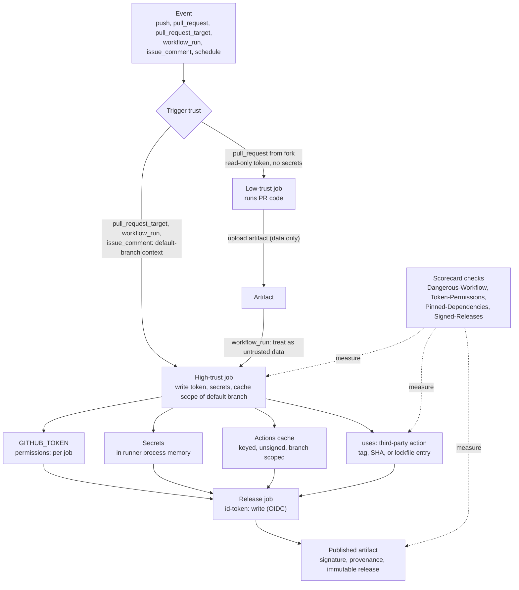

# CI/CD Pipeline Hardening and OpenSSF Scorecard

> [!summary] Claim:
> A CI pipeline is a privileged program whose inputs (branch names, PR titles, fork code, third-party actions, caches) are partly attacker-controlled, so hardening is deciding, per trigger, which of five assets the job can touch: the `GITHUB_TOKEN`, repository secrets, the cache, the runner, and the release credential.
> The OpenSSF Scorecard turns that decision into 0 to 10 scores per check and a risk-weighted aggregate; four checks are about the pipeline itself (Dangerous-Workflow, Token-Permissions, Pinned-Dependencies, Signed-Releases) and the rest are about repository hygiene.
> Real compromises (tj-actions, Ultralytics, Nx) chain the same few primitives: an unsafe trigger, expression injection into a shell, a mutable reference, a long-lived credential, and secrets held in runner memory or cache.
> The controls that break the chains are immutable references (commit SHA or workflow lockfile), a read-only token declared per job, no secrets on untrusted triggers, OIDC instead of stored tokens, and egress visibility.



## The Mechanism

This note owns the CI/CD runner threat model and the Scorecard measurement of it.
[[SLSA-Framework-Build-and-Source-Tracks]] owns the build-integrity levels, [[Sigstore-Keyless-Signing-Cosign-Fulcio-and-Rekor]] owns signing, and [[Audit-and-Harden-a-GitHub-Actions-Release-Pipeline]] owns the step-by-step remediation runbook.
[[Case-Study-Codecov-Bash-Uploader-and-TJ-Actions]] owns the full forensic timeline of the tj-actions incident; this note uses it only as evidence for the memory-scraping mechanism.
Facts are as read from the sources in the frontmatter in 2026-11, and platform is GitHub Actions on GitHub-hosted Linux runners unless stated.

### 1. What Scorecard is and is not

Scorecard is a command-line tool and a weekly batch service that runs a fixed list of automated checks against a repository and prints a score from 0 to 10 per check.
Each check carries a risk level; the aggregate score is a risk-weighted average of the check scores with these weights: Critical 10, High 7.5, Medium 5, Low 2.5 (Scorecard README, as of 2026-11, Both).

| Risk | Checks (README table) |
| :--- | :--- |
| Critical | Dangerous-Workflow, Webhooks (experimental) |
| High | Binary-Artifacts, Branch-Protection, Code-Review, Dependency-Update-Tool, Maintained, Signed-Releases, Token-Permissions, Vulnerabilities |
| Medium | Fuzzing, Packaging, Pinned-Dependencies, SAST, Security-Policy (plus SBOM, which `docs/checks.md` rates Medium) |
| Low | CI-Tests, CII-Best-Practices, Contributors, License |

Scorecard measures observable proxies, not security.
The Dependency-Update-Tool check passes when Dependabot or Renovate is enabled; it does not verify the tool runs or that its pull requests are merged.
Signed-Releases looks for signature files among release assets and does not verify the signatures.
Treat a score as a prioritized list of missing controls and never as a certificate.

Release history relevant to this note (GitHub Releases, as of 2026-11):

| Version | Date | Change that matters here |
| :--- | :--- | :--- |
| v5.6.0 | 2026-10-12 | Workflow parsing reads YAML aliases, so Pinned-Dependencies can report more findings; weekly scans and REST API moved to AboutCode Foundation infrastructure; Scorecard Action users must be on scorecard-action v2.5.0 or later because older versions pull from the retired gcr.io registry; the BigQuery public dataset is no longer available |
| v5.7.0 | 2026-11-19 | GitHub immutable releases count toward Signed-Releases and Pinned-Dependencies; experimental `scorecard mcp` subcommand; experimental OSPS Baseline mode; exit code 1 restored when a scan or results write fails |

The scope text for this note was written against v5.6.0; v5.7.0 is the latest release as of 2026-11-21.

### 2. The four pipeline checks, down to the scoring code

#### Dangerous-Workflow (Critical)

The check inspects workflow files for two patterns, each implemented as its own probe (`hasDangerousWorkflowUntrustedCheckout`, `hasDangerousWorkflowScriptInjection`):

- Untrusted code checkout: a `pull_request_target` or `workflow_run` trigger combined with an explicit checkout of pull request code.
- Script injection: an untrusted context value such as `github.event.issue.title` interpolated into an inline script.

The scoring in `checks/evaluation/dangerous_workflow.go` is binary.
Any finding returns the minimum score ("dangerous workflow patterns detected"); no findings returns the maximum; no workflows at all is inconclusive.
There is no partial credit, which is why a single dangerous workflow file anywhere in the scanned tree can pull a Critical-weight check to 0.

#### Token-Permissions (High)

The best result is read-only permissions at the top level of each workflow with write permissions declared per job.
`permissions.go` starts at the maximum and deducts (as of 2026-11, Both):

| Finding | Effect on score |
| :--- | :--- |
| Top-level write to `contents`, `packages`, or `actions` | Deduction equals the full maximum, so the score is the minimum |
| Top-level write to `deployments` or `security-events` | Deduct 1.0 |
| Top-level write to `checks` or `statuses` | Deduct 0.5 |
| Top-level `write-all` | Deduct 0.5, and minimum score if the same workflow also has job-level write or undeclared job permissions |
| Top-level permissions undeclared | Deduct 0.5, or minimum if any job in the same workflow also lacks a declaration |
| Job-level write with top-level undeclared in the same workflow | Deduct a further 0.5 |
| Job-level write with top-level write in the same workflow | Minimum score |

The deductions are float32 but the result is reported as `int(score)`, so a single 0.5 deduction already shows as 9 (`permissions.go`, as of 2026-11, Both).
The prose in `docs/checks.md` says "one point" for defined jobs under undeclared top-level permissions; the code deducts 0.5 per finding, so trust the code.
The check cannot see the repository-level "read-only by default" setting, so a repository that relies on it still gets flagged for missing declarations.
Declaring `permissions: {}` at the top level and granting per job is both the Scorecard-optimal and the least-privilege shape.

GitHub's own semantics explain why this works: if you specify any permission key, every unspecified key is set to `none`; the keys are `actions`, `artifact-metadata`, `attestations`, `checks`, `code-quality`, `contents`, `copilot-requests`, `deployments`, `discussions`, `id-token`, `issues`, `packages`, `pages`, `pull-requests`, `security-events`, `statuses`, and `vulnerability-alerts`.
Repositories created in a personal account start with a `GITHUB_TOKEN` that has read access only for `contents` and `packages`; repositories in an organization inherit the organization's setting (GitHub Docs, as of 2026-11).

#### Pinned-Dependencies (Medium)

The `pinsDependencies` probe scans Dockerfiles, shell scripts, and GitHub workflows used in build and release, emitting a true or false finding per dependency.
`pinned_dependencies.go` defines `gitHubOwnedActionWeight = 2`, `thirdPartyActionWeight = 8`, and `normalWeight = gitHubOwnedActionWeight + thirdPartyActionWeight`, which is 10.
When a repository uses both kinds of action, GitHub-owned actions form one group at weight 2 and third-party actions another at weight 8; with only one kind, that group takes weight 10; every non-action dependency type forms a group at weight 10.
The score is then a weighted proportional score over the groups, so third-party actions dominate by design: they are the ones an outside party can move.

Rules that decide what counts as pinned: a Go module with a full semantic version is pinned; a `uses:` reference by tag counts as pinned only if backed by a published immutable release (relevant from v5.7.0); a hash is required for Dockerfile images, where a manifest-list hash is acceptable for multi-architecture builds.

#### Signed-Releases (High)

The `releasesAreSigned` probe checks whether the last 5 releases carry a signature asset matching `*.minisig`, `*.asc`, `*.sig`, `*.sign`, `*.sigstore`, `*.sigstore.json`, or `*.intoto.jsonl`.
Signatures on every checked release score 8, and a SLSA provenance file (`*.intoto.jsonl`) on each release reaches 10 (`docs/checks.md`).
`docs/checks.md` says "last five" release assets in one sentence and "the 30 most recent releases" in another; the probe documentation says 5 and `checks/evaluation/signed_releases.go` caps evaluation at 5, so 5 is the effective window (as of 2026-11, Both); confirm with `--show-details`.
From v5.7.0 a GitHub immutable release also counts as signed (v5.7.0 release notes), and the check does not verify any signature.

#### Other checks that bear on the pipeline

| Check | What it reads | Scoring facts from `docs/checks.md` |
| :--- | :--- | :--- |
| Branch-Protection (High) | Branch protection or repository rules on default and release branches | Tiered: tier 1 = 3 (no force push, no deletion), tier 2 = 6 (at least 1 reviewer), tier 3 = 8 (at least 1 status check), tier 4 = 9 (2 reviewers, code owner review), tier 5 = 10 (dismiss stale reviews, include administrators); without an admin token, the "for administrators" requirements are ignored and scored as met |
| Code-Review (High) | Approval on the last ~30 commits | Bot and AI reviews do not count; one unreviewed human change deducts 7, multiple deduct a further 3, any unreviewed bot change deducts 3 |
| Dependency-Update-Tool (High) | Dependabot or Renovate configuration | Presence only |
| SAST (Medium) | CodeQL or SonarCloud on recent merged PRs, or `github/codeql-action` in a workflow | GitHub only |
| SBOM (Medium) | SBOM in source, pipeline, or release | 5 if present, 10 if published as a release artifact; see [[SBOM-Standards-SPDX-CycloneDX-and-VEX]] |
| Security-Policy (Medium) | `SECURITY.md` contents | Contact link 6, free-form text 3, vulnerability and disclosure text 1 |
| Vulnerabilities (High) | Open unfixed vulnerabilities via OSV | Presence of known open advisories |

### 3. Running Scorecard

```sh
# CLI against a public repository (needs a GitHub token in the environment)
export GITHUB_AUTH_TOKEN=...               # GITHUB_TOKEN, GH_AUTH_TOKEN, GH_TOKEN also accepted
scorecard --repo=github.com/OWNER/REPO --show-details
scorecard --repo=github.com/OWNER/REPO --checks=Dangerous-Workflow,Token-Permissions,Pinned-Dependencies,Signed-Releases --format=json
```

`--show-details` explains why a check lost points, `--checks` restricts the run, and `--format` takes `default` (text) and `json` per the README; an `intoto` format already existed before v5.6.0, whose release notes only changed its serialization to `protojson`, and v5.7.0 added `gemara` for the experimental OSPS Baseline mode (as of 2026-11, Both).
A comma-separated token list in `GITHUB_AUTH_TOKEN` is rotated round-robin.

The Scorecard Action runs the same checks in CI and can publish results to `api.scorecard.dev` for a badge.
The canonical workflow from `ossf/scorecard-action` `examples/scorecard.yml` is itself a hardening exemplar.
The excerpt below omits its `concurrency` group and its two SHA-pinned upload steps (`actions/upload-artifact` and `github/codeql-action/upload-sarif`); the upstream comment notes that `cache-mode` was added to GitHub Actions in September 2026, so older linters may not recognize it (as of 2026-11):

```yaml
'on':
  branch_protection_rule:
  schedule:
    - cron: '15 14 * * 0'
  push:
    branches: ['main']

permissions: {}
cache-mode: none

jobs:
  analysis:
    runs-on: ubuntu-latest
    if: ${{ github.event.repository.default_branch == github.ref_name }}
    permissions:
      security-events: write  # upload SARIF
      id-token: write         # sign results published to api.scorecard.dev
    steps:
      - uses: actions/checkout@3d3c42e5aac5ba805825da76410c181273ba90b1  # v7.0.1
        with:
          persist-credentials: false
      - uses: ossf/scorecard-action@23f22cd43608bae7a1f1fa2603d7314dee9538a5  # v2.6.0
        with:
          results_file: results.sarif
          results_format: sarif
          publish_results: true
          fail_on_publish_error: true
```

Constraints the Scorecard API enforces on a workflow that publishes results (scorecard-action README): no top-level `env` or `defaults`, no workflow-level write permissions, only the Scorecard job may hold `id-token: write`, no job-level `env` or `defaults` and no containers or services in that job, an Ubuntu GitHub-hosted runner, and only allowlisted steps (`actions/checkout`, `actions/upload-artifact`, `github/codeql-action/upload-sarif`, `ossf/scorecard-action`, `step-security/harden-runner`).
Non-compliant results are rejected by the API, and `fail_on_publish_error: true` turns that rejection into a failed step; network, 408, 429, and 5xx errors only warn.
Weekly scores on `api.scorecard.dev` omit `CI-Tests`, `Contributors`, and `Dependency-Update-Tool` (README), so a local scan and the published badge can differ.

### 4. The trigger model: where the trust boundary actually is

GitHub decides secrets and token scope by event, not by file content.
A `pull_request` run from a fork gets a read-only token and no secrets.
A `pull_request_target` run executes the workflow definition from the default branch of the base repository, so it has the repository's secrets and, per the workflow syntax page, a token with read/write permission "even when it is triggered from a public fork".
`workflow_run` and `issue_comment` also run in the default-branch context, which is why GitHub Security Lab treats all three as privileged entry points.

The classic "pwn request" (Security Lab, 2021-08-03) is `pull_request_target` plus an explicit checkout of the PR head followed by a build step.
Whatever `npm install` or `make` runs now runs attacker code with a write token and secrets.
Two non-obvious points from the Security Lab series:

- A PR checkout is dangerous even when the workflow only means to run trusted commands: the token and secrets sit in runner memory, and `actions/checkout` persists the token by default (`persist-credentials: true`), so any PR-controlled build script or config file that later code loads can read it (Security Lab part 1).
- Fixing the workflow on the default branch does not fix older branches: an attacker can open a PR against a stale branch that still carries the vulnerable file (Security Lab 2025 part 4; Nx exploited exactly this, see below).

Mitigations in order of strength:

1. Use `pull_request` when you need neither secrets nor write access.
2. Split the work: an unprivileged `pull_request` workflow builds and uploads an artifact; a privileged `workflow_run` workflow downloads it as data, validates it (for example parse the PR number as an integer), and comments or labels.
   Extract artifacts outside the workspace, for example under `${{ runner.temp }}`, and never execute anything from them.
3. Label gating (`pull_request_target` with `types: [labeled]`) is only a temporary fix because of a time-of-check to time-of-use race: the attacker can push after the label is applied.
   Pin the checkout to `github.event.pull_request.head.sha`, which is immutable, rather than `head.ref`, which moves.
4. Repository-owner checks work for `pull_request_target` but not for `workflow_run`, which always runs in the default-branch context; AWS Karpenter (GHSL-2024-314) and Cloudflare workers-sdk (GHSL-2024-252) both relied on the ineffective form.

Platform changes that moved this boundary (as of 2026-11, GitHub.com):

- `actions/checkout` v7 refuses to check out fork pull request code by default when triggered by `pull_request_target` or `workflow_run`; opting in requires the input `allow-unsafe-pr-checkout: true`.
  zizmor's `dangerous-checkout` audit flags that input.
- GitHub announced on 2026-11-02 that from 2026-12-02 `pull_request_target` is blocked by default in all public repositories on Free, Team, and Enterprise Cloud unless an Actions event policy allows it; private and internal repositories and GitHub Enterprise Server are not covered.
  The rule started in evaluate mode, with brownouts on 2026-11-09 and 2026-11-16 (16:00 to 18:00 UTC) that failed blocked runs with an annotation; policy insights show which runs would be blocked.
  Policies live under Settings, Actions, Policies, and an event rule lists permitted events such as `push`, `pull_request`, `pull_request_target`, and `workflow_dispatch`.
- The fork-approval setting ("Approval for running fork pull request workflows from contributors") defaults to requiring approval for first-time contributors, but `pull_request_target` workflows always run regardless of it, and under the first-time-contributor options a user with any previously merged commit skips approval.

### 5. Expression injection

`${{ ... }}` is expanded by the runner into the text of a `run:` script before the shell starts, so an attacker-controlled value becomes shell syntax.
Fields that are attacker-controlled include `github.event.issue.title`, `github.event.issue.body`, `github.event.pull_request.title`, `github.event.pull_request.body`, `github.event.comment.body`, `github.event.pull_request.head.ref`, `github.head_ref`, and commit author names and emails (Security Lab, 2021-08-04).
Branch names are the sharpest case: git allows `"`, `;`, `$`, and `{}` in refs, and `${IFS}` stands in for a space.

Vulnerable and fixed forms:

```yaml
# VULNERABLE: the title is pasted into the script text
- run: echo "Validating PR title: ${{ github.event.pull_request.title }}"

# FIXED: the value travels as data in an environment variable
- env:
    TITLE: ${{ github.event.pull_request.title }}
  run: echo "Validating PR title: $TITLE"
```

GitHub's secure-use reference calls the intermediate environment variable the preferred approach for inline scripts, and prefers a JavaScript action that takes the value as an input.
Passing the value through `with:` avoids shell injection but the action may still mishandle it; Security Lab's example is `atlassian/gajira-comment`, whose lodash templating evaluated attacker text.
Quoting `"$TITLE"` in the shell still matters (ShellCheck SC2086), because the environment variable fixes code injection, not word splitting.

The same class applies to files the runner consumes.
`GITHUB_ENV` and `GITHUB_PATH` let a step change the environment of every later step; a step that writes attacker-controlled text there can set `LD_PRELOAD` or prepend a directory to `PATH`.
GitHub blocks `NODE_OPTIONS` through `GITHUB_ENV` for this reason (workflow commands reference).
The older stdout-parsed commands had the same flaw: `@actions/core` before 1.2.6 emitted `set-env` and `add-path` over stdout, so a workflow that logged untrusted data could be tricked into changing the environment (CVE-2020-15228, published 2020-10-01); the runner then disabled those commands.

### 6. Mutable references and the three levels of pinning

A `uses: owner/repo@v4` reference resolves a tag at run time, and a tag "can be moved or deleted if a bad actor gains access to the repository storing the action" (secure-use reference).
The tj-actions incident (CVE-2025-30066, GHSA-mrrh-fwg8-r2c3) retargeted multiple version tags to a malicious commit (`0e58ed86...`) on 2025-03-14 and 2025-03-15; the affected range was `<= 45.0.7`, the fix is 46.0.1, and GitHub's advisory says over 23,000 repositories used the action.
The payload downloaded a Python script from a gist and extracted secrets from the Runner Worker process memory, printed them double-base64-encoded in the workflow log, and relied on public logs for exfiltration.
The compromise reached tj-actions through `reviewdog/action-setup` (CVE-2025-30154), whose `v1` tag was moved to a malicious commit on 2025-03-11 between 18:42 and 20:31 UTC; workflows that pinned a commit hash were not affected (Wiz).
CISA added CVE-2025-30066 to its Known Exploited Vulnerabilities catalog on 2025-03-18 and CVE-2025-30154 on 2025-03-24 (CISA KEV feed).

Defense levels, weakest to strongest (as of 2026-11, GitHub.com):

| Level | Mechanism | Strength | Weakness |
| :--- | :--- | :--- | :--- |
| Tag | `uses: x/y@v4` | Convenient | Tag can be force-moved |
| Full commit SHA | `uses: x/y@<40 hex>  # v4.1.0` | Immutable content; enforceable with the policy "Require actions to be pinned to a full-length commit SHA" | Transitive dependencies of composite actions are not pinned; an "impostor commit" that exists only in a fork of the repository can be referenced through the parent's name, which zizmor's `impostor-commit` audit detects |
| Workflow lockfile | `.github/workflows/actions.lock` generated by the `gh actions-lock` GitHub CLI extension | Records the exact commit, `owner_id`, and `repo_id` of every action including transitive ones; the locked commit must be reachable from the recorded ref in the action's own repository; Dependabot regenerates the entry in the same pull request | Covers step-level `uses` only, not reusable workflow calls (`jobs.<id>.uses`), which still need a full SHA; it does not judge whether a dependency is safe |

The lockfile reached public preview on 2026-10-14 and general availability on 2026-10-28 for GitHub Enterprise Cloud, Team, and Free.
GitHub's secure-use reference calls a lockfile "the best measure", and the lockfile concept page says SHA pinning in workflow files is no longer necessary for repositories that adopt one (a lockfile also satisfies the SHA-pinning policy for onboarded workflows); the "Require lockfile" policy blocks runs of targeted workflows that are not onboarded, so generate and verify lockfiles before setting that policy to Active.
With both policies enabled, an action in the lockfile passes both, an action pinned by SHA but absent from the lockfile is blocked by Require lockfile, and an action referenced by tag and absent is blocked by both.

Pinning has a cost: "Dependabot only creates alerts for vulnerable actions that use semantic versioning and will not create alerts for actions pinned to SHA values" (secure-use reference), though Dependabot version updates still bump them.
Pinning by hash does not make a bad version safe; it makes the version you reviewed the version that runs.
Immutable releases extend the idea to what you publish: once published, a release's tag and assets cannot be moved, modified, or deleted, and a release attestation is generated (GitHub Docs, as of 2026-11); enablement applies only to future releases: the "Preventing changes to your releases" how-to states "immutability will only apply to future releases", so releases published before you enable it stay mutable (GitHub Docs, as of 2026-11).

### 7. Secrets: where they live and how they leak

A job receives only the secrets it references, but the runner process holds them while the job runs.
The tj-actions payload and the Ultralytics attack both dumped Runner Worker process memory and searched it for secret values; the Ultralytics follow-up script greps for `"isSecret":true` entries (Woodruffw analysis).
Karim Rahal's 2023 write-up shows the same primitive manually: on GitHub-hosted runners the `runner` user has `sudo`, so a step can dump the `Runner.Listener` process with `gcore` and grep it for secret-flagged JSON (spelled `"issecret":true` in that dump).
GitHub's masking is a log filter, not a protection: "Because there are multiple ways a secret value can be transformed, automatic redaction is not guaranteed", and a base64 or double-base64 of the value is not masked, which is exactly what the tj-actions payload used.

Controls, in order of leverage:

1. Do not hold the secret at all on untrusted paths: use OIDC (`permissions: id-token: write`) so the job exchanges a short-lived identity token for cloud credentials; the cloud provider validates the token's `sub` and other claims against conditions preconfigured on the role's trust definition, so define conditions that exclude untrusted repositories: the "Configuring OpenID Connect in cloud providers" how-to says you "must define at least one condition, so that untrusted repositories can't request access tokens for your cloud resources" (GitHub Docs, as of 2026-11).
   Repositories created after 2026-07-15 use an immutable default `sub` format including owner and repository IDs (GitHub Docs).
2. Use registry trusted publishing instead of a stored token: PyPI mints a short-lived token valid for 15 minutes from a configuration of owner, repository, and workflow filename, with the environment optional but strongly recommended; npm trusted publishing needs npm CLI 11.5.1 or later and Node 22.14.0 or later, supports GitHub-hosted runners only (self-hosted runners are planned), and generates provenance automatically only when you publish a public package via trusted publishing from a public repository, so a private repository gets no provenance even for a public package (npm Docs, Trusted publishers, as of 2026-11).
3. Scope secrets to environments with required reviewers, never store structured JSON or YAML blobs as one secret (redaction works per value), and register derived values with `::add-mask::`.
4. Give every job a minimal `permissions:` block so a stolen token cannot push or publish.
5. Detect after the fact: GitHub secret scanning of Actions workflow logs entered public preview on 2026-11-09 for Enterprise Cloud with Secret Protection or Advanced Security, off by default, scanning logs when a run completes and raising alerts without notifications during the preview; it does not detect secrets already masked by Actions, generic patterns, custom patterns, or AI-detected secrets, and it does not backfill runs before enablement.
6. Watch egress: StepSecurity Harden-Runner in `egress-policy: audit` records outbound connections per step and flagged the tj-actions call to `gist.githubusercontent.com`; Windows and macOS GitHub-hosted runners are audit mode only, and the Community tier is free for public repositories on GitHub-hosted runners (README, as of 2026-11).

`actions/checkout` persists a credential by default (`persist-credentials: true`).
Before v6 the credential lived in `.git/config`, where an `actions/upload-artifact` of the workspace could publish it; v6 moved it to a separate file under `$RUNNER_TEMP`.
Set `persist-credentials: false` unless a later step runs authenticated git commands; zizmor's `artipacked` audit flags the default.

### 8. The cache is a write channel into your release build

Cache entries are keyed on the client side, unsigned, and enforced only by branch scope.
Adnan Khan's 2024 analysis showed that the cache runtime token is independent of `GITHUB_TOKEN` permissions, so a job with a read-only `GITHUB_TOKEN` can still write cache entries, and `actions/cache` restores an archive without checking paths, letting a poisoned entry overwrite any file in the workspace such as `package.json`.
Workflows triggered by `pull_request_target` run in the default branch's cache scope, so a "pwn request" becomes a poisoned cache that a later release workflow restores.
The default limit is 10 GB per repository with least-recently-used eviction, and entries unused for 7 days are removed; the attack fills the cache to force eviction of the legitimate entry, then plants its own under the same key.
An update dated 2025-01-23 on that post says writes after the job finishes are no longer possible, so poisoning must happen during the job.

GitHub's dependency-caching reference now describes a defense (as of 2026-11, GitHub.com): runs from `pull_request_target`, `issue_comment`, and `workflow_run` get read-only access to the default branch's cache scope, and a `cache-mode` key accepts `read`, `write`, `write-only`, or `none`; explicitly setting `write` or `write-only` on a low-trust trigger "reintroduces the risk of cache-poisoning".
The page also states "Cache contents are not signed or verified", so release workflows should not restore caches, which is also the SLSA requirement that one build must not inject entries into a cache used by another.
Security Lab's 2025 note warns that `permissions: {}` alone does not prevent cache poisoning.

### 9. Runners: ephemerality is the isolation

Each GitHub-hosted runner other than single-CPU ones is a fresh virtual machine; self-hosted runners "can be persistently compromised by untrusted code in a workflow" and the guide says to almost never use them for public repositories.
Use `./config.sh ... --ephemeral` so GitHub assigns the runner only one job, or just-in-time runners from the REST API, which perform at most one job.
Home-grown "destroy the runner after each job" automation is not a substitute: the secure-use reference says there is no guarantee such a runner runs only one job, and secrets passed as command-line arguments can be seen by another job on the same runner (for example with `ps x -w`).
Runner groups limit which repositories can use an organization-level runner.
For agent and sandbox isolation on a developer machine, see [[Agent-Shell-Sandboxing-Seatbelt-and-Landlock]] in the shell book.

### 10. Worked incidents as chains

| Incident | Entry | Primitive chain | Control that breaks it |
| :--- | :--- | :--- | :--- |
| tj-actions / reviewdog (2025-03) | PAT theft upstream, then tag retarget | Mutable tag, then Runner Worker memory read, then double-base64 in public log | SHA or lockfile pin; egress audit; no secrets in public logs |
| Ultralytics (2024-12) | PR from a fork with command substitution in the branch name | `pull_request_target`, then template injection in `ultralytics/actions` `git pull origin ${{ github.head_ref }}`, then cache poisoning (the analysis author calls this inferred), then release | Environment-variable indirection; no cache restore in release; trusted publishing with environment |
| Nx s1ngularity (2025-08) | PR title in a stale branch's workflow | `pull_request_target` plus `echo "...${{ github.event.pull_request.title }}"`, then a triggered `publish.yml` run sends the npm token to a webhook, then malicious `nx` versions with a `postinstall` credential stealer | Same fix on every branch; read-only token; trusted publishing |

Ultralytics release times (author's table, no timezone stated): 8.3.41 on 2024-12-04 20:51, removed after about 12 hours; 8.3.42 on 2024-12-05 12:47, removed after about 1 hour; 8.3.45 on 2024-12-07 01:41:45 and 8.3.46 on 2024-12-07 02:27:14, both directly to PyPI through an API token with no CI or repository activity and no attestations, removed about 8 and 7.5 hours later (Woodruff timeline).
Nx advisory GHSA-cxm3-wv7p-598c (CVE-2025-10894) names PR 32458, merged 2025-08-21, whose workflow injected the PR title; the advisory states the vulnerable file persisted on outdated branches and the advisory is listed as withdrawn as of 2026-11, so use its mechanism description but verify the current Nx post-mortem for status.

## Commands and Numbers to Know

| Item | Value | Platform |
| :--- | :--- | :--- |
| Scorecard latest release | v5.7.0 on 2026-11-19; v5.6.0 on 2026-10-12 (as of 2026-11) | Both |
| Aggregate weights | Critical 10, High 7.5, Medium 5, Low 2.5 (as of 2026-11) | Both |
| Critical checks | Dangerous-Workflow, Webhooks (experimental) (as of 2026-11) | Both |
| Dangerous-Workflow scoring | Any finding gives the minimum score, none gives the maximum (as of 2026-11) | Both |
| Token-Permissions | Top-level write to `contents`, `packages`, or `actions` gives the minimum score (as of 2026-11) | Both |
| Pinned-Dependencies weights | GitHub-owned action 2, third-party action 8, other dependency groups 10 (as of 2026-11) | Both |
| Signed-Releases | 8 with signature files, 10 with `*.intoto.jsonl` provenance (as of 2026-11) | Both |
| Scorecard Action minimum | scorecard-action v2.5.0 or later after v5.6.0 (as of 2026-11) | Both |
| Weekly API scores omit | CI-Tests, Contributors, Dependency-Update-Tool (as of 2026-11) | Both |
| `GITHUB_TOKEN` rule | Any specified permission sets every unspecified key to `none` (as of 2026-11) | Both |
| Cache limits | 10 GB per repository default, entries unused for 7 days removed, 200 uploads and 1,500 downloads per minute per repository, keys up to 512 characters (as of 2026-11) | Both |
| `cache-mode` values | `read`, `write`, `write-only`, `none` (as of 2026-11) | Both |
| `pull_request_target` default block | Public repositories from 2026-12-02 unless an event policy allows it (as of 2026-11) | Both |
| Workflow lockfile | `.github/workflows/actions.lock`, GA 2026-10-28 (as of 2026-11) | Both |
| PyPI trusted publishing token | Valid 15 minutes (as of 2026-11) | Both |
| npm trusted publishing | npm CLI 11.5.1 or later, Node 22.14.0 or later, GitHub-hosted runners only (as of 2026-11) | Both |
| tj-actions fix | 46.0.1; affected `<= 45.0.7`; CVSS 8.6; over 23,000 repositories (as of 2026-11) | Both |
| zizmor | Latest release v1.32.0, 42 audits including `template-injection`, `dangerous-triggers`, `unpinned-uses`, `excessive-permissions`, `artipacked`, `cache-poisoning`, `impostor-commit` (as of 2026-11) | Both |
| `actions/checkout` | Major version 7; `persist-credentials` default true; v6 stores credentials under `$RUNNER_TEMP` (as of 2026-11) | Both |

```sh
# Static audit of workflows with zizmor (offline audits work without a token)
zizmor .github/workflows/

# Run the four pipeline checks and see why points were lost
scorecard --repo=github.com/OWNER/REPO --show-details \
  --checks=Dangerous-Workflow,Token-Permissions,Pinned-Dependencies,Signed-Releases
```

## Multi-Language Comparison

Scorecard checks are language-agnostic for pipeline hygiene and language-aware only where its documentation names the ecosystem.

| Concern | Python | JavaScript / TypeScript | Go | C++ and Rust |
| :--- | :--- | :--- | :--- | :--- |
| Pinned-Dependencies remediation (checks.yaml) | Declare exact versions in `requirements.txt` | Exact versions in `package.json`, check in `package-lock.json` | A full semantic version counts as pinned | No ecosystem-specific rule is named in `docs/checks.md`; Dockerfiles, shell scripts, and workflows are scanned for all languages |
| Fuzzing check | OSS-Fuzz or ClusterFuzzLite; no Python-specific recognizer is listed in `docs/checks.md` | `fast-check` property tests are recognized | Native Go fuzzing is recognized | OSS-Fuzz and ClusterFuzzLite are the language-neutral routes |
| Tokenless publishing | PyPI trusted publishing (15-minute token) | npm trusted publishing (CLI 11.5.1 or later) | Not covered by sources read for this note | Not covered by sources read for this note |
| Reproducibility link | See [[Reproducible-Builds-as-a-Security-Control]] | Same | Same | Same |

For locked, vendored, and mirrored dependencies in the package manager itself, see [[Lockfiles-Vendoring-and-Offline-Mirrors]].

## Worked Lab Example

This note has no lab, so none of the score statements below is measured output; each is derived by reading the evaluation rules for the four pipeline checks, and only the bash transcript was run (macOS system bash, 2026-11-21).

Start from a workflow that triggers on `pull_request_target`, has no `permissions:` key, and uses a third-party action by tag:

```yaml
on: pull_request_target
jobs:
  build:
    runs-on: ubuntu-latest
    steps:
      - uses: actions/checkout@v4
        with:
          ref: ${{ github.event.pull_request.head.sha }}
      - run: echo "Building ${{ github.event.pull_request.title }}"
      - uses: some-org/upload-thing@v1
```

Findings by the rules:

1. Dangerous-Workflow: two findings (a `pull_request_target` trigger with an explicit checkout of PR code, and `github.event.pull_request.title` inside a `run:`); either one gives the minimum score, so a Critical-weight check scores 0.
2. Token-Permissions: top-level and job-level permissions are both undeclared, which the evaluation code treats as the minimum score.
3. Pinned-Dependencies: `actions/checkout@v4` is a GitHub-owned action pinned by tag and `some-org/upload-thing@v1` is third-party pinned by tag; the third-party group carries weight 8 of 10, so fixing it matters most.

The repair, in the order of the attack chain:

```yaml
on:
  pull_request:          # no secrets, read-only token on forks
permissions: {}          # top level: nothing
jobs:
  build:
    runs-on: ubuntu-latest
    permissions:
      contents: read     # only what this job needs
    steps:
      - uses: actions/checkout@3d3c42e5aac5ba805825da76410c181273ba90b1  # v7.0.1
        with:
          persist-credentials: false
      - env:
          TITLE: ${{ github.event.pull_request.title }}
        run: echo "Building $TITLE"
      - uses: some-org/upload-thing@<40-hex-commit-sha>  # v1.x.y, reviewed
```

The injection class is reproducible without GitHub.
Running this on macOS with the system `bash` (measured 2026-11-21 in this session) shows how the expanded script behaves when the branch name is `zzz";echo${IFS}"hello";#`:

```text
$ HEAD_REF='zzz";echo${IFS}"hello";#'
$ bash -c "echo \"Branch: ${HEAD_REF}\""      # expression-style: value pasted into script text
Branch: zzz
hello
$ HEAD_REF="$HEAD_REF" bash -c 'echo "Branch: $HEAD_REF"'   # environment-variable style
Branch: zzz";echo${IFS}"hello";#
```

The first form runs the attacker's `echo hello` as a second command; the second prints the branch name as data.
To audit a real repository, run `zizmor .github/workflows/` and `scorecard --show-details` as listed in Commands and Numbers to Know, then iterate until Dangerous-Workflow and Token-Permissions reach their maximum.
The remediation runbook for a full release pipeline is [[Audit-and-Harden-a-GitHub-Actions-Release-Pipeline]].

> [!warning] Pitfalls:
> - Chasing the aggregate: a repository can raise its score with Fuzzing, CII-Best-Practices, or License work while Dangerous-Workflow stays at 0; read per-check scores weighted by risk, and start with the Critical and High pipeline checks.
> - Pinning by SHA and stopping: transitive actions inside a composite action stay mutable, and an impostor commit from a fork passes a naive "is it 40 hex characters" test; use a lockfile or review the commit's reachability from the upstream default branch.
> - Fixing the default branch only: old branches carry old workflow files and a `pull_request_target` PR can run them (the Nx chain).
> - Assuming `permissions: {}` stops cache poisoning: the cache runtime token is separate from `GITHUB_TOKEN`; restrict `cache-mode` and do not restore caches in release jobs.
> - Treating masking as a control: derived forms (base64, URL-encoding, substrings, JSON fields) are not redacted; assume any secret reachable by the job is readable by every step.
> - Trusting `github.actor` or hardcoded-user checks to gate `pull_request_target` or `issue_comment`: Security Lab Part 4 calls relying solely on actor checks ineffective for `issue_comment`, because the commenter need not be the attacker and the pull request can be mutated after approval (a time-of-check to time-of-use gap); date checks are unreliable because commit dates can be forged, and repository-owner checks are redundant for `issue_comment` and `workflow_run`, which always run in the default-branch context.
> - Gaming Dependency-Update-Tool and Signed-Releases: both check for presence only, so a Dependabot file nobody merges scores full marks and an unverified `.sig` file on each release scores 8 of 10 (an unverified `*.intoto.jsonl` scores 10).
> - Scorecard Action restrictions: adding top-level `env`, a service container, or an unlisted step to the publishing workflow makes the API reject the results.
> - Using self-hosted persistent runners for public repositories: the workspace, caches, and tools survive across jobs from different pull requests.
> - Relying on `pull_request_target` approval gates: approval settings do not apply to it, and a label gate is open to a push-after-approval race.

## At Scale

From one repository to 1,000 to 50,000 engineers the unit of control changes from a workflow file to a policy.

- Make the unsafe thing impossible in policy rather than detectable in review: organization or enterprise Actions policies for allowed actions, "Require actions to be pinned to a full-length commit SHA", Require lockfile, and event rules that deny `pull_request_target` except for named workflows.
  Roll each out in evaluate mode first and read the policy insights for would-be blocks.
- Decision rule for actions: first-party GitHub actions by lockfile entry; third-party by lockfile plus an internal review of the pinned commit; anything that can read secrets (deployment, publishing, notification actions) is vendored into an internal repository or replaced by a reviewed script.
- Decision rule for credentials: no stored cloud or registry tokens in CI where OIDC or trusted publishing exists; the release job is the only job with `id-token: write`, runs in a protected environment with required reviewers, and never restores a cache.
- Use Scorecard as a fleet signal: scan all repositories with the API or CLI, track Dangerous-Workflow and Token-Permissions as hard gates (anything below maximum is a ticket), and treat Branch-Protection, Code-Review, and Pinned-Dependencies as trend metrics.
  Remember the weekly API omits three checks, so run the CLI for those.
- Compensating controls for what Scorecard cannot see: egress allowlists on runners (audit mode first, then block where supported), log secret scanning once it leaves preview, and CODEOWNERS on `.github/workflows` so workflow changes need a designated reviewer.
- Downside: lockfiles and SHA pins slow security patch adoption unless Dependabot regeneration is automated, and strict event policies break legitimate bot workflows (a `dependabot[bot]` run needs to be an allowed actor under actor restrictions).
- Provenance and signing sit on top of a hardened pipeline, not in place of one; see [[SLSA-Framework-Build-and-Source-Tracks]] and [[Sigstore-Keyless-Signing-Cosign-Fulcio-and-Rekor]].

> [!tip] Practice Drill:
> Pick one of your own workflows and write down, per job, the answer to five questions: which trigger, which token permissions, which secrets, which cache access, and which mutable `uses:` references.
> Then run `zizmor` and `scorecard --show-details` on it and reconcile the two outputs; every finding one tool reports and the other does not tells you about a blind spot.
> The full-pipeline runbook is [[Audit-and-Harden-a-GitHub-Actions-Release-Pipeline]], and [[Drill-Supply-Chain-Detect-Tarball-vs-Git-Tag-Backdoor]] practices the adjacent skill of comparing a published artifact to its source.

## Interview Questions

### L5

1. What is the difference between `pull_request` and `pull_request_target`, and why does the second get Scorecard's Critical rating?

   > [!success]- Answer
   > `pull_request` from a fork runs the PR's workflow with a read-only token and no secrets.
   > `pull_request_target` runs the default branch's workflow definition with secrets and a token that has read/write permission even for public forks.
   > Combined with a checkout and execution of PR code it gives the attacker those privileges; that combination (and script injection) is exactly what Dangerous-Workflow looks for, and one finding sets the score to the minimum.

2. Why is `run: echo "${{ github.event.pull_request.title }}"` dangerous, and what is the fix?

   > [!success]- Answer
   > The runner substitutes the value into the script text before the shell runs, so a title containing `"; curl ... | sh; "` becomes commands.
   > Put the value in `env:` and reference `"$TITLE"` in the script, or pass it to a JavaScript action as an input.
   > Quote the shell variable as well.

3. What does `permissions: {}` at workflow level plus `contents: read` on one job do, and how does Scorecard's Token-Permissions treat it?

   > [!success]- Answer
   > Specifying any permission sets all unspecified keys to `none`, so the empty map removes everything and the job re-grants only `contents: read`.
   > Token-Permissions awards its best result for read-only top-level permissions with writes declared per job; a top-level write to `contents`, `packages`, or `actions` drives the score to the minimum.

### L6

4. Predict the output.
   A workflow runs `echo "Branch: ${{ github.head_ref }}"` and the PR branch is named `zzz";echo${IFS}"hello";#`.
   What does the job log print, and what changes if the value is passed through `env:`?

   > [!success]- Answer
   > The expanded script is `echo "Branch: zzz";echo${IFS}"hello";#"`, so the log shows `Branch: zzz` and then `hello`, because `${IFS}` word-splits into a space and the second `echo` is attacker-chosen code (reproduced with `bash` on macOS in this session).
   > With `env: HEAD_REF: ${{ github.head_ref }}` and `echo "Branch: $HEAD_REF"`, the log shows the literal text `Branch: zzz";echo${IFS}"hello";#` and nothing is executed.

5. Debug this.
   A repository's workflow comments on PRs using `on: pull_request_target`, checks out `ref: ${{ github.event.pull_request.head.sha }}`, runs `npm ci && npm test`, and then posts a comment using a secret-backed token.
   The maintainer says "we pinned the SHA so it is safe".
   What is wrong and how do you restructure it?

   > [!success]- Answer
   > Pinning to the PR head SHA stops a TOCTOU swap but it is still attacker code running with the repository's secrets and a write token: `npm ci` runs lifecycle scripts and `npm test` runs the PR's tests.
   > Restructure into two workflows: `pull_request` runs build and test with `permissions: contents: read` and uploads results as an artifact; a `workflow_run` workflow with `pull-requests: write` downloads the artifact outside the workspace, validates it as data (for example the PR number is an integer), and comments.
   > Never execute anything from the artifact.

6. Why does SHA pinning not fully protect against a malicious `uses:` dependency, and what closes the gap?

   > [!success]- Answer
   > A SHA fixes the reviewed commit of the top-level action only; a composite action can pull unpinned transitive actions at run time, and a SHA can point to a fork-only impostor commit that resolves through the parent repository name.
   > A workflow lockfile records transitive dependencies with `owner_id` and `repo_id` and requires the commit to be reachable from the recorded ref in the action's own repository.
   > Reusable workflow calls are not covered by the lockfile and still need a full SHA; zizmor's `impostor-commit` audit checks fork-only commits.

### L7+

7. Explain how a read-only `GITHUB_TOKEN` can still lead to a poisoned release.
   How would you design the pipeline to survive it?

   > [!success]- Answer
   > The Actions cache uses a separate runtime token, so a job with a read-only `GITHUB_TOKEN` can still write cache entries; scope is enforced by branch only and contents are unsigned.
   > A job in the default branch's scope (historically any `pull_request_target` run) can poison a key that a release workflow later restores, overwriting files such as `package.json` or build configuration.
   > Design: no cache restore in the release job (or `cache-mode: none`), low-trust triggers read-only on cache scope, no `pull_request_target` code execution, release in a protected environment with trusted publishing, and provenance generated by an isolated builder.
   > Accept the downside of slower release builds.

8. A team wants to claim "Scorecard 9 or higher on every repo" as a security KPI. What are the problems, and what would you measure instead?

   > [!success]- Answer
   > The aggregate averages checks with weights so a high score can hide a 0 on a Critical check; several checks measure presence not effectiveness (Dependency-Update-Tool, Signed-Releases do not verify behavior); some checks need an admin token to be accurate (Branch-Protection); the weekly API omits three checks; and score gaming (adding `SECURITY.md`) is cheap.
   > Measure gates on specific checks (Dangerous-Workflow at maximum, Token-Permissions at maximum), policy coverage (percentage of workflows on a lockfile, repositories with no stored publish tokens), mean time to merge dependency-update pull requests, and runtime evidence such as egress anomalies.

9. Reconstruct the tj-actions chain, and say which three independent controls would each have prevented credential loss.

   > [!success]- Answer
   > A `reviewdog/action-setup` `v1` tag was moved to a malicious commit on 2025-03-11 (18:42 to 20:31 UTC); `tj-actions/eslint-changed-files` consumed it, a maintainer PAT leaked, and `tj-actions/changed-files` tags were retargeted on 2025-03-14 to a commit that fetched a Python script from a gist, read Runner Worker memory, and printed secrets double-base64-encoded in public logs.
   > Controls: pinning to a SHA or lockfile entry (hash-pinned users were not affected by the reviewdog change); removing the secret from the job through OIDC or trusted publishing so memory holds nothing durable; egress audit or block, which flagged the gist call, plus not letting public logs carry secrets.
   > Rotation is the response after the fact (CISA: treat identified secrets as compromised).

10. Your organization has 4,000 repositories on `pull_request_target`-based bots, and GitHub will block that trigger in public repositories from 2026-12-02. Plan the migration.

    > [!success]- Answer
    > Use evaluate-mode policy insights to inventory which runs would be blocked and by which workflows.
    > Classify each use: label or comment bots that need write on metadata only (split to `pull_request` plus `workflow_run`, or keep `pull_request_target` with no checkout and no PR-controlled expression expansion), and any that run PR code (must move to `pull_request` or a split).
    > For the minority that must stay, allow `pull_request_target` through an event policy targeting named workflow files, pair it with `actions/checkout` v7's default refusal, read-only cache scope, per-job permissions, and CODEOWNERS on the workflow files, and remove the same workflow from every stale branch.
    > Private and internal repositories and GitHub Enterprise Server are not subject to the default block, so schedule them separately.

## Further Reading

- [OpenSSF Scorecard checks](https://github.com/ossf/scorecard/blob/main/docs/checks.md): the authoritative per-check description and scoring text.
- [Scorecard evaluation code](https://github.com/ossf/scorecard/tree/main/checks/evaluation): the exact weights and deductions the scores come from.
- [GitHub Actions secure use reference](https://docs.github.com/en/actions/reference/security/secure-use): GitHub's own rules on injection, pinning, secrets, runners, and OIDC.
- [GitHub Security Lab, Preventing pwn requests](https://securitylab.github.com/resources/github-actions-preventing-pwn-requests/): the canonical two-workflow split.
- [GitHub Security Lab, Untrusted input](https://securitylab.github.com/resources/github-actions-untrusted-input/): the list of attacker-controlled contexts and the environment-variable fix.
- [GitHub Security Lab, New patterns and mitigations](https://securitylab.github.com/resources/github-actions-new-patterns-and-mitigations/): TOCTOU, workflow_run, and cache findings from 2025.
- [The Monsters in Your Build Cache](https://adnanthekhan.com/2024/05/06/the-monsters-in-your-build-cache-github-actions-cache-poisoning/): the cache poisoning mechanism with numbers.
- [zizmor audits](https://docs.zizmor.sh/audits/): the static-analysis rule set that mirrors these attack classes.
- [GHSA-mrrh-fwg8-r2c3](https://github.com/advisories/GHSA-mrrh-fwg8-r2c3): the tj-actions advisory with commit, versions, and triage guidance.

## See Also

- [[SLSA-Framework-Build-and-Source-Tracks]]: build-integrity levels that depend on the hardened pipeline described here.
- [[Sigstore-Keyless-Signing-Cosign-Fulcio-and-Rekor]]: the keyless signing the Signed-Releases check rewards.
- [[SBOM-Standards-SPDX-CycloneDX-and-VEX]]: the SBOM check and artifact formats.
- [[Dependency-Confusion-Typosquatting-and-Registry-Attacks]]: registry-side attacks on the same dependencies.
- [[Audit-and-Harden-a-GitHub-Actions-Release-Pipeline]]: the step-by-step playbook for this note's controls.
- [[Case-Study-Codecov-Bash-Uploader-and-TJ-Actions]]: forensic timeline of the memory-scraping incidents.
- [[Lockfiles-Vendoring-and-Offline-Mirrors]]: package-manager lockfiles, the sibling idea to the workflow lockfile.
- [[Reproducible-Builds-as-a-Security-Control]]: the next note, verifying that a hardened build is also repeatable.
- [[19-Shell-and-Unix-Engineering/22-Shell-and-AI-Agents/Agent-Shell-Sandboxing-Seatbelt-and-Landlock|Agent Shell Sandboxing Seatbelt and Landlock]]: sandboxing untrusted code on a developer machine.

## Related

- Prerequisites: none
- Next: [[Reproducible-Builds-as-a-Security-Control]]
- See also: [[19-Shell-and-Unix-Engineering/22-Shell-and-AI-Agents/Agent-Shell-Sandboxing-Seatbelt-and-Landlock|Agent Shell Sandboxing Seatbelt and Landlock]]
