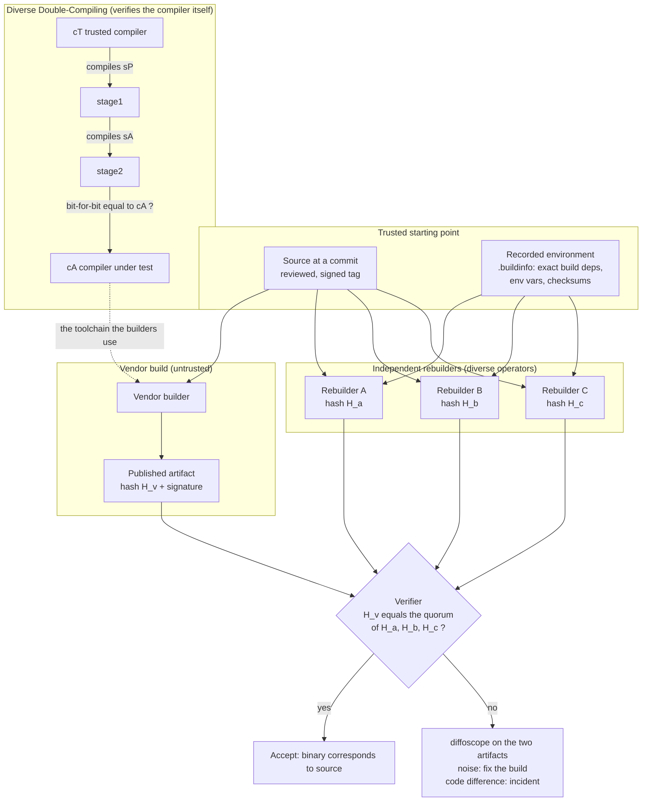

# Reproducible Builds: Determinism, Diverse Double-Compiling, and diffoscope

> [!summary] Claim:
> A signature binds a binary to a key, not to a source tree, so nothing in a signed release proves the binary was built from the source you reviewed; a reproducible build turns that claim into something any party can check by rebuilding and comparing hashes.
> The control only exists when three things hold together: the build is deterministic (the clock, paths, order, and identity are controlled), the full build environment is recorded and replayable (`.buildinfo`, pinned toolchains), and independent parties actually rebuild and publish what they got (rebuilders, quorum, transparency).
> Rebuilding catches a tampered builder, a swapped artifact, and a release tarball that differs from version control when the rebuild starts from version control; it does not catch malicious source, and it cannot catch a compromised compiler lineage unless the compiler binary itself is verified, which is what Wheeler's Diverse Double-Compiling and bootstrappable builds do.
> `diffoscope` turns a hash mismatch into a located difference, and the verdict on a mismatch is "reproduce or explain": noise is fixed at its source, and a difference in code sections that nobody can explain is treated as an incident.



## The Mechanism

This note owns reproducibility as a security control: the threat model, the verification architectures, Thompson's attack, Diverse Double-Compiling (DDC), bootstrapping, and `diffoscope` as the forensic tool.
[[Hermetic-and-Reproducible-Builds]] owns the engineering of determinism (every nondeterminism source and its fix) and [[Drill-Build-Systems-Hunt-Non-Determinism-with-Diffoscope]] owns the hands-on hunt, so this note summarizes those in a table and links to them rather than re-deriving them.
[[SLSA-Framework-Build-and-Source-Tracks]] owns provenance levels, and [[In-Toto-Layouts-Link-Metadata-and-DSSE-Attestations]] and [[Sigstore-Keyless-Signing-Cosign-Fulcio-and-Rekor]] own the attestation and signing formats that carry rebuild results.

### 1. The threat model: what a binary adds to a source tree

Source review answers one question, whether this source is benign.
A signed binary makes a second claim, that it was built from that source, and no signature checks the second claim.
Lamb and Zacchiroli state the gap as "trusting code is not the same as trusting its executable counterparts", and they model both the distribution and the build process as not completely trusted.
Thompson's 1984 lecture ends with the strongest form: "No amount of source-level verification or scrutiny will protect you from using untrusted code."

A rebuild is an independent re-execution of the claim.
Where the substitution happens decides whether it is caught:

| Where the substitution happens | Example | Caught by an independent rebuild? |
| :--- | :--- | :--- |
| The vendor's build host alters source or output during the build | SUNSPOT in the SolarWinds Orion build, covered in [[Case-Study-SolarWinds-Orion-SUNBURST]] | Yes, if the rebuilder is clean and compares against the published artifact |
| The registry or mirror serves a different artifact than the one built | Artifact swap after a clean build | Yes, the published hash differs from every rebuilder's hash |
| The release tarball contains files that the VCS tag does not | xz 5.6.0 and 5.6.1, covered in [[Case-Study-XZ-Utils-Backdoor-CVE-2024-3094]] | Only if the rebuild starts from the VCS tag; a rebuild from the tarball reproduces the backdoor exactly |
| The compiler binary is subverted and re-inserts itself | Thompson's attack | Only if the compiler binary is itself verified (DDC or a bootstrap from a small seed) |
| A malicious commit lands in the source | Compromised maintainer account | No, the malicious source reproduces perfectly |
| A malicious dependency version is selected | Dependency confusion, covered in [[Dependency-Confusion-Typosquatting-and-Registry-Attacks]] | No, unless the pinned dependency set is itself part of the recorded and reviewed input |

The Debian project, which started its reproducibility effort in 2014 according to Lamb and Zacchiroli, scoped the control precisely: a bit-identical rebuild shows that the binary corresponds to the source, and says nothing about whether the source is good.

### 2. Reproducible is a property; verified reproducible is a control

The Reproducible Builds project defines the property: "A build is reproducible if given the same source code, build environment and build instructions, any party can recreate bit-by-bit identical copies of all specified artifacts."
The phrase "any party" carries the security meaning.
A build that repeats on the vendor's own machine proves determinism, not integrity.

SLSA's FAQ separates two concepts that are often merged:

- "Reproducible" means repeating the build with the same inputs gives bit-for-bit identical output, with benefits in debugging, caching, and dependency tracking.
- "Verified reproducible" means using two or more independent build platforms to corroborate the provenance of a build, so the overall platform is more trustworthy than any one component.

SLSA does not require verified reproducible builds; it lists them as one option for meeting the Build requirements, and it names the reasons: reproducible builds do not address source, dependency, or distribution threats, reproducers must truly be independent, some builds cannot easily be made reproducible, and closed-source builds would need multiple independent in-house rebuilders.
Its independence example is concrete: if all rebuilders run the same pipeline software and a build request can trigger a vulnerability in it, one attacker compromises all rebuilders.

Building Secure and Reliable Systems (Chapter 14) gives the three architectures a verifier can use to trust a binary's provenance:

| Architecture | How the verifier gets assurance | Cost and limit |
| :--- | :--- | :--- |
| Trusted build service | The original build ran on a service the verifier trusts, which signs provenance with a key only it holds | One build, no reproducibility needed; Google uses this model internally; the service is a single point of trust |
| A rebuild you perform yourself | The verifier fetches the commit named in the provenance, re-runs the build, and compares bytes | Needs full reproducibility; builds take minutes or hours while deployment decisions need milliseconds, so it does not scale |
| Rebuilding service | A quorum of rebuilders each rebuild and attest; the verifier looks up the artifact hash in N databases | Needs reproducibility plus independent operators; Debian uses this model when a central authority is infeasible or undesirable |

The same chapter defines the vocabulary: hermetic means all inputs are fully specified up front by version or cryptographic hash; reproducible means the same commands on the same inputs give bit-identical outputs, and "almost always requires hermeticity"; verifiable means the provenance of an artifact is determined in a trustworthy way.
It also records the useful converse: "Nonreproducibility often indicates nonhermeticity", so testing reproducibility continuously finds undeclared inputs early.

### 3. Determinism hazards, seen from the security side

Every nondeterministic byte in an artifact is a byte that verification must ignore, explain, or normalize.
That is the security cost of nondeterminism: it is not the bug, it is the cover.
An attacker who can place bytes into a region that rebuilders already treat as noise (a timestamp field, an embedded path, an unordered table) is invisible to a hash comparison that has been relaxed to tolerate it.
The goal is therefore to drive the tolerated set to zero, not to build an ever smarter fuzzy comparator.

The hazards are listed once here; [[Hermetic-and-Reproducible-Builds]] has the mechanism, flags, and measured behavior of each.

| Hazard | Where it leaks into the artifact | Control | Source for the control |
| :--- | :--- | :--- | :--- |
| Wall clock | `__DATE__`, `__TIME__`, archive member mtimes, gzip header time | `SOURCE_DATE_EPOCH`, a UNIX timestamp that "MUST be reproducible (deterministic) across different executions of the build" and that builds use in place of the current time | SOURCE_DATE_EPOCH specification Revision 1.1 |
| Build directory | Debug info, `__FILE__` in `assert` and logging, embedded absolute paths | `-ffile-prefix-map=OLD=NEW` (GCC and Clang) rewrites references "as if the files resided in directory new"; GCC's `-fcanon-prefix-map` matches canonical paths instead of text | GCC Overall Options; Reproducible Builds build-path page |
| Directory and glob order | Archive member order, object link order | Sort inputs under the C locale (`LC_ALL=C sort`), `tar --sort=name` (GNU tar 1.28 and later); GNU Make `$(wildcard ...)` sorts by the current locale, so wrap it in `$(sort ...)` | Reproducible Builds archives and stable-inputs pages |
| File owner and mode | Numeric uid and gid, mode bits in tar, ar, and zip headers | Fixed owner and umask, tool modes that zero them | Reproducible Builds archives page |
| File modification times | Archive headers | `tar --clamp-mtime --mtime=...` (GNU tar 1.29 and later), or `touch` to the epoch value before archiving | Reproducible Builds archives page |
| Locale, timezone, hash seeds, parallel completion order | Sorted outputs, formatted dates, manifests written in completion order | Fixed `LC_ALL`, `TZ`, seeds; sort before writing | [[Hermetic-and-Reproducible-Builds]] |
| Per-build randomness and secrets | Signing keys, link-time random names, build IDs | Fixed seeds; reproduce the unsigned bytes and verify signatures separately | [[Hermetic-and-Reproducible-Builds]] |

Two design points matter for the control specifically.
First, the Go team's rule for deciding what to fix is the security rule too: a relevant input is anything whose change can change the output, and a build is reproducible when every relevant input can be supplied again.
Second, signatures cannot be reproduced by a third party because the key is secret, so the control splits them off.
Go's verifier compares macOS binaries "after stripping code signatures", and Bitcoin Core's Guix build has a separate `guix-codesign` step that attaches detached signatures (from a `DETACHED_SIGS_REPO`) to non-codesigned outputs.

#### What `SOURCE_DATE_EPOCH` requires, clause by clause

The specification (Revision 1.1, dated 27 November 2017; Revision 1.0 is dated 1 September 2015) is short, and each clause closes a specific verification gap:

| Clause (specification wording) | What it closes |
| :--- | :--- |
| The value is a UNIX timestamp, "the number of seconds, excluding leap seconds, since 01 Jan 1970 00:00:00 UTC", and "MUST be an ASCII representation of an integer with no fractional component, identical to the output format of `date +%s`" | Two tools cannot disagree about format; a fractional or locale-formatted value is malformed |
| It "MUST be reproducible (deterministic) across different executions of the build, depending only on the source code", and "SHOULD be set to the last modification time of the source, incorporating any packaging-specific modifications" | A rebuilder who has the same source derives the same value; the vendor cannot pick a value only it knows |
| Build processes "MUST use this variable for embedded timestamps in place of the current date and time" | `__DATE__`, archive headers, and generated docs stop leaking the wall clock |
| Where an embedded timestamp is not "current" but is still specific to one execution of the build (a generated file's mtime, for example), the process uses "a timestamp no later than the value of this variable" (clamping, added in 1.1) | Old files keep their old times, newer files are clamped, so the result is still deterministic |
| Processes "MUST NOT unset this variable for child processes if it is already present" | A wrapper script cannot silently reintroduce the clock in a subprocess |
| Formatting "MUST be deferred until runtime if an end user should observe the value in their own locale or timezone" | The stored bytes stay locale-free |
| "If the value is malformed, the build process SHOULD exit with a non-zero error code" | A bad value fails loudly and does not fall back to `time()` |

The Reproducible Builds timestamps guide adds the sourcing advice that makes the value deterministic: extract the date from the revision control system or from a changelog, and use `strip-nondeterminism` or `libfaketime` (via `LD_PRELOAD`) only as fallbacks, noting that faking time can break builds that depend on time differences (documentation as of 2026-11).
The guide gives no exact `git log` command, so any command you write for it is your own; the common choice, the commit time of the revision being built, satisfies the specification because it depends only on the source.

#### Signatures, system images, and JVM archives

Three hazards need a policy, not just a flag:

- **Embedded signatures.** The Reproducible Builds embedded-signatures guide names three approaches: make the signature an optional input of the build (Debian's `wireless-regdb` and F-Droid's `apksigcopier` are its examples), have the comparison tool ignore signature bytes (it must be "very easy to audit and understand", because the ignored region is exactly where a payload would hide), or ship a tool that strips signatures from official releases so a verifier compares the rest byte for byte (which requires the verifier to download the official release).
  Go's macOS check is the third approach and Bitcoin's `guix-codesign` is the first.
- **System images.** The system-images guide lists unset filesystem UUIDs and labels, timestamps that do not derive from `SOURCE_DATE_EPOCH`, and `mksquashfs`-style fragment reordering under multithreading as the leaks.
  Its fixes are to set the UUID explicitly (`mkfs.xfs -m uuid=`, `-U` and `hash_seed=` for ext), to clamp mtimes of the root filesystem to `SOURCE_DATE_EPOCH` before imaging, and, for XFS, to use `SOURCE_DATE_EPOCH` with `DETERMINISTIC_SEED=1` on xfsprogs 6.18.0 or later (as of 2026-11, Linux).
  A UUID carries no security meaning but must still be chosen deterministically, because a random one is one more tolerated difference.
- **JVM archives.** The JVM guide says `.jar` packaging is not reproducible-friendly, particularly archive timestamps; Gradle supports reproducible archives since 3.4 through `isPreserveFileTimestamps = false` and `isReproducibleFileOrder = true`, with explicit directory and file permissions; Java properties files take the system property `java.properties.date`; and locale-dependent output is pinned with `user.language`, `user.country`, `user.variant`, and `file.encoding=UTF-8` on Java 17 and earlier.
  Maven's mechanism is `project.build.outputTimestamp`, covered in the table in the rebuilders section.

Two more rules of the road come from the Reproducible Builds deterministic-build-systems guide: it states that there is no need to make a build system give constant output when run in different build paths when the build path is considered part of the build environment, so rebuilds must use the same directory (a deliberate scope decision: the path becomes a recorded input, as `Build-Path` in `.buildinfo` does), and it lists real leaks to hunt, such as CMake setting an `RPATH` for binaries that link to a library in the same project, Qt's `rcc` embedding source file modification times, and Qt's `moc` embedding the relative path from the build directory to the source directory.
Go's release builds take the path approach differently: the 1.21 toolchain was built with `go install -trimpath`, which replaces the source directory with the module path in the output (Go blog, 2023-08-28).

#### Testing for determinism: variation, not repetition

A control that only repeats a build proves nothing, so the standard tool varies the environment.
`reprotest` builds the same source twice in different environments and compares the results; its default `+all` set of variations, from the manual page, is `environment`, `build_path`, `kernel`, `aslr`, `num_cpus`, `time`, `user_group`, `fileordering`, `domain_host`, `home`, `locales`, `exec_path`, `timezone`, and `umask`.
It runs in the `null` virtual server (directly in `/tmp`) by default, or in `chroot`, `lxc`, `lxd`, `qemu`, `schroot`, or `ssh` testbeds, with `--testbed-init` and `--testbed-build-pre` hooks for installing tools such as `disorderfs` or build dependencies (as of 2026-11, Linux).
Debian's own tests apply a similar set of variations (listed in the pitfalls), and Debian Policy v4.7.4.1 section 4.15 states the aim: "Packages should build reproducibly", and it is "recommended that packages produce bit-for-bit identical binaries even if most environment variables and build paths are varied", with the stricter standard intended to replace the baseline "when it is easier for packages to meet it".
Note the policy words are "should" and "recommended", not "must".
The hands-on use of `reprotest` is in [[Drill-Build-Systems-Hunt-Non-Determinism-with-Diffoscope]].

### 4. Recording the environment: `.buildinfo`

A rebuild is only possible when the inputs are recorded.
Debian records them in a `.buildinfo` control file (deb822 format, format version 1.0 per `deb-buildinfo(5)` in dpkg 1.23.12), which "might be enclosed in an OpenPGP ASCII Armored signature".
The security-relevant fields:

| Field | Content | Why a rebuilder needs it |
| :--- | :--- | :--- |
| `Checksums-Sha256` (and Md5, Sha1) | Hashes of the files the build produced | The claim being verified: this hash came from this build |
| `Installed-Build-Depends` | Every installed and configured package that might affect the build, with exact versions, including all essential packages and their recursive dependencies | Reconstruct the toolchain and libraries byte for byte |
| `Environment` | Environment variables "known to affect the package build process", with quoted values | Replay the variables that change output |
| `Build-Path` | The absolute build path, emitted only if the vendor allows it; on Debian only paths starting with `/build/` | Rebuild at the same path when path remapping is not used |
| `Build-Origin`, `Build-Architecture`, `Build-Date` | Distribution, build architecture, build date | Select the matching builder and clamp time |
| `Build-Kernel-Version` | Kernel release, present only if the builder requested it, "to avoid leaking possibly sensitive information" | Rarely needed; opt-in for privacy |
| `Build-Tainted-By` | A non-exhaustive tag list (the field is supported since dpkg 1.19.5); on Debian the tags are `usr-local-has-configs`, `usr-local-has-includes`, `usr-local-has-programs`, `usr-local-has-libraries`, and `can-execute-cross-built-programs` (that tag since dpkg 1.21.10) | Flags that the builder had undeclared inputs, so a mismatch is explainable |

A `.buildinfo` file is a declaration, not a guarantee: it lists what the builder says it used.
Its value to a verifier is that a rebuild which follows it either reproduces the hash or fails, and a failure is then about the build, not about a guess at the environment.
The Debian rebuild pipeline shows the full replay: `rebuilderd` calls `debrebuild`, which calls `debootsnap` (which fetches each exact build dependency from `snapshot.debian.org` and `metasnap.debian.net`), then `mmdebstrap`, then `sbuild`, which builds inside a user namespace; `buildinfos.debian.net` serves the `.buildinfo` files.
The project states its goal as replicating the original build process, "not to seek out additional sources of variance", which belongs to the separate variance testing at `tests.reproducible-builds.org`.

### 5. Rebuilders and quorum in production

The control is only as strong as the set of parties who really rebuild.
Russ Cox says it directly about Go before 1.21: earlier toolchains were "possible to reproduce, but only with significant effort, and probably no one did".
The deployments below are the existing instances of the "rebuilding service" architecture:

| Operator | What is rebuilt | How trust is established | Notes |
| :--- | :--- | :--- | :--- |
| Go project | Go toolchain archives on `go.dev/dl` | Release builds run on a Linux/x86-64 and a Windows/x86-64 system and "must produce bit-for-bit identical archives or else we do not proceed with the release"; `golang.org/x/build/cmd/gorebuild` lets anyone rebuild, run nightly with results at `go.dev/rebuild` | Three relaxed checks: the macOS `tar.gz` compares contents with signatures stripped, the macOS PKG and the Windows MSI are not rebuilt but their contents are compared with a rebuilt archive |
| Debian | Debian binary packages | `reproduce.debian.net` rebuilds each binary package from its `.buildinfo`; `debian-repro-status` shows a system's status | The page asks for more independent rebuilders in "a diverse variety of setups and settings"; it tests every release architecture except s390x (as of 2026-11) |
| Arch Linux and others | Distribution packages | `rebuilderd` monitors a repository, rebuilds through a backend such as `archlinux-repro` or `debrebuild`, tracks verified packages, optionally attaches a `diffoscope` report | README status (as of 2026-11): Arch Linux and Debian supported, Tails and Fedora experimental, Alpine planned |
| Bitcoin Core | Release binaries | Multiple builders run `guix-build`, then attest with `guix-attest` into a `guix.sigs` repository; `guix-verify` runs after "at least one other signer" has uploaded signatures | Detached codesignatures handled by `guix-codesign` |
| OSS Rebuild (Google) | PyPI, npm, and Crates.io packages | Infers a build definition, rebuilds, compares semantically after normalizing instabilities such as archive compression, and publishes SLSA Provenance | Only the most popular packages are rebuilt (README, as of 2026-11); launched 2025-07-21 |
| Maven Central ecosystem | Java releases | The Reproducible Central project lists releases checked as reproducible by rebuilding independently from the reference build in Central; the mode is driven by `project.build.outputTimestamp`, and Maven's guide says it is active by default starting with Maven 3.10.0 and 4.0.0-beta-5 (MNG-8258; 3.10.0 was released 2026-09-27 and 3.10.1 on 2026-11-11 per the Maven release history, and 4.0.0-beta-5 on 2024-10-22), with the property still used to override the inherited default | Maven's guide says any single non-numeric character value of that property disables the mode (as of 2026-11) |

How many of those rebuilds succeed is the other operational number.
In the Debian rebuilder instance, the amd64 `api/v0/dashboard` endpoint reported, for suite `main`, 113,681 `good`, 66,738 `unknown`, and 2,900 `bad` (as of 2026-11-26, Linux; the counters move daily).
The front page's own script reads a different endpoint, `api/v1/dashboard` filtered by release, and computes its headline "reproduced" figure as good / (good + bad + fail), excluding `unknown`; for amd64 and `forky` that endpoint returned 19,125 `good`, 256 `bad`, 0 `fail`, and 0 `unknown`, which the formula turns into 98.68 percent (as of 2026-11-26).
Neither the page nor the endpoints say whether a count is per binary package or per `.buildinfo`, so treat them as the instance's own counters rather than a percentage of the archive.
Lamb and Zacchiroli reported over 95 percent of the 30,000-plus packages in Debian's development branch reproducible in 2021, and the Nix study of 709,816 historical package builds found bitwise reproducibility between 69 and 91 percent over 2017 to 2023 with an upward trend, rebuildability above 99 percent, and about 15 percent of the failures traced to embedded build dates.

#### Quorum arithmetic and its failure channels

Lamb and Zacchiroli describe the verification scheme: independent builders each publish a checksum for a source release, and the checksum reported by at least 50 percent of the builders may be the one to trust, so an attacker must take over at least half of the builder community to push a malicious binary.
The quorum rule is only as good as the independence assumption.
Independent here means failures that do not share a cause, and the shared causes to enumerate are:

| Shared channel | Attack it enables | Mitigation |
| :--- | :--- | :--- |
| Same source input | Everyone rebuilds the same malicious commit or tarball and agrees on a malicious hash | Review the source; for tarballs, diff against the VCS tag before rebuilding |
| Same rebuild software | A crafted build request compromises every rebuilder (the SLSA FAQ example) | Different pipeline implementations and operators |
| Same compiler binaries | A subverted toolchain produces the same malicious output on every rebuilder | DDC or a bootstrap from a small seed |
| Same package mirror or snapshot service | One poisoned mirror feeds all builders | Fetch by content hash from separately administered mirrors |
| Same hardware or firmware lineage | Below-the-compiler subversion (Thompson noted microcode as an extreme case) | Diverse hardware; out of scope for software rebuilds |

The mechanism that carries the result matters too.
A verifier needs the vendor's claimed hash and the rebuilders' hashes from places an attacker cannot silently edit, which is the job of signed attestations ([[In-Toto-Layouts-Link-Metadata-and-DSSE-Attestations]]) and a transparency log ([[Sigstore-Keyless-Signing-Cosign-Fulcio-and-Rekor]]).
`rebuilderd` documents the right reading of a failure: "due to the early state of this technology a failed rebuild is more likely due to an undeterministic build process instead of a supply chain compromise", and confidence comes from multiple trusted rebuilders agreeing on the set of packages you actually use.

### 6. Thompson's attack: why a hash match against your own compiler proves nothing

Thompson built the attack in three stages.

1. Stage I is a self-reproducing program: a source program that, compiled and executed, outputs an exact copy of its source.
   It matters because such a program can carry arbitrary extra text, and the comment in his example is reproduced too.
2. Stage II is a compiler that learns: the C compiler's code for the escape `\n` "knows" in a completely portable way which character code a newline is, and that knowledge lives in the binary.
   To add `\v`, he first compiled a version with the literal decimal 11, installed that binary as the official compiler, and could then write the portable form `\v` in the source forever, because the knowledge lives in the binary and not in the text.
3. Stage III uses that mechanism for malice, with two Trojan horses: a miscompilation of the `login` command so that a known password works, and a second one that recognizes the compiler's own source and inserts both Trojans into it.
   He compiled the doctored source once, installed the resulting binary as the official compiler, and then removed both bugs from the source: the clean source, compiled by the infected binary, still re-inserts them.

The consequence for verification is exact.
Rebuilding the compiler from its (clean) source with the infected compiler gives back the infected compiler, so a self-regeneration check passes.
A rebuild on a second machine passes too if that machine uses the same infected compiler binary.
Wheeler states this in the dissertation: naive developers presume that recompiling the source to see whether the same executable is produced is enough, and the trusting trust attack "can falsify this presumption".
The attack was known earlier through an Air Force evaluation of Multics, which Thompson acknowledges and Wheeler cites as Karger 1974.

### 7. Diverse Double-Compiling

Wheeler's dissertation (George Mason University, Fall 2009) gives a procedure that detects the attack and a formal argument for when it is sound.

#### The procedure

Symbols (from the dissertation):

- `cA` is the compiler executable under test, which may be corrupt, and `sA` is its putative source.
- `cP` is the compiler purported to have produced `cA` (its parent), and `sP` is the parent's putative source, often an older version of `sA`.
- `cT` is a trusted compiler that must be able to compile `sP`.

The steps:

1. Regeneration check (a control experiment): rebuild `cA` from `sA` with exactly the process that supposedly produced it.
   It checks that you control all the relevant inputs; a corrupted compiler can pass it, so it is not sufficient by itself.
2. Stage 1: compile `sP` with the trusted compiler: `stage1 = c(sP, cT)`.
3. Stage 2: compile `sA` with `stage1`: `stage2 = c(sA, stage1)`.
4. Compare `stage2` to `cA` for exact equality.

If they are bit-for-bit identical "and certain other assumptions hold", then `cA` corresponds to `sA`.
In the self-parenting case `sP = sA`, which is the ordinary "compiler compiles itself" release practice, so `stage1` is `sA` compiled by `cT`, and `stage2` is `sA` compiled by `stage1`.

```text
cT   sP  ->  stage1          # trusted compiler builds the parent source
stage1  sA  ->  stage2       # that result builds the putative compiler source
cmp stage2 cA                # equal means cA corresponds to sA
```

The design intent is subtle.
DDC does not require that `cT` and `cA` produce the same machine code for anything; Wheeler's section 4.4 is titled "DDC does not require that different compilers produce identical executables".
It requires that running two different compiler executables, `stage1` and the original `cP`, each correctly implementing the language, over the same source `sA`, give the same result.
The trusted compiler only has to compile one program, `sP`, so it can be slow, simple, or never released, and "the trusted compiler could even be a 'secret' compiler that is never publicly released".

#### Assumptions, stated in the dissertation

- "Trusted" means justified confidence that the program or process "does not have triggers and payloads that would affect the results of DDC" (not that it is bug free).
  This covers `cT`, the environments that run DDC, the comparison tool, and the way `sA`, `sP`, and `cA` were obtained.
- `cT` must give the same semantics to the constructs `sP` uses, including any nonstandard extensions.
- The compiler defined by `sP` should be deterministic: "once compiled, and then executed multiple times given the same inputs, it should produce exactly the same outputs each time".
- DDC shows that source and executable correspond; it does not show the source is benign, so `sA` and `sP` must still be reviewed.
  It lets review "concentrate on the source code, knowing that ... DDC will prove that the executable will correspond to the source code".
- DDC can be repeated with different trusted compilers or in different environments, forcing the attacker to subvert all of them.
- Using an older version of `cA` as `cT` is far less diverse and risks "pop-up" attacks, in which an attacker inserts a self-perpetuating payload into one version of the source and removes it from the next, so the final source looks clean while the executable chain is infected.
  Wheeler's counter is to re-run DDC on every executable release before it is used as a compiler, or, if that is impractical, "at least ... periodically and unpredictably".

The dissertation proves the key claim in first-order logic with equality using the prover `prover9`: proof 1 shows that if `stage2` equals `cA` then `cA` and `sA` correspond under the stated assumptions, proof 2 shows that under normal conditions they are always equal, and proof 3 derives one of the assumptions from the existence of a grandparent compiler.
The model separates the compilation environments (`e1`, `e2`) and the "effects" (random numbers, thread order, platform differences the language allows) that reach each step, which is the formal version of the nondeterminism hazards in the earlier table.

#### The demonstrations, with numbers

| Demonstration | Setup | Result |
| :--- | :--- | :--- |
| tcc (Tiny C Compiler) | Fedora Core 3, GCC 3.4.3 as both bootstrap and trusted compiler; tcc 0.9.20, 0.9.21, and 0.9.22 as the simulated potentially corrupt compiler chain | After patching the two defects the dissertation describes (a sign-extending cast and the uninitialized `long double` bytes), the DDC result and the chain-built executable were identical; it lists SHA-1 `c1ec831ae153bf33bff3df3c248b12938960a5b6` for `tcc` |
| Goerigk Lisp compilers | A correct and a maliciously corrupted compiler, with GNU Clisp as `cT` | `stage2` equalled the correct compiler and differed from the corrupt one; a unified diff pointed at the `login` pattern, "an immediate tip-off" |
| GCC | GCC 3.0.4's C compiler, Intel `icc` 11.0 as `cT`, Fedora 9, 32-bit x86, ccache removed | Identical results; `cc1` was 6,247,750 bytes |

Two lessons from the demonstrations are about determinism rather than about malice.
First, tcc stored a 10-byte `long double` zero in 12 bytes without initializing the last two, so the output bytes depended on the environment; the dissertation fixed it by replacing `0.0` with `(f1-f1)`, and it names the violated assumption (`sP_portable_and_deterministic`).
Second, Wheeler could not regenerate the Fedora Core compiler at all, because "the Fedora project (and probably many other distributions) does not record all the information necessary to easily recreate the exact same compiler executable"; so for the GCC experiment he created a new executable specifically to demonstrate DDC.
A decade and a half later, `.buildinfo` and the lockfile-and-hash style of recording address exactly that gap.

#### Limits

- DDC proves correspondence for the compiler components included in the test; in the GCC run the assembler, linker, archiver, C library, and kernel were treated as external, and covering them is "a matter of additional effort".
- If both compilers fail identically on `sP` and `sA`, DDC cannot see it; Wheeler argues this is rare for mature compilers and irrelevant to detecting an intentional self-perpetuating attack.
- A mismatch says that some assumption failed, not which one; for large compilers, finding the cause "can be difficult and time-consuming", which is where `diffoscope` earns its place.
- Compilers that embed timestamps or other unstable fields in their output need those removed or masked for the comparison, which brings the problem back to the determinism hazards.

### 8. Bootstrappable builds: removing the trusted binary instead of checking it

DDC needs a trusted second compiler.
The other approach shrinks what must be trusted until it can be audited by hand.

- GNU Guix announced its Full-Source Bootstrap on 2023-04-26: a package graph "of more than 22,000 nodes rooted in a 357-byte program".
  The seed is `hex0-seed`, a 357-byte binary for x86 with a plain-text `hex0` equivalent; from it `stage0-posix` builds `hex0`, `hex1`, `catm`, `hex2`, `M0`, `cc_x86`, `M1`, `M2`, `get_machine`, and then `M2-Planet`, which builds GNU Mes 0.24, then tcc (the graph lists `tcc-boot` 0.9.27 and `bootstrappable-tcc`, 0.9.26 plus 31 patches), then an old GCC chain (`gcc-core-mesboot` 2.95.3 and `gcc-mesboot` 4.9.4 appear in the graph), toward the modern toolchain.
  The authors' own caveat: the package graph is rooted in 357 bytes, but the set of binaries still includes a 25 MiB statically linked Guile used as the build driver (as of 2023-04).
- They also record why bootstrapping gets harder over time: GCC 4.8.0 (2013) made C++ a build requirement, and glibc 2.28 (2018) added Python as a build requirement.
- `mrustc` is an alternative Rust compiler written in C++ whose stated primary goal is to bootstrap `rustc`; its README says it "builds working copies of `rustc` and `cargo` from a release source tarball".
  It is a diverse compiler in exactly Wheeler's sense, which makes it a candidate `cT` for checking `rustc`.
  The README reports that it is "currently tested to fully bootstrap (with a binary-equal 1.91.1) version 1.90.0" (as of 2026-11, x86-64 Linux GNU), which is a DDC-shaped result; the README does not say what the 1.91.1 build is compared against, does not call it DDC, and does not state the DDC assumptions, so read it as a convergence check, not a full DDC argument.
- Go's toolchain build is itself a convergence test: toolchain1 is built by a bootstrap compiler (Go 1.17 for Go 1.21), toolchain2 by toolchain1, toolchain3 by toolchain2, and the post says toolchain2 and toolchain3 "should be identical", which "would only converge if the toolchain build on a single machine was reproducible".
  The post also reports that a Go toolchain can be built on any supported host with any bootstrap compiler, "including bootstrapping all the way back to Go 1.4's C implementation", with identical output.

The three approaches stack rather than compete: reproducible rebuilds verify distributed artifacts, DDC verifies the compiler that makes them, and a small-seed bootstrap shrinks the unverified base underneath both.

### 9. `diffoscope` as the forensic tool

When a comparison fails, `diffoscope` (version 339 as of 2026-11, Both) answers which byte and why.
This section records how it works internally and the limits that matter when the inputs are hostile; [[Drill-Build-Systems-Hunt-Non-Determinism-with-Diffoscope]] walks through using it.

- The entry point `compare_root_paths()` first checks whether two files are byte-identical (`has_same_content_as`); if so it returns no difference, which is why identical inputs produce no output.
  Otherwise it hands the pair to `compare_files()`.
- Comparator selection is an ordered table, `ComparatorManager.COMPARATORS` in `comparators/__init__.py`, whose entries include `ElfFile`, `MachoFile`, `Pe32PlusFile`, `PycFile`, `RustObjectFile`, `ZipFile`, `TarFile`, `ArFile`, `DebFile`, `GzipFile`, `XzFile`, `SquashfsFile`, `Iso9660File`, `DotBuildinfoFile`, and many more; a binary hex fallback (`compare_binary_files`) exists for anything unrecognized.
  Container comparators unpack and recurse, and format-specific ones turn opaque data into text first: an ELF is compared section by section, with disassembly for code.
- Members of containers are paired by name; when names differ (a version number in a path, for example), diffoscope pairs them by fuzzy matching using the TLSH locality-sensitive hash, with a default threshold of 110 (`--fuzzy-threshold`, 0 disables, 400 is high fuzziness); files under 512 bytes get no TLSH value, and a container with one element is force-compared against a container with one element.
- The exit status is 0 when the inputs are the same, 1 when they differ, and 2 on trouble (missing libraries, out of memory, no space left, broken pipe, interrupts, or any unexpected exception), so CI can distinguish "different" from "could not compare".
  Writing an empty text report for identical inputs requires `--output-empty`.
- Output formats are text, HTML (single page or `--html-dir`), JSON, Markdown, and reStructuredText; `--diff-mask REGEX` replaces matching substrings before diffing, `--exclude` removes members, and `--exclude-directory-metadata` defaults to `no` when comparing two directories and `yes` otherwise.
- Default limits (from `config.py`): report 40 MiB, 1,024 lines per diff block across all pages, 128 lines per block per page, 2^22 lines fed to `diff`, container recursion depth 50; `--no-default-limits` lifts most of them, but `--max-container-depth` "cannot be disabled for security reasons", and `--timeout` is documented as experimental with no timeout by default.
- `--list-tools` shows the external programs it shells out to and `--list-missing-tools` shows which of them are absent; run the second once in the CI image so a missing tool is a known gap and not a surprise.

Security reading of its output:

| Pattern in the diff | Usual meaning | Action |
| :--- | :--- | :--- |
| Metadata only (mtime, uid, order of members) | Determinism bug in archiving | Fix at the source; do not mask |
| A string like a date, a path, or a hostname in `.rodata` or debug sections | Embedded environment | Fix with `SOURCE_DATE_EPOCH` or a prefix map |
| Function bodies in `.text` differ and the source diff is empty | Different compiler or flags, or something inserted | Compare toolchain records first; if identical, treat as an incident |
| Extra members in one archive, extra sections or symbols, extra imported libraries | Content added outside the source | Incident until explained |
| Differences only inside a signature block | Expected; signatures are not reproducible | Compare the unsigned content |

`diffoscope` also parses untrusted archives and images, so run it in a sandbox with resource limits: the recursion-depth guard and size limits exist because an input can be crafted to expand without bound ([[Sandboxing-and-Hermetic-Execution-Internals]]).

### 10. What an identical hash does not prove, with two incidents

- **SolarWinds Orion.** CrowdStrike's SUNSPOT analysis describes malware that monitors running processes for `MsBuild.exe`, identifies the Orion solution from its command line, and "replaces a source code file" (`InventoryManager.cs`) during the build, only if hardcoded MD5 checks on the original and the replacement match, wrapping the injected code in `#pragma warning disable` and `restore` so warnings do not reach build logs; it backs the original up as `.bk`, then restores the original source after `MsBuild.exe` exits.
  The compromised build host produced a binary that was consistent with itself.
  A clean independent rebuild from the repository's source would have produced a different binary, and the difference would be in code: this is the case reproducible builds are designed for (my reasoning; the SUNSPOT report does not discuss rebuilds).
  A rebuild on the same compromised host reproduces the backdoor and proves nothing, which is the point of independent operators.
- **xz-utils.** Andres Freund's disclosure on 2024-03-29 says the backdoor had a part "solely in the distributed tarballs": a line in `build-to-host.m4` "not in the upstream source of build-to-host, nor is build-to-host used by xz in git", present in the release tarballs for 5.6.0 and 5.6.1.
  Independent rebuilders who rebuild from the release tarball produce identical, backdoored binaries and agree with each other; the quorum is unanimous and wrong.
  The control that catches this is a different one: compare the tarball against the VCS tag before rebuilding ([[Drill-Supply-Chain-Detect-Tarball-vs-Git-Tag-Backdoor]]), and define "the source" in the provenance as a VCS commit rather than an archive.
  Google's OSS Rebuild blog claims its approach catches "unsubmitted source code" by declining to attest artifacts that contain code absent from the public repository; that is the vendor's stated design and I did not test it.

The first incident is a case where verification helps; the second shows its boundary.
Reproducibility checks that the build function is honest, and the quality of the inputs is somebody else's control.

### 11. Fit with SLSA and attestations

SLSA Build L3 requires an isolated build platform whose provenance is unforgeable: builds must not be able to read the provenance signing key, must not influence each other, must run in an ephemeral environment, and must not poison a shared cache (the output "MUST be identical whether or not the cache is used").
That is a trusted build service in the earlier table.
A rebuild-based design reaches the same goal differently: corroborate provenance with independent platforms.
OSS Rebuild exposes the bridge by publishing its rebuild results as SLSA Provenance and describing them as "meeting SLSA Build Level 3 requirements with no publisher intervention" (the blog's own wording; it is the project's conformance claim, and no third-party assessment is cited in the blog or README).

The design rule that follows: use SLSA provenance to say who built what from which source on which platform, and use reproducible rebuilds to remove the need to trust that platform; neither replaces review of the source or control of dependencies ([[SBOM-Standards-SPDX-CycloneDX-and-VEX]] describes how the dependency set is declared).

## Commands and Numbers to Know

| Item | Value or form | Platform and date | Why it matters |
| :--- | :--- | :--- | :--- |
| Definition | Same source, build environment, and build instructions, any party, bit-by-bit identical specified artifacts | Both (as of 2026-11) | Reproducible Builds project wording |
| `SOURCE_DATE_EPOCH` | UNIX timestamp, ASCII integer, no fraction; builds use it in place of the current time | Both (as of 2026-11) | Specification Revision 1.1 |
| `-ffile-prefix-map=OLD=NEW` | Alias for `-fdebug-prefix-map` and `-fmacro-prefix-map`, available since GCC 8 and Clang 10, per the build-path page; the current GCC manual says it is equivalent to all the individual `-f*-prefix-map` options, which includes `-fprofile-prefix-map` | Both (as of 2026-11) | Removes the build directory from debug info and `__FILE__` |
| `tar --sort=name` | GNU tar 1.28 and later; `--clamp-mtime` needs 1.29 and later | Linux (as of 2026-11) | Stable archive order and times |
| `.buildinfo` format | Version 1.0, deb822, may be OpenPGP-signed | Linux (as of 2026-11) | Records the rebuild inputs |
| `debian-repro-status` | `sudo apt install debian-repro-status ; debian-repro-status` | Linux (as of 2026-11) | Shows a Debian system's reproducibility status |
| `diffoscope` | 339; exit 0 same, 1 different, 2 trouble | Both (as of 2026-11) | Scriptable gate in CI |
| `diffoscope` defaults | 40 MiB report, 1,024 lines per block, 128 per page block, depth 50, fuzzy threshold 110 | Both (as of 2026-11) | Output truncated without `--no-default-limits` |
| `gorebuild` | `golang.org/x/build/cmd/gorebuild`, nightly results at `go.dev/rebuild` | Both (as of 2026-11) | Rebuilds Go release archives |
| Guix seed | 357-byte `hex0-seed`, more than 22,000 graph nodes, 25 MiB Guile driver remaining | Linux (as of 2023-04) | Size of the unverified base |
| Wheeler GCC demo | GCC 3.0.4, `icc` 11.0 as `cT`, Fedora 9 32-bit x86, `cc1` 6,247,750 bytes | Linux (2009) | Scale proof for DDC |
| Debian rebuilder counters | amd64 v0, `main`: 113,681 good, 66,738 unknown, 2,900 bad; amd64 v1, `forky`: 19,125 good, 256 bad, 98.68 percent by the page's formula | Linux (as of 2026-11-26) | Instance counters from the dashboard endpoints; they move daily |
| Nix study | 709,816 builds, 69 to 91 percent bitwise reproducible, over 99 percent rebuildable, about 15 percent of failures embedded dates | Linux (2017-2023 snapshots) | Reproducibility at ecosystem scale |
| `reprotest` | Default `+all` variations: environment, build_path, kernel, aslr, num_cpus, time, user_group, fileordering, domain_host, home, locales, exec_path, timezone, umask; default testbed `null` | Linux (as of 2026-11) | Varies the environment between two builds |
| Debian Policy 4.15 | "Packages should build reproducibly"; bit-identical output under varied environment and paths is "recommended" (Policy v4.7.4.1) | Linux (as of 2026-11) | Distribution-level stance, not a hard requirement |
| Gradle archives | `isPreserveFileTimestamps = false`, `isReproducibleFileOrder = true` (Gradle 3.4 and later) | Both (as of 2026-11) | JVM archive determinism |
| Maven | `project.build.outputTimestamp` in `pom.xml` sets the reproducible timestamp; the mode is on by default from Maven 3.10.0 and 4.0.0-beta-5, and a single non-numeric character disables it | Both (as of 2026-11) | Java reproducible mode, opt-out in new Maven |

## Multi-Language Comparison: C++ / Python / Rust

The verification infrastructure differs more than the determinism fixes do.
Only items I verified against the sources listed above appear in the table; the engineering of each language's determinism is in [[Hermetic-and-Reproducible-Builds]].

| Concern | C and C++ | Python | Rust |
| :--- | :--- | :--- | :--- |
| Third-party rebuild service | Distribution rebuilders (`reproduce.debian.net`, `rebuilderd` for Arch) rebuild binary packages from `.buildinfo` | OSS Rebuild rebuilds popular PyPI packages and publishes SLSA Provenance | OSS Rebuild rebuilds popular Crates.io packages |
| Compiler verification | DDC on GCC demonstrated in 2009 (GCC 3.0.4 with `icc` 11.0); GNU Mes and `M2-Planet` provide the small-seed route to GCC in Guix | Not covered by the sources above | `mrustc` bootstraps `rustc` from a release source tarball and is a diverse compiler candidate |
| Path leakage control | `-ffile-prefix-map` (GCC and Clang); `-fcanon-prefix-map` in GCC | Not covered by the sources above | Not covered by the sources above |
| `diffoscope` comparators | `ElfFile`, `MachoFile`, `Pe32PlusFile`, `ArFile` | `PycFile`, `ZipFile`, `TarFile` | `RustObjectFile`, `ElfFile` |
| Typical artifact checked | Static or shared library, executable, `.deb` | Wheel (ZIP) and sdist (tar.gz) | `.crate` package and compiled objects |

## Worked Lab Example

This note has no lab, and lab checks are paused, so nothing below was run for this note and no output is claimed.
The recipes are copied or adapted from the primary sources and are meant to be run by the reader.

#### Recipe 1: rebuild and compare a distributed toolchain

Go's own verifier is the shortest real end-to-end check.
Following the Go blog, run `golang.org/x/build/cmd/gorebuild`, which starts from the Git repository, rebuilds the current Go versions, and compares the result with the archives on `go.dev/dl`.
Expect bit-for-bit equality for most archives, and the three documented relaxed comparisons for the macOS `tar.gz`, the macOS PKG, and the Windows MSI.

#### Recipe 2: a DDC run for a small compiler

```sh
# Inputs, all obtained and hashed through a process you trust:
#   cT : trusted compiler binary
#   sP : parent compiler source        sA : source of the compiler under test
#   cA : the shipped compiler binary under test
set -eu
# 0. Regeneration check: rebuild cA by the process that supposedly produced it.
#    If this fails, you do not control the inputs and DDC cannot proceed.
# 1. stage1: trusted compiler builds the parent source.
"$CT" -o stage1 "$SP"
# 2. stage2: stage1 builds the putative source of the compiler under test.
./stage1 -o stage2 "$SA"
# 3. Compare. Equal: cA corresponds to sA. Different: some assumption failed.
cmp stage2 "$CA" && echo "cA corresponds to sA"
# On mismatch: diffoscope stage2 "$CA"   (and check determinism of stage1 first)
```

The flags are placeholders for whatever your compiler takes; the structure is the dissertation's.
Run it twice with different environments (`TZ`, build path, locale) to see whether `stage2` is itself stable before blaming the compiler under test.

#### Recipe 3: triage a rebuild mismatch

```sh
# Exit codes: 0 same, 1 different, 2 trouble.
diffoscope --text report.txt --html report.html --markdown report.md vendor.deb rebuilt.deb
rc=$?
case "$rc" in
  0) echo "reproduced" ;;
  1) echo "differs: read report.txt, classify each hunk (metadata, embedded env, code)" ;;
  *) echo "diffoscope failed to compare: do not treat as a pass" >&2 ; exit 2 ;;
esac
```

Treating exit code 2 as "not a mismatch and not a match" avoids the silent-pass failure where a missing tool or crash is read as "no differences".

#### Recipe 4: vary the environment before trusting a match

The second and third forms are the manual page's own examples; the first adapts them by naming the `null` server, which the manual documents as the default, and none of them was run for this note.

```sh
# Build in a throwaway directory with the null testbed (the default), varying everything in +all:
reprotest . -- null
# Build a Debian package inside a chroot-like testbed with the default variations:
reprotest . -- schroot unstable-amd64-sbuild
# Build with a custom command and compare the produced .deb files:
reprotest 'dpkg-buildpackage -b --no-sign' '../*.deb' -- schroot unstable-amd64
```

A pass here shows the build is insensitive to the variations listed in the mechanism section, which is stronger than two identical runs but still says nothing about a hostile builder; it removes noise so that an independent rebuild can mean something.

## Pitfalls

> [!warning] Pitfall: building twice on one machine and calling it verified
> Two builds in the same container with the same clock, path, locale, and mounts share every environmental input, so they agree even when the build is full of hidden dependencies.
> Verification needs variation (Debian's CI varies time zone, locale, uid and gid, umask, hostname, `PATH`, `/bin/sh`, the date by 398 days, and, on amd64, the parallelism setting between its two builds, per its variations page as of 2026-11) or a different operator.

> [!warning] Pitfall: a quorum of rebuilders that share a failure channel
> Three rebuilders that run the same pipeline software, fetch from the same mirror, and use the same compiler binary are one rebuilder.
> Enumerate the shared channels in the table above before counting votes, and record which channel each operator is independent on.

> [!warning] Pitfall: rebuilding from the release tarball
> A tarball is built by the maintainer and can contain files that the VCS tag does not, as with xz 5.6.0 and 5.6.1.
> A rebuild from that tarball agrees with the vendor's backdoored binary.
> Define the verified source as a commit, and diff any archive against the tag.

> [!warning] Pitfall: masking differences until the comparison passes
> `--diff-mask`, `--exclude`, and `strip-nondeterminism` are useful for triage and for known-benign fields, but each mask is a region in which a payload is invisible.
> Keep the masked set small, reviewed, and written down, and drive it to zero by fixing the build.

> [!warning] Pitfall: reading a mismatch as proof of compromise (or a match as proof of safety)
> The `rebuilderd` README says a failed rebuild is more likely nondeterminism than an attack.
> A match proves correspondence between a source and a binary, nothing about the source.
> Triage mismatches by content, and keep source review and dependency control as separate controls.

> [!warning] Pitfall: treating `diffoscope` exit code 2 like exit code 1 or 0
> Code 2 means it could not finish: missing library, out of memory, disk full, or interruption.
> A pipeline that tests only `rc != 0` as "differs" can misfile a crash as a mismatch, and one that tests only `rc == 1` can misfile a crash as a pass.

> [!warning] Pitfall: running DDC with a trusted compiler that is not diverse
> Using an older version of the compiler under test as `cT` shares its lineage, so a self-perpetuating infection present in both passes the check, and the dissertation warns of pop-up attacks across versions.
> Choose a compiler from a different organization and code base, and re-run on every release before the binary is used as a compiler.

> [!warning] Pitfall: no recorded environment
> Wheeler could not regenerate Fedora's compiler because the information needed to recreate it was not recorded.
> Reproducibility work without `.buildinfo`-style records fails as soon as the original builder is rebuilt, upgraded, or lost.

> [!warning] Pitfall: running `diffoscope` on hostile artifacts without isolation
> It unpacks nested archives and filesystem images and shells out to many tools, so an attacker-supplied artifact is an attack on the verifier.
> Keep the recursion limit, run it in a sandbox, and give it a memory and disk budget.

## At Scale

For a single developer, "reproducible" means `SOURCE_DATE_EPOCH` and a prefix map and a check that two builds in different directories match.
At 1,000 to 50,000 engineers the questions become who rebuilds what, with which trust assumptions, and what the policy does on a mismatch.

| Decision | Rule |
| :--- | :--- |
| First-party artifacts you ship | Use a trusted build service with SLSA provenance as the primary control; add a second, independently operated rebuild for the highest-risk artifacts (toolchains, base images, update channels), because that is the only design where one compromised build host is detected |
| Third-party artifacts you consume | Prefer artifacts that a rebuilder has verified; for the rest, rebuild before admission to the internal registry, as in [[Enterprise-Third-Party-Code-Ingestion-and-Quarantine-Architecture]]; admit a non-reproducible dependency only with a recorded reason and an owner |
| What counts as a quorum | At least two rebuilders that you can show are independent on source input, pipeline software, toolchain, and mirror; record which operators and versions voted |
| Mismatch policy | Reproduce or explain: a mismatch blocks release until a reviewer classifies each hunk as metadata, embedded environment (fix the build), or code (open an incident); never auto-mask |
| Reproducibility rate as a metric | Track the percentage of release artifacts reproduced by an independent rebuilder, not the percentage that are "deterministic" in your own CI; Debian and the Nix study show 90-plus percent is reachable at ecosystem scale, so a 100 percent target for first-party artifacts is realistic |
| Toolchain verification | Pin compilers by hash, rebuild them from source on a schedule, and run DDC when you introduce or upgrade a toolchain; budget for the trusted second compiler as shared infrastructure, since only one program, `sP`, has to compile on it |
| Cost | A rebuild costs at most one more build per artifact; it is cheapest when shared, which is the argument for community rebuilders (`reproduce.debian.net`, OSS Rebuild) over each company running its own for the same open-source packages |
| Closed source | The SLSA FAQ notes a closed-source reproducible build needs multiple independent in-house rebuilders or source access for outside rebuilders, and calls the first likely prohibitively expensive; the practical alternative is a hardened single builder with provenance (my inference, not the FAQ's) |

Operationally, put the rebuild in the release path as a separate job with a separate identity and no shared cache, and feed its attestation into the same policy engine that checks provenance ([[Supply-Chain-Decision-Records]] holds the decision framing for build trust versus rebuild trust).
Content-addressed caches ([[Remote-Execution-API-and-Remote-Caching]]) amplify the value of determinism and the cost of lacking it, so the same work pays twice.

## Practice Drill

> [!tip] Practice Drill:
> 1. Take a small C project and build it twice in different directories under different `TZ` and `LC_ALL` values; compare with `diffoscope` and eliminate every difference without using a mask ([[Drill-Build-Systems-Hunt-Non-Determinism-with-Diffoscope]]).
> 2. Download a release tarball and the matching VCS tag of a project that uses autotools, and compare the file lists; explain each file that exists only in the tarball ([[Drill-Supply-Chain-Detect-Tarball-vs-Git-Tag-Backdoor]]).
> 3. On paper, run DDC for a toy compiler: name `cT`, `sP`, `sA`, and `cA`, list the assumptions you would need to justify, and decide what a mismatch would mean at each step.
> 4. Write the quorum policy for three rebuilders you would trust, and list the shared failure channels you cannot remove.

## Interview Questions

> [!question] L5: What is the difference between a reproducible build, a hermetic build, and a verified reproducible build?
>
> > [!success]- Answer
> > Hermetic means every input (source, compilers, tools, libraries) is fully specified up front by version or content hash, so the build cannot see anything undeclared.
> > Reproducible means the same commands on the same inputs give bit-for-bit identical outputs; it almost always requires hermeticity, and the Reproducible Builds definition says any party can recreate the artifacts.
> > Verified reproducible means two or more independent build platforms corroborate the provenance, which is the part that makes it a security control and not just a debugging aid.
> > Building twice on one machine shows determinism of that machine only.

> [!question] L5: Predict the output: `diffoscope --text - a.bin b.bin; echo $?` where `a.bin` and `b.bin` are byte-identical.
>
> > [!success]- Answer
> > It prints no diff and the shell prints `0`.
> > The first step in `compare_root_paths()` is a byte-identity check, which returns no difference.
> > For differing inputs it would print the diff and exit `1`, and on a failure to compare (missing libraries, out of memory, disk full) it exits `2`.
> > Writing an empty report file for identical inputs needs `--output-empty`.

> [!question] L6: How do you decide whether a 3 percent independent-rebuild failure rate across your release artifacts is compromise or noise?
>
> > [!success]- Answer
> > Treat it as noise until content says otherwise, because the `rebuilderd` authors note a failed rebuild is more likely an undeterministic build than a compromise.
> > Run `diffoscope` on each pair and classify hunks: metadata only (archive mtime, owner, order) and embedded environment (dates, paths) are build bugs to fix at the source, with `SOURCE_DATE_EPOCH` and prefix maps.
> > Differences in code sections, extra archive members, or added symbols and imports with an empty source diff are incidents.
> > Before deciding, check the `.buildinfo` or equivalent for toolchain and dependency differences, because a different compiler version explains code differences legitimately.
> > Track the rate over time: a sudden jump in one package's failures after a toolchain bump is a build regression, and a single new code-level difference in an artifact that used to reproduce is the signal to escalate.

> [!question] L6: Debug this: a DDC run gives a `stage2` that differs from `cA` in a handful of data-section bytes and two builds of `stage1` also differ, so what do you suspect first?
>
> > [!success]- Answer
> > Nondeterminism in the compiler build, not an attack: DDC requires the compiler defined by `sP` to be deterministic, and two different `stage1` builds show it is not.
> > Wheeler hit exactly this with tcc: it stored a 10-byte `long double` zero in 12 bytes and left two bytes uninitialized, so the output depended on the environment; he fixed it by replacing `0.0` with `(f1-f1)`, and it violated the `sP_portable_and_deterministic` assumption.
> > Diff the two `stage1` builds with `diffoscope`, find the field that varies (uninitialized padding, a timestamp, a path), remove the cause, and only then interpret a `stage2` versus `cA` mismatch.

> [!question] L6: Why can't you detect a Thompson-style compiler with the compiler itself, and why does DDC need a different compiler?
>
> > [!success]- Answer
> > The infected binary, given the clean source of the compiler, rebuilds the infected binary, so the regeneration check passes, and any rebuilder using the same binary agrees.
> > DDC compiles the parent source with a second compiler that does not share the infection, then uses that result to build the compiler under test; if the output equals the shipped binary, the binary corresponds to the source.
> > The second compiler only needs to build one program, so it can be slow, simple, or private, and using several different `cT` values forces an attacker to subvert all of them.
> > Using an old version of the same compiler weakens the diversity and opens the pop-up attack across versions.

> [!question] L6: A vendor's release is signed, and your rebuild matches every byte except the signature block; is that a pass, and how do you make the answer principled?
>
> > [!success]- Answer
> > It can be a pass, but only through a written policy, because a signature cannot be reproduced by a third party who lacks the key and the ignored region is where a payload would hide.
> > The embedded-signatures guide gives three designs: make the signature an input to the build (detached signatures attached by a separate step, as in Bitcoin Core's `guix-codesign`), have the comparison tool skip signature bytes (the tool must be very easy to audit), or strip signatures from the official release and compare the rest byte for byte (Go's macOS check).
> > Choose the one whose ignored region is smallest and mechanically bounded, verify the signature separately against the vendor's key, and record in the attestation which bytes were excluded.
> > An unbounded "ignore anything near the signature" mask is the failure to avoid.

> [!question] L5: Why must `SOURCE_DATE_EPOCH` "depend only on the source code", and what breaks if a vendor sets it to the build host's clock?
>
> > [!success]- Answer
> > The specification requires the value to be reproducible across executions of the build and depend only on the source, and recommends the last modification time of the source.
> > A rebuilder who has the same source can then derive the same value; a value taken from the vendor's clock is a private input the rebuilder cannot know, so every embedded timestamp differs and the comparison fails or is relaxed.
> > A relaxed comparison is the real cost: the date fields become a tolerated difference where a payload can hide.

> [!question] L7: Would three independent Debian-style rebuilders have caught the backdoor in the xz 5.6.0 and 5.6.1 release tarballs?
>
> > [!success]- Answer
> > Not by rebuilding from the tarball: they would all agree on the backdoored binary, because the malicious `build-to-host.m4` line was in the tarball and not in the git source.
> > It would be caught by a rebuild that starts from the VCS tag (the output would differ from the tarball-derived binary) or by comparing the tarball with the tag before building.
> > The lesson is that reproducibility verifies the function from inputs to outputs, so the control must also pin what counts as the input: a commit in provenance, not an archive, plus a tarball-to-tag diff.

> [!question] L7: Design the quorum policy for rebuilding third-party packages at a company with 20,000 engineers.
>
> > [!success]- Answer
> > Start from the failure channels: source input, rebuild software, toolchain, mirror, hardware.
> > Require at least two rebuilders on distinct pipelines and operators (for example a community rebuilder plus an internal one) and fetch inputs by content hash from separately administered mirrors.
> > Define the source as a commit and diff any archive against it first.
> > Record every vote with operator, software version, and `.buildinfo` or build definition, and store them as signed attestations, with the policy engine accepting an artifact only if the vendor hash equals the quorum hash.
> > Decide the mismatch policy up front: block, classify with `diffoscope`, never auto-mask, and quarantine unreproducible packages with an owner and a reason ([[Enterprise-Third-Party-Code-Ingestion-and-Quarantine-Architecture]]).
> > State the residual risk: malicious source and dependencies are untouched by this control.

> [!question] L7: In the SUNSPOT build-time source swap, why does an independent rebuild help but a second build on the same build server does not?
>
> > [!success]- Answer
> > SUNSPOT ran on the build host, watched for `MsBuild.exe`, swapped one source file in place during compilation, and restored it afterward, so the repository stayed clean.
> > A second build on the same host would be infected the same way and produce the same bytes, so repeatability is no evidence.
> > An independent clean rebuild from the repository's source yields a binary without the injected code, so its hash differs from the shipped one, and `diffoscope` would show added code.
> > This depends on the rebuilder's independence from the compromised host and on the build being reproducible in the first place: a build with a large tolerated noise set would hide the difference.

> [!question] L8+: You own build integrity for a toolchain shipped to 30,000 engineers, so when is DDC enough and when do you need a small-seed bootstrap?
>
> > [!success]- Answer
> > DDC is enough when you can justify one or more diverse, trusted second compilers whose own provenance is independent of the compiler under test; it then gives a formal correspondence between the shipped binary and its source, at the cost of two compilations and a comparison per release, and it needs your compiler build to be deterministic.
> > A small-seed bootstrap (the Guix 357-byte `hex0` route, or `mrustc` for Rust) is for when you cannot justify any trusted binary: it replaces trust in a compiler with trust in a seed small enough to audit, at the cost of a long chain (stage0, Mes, tcc, then old GCC versions) and recurring breakage as upstream adds build requirements such as C++ in GCC 4.8 and Python in glibc 2.28.
> > Use them together: bootstrap or DDC to establish the toolchain once and on each major version, reproducible rebuilds with independent operators for each shipped artifact, and pop-up-attack defense by re-running DDC on every release before it is used as a compiler.
> > Name the residual: hardware and firmware below the compiler, and source that is malicious.

> [!question] L8+: Leadership asks for "100 percent reproducible builds" as a security KPI. What do you propose instead, and what do you refuse to measure?
>
> > [!success]- Answer
> > Measure the share of release artifacts that were reproduced by an independent operator within a time bound after release, with the mismatch classification, not the share of builds that agree with themselves.
> > Break out the tolerated noise set (masks, relaxed comparisons like Go's macOS signature stripping), the time to explain a mismatch, and the number of independent operators.
> > Refuse to measure local determinism alone, because it does not involve an independent party, and refuse to report a match as "safe", because source and dependency compromise are outside the control.
> > Scope the target: 100 percent is realistic for first-party artifacts you control, as Go achieved for its toolchain from 1.21; for the open-source packages you consume, the realistic goal is "verified by at least one independent rebuilder, or quarantined with an owner".
> > Pair the KPI with an attestation pipeline so the numbers are auditable, and with the other controls (provenance, source review, dependency pinning) so the KPI is not mistaken for the whole program.

## Further Reading

- Ken Thompson, "Reflections on Trusting Trust" (CACM 1984): the three-stage attack, three pages, and still the cleanest statement of why source review is not enough.
- David A. Wheeler, "Fully Countering Trusting Trust through Diverse Double-Compiling" (2009): the procedure, the assumptions, the formal proofs, and the tcc, Lisp, and GCC demonstrations; chapter 8 covers non-determinism, pop-up attacks, and application problems.
- Chris Lamb and Stefano Zacchiroli, "Reproducible Builds: Increasing the Integrity of Software Supply Chains" (IEEE Software, 2021): the supply-chain framing, the checksum-consensus model, and Debian's experience; see also [[Paper-Reproducible-Builds-Lamb-Zacchiroli]].
- Malka, Zacchiroli, and Zimmermann, "Does Functional Package Management Enable Reproducible Builds at Scale? Yes." (2025): the largest measurement of bitwise reproducibility, with causes of failure listed.
- Russ Cox, "Perfectly Reproducible, Verified Go Toolchains" (2023): the best engineering account of making a toolchain reproducible and verifying it nightly.
- SLSA v1.2 FAQ, "What about reproducible builds?": the distinction between reproducible and verified reproducible, and the independence caveat; and Building Secure and Reliable Systems, Chapter 14, for the three verifiable-build architectures.
- `deb-buildinfo(5)` and `reproduce.debian.net`: the environment record and a working rebuild pipeline.
- Guix, "The Full-Source Bootstrap" (2023): the small-seed approach, with the graph from the 357-byte seed to GCC.
- CrowdStrike, "SUNSPOT: An Implant in the Build Process": a primary account of build-time source substitution; Andres Freund's oss-security post on xz for the tarball-only component; see also [[Paper-Reflections-on-Trusting-Trust]].
- Reproducible Builds documentation (`/docs/timestamps/`, `/docs/embedded-signatures/`, `/docs/system-images/`, `/docs/jvm/`) and the `SOURCE_DATE_EPOCH` specification: the clause-level rules and the three designs for handling signatures.
- `reprotest(1)` and Debian Policy section 4.15: the variation set a build should survive and the distribution's stated expectation.
- The `diffoscope` source tree (`comparators/__init__.py`, `config.py`, `main.py`): the comparator table, the limits, and the exit codes.

## Related

- Prerequisites: [[SLSA-Framework-Build-and-Source-Tracks]]
- Next: [[Enterprise-Third-Party-Code-Ingestion-and-Quarantine-Architecture]]
- See also: [[Hermetic-and-Reproducible-Builds]], [[Drill-Build-Systems-Hunt-Non-Determinism-with-Diffoscope]], [[In-Toto-Layouts-Link-Metadata-and-DSSE-Attestations]], [[Sigstore-Keyless-Signing-Cosign-Fulcio-and-Rekor]], [[Case-Study-XZ-Utils-Backdoor-CVE-2024-3094]], [[Case-Study-SolarWinds-Orion-SUNBURST]], [[Drill-Supply-Chain-Detect-Tarball-vs-Git-Tag-Backdoor]], [[Paper-Reflections-on-Trusting-Trust]], [[Paper-Reproducible-Builds-Lamb-Zacchiroli]]
