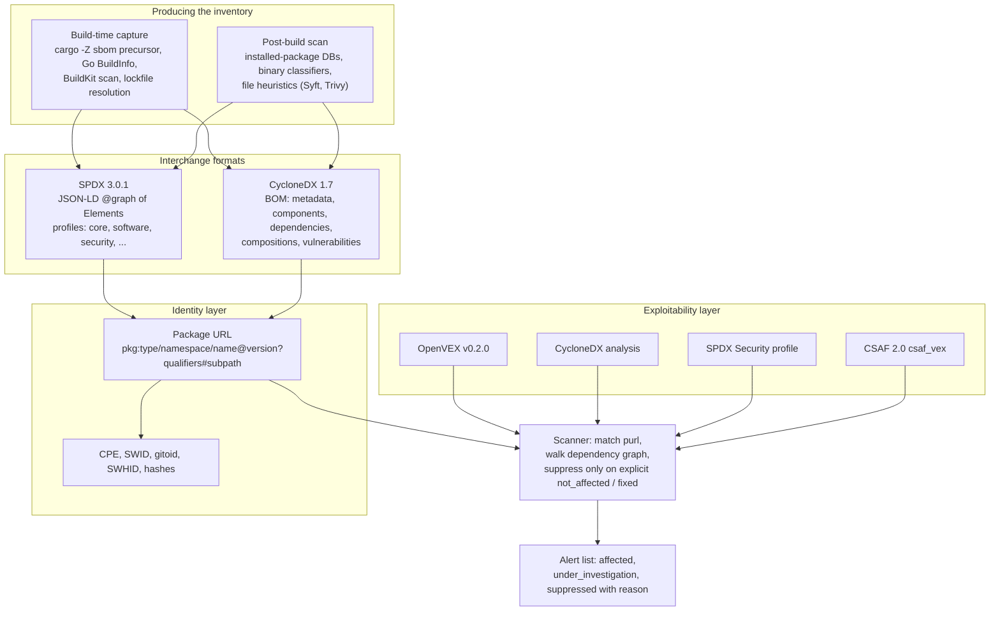

# SBOM Standards: SPDX 3.0, CycloneDX 1.7, and VEX Mechanics

> [!summary] Claim:
> An SBOM is a machine-readable graph of components, identities, and relationships; SPDX 3.0.1 models it as typed elements and relationship elements grouped into conformance profiles, and CycloneDX 1.7 models it as a BOM object with a component inventory, a `dependencies` graph, and `compositions` that state how complete each part is.
> Components are matched across SBOMs, scanners, and advisories by identifier, and the Package URL (purl) is the identifier that all three of the SPDX software profile, CycloneDX, and VEX carry, so purl canonicalization decides whether anything downstream matches.
> A VEX statement is `product + vulnerability + status` (plus a justification for `not_affected`), is carried in OpenVEX, CycloneDX `vulnerabilities`, the SPDX Security profile, or CSAF, and works only because a scanner treats the absence of a statement as "affected".
> When the SBOM is produced matters as much as its format: a build-time SBOM records what the compiler and linker consumed, a post-build scan infers it from artifacts with heuristics, and both standards now have fields to say which one you are holding.



## The Mechanism

An SBOM answers one question: what is inside this artifact, and how did it get there.
Everything else in this note is machinery for making that answer comparable across tools, organizations, and time.
Three problems have to be solved, and each standard solves them differently: a data model for components and their relationships, an identifier scheme so that two documents agree they are talking about the same thing, and a way to express that a known vulnerability does or does not matter for this particular product.
Facts below come from SPDX 3.0.1, the CycloneDX 1.7 JSON schema, and the cited specifications unless another source is named.
The scope of this note is the standards and the mechanics of generating and consuming them.
Signing and distributing an SBOM as an attestation belongs to [[In-Toto-Layouts-Link-Metadata-and-DSSE-Attestations]] and [[Sigstore-Keyless-Signing-Cosign-Fulcio-and-Rekor]].
Build provenance (how the artifact was built, as opposed to what is in it) belongs to [[SLSA-Framework-Build-and-Source-Tracks]].

### 1. Identity: Package URL, CPE, and content identifiers

A vulnerability database says "package X before version Y is affected".
An SBOM says "this product contains X at version Z".
Joining those two statements requires a shared name for X, and the choice of identifier is the largest single cause of false positives and false negatives in SBOM-driven scanning.
Both standards let a component carry several identifiers at once.

| Identifier | What it names | Where it lives (SPDX 3.0.1) | Where it lives (CycloneDX 1.7) |
| :--- | :--- | :--- | :--- |
| Package URL (purl) | A package in an ecosystem, by type, namespace, name, version | `software_packageUrl` on a Package, or `externalIdentifier` of type `packageUrl` | `component.purl` |
| CPE 2.2 or 2.3 | A product in the NVD naming scheme | `externalIdentifier` of type `cpe22` or `cpe23` | `component.cpe` |
| SWID or CoSWID tag | A software identification tag | `externalIdentifier` of type `swid` (CoSWID, RFC 9393) | `component.swid` |
| gitoid (OmniBOR) | A git-object-style hash of the artifact | `contentIdentifier` on a SoftwareArtifact | `component.omniborId` |
| SWHID | A Software Heritage intrinsic identifier | `externalIdentifier` of type `swhid` | `component.swhid` |
| Cryptographic hash | The bytes of the artifact | `verifiedUsing` with a `Hash` (algorithm, hashValue) | `component.hashes[]` (`alg`, `content`) |

The hash row deserves emphasis.
A purl and a CPE are claims about identity made by whoever wrote the SBOM.
A hash is the only identifier that a consumer can recompute from the artifact itself, which is why the CISA 2025 draft adds Component Hash as a minimum element and BSI TR-03183-2 v2.1.0 requires a SHA-512 hash of the deployable component.

#### Package URL canonicalization

A purl is a URL with seven components: `scheme:type/namespace/name@version?qualifiers#subpath`.
The scheme is the constant `pkg`.
The core rules (SPDX 3.0.1 Annex E, which reproduces the purl specification v1) are:

- The type is ASCII letters, digits, `.`, `+`, and `-`, cannot start with a digit, is never percent-encoded, and is case insensitive with a lowercase canonical form.
- The namespace is zero or more `/`-separated segments; leading and trailing slashes are stripped; each segment is percent-encoded and must be non-empty when decoded.
- The name is required and percent-encoded; the version is an opaque percent-encoded string with no comparison rule, because "there is no reliable and uniform way" to compare versions across ecosystems.
- Qualifier keys are lowercase, unique, and must not be percent-encoded; a `key=value` pair whose value is empty is the same as no pair at all; the canonical form sorts the `key=value` strings lexicographically and joins them with `&`.
- The subpath is split on `/`, and empty, `.`, and `..` segments are discarded.
- A purl must not contain a URL authority, so a registry host goes in the `repository_url` qualifier, not in the namespace.
- `pkg://type/name` is accepted by parsers but must not be produced; the canonical form is `pkg:type/name`.

The specification defines `repository_url`, `download_url`, `vcs_url`, `file_name`, and `checksum` as qualifiers valid for all types, and tells producers to keep qualifiers to the bare minimum needed for identification.
The `checksum` qualifier is a comma-separated list of `algorithm:hex_value` items in lowercase.
The build algorithm runs left to right (lowercase `pkg:`, lowercase type, `/`, namespace segments, name, `@version`, `?qualifiers`, `#subpath`), and the parse algorithm runs right to left by splitting once on `#`, then `?`, then `:`, then the first `/`, then the last `@`, then the last `/`.
Right-to-left parsing is what lets `@` and `/` appear percent-encoded inside names without ambiguity.

Type-specific rules sit on top of the generic ones, and they are where two tools most often disagree.
The type definitions in the `package-url/purl-spec` repository (as of 2026-11, Both) say, for example:

| Type | Namespace | Name rule | Version note |
| :--- | :--- | :--- | :--- |
| `pypi` | prohibited | lowercase, and runs of `-`, `_`, `.` collapse to a single `-` (PEP 503 normalization) | case insensitive |
| `npm` | optional, the scope, with the `@` always percent-encoded | case sensitive | case sensitive |
| `maven` | required, the groupId | case sensitive, the artifactId; qualifiers `classifier` and `type` | case sensitive |
| `golang` | required, the module path prefix, lowercased | lowercased | often a commit when available |
| `oci` | prohibited; the registry path goes in `repository_url` | lowercased, the last fragment of the repository name | the `sha256:` digest, required to uniquely identify the artifact |

The `oci` row explains a recurring failure: an OCI purl without a digest version names a repository, not an artifact, so a VEX statement keyed to it covers every image built from that repository.
The purl specification is an Ecma standard, ECMA-427 1st edition (December 2025), which defines the syntax and the schema for type definitions but, per its abstract, does not itself contain the type definitions.
Ecma lists ISO/IEC DIS 27056 for it.

#### purl matching is not defined by the purl specification

Scanners must decide when the purl in a VEX statement "matches" the purl of a detected package.
Trivy's documentation states its rules and says they "are not formally defined within the current official PURL specification" and instead "represent a community consensus":

- A purl without a version matches all versions of that package.
- A purl without qualifiers matches the package at that version with any qualifiers.
- A purl with qualifiers matches only packages that have the same values for those qualifiers; extra qualifiers on the package are ignored.

These rules mean that precision is something the VEX author chooses by what they leave out.
Leaving the version off a `not_affected` statement is a decision to suppress the vulnerability for every version, including versions you have not analyzed.

### 2. SPDX 3.0.1: a graph of Elements, partitioned into profiles

SPDX 3.0 was released 2024-04-15 and 3.0.1 on 2024-12-12 (GitHub release dates of `spdx/spdx-3-model`); a 3.1 release candidate was tagged 2026-01-24 (as of 2026-11, Both).
The specification states that the data model is based on RDF, and that any of JSON-LD, Turtle, N-Triples, or RDF/XML can serialize it.
The consequence is a uniform shape: every piece of information is an element, and any two elements are related by a `Relationship` element rather than by a fixed section of a document.

#### Elements, creation info, and identity

`Element` is the abstract base class of every domain class.
Its properties are `spdxId` (1..1, an `xsd:anyURI`), `creationInfo` (1..1), `name`, `summary`, `description`, `comment`, `externalIdentifier` (0..*), `externalRef` (0..*), `verifiedUsing` (0..*, an `IntegrityMethod` such as `Hash`), and `extension`.
`CreationInfo` requires `specVersion` (a SemVer), `created` (a DateTime), and `createdBy` (one or more `Agent`), with optional `createdUsing` (`Tool`).
The specification adds a note on `created`: it is "often the date of last change (e.g., a git commit date), not the date when the SPDX data was created, as doing so supports reproducible builds."
That is a deliberate design choice and it conflicts with the NTIA and CISA reading of Timestamp as the time of data assembly, which is worth knowing when you map one to the other.

#### Relationships are elements

`Relationship` is itself a subclass of `Element`, with `from` (1..1), `to` (1..*), `relationshipType` (1..1), `completeness` (0..1), `startTime`, and `endTime`.
The consequences are structural: a relationship has its own `spdxId`, its own `creationInfo`, its own `verifiedUsing`, and can be the target of another relationship.
The `RelationshipType` vocabulary is read as the sentence "from (is) (a) RELATIONSHIP to".
It has roughly sixty entries (as of 2026-11, Both), and the ones that matter for an SBOM are:

| Entry | Meaning (paraphrased from the vocabulary) |
| :--- | :--- |
| `contains` | `from` contains each `to` |
| `dependsOn` | `from` depends on each `to`, during a `LifecycleScopeType` period |
| `hasStaticLink`, `hasDynamicLink` | `from` statically or dynamically links each `to` |
| `hasProvidedDependency` | a dependency assumed to be provided, not in the distributed artifact |
| `hasOptionalDependency`, `hasOptionalComponent` | optional dependency, optional component |
| `generates`, `hasInput`, `hasOutput`, `hasHost`, `invokedBy`, `usesTool` | Build profile relationships between a Build, its inputs, outputs, host, invoker, and tools |
| `ancestorOf`, `descendantOf`, `patchedBy`, `hasVariant` | derivation and modification |
| `hasDistributionArtifact`, `packagedBy`, `expandsTo` | packaging relationships |
| `affects`, `doesNotAffect`, `fixedIn`, `underInvestigationFor` | VEX relationships, each restricted to one assessment class |
| `describes` | `from` describes each `to`; the spec says to use `rootElement` to mark the roots of a collection |

Completeness is a first-class concept.
`RelationshipCompleteness` is `complete`, `incomplete`, or `noAssertion`.
`to` may hold the individual `NoneElement` to assert that no such relationships exist, or `NoAssertionElement` to say nothing; mixing `NoneElement` with other elements is invalid.
This is the SPDX analogue of the CycloneDX `compositions` object, and the two are the only way a consumer can tell an empty dependency list from an unexamined one.

`LifecycleScopedRelationship` adds `scope` (`design`, `development`, `build`, `test`, `runtime`, `other`), so one `dependsOn` vocabulary serves both build-time and runtime dependency graphs.
The specification's rationale is that this "lets us avoid a proliferation of relationships".
A build-only compiler and a runtime library are both `dependsOn` targets of the application; the `scope` property is what keeps a scanner from alerting on a vulnerability in a tool that never ships.

#### Collections: Bom, Sbom, and SpdxDocument

`ElementCollection` groups elements through `element` (0..*) and `rootElement` (0..*), and carries `profileConformance` (0..*).
`Bom` is a `Bundle` is an `ElementCollection`.
`software_Sbom` is a `Bom` that adds `sbomType` (0..*), whose entries are `design`, `source`, `build`, `analyzed`, `deployed`, and `runtime`.
Those types come from the CISA "Types of Software Bill of Material (SBOM) Documents" publication of 2023-04-21, and one SBOM may carry several.
`SpdxDocument` is an `ElementCollection` that represents a set of elements which could be serialized together, with `dataLicense`, `import` (`ExternalMap`, for references into other documents), and `namespaceMap`.
Two rules keep it honest: a serialization must not contain more than one `SpdxDocument`, and information about one specific serialization (the actual bytes) lives in an `Artifact` linked by a `serializedInArtifact` relationship, not on the document.

#### Profiles

A profile is a compliance point: a namespace of classes and properties plus restrictions on existing ones.
The Conformance clause defines nine: Core, Software, Security, Licensing, Dataset, AI, Build, Lite, and Extension, and says Core is mandatory and all others are optional.
Licensing has two variants, SimpleLicensing and ExpandedLicensing, so the `ProfileIdentifierType` vocabulary used in `profileConformance` has ten values: `core`, `software`, `security`, `simpleLicensing`, `expandedLicensing`, `dataset`, `ai`, `build`, `lite`, `extension`.
If a creator lists a profile in `profileConformance`, they are claiming "that all contained elements conform to all restrictions defined for that profile".
The practical meaning for a consumer: read `profileConformance` first, because a document that lists only `core` and `software` makes no claim about vulnerability data even if you find a `Vulnerability` element in it.

| Profile | Adds | Relevance to this note |
| :--- | :--- | :--- |
| Core | Element, Relationship, CreationInfo, Agent, Tool, Hash, ExternalIdentifier, ElementCollection, SpdxDocument | Everything |
| Software | `Package`, `File`, `Snippet`, `Sbom`, `packageUrl`, `packageVersion`, `primaryPurpose`, `downloadLocation`, `contentIdentifier` | The inventory |
| Security | `Vulnerability`, VEX assessment relationships, CVSS v2, v3, v4, EPSS, SSVC, and exploit-catalog assessments | VEX inside SPDX |
| Licensing | License expressions, `ListedLicense`, `CustomLicense`, `LicenseExpression` | License compliance |
| Build | Build element and relationships (`hasInput`, `hasOutput`, `hasHost`) | Provenance overlap with SLSA |
| AI, Dataset | `AIPackage`, `DatasetPackage` and their properties | Model and data inventories |
| Lite | The minimum set for license compliance | Conformance floor |

#### Serialization: JSON-LD, the context file, and two kinds of validation

The common serialization is JSON-LD with a single top-level `@context` of `https://spdx.org/rdf/3.0.1/spdx-context.jsonld`, which aliases `spdxId` to `@id` and `type` to `@type`, and a top-level `@graph` array of elements.
The specification also defines a canonical serialization (JSON per RFC 8259, no insignificant whitespace, object members ordered by name) so that identical content produces identical bytes.
Conformance has two parts, both required: structural validation against the SPDX JSON Schema, and semantic validation against the SPDX OWL ontology with SHACL shapes.
These are not redundant.
Checked locally on 2026-11-21 with Python `jsonschema` 4.26.0 against the published 3.0.1 JSON Schema (macOS), a `VexNotAffectedVulnAssessmentRelationship` with `relationshipType: "affects"` validated clean, although the class description restricts it to `doesNotAffect`, and a bogus `justificationType` was rejected.
Re-checked in verification (2026-11, macOS) with `pyshacl` 0.40.2 and `rdflib` 7.6.0 against the shapes in the published `spdx-model.ttl`: the same `affects` relationship conforms there too, and so does one whose `from` is a Package rather than a Vulnerability, while the bogus `justificationType` is rejected by both layers.
SHACL does add class-range checks that the JSON Schema cannot express: a `CreationInfo` whose `createdBy` points at a Package passed the JSON Schema and failed SHACL ("Value does not have class Agent").
So the JSON Schema checks vocabulary and shape, SHACL adds the classes of referenced elements, and the cross-property constraints stated in the class descriptions ("restricted to the doesNotAffect relationship type", "the from: end of the relationship must be a /Security/Vulnerability classed element") are prose rules that neither published 3.0.1 artifact enforces (as of 2026-11, Both).
A pipeline that runs both validators will still accept semantically invalid SPDX 3 VEX unless it adds its own rules for those constraints.

#### What SPDX 3 tooling support looks like

Tool support lags the specification.
`syft` 1.57.2 (macOS, as of 2026-11), whose `--help` examples name `spdx`, `spdx-json`, `spdx@2.2`, and `spdx-json@2.2`, documents SPDX 2.3 tag-value and JSON output and 2.2 as an option; its help lists no SPDX 3 format.
BSI TR-03183-2 v2.1.0 nevertheless makes SPDX 3.0.1 the minimum SPDX version for new SBOMs, so regulated producers need a generator that emits it.
Treat "which tool emits which format version" as a fact to re-check at adoption time, not a property of the standard.

### 3. CycloneDX 1.7: a BOM object with a dependency graph

CycloneDX 1.7 was released 2025-10-21, standardized as ECMA-424 (2nd edition, December 2025, which defines CycloneDX v1.7), and 1.7.1 and 1.7.2 are tagged in the `CycloneDX/specification` repository (published 2026-06-02 and 2026-09-17) (as of 2026-11, Both).
The specification overview lists `application/vnd.cyclonedx+json` and `application/vnd.cyclonedx+xml` as IANA-registered and `application/x.vnd.cyclonedx+protobuf` (an unregistered `x.` type, with no IANA assignment shown) for Protobuf, each with an optional `version` parameter; conventional file names are `bom.json`, `bom.xml`, `*.cdx.json`, and `*.cdx.xml`.
The predicate type for in-toto attestations is `https://cyclonedx.org/bom`.
Ecma lists ISO/IEC DIS 27055 for ECMA-424.

#### The object model

The JSON schema requires only `bomFormat` and `specVersion` at the top level.
The properties are `serialNumber`, `version`, `metadata`, `components`, `services`, `externalReferences`, `dependencies`, `compositions`, `vulnerabilities`, `annotations`, `formulation`, `declarations`, `definitions`, `citations`, `properties`, and `signature`.
That list is the capability map of the standard:

| Top-level object | Purpose | Notes |
| :--- | :--- | :--- |
| `metadata` | Who, when, with what, about what | `timestamp`, `lifecycles`, `tools`, `manufacturer`, `authors`, `component` (the subject of the BOM), `supplier`, `licenses` |
| `components` | The inventory | `type` and `name` required; types include `application`, `library`, `framework`, `container`, `operating-system`, `firmware`, `file`, `machine-learning-model`, `data`, `cryptographic-asset` |
| `services` | External APIs the software calls | Endpoints, authentication, data flows |
| `dependencies` | The graph | `ref`, `dependsOn`, `provides` |
| `compositions` | Completeness | `aggregate` plus `assemblies`, `dependencies`, `vulnerabilities` |
| `vulnerabilities` | Disclosure and VEX | `id`, `analysis`, `affects` |
| `formulation` | How it was made | formulas, workflows, tasks, steps |
| `declarations`, `definitions` | Compliance as code | claims, evidence, standards |
| `citations` | Provenance of the data itself | new in 1.7 |

Identity inside a document is `bom-ref`, a string unique within the BOM.
The schema's `refType` is any non-empty string, with the advice that a `bom-ref` "SHOULD not start with the BOM-Link intro 'urn:cdx:'"; the schema carries a `TODO (breaking change)` comment to enforce that.
Components can nest (`components` inside a component) for assemblies, but the dependency relationships live in the flat `dependencies` array.

#### Dependencies: absence means unknown

A `dependency` object has a required `ref`, a `dependsOn` array of refs, and a `provides` array (components that define a specification or standard that this component implements, for example a crypto library implementing an algorithm).
The schema description is explicit about the semantics: "Components or services that do not have their own dependencies must be declared as empty elements within the graph.
Components or services that are not represented in the dependency graph may have unknown dependencies.
It is recommended that implementations assume this to be opaque and not an indicator of an object being dependency-free."
So a leaf with `"dependsOn": []` asserts "no dependencies", and a component with no entry asserts nothing.
Generators that omit leaf entries produce graphs that look complete and are not, which is why a careful producer pairs the graph with `compositions`.

`compositions[].aggregate` takes `complete`, `incomplete`, `incomplete_first_party_only`, `incomplete_first_party_proprietary_only`, `incomplete_first_party_opensource_only`, `incomplete_third_party_only`, `incomplete_third_party_proprietary_only`, `incomplete_third_party_opensource_only`, `unknown`, or `not_specified` (the default).
References in `assemblies` and `dependencies` do not cascade: the schema says they are "explicit for the specified constituent part only", so a `complete` assertion about one component says nothing about its transitive dependencies unless you list them.

#### Lifecycles, evidence, and pedigree

`metadata.lifecycles[]` names the phase in which the data was captured, from the pre-defined values `design`, `pre-build`, `build`, `post-build`, `operations`, `discovery`, and `decommission` (or a custom name with description).
This is the CycloneDX counterpart of SPDX `sbomType` and of the CISA 2025 Generation Context element, and the three vocabularies do not map one to one: SPDX distinguishes `source`, `build`, `analyzed`, `deployed`, `runtime`, and `design`; CISA 2025 distinguishes before, during, and after build; CycloneDX has seven phases.
`component.evidence` records how an identity claim was reached.
`evidence.identity[]` names a `field` (`group`, `name`, `version`, `purl`, `cpe`, `omniborId`, `swhid`, `swid`, `hash`), a `confidence` between 0 and 1, and `methods[]`, each with a `technique` (`source-code-analysis`, `binary-analysis`, `manifest-analysis`, `ast-fingerprint`, `hash-comparison`, `instrumentation`, `dynamic-analysis`, `filename`, `attestation`, `other`) and its own `confidence`.
`evidence.occurrences[]` records where (`location`, `line`, `offset`, `symbol`), and `evidence.callstack` records use through call frames.
This is the vehicle for representing a heuristic scan honestly: a `binary-analysis` method at confidence 0.4 tells a consumer something different from a `manifest-analysis` method at 1.0.
`component.pedigree` documents ancestors, descendants, variants, commits, patches, and notes for forks and backports; the older `component.modified` boolean is marked deprecated in favor of it.
`scope` is `required`, `optional`, or `excluded`, where `excluded` means test or other non-runtime components "not reachable within a call graph at runtime".
1.7 adds `isExternal` (a component expected to be provided by the environment, which also allows a `versionRange` in `vers` syntax instead of a `version`).

#### BOM-Link

A BOM-Link has the form `urn:cdx:serialNumber/version#bom-ref`, registered as a URN and compliant with RFC 8141, where `serialNumber` is the UUID without the `urn:uuid:` prefix, `version` is the BOM version, and `bom-ref` is optional.
The schema pattern for an element link is `^urn:cdx:<uuid>/[1-9][0-9]*#.+$`.
BOM-Link is what lets a VEX document that lives in a different file, owned by a different team, point at a component in the SBOM without copying it.
It is also fragile, because of the version component.
A BOM-Link pins to BOM version N; if the producer regenerates the SBOM, increments `version`, and the VEX still says `/1#`, the link is dangling.
Checked locally on 2026-11-21 against the 1.7 schema: a VEX `affects[].ref` written as `urn:uuid:<uuid>/1#<bom-ref>` (wrong scheme) and one written `urn:cdx:<uuid>/0#<bom-ref>` (version 0) both validated with zero errors, because `affects[].ref` accepts either a BOM-Link or any plain `bom-ref` string.
The schema cannot detect a link that will never resolve, so resolution has to be tested by the consumer.

#### What 1.7 changed relative to 1.6

Diffing the `bom-1.6.schema.json` and `bom-1.7.schema.json` files (the `1.6` and `1.7` branches of `CycloneDX/specification`, fetched 2026-11-21) shows no removed definitions and these additions:

- A top-level `citations` array and a `citation` definition, naming who contributed which data and when.
- Patent definitions (`patent`, `patentFamily`, `patentAssertions`, `patentApplicationNumber`, `patentJurisdiction`, `patentFilingDate`, `priorityApplication`) and the external reference types `patent`, `patent-family`, `patent-assertion`, and `citation`.
- `tlpClassification` (`CLEAR`, `GREEN`, `AMBER`, `AMBER_AND_STRICT`, `RED`), default `CLEAR`.
- Component `isExternal`, `versionRange`, and `patentAssertions`.
- A `licensing` definition, IKEv2 cryptography definitions (`ikeV2Auth`, `ikeV2Enc`, `ikeV2Integ`, `ikeV2Ke`, `ikeV2Prf`), and `relatedCryptographicAsset(s)`.
- Hash algorithms `Streebog-256` and `Streebog-512`.

The `impactAnalysisState` and `impactAnalysisJustification` enumerations are identical in 1.6 and 1.7, and the `vulnerability` object is structurally identical: a recursive diff in verification found only description text changes (the `vers` specification link, the `bom-ref` wording, and the `properties` and `tools` descriptions).
Nothing in 1.7 changes VEX; a VEX pipeline built on 1.6 needs no migration work for the analysis fields.
The 1.7.1 and 1.7.2 release notes (GitHub releases, read 2026-11-21) list their fixes under "Schema Alignment" and name only Protobuf and XML changes: 1.7.1 adds a repeated `ModelCard.property` field and makes several `modelCard` XML nodes repeatable, and 1.7.2 adds the XML node for `relatedCryptographicAsset`.
The rest of each release is registry entries, editorial fixes, and CI changes, so neither patch release touches the VEX fields.

### 4. SPDX 3.0.1 versus CycloneDX 1.7

| Dimension | SPDX 3.0.1 | CycloneDX 1.7 |
| :--- | :--- | :--- |
| Core abstraction | Graph of `Element`s; relationships are elements | One BOM document; components plus a `dependencies` graph |
| Stewardship (as of 2026-11) | Linux Foundation, SPDX workgroup | OWASP Foundation; Ecma TC54 (ECMA-424) |
| Serialization | JSON-LD (plus Turtle, N-Triples, RDF/XML); canonical JSON form | JSON, XML, Protobuf |
| Validation | JSON Schema plus OWL and SHACL; SHACL adds class-range checks, but neither layer enforces the per-class VEX relationship rules | JSON Schema (draft-07 base, with sibling `spdx`, `jsf`, and `cryptography-defs` schemas) |
| Component identity | `spdxId` URI per element; purl, CPE, SWID, gitoid, SWHID via identifier properties | `bom-ref` per document; BOM-Link across documents; `purl`, `cpe`, `swid`, `omniborId`, `swhid` |
| Completeness | `completeness` on a Relationship; `NoneElement`, `NoAssertionElement` | `compositions[].aggregate` (ten values) |
| Lifecycle context | `sbomType` (six values), `LifecycleScopedRelationship.scope` | `metadata.lifecycles` (seven phases) |
| Evidence of how identified | No equivalent field in the Software profile | `component.evidence.identity.methods` with technique and confidence |
| VEX | Security profile: `Vex*VulnAssessmentRelationship` classes | `vulnerabilities[].analysis` with `state`, `justification`, `response` |
| License model | Licensing profile with expressions and listed licenses; Lite profile for the minimum | `licenses` on components and metadata |
| Out-of-scope breadth | Build, AI, Dataset profiles | Services, formulation, declarations, cryptographic assets, ML models, patents |

Neither is "better"; the useful question is what your consumers accept.
BSI TR-03183-2 v2.1.0 accepts CycloneDX 1.6 or higher and SPDX 3.0.1 or higher.
The CISA 2025 draft says organizations "should accept any widely used, interoperable, and machine-processable SBOM format" and names SPDX and CycloneDX as the two widely used ones.
An enterprise that must ingest from many suppliers should accept both and normalize on ingest, and should choose a single producer format by what its own toolchain emits most completely.
One structural point matters when normalizing: SPDX relationships carry their own metadata and lifecycle scope, CycloneDX edges are bare `ref`-to-`ref` pairs, so a round trip from SPDX to CycloneDX loses relationship-level data that a round trip in the other direction never had.

### 5. Generating the inventory: build time versus post build

The source of an SBOM determines what it can know.
SPDX `sbomType` and CISA 2025 Generation Context give the vocabulary: `source` or before build (repository and manifest data), `build` or during build (the components that contributed to the releasable artifact), and `analyzed` or after build ("through analysis of artifacts ... after its build.
Such analysis generally requires a variety of heuristics").

#### Build-time capture

A build-time SBOM is accurate because the build system already resolved the graph; the work is to not throw that information away.
Three concrete mechanisms are documented:

- **Cargo SBOM precursor (`-Z sbom`, nightly).**
  Cargo writes `<artifact>.cargo-sbom.json` next to each executable and linkable output that is uplifted into the target or artifact directory.
  The file lists dependencies, targets, features, and the `rustc` used, in a schema with `version: 1`, a `root` index, and a `crates` array (the same crate can appear more than once if compiled differently).
  Enable it with `-Z sbom`, `[build] sbom = true` in `.cargo/config.toml`, or `CARGO_BUILD_SBOM=true`; Cargo exports `CARGO_SBOM_PATH` to build scripts.
  The Cargo Book marks it unstable and tracks it in rust-lang/cargo#13709 with RFC 3553 (as of 2026-11, nightly only).
  It is a precursor, meant for tools such as `cargo-auditable` and CycloneDX generators to consume, not a finished SBOM.
- **`cargo-auditable`.**
  It embeds the dependency tree as JSON in a dedicated linker section of the executable, so the inventory travels inside the binary.
  Its README reports the embedded list "uses under 4kB even on large dependency trees with 400+ entries", and lists consumers: `cargo audit` v0.17.3+, Trivy v0.31.0+, Grype v0.83.0+, osv-scanner v2.0.1+, and Syft v1.15.0+.
  It is not a Cargo built-in.
- **Go build information.**
  The Go toolchain embeds module information in binaries built with module support.
  `runtime/debug.BuildInfo` (since Go 1.12) exposes `GoVersion`, `Path`, `Main`, `Deps` ("all the dependency modules, both direct and indirect, that contributed packages to the build of this binary"), and `Settings`; `go version -m <file>` prints it.
  Because it is recorded by the toolchain when the binary is built, it is evidence about what was built, and a scanner can read it from a container image that contains no `go.mod`.

A fourth mechanism is the build-integrated container scan.
`docker buildx build --attest type=sbom` (or `--sbom=true`) runs a BuildKit scanner plugin during the build and attaches an SPDX document in the in-toto SPDX predicate format to the image; the default scanner image is `docker/buildkit-syft-scanner`, which wraps Syft.
The Docker documentation is explicit about the scope trap: by default only the final stage is scanned, so with a multi-stage build ending in `FROM scratch` the SBOM omits everything installed in earlier stages.
The build arguments `BUILDKIT_SBOM_SCAN_STAGE` and `BUILDKIT_SBOM_SCAN_CONTEXT` widen the scope, but they are special: they must be declared with an explicit `ARG` in the Dockerfile, cannot be set through variable substitution or environment variables from within it, and passing `--build-arg` for one that was never declared has no effect.
This one is a hybrid: it runs at build time but still analyzes a filesystem.

For C and C++ the note documents no compiler-level mechanism comparable to the three above; the options verified here are the Syft lockfile and install catalogers (`conan-cataloger`, `conan-info-cataloger`, `vcpkg-manifest-cataloger` in `syft cataloger list`, syft 1.57.2, macOS) and binary analysis.

#### Post-build scanning

A post-build scanner starts from an artifact (image, directory, binary) and works backwards.
Syft's catalogers show the structure.
On `syft` 1.57.2 (macOS), `syft cataloger list` prints 4 file catalogers and 67 package catalogers, each tagged with how it observes packages: `installed` (reads package manager databases and install metadata, such as `dpkg-db-cataloger`, `apk-db-cataloger`, `rpm-db-cataloger`, `python-installed-package-cataloger`), `declared` (reads manifests and lockfiles, such as `go-module-file-cataloger`, `rust-cargo-lock-cataloger`, `javascript-lock-cataloger`, `python-package-cataloger`, `java-pom-cataloger`), and binary-oriented catalogers (`go-module-binary-cataloger`, `cargo-auditable-binary-cataloger`, `elf-binary-package-cataloger`, and `binary-classifier-cataloger`; the last two carry both `declared` and `installed` tags).
The difference between the two tag families is the difference between "what the project said it wanted" and "what is on disk".
A lockfile can list a package that the final artifact does not contain, and an image can contain a binary that no lockfile names.
Scanning an image therefore tends to select installed catalogers, scanning a source directory tends to select declared ones, and the same project yields two different SBOMs that are both correct for what they observed.
That is exactly what the `sbomType` and `lifecycles` fields exist to disclose.

| Property | Build-time capture | Post-build scan |
| :--- | :--- | :--- |
| Sees the resolved graph | Yes, from the build tool | Only if the artifact embeds it (`cargo-auditable`, Go BuildInfo) |
| Sees build-only inputs | Yes (compilers, generators) | No, unless scanning the build environment |
| Works on third-party artifacts you did not build | No | Yes, the only option |
| Handles vendored or statically linked code | Depends on the build tool | Heuristic: binary classifiers match strings and signatures |
| Typical error | Omits what the tool did not record | False positives and false negatives from inference |
| How to disclose it | `sbomType: build`, `lifecycles: build` | `sbomType: analyzed`, `lifecycles: post-build`, evidence with confidence |

The standard way to combine them is to treat the build-time SBOM as authoritative for first-party builds and the post-build scan as a verification and as the only source for components you received as binaries.
A diff between the two is itself a signal: a component present in the scan but absent from the build-time SBOM is either a build-system gap or something added after the build.
That diff is a cheap tamper and drift check and complements [[Reproducible-Builds-as-a-Security-Control]].

### 6. VEX: exploitability as a separate, time-varying document

An SBOM is static: it says what is in version Z.
A vulnerability scanner joins it to a database and reports every match.
Most matches are noise for a given product: the vulnerable function is never called, the vulnerable code was compiled out, the component is present only in a test image.
VEX (Vulnerability Exploitability eXchange) is the mechanism by which the supplier, who knows the product, tells the consumer which matches matter.
The CISA document "Minimum Requirements for VEX" (April 2023) states plainly that it was "drafted and debated by experts" without a formal standards process, "does not necessarily represent consensus", and "does not represent official CISA policy"; it is a convergence document that OpenVEX, CycloneDX, SPDX 3, and CSAF all implement.

#### The statement

A VEX statement asserts the status of a product with respect to a vulnerability at a point in time.
The CISA minimum elements, restated: a vulnerability identifier, a product identifier (and optionally subcomponent identifiers), a status, and a timestamp, with these status values:

| Status | Meaning | Extra requirement |
| :--- | :--- | :--- |
| `not_affected` | No remediation or mitigation required | A `justification` (SHOULD) or an `impact_statement` (MUST if no justification) |
| `affected` | Actions are recommended to remediate or mitigate | An `action_statement` (MUST) |
| `fixed` | The listed product versions contain a fix | None |
| `under_investigation` | Not yet determined; expected to change | None |

The five `not_affected` justification labels, defined by the VEX working group in 2022 and adopted unchanged by CISA, OpenVEX, SPDX (in camelCase) and CSAF flags (OASIS CSAF 2.0 section 3.2.3.5 lists the same five):

- `component_not_present` (SPDX `componentNotPresent`): the vulnerable component is not in the product.
- `vulnerable_code_not_present`: the component is present but the vulnerable code is not, typically because it was configured or built out.
- `vulnerable_code_not_in_execute_path`: the code is present but cannot be executed given how the product uses it.
- `vulnerable_code_cannot_be_controlled_by_adversary`: present and used, but an attacker cannot reach the vulnerable condition.
- `inline_mitigations_already_exist`: built-in protections that the attacker cannot subvert and the user cannot disable.

OpenVEX adds a warning to the last two: they "could be difficult to prove conclusively", and for the last "history is littered with examples of mitigation bypasses".
Every one of these is a claim a supplier must be able to defend; the machine-readable label is cheap to write and expensive to be wrong about.

#### Four carriers, one grammar

| Carrier | Where the statement lives | Status vocabulary | Justification vocabulary |
| :--- | :--- | :--- | :--- |
| OpenVEX v0.2.0 | `statements[]` in a JSON-LD document | `not_affected`, `affected`, `fixed`, `under_investigation` | the five labels, as `justification` |
| CycloneDX 1.7 | `vulnerabilities[].analysis` | `state`: `resolved`, `resolved_with_pedigree`, `exploitable`, `in_triage`, `false_positive`, `not_affected` | nine values: `code_not_present`, `code_not_reachable`, `requires_configuration`, `requires_dependency`, `requires_environment`, `protected_by_compiler`, `protected_at_runtime`, `protected_at_perimeter`, `protected_by_mitigating_control` |
| SPDX 3.0.1 Security | One relationship element per status: `VexAffected...`, `VexFixed...`, `VexNotAffected...`, `VexUnderInvestigation...` | encoded by class and relationship type (`affects`, `fixedIn`, `doesNotAffect`, `underInvestigationFor`) | `VexJustificationType`: the five labels in camelCase |
| CSAF 2.0 Profile 5 | `vulnerabilities[].product_status` and `flags` | `known_affected`, `known_not_affected`, `fixed`, `under_investigation` (plus `first_affected`, `first_fixed`, `last_affected`, `recommended`) | `flags[].label`: the five labels |

CycloneDX is the outlier.
Its `state` enumeration has six values, with `exploitable` standing roughly for `affected`, `resolved` for `fixed`, `in_triage` for `under_investigation`, and `false_positive` having no equivalent in the CISA statuses.
Its justification list is nine values that mix reasons (`code_not_present`, `code_not_reachable`) with preconditions (`requires_configuration`, `requires_dependency`, `requires_environment`) and protections (`protected_by_compiler`, `protected_at_runtime`, `protected_at_perimeter`, `protected_by_mitigating_control`).
That mapping is my reading of the descriptions, not an official crosswalk, and the CycloneDX list has no entry that cleanly corresponds to `vulnerable_code_cannot_be_controlled_by_adversary`.
Converting between carriers therefore loses information in at least one direction, and a pipeline that normalizes must decide per label.
CycloneDX also has `response` (`can_not_fix`, `will_not_fix`, `update`, `rollback`, `workaround_available`), the analysis `detail`, and `firstIssued` and `lastUpdated` timestamps.
The schema says a `not_affected` state "should" carry a justification, so the requirement is softer than in the CISA document.

CycloneDX uses one object for two jobs.
A Vulnerability Disclosure Report (VDR) lists known vulnerabilities and their ratings, and a VEX adds the `analysis` that says whether each applies.
CycloneDX distinguishes an independent VEX BOM (a document that contains only `vulnerabilities` and points at the SBOM by BOM-Link) from a BOM with embedded VEX.

#### How SPDX 3 expresses it: the direction trap

In the SPDX 3.0.1 Security profile the `from` end of every VEX relationship is a `Vulnerability`, and `to` lists the products.
The component that actually carries the vulnerable code goes in the optional `security_assessedElement` property.
In the specification's own example, `to` is `urn:product-acme-application-1.3` (the product) and `security_assessedElement` is `urn:npm-elliptic-6.5.2` (the vulnerable library inside it).
A not-affected statement must carry either `justificationType` or `impactStatement`; both have cardinality 0..1, and the specification says that "to produce a valid VEX not_affected statement, one of them MUST be defined" per the VEX minimum elements.
A `VexAffected...` relationship requires `actionStatement` (cardinality 1..1).
Other Security-profile assessments exist alongside VEX: `CvssV2`, `CvssV3`, `CvssV4`, `Epss` (probability and percentile each between 0 and 1), `Ssvc` (the CISA SSVC decision type), and `ExploitCatalog` (for example the CISA KEV catalog, with an `exploited` boolean).
Those are risk-scoring inputs; only the four `Vex*` classes are exploitability statements.

#### Time, versioning, and inheritance

VEX is a sequence of statements, each overriding and enriching earlier ones, so time is part of the data model.
OpenVEX makes this concrete: a document requires `@context`, `@id`, `author`, `timestamp`, `version`, and `statements`; `version` "must be incremented when any content within the VEX document changes"; a statement requires `vulnerability` and `status`.
Timestamps cascade: a statement timestamp overrides the document timestamp, which overrides one on an encapsulating document (for example an in-toto attestation or a CSAF wrapper).
When a document is updated, the untouched statements' inherited data must be preserved, so the document timestamp may need to be pinned onto the old statements before a new one is added.
The `author` "SHOULD be cryptographically associated with the signature of the VEX document", which is the hand-off to [[Sigstore-Keyless-Signing-Cosign-Fulcio-and-Rekor]]: an unsigned VEX is an unauthenticated instruction to suppress alerts.
SPDX 3 has `publishedTime`, `modifiedTime`, `withdrawnTime`, and `statusNotes` on assessments; CycloneDX has `firstIssued` and `lastUpdated`.

#### Products and subcomponents

The product is what you ship; the subcomponent is where the vulnerable code lives.
The CISA document says a common use case is to convey that a subcomponent is `affected` by a vulnerability while the product is `not_affected`.
In OpenVEX the product is a `products[]` entry that may carry `subcomponents[]`, each addressed by `@id`, `identifiers`, and `hashes`.
This matters for scoping.
A statement with only a product (say an OCI image purl) and no subcomponent applies to every instance of that vulnerability in the image, so it can silence a second, genuinely exploitable copy of the same library.
A statement with a subcomponent applies only to that package inside that product.

### 7. How scanners consume VEX

Trivy (v0.76.2 locally; its VEX features are labeled EXPERIMENTAL in the documentation, as of 2026-11, Both) documents its algorithm better than most, so it is a useful model of the consumer side.
`--vex` accepts `repo`, `oci`, `sbom-ref`, or a file path, and multiple methods can be combined, with priority set by flag order.
A VEX repository is a set of documents indexed by purl; Trivy generates a purl for each discovered package and looks for a match.
The default repository is `https://github.com/aquasecurity/vexhub` (VEX Hub), which "primarily trusts VEX documents published by the package maintainers".
With multiple repositories, the first one with a matching document decides: if the first says `affected` and the second says `not_affected`, the result is `affected`, and the search stops.
Local files may be CycloneDX (only the independent-VEX-BOM form is supported, and the input SBOM must be CycloneDX), OpenVEX, or CSAF.
For CycloneDX the BOM-Link must be taken from the SBOM's own `serialNumber`, `version`, and `bom-ref`; Trivy's documentation calls out that the serial number starts `urn:uuid:` but the BOM-Link starts `urn:cdx:`.
`--show-suppressed` lists what was filtered and why.
The source on the `main` branch (`pkg/vex/vex.go`, `openvex.go`, `csaf.go`, `cyclonedx.go`, read 2026-11-21) shows what it suppresses: `Filter` drops a finding when the statement says the product is "either not affected or fixed", and each of the OpenVEX, CSAF, and CycloneDX handlers returns a match only for `not_affected` or `fixed`.
A statement of `affected` or `under_investigation` (CycloneDX `exploitable` or `in_triage`) leaves the finding in the report.

The dependency-tree rule is the part to understand.
Trivy builds a dependency graph and applies a statement to it by walking parents from the vulnerable package.
Given `Root A` depending on `B` depending on `C` (vulnerable), a `not_affected` statement for product `B` with subcomponent `C` suppresses the finding for `Root A` too, because the only path from `A` to `C` goes through `B`.
Given `Root Z` depending on both `B` and `D`, each depending on `C`, the same statement is not enough: `D` may still be affected, and "in the absence of a VEX, the default assumption is that it is affected", so `Root Z` stays affected.
The rule is conservative by design, and it is why a VEX written about a leaf component is less useful than one written about the product boundary you actually ship.
For CSAF relationships, Trivy treats `default_component_of`, `installed_on`, and `installed_with` all as "depends_on".
Grype's README lists OpenVEX support for "filtering and augmenting scan results", and `govulncheck` can emit OpenVEX with `-format openvex` (its documentation lists no support for silencing findings, and notes false positives for code that is in a binary but unreachable).

Two consequences for design.
First, all of this depends on exact identifier match, so the purl canonicalization rules in the Identity section are load-bearing, not cosmetic.
Second, a scanner that reads VEX is trusting whoever wrote it.
Which VEX sources to trust, and in what priority order, is a policy decision, not a technical default.

### 8. Machine-readable compliance

Regulators are converging on an SBOM floor and on the idea that the format must be machine-processable.

| Source | What it requires of the SBOM | Status |
| :--- | :--- | :--- |
| NTIA Minimum Elements (July 2021) | Seven data fields: Supplier Name, Component Name, Version of the Component, Other Unique Identifiers, Dependency Relationship, Author of SBOM Data, Timestamp; plus automation support (SPDX, CycloneDX, SWID) and practices | Published baseline |
| CISA 2025 Minimum Elements | Adds Component Hash, License, Tool Name, and Generation Context; updates SBOM Author, Software Producer, Component Version, Software Identifiers, Dependency Relationship, Coverage; says agencies should avoid accepting SBOMs for new software in deprecated versions of any format | Draft published 2025-08-22 for comment; the CISA page still described it as a request for comment when fetched on 2026-11-21 |
| BSI TR-03183-2 v2.1.0 (2025-08-20) | JSON or XML; CycloneDX 1.6 or higher, or SPDX 3.0.1 or higher; only officially released versions; a SHA-512 hash of the deployable component; completeness of the dependency enumeration must be indicated | Technical guideline, with a transitional system in its section 7 |
| EU Cyber Resilience Act, Regulation (EU) 2024/2847 | Annex I Part II point 1: identify and document vulnerabilities and components, "including by drawing up a software bill of materials in a commonly used and machine-readable format covering at the very least the top-level dependencies"; Annex VII point 2(b) puts the SBOM in the technical documentation, as part of the vulnerability handling information; Annex II item 9 requires telling the user where the SBOM can be accessed only if the manufacturer decides to make it available; Article 13(24) lets the Commission specify the SBOM format and elements by implementing act | Applies from 2027-12-11; Article 14 reporting obligations from 2026-09-11; Chapter IV from 2026-06-11 |

Two observations.
The CRA floor is low (top-level dependencies, any commonly used machine-readable format) and the BSI floor is higher (hash, filename, completeness, pinned format versions), so a producer who satisfies BSI TR-03183-2 satisfies the CRA's SBOM clause by a wide margin but cannot assume the Commission's eventual implementing act will match it.
The BSI guideline also says outright that vulnerability information does not belong in the SBOM: "the exchange of vulnerability information and the potential impact should be facilitated, by means of Security Advisories e.g. CSAF or VEX".
That matches the model in this note: an SBOM is relatively static and a VEX is dynamic.

A workable mapping from the NTIA and CISA data fields to the two formats (my mapping, built from the property tables above, not an official crosswalk):

| Data field | CycloneDX 1.7 | SPDX 3.0.1 |
| :--- | :--- | :--- |
| Supplier or Software Producer | `component.supplier`, `component.manufacturer` | `suppliedBy`, `originatedBy` on the Package |
| Component Name | `component.name` | `name` |
| Component Version | `component.version` | `software_packageVersion` |
| Software Identifiers | `purl`, `cpe`, `swid`, `omniborId`, `swhid` | `software_packageUrl`, `externalIdentifier`, `contentIdentifier` |
| Component Hash | `component.hashes[]` | `verifiedUsing` with `Hash` |
| License | `component.licenses` | Licensing profile (`hasDeclaredLicense`, `hasConcludedLicense` relationships) |
| Dependency Relationship | `dependencies[]` | `dependsOn`, `contains` relationships |
| SBOM Author | `metadata.authors`, `metadata.manufacturer` | `CreationInfo.createdBy` |
| Tool Name | `metadata.tools` | `CreationInfo.createdUsing` |
| Timestamp | `metadata.timestamp` | `CreationInfo.created` (caveat above) |
| Generation Context | `metadata.lifecycles` | `software_Sbom.sbomType` |
| Coverage and completeness | `compositions[].aggregate` | Relationship `completeness`, `NoneElement`, `NoAssertionElement` |

The compliance engineering pattern that follows is a validator, not a form: assert each field exists, assert the format version meets the floor, assert that identifiers are canonical, and fail the release if a regulated field is missing.

## Commands and Numbers to Know

| Item | Value | Platform |
| :--- | :--- | :--- |
| Current SPDX release | 3.0.1 (2024-12-12); 3.0 was 2024-04-15; 3.1-rc1 tagged 2026-01-24 (as of 2026-11) | Both |
| SPDX JSON-LD context | `https://spdx.org/rdf/3.0.1/spdx-context.jsonld` (as of 2026-11) | Both |
| SPDX JSON Schema and ontology | `https://spdx.org/schema/3.0.1/spdx-json-schema.json`, `https://spdx.org/rdf/3.0.1/spdx-model.ttl` (as of 2026-11) | Both |
| SPDX profiles | 9 compliance points, 10 `profileConformance` values (as of 2026-11) | Both |
| CycloneDX current | 1.7 (2025-10-21), patches 1.7.1 (2026-06-02), 1.7.2 (2026-09-17); ECMA-424 2nd edition, Dec 2025 (as of 2026-11) | Both |
| CycloneDX required top-level | `bomFormat`, `specVersion` (as of 2026-11) | Both |
| CycloneDX `serialNumber` pattern | `^urn:uuid:` plus a lowercase RFC 4122 UUID (as of 2026-11) | Both |
| BOM-Link | `urn:cdx:<uuid>/<version>#<bom-ref>`, version at least 1 (as of 2026-11) | Both |
| in-toto predicate type for CycloneDX | `https://cyclonedx.org/bom` (as of 2026-11) | Both |
| purl standard | ECMA-427 1st edition, Dec 2025; scheme `pkg` (as of 2026-11) | Both |
| OpenVEX | v0.2.0, context `https://openvex.dev/ns/v0.2.0` (as of 2026-11) | Both |
| CISA VEX minimum requirements | April 2023; 4 statuses, 5 justification labels (as of 2026-11) | Both |
| Cargo SBOM precursor | `-Z sbom` or `CARGO_BUILD_SBOM=true`, output `<artifact>.cargo-sbom.json`, nightly only (as of 2026-11) | Both |
| `cargo auditable build --release` | Embeds dependency JSON in a linker section; under 4 kB for 400+ entries (README claim; as of 2026-11) | Both |
| `go version -m <binary>` | Prints embedded module info; backed by `runtime/debug.BuildInfo` since Go 1.12 (as of 2026-11) | Both |
| `docker buildx build --sbom=true` | Attaches SPDX in the in-toto SPDX predicate; scans the final stage only by default (as of 2026-11) | Both |
| `syft scan <src> -o cyclonedx-json` | Also `spdx-json`, `spdx-json@2.2`, `syft-json`, `purls` among the listed output formats; syft 1.57.2 lists no SPDX 3 format (as of 2026-11) | macOS (observed) |
| `syft cataloger list` | 4 file catalogers and 67 package catalogers, tagged `declared` or `installed` (syft 1.57.2, as of 2026-11) | macOS (observed) |
| `trivy image <ref> --vex <file>` | `--vex` accepts `repo`, `oci`, `sbom-ref`, or a path; flag order sets priority; EXPERIMENTAL (Trivy docs, as of 2026-11) | Both |
| `trivy ... --show-suppressed` | Lists vulnerabilities filtered out by VEX and the reason (as of 2026-11) | Both |
| `govulncheck -format openvex` | Emits OpenVEX from vulnerability analysis (as of 2026-11) | Both |
| CRA application dates | 2026-06-11 (Chapter IV), 2026-09-11 (Article 14), 2027-12-11 (rest) (as of 2026-11) | Both |

## Multi-Language Comparison

The concern spans languages because the build tool, not the SBOM standard, decides what is recorded.

| Concern | C++ | Python | Rust | Go |
| :--- | :--- | :--- | :--- | :--- |
| Where the resolved graph lives | No single package manager; Conan and vcpkg manifests when used | Installed-package metadata in site-packages; lockfiles from the chosen tool | `Cargo.lock`; `-Z sbom` precursor (nightly) | Module graph in `go.mod`; embedded in the binary |
| Survives into the artifact | Not by default; binaries need classifiers | Installed metadata inside an image; not in a wheel's code | Only with `cargo-auditable` | Yes, `BuildInfo` is always linked in for module builds |
| Syft catalogers (v1.57.2) | `conan-cataloger`, `conan-info-cataloger`, `vcpkg-manifest-cataloger`, `binary-classifier-cataloger`, `elf-binary-package-cataloger` | `python-package-cataloger` (declared), `python-installed-package-cataloger` (installed) | `rust-cargo-lock-cataloger` (declared), `cargo-auditable-binary-cataloger` (installed) | `go-module-file-cataloger` (declared), `go-module-binary-cataloger` (installed) |
| purl type and normalization | `conan`, `generic`, or `github`; vendored code often has no registry identity | `pypi`, name lowercased and `-_.` runs collapsed to `-` | `cargo` | `golang`, namespace and name lowercased |
| Main false-positive source | Vendored copies identified by string match | Declared dependency not installed in the final image | Lockfile package not linked into the binary | Module in `go.mod` whose packages are never imported |
| VEX tooling | Manual or per-vendor | Manual or scanner-specific | `cargo audit`, manual | `govulncheck -format openvex`; source mode analyzes call paths, binary mode finds vulnerable symbols without call stacks |

The Go row is the strongest example of build-time information plus analysis: `govulncheck` in source mode analyzes call paths (conservatively for function pointers and interface calls, and blind to `reflect` calls), in binary mode uses the binary's symbol information to find vulnerable functions without call stacks, and can emit OpenVEX with `-format openvex`, which makes it a source of evidence for a `vulnerable_code_not_in_execute_path` justification (with those stated limits).
C++ is the weakest: with no universal build-time record, a native binary's inventory is reconstructed, and a VEX for it is only as strong as the reconstruction.

## Worked Example (no lab)

This note has no lab.
The example below was checked once on 2026-11-21 on macOS, and no expected-output file records it; the results are stated as observations, not as recorded lab output.
Four documents describe one scenario, using a synthetic identifier `CVE-2099-12345` and fictional packages so that no claim is made about a real vulnerability.

The product is `acme-gateway` 2.4.1, which depends on `example.com/yamlish` v1.8.0, which depends on `example.com/netutil` v0.3.2.
`netutil` has a vulnerability in a function, `ParseAnchors`, that the gateway never calls.

Step 1 is the CycloneDX 1.7 SBOM, captured at the build phase:

```json
{
  "bomFormat": "CycloneDX",
  "specVersion": "1.7",
  "serialNumber": "urn:uuid:3e671687-395b-41f5-a30f-a58921a69b79",
  "version": 1,
  "metadata": {
    "timestamp": "2026-11-20T09:30:00Z",
    "lifecycles": [{ "phase": "build" }],
    "component": {
      "type": "application",
      "bom-ref": "acme-gateway",
      "name": "acme-gateway",
      "version": "2.4.1"
    }
  },
  "components": [
    {
      "type": "library",
      "bom-ref": "pkg:golang/example.com/yamlish@v1.8.0",
      "name": "example.com/yamlish",
      "version": "v1.8.0",
      "purl": "pkg:golang/example.com/yamlish@v1.8.0",
      "scope": "required"
    },
    {
      "type": "library",
      "bom-ref": "pkg:golang/example.com/netutil@v0.3.2",
      "name": "example.com/netutil",
      "version": "v0.3.2",
      "purl": "pkg:golang/example.com/netutil@v0.3.2",
      "scope": "required"
    }
  ],
  "dependencies": [
    { "ref": "acme-gateway", "dependsOn": ["pkg:golang/example.com/yamlish@v1.8.0"] },
    { "ref": "pkg:golang/example.com/yamlish@v1.8.0", "dependsOn": ["pkg:golang/example.com/netutil@v0.3.2"] },
    { "ref": "pkg:golang/example.com/netutil@v0.3.2", "dependsOn": [] }
  ],
  "compositions": [
    {
      "aggregate": "complete",
      "assemblies": ["acme-gateway"],
      "dependencies": [
        "acme-gateway",
        "pkg:golang/example.com/yamlish@v1.8.0",
        "pkg:golang/example.com/netutil@v0.3.2"
      ]
    }
  ]
}
```

Note the empty `dependsOn` on `netutil`, which asserts that it is a leaf, and the `compositions` entry listing all three refs in `dependencies`, which asserts the graph is complete for them.

Step 2 is an independent CycloneDX VEX that points at that SBOM by BOM-Link:

```json
{
  "bomFormat": "CycloneDX",
  "specVersion": "1.7",
  "serialNumber": "urn:uuid:7a1f2c44-5d0e-4b8e-9a52-0c1d2e3f4a5b",
  "version": 1,
  "vulnerabilities": [
    {
      "id": "CVE-2099-12345",
      "analysis": {
        "state": "not_affected",
        "justification": "code_not_reachable",
        "detail": "acme-gateway never calls the vulnerable ParseAnchors function of example.com/netutil.",
        "firstIssued": "2026-11-20T10:00:00Z",
        "lastUpdated": "2026-11-20T10:00:00Z"
      },
      "affects": [
        {
          "ref": "urn:cdx:3e671687-395b-41f5-a30f-a58921a69b79/1#pkg:golang/example.com/netutil@v0.3.2",
          "versions": [{ "version": "v0.3.2", "status": "unaffected" }]
        }
      ]
    }
  ]
}
```

The `ref` is `urn:cdx:` plus the SBOM's `serialNumber` without `urn:uuid:`, then `/1` (the SBOM `version`), then `#` and the `bom-ref`.

Step 3 is the same assertion as OpenVEX, with the product at the image boundary and `netutil` as the subcomponent so that the statement does not silence other instances of the vulnerability in the image:

```json
{
  "@context": "https://openvex.dev/ns/v0.2.0",
  "@id": "https://example.com/vex/acme-gateway/2026-0001",
  "author": "Acme Product Security",
  "role": "Document Creator",
  "timestamp": "2026-11-20T10:00:00Z",
  "version": 1,
  "statements": [
    {
      "vulnerability": { "name": "CVE-2099-12345" },
      "products": [
        {
          "@id": "pkg:oci/acme-gateway?repository_url=registry.example.com%2Facme",
          "subcomponents": [{ "@id": "pkg:golang/example.com/netutil@v0.3.2" }]
        }
      ],
      "status": "not_affected",
      "justification": "vulnerable_code_not_in_execute_path",
      "impact_statement": "acme-gateway never calls ParseAnchors."
    }
  ]
}
```

The OCI purl has no digest version, so as written it names the repository; a production statement would pin the image digest or list each shipped digest.
OpenVEX prefers the machine-readable `justification` and says `impact_statement` is optional enrichment in that case.

Step 4 is the SPDX 3.0.1 form.
The relevant elements in the `@graph` are a `software_Sbom` with `software_sbomType: ["build"]` and `profileConformance` listing `core` and `software`, two `software_Package` elements (the second with `software_packageUrl` and a `Hash` under `verifiedUsing`), a `LifecycleScopedRelationship` with `relationshipType: "dependsOn"`, `completeness: "complete"` and `scope: "runtime"`, a `security_Vulnerability` with a `cve` external identifier, and the VEX element:

```json
{
  "type": "security_VexNotAffectedVulnAssessmentRelationship",
  "spdxId": "https://example.com/spdx/vex/CVE-2099-12345-gateway",
  "creationInfo": "_:creationinfo",
  "relationshipType": "doesNotAffect",
  "from": "https://example.com/spdx/vuln/CVE-2099-12345",
  "to": ["https://example.com/spdx/pkg/acme-gateway-2.4.1"],
  "security_assessedElement": "https://example.com/spdx/pkg/netutil-0.3.2",
  "security_justificationType": "vulnerableCodeNotInExecutePath",
  "security_impactStatement": "acme-gateway never calls ParseAnchors.",
  "security_publishedTime": "2026-11-20T10:00:00Z"
}
```

Observed on 2026-11-21 (Python `jsonschema` 4.26.0, macOS):

- The CycloneDX SBOM and VEX validated against `bom-1.7.schema.json` with zero errors, and the full SPDX document validated against `spdx-json-schema.json` with zero errors.
- Changing the CycloneDX justification to a value outside the enumeration, or the SPDX `justificationType` to an invalid value, produced validation errors.
- Changing the SPDX `relationshipType` from `doesNotAffect` to `affects` on the NotAffected class produced zero errors, and in verification the published SHACL shapes (`pyshacl` 0.40.2) also accepted it, as described in the SPDX serialization section.
- Changing the VEX BOM-Link to the `urn:uuid:` form, or the link version to `0`, produced zero errors, as described in the BOM-Link section.

The last two bullets are the reason the example exists: they are the failures a schema check cannot see.
The OpenVEX document also validated with zero errors against the published `openvex_json_schema.json` (draft 2020-12, from `openvex/spec`), a `status` of `bogus` produced an error, and removing both `justification` and `impact_statement` from the `not_affected` statement produced an error (`jsonschema` 4.26.0, macOS).
Reproduce the schema checks with `pip install jsonschema` in a virtual environment and the schemas listed in `sources`.
Reproduce the scanner behavior with `trivy sbom <file> --vex <vex-file>` using the BOM-Link form above; I did not run Trivy against these documents, so the suppression behavior in the scanner section is taken from Trivy's documentation and source.

> [!warning] Pitfalls:
> - **Treating a schema-valid document as a correct one.**
>   SPDX 3 needs SHACL on top of JSON Schema, yet even both accept a `VexNotAffected...` element with the wrong relationship type or a non-Vulnerability `from`; CycloneDX cannot validate a BOM-Link.
>   Add resolution tests (every `affects[].ref` must resolve against the SBOM it names) and custom rules for the per-class VEX constraints.
> - **Dangling BOM-Links after regeneration.**
>   A BOM-Link pins to `serialNumber` and `version`.
>   Regenerate the SBOM, bump `version`, forget the VEX, and the VEX silently stops matching.
>   Either regenerate both together or reference by purl.
> - **Reading "no dependencies listed" as "no dependencies".**
>   In CycloneDX an absent `dependencies` entry means unknown.
>   Look at `compositions` and treat `not_specified` (the default) as no information.
> - **VEX scoped too broadly.**
>   A product-only statement, or a purl with no version, suppresses every instance.
>   Use subcomponents and versions, and prefer a product identifier pinned to a digest.
> - **Unsigned VEX.**
>   A VEX is an instruction to suppress alerts.
>   An attacker who can edit it can hide a real vulnerability.
>   Sign it and pin the trusted authors in the consumer.
> - **Mixing vocabularies.**
>   CycloneDX has nine justifications and four other formats have five.
>   Converting loses meaning, and `false_positive` has no CISA status.
>   Decide the mapping once, centrally.
> - **Letting the image scan define the SBOM.**
>   BuildKit scans only the final stage by default, so build tools in earlier stages are invisible.
>   If build-time tampering is in your threat model, set the scan-stage argument and treat the result as a different SBOM type.
> - **purl drift.**
>   `pkg:pypi/Django_REST.framework` and `pkg:pypi/django-rest-framework` name the same package after normalization and different strings before it.
>   Canonicalize at ingest, before storing or comparing.
> - **Timestamp semantics differ.**
>   SPDX `created` is the time of last change in the source, which supports reproducible SBOMs.
>   NTIA and CISA define Timestamp as when the data was assembled.
>   Pick one meaning per field and document it.
> - **Assuming Trivy's VEX behavior is standard.**
>   It is experimental, and its purl matching rules are, in its own words, community consensus rather than the purl specification.
>   Other scanners may differ.

## At Scale

For one developer, an SBOM is a file produced by `syft` or a build flag, and VEX is a note to self.
At 1,000 to 50,000 engineers the costs move to normalization, trust, and volume.

- **Pick formats by consumer, not by taste.**
  Accept both SPDX and CycloneDX at the ingest boundary and normalize into one internal graph.
  Choose one producer format per toolchain, and prefer the one your generator emits most completely.
  Decision rule: if a regulator or a large customer names a format version (BSI names CycloneDX 1.6+ and SPDX 3.0.1+), the producer must emit at least that version, even if the internal store uses something else.
- **Generate where the information is.**
  For first-party code, capture at build time and attach the SBOM as an attestation (see [[In-Toto-Layouts-Link-Metadata-and-DSSE-Attestations]] and [[SLSA-Framework-Build-and-Source-Tracks]]).
  For third-party binaries, post-build scanning is the only option, and the SBOM type must say so.
  Decision rule: run both for anything you ship, and alert on divergence.
- **Make the purl the join key and canonicalize it once.**
  Run every incoming identifier through one purl parser that implements the specification's build rules and the per-type rules.
  Store the canonical string and the raw string.
  Reject documents whose components lack both a purl and a hash for anything in the regulated scope.
- **Centralize VEX authorship and trust.**
  The people who can credibly assert `vulnerable_code_not_in_execute_path` are the owners of the product, so give them tooling (reachability analysis such as `govulncheck`, review workflow) and require review for any `not_affected` with a justification that is hard to prove (`inline_mitigations_already_exist`, `vulnerable_code_cannot_be_controlled_by_adversary`).
  Sign VEX with the same pipeline as SBOMs ([[Sigstore-Keyless-Signing-Cosign-Fulcio-and-Rekor]]).
  Decision rule: the consumer suppresses only on VEX from an allowlist of signers, and never on unsigned VEX.
- **Treat VEX like code.**
  It has timestamps and versions, so store it in version control, expire `under_investigation` statements after an SLA, and require every `affected` statement to carry an action.
  Measure suppression rate and re-audit a sample of `not_affected` statements; a high rate with no incident review is a smell.
- **Do not suppress on the wrong layer.**
  Scope each statement to the product boundary that ships.
  Prefer product plus subcomponent plus pinned version over wildcard purls.
- **Plan for volume.**
  An organization with thousands of services generates thousands of SBOMs per release and an order of magnitude more VEX statements.
  Index by purl and by product digest, and keep the format-agnostic internal graph so a new vulnerability can be answered by a graph query rather than a re-scan.
  Where the answer must be authoritative, tie it to [[Respond-to-a-Compromised-Transitive-Dependency]].
- **Feed ingestion policy.**
  SBOMs from suppliers are inputs to the quarantine decisions in [[Enterprise-Third-Party-Code-Ingestion-and-Quarantine-Architecture]]; an SBOM that fails completeness checks is a reason to reject or to scan it yourself.
- **Regulatory readiness.**
  Map each regulatory field to a validator rule (see the field mapping above), version the rule set with the regulation (CRA application dates are 2026-06-11, 2026-09-11, and 2027-12-11), and keep evidence that each release's SBOM passed it.

> [!tip] Practice Drill:
> Take a small Go or Rust service you own.
> Generate a post-build SBOM with `syft scan <image-or-dir> -o cyclonedx-json=sbom.cdx.json` and, separately, capture a build-time record (`go version -m <binary>`, or `cargo auditable build --release`).
> Diff the two component lists by canonical purl and explain every difference as a build gap, a scan false positive, or a post-build addition.
> Then pick one finding that `trivy sbom sbom.cdx.json` reports, decide whether it is exploitable by reading the code path, and write the VEX as both OpenVEX and CycloneDX, using a subcomponent and a pinned version.
> Re-run with `--vex <file> --show-suppressed` and confirm the finding moves to the suppressed list, then break the BOM-Link on purpose and confirm that it comes back.
> For the incident-response version of this exercise see [[Respond-to-a-Compromised-Transitive-Dependency]], and for gating the result see [[Audit-and-Harden-a-GitHub-Actions-Release-Pipeline]].

## Interview Questions

### L5

> [!question] Q1. What is the difference between an SBOM and a VEX document, and why are they separate?
> [!success]- Answer
> An SBOM lists what is in a product: components, versions, identifiers, relationships.
> It changes only when the product changes.
> A VEX document states, for a given vulnerability and product, whether the product is `affected`, `not_affected`, `fixed`, or `under_investigation`, and a `not_affected` statement carries a justification.
> It changes whenever the analysis changes, including after the product has shipped.
> They are separate because their lifecycles differ and because the SBOM is produced by the build while the VEX is produced by someone who has analyzed the vulnerability.
> BSI TR-03183-2 says this directly: vulnerability information should be exchanged as security advisories or VEX, not embedded in the SBOM.

> [!question] Q2. What are the seven components of a Package URL, and which are required?
> [!success]- Answer
> `scheme:type/namespace/name@version?qualifiers#subpath`.
> The scheme is always `pkg`, the type and name are required, and namespace, version, qualifiers, and subpath are optional.
> The namespace is type-specific (a Maven groupId, an npm scope), qualifiers carry things such as `arch` or `repository_url`, and the subpath is relative to the package root.
> A purl must not contain a URL authority, so a registry host belongs in `repository_url`.

> [!question] Q3. Predict the output: what is the canonical form of `pkg:PyPI/Django_REST.framework@3.15.2?Arch=x86_64&checksum=&file_name=x.whl#/a/./b//c/`?
> [!success]- Answer
> `pkg:pypi/django-rest-framework@3.15.2?arch=x86_64&file_name=x.whl#a/b/c`.
> The type is lowercased to `pypi`.
> The `pypi` type lowercases the name and collapses runs of `-`, `_`, and `.` into one `-`, giving `django-rest-framework`.
> Qualifier keys are lowercased (`Arch` becomes `arch`), the pair `checksum=` is dropped because an empty value is the same as no pair, and the remaining pairs are sorted lexicographically (`arch` before `file_name`).
> The subpath is stripped of leading and trailing slashes, and the empty and `.` segments are discarded, leaving `a/b/c`.
> The name normalization is a type rule from the `pypi` definition in `package-url/purl-spec`, not the generic purl syntax, so a consumer implementing only the generic rules would get a different string.

### L6

> [!question] Q4. Your scanner reports CVE-X against a dependency that your service never calls. Walk through making that alert go away correctly.
> [!success]- Answer
> First prove it: use reachability analysis (for Go, `govulncheck`) or code review to establish that the vulnerable code is not reachable, and choose the justification that is accurate, here `vulnerable_code_not_in_execute_path` (CycloneDX `code_not_reachable`).
> Then write a VEX statement with status `not_affected`, the justification, and an optional human impact statement.
> Scope it with a product plus subcomponent and a specific version so that it does not suppress other instances, and use a product identifier that is pinned (an image digest for OCI).
> Sign the VEX and publish it where the scanner will look, for example a VEX repository or an OCI attestation.
> Verify with `--show-suppressed` that the finding is moved to the suppressed list for the right reason, and add a review date, because the claim is only true for the code as analyzed.

> [!question] Q5. Debug this: a CycloneDX VEX is written for an SBOM, validates against the 1.7 schema, and Trivy still reports the vulnerability. The `affects[].ref` is `urn:uuid:3e671687-395b-41f5-a30f-a58921a69b79/1#pkg:golang/example.com/netutil@v0.3.2`. What is wrong?
> [!success]- Answer
> The BOM-Link must start with `urn:cdx:`, not `urn:uuid:`.
> The `serialNumber` field starts with `urn:uuid:`, but the BOM-Link form is `urn:cdx:<uuid>/<version>#<bom-ref>`, and Trivy's documentation calls this out.
> The document validates because `affects[].ref` accepts either a BOM-Link or any plain `bom-ref` string, so a link with the wrong scheme is just a `bom-ref` that matches nothing; the same happens with a link whose version is `0` or no longer matches the SBOM's `version`.
> The fix is to take the serial number, version, and `bom-ref` from the SBOM itself and add a test that resolves every `affects[].ref` against that SBOM.

> [!question] Q6. Why does SPDX 3.0.1 need both a JSON Schema and SHACL to validate a document, and what does a pipeline that only checks the JSON Schema miss?
> [!success]- Answer
> The JSON Schema checks structure, property names, and vocabulary values.
> SHACL adds what a JSON Schema cannot see in an IRI string: the class of a referenced element, so a `createdBy` that points at a Package passes the JSON Schema and fails SHACL.
> A pipeline that checks only the JSON Schema misses those class-range errors.
> The trap is that the cross-property constraints in the class descriptions, such as "a VexNotAffected relationship must use `doesNotAffect`" or "the `from` end must be a Vulnerability", are not encoded in the published 3.0.1 shapes either: an `affects` relationship on the NotAffected class passed `jsonschema` 4.26.0 and `pyshacl` 0.40.2.
> The specification requires both structural and semantic validation for conformance, and a careful consumer adds its own rules for the prose-only constraints.

### L7+

> [!question] Q7. The same product has a build-time SBOM and a post-build scan SBOM, and they disagree on 12 components. How do you triage, and what do you do with the result?
> [!success]- Answer
> Classify each difference by which side has the component.
> Present in the scan, absent from the build-time SBOM: a gap in the build recording (vendored or statically linked code, a multi-stage build whose earlier stages were out of scope) or something added after the build, which is a tamper or drift signal.
> Present in the build-time SBOM, absent from the scan: a declared dependency not linked into the artifact, a build-only tool, or a scan that missed it because the cataloger did not apply.
> Compare by canonical purl and by hash, not by display name.
> Then record both with their types (`sbomType` build and analyzed, or `lifecycles` build and post-build), keep evidence with confidence for the inferred ones, and use the build-time SBOM as authoritative for first-party code.
> Feed unexplained post-build additions to incident response, and use the stable differences to fix the generator.

> [!question] Q8. A reviewer proposes suppressing a vulnerability fleet-wide with one VEX statement using an unversioned purl and no subcomponent. Evaluate it.
> [!success]- Answer
> It is too broad on three axes.
> An unversioned purl matches all versions under the community matching rules, including versions never analyzed.
> No subcomponent means the statement applies to the product as a whole, so it also covers a second, genuinely exploitable copy of the library.
> A fleet-wide scope means one wrong or malicious statement hides the vulnerability everywhere.
> The correct form is one statement per analyzed product and version, with the subcomponent and its version, pinned product identifier, a justification that is provable, a signer on the consumer's allowlist, and an expiry or review date.
> Where many products share a component, generate the statements per product from one analysis, rather than widening a single one.

> [!question] Q9. Design the SBOM and VEX pipeline for a company that must satisfy BSI TR-03183-2 v2.1.0 and the EU CRA for a product built in C++, Python, and Go.
> [!success]- Answer
> Pick the emitted format by the strictest consumer: CycloneDX 1.6 or higher or SPDX 3.0.1 or higher, JSON, officially released versions only.
> Generate at build time wherever the build tool exposes the graph (Go `BuildInfo`, lockfiles for Python and Conan or vcpkg), and run a post-build scan of the final image to cover native and vendored code, recording `sbomType` or `lifecycles` for each.
> Require for each component a purl, a SHA-512 hash of the deployable component, a filename, and an indication of dependency completeness (`compositions` or relationship completeness), since those are BSI data fields.
> Canonicalize purls at ingest with per-type rules.
> Keep vulnerability data out of the SBOM and publish VEX (OpenVEX or CycloneDX, with CSAF for advisories) with justifications, signed.
> Store SBOMs and VEX as attestations and index by purl and digest, and validate with both structural and semantic checks plus BOM-Link resolution and custom rules for the prose-only SPDX VEX constraints.
> For the CRA, keep the SBOM in the technical documentation (Annex VII point 2(b)) and make the coverage at least the top-level dependencies, and track the implementing act under Article 13(24) because it may fix a format.
> Re-evaluate tool support for SPDX 3 before choosing it, since a generator in common use at the time of writing lists only SPDX 2.2 and 2.3 outputs.

> [!question] Q10. Why can a hash be a better join key than a purl, and when can it not be used?
> [!success]- Answer
> A purl is an assertion by the SBOM author and varies with canonicalization, vendor naming, and mirrors.
> A hash is recomputable from the artifact, so two parties can verify they mean the same bytes without trusting each other's naming.
> BSI requires a SHA-512 of the deployable component and the CISA 2025 draft adds Component Hash for this reason.
> It cannot be used when the SBOM author has no access to the component artifact (the CISA draft says in that case the author should not include a hash), when the component is built from source in each environment so hashes differ per build (unless the build is reproducible, see [[Reproducible-Builds-as-a-Security-Control]]), or when the vulnerability database is keyed by package and version rather than by file content.
> So the practical design is both: purl for matching to advisories, hash for integrity and for pinning VEX to what was actually analyzed.

## Further Reading

- [SPDX Specification 3.0.1](https://spdx.github.io/spdx-spec/v3.0.1/): the normative model, vocabularies, conformance clause, and serializations; read Core, Software, and Security together.
- [SPDX 3.0.1 JSON Schema](https://spdx.org/schema/3.0.1/spdx-json-schema.json): the structural validator, and the artifact to test your own documents against.
- [CycloneDX specification overview](https://cyclonedx.org/specification/overview/) and [CycloneDX schema repository](https://github.com/CycloneDX/specification): the object model and the authoritative JSON schema with descriptions on every field.
- [ECMA-424](https://ecma-international.org/publications-and-standards/standards/ecma-424/) and [ECMA-427](https://ecma-international.org/publications-and-standards/standards/ecma-427/): the standards bodies' versions of CycloneDX 1.7 and Package URL.
- [package-url/purl-spec](https://github.com/package-url/purl-spec): per-type definitions where the real normalization rules live.
- [CISA, Minimum Requirements for VEX](https://www.cisa.gov/sites/default/files/2023-04/minimum-requirements-for-vex-508c.pdf): the convergence document that every VEX format implements; short and precise.
- [OpenVEX specification](https://github.com/openvex/spec/blob/main/OPENVEX-SPEC.md): the minimal VEX format, with the clearest treatment of inheritance, subcomponents, and statement updates.
- [CSAF 2.0, Profile 5 VEX](https://docs.oasis-open.org/csaf/csaf/v2.0/os/csaf-v2.0-os.html): the advisory-centric carrier and its product status and flag vocabulary.
- [Trivy VEX documentation](https://trivy.dev/docs/latest/guide/supply-chain/vex/): the best public description of how a scanner applies VEX to a dependency graph.
- [NTIA Minimum Elements](https://www.ntia.doc.gov/files/ntia/publications/sbom_minimum_elements_report.pdf) and [CISA 2025 Minimum Elements](https://www.cisa.gov/resources-tools/resources/2025-minimum-elements-software-bill-materials-sbom): the baseline and the draft revision.
- [BSI TR-03183-2](https://www.bsi.bund.de/SharedDocs/Downloads/EN/BSI/Publications/TechGuidelines/TR03183/BSI-TR-03183-2_v2_1_0.pdf): the most concrete regulator-grade field list, with explicit format version floors.
- [Regulation (EU) 2024/2847](https://eur-lex.europa.eu/legal-content/EN/TXT/HTML/?uri=OJ:L_202402847): the Cyber Resilience Act text; read Annex I Part II and Article 13.
- [Docker SBOM attestations](https://docs.docker.com/build/metadata/attestations/sbom/), [Cargo unstable `sbom`](https://doc.rust-lang.org/nightly/cargo/reference/unstable.html), [cargo-auditable](https://github.com/rust-secure-code/cargo-auditable), and [Go `debug.BuildInfo`](https://pkg.go.dev/runtime/debug#BuildInfo): the build-time capture mechanisms.

## See Also

- [[SLSA-Framework-Build-and-Source-Tracks]] for what an SBOM does not cover: how the artifact was built.
- [[In-Toto-Layouts-Link-Metadata-and-DSSE-Attestations]] for wrapping an SBOM or VEX as a signed attestation with a predicate type.
- [[Sigstore-Keyless-Signing-Cosign-Fulcio-and-Rekor]] for signing SBOMs and VEX so that consumers can trust the author.
- [[Reproducible-Builds-as-a-Security-Control]] for why a build-time SBOM and an independent rebuild should agree.
- [[Enterprise-Third-Party-Code-Ingestion-and-Quarantine-Architecture]] for how supplier SBOMs feed ingestion decisions.
- [[Respond-to-a-Compromised-Transitive-Dependency]] for using an SBOM inventory to answer "are we affected" during an incident.
- [[Supply-Chain-Decision-Records]] for recording the SPDX versus CycloneDX choice and the VEX trust policy.
- [[Audit-and-Harden-a-GitHub-Actions-Release-Pipeline]] for where in a release pipeline SBOM generation and attestation belong.

## Related

- Prerequisites: none
- Next: [[Dependency-Confusion-Typosquatting-and-Registry-Attacks]]
- See also: [[11-Security-And-Cryptography/01-Common-Vulnerabilities/owasp_top_10|owasp_top_10]]

