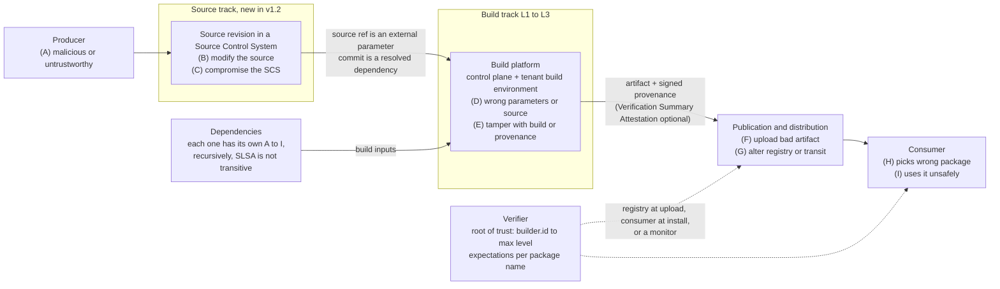

# The SLSA Framework: Threat Taxonomy, Build Track, and Source Track

> [!summary] Claim:
> SLSA v1.2 (approved 2025-11-24) is a threat model of nine lettered threats, A through I, laid along one path from producer to source, build, publication, distribution, and use, plus two tracks of levels that answer those threats with evidence: a Build track (L1 provenance exists, L2 hosted and signed, L3 isolated and unforgeable) and a Source track.
> A level describes one artifact's own build and says nothing about its dependencies, and it protects nobody until a verifier compares the artifact's provenance to expectations bound to a package name, using a root of trust that maps each `builder.id` to the highest level that verifier will believe.
> The L2 versus L3 line is about who you must trust: at L2 the control plane signs provenance but a tenant's build steps may still reach the signing material or other builds, and at L3 the platform itself guarantees isolation, so you trust the platform instead of each project.
> Provenance is evidence of what a platform observed, not a verdict that the build was benign, which is exactly the gap the May 2026 Mini Shai-Hulud npm compromise exposed.



## The Mechanism

SLSA, pronounced "salsa", is a specification, not a product.
It defines a vocabulary, a threat model, requirements on producers and platforms, and two attestation predicates.
It does not scan code, sign anything, or block anything by itself.
Every concrete claim in this note comes from the SLSA v1.2 specification pages listed in `sources:` unless another source is named.

### 1. Lineage and what v1.2 contains

| Version | Date | What changed |
| :--- | :--- | :--- |
| v0.1 | 2021 preview (the v1.0 announcement of 2023-04-19 places it "almost two years" earlier) | One unnamed track with levels 1 to 4, mixing source and build requirements, including hermetic and reproducible builds at the top level |
| v1.0 | 2023-04-19 (final) | Source aspects removed to focus on a Build track of L1 to L3; provenance format refactored (`parameters` to `externalParameters`, `materials` to `resolvedDependencies`) |
| v1.1 | 2025-04-21 (Approved) | Clarifications, a procedure for verifying VSAs, `verifier.version` in the VSA, refined threat model; backwards compatible with v1.0 |
| v1.2 | 2025-11-24 (Approved) | Adds the Source track, extends the threat model to cover it, restructures the spec for multiple tracks; RC2 (2025-11-10) became final with no further changes |

The v1.2 announcement states that development continues on a Build Environment track and a Dependency track.
The "Future directions" page keeps a Build L4 and a Platform Operations track as ideas only, and lists what v0.1's level 4 required (pinned dependencies, hermetic builds, all dependencies listed in provenance, reproducible builds) as candidates, not commitments.
Nothing above L3 exists in the Build track as of 2026-11 (Both).

SLSA's stated focus is integrity, with availability secondary.
It splits integrity in two.
Source integrity means a source revision reflects the producer's intent and was not modified after acceptance.
Build integrity means the package was built from the correct, unmodified sources and dependencies according to the producer's recipe, and artifacts were not altered between stages.
Availability means the package can still be built later and the code and change history stay available for investigation.

SLSA says plainly what it does not cover:

- Code quality: whether the authors followed secure coding practices.
- Producer trust: organizations that intentionally ship malware (threat A), although it can reduce insider risk inside a producer you trust.
- Transitive trust: the level of an artifact is independent of the level of its dependencies, and there is no single level that covers an artifact plus its whole dependency closure.

The FAQ gives the reason for non-transitivity: if a level required dependencies at the same level, reaching it would mean starting at the very beginning of the supply chain and working forward, which forces work on the least risky component first and blocks progress downstream.
Independent ratings let teams progress in parallel and prioritize by risk, and the FAQ notes this is a lesson from deploying other controls at scale at Google.

### 2. The vocabulary the requirements are written in

The spec models a supply chain as a directed acyclic graph of sources, builds, dependencies, and packages.
One artifact's supply chain is its dependencies' supply chains plus its own sources and builds.

| Term | Meaning in SLSA |
| :--- | :--- |
| Artifact | An immutable blob of data: a file, a git commit, a container image, a firmware image |
| Source | An artifact directly authored or reviewed by persons, without modification; the beginning of the chain, which SLSA does not trace back further |
| Build | A process that transforms input artifacts into output artifacts |
| Package | An artifact that is distributed; always the output of a build, even if that build is a no-op, so a zip of source code is a package, not a source |
| Dependency | An artifact that is an input to a build but is not a source; always a package |
| Attestation | An authenticated statement (metadata) about one or more artifacts |

The roles are producer, verifier, consumer, and infrastructure provider; one party can hold several.

#### The build model

A build runs on a multi-tenant build platform where each execution is independent.
The terms that every Build requirement uses:

| Term | Meaning |
| :--- | :--- |
| Platform | The transitive closure of software, hardware, people, and organizations that must be trusted to execute the build faithfully |
| Admin | A privileged user of the platform who could tamper with builds or the control plane |
| Tenant | An untrusted user who defines the build steps and the external parameters |
| Control plane | The platform component that orchestrates each build and produces provenance; managed by the admin and trusted to be outside the tenant's control |
| Build environment | The isolated execution context initialized by the control plane; for a distributed build, the collection of all machines, containers, or VMs that run steps |
| Build caches | Platform-managed intermediate storage mapping intermediate artifacts to their explicit inputs; shared with later builds |
| External parameters | The top-level independent inputs, set by the tenant, that the control plane uses to initialize the build |
| Dependencies | Artifacts fetched during initialization or execution: configs, source artifacts, build tools |

The model has no formal notion of "source".
The reference to a git repository is an external parameter, and the repository content is a dependency.
That choice is why provenance records `externalParameters` (what was asked for) and `resolvedDependencies` (what it resolved to, for example the commit) as separate fields.

The spec asks you to avoid three ambiguous words.
"Build recipe" and "builder" are avoided in favor of "external parameters" and "build platform", with `builder` surviving only as a provenance field name.
"Package repository" is avoided because it can mean a registry or a package name, so "repository" always means a source repository.

#### The distribution model

A consumer resolves a mutable package name to an immutable package artifact by asking a registry.
The registry is whoever has the power to change which artifacts consumers accept for a name, so if consumers only accept packages signed by a given key, access to that key is the registry.
SLSA says the package name is the primary security boundary of an ecosystem and the primary unit it protects: expectations attach to package names, while provenance attaches to artifacts.
The terminology page maps ecosystems onto this model, for example Cargo (crate name, registry, artifact), PyPA (project name, index, distribution), npm (package name, registry, package), Go (module path, module proxy, module), and OCI (repository, registry, object).
Go is called out as the odd one: the package name is a source repository URL, and the module proxy acts as both builder and registry, trusted because builds are independently reproducible and a checksum database ensures every client gets the same artifact for a URL.

### 3. The threat taxonomy, A through I

The spec labels threats by where in the pipeline they occur, because priorities and mitigations cluster along that path.
Dependencies are recursive, so every dependency has its own A through I, and so does each dependency of that dependency.
SLSA prioritizes mitigations that can be adopted broadly and automatically, because organizations consume thousands of packages and cannot rely on each team to do the right thing.

| Letter | Threat cluster | SLSA's example | Addressed by |
| :--- | :--- | :--- | :--- |
| A | Producer intentionally produces harmful code | SpySheriff, anti-spyware software that is itself malicious | Not addressed; consumers must establish a basis for trust (open source with an active user base, legal or reputational incentives) |
| B | Adversary modifies the source by following, or bypassing, the official process | SushiSwap, a contractor with repo access pushed a commit redirecting cryptocurrency | Source track (two-party review, history, provenance) |
| C | Source code management system compromised or abused by an administrator | PHP, attacker compromised the self-hosted git server and injected two commits | Source track controls plus trust in the SCS operator |
| D | Build from the wrong source or with the wrong parameters | The Great Suspender, software published that was not built from the purported sources | Build track L1 provenance compared to expectations |
| E | Tampering with the build process or falsifying provenance | SolarWinds, build platform compromised and an implant injected on every build | Build track L2 and L3 |
| F | Upload of an artifact that does not reflect the official source | Codecov, leaked credentials used to upload a malicious artifact to a GCS bucket users download from | Verifier requires provenance matching expectations |
| G | Registry or channel altered, including modification in transit | Researcher-run mirrors of popular registries that could have served malicious packages | Consumer-side verification, optionally via a VSA |
| H | Consumer selects a package it did not intend | Browserify typosquatting; dependency confusion | Dependency confusion: L2+ provenance plus expectations; typosquatting not addressed |
| I | Consumer uses a package unsafely | Default credentials | Not addressed (the spec points to Secure by Design efforts) |

The threats-overview page adds one non-lettered row, "dependency threats", citing event-stream (a malicious binary version published without a corresponding source update), which applying SLSA recursively to dependencies would catch, and an availability example, mimemagic (a producer removing a package version).
The cases that map onto these letters are in [[Case-Study-SolarWinds-Orion-SUNBURST]] (E), [[Case-Study-Codecov-Bash-Uploader-and-TJ-Actions]] (F), [[Case-Study-Event-Stream-and-Maintainer-Handoff]] (the dependency row), and [[Dependency-Confusion-Typosquatting-and-Registry-Attacks]] (H).

#### Source threats in detail (B and C)

Threat B is an adversary without administrator privileges following or bypassing the producer's source process.
The threats page splits it into four families, and tags each mitigation with the Source level that provides it:

| Family | Sub-threat | Mitigation named by the spec | Level tag on the threats page |
| :--- | :--- | :--- | :--- |
| B1 submit without review | Direct push to main; one actor controlling several accounts; a robot account that can submit without review; rule exceptions such as "docs only" (a malicious executable named `help.md`); an admin who disables a control, pushes, then re-enables it | Require approval of all changes, even robot-authored ones; remove exceptions; trust SCS claims only if admins cannot abuse privileges | Source L4 for direct submit; admin abuse is a "verification" item |
| B2 evade change management | Force-push to erase a malicious commit after a release; move a release tag to a malicious commit; skip required checks; modify code after review; submit an unreviewable change (a binary diff); copy a change reviewed in a fork into upstream; commit-graph attacks | Block force pushes; protect tags; enforce checks technically; invalidate approvals on modification; render images and metadata for reviewers; make approvals context-specific; require that every revision in the protected context followed the process | L2+ for history and tags, L3+ for required checks, L4 for the review items |
| B3 render code review ineffective | Two trusted persons colluding; a "bugdoor" that looks benign; rubber-stamping | Not addressed by SLSA; the producer can add friction | None |
| B4 render change metadata ineffective | Forge author or timestamp metadata | Attribute changes only to authenticated identities and record contemporaneous evidence in signed source provenance | L2+ |

The commit-graph attack is worth knowing cold.
An adversary sends a pull request with malicious commit X and a commit Y that undoes X.
The combined diff shows zero malicious lines, so the reviewer never sees X, yet if X becomes reachable from the protected branch it reaches developer machines.
The only fix is that every revision in the protected context followed the full process, meaning one new commit per review or full process per constituent commit.

Threat C covers platform administrator abuse, for example an employee of a hosting service pushing a change with an internal tool, or shipping a malicious server build that serves backdoored sources only to a specific CI client or lets particular users bypass branch protection.
SLSA marks this a "verification" item: consumers should not accept claims from an SCS unless they trust it to constrain its administrators, and a future Platform Operations track may add guidance.
Exploiting a vulnerability in the SCS implementation is "not currently addressed".

#### Build threats in detail (D, E, F, G)

D is addressed by comparing provenance to expectations, so it depends on L1 provenance existing.
Each sub-threat is a different field the verifier compares:

| Sub-threat | Field compared | Example from the spec |
| :--- | :--- | :--- |
| Build from an unofficial fork | Source location in provenance | Built from `evilfork/my-package` instead of `good/my-package` |
| Build from an unofficial branch or tag | Source branch or tag, or reachability from an expected branch | Release tags come from protected `main`, adversary builds `experimental` |
| Build from unofficial build steps | Build configuration source | Google Cloud Build running custom steps supplied over RPC instead of `cloudbuild.yaml` |
| Build from unofficial parameters | All `externalParameters` | `debug.yml` instead of `release.yml`; a `workflow_dispatch` input that sets a compiler flag overriding a macro |
| Modified after checkout | Source repo the platform pulled from | Adversary fetches, commits locally, requests a build from the local commit |

E is the build process itself, and the spec says these threats are directly addressed by the Build track:

| Sub-threat | Level that mitigates | Mitigation and the spec's example |
| :--- | :--- | :--- |
| Forge provenance values other than the output digest | L2+, hardened at L3 | Control plane generates all fields except (optionally) the artifact hash; at L3 the control plane resists even determined adversaries (a worker that breaks out of its container to reach signing material) |
| Forge the output digest | Not a problem | Any build claiming to produce a digest could have produced it by copying it from input to output; the verifier still rejects because the source does not match |
| Compromise the project owner | L2+, completed at L3 | The owner must not influence the build or provenance; example is an SSH debug feature, and at L3 the enumerated external parameters record the access, so verification fails |
| Compromise another build | L3 | Isolate every build; do not run all builds as one Linux user; start each build from a clean image so a swapped `make` cannot persist |
| Steal cryptographic secrets | L3 | Sign in the control plane, not on the worker the adversary controls |
| Poison the build cache | L3 | Key the cache by the transitive closure of inputs, and make entries writable only by the control plane or backed by L3 provenance per entry |
| Compromise the build platform admin | Verification item | Consumers do not accept provenance unless they trust controls against admin abuse (two-person approvals, audit logging) |

The cache example in the spec is concrete: if the cache key is only the digest of `auth.cc`, an adversary can build it with flags that define a macro replacing `CheckAuth(ctx)` with `true`, and later builds of the same file get the poisoned object.
Keying by the file digest, the command line, and the compiler digest fixes that, but a tenant with write access can still observe a legitimate key and write a malicious `auth.o` under it, which is why entries must be control-plane-written or L3-attested themselves.

F and G repeat the same mitigations at different places.
For F the mitigations are: require provenance (L1), check that the subject digest matches the artifact (L1), require a valid signature on provenance (L2), and require that the builder matches expectations.
G differs in who verifies: the consumer, or a registry-issued Verification Summary Attestation.
G adds two threats that exist only with VSAs: a VSA from an untrusted intermediary, and replacing a package together with its valid VSA for a different package.
The second is defeated by checking `resourceUri` against the package you requested rather than the package you received.

#### Usage, dependency, availability, and verification threats

- H dependency confusion: the mitigation is to build internal packages on an L2+ system, define expectations for their provenance, and verify on install, so a public-registry package with an internal name fails verification.
  Typosquatting is not addressed, though the source-availability requirement is a mild deterrent.
- I improper usage is not addressed.
- Build dependency threats: a vulnerable library, a compromised build tool (the spec's example is a backdoored `/usr/bin/tar` that injects into every ELF it writes), and a runtime dependency that is loaded during the build for tests or dynamic linking.
  SLSA's advice is to apply it recursively to build tools and base images, and to isolate tests in an environment without write access to the output.
  Runtime dependencies are otherwise excluded: each is its own artifact with its own threats.
- Availability: deleting the code, a dependency becoming unavailable, delisting an artifact or its provenance; none is addressed, though hermetic and reproducible builds may reduce impact.
- Verification threats: tampering with recorded expectations (require two-party review of changes to them) and hash collisions (use strong digests such as SHA-256).

> [!warning] Pitfall: the spec's pages disagree on two details
> The threats page labels distribution-channel threats G, but the "Verifying artifacts" page says verification by the consumer covers "compromise of the package in transit" under threat I, and that verifying inside the registry does not cover G or I.
> The threats page defines I as unsafe usage that SLSA does not address, so I read the verifying-artifacts text as using stale labels.
> Cite threat letters from the threats page and describe the scenario in words.

### 4. The Build track

#### Levels

| Level | Requirement in one line | What it defends | The spec's own caveat |
| :--- | :--- | :--- | :--- |
| Build L0 | None; the absence of SLSA | Nothing | Meant for development or test builds run on the machine that uses them, such as unit tests |
| Build L1 | Provenance exists and shows how the package was built | Mistakes and documentation | "Trivial to bypass or forge"; provenance may be incomplete and unsigned |
| Build L2 | A hosted platform generates and signs the provenance | Tampering after the build | Forging provenance or evading verification still requires an explicit attack, "though this may be easy"; deters adversaries who face legal or financial risk, such as employees who could be fired |
| Build L3 | A hardened platform: runs cannot influence one another, and signing secrets are not reachable from user build steps | Tampering during the build, including by insiders, compromised credentials, and other tenants | Forging requires exploiting a vulnerability "beyond the capabilities of most adversaries"; it usually needs significant changes to an existing platform |

L0 is a convention for "no level", not a requirement set.
The Build track contains L1 through L3.
Each level implies the ones below it, and the VSA spec says `verifiedLevels` MUST NOT list more than one level per track.

#### Who owes what

| Requirement | Owner | L1 | L2 | L3 |
| :--- | :--- | :--- | :--- | :--- |
| Choose an appropriate build platform | Producer | yes | yes | yes |
| Follow a consistent build process | Producer | yes | yes | yes |
| Distribute provenance | Producer | yes | yes | yes |
| Provenance exists | Platform | yes | yes | yes |
| Provenance is authentic | Platform | no | yes | yes |
| Provenance is unforgeable | Platform | no | no | yes |
| Hosted | Platform | no | yes | yes |
| Isolated | Platform | no | no | yes |

L2 adds a consumer duty as well: validate the authenticity of the provenance.
"Follow a consistent build process" is what makes expectations possible at all, because a verifier can only reject deviations from a pattern it can state; the spec allows explicit metadata (a package ecosystem's configuration file that the producer must keep current) or implicit expectations such as trust on first use.
Producer requirements were larger in draft v0.1 and were removed in v1.0 pending the future-directions work.

#### Provenance generation: completeness, authenticity, accuracy

The spec grades provenance on three axes, and the level sets a minimum on each:

| Axis | L1 | L2 | L3 |
| :--- | :--- | :--- | :--- |
| Completeness (what information is in it) | Best effort; SHOULD be enough to catch mistakes; a few fields MAY be absent if prohibitively expensive | SHOULD be complete; external parameters MAY be incompletely captured; resolved dependencies best effort | SHOULD be complete; external parameters MUST be fully enumerated; resolved dependencies still best effort |
| Authenticity (can it be tied to the builder) | No requirement | Consumers MUST be able to validate it; SHOULD be a digital signature from a private key accessible only to the build platform component that generated it | Same as L2 |
| Accuracy (resistance to tampering within the build) | No requirement | Generated by the control plane, not a tenant; some security control against tenant tampering with no minimum strength | Strongly resistant to forgery by tenants; every field generated or verified by the control plane; the signing secret is in a secure management system, accessible only to the build service account, and not accessible to the environment running user-defined build steps |

L2 has two named exceptions where a tenant may generate content: the names and digests of output artifacts (`subject`), and any field not marked REQUIRED for L2, for example `resolvedDependencies`.
Builders SHOULD document any tenant-generated fields.
L3 adds no new fields beyond L2; it hardens who may write them.
At L2 and above the spec RECOMMENDS signing methods that make key compromise detectable and recoverable, such as transparency logs or timestamping services.
A footnote allows "alternate means of verifying the authenticity of the provenance", so a signature is the usual mechanism, not the only one.
The spec notes that the L3 property was called "non-falsifiable" in draft v0.1 and is now called "unforgeable".

The output digest is tenant-generated on purpose.
A claim of "this build produced digest X" cannot be verified more than by hashing the output, and a malicious build could always have produced X by copying it from its input.
What stops a forged subject is the rest of the provenance: the source and parameters will not match expectations, so the digest is irrelevant.
It also means that provenance is only a claim that an artifact was built, not that it was published to any registry.

#### Isolation strength

"Hosted" means all build steps ran on a hosted platform on shared or dedicated infrastructure, not on an individual's workstation (examples in the spec: GitHub Actions, Google Cloud Build, Travis CI).
"Isolated" (L3) means any external influence on the build was specifically requested by the build itself, and this MUST hold between builds in the same tenant project.
The platform MUST guarantee all five:

1. A build cannot access any secret of the platform, such as the provenance signing key.
2. Two builds that overlap in time cannot influence each other, for example by altering the memory of another build process on the same machine.
3. A build cannot persist or influence the environment of a later build, so each build gets a fresh ephemeral environment.
4. A build cannot inject false entries into a cache used by another build; the output must be identical whether or not the cache is used.
5. The platform does not open services that allow remote influence unless every such interaction is captured as `externalParameters`.

What L3 does not require, in the spec's words, is anything of the build itself.
L3 is "limited to ensuring that a well-intentioned build runs securely": it does not stop a producer from running a risky build, and "Isolated" does not prohibit a build from calling a remote execution service or a self-hosted runner outside the platform's trust boundary.
It is also not "hermetic", which roughly means no network access during the build; that is deferred to future directions because it needs changes to both platform and each build.

The FAQ answers "how do I SLSA with a self-hosted runner" by asking which entities inform the provenance.
The requirements attach to the transitive closure of systems responsible for the provenance:

| Situation | Where requirements land |
| :--- | :--- |
| The platform generates the provenance and only calls a runner for individual items | On the platform only; the runner gets no requirements |
| The runner generates the provenance | On the runner; the orchestrating platform is irrelevant |
| The platform gives the runner credentials to generate provenance, or both contribute fields | On both |

#### The provenance predicate, `https://slsa.dev/provenance/v1`

The predicate describes how an artifact was produced so that consumers can verify it met expectations and others can rebuild it.
The spec calls it the RECOMMENDED way to satisfy the v1.0 provenance requirements; an alternate format MUST carry equivalent information and SHOULD be bidirectionally translatable.
Required at Build L1: `buildDefinition` and `runDetails`; inside them `buildType`, `externalParameters`, and `runDetails.builder.id`.
Everything else is optional.

```json
{
  "_type": "https://in-toto.io/Statement/v1",
  "subject": [{"name": "widget-1.4.0.tar.gz", "digest": {"sha256": "<64 hex chars>"}}],
  "predicateType": "https://slsa.dev/provenance/v1",
  "predicate": {
    "buildDefinition": {
      "buildType": "https://actions.github.io/buildtypes/workflow/v1",
      "externalParameters": {
        "workflow": {
          "ref": "refs/tags/v1.4.0",
          "repository": "https://github.com/acme/widget",
          "path": ".github/workflows/release.yml"
        }
      },
      "internalParameters": {
        "github": {"event_name": "push", "repository_id": "1", "repository_owner_id": "2", "runner_environment": "github-hosted"}
      },
      "resolvedDependencies": [
        {"uri": "git+https://github.com/acme/widget@refs/tags/v1.4.0",
         "digest": {"gitCommit": "<40 hex chars>"}}
      ]
    },
    "runDetails": {
      "builder": {"id": "https://github.com/acme/release-workflows/.github/workflows/build.yml@refs/tags/v2.1.0"},
      "metadata": {"invocationId": "https://github.com/acme/widget/actions/runs/1/attempts/1"}
    }
  }
}
```

This is an illustrative document, not captured output: the field shape comes from the SLSA provenance schema and the GitHub-maintained build type, and every value is a placeholder.

The fields and the rules the spec attaches to them:

| Field | Rule |
| :--- | :--- |
| `buildType` | A TypeURI that identifies the parameterized template and how to interpret parameters; SHOULD resolve to a human-readable spec with schemas and a complete example |
| `externalParameters` | Untrusted tenant inputs; MUST be included and MUST be verified downstream; MUST be complete at L3; the platform SHOULD minimize their size and complexity; verifiers SHOULD reject unrecognized or unexpected fields |
| `internalParameters` | Set by the platform identified by `builder.id`; OPTIONAL and need not be verified downstream; for debugging, incident response, and reproduction; the same field name SHOULD NOT appear in both parameter sets |
| `resolvedDependencies` | Unordered artifacts needed at build time; best effort through L3; if the build script fetches `foo.sh`, which fetches `bar.tar.gz`, both SHOULD be listed; parameters carry the literal values and the digests go here |
| `runDetails.builder.id` | URI naming the transitive closure of the trusted build platform; the sole determiner of the Build level; each operating mode with different security properties MUST have a different id |
| `builder.builderDependencies` | Orchestrator dependencies that do not run in the workload and do not affect the build but may affect provenance generation or security |
| `runDetails.metadata` | `invocationId` (SHOULD be globally unique), `startedOn`, `finishedOn`; nothing required |
| `runDetails.byproducts` | Artifacts not considered output but useful for debugging, such as logs or a digest of the evaluated build configuration |

Four design rules in the provenance spec matter more than they look.

- Parameters hold literal values and dependencies hold digests.
  The spec's example records `repository` and `ref` as parameters and the resolved `gitCommit` as a `resolvedDependencies` entry.
- Move configuration into input artifacts.
  Instead of passing compiler flags as an external parameter that must be verified separately, require the flags to live next to the source or build config, so verifying the repository verifies the flags.
  The verifying-artifacts page adds that a `buildType` whose parameters list a command line to run is impractical to verify, and the better design puts the commands in a versioned file and records only the repository.
- Client-side evaluated configuration breaks verification.
  If a client turns YAML into ephemeral JSON and uploads it, the server cannot tie it to version control.
  The RECOMMENDED fix is to rearchitect the platform to read configuration straight from version control and record the server-verified URI.
- The builder is distinct from the signer.
  "GitHub" may sign provenance for the "GitHub Actions" builder, and "Google" for "Google Cloud Build", but consumers MUST accept only specific signer-builder pairs, so GitHub may not sign for Cloud Build.
  GitHub-hosted runners can be one identity and each self-hosted runner its own, because not every consumer trusts every runner.

Parsing rules inherited from in-toto: consumers MUST ignore unrecognized fields, the `predicateType` URI carries the major version and changes on any breaking change, minor versions are backwards compatible and monotonic, and unset, null, and empty values are equivalent.
Extension fields use `<vendor>_<fieldname>`, never alter the meaning of other fields, and SHOULD follow the monotonic principle: ignoring the extension SHOULD NOT turn a DENY into an ALLOW.

##### The GitHub Actions build type

The GitHub-maintained build type at `https://actions.github.io/buildtypes/workflow/v1` covers only four event types: `create`, `release`, `push`, and `workflow_dispatch`.
It states that it MUST NOT be used for other events, naming `pull_request` and `repository_dispatch` as having complex semantics that may be error prone.
Its three external parameters are `workflow.ref`, `workflow.repository` (HTTPS URI without `.git`), and `workflow.path`.
Its internal parameters carry a `github` object with `event_name`, `repository_id`, `repository_owner_id`, and `runner_environment` (`github-hosted` or `self-hosted`); the numeric IDs exist so a verifier can detect an old name being reused for a new entity after a rename.
`resolvedDependencies` MUST contain the resolved commit for the workflow, with a URI in SPDX download-location form.
`builder.id` is `github.server_url + "/" + github.job_workflow_ref`, which is the reusable workflow when one generated the provenance and the top-level workflow otherwise.
`builder.id` is therefore the field a verifier compares to tell "built by the shared reusable workflow" from "built by the project's own top-level workflow".

#### Attestation layering and distribution

SLSA treats an attestation as an authenticated statement and a generalization of signing: a raw signature carries one implicit bit negotiated out of band and needs a new keyset per meaning, while an attestation carries explicit metadata and the signature only says who made it.
The model has an envelope (message plus signature), a statement (subject plus predicate type), a predicate (arbitrary schema, possibly with links), a bundle (a collection), and storage and lookup conventions.
The recommended suite is a DSSE envelope with ECDSA over NIST P-256 (or stronger) and SHA-256, in-toto statements, a predicate chosen to fit (provenance, SPDX, third-party types), JSON Lines bundles, and storage left "TBD".
The in-toto envelope spec requires `payloadType` to be signed with the payload and take the form `application/vnd.in-toto+<encoding>`, with `application/vnd.in-toto+json` the usual value, and it tells consumers not to trust the media type to identify the predicate and to rely on the statement's `predicateType`.
The internals of statements, DSSE, and layouts belong to [[In-Toto-Layouts-Link-Metadata-and-DSSE-Attestations]], and keyless signing of the envelope belongs to [[Sigstore-Keyless-Signing-Cosign-Fulcio-and-Rekor]].

The "Distributing provenance" page decides how consumers find it:

- Attestations SHOULD be bound to artifacts, not releases, because a release can gain artifacts for new platforms days later, so the set of attestations for a release can grow.
- Ecosystems SHOULD support a one-to-many relationship from artifact to attestations, while SLSA itself cares about the maintainer's build attestations.
- The provenance filename SHOULD relate to the artifact filename; in-toto recommends `<filename>.intoto.jsonl`.
- Producers MUST publish attestations in at least one place and SHOULD publish in more than one: alongside source repository releases (simple, but puts the code host in the critical path), as sidecar files in the package registry (PyPI's `.asc` signature files are the spec's example of the pattern), or elsewhere with a hash recorded in a transparency log such as Rekor.
- The long-term preference is the registry, for trust (clients already trust it) and reliability (it is already on the critical path).
- Attestations SHOULD be immutable once published for an artifact; a change should ship as a new release with new artifacts.
- Ecosystems that install from "source" through an intermediary, such as Homebrew installing GitHub release archives or Go through its module proxy, serve archives that are not bit-for-bit what is in version control.
  The spec treats that transformation as a build, so the intermediary SHOULD provide build provenance.

#### Verification: what the consumer actually does

Provenance does nothing unless someone inspects it.
The "Verifying artifacts" page defines the checks.
Once, the verifier configures roots of trust: a map from (builder public key or Sigstore identity, `builder.id`) to the maximum SLSA Build level it grants that builder.
The spec's example trusts one builder at L3 by fixed public key, trusts a different builder that claims L3 only up to L2, and trusts a Sigstore-authenticated builder identified by a certificate subject-alternative-name pattern for a tagged reusable workflow.
Then, per artifact:

1. Verify the envelope signature against the roots of trust, yielding recognized identities.
2. Verify that the statement's `subject` digest matches the artifact.
3. Verify that `predicateType` is `https://slsa.dev/provenance/v1`.
4. Look up the Build level for the (identity, `builder.id`) pair, defaulting to L1.
5. Compare expectations: the builder identity, the canonical source repository, `buildType`, and `externalParameters`.
   Unrecognized fields in `externalParameters` SHOULD fail verification; a parameter may allow a range of values if every value in the range is safe; plain JSON comparison suffices.
6. Optionally verify `resolvedDependencies` recursively, which the spec says has no requirements in v1.x and needs a trimming heuristic because some transitive dependency is always L0 ("the compiler's compiler's compiler").

The mapping to threats: step 1 and 2 with L2 provenance cover tampering with the artifact or provenance after the build (F); L3 plus a builder you trust covers the build process (E); verification by the consumer or outside the registry covers a compromised registry (G); the expectation comparison covers wrong sources and parameters (D).
L3 does not cover compromise of the platform itself by a malicious insider, so adding a builder to the roots of trust is a trust decision the verifier owns.

Expectations come from one of three models: trust on first use (accept the first provenance, then alert on any difference between consecutive versions, optionally with rules for benign changes); defined by the producer (needs an authenticated channel and protection against unilateral edits, such as two-party control); or defined in source (the package name is bound to a repository and the repository states the rest, which is how Go works).
Verification can run in the package ecosystem at upload (RECOMMENDED when possible, because every client benefits), at the consumer at download or install, or in a monitor that verifies a set of packages and publishes results; the spec says at least one SHOULD be used, and notes that a monitor's detection is of limited benefit unless a human or system acts on it.

The following sketch is the policy half of steps 2 to 5.
It assumes the DSSE signature was already verified by a real library and that `statement` is the decoded payload.
It was executed on darwin-arm64 with the system `python3` to confirm the behavior described in the interview answers; it is not a harness lab and its output is not recorded in an expected file.

```python
import hashlib

TRUSTED_BUILDERS = {  # builder.id -> max Build level this verifier believes
    "https://github.com/acme/release-workflows/.github/workflows/build.yml@refs/tags/v2.1.0": 3,
}
EXPECT = {
    "buildType": "https://actions.github.io/buildtypes/workflow/v1",
    "external": {"workflow": {
        "ref": "refs/tags/v1.4.0",
        "repository": "https://github.com/acme/widget",
        "path": ".github/workflows/release.yml"}},
    "min_level": 3,
}

def verify(statement: dict, artifact: bytes) -> tuple[int, str]:
    if statement.get("_type") != "https://in-toto.io/Statement/v1":
        return 0, "wrong statement type"
    if statement.get("predicateType") != "https://slsa.dev/provenance/v1":
        return 0, "wrong predicateType"
    want = hashlib.sha256(artifact).hexdigest()
    if not any(s.get("digest", {}).get("sha256") == want for s in statement["subject"]):
        return 0, "no subject matches artifact digest"
    pred = statement["predicate"]
    level = TRUSTED_BUILDERS.get(pred["runDetails"]["builder"]["id"], 0)
    if level == 0:
        return 0, "builder.id not in roots of trust"
    bd = pred["buildDefinition"]
    if bd["buildType"] != EXPECT["buildType"]:
        return 0, "unexpected buildType"
    if bd["externalParameters"] != EXPECT["external"]:   # equality rejects unknown fields
        return 0, "externalParameters differ from expectation"
    if level < EXPECT["min_level"]:
        return 0, f"builder trusted only to L{level}"
    return level, "ok"
```

Dict equality on `externalParameters` is deliberate: it enforces "reject unrecognized fields" for free, which is the behavior the spec asks of verifiers and the one most hand-written verifiers skip.
The sketch is also stricter than the spec's step 4, which defaults an unrecognized builder to Build L1: it rejects that builder outright, which is equivalent here because the policy demands L3.
It deliberately does not check `resolvedDependencies`; a production verifier also compares the resolved commit to a Source VSA or a reachability check against the expected branch.

### 5. The Source track (new in v1.2)

The Source track gives producers and consumers increasing trust in how a source revision was created.
The expected process for creating a revision is determined solely by the repository's owner, the organization, which also decides the intent of the software and administers the technical controls that enforce the process.
Consumers review attestations to verify that a given revision meets their standards.
Where the Build track asks "was this artifact built as expected", the Source track asks "was this revision created as expected", and the two meet at the build's `resolvedDependencies` entry for the source commit.

#### Definitions the requirements depend on

| Term | Meaning |
| :--- | :--- |
| Source Revision | A logically immutable snapshot of the tracked files plus metadata (author, timestamp, parents), identified by a revision identifier such as a git commit SHA or a path-qualified number such as `25@trunk/` in Subversion |
| Named Reference | A user-friendly name for a revision, such as `main` or `v1.2.3` |
| Branch | A Named Reference that moves to track a line of development |
| Tag | A Named Reference intended to be immutable; patterns like `latest` and `nightly` that git allows to move are Named References, not Tags, for this spec |
| Change | A modification to the repository state: a new revision, or creating, deleting, or modifying a Named Reference |
| Source Control System (SCS) | The platform or combination of services that hosts the repository and enforces authentication, authorization, and change management |
| Source Provenance | Information about how a revision came to exist: where it was hosted, when it was generated, what process was used, who contributed, and which parents preceded it |

The roles are Administrator (can modify change history and org-wide policy), Trusted person (authorized to propose and approve changes), Trusted robot (automation authorized for explicitly defined contexts whose identity and code cannot be unilaterally influenced), and Untrusted person (may read and propose, may not approve or act privileged).

Onboarding is forward-looking.
When an organization onboards a branch or raises its level, it makes claims about how the branch is managed from that revision forward, and "no claims are made for prior revisions".
This gives continuity a defined origin instead of retroactively blessing history.

#### Levels

| Level | Title | One line | Focus |
| :--- | :--- | :--- | :--- |
| Source L1 | Version controlled | Use a version control system | Discrete revisions for precise consumption |
| Source L2 | History and provenance | Branch history is continuous, immutable, and retained, and the SCS issues Source Provenance Attestations for each new revision | Reliable history through enforced controls and evidence |
| Source L3 | Continuous technical controls | The SCS enforces the organization's technical controls on specific Named References | Consumers know which technical controls are guaranteed |
| Source L4 | Two-party review | The SCS requires two trusted persons to review all changes to protected branches | Code quality and resistance to insider threats |

The v1.2 "What's new" page records that between RC1 and the final release the Source levels were reorganized so that L2 focuses on history and provenance and L3 on continuous enforcement of technical controls.

> [!warning] Pitfall: the published v1.2 text disagrees with itself about how many Source levels exist
> The "Source: Requirements" page, and the same file at git tag `v1.2`, define four levels in its tables and requirement matrix, with L4 being two-party review.
> The same page's Source VSA section says `verifiedLevels` MUST contain "one of `SLSA_SOURCE_LEVEL_0`, `SLSA_SOURCE_LEVEL_1`, `SLSA_SOURCE_LEVEL_2`, `SLSA_SOURCE_LEVEL_3`", while the generic VSA page lists `SLSA_SOURCE_LEVEL_4` in its `SlsaResult` examples.
> The RC1 file has the same L0 to L3 enumeration, so this is a spec text inconsistency, not a rendering artifact.
> The Verified Properties page offers a way around it: `SLSA_SOURCE_TWO_PARTY_REVIEWED` MAY be added at any source level where the SCS can make the claim.
> Until the text is reconciled, a verifier should demand explicit strings it understands (`SLSA_SOURCE_LEVEL_3` plus `SLSA_SOURCE_TWO_PARTY_REVIEWED`) and treat an unknown `SLSA_SOURCE_LEVEL_N` as a reject, not a pass.

A second inconsistency is smaller.
"Verifying source" says that at Source L3+ the SCS issues detailed provenance, but the requirements matrix requires Source Provenance from L2.
The matrix is the normative table, so I follow it.

#### Requirements matrix

Organization requirements:

| Requirement | L1 | L2 | L3 | L4 |
| :--- | :--- | :--- | :--- | :--- |
| Choose an SCS capable of the desired level | yes | yes | yes | yes |
| Configure the SCS to control access and enforce history | no | yes | yes | yes |
| Safe expunging process | no | yes | yes | yes |
| Continuous technical controls | no | no | yes | yes |

SCS requirements:

| Requirement | L1 | L2 | L3 | L4 |
| :--- | :--- | :--- | :--- | :--- |
| Repositories are uniquely identifiable (stable locator such as a URI) | yes | yes | yes | yes |
| Revisions are immutable and uniquely identifiable | yes | yes | yes | yes |
| Human readable changes (diff tooling; SHOULD render non-text) | yes | yes | yes | yes |
| Source Verification Summary Attestations | yes | yes | yes | yes |
| History | no | yes | yes | yes |
| Continuity | no | yes | yes | yes |
| Identity management | no | yes | yes | yes |
| Source Provenance | no | yes | yes | yes |
| Protected Named References | no | no | yes | yes |
| Two-party review | no | no | no | yes |

The ones with mechanisms worth knowing:

- **Access and history.**
  Access controls MUST use the SCS's identity management, for example a maintainers role that alone may update `main`.
  If the SCS supports Tags it MUST be configured to prevent them being moved or deleted; evidence of that continuity appears in the provenance for the tagged revision.
- **History.**
  The SCS MUST record every change to a Named Reference, with time, actor, and new revision ID, and for ancestry-based systems a branch may only move to a descendant of its current revision.
  For git the spec says this requires a technical control that prohibits `git push --force`.
  If a branch points at `a`, it may move to `b` only if `a` is an ancestor of `b`.
- **Continuity.**
  A technical control only counts if it applied to every revision since a stated start revision.
  The spec's example: `main` points at `a` when control `t` is configured; the next revision `b` is the first protected by `t` and starts `t`'s continuity; any revision added while `t` is disabled resets continuity of `t` from a new start revision.
  This is the clause that defeats the admin who removes branch protection, pushes, and re-enables it, because the push breaks continuity and the gap is visible in the evidence.
  The only exception is the safe expunging process.
- **Safe expunging.**
  An SCS MAY let the organization remove content and history without a public record, but only for legal or privacy compliance, with a documented process, tracked requests, and SHOULD require an administrator plus one more trusted person.
  The spec warns that removing a revision is like deleting a registry version: in git every revision ID depends on its ancestors, so every descendant gets a new ID, and consumers who depend on the old IDs may be stranded.
- **Protected Named References.**
  The SCS MUST let the organization mark which references are protected (the spec's examples are `main` and `refs/heads/releases/*` but not `refs/heads/experimental/*`, and tag protection on `refs/tags/releases/*`), MUST record the enforced controls in contemporaneous attestations tied to the revisions, MUST let the organization add properties to the Source VSA, and MUST prevent such properties from starting with anything other than `ORG_SOURCE_`.
- **Identity management.**
  The SCS MUST identify and authenticate actors, MUST let the organization say which actors and roles may do sensitive actions, and MUST document how actors are identified for attribution.
  The spec accepts hosted identity (GitHub, GitLab), cryptographic signatures (it cites gittuf for managing actor public keys), or an enterprise directory.
  The guiding principles add that SLSA does not require legal identities, so pseudonymous contributors are supported.
- **Two-party review (L4).**
  Changes to protected branches MUST be agreed by two or more trusted persons before submission, either uploader plus a different reviewer or two different reviewers.
  It applies to the final revision submitted, so later changes in review must be reviewed again.
  Approvals are context-specific (a repo plus a branch), so moving fully reviewed content to another context still needs review, though well-understood automatic merges such as cutting a release branch are not precluded.
  The SCS MUST show reviewers a clear representation of the result of accepting the change.
  An organization MAY grant a Trusted Robot a perpetual exception, for example import and migration bots or Dependabot.

#### Source attestations

Source attestations come in two kinds.
A Source Verification Summary Attestation (Source VSA) is standardized and says which level a revision meets.
Source provenance attestations are deliberately left undefined: GitHub-based, Gerrit-based, and Subversion-based workflows produce different evidence, so the SCS documents its own formats and how each supports the VSA's claims.
The spec lists example kinds a source provenance might take: parents and actors, code review, authentication, vulnerability scan, test results, SPDX, and SCAI.

The Source VSA uses the generic VSA predicate with these rules:

| Field | Rule |
| :--- | :--- |
| `subject.digest` | MUST include the revision identifier (for git, `gitCommit`); MAY include other digests such as `gitTree` or `dirHash`; SCSs without cryptographic digests MUST define a canonical type including the repository |
| `subject.uri` | SHOULD point a human at details; not for policy decisions |
| `subject.annotations.sourceRefs` | SHOULD list the references that pointed at the revision when the attestation was made; the list MAY be non-exhaustive; git refs MUST be fully qualified (`refs/heads/main`) |
| `resourceUri` | MUST be the repository URI, preferably SPDX download-location form such as `git+https://github.com/foo/hello-world` |
| `verifiedLevels` | MUST include the SLSA source level asserted; only the highest level met; may include `ORG_SOURCE_` properties, and `ORG_SOURCE_INTERNAL_` marks ones not for external consumers |
| `dependencyLevels` | MAY be empty, since revisions are usually terminal; could report submodule levels |

An SCS that does not generate a VSA for a revision means that revision is Source Level 0.
At L1 and L2 the SCS MAY issue VSAs from its understanding of the system (design docs, security reviews), while at L2 and above it MUST base them on the SCS-issued source provenance.
The issuer chooses how to populate `sourceRefs`, for example one VSA per merged pull request listing the destination branch, or one per update of a Named Reference; downstream users are expected to know which method the issuer uses.

#### Verifying source

The consumer checks three things, with a root-of-trust map from (SCS identity, VSA `verifier.id`) to the maximum Source level that SCS is trusted for:

1. The SCS that issued the VSA is trusted, and the VSA applies to the revision fetched (signature, `subject.digest`, `verifier.id`).
2. The VSA's claims match expectations: `verifier.id`, `subject.digest`, `verificationResult`, `resourceUri`, `subject.annotations.sourceRefs`, and `verifiedLevels`.
   The `sourceRefs` check stops an adversary from presenting a revision that only exists on an experimental branch as if it were on `release`, and the `resourceUri` check stops substitution of a VSA for a different repository.
3. Optionally, the evidence in the source provenance matches the VSA's claims, as expected claims about the SCS's own format.

Expectations are formed by trust on first use or by the producer, and are tied to a branch or tag while a VSA is tied to a revision.
Verification can occur in the build system at source fetch time, in the package ecosystem at artifact upload, at the consumer, or in a monitor; at least one SHOULD.
The example root-of-trust entry in the spec trusts a tagged reusable workflow in `slsa-framework/slsa-source-poc` as a Sigstore-authenticated SCS identity at Source L3; I did not assess that project's maturity.

#### Example controls beyond the levels

At Source L3 and above, organizations are encouraged to add their own controls, and the "Example controls" page gives six patterns.
Consumers detect them by `ORG_SOURCE_` properties in `verifiedLevels`.

| Control | The mechanism and why it exists |
| :--- | :--- |
| Expert code review | Every portion of the source has named experts, and a change needs approval from a member of the expert set for each portion it touches |
| Review every single revision | Any modification after approval revokes all approvals; a new approval from all required reviewers is needed, though a previous approver may re-approve |
| Automated testing | Branch protection requires passing test results; tests SHOULD run in a trustworthy environment (the Build track) against the proposed merge commit, not the topic branch tip |
| Every revision reachable from a branch was approved | Reviewers normally see only the net diff against the merge base; a standard merge commit makes every topic-branch commit reachable through the second parent, and `git clone` fetches them, so an attacker can have a victim run `git clone` then `git reset --hard <unreviewed id>`; the control is squash or rebase merges producing a single new single-parent commit from the reviewed diff, never replaying the topic commits |
| Immutable change discussion | The SCS records the description and discussion, links it to the revision (usually via commit metadata), and makes it immutable once accepted |
| Merge trains | A buffer branch collects approved changes; at 60 merges per hour the main branch tip is stable for about 1 minute, too short for review; the cost is that the final revision ID is not known until the train completes, so the SCS MUST attest that the train's result is identical ("MERGESAME" in git terms) to applying each approved change in sequence, with nothing added or removed |

#### Assessing a source control system

The "Assessing source control systems" page lists adversary profiles (project contributors, maintainers, SCS administrators) and five components to evaluate: control configuration, the change management interface, the control plane, the verifier, and storage, with technical controls described in a section of their own.
Its prompts include how the SCS stops maintainers from tampering with configured controls, how it stops SCS administrators from doing so, how many staff can influence revision creation or VSA generation, how secrets are held and rotated, and, for the SCS's own supply chain, the spec's example of "SLSA Build L3+ provenance, built from SLSA Source L4+ source".
That last phrase is further evidence that L4 is intended to exist despite the VSA enumeration.
Organizations can self-attest with evidence published on the internet or seek third-party certification, whose evidence need not be public.

### 6. Verification Summary Attestations

A VSA says that some verifier evaluated an artifact and a bundle of attestations against a policy and reached a result.
Users who trust the verifier can skip evaluating the attestations themselves.
It also lets a producer keep pipeline details confidential, for legal reasons (a supplier that cannot be named) or security reasons (an embargoed patch), while still communicating that verification happened.
The predicate type is `https://slsa.dev/verification_summary/v1`.

| Field | Required | Meaning and rules |
| :--- | :--- | :--- |
| `verifier.id` | yes | URI of the verifier; consumers MUST accept only specific (signer, verifier) pairs, so GitHub may sign for the GitHub Actions verifier but not for Google Cloud Deploy |
| `verifier.version` | no | Map of component names to versions (added in v1.1) |
| `timeVerified` | no | Timestamp; optional since v1.1 |
| `resourceUri` | yes | Where the producer expects the consumer to fetch the artifact; if set to something else, the producer must communicate the expected value out of band |
| `policy` | yes | `uri` MUST be present; `digest` SHOULD be present (v1.1) to pin the exact policy version |
| `inputAttestations` | no | Attestations used; if non-empty, MUST list all of them, each with a `digest` and ideally a `uri` |
| `verificationResult` | yes | `PASSED` or `FAILED` |
| `verifiedLevels` | yes | Highest level per track plus verified properties, or `FAILED`; at most one level per track; strings `SLSA_<TRACK>_LEVEL_<N>` or `SLSA_<TRACK>_LEVEL_UNEVALUATED`; custom values MUST NOT start with `SLSA_` |
| `dependencyLevels` | no | Map from level string to count of transitive dependencies verified at that level, each dependency counted once at its highest level |
| `slsaVersion` | no | `<MAJOR>.<MINOR>`; defaults to an unspecified 1.x |

`dependencyLevels` has three states that are easy to confuse: an absent level means zero at that level, a set but empty object means the artifact has no dependencies at all, and an unset or null object means the verifier makes no claim about dependencies.
A VSA can establish dependency levels either by recursively verifying each non-source dependency from `resolvedDependencies`, or by matching each one (`subject.digest` equals the dependency digest, ideally `resourceUri` equals the dependency URI) to a VSA for it and reading that VSA's `verifiedLevels` and `dependencyLevels`.

To consume a VSA the spec requires seven checks:

1. The signature on the envelope verifies against a preconfigured root of trust.
2. `subject` matches the artifact digest.
3. `predicateType` is the VSA type.
4. `verifier.id` matches the key used in step 1.
5. `resourceUri` matches the expected value.
6. `verificationResult` is `PASSED`.
7. `verifiedLevels` contains the expected value.

The spec's warning is that a VSA does not protect against compromise of the verifier, such as a malicious insider, so adding a verifier to the roots of trust is itself a trust decision.
The spec's examples show two consumption patterns.
One is a full delegation, analogous to code signing, where `verifiedLevels` must contain `SLSA_BUILD_LEVEL_UNEVALUATED` and the value is "arbitrary but prenegotiated".
The other is a rule such as "must have a passing VSA from verifier V at Build Level 2 or higher", which the spec says mitigates the same threats as verifying the provenance directly.

#### Verified properties

Levels do not fit every control, so the spec defines named properties that can sit in `verifiedLevels` next to a level:

| Property | Meaning | Constraint |
| :--- | :--- | :--- |
| `SLSA_SOURCE_TWO_PARTY_REVIEWED` | Source reviewed by two trusted persons | MUST only be issued under the Source track's two-party-review requirement; MAY be added at any source level where the SCS can claim it |
| `SLSA_BUILD_REPRODUCED` | Artifact reproduced by two or more builders | MUST only be issued if the artifact has build provenance from two or more independently operated build platforms trusted by the VSA issuer |

The page is served at `/spec/v1.2/verified-properties` with status Approved, but it is absent from the `docs/spec/v1.2/` tree at git tag `v1.2` (as of 2026-11).
The working-draft copy on `main` (marked "Draft (v1.3)") rewrites `SLSA_BUILD_REPRODUCED`: each platform must produce its own attestation with an identical output digest, no minimum Build level or provenance format is required, and the attestations must appear in `inputAttestations`.

The FAQ treats reproducibility with care.
"Reproducible" means the same inputs give bit-for-bit identical output; "verified reproducible" means two or more independent platforms corroborate the provenance.
It can satisfy all Build requirements but is not required, because it does not address source, dependency, or distribution threats, rebuilders must be truly independent (identical pipeline software shares an exploitable bug), and closed-source builds would need multiple independent in-house rebuilders.
The mechanics of determinism belong to [[Reproducible-Builds-as-a-Security-Control]].

### 7. Auditing a build runner against build-time code injection

"Build-time code injection" is any path by which attacker-controlled bytes reach the build's output or the provenance without being named in the provenance.
SLSA's assessment page gives the method: assume one of three adversaries, then walk five components of the platform asking what each can reach.

| Adversary | Capabilities the spec grants |
| :--- | :--- |
| Project contributor | Create builds; modify the external parameters and environment of builds they control and run arbitrary code in them; read and fork the source repo; build from a modified fork |
| Project maintainer | Everything a contributor can, plus create builds under the target project's identity, modify the target source repo and build from it, and modify the target build's configuration |
| Platform administrator | Everything a maintainer can, plus run arbitrary code on the platform, read and modify network traffic, access the control plane's secrets, and remotely access build environments (for example over SSH) |

The five components are external parameters, the control plane, build environments, caches, and output storage.
The L3 requirements are written against the first two adversaries.
The third is a verification item: the spec asks consumers to assess how a platform constrains its own administrators (two-person approvals, audit logging) rather than making that an L3 MUST, which is why the verifier chooses which platforms to trust.

The table converts the L3 text into evidence an auditor can collect and a probe an auditor can run.
The probes are my construction from the requirement text and the spec's examples; the spec supplies the questions, not the tests.

| L3 property | Evidence to ask for | Probe | Failure the spec or a real incident shows |
| :--- | :--- | :--- | :--- |
| Signing secret unreachable from user steps | Where the signing key or signing-identity token lives, which process holds it, and which job or VM signs | From an ordinary build step, try to read environment variables, files, the instance metadata endpoint, and the memory of sibling processes for anything that can sign | Mini Shai-Hulud: an ambient OIDC token was scraped from runner process memory and used to publish and sign |
| Provenance generated by the control plane | A diagram naming which component writes each provenance field and which fields a tenant can supply | Run a build that sets a parameter or log line to look like a provenance field and confirm it never appears in the signed statement | Spec example: a worker that breaks out of its container reaches signing material |
| No cross-build influence while overlapping | The isolation technology (VM, container, sandboxed process) and what two concurrent builds share | Start two builds on one pool, have one write to shared paths, memory, and loopback services and check the other | Spec example: all builds as the same Linux user on one machine, one swapping source files under another |
| No persistence to the next build | Runner lifecycle: is each build a fresh VM or image | Build 1 writes a marker and replaces a tool such as `make`; build 2 on the same pool looks for both | Spec example: a replaced `make` binary surviving into a later benign build; GitHub's documentation, as quoted in the generator design, says each job on a GitHub-hosted runner runs in a fresh VM, which is the property the generator design relies on, while self-hosted runners need this proven |
| No cache poisoning | What keys the cache, who can write entries, and whether entries carry provenance | From the least trusted trigger the platform allows, write an entry under the key a release build will read, then run the release build and diff output with and without the cache | Spec example: a key of only the source digest; real incident: a fork-triggered run poisoned a package store a release run later restored |
| No remote-influence services | Listening ports and remote-execution hooks in the build environment | Scan the environment from outside during a build; list every interactive feature (SSH debugging, remote shells) | Spec example: SSH into a running build, which must then appear in `externalParameters` or fail verification |
| `externalParameters` complete | An enumerated list of every channel by which a tenant can change a build | Vary each channel in turn (input values, variables, trigger type, config path) and check the signed `externalParameters` changes; any silent channel fails | Spec example: a `workflow_dispatch` input that overrides a compiler macro |
| Output storage separation | Authorization model on output storage | Have build A try to read and overwrite build B's artifact and provenance | The assessment prompt: how are builds prevented from reading or overwriting another build's files |
| Build tools and base images verified | Provenance or VSAs for the runner image and toolchain, checked before the build | Replace a tool in a test image and confirm the platform refuses to start the build | Spec example: a backdoored `tar` that injects into every ELF it writes |

On GitHub, the generator's design document explains the isolation it relies on.
Maintainers define the workflow, so they could interfere with a builder through environment variables, steps, services, and defaults, which propagate to jobs in the workflow.
A reusable workflow avoids those channels: the caller can interact with it only through its declared inputs, with no extra steps and no env variables.
A reusable workflow can use separate jobs for building and for generating provenance, each on its own fresh VM, with data exchanged through artifacts whose integrity is protected by hashes that pass over the trusted job-output channel.
Its stated trust base is GitHub (executing the expected code, integrity of data between job VMs, isolation of defaults and environment variables between caller and reusable workflows, OIDC token issuance), Sigstore (ephemeral signing keys, Fulcio authentication), and the generator workflow itself.
A verifier of a self-hosted runner's output has no guarantee about the code it ran unless it also trusts that runner.

GitHub's own documentation of the L3 path follows the same logic.
Artifact attestations by themselves give SLSA v1.0 Build L2, and a build inside a reusable workflow that many repositories share can meet Build L3, with both the calling and the reusable workflow granted `attestations: write`, `contents: read`, and `id-token: write`.
The SLSA blog's reading is blunt about what this does: developers must invoke a shared reusable workflow rather than author their own, which "shifts trust from each individual developer to whoever controls that shared workflow", so "the trust root moves rather than disappears".

#### Case: Mini Shai-Hulud, 2026-05-11

The advisory GHSA-g7cv-rxg3-hmpx (CVE-2026-45321) records that between about 19:20 and 19:26 UTC on 2026-05-11, 84 malicious versions across 42 `@tanstack/*` npm packages were published, each affected package receiving exactly two.
The publishes were authenticated through the legitimate GitHub Actions OIDC trusted-publisher binding, and the publish workflow itself was not modified.
The attacker chained three known classes: a `pull_request_target` "Pwn Request" workflow that ran fork code in the base repository's context, GitHub Actions cache poisoning across the fork and base boundary, and extraction of the OIDC token from the runner process's memory.
The SLSA community's post reports that the resulting npm provenance attestations accurately named the builder, the repository, and the workflow at `refs/heads/main`, and were "indistinguishable from attestations on legitimate packages".
It argues that npm's built-in provenance gives Build L2 (hosted platform, authenticated provenance) with no isolation requirement, that the incident violated three of the five L3 isolation MUSTs (cache poisoning, secret access, persistence), and that an L3 platform would have blocked the primary vector.
It also says what no level fixes: the `pull_request_target` misconfiguration is outside SLSA's scope, and once attacker code runs inside a trusted workflow the evidence is accurate and the build is still not what the producer intended.
The blog notes that both publishing runs ended with `status: failure` yet published, so monitoring for publish events from failed workflow runs would have flagged it within minutes.
The post is a community author's analysis, not a spec requirement, and its L3-would-have-prevented claim is an argument, not a measurement.
The victim-side facts (payload, detection, versions) are in the advisory, and the registry-worm family is owned by [[Case-Study-Shai-Hulud-and-Self-Replicating-Registry-Worms]].
The workflow-level hygiene that would have removed the entry point (trigger choice, permissions, cache scope, pinning) belongs to [[OpenSSF-Scorecard-and-CI-CD-Pipeline-Hardening]] and [[Audit-and-Harden-a-GitHub-Actions-Release-Pipeline]].

### 8. Tooling and ecosystem status (as of 2026-11)

| Tool or service | Level and role | Status as fetched 2026-11-21 | Verify with |
| :--- | :--- | :--- | :--- |
| GitHub artifact attestations (`actions/attest`; `actions/attest-build-provenance` v4 is a wrapper) | Build L2 alone; L3 with a shared reusable workflow, per GitHub docs | Current; public repositories use the Sigstore public-good instance and write to a public log, private repositories use GitHub's own Sigstore instance with no transparency log and federation only with GitHub Actions | `gh attestation verify` |
| `slsa-github-generator` | Generic, container, and language builders that generate L3 provenance through reusable workflows | README says "no longer actively maintained"; latest release v2.1.0 from February 2025; existing provenance stays valid | `slsa-verifier` |
| `slsa-verifier` | Verifies provenance from the generator, from npm, and from Google Cloud Build containers | Also "no longer actively maintained"; README points GitHub users to `gh attestation verify` | itself |
| npm provenance | Build L2 per the SLSA community post | `npm publish --provenance` needs `id-token: write` and a cloud-hosted runner on GitHub Actions or GitLab CI/CD; trusted publishing generates provenance automatically | `npm audit signatures` (documented under "Verifying provenance attestations" in the npm docs), or `slsa-verifier verify-npm-package` |
| PyPI attestations (PEP 740, Final, resolved 2024-07-17) | Accepts two predicates per file, SLSA Provenance and PyPI Publish; more than two or repeated predicates are rejected | Trusted Publisher identities that can attest: GitHub Actions, GitLab CI/CD, Google Cloud; `pypa/gh-action-pypi-publish` generates and uploads them by default | PyPI (which displays attestations) and the `pypi-attestations` library and CLI |
| crates.io | Trusted Publishing via OIDC and short-lived tokens, announced 2025-07, GitHub Actions only at that time | This is publish authentication, not SLSA provenance; I found no crates.io feature that hosts or serves provenance attestations (the Cargo team closed its SLSA integration request on 2025-05-06 as needing an RFC, and the crates.io tracker's open issue 6397 only proposes surfacing security information in the UI) | n/a |

The `slsa-github-generator` status matters for migration planning: its reusable-workflow design backed the L3 claims of the projects its README lists, and GitHub's own guidance now points to artifact attestations, which changes how consumers verify (with `gh attestation verify` instead of `slsa-verifier`).
The generator also has sharp edges worth knowing if you inherit one.
It MUST be referenced by an exact `@vX.Y.Z` tag, not a short tag or a commit hash, which is why pinning it by digest, a normal hardening rule, does not work and renovation tooling needs special configuration.
It writes an entry to the public Rekor instance that includes the repository name, so private repositories get an error unless `private-repository: true` is set and the leak is accepted.
Its generic workflow supports `schedule`, `push`, `release`, and `workflow_dispatch`, and not `pull_request`.

Commands from the documentation, not run for this note:

```sh
# GitHub artifact attestations: the provenance must come from this repository's workflows
gh attestation verify ./widget-1.4.0.tar.gz --repo acme/widget

# Require a specific shared workflow as the signer (the L3 pattern)
gh attestation verify ./widget-1.4.0.tar.gz -o acme \
  --signer-workflow acme/release-workflows/.github/workflows/build.yml

# slsa-verifier for generator provenance: bind source repo and release tag
slsa-verifier verify-artifact widget --provenance-path widget.intoto.jsonl \
  --source-uri github.com/acme/widget --source-tag v1.4.0
```

`gh attestation verify` requires either `--owner` or `--repo`, which both say where to fetch the attestation and which workflow signed it; `--signer-repo` and `--signer-workflow` narrow the signer when it differs from the caller.
Its help text (gh 2.105.0, as of 2026-11) warns that `--repo` and `--owner` are compared only with the names recorded when the attestation was made, so it cannot detect a rename or a different repository now holding that name; the build type's numeric `repository_id` and `repository_owner_id` exist for that check.
`slsa-verifier` supports only GitHub URIs in `--source-uri`, and for a container it wants an immutable digest reference so that a tag cannot move between verification and use, a time-of-check to time-of-use gap that its README spells out.
For commit-level checks it recommends `--print-provenance` and inspecting the SHA yourself.

## Commands and Numbers to Know

| Item | Value | Platform and date | What it controls |
| :--- | :--- | :--- | :--- |
| Current spec | v1.2, Approved 2025-11-24; v1.1 is Retired; v1.2 is backwards compatible with v1.1 | Both (as of 2026-11) | Which requirements apply |
| Build levels | L1, L2, L3; L0 means none; no L4 defined | Both (as of 2026-11) | Provenance exists, hosted and signed, hardened |
| Source levels | L1 to L4 in the requirement tables; VSA text enumerates L0 to L3 | Both (as of 2026-11) | Version control, history and provenance, continuous controls, two-party review |
| Provenance predicate | `https://slsa.dev/provenance/v1` | Both (as of 2026-11) | Resolves to the latest minor version; use the string, not the URL bar |
| VSA predicate | `https://slsa.dev/verification_summary/v1` | Both (as of 2026-11) | Verification Summary Attestation |
| Statement type | `https://in-toto.io/Statement/v1` | Both (as of 2026-11) | Wrapper naming subject and predicate type |
| Envelope payload type | `application/vnd.in-toto+json` (or `application/vnd.in-toto.<predicate>+json`) | Both (as of 2026-11) | DSSE `payloadType`; `payload` is a base64 JSON Statement |
| Recommended signature suite | DSSE with ECDSA over P-256 or stronger and SHA-256 | Both (as of 2026-11) | The spec's recommended envelope |
| Provenance fields required at L1 | `buildDefinition.buildType`, `buildDefinition.externalParameters`, `runDetails.builder.id` | Both (as of 2026-11) | Minimum valid provenance |
| Provenance timestamp format | RFC 3339 in UTC ("Z"), fractional seconds allowed, for example `1985-04-12T23:20:50.52Z` (in-toto `field_types.md`) | Both (as of 2026-11) | `startedOn`, `finishedOn`, VSA `timeVerified` |
| L3 isolation MUSTs | 5 (secrets, concurrent builds, persistence, cache poisoning, remote services) | Both (as of 2026-11) | What "Isolated" means |
| Provenance filename | `<artifact>.intoto.jsonl` recommended by in-toto | Both (as of 2026-11) | Mapping artifact to attestation |
| `SlsaResult` strings | `SLSA_<TRACK>_LEVEL_<N>`, `SLSA_<TRACK>_LEVEL_UNEVALUATED`, `FAILED`; custom values must not start with `SLSA_` | Both (as of 2026-11) | Contents of `verifiedLevels` |
| Org source properties | `ORG_SOURCE_` (external), `ORG_SOURCE_INTERNAL_` (not for external consumers) | Both (as of 2026-11) | Extra claims in a Source VSA |
| GitHub build type events | `create`, `release`, `push`, `workflow_dispatch` | Both (as of 2026-11) | Events `actions/buildtypes` workflow v1 may describe |
| GitHub permissions for L3 path | `attestations: write`, `contents: read`, `id-token: write` in caller and reusable workflow; add `packages: write` for container images | Both (as of 2026-11) | What the attesting workflow needs |
| `gh attestation verify` | Needs `--owner` or `--repo`; optional `--signer-repo`, `--signer-workflow` | Both (as of 2026-11) | Consumer-side verification of GitHub attestations |
| `slsa-verifier verify-artifact` | `--provenance-path`, `--source-uri` (GitHub only), `--source-tag`, `--source-branch`, `--builder-id`, `--print-provenance` | Both (as of 2026-11) | Generator and npm provenance verification; project unmaintained |
| Generator reference rule | Exact `@vX.Y.Z` tag only | Both (as of 2026-11) | Short tags and hashes fail the build |
| PyPI attestation cap | 2 per file (SLSA Provenance, PyPI Publish) | Both (as of 2026-11) | Upload rejection rule |
| Spec's merge-train arithmetic | 60 merges per hour leaves a branch tip stable about 1 minute | Both (as of 2026-11) | Why large repos need trains |

## Multi-Language Comparison: C++ / Python / Rust

SLSA is language-neutral, so the language matters only through the package ecosystem and the build system that produces the artifact.
This table records what I verified in primary sources; blank knowledge is marked rather than filled.

| Concern | C++ | Python | Rust |
| :--- | :--- | :--- | :--- |
| What the artifact usually is | A binary, tarball, or container; there is no single dominant registry | sdist and wheel files on an index | A crate file on crates.io |
| Provenance path with documented support | The generic generator README documents integration with Bazel and other build systems; GitHub artifact attestations attach to any file; the slsa-verifier README shows Bazel Central Registry module files verified with `verify-github-attestation` | PEP 740 attestations on PyPI, generated by default by `pypa/gh-action-pypi-publish` from a Trusted Publisher | The generic generator README has a Rust section; crates.io Trusted Publishing authenticates the publisher but is not provenance |
| Who can attest | Any workflow that can call `actions/attest`, or a generator workflow | GitHub Actions, GitLab CI/CD, Google Cloud Trusted Publishers | GitHub Actions publisher (as of the 2025-07 announcement) |
| Package name in the SLSA ecosystem table | Not listed in the terminology page's ecosystem table, so expectations are per project (source repo plus builder) | Project name at the index | Crate name at the registry |
| Install-time provenance checks (as of 2026-11) | I found none for SLSA provenance in Conan or vcpkg; Conan's package signing plugin can run a user-written `verify()` (for example with Cosign) when a package is installed, which checks a signature and not SLSA provenance, and its docs do not mention SLSA | PEP 740 does not make verification by installers like `pip` a policy recommendation, and PyPI's docs describe verification as a manual `pypi-attestations verify pypi` step; pip's changelog mentions attestations only for pip's own releases | No crates.io hosting or verification of provenance attestations found |

Which builds are deterministic enough to serve as the independent rebuilds that `SLSA_BUILD_REPRODUCED` needs differs per toolchain and is owned by [[Reproducible-Builds-as-a-Security-Control]].

## Worked Lab Example

This note has no lab.
The brief for it declares none, so there is no lab directory under `code/`, no `expected/` file, and no recorded output block.
This worked example is a reading exercise on the verifier sketch from the Build track mechanism, and the interview answers use its behavior.
I confirmed the behavior by executing the sketch on darwin-arm64 with the system `python3`; that run is not a harness lab and no output from it is quoted as a measurement.
The runnable, graded exercise for forged provenance is [[Drill-Supply-Chain-Verify-and-Reject-Forged-SLSA-Provenance]].

Walk five inputs through `verify()`:

| Input | Which check rejects it | Threat it models |
| :--- | :--- | :--- |
| Artifact bytes changed after the build, original provenance kept | Subject digest does not match | F, tamper with artifact after CI/CD |
| Same builder, but `workflow.repository` is `https://github.com/evil/widget` | `externalParameters` differ | D, build from unofficial fork |
| Same builder and repo, plus an extra `inputs` object in `externalParameters` | `externalParameters` differ, because dict equality rejects unknown fields | D, build from unofficial parameters |
| A valid statement whose `builder.id` is not in `TRUSTED_BUILDERS` | Builder not in the roots of trust | F, build with untrusted CI/CD |
| The exact expected statement and artifact | None; returns level 3 | none |

To extend the sketch toward a production verifier, add four things in this order: verify the DSSE signature and the certificate identity with the Sigstore client library instead of assuming it; compare `resolvedDependencies[0].digest.gitCommit` to a Source VSA or to branch reachability; read the expectations from a store that requires two-party review to change; and key the whole policy by package name so a verifier cannot apply one package's expectations to another.

## Pitfalls

> [!warning] Pitfall: verifying that "a valid attestation exists"
> A signature chaining to a trusted CA proves some workflow signed some statement, and any repository can run a workflow.
> Without comparing `builder.id`, source repository, `buildType`, and every `externalParameters` field to expectations bound to the package name, an attacker's fork produces provenance that passes.
> The spec's verification section is these comparisons; signature checking is step one of six.

> [!warning] Pitfall: reading a level as a verdict on the code
> L3 is a platform guarantee that a well-intentioned build ran in isolation, with no requirement that the source be reviewed, the build be hermetic, or the output be benign.
> Mini Shai-Hulud produced accurate, signed, correctly attributed provenance for malicious packages, because the attacker ran inside the legitimate pipeline.

> [!warning] Pitfall: trusting `resolvedDependencies` as source identity at L2
> At L2 the spec lets a tenant generate any provenance field that is not REQUIRED for L2, and `resolvedDependencies` is its own example.
> A source commit recorded there is only as trustworthy as the platform's L3 claim, so rely on the resolved commit for source decisions only from a builder you trust to L3, and treat `externalParameters` as the field the control plane vouches for.

> [!warning] Pitfall: verifying a mutable name and running a different artifact
> `image:tag` can move between a successful check and `docker run`.
> `slsa-verifier` requires an immutable digest reference for this reason: verify the digest, then use the digest.

> [!warning] Pitfall: letting the producer rewrite its own expectations
> If the file that says "this package must come from `good/my-package`" is editable by the package's own maintainers, the adversary who compromises a maintainer adds `evil/my-package` first.
> The spec's fix is two-party control over expectation changes, and trust on first use needs an alert on every provenance change, not just the first.

> [!warning] Pitfall: an identity pattern wider than one workflow
> The spec's Sigstore root-of-trust example pins a single workflow path at a version-tag pattern.
> A pattern that matches a whole organization trusts every workflow in it, including the one an attacker can add by pull request.
> Pin the signing workflow, and pin its version so a moved tag does not silently change the builder.

> [!warning] Pitfall: a self-hosted runner inside the provenance path
> If the runner generates or contributes provenance fields, the L3 requirements land on the runner too, as the FAQ states.
> A persistent self-hosted runner fails the "no persistence" and "no cross-build influence" MUSTs unless it is rebuilt from a clean image for each job.

> [!warning] Pitfall: signing every CI build
> GitHub's guidance is to attest releases that consumers will verify, not frequent test builds, source files, or documentation.
> Attestation volume with no verifier behind it is noise, and "generating attestations alone doesn't provide any security benefit".

> [!warning] Pitfall: a source control that admins can toggle
> A branch protection rule an administrator can disable and re-enable leaves no trace in the final state of the repository.
> Source L2 continuity and the History requirement exist to make that toggling visible: a gap resets the start revision of the control.

> [!warning] Pitfall: pinning the generator by hash
> `slsa-github-generator` fails a build that references it by commit hash or a short tag, and it is no longer actively maintained.
> Pin by exact `@vX.Y.Z` tag, accept that a mutable tag is the trust root, and plan the migration to artifact attestations.

## At Scale

One team needs one verified release path.
A fleet needs a trusted-platform policy, because SLSA's own principle is "trust platforms, verify artifacts": hardening is expensive manual work and each trusted platform widens the attack surface, while verifying that an artifact came from a trusted platform is cheap to automate.
Work and attack surface then scale with the number of platforms, not artifacts, which is why the spec's corollary is to concentrate trust in a few shared platforms.

| Fleet size and situation | Decision rule | Cost of the rule |
| :--- | :--- | :--- |
| Under about 50 engineers, one hosted CI | Use the CI's native attestation (L2), verify in one place at deploy, and do not build a builder | L2 stops post-build tampering but not an attacker inside the pipeline |
| Hundreds of engineers, many repositories | Move release builds to one or a few shared reusable workflows owned by a platform team, which is the GitHub route to L3; pin them by exact version; put expectations in the workflow repository behind CODEOWNERS review | Trust concentrates in the shared workflow's maintainers; the workflow becomes a high-value target |
| Thousands of engineers, many ecosystems | Run verification at registry ingress and at deploy admission, issue VSAs from a central verifier, and let consumers check VSAs instead of re-walking provenance graphs | The verifier is now the root of trust, and a VSA does not protect against its compromise |
| Third-party code in the dependency graph | Verify what upstreams publish and use a trimming heuristic, because some transitive dependency is always L0; use `dependencyLevels` to report counts rather than demand a level | Coverage is partial by construction; SLSA is not transitive |
| Large monorepo with a merge queue | Treat the queue as a merge train: attest that the merged result is identical to applying each approved change in order | Reviewers never see the final revision ID, so the attestation carries the weight |
| Self-hosted runners needed for hardware or licensing | Keep them out of the provenance path, or rebuild each from a clean image per job and sign in a separate trusted job | Extra latency and an image pipeline to secure |

Operational facts that bite at scale:

- Verification latency and availability matter.
  The spec notes that distributing provenance only through source-host releases puts the code host in installers' critical path, and prefers the registry for reliability; cache VSAs and provenance near the consumer.
- Builder identity is a versioned asset.
  Because `builder.id` is the sole determiner of the Build level, a builder that changes its security properties must change its id, and a verifier's root-of-trust map needs a review process like any other policy.
- Platform assessment recurs.
  The terminology page says certification of a build platform should happen on a recurring cadence with outcomes published, and the assessment pages offer self-attestation with public evidence or third-party certification.
- Expectation changes are production changes.
  Two-party review on the policy store is the control that closes the "tamper with recorded expectations" threat.
- A level is a claim about one artifact.
  Roll-ups such as "98 percent of services at L2" are inventory statistics, not security guarantees, and the spec's own FAQ explains why no level covers dependency closure.

## Practice Drill

> [!tip] Practice Drill
> Run [[Drill-Supply-Chain-Verify-and-Reject-Forged-SLSA-Provenance]] first.
> Then do three exercises on the verifier sketch in this note, without a lab harness.
> 1. Add a fourth case where the provenance is signed by the trusted builder and matches every expectation but the resolved commit is not reachable from `main`, and add the check that rejects it; explain which lettered threat in the threat taxonomy it covers.
> 2. Write the expectation store as a file keyed by package name, make `verify()` take the package name, and show that a statement valid for `widget` is rejected for `gadget`.
> 3. Take a real workflow from a repository you maintain and fill the runner-audit table from the mechanism on auditing a build runner with one probe per row; mark each row passed, failed, or unknowable from the repository alone, and record what you would need from the platform operator to settle the unknowable ones.
> For a live check, pick a public repository that publishes GitHub artifact attestations, run `gh attestation verify` on a release file with `--repo` set correctly, then with a wrong `--repo`, and write down which check failed.

## Interview Questions

> [!question] L5: What does each SLSA Build level prevent, and what does each leave open?
>
> > [!success]- Answer
> > L1 requires provenance to exist, which prevents release mistakes such as building from a commit not in the upstream repo and gives an inventory, but it is unsigned and trivial to forge.
> > L2 requires a hosted platform to generate and sign the provenance, which prevents tampering after the build and deters adversaries who risk legal or financial consequences, but forging still needs only an explicit, possibly easy, attack, because tenant build steps may reach signing material or influence other builds.
> > L3 requires the platform to isolate builds from each other and keep the signing secret from user build steps, which prevents tampering during the build by insiders, compromised credentials, or other tenants.
> > None of them says the source was reviewed, the build hermetic, the dependencies safe, or the platform operator trustworthy.

> [!question] L5: Why does SLSA let a tenant-controlled build step supply the provenance `subject` at L2 and L3?
>
> > [!success]- Answer
> > The control plane cannot independently prove that a build produced a given artifact, and a malicious build could have produced any digest by copying a file from input to output.
> > Forging a subject therefore gains the attacker nothing on its own: the verifier compares the builder, source repository, `buildType`, and `externalParameters`, and a forged claim from `evil/my-package` fails those comparisons whatever digest it claims.
> > The exception is narrow: only the artifact names and digests, plus fields not REQUIRED at L2, may be tenant-generated, and builders SHOULD document which.
> > Provenance remains only a claim that an artifact was built, not that it was published anywhere.

> [!question] L5 (predict the output): the `verify()` sketch in this note is called with a statement whose type, predicate type, subject digest, and `buildType` are correct, whose `builder.id` maps to level 2 in `TRUSTED_BUILDERS`, and whose `externalParameters` carry an extra `inputs` object.
> `EXPECT["min_level"]` is 3.
> What does it return?
>
> > [!success]- Answer
> > `(0, 'externalParameters differ from expectation')`.
> > The checks run in order: statement type, predicate type, subject digest, trusted builder lookup (level 2 is nonzero, so it passes), `buildType`, then the `externalParameters` equality, which fails on the extra field before the level comparison is reached.
> > The "builder trusted only to L2" message appears only for a statement that matches every expectation.
> > The ordering is a design choice: reporting the parameter mismatch first points the investigator at the more suspicious fact, an unexpected input, instead of the policy gap.

> [!question] L6 (debug this): a deploy gate accepts an artifact when the DSSE signature chains to Fulcio with the GitHub Actions issuer, the predicate type is `https://slsa.dev/provenance/v1`, and the subject digest matches.
> A backdoored `widget` from an attacker's fork passed the gate.
> Why, and what is the fix?
>
> > [!success]- Answer
> > The gate checks that a valid GitHub workflow made a valid statement about these bytes, and any repository can do that; the attacker built the backdoored artifact in their own fork and got honest provenance for it.
> > The missing steps are the expectation comparisons: that the signing identity is the one trusted builder (for the reusable-workflow route, a specific workflow path at a pinned version), that the source repository is `good/widget`, that `buildType` is as expected, and that every `externalParameters` value matches, with unknown fields rejected.
> > In GitHub terms, bind verification to the repository or to the signer workflow with `--repo`, `--signer-repo`, or `--signer-workflow`, and store the expectations per package name behind two-party review.
> > This is threat D (wrong source) and F (untrusted CI/CD), and the spec's fork example is exactly `evilfork/my-package`.

> [!question] L6: Give three concrete attacks a Build L2 platform permits that L3 isolation forbids.
>
> > [!success]- Answer
> > First, secret theft: build steps run where the provenance signing material or signing-identity token is reachable, so malicious code signs its own provenance; the spec's example is provenance signed on the attacker-controlled worker, and Mini Shai-Hulud used an OIDC token read from runner memory.
> > Second, persistence and cross-build influence: builds share a machine or user, so one build swaps `make` or source files that a later benign build uses while its provenance still claims the benign source.
> > Third, cache poisoning: a cache keyed only by a source digest lets an attacker's build, run with extra compiler flags, seed an entry that later builds restore, and a tenant with write access can write an entry under an observed key; L3 requires keys over the transitive closure of inputs and control-plane-only writes or per-entry L3 provenance.
> > A fourth, open remote services such as SSH debugging, is allowed unless the access is captured in `externalParameters`.

> [!question] L6: Why must the Source track prohibit `git push --force`, and what does continuity add?
>
> > [!success]- Answer
> > The History requirement says a branch may move only to a descendant of its current revision, because otherwise an adversary can build and publish from malicious commit X and then rewrite the branch to erase it, which also destroys the record consumers would use to investigate.
> > Prohibiting non-fast-forward updates keeps ancestry intact, and the SCS also records who moved the reference, when, and to what.
> > Continuity adds time: a control counts for a revision only if it applied to every revision since a stated start, and any revision added while the control was disabled restarts continuity from a new start.
> > That defeats the administrator who disables branch protection, pushes, and re-enables it, because the gap shows in the evidence even though the final settings look fine.

> [!question] L7: Design provenance verification for 5,000 services that consume thousands of third-party packages.
>
> > [!success]- Answer
> > Verify in more than one place, because the spec says at least one SHOULD and recommends registry-side verification at upload where you control the registry: an internal registry or proxy checks provenance for the packages whose upstreams publish it, and deploy admission verifies the first-party artifacts you build.
> > Concentrate trust: one or a few builders pinned by exact version, a root-of-trust map from builder identity to maximum level, and expectations stored per package name behind two-party review.
> > Use VSAs: a central verifier evaluates provenance and source attestations and signs `verifiedLevels` and `dependencyLevels`, and consumers check the seven VSA steps, including `resourceUri` so a VSA for another package cannot be swapped in.
> > Accept partial coverage: apply a trimming heuristic because some transitive dependencies are L0, report coverage as counts, and block only where policy says a level is required.
> > Name the residual risk: the central verifier and each trusted builder's operators are insiders SLSA does not defend against, so assess them on a cadence and keep audit logs.

> [!question] L7: Explain Mini Shai-Hulud in SLSA terms: why was the provenance valid, what would L3 have changed, and what no level covers.
>
> > [!success]- Answer
> > The attacker ran code inside the legitimate release workflow, using a poisoned cache and an OIDC token read from runner memory, so Sigstore issued a real certificate and the signed statement accurately named the real builder, repository, and ref.
> > npm's built-in provenance is Build L2, with no isolation requirement, and the isolation MUSTs on cache poisoning, secret access, and persistence are exactly what the incident broke, so a platform meeting L3 would have blocked the primary vector, per the SLSA community post.
> > No level covers the `pull_request_target` trigger misconfiguration or the intended-ness of what the pipeline ran, and an expected-builder check passes because the pipeline is the expected one.
> > Detection comes from outside provenance: publish events from workflow runs that ended in failure, trigger and permission hygiene, cache scoping, and the Source track's evidence of review and attribution for the commits involved.

> [!question] L8+: The v1.2 Source track text defines L4 in its tables but the Source VSA section enumerates only `SLSA_SOURCE_LEVEL_0` to `_3`; how do you build and govern an evaluator that survives this?
>
> > [!success]- Answer
> > Treat the VSA strings as the contract and the prose as guidance: the evaluator accepts an explicit allow-list of `verifiedLevels` values per repository class, for example `SLSA_SOURCE_LEVEL_3` plus `SLSA_SOURCE_TWO_PARTY_REVIEWED`, and rejects any `SLSA_SOURCE_LEVEL_N` it does not know.
> > It never infers a level from another field, never lets a higher unknown level satisfy a lower requirement, and logs the raw `verifiedLevels` it saw.
> > Governance records the ambiguity as a standing decision with the spec version, the git tag and the page where the inconsistency appears, and a review trigger on the next spec release; auditors get the allow-list, not a claim of "Source L4".
> > The verified-properties mechanism is the spec-sanctioned way to express review independently of the level number, which is why it is the safer policy key.

> [!question] L8+: SLSA is not transitive; defend or attack that design, and say how you would compute an organization's exposure anyway.
>
> > [!success]- Answer
> > The defense is tractability: a transitive requirement would force work to begin at the least risky leaves of the graph and block everything downstream, while independent ratings let teams improve in parallel by risk, a lesson the FAQ attributes to Google's deployment of other controls.
> > The attack is that a level on an application says nothing about a compromised build tool or library in its closure, and the spec itself lists build dependencies and compromised tools as threats it does not directly address, with Dependency and Build Environment tracks still in development.
> > Compute exposure from VSAs: each verified artifact carries `dependencyLevels`, counted once per dependency at its highest level, with an unset value meaning "no claim" and an empty object meaning "no dependencies"; aggregate the counts and the unknowns, and rank unknowns by blast radius.
> > Then spend effort where the graph is both unverified and high-impact: shared base images, build tools, and widely imported libraries, which are the build dependencies the threats page calls out.

> [!question] L8+: GitHub reaches Build L3 through a shared reusable workflow; where did the trust go, and how does that change your risk register?
>
> > [!success]- Answer
> > Isolation between the caller and the build is provided by the reusable workflow boundary, with separate jobs on fresh VMs for building and signing, so project maintainers can no longer tamper with provenance through their own workflow.
> > The trust moves to whoever controls the shared workflow and to GitHub as the platform: the generator's design lists GitHub's job isolation, data integrity between jobs, and OIDC issuance, and Sigstore's ephemeral keys, as part of the trusted base.
> > The risk register gains the shared workflow as a tier-0 asset: its repository needs two-party review, restricted write access, version pinning by consumers, and its own provenance, and its maintainers become insiders for every project that uses it.
> > It also gains the platform's isolation claims as an assumption you can only assess through the published evidence, since SLSA tells you what to ask a platform operator and does not make the operator answer.

## Further Reading

- SLSA v1.2 "Threats and mitigations": the full A to I taxonomy with the level that mitigates each sub-threat; read it with the Source and Build requirements pages open.
- SLSA v1.2 "Build: Requirements" and "Build: Provenance": the normative MUSTs and the field-by-field provenance schema, including the L3 isolation list.
- SLSA v1.2 "Build: Verifying artifacts" and "Verification Summary Attestation": the verification algorithm, roots of trust, and the VSA field rules.
- SLSA v1.2 "Source: Requirements", "Verifying source", and "Example controls": the new track, with the continuity and merge-train details.
- SLSA v1.2 "FAQ" and "Guiding principles": why SLSA is not transitive, how reproducible builds fit, and the self-hosted runner cases.
- Mark Lodato, SLSA v1.0 announcement and Andrew McNamara, "Mini Shai-Hulud: Where SLSA's Boundaries Fall" (SLSA blog, 2026-05-15): the limits of provenance as applied to a real 2026 incident.
- GHSA-g7cv-rxg3-hmpx (CVE-2026-45321): the advisory record for the same incident, with the timeline and indicators.
- `slsa-framework/slsa-github-generator` SPECIFICATIONS.md: the clearest written explanation of how reusable workflows give isolation on GitHub, and its threat model.
- GitHub Docs, "Using artifact attestations and reusable workflows to achieve SLSA v1 Build Level 3": the current GitHub path to L3 and the `gh attestation verify` flags.
- in-toto attestation framework, Statement and Envelope specifications: the layers under every SLSA predicate.
- PEP 740 and PyPI's attestation docs: a registry-side implementation of attestation upload and display.

## Related

- Prerequisites: none
- Next: [[In-Toto-Layouts-Link-Metadata-and-DSSE-Attestations]]
- See also: [[17-Cloud-AI-Engineering/Volume_08_Security_Identity_and_the_Data_Perimeter/Chapter_05_Software_Supply_Chain_Security_SLSA_and_Sigstore|Chapter_05_Software_Supply_Chain_Security_SLSA_and_Sigstore]], [[Sigstore-Keyless-Signing-Cosign-Fulcio-and-Rekor]], [[SBOM-Standards-SPDX-CycloneDX-and-VEX]], [[Dependency-Confusion-Typosquatting-and-Registry-Attacks]], [[OpenSSF-Scorecard-and-CI-CD-Pipeline-Hardening]], [[Reproducible-Builds-as-a-Security-Control]], [[Audit-and-Harden-a-GitHub-Actions-Release-Pipeline]], [[Drill-Supply-Chain-Verify-and-Reject-Forged-SLSA-Provenance]], [[Case-Study-SolarWinds-Orion-SUNBURST]], [[Case-Study-Codecov-Bash-Uploader-and-TJ-Actions]], [[Case-Study-Shai-Hulud-and-Self-Replicating-Registry-Worms]]
- Lab: none
