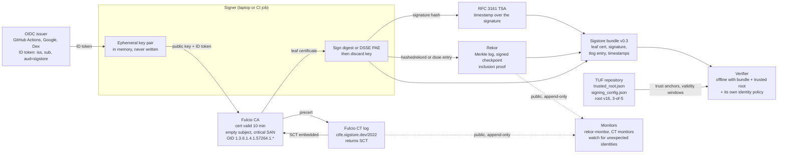

# Sigstore: Keyless Signing, Fulcio Certificates, Rekor Transparency, and Cosign

> [!summary] Claim:
> Keyless signing replaces "who holds this private key" with "which (issuer, subject) identity authenticated at this moment".
> Fulcio turns an OIDC identity token plus a throwaway public key into an X.509 certificate valid for 10 minutes, and logs that certificate to a Certificate Transparency log; the signer then discards the key.
> A signature stays verifiable for years because a log or timestamp authority proves it was made inside that 10-minute window: a Rekor v1 signed entry timestamp, or an RFC 3161 timestamp (which Rekor v2 makes mandatory in practice).
> A verifier checks the signature, the chain to a TUF-distributed trust root, the SCT, the time, the inclusion proof, and most importantly an identity policy it brought itself; only third-party monitors notice a certificate that should never have been issued.



## The Mechanism

### The problem keyless signing trades away

Traditional signing (GPG, a release key in a vault) answers "was this signed by the holder of key K".
That leaves three problems that the Sigstore overview names: binding K to a real identity, protecting K for years, and revoking K when it leaks.
Sigstore moves the question to identities that already exist: an OIDC subject at an issuer, such as a GitHub Actions workflow or an email address.
The cost is a new trust structure.
You now trust the OIDC issuer to authenticate honestly, Fulcio to issue honestly, the logs to be append-only, and a TUF root to distribute the keys of all of them.
The Sigstore threat model states what this buys: a keyless signature guarantees only that "a signer who successfully authenticated to Sigstore using that identity at that time" created it.
It does not say the signer should have signed, that the account was not compromised, or that the artifact is good.
That policy gap is why the verifier's identity policy is the security-critical input, not the signature.

### Parties and what each is trusted for

| Party | Role | Trusted to | Detected if it lies via |
|---|---|---|---|
| OIDC issuer (GitHub Actions, Google, Dex) | Authenticates the signer, issues an ID token | Only mint tokens for the real subject | Nothing in Sigstore; Fulcio logs the certificate, so a monitor sees the identity use |
| Fulcio | CA and registration authority; binds key to identity | Verify token and proof of possession, embed the right SAN and extensions | CT log of issued certificates |
| Fulcio CT log | RFC 6962 log of certificates and precertificates | Return an SCT, stay append-only | CT monitors and consistency checks |
| Timestamp authority | RFC 3161 time over the signature | Report the correct time | Multiple TSAs or Rekor time cross-checks; verifier policy |
| Rekor | Signature transparency log | Stay append-only, sign checkpoints | Monitors, witnesses, consistency proofs |
| TUF root (root-signing) | Distributes CA certs, log keys, URLs | Rotate and revoke key material | TUF threshold signatures (3 of 5 root keys, as of 2026-11) |
| Verifier | Applies the identity policy | Decide which (issuer, subject) pairs may sign what | Nothing; this is where most real failures live |

The Sigstore public deployment spec adds that the Fulcio root and intermediate are hosted on Google Cloud (a KMS-backed intermediate and a CA Service root).
The Fulcio, Rekor, and rekor-tiles READMEs each state a 99.5 percent availability SLO for the public-good Fulcio, Rekor v1, and Rekor v2 (as of 2026-11, Both).

### Identity is a pair: issuer and subject

The Fulcio spec says it directly: an identity is the pair of an identifier and an issuer, and a verifier MUST check both.
`user@gmail.com` as asserted by Google is not the same account as `user@gmail.com` as asserted by another provider.
Fulcio accepts an ID token only if it carries:

- `aud` equal to `sigstore`.
- `iss` equal to one of the issuers in the Fulcio configuration.
- `exp` and `iat`.
- A configured subject claim: `email` (with `email_verified: true`) for email providers, `sub` for SPIFFE and URI providers, `job_workflow_ref` for GitHub, `ci_config_ref_uri` for GitLab.

The public-good instance accepts user logins through Dex (GitHub, Google, Microsoft) and workflow identities from GitHub Actions, GitLab CI, Buildkite, Codefresh, and SPIFFE-based providers (as of 2026-11, Both).
Cosign obtains the token three ways: an interactive browser flow, a device flow when there is no terminal, or `--identity-token` and `SIGSTORE_ID_TOKEN` for CI.
It also detects ambient credentials; the `--oidc-provider` help lists `spiffe`, `google`, `github-actions`, `filesystem`, and `buildkite-agent` (cosign 3.1.4).
In GitHub Actions the job must request the token with `permissions: id-token: write`; without it no OIDC JWT can be requested.

The SAN is the identity the verifier will match, and its shape depends on the provider:

| Provider | SAN written by Fulcio | Issuer (OID 1.3.6.1.4.1.57264.1.8) |
|---|---|---|
| Email via Dex or Google | email address | `https://oauth2.sigstore.dev/auth` or `https://accounts.google.com` |
| GitHub Actions | URI `https://github.com/{job_workflow_ref}` | `https://token.actions.githubusercontent.com` |
| GitLab CI | URI `https://{ci_config_ref_uri}` | `https://gitlab.com` |
| SPIFFE | URI from `sub` | the configured SPIFFE issuer |
| Kubernetes | URI `https://kubernetes.io/namespaces/{ns}/serviceaccounts/{name}` | the cluster issuer |

For GitHub, `job_workflow_ref` names the workflow file that contains the signing job, including a reusable workflow when one is called.
The calling repository appears separately, in the Source Repository URI extension.
This split is the source of a common policy bug, described in Pitfalls.

### Fulcio: from token to certificate

The Fulcio certificate-issuing walkthrough has seven steps:

1. The client sends an ID token plus either a public key and a signed challenge, or a PKCS#10 CSR.
2. Fulcio authenticates the token: it finds the issuer's OIDC discovery endpoint from `iss`, downloads the issuer's signing keys, and verifies the JWT signature.
3. Fulcio verifies proof of possession: the challenge is a signature over the identity claim (normally `sub`), verified with the submitted public key.
4. Fulcio builds the certificate: the submitted public key, a SAN equal to the identity, the issuer in a custom extension, and extensions derived from token claims.
5. Fulcio signs it with its intermediate key (backends include cloud KMS, Tink, PKCS#11, Google CA Service, a file, or an ephemeral key for tests).
6. Fulcio appends a precertificate (with the CT poison extension, OID `1.3.6.1.4.1.11129.2.4.3`) to the CT log, receives an SCT, embeds it (OID `1.3.6.1.4.1.11129.2.4.2`), and signs again.
7. Fulcio returns the certificate chain.

The Fulcio certificate specification fixes what an issued certificate looks like.
It MUST have exactly one critical SAN (an email or a URI), an empty Subject, Key Usage Digital Signature only, Extended Key Usage Code Signing only, a lifetime inside its parent's, and a 160-bit random serial.
It MUST carry the OIDC issuer extension, and a client MUST NOT trust it without an SCT or inclusion proof.
Allowed public keys are ECDSA P-256, P-384, or P-521, RSA 2048 to 4096 bits, or Ed25519.
Fulcio "only issues short-lived certificates that are valid for 10 minutes" (README, as of 2026-11).
Intermediates SHOULD have `pathlen:0` so they can only issue leaves.

#### A real certificate, decoded

The Sigstore bundle-format page embeds a real public-good bundle for `sigstore-java-1.0.0.jar`.
I decoded its leaf with OpenSSL 4.1.0 on darwin-arm64 (a one-off run on 2026-11-21, not a recorded lab):

```text
$ openssl x509 -inform DER -in leaf.der -noout -text
        Signature Algorithm: ecdsa-with-SHA384
        Issuer: O=sigstore.dev, CN=sigstore-intermediate
        Validity
            Not Before: Aug 28 18:44:34 2024 GMT
            Not After : Aug 28 18:54:34 2024 GMT
        Subject: 
        Subject Public Key Info:
                ASN1 OID: prime256v1
        X509v3 extensions:
            X509v3 Key Usage: critical
                Digital Signature
            X509v3 Extended Key Usage: 
                Code Signing
            X509v3 Subject Alternative Name: critical
                URI:https://github.com/sigstore/sigstore-java/.github/workflows/release-sigstore-java-from-tag.yaml@refs/tags/v1.0.0
            1.3.6.1.4.1.57264.1.1: 
                https://token.actions.githubusercontent.com
            1.3.6.1.4.1.57264.1.8: 
                .+https://token.actions.githubusercontent.com
            1.3.6.1.4.1.57264.1.9: 
                .phttps://github.com/sigstore/sigstore-java/.github/workflows/release-sigstore-java-from-tag.yaml@refs/tags/v1.0.0
            1.3.6.1.4.1.57264.1.12: 
                .)https://github.com/sigstore/sigstore-java
            1.3.6.1.4.1.57264.1.14: 
                ..refs/tags/v1.0.0
            1.3.6.1.4.1.57264.1.21: 
                .Mhttps://github.com/sigstore/sigstore-java/actions/runs/10602446914/attempts/1
            CT Precertificate SCTs: 
                Signed Certificate Timestamp:
                    Log ID    : DD:3D:30:6A:C6:C7:11:32:63:19:1E:1C:99:67:37:02:
                                A2:4A:5E:B8:DE:3C:AD:FF:87:8A:72:80:2F:29:EE:8E
                    Timestamp : Aug 28 18:44:34.876 2024 GMT
```

The listing is an excerpt; the certificate also carries the deprecated `.1.2` through `.1.6` and the other extensions `.1.10`, `.1.11`, `.1.13`, `.1.15` through `.1.20`, and `.1.22` described in the OID directory (re-decoded from the Maven Central bundle on 2026-11-21).
Facts to read off it:

- Validity is exactly 10 minutes, 18:44:34 to 18:54:34.
- The Subject is empty and the SAN is critical, as the spec requires; the identity lives only in the SAN and extensions.
- The leaf key is P-256 while the signature is `ecdsa-with-SHA384`: the intermediate and root in the trusted root are both P-384 keys (checked with `openssl x509 -text` on the `trusted_root.json` chain).
- Extension `.1.1` (deprecated) is a raw string and `.1.8` is the DER-encoded UTF8String of the same issuer; the leading `.+` in OpenSSL's dump is the DER tag byte 0x0C and length 0x2B (43).
- The SCT log ID `DD:3D:30:6A...` is the `ctfe.sigstore.dev/2022` log in the trusted root, and its timestamp is 18:44:34.876, within a second of the certificate's `notBefore`.

#### The extension directory

Sigstore owns IANA Private Enterprise Number 57264.
All Fulcio extensions live under `1.3.6.1.4.1.57264.1`.
The tail OIDs 1 to 6 are deprecated GitHub-specific values formatted as raw strings with no DER wrapping; OID 7 is the OtherName SAN; OIDs 8 to 24 are DER UTF8Strings (OID info, as of 2026-11).

| OID suffix | Name | GitHub Actions source claim | Use in a policy |
|---|---|---|---|
| `.1.8` | Issuer (V2) | `iss` | Always pin; `.1.1` is the deprecated raw form |
| `.1.9` | Build Signer URI | `server_url + job_workflow_ref` | Which workflow file did the signing |
| `.1.10` | Build Signer Digest | `job_workflow_sha` | Immutable commit of that workflow |
| `.1.11` | Runner Environment | `runner_environment` | `github-hosted` versus `self-hosted` |
| `.1.12` | Source Repository URI | `server_url + repository` | Which repository the run belongs to |
| `.1.13` | Source Repository Digest | `sha` | Commit that was built |
| `.1.14` | Source Repository Ref | `ref` | Branch or tag that triggered it |
| `.1.15` | Source Repository Identifier | `repository_id` | Survives repo rename and transfer |
| `.1.16`, `.1.17` | Owner URI, Owner Identifier | `server_url + repository_owner`, `repository_owner_id` | Same, for the org |
| `.1.18`, `.1.19` | Build Config URI, Digest | `server_url + workflow_ref`, `workflow_sha` | The top-level initiating workflow |
| `.1.20` | Build Trigger | `event_name` | Reject `pull_request_target` or unexpected events |
| `.1.21` | Run Invocation URI | repository plus `/actions/runs/` plus `run_id` plus attempt | Audit link to the exact run |
| `.1.22` | Source Repository Visibility At Signing | `repository_visibility` | Detect a private repo signing into a public log |
| `.1.23` | Deployment Environment | `environment` | Tie to protection rules |
| `.1.24` | Token Subject | `sub` | Raw `sub` as presented |

OIDs `.1.2` to `.1.6` (Workflow Trigger, SHA, Name, Repository, Ref) are the deprecated GitHub-only forms.
Cosign 3.1.4 still exposes flags named `--certificate-github-workflow-name`, `-ref`, `-repository`, `-sha`, and `-trigger`.
The `-ref` and `-repository` help text refers to "the ref claim" and "the repository claim" of the GitHub token, but the source shows that all five flags compare against the deprecated OIDs `.1.2` to `.1.6` (`pkg/cosign/certextensions.go` at tag v3.1.4), so they match only while Fulcio keeps emitting those legacy extensions.
The OID directory's `.1.8` and later extensions are the better basis for a policy written in a Sigstore SDK.

#### Post-quantum status

The certificate specification now has a section on ML-DSA certificates (RFC 9881) for instances started with `--experimental-enable-pqc`.
It is experimental, ML-DSA-44, ML-DSA-65, and ML-DSA-87 are the allowed key types, chains must not mix ML-DSA and non-ML-DSA, and such certificates are not appended to a CT log.
The spec says that if you need signatures committed to a transparency log, use Rekor.
Treat it as design direction, not something the public-good instance issues (as of 2026-11).

### Certificate Transparency for Fulcio

Fulcio's CT log is a separate RFC 6962 log from Rekor.
It stores only issued certificates, while Rekor stores signatures and attestations.
Its job is the one the security model gives it: Fulcio assumes a valid token is proof of ownership, so a compromised account or issuer leads to a valid but unauthorized certificate.
Mandatory CT logging forces that certificate into public view.
"Fulcio itself does not monitor the certificate transparency log; users are responsible for monitoring the log for unauthorized certificates issued to their identities."
Verifiers check the embedded SCT offline per RFC 6962 section 3.2, or fetch an inclusion proof online.
The public-good CT shards are named by year; the trusted root lists `https://ctfe.sigstore.dev/test` (2021 to 2022-10-31) and `https://ctfe.sigstore.dev/2022` (from 2022-10-20), both ECDSA P-256 with SHA-256 (as of 2026-11).

### What gets signed

A signature is only as meaningful as what is under it, and cosign signs three different things.

- A blob: `cosign sign-blob` signs the file, with an ECDSA signature over its SHA-256 digest as the real bundle shows; the Rekor entry is a `hashedrekord` carrying the SHA-256 digest, signature, and certificate.
  The real entry from the decoded bundle has a canonical body of 3813 bytes: `{"apiVersion":"0.0.1","kind":"hashedrekord","spec":{"data":{"hash":{"algorithm":"sha256","value":"5be26f..."}},"signature":{"content":"...","publicKey":{"content":"<base64 of the PEM certificate>"}}}}`.
- A container image: legacy cosign signatures sign a payload that embeds the image digest (`Critical.Image.Docker-manifest-digest`), and in the bundle layout the bundle is attached as an OCI 1.1 referring artifact whose `artifactType` and layer media type are `application/vnd.dev.sigstore.bundle.v0.3+json`, with `subject` pointing at the image manifest.
  Registries without the Referrers API fall back to the referrers tag schema, tag `sha256-<hex>` with an image index.
  The older cosign layout stored `sha256-<hex>.sig` tags and is still readable.
  Sign and verify by digest, because a tag can move.
- An attestation: a DSSE envelope with `payloadType` `application/vnd.in-toto+json` over an in-toto statement.
  The signature is over the DSSE pre-authentication encoding, `PAE(type, body) = "DSSEv1" SP LEN(type) SP type SP LEN(body) SP body`, not over the raw JSON.
  The in-toto and DSSE structure belongs to [[In-Toto-Layouts-Link-Metadata-and-DSSE-Attestations]]; this note only needs the PAE rule.
  A Sigstore bundle's DSSE envelope MUST have exactly one signature (`sigstore_bundle.proto`), and the client spec puts multi-signature envelopes out of scope.

For `hashedrekord` over a DSSE envelope, the client spec says the logged artifact hash is `Hash(PAE(payloadType, payload))` and the entry's signature equals `dsse_envelope.signatures[0].sig` byte for byte.
Pure Ed25519 has no externalized prehash, so it cannot be used for that construction.

### Establishing time: why a 10-minute certificate verifies for years

A certificate that expired in 2024 fails normal path validation in 2026.
Sigstore verifies instead that the signature existed while the certificate was valid.
The client spec calls this the "hybrid model": run RFC 5280 path validation with a fake "current time" taken from a trusted timestamp, so that the leaf, intermediate, and root must all be valid at that time.
If both a TSA time and a Rekor time are present, validation runs twice and both must pass.

Where does the trusted time come from?

- Rekor v1 `integratedTime`, covered by the signed entry timestamp (SET).
  The Sigstore timestamps page is blunt about the limit: the time comes from Rekor's internal clock, "which is not externally verifiable", and it is not part of the Merkle leaf, so it is "mutable in Rekor without detection".
  The threat model agrees that a compromised Rekor server can change timestamps so that signatures made outside the validity window look valid.
- An RFC 3161 timestamp from a TSA.
  The client sends a hash of the signature as the `messageImprint` of a `TimeStampReq`; the response `TSTInfo` carries `messageImprint`, `genTime`, and optional `accuracy` (RFC 3161 section 2.4.2).
  Sigstore recommends signing over the signature ("countersigning"), so the timestamp covers the signature rather than the artifact.
  The public-good TSA is `https://timestamp.sigstore.dev/api/v1/timestamp`, valid from 2025-07-04, and the trusted root names its CA subject `sigstore-tsa-selfsigned` (as of 2026-11).
  The Sigstore Timestamp Authority follows RFC 3628 policy and RFC 5816 structure updates.
- Rekor v2 does not act as a time source and returns no SET.
  The Rekor v2 spec says signing clients SHOULD fetch an RFC 3161 timestamp and include it, "in order for verifying clients to verify Fulcio-issued ephemeral signing certificates".
  Cosign 3.0.5 added "Automatically require signed timestamp with Rekor v2 entries" and "Enforce TSA requirement for Rekor v2, Fulcio signing" (release notes).

You can see the requirement fail.
With the real bundle and the log check disabled, the expired certificate has no time source and verification stops (cosign v3.1.4, darwin-arm64, one-off run on 2026-11-21):

```text
$ cosign verify-blob --insecure-ignore-tlog --bundle sigstore-java-1.0.0.jar.sigstore.json \
    --certificate-identity "https://github.com/sigstore/sigstore-java/.github/workflows/release-sigstore-java-from-tag.yaml@refs/tags/v1.0.0" \
    --certificate-oidc-issuer https://token.actions.githubusercontent.com sigstore-java-1.0.0.jar
WARNING: Skipping tlog verification is an insecure practice that lacks transparency and auditability verification for the blob.
Error: failed to verify leaf certificate: leaf certificate verification failed
error during command execution: failed to verify leaf certificate: leaf certificate verification failed
```

I also reproduced the hybrid model with plain OpenSSL: the leaf chains to the trusted-root intermediate and root with `-attime` set to the entry's `integratedTime`, and fails as expired with the current clock (`openssl verify -attime 1724870676 ... leaf.pem` printed `leaf.pem: OK`; without `-attime` it printed `error 10 at 0 depth lookup: certificate has expired`).

### Rekor: Merkle tree, checkpoints, and proofs

Rekor is an append-only Merkle tree over canonicalized signing events.
Its hashing is RFC 6962 section 2.1 (restated in RFC 9162 section 2.1.1) with SHA-256: a leaf hash is `SHA-256(0x00 || entry)`, an interior node is `SHA-256(0x01 || left || right)`, and the tree splits at the largest power of two smaller than the size.
The distinct prefix bytes stop a leaf from being reinterpreted as an interior node (second-preimage defense).
An inclusion proof for leaf `m` in a tree of size `n` is the list of sibling hashes on the path to the root, of length about `log2(n)`.
A consistency proof between sizes `m < n` shows the size-`n` tree contains the size-`m` tree as a prefix, which is what "append-only" means operationally.

A checkpoint is the signed commitment to a tree head.
The Rekor checkpoint format is the C2SP tlog-checkpoint, a signed note whose text is at least three lines: the origin, the tree size as ASCII decimal, and the base64 root hash; then an empty line and signature lines that begin with an em dash (U+2014) and a space, then the key name, a space, and base64 of a 4-byte key hash followed by the signature.
A log MUST NOT sign two checkpoints that are inconsistent with each other.

#### The real proof, checked by hand

For the real bundle I recomputed the Merkle root from the inclusion proof with the RFC 9162 section 2.1.3.2 algorithm, then verified the checkpoint signature with the Rekor key from the TUF trusted root.
The proof and checkpoint come from the bundle on the Sigstore bundle-format page; the key is the first `tlogs` entry of the `trusted_root.json` that `cosign initialize` fetched into a scratch `TUF_ROOT`.

```python
import json, base64, hashlib
b = json.load(open('msgsig_bundle.json'))
e = b['verificationMaterial']['tlogEntries'][0]
p = e['inclusionProof']
h = hashlib.sha256(b'\x00' + base64.b64decode(e['canonicalizedBody'])).digest()
fn, sn = int(p['logIndex']), int(p['treeSize']) - 1
r = h
for c in (base64.b64decode(x) for x in p['hashes']):
    if fn & 1 or fn == sn:
        r = hashlib.sha256(b'\x01' + c + r).digest()
        while not fn & 1 and fn != 0:
            fn >>= 1; sn >>= 1
    else:
        r = hashlib.sha256(b'\x01' + r + c).digest()
    fn >>= 1; sn >>= 1
print(sn == 0 and r == base64.b64decode(p['rootHash']))
```

Results (Python 3.15.2 and OpenSSL 4.1.0, darwin-arm64, one-off run on 2026-11-21):

- The proof has 12 hashes, `logIndex` 3775938, `treeSize` 3775939; the recomputed root equals the claimed `nEpjeg/gaT1EOcKQAr3q/XGdnuKzLsf4UhgZrwtTU+8=` (script printed `match True`).
- Twelve rather than twenty-two hashes: `3775939` has 13 set bits, so the leaf is the last one, alone in a size-1 subtree at the right edge, and needs only the 12 left subtree roots.
- The checkpoint note text is `rekor.sigstore.dev - 1193050959916656506`, `3775939`, and the root; its signature line carries key hash `c0d23d6a`, equal to the first 4 bytes of the Rekor log ID `c0d23d6ad406973f9559f3ba2d1ca01f84147d8ffc5b8445c224f98b9591801d`.
- That log ID is `SHA-256` of the DER public key; `openssl dgst -sha256 -verify rekor.pem -signature note.sig note.txt` printed `Verified OK` (the signature is ECDSA P-256 over the note text, 70 bytes).
- The artifact signature, as verified by `openssl pkeyutl -verify -pubin -inkey pub.pem -in dig.bin -sigfile sig.der -pkeyopt digest:sha256`, was `Signature Verified Successfully`, and `integratedTime` 1724870676 is 2024-08-28 18:44:36 UTC, inside the certificate window.

#### Rekor v1 versus Rekor v2

| Property | Rekor v1 | Rekor v2 (rekor-tiles) |
|---|---|---|
| Status | Maintenance mode (README) | Current implementation (deployment spec) |
| Backend | Trillian, one tree per shard | Tile-backed log on Trillian-Tessera |
| Checkpoint signature | ECDSA P-256 | Ed25519 |
| Log ID | SHA-256 of the public key | C2SP signed-note key ID |
| Time | `integratedTime` plus SET from the log clock | No SET; needs an external RFC 3161 timestamp |
| Entry types | Pluggable (hashedrekord, intoto, dsse, and more) | hashedrekord v0.0.2; the DSSE story differs by source, as the next paragraph explains |
| Search index | Yes, unverifiable | None; an independent service is planned |
| Verification | Online or offline | Offline strongly preferred; online discouraged |
| Write latency | Synchronous | Batched, 2 to 10 seconds per the spec |
| Sharding | Tree IDs behind one URL, global index | Fully independent shards, found through TUF |
| Witnessing | Gossip described, not built in | Optional synchronous witness cosignatures on checkpoints |
| Public attestation size | 100 KB upload limit on the public instance | No attestation-specific limit in the v2 spec or README; the rekor-tiles server caps every request body at 4 MiB by default (`--max-request-body-size`, `4*1024*1024` in `internal/cli/flags.go`, enforced by `http.MaxBytesHandler` and the gRPC max message size), and the value the public instance runs with is not published (as of 2026-11); cosign 3.1.1 logs DSSE as a hash to avoid size limits |

The sources disagree on Rekor v2 entry types.
The Rekor v2 spec (section 4.3) says hashedrekord is the only type and that DSSE payloads "cannot be uploaded with a `dsse` entry type"; DSSE is expressed through hashedrekord.
The public deployment spec (section 3.1) lists DSSE v0.0.2 for attestations, and the rekor-tiles README says `serve` mode handles both `hashedrekord` and `dsse`; the repository still ships `api/proto/rekor/v2/dsse.proto` (as of 2026-11).
Cosign 3.1.1 states that DSSE attestations are now logged as hashed entries using the DSSE PAE.
I use the cosign behavior as the safe assumption: the leaf commits to `Hash(PAE(...))`.

Why tiles: a tile-based log stores the tree as static, cacheable objects (`/api/v2/tile/entries` for monitors, checkpoints at `/api/v2/checkpoint`), so verification reads are CDN friendly and proofs can be computed from tiles.
Why shards: a new instance is created periodically to keep the log small and to rotate the checkpoint signing key.
The rekor-tiles README says the public URL changes "approximately every 6 months", while the Sigstore sharding page says "we aim to create a new log every year" and the deployment spec says "every year at a minimum"; I treat the cadence as unsettled.
The 2025 shard `https://log2025-1.rekor.sigstore.dev` has an Ed25519 key valid from 2025-09-23 in the trusted root.

Witnessing addresses split views.
A log could show different trees to different parties; a single witness cannot catch that, since the log could show that witness a consistent view.
Rekor v2 can block until a network of witnesses cosigns the checkpoint, so a client receives a checkpoint with cosignatures and verifying clients SHOULD check them against their trust root.

### The bundle: one file with all verification material

The bundle is a protobuf message (`dev.sigstore.bundle.v1.Bundle`) serialized as JSON, with the media type `application/vnd.dev.sigstore.bundle.v0.3+json` (current version 0.3, as of 2026-11).
The JSON uses lowerCamelCase keys and string enum values, and the file extension is `.sigstore.json`; the client spec says to use `.sigstore.jsonl` for JSON Lines of several bundles.

```text
Bundle
  mediaType
  verificationMaterial
    certificate | x509CertificateChain | publicKey (hint)     one of
    tlogEntries[]: logIndex, logId, kindVersion, integratedTime,
                   inclusionPromise (SET), inclusionProof (hashes, checkpoint), canonicalizedBody
    timestampVerificationData: rfc3161Timestamps[].signedTimestamp
  messageSignature (messageDigest, signature) | dsseEnvelope    one of
```

Version differences from the protobuf comments:

- v0.1 and v0.2 keyless bundles MUST use a certificate chain; v0.3 keyless bundles with the public-good instance MUST use a single leaf certificate.
  Signers MUST NOT include root CAs and SHOULD NOT include intermediates that are in an independent root of trust.
- v0.1 bundles could carry only an inclusion promise (SET) and no proof; verifiers SHOULD NOT accept v0.1 in ecosystems that never produced it.
- A public key hint form MUST NOT be used for keyless signing against the public-good instance.
- For a DSSE payload, the bundle's `keyid` hint must equal the envelope's hint.
- When the signer is identified by a certificate, a verifier MUST verify the signature was computed while the certificate was valid.

A bundle is also what cosign stores in a registry: the OCI manifest has `artifactType` set to the bundle media type, one layer holding the JSON, and annotations `dev.sigstore.bundle.content` (`message-signature` or `dsse-envelope`), `dev.sigstore.bundle.predicateType`, and `org.opencontainers.image.created` that registries propagate into the referrers index.

### Trust roots: TUF, trusted_root.json, and signing_config.json

A bundle is untrusted input; the trust roots are not in it.
Verification needs a `TrustedRoot` with Fulcio CAs, CT log keys, Rekor keys and URLs, and TSA chains, plus validity windows for each.
The `TrustedRoot` protobuf says it MUST include every previously used instance, or signatures from the past cannot be verified, and that clients MUST accept overlapping windows to survive rotations.
Signing needs a `SigningConfig`: service URLs for CA, OIDC, Rekor, and TSA, with `selector` values `ALL`, `ANY`, or `EXACT` with a count.
When counting a threshold, services are grouped by operator and one operator counts once.

The public-good instance distributes both through a TUF repository at `https://tuf-repo-cdn.sigstore.dev`.
I ran `cosign initialize` with `TUF_ROOT` pointing to a scratch directory (cosign v3.1.4, 2026-11-21) and read what it fetched:

- TUF root metadata version 16, expiring 2027-04-22; roles `root` and `targets` need 3 of 5 keys, and `snapshot` and `timestamp` need 1 key each.
- Targets in the cache: `trusted_root.json` and `signing_config.v0.2.json`.
- `trusted_root.json` lists two Rekor logs (v1 `https://rekor.sigstore.dev`, ECDSA P-256, from 2021-01-12; and `https://log2025-1.rekor.sigstore.dev`, Ed25519, from 2025-09-23), two Fulcio CA entries (an older one ending 2022-12-31 and the current one from 2022-04-13 with a two-certificate chain), two CT logs, and one TSA (`timestamp.sigstore.dev`, from 2025-07-04).
- The TUF-served `signing_config.v0.2.json` lists only the Rekor v1 URL for signing, with `ANY` selectors for Rekor and TSA.
  Rekor v2 is available through a separate `signing_config_rekor_v2.v0.2.json` in the root-signing repository, listing `https://log2025-1.rekor.sigstore.dev` (API version 2, valid from 2026-01-01) ahead of v1.
  So as of 2026-11-21 the default public-good signing path still writes to Rekor v1, while verifiers already hold the v2 shard key.

The TUF root provides what the threat model asks for: threshold signing by offline root keys, rotation, revocation with a compromise time (so earlier legitimate signatures still verify), and freshness.
The trust-root caveat from the threat model: "if that process can be intercepted, we can consider all of the infrastructure effectively compromised."
An air-gapped verifier therefore needs a deliberate process to refresh `trusted_root.json`, or its CA and log keys go stale at the next rotation.

### Cosign: what changed and what v3 does by default

| Version | Date | Change relevant to keyless |
|---|---|---|
| v2.4.0 | 2024-08-06 | Protobuf bundle support in `verify-blob`, `sign-blob`, `attest-blob`; trust root file instead of many flags |
| v2.5.0 | 2025-04-07 | New bundle spec for OCI image attestations, gated behind `--new-bundle-format` |
| v2.6.0 | 2025-09-12 | Bundles as OCI 1.1 referring artifacts; `SigningConfig` for `sign`, `attest`; Rekor v2 support |
| v3.0.1 | 2025-10-08 | New bundle format and signing-config fetch by default; `--bundle` output moved from optional to required (v3.0.0 was never published) |
| v3.0.4 | 2026-01-09 | Fix GHSA-whqx-f9j3-ch6m |
| v3.0.5 | 2026-02-19 | TSA required with Rekor v2; fix for the private-PKI advisory; deprecations |
| v3.0.6 | 2026-04-06 | Fix GHSA-w6c6-c85g-mmv6; reject `--new-bundle-format` with `--rfc3161-timestamp` |
| v3.1.1 | 2026-06-09 | Deprecates many legacy flags for removal in v4; "Sign exclusively via sigstore-go"; adds `bundle upgrade`; DSSE logged as hashed entries (v3.1.0 was skipped) |
| v3.1.3 | 2026-08-06 | Fix GHSA-fx35-mq7g-6g98 (verification bypass via an unexpected public key in a legacy bundle) |
| v3.1.4 | 2026-10-20 | Adds `cosign bundle create-from-container`; latest release (as of 2026-11-21) |

The v3.0.0 note says v3 turns on, by default, the standardized bundle, trust-root and signing-config inputs, and OCI 1.1 referring artifacts.
In 3.1.4 the deprecated flags still parse but print notices.
I ran each against a missing file to read the notices:

```text
Flag --new-bundle-format has been deprecated, this will be the only supported format in future versions
Flag --offline has been deprecated, To verify in an airgapped environment, provide a --bundle with the signature and verification material, and a --trusted-root file with the service keys and certificates
Flag --rekor-url has been deprecated, please use --bundle, which includes the Rekor inclusion proof
Flag --rfc3161-timestamp has been deprecated, please use --bundle to provide the output bundle location, which will include the signed timestamp
Error: unknown flag: --use-signing-config
```

`--use-signing-config` is a signing flag, so `verify-blob` rejects it as unknown; on the signing commands 3.1.4 accepts it and prints "Flag --use-signing-config has been deprecated, an offline signing flag will be added in the future; TUF will continue to provide a signing config by default if one is not provided manually".
The 3.1.4 `--help` hides the deprecated flags, so a script that worked on v2 can still run on v3 and print warnings; the removal is planned for a v4 (release notes 3.1.1 and 3.1.2).

Cosign command map for keyless work (cosign v3.1.4, Both):

| Task | Command shape |
|---|---|
| Sign a blob | `cosign sign-blob FILE --bundle FILE.sigstore.json --yes` |
| Verify a blob | `cosign verify-blob FILE --bundle FILE.sigstore.json --certificate-identity ID --certificate-oidc-issuer ISS` |
| Sign an image | `cosign sign IMAGE@sha256:DIGEST --yes` |
| Verify an image | `cosign verify IMAGE@sha256:DIGEST --certificate-identity ID --certificate-oidc-issuer ISS` |
| Attest | `cosign attest --type TYPE --predicate FILE IMAGE@sha256:DIGEST` |
| Verify an attestation | `cosign verify-attestation --type TYPE ... IMAGE` (set `--check-claims`, see Pitfalls) |
| Attest and verify a blob | `cosign attest-blob --predicate FILE --type TYPE --bundle OUT` and `cosign verify-blob-attestation` |
| Look at a bundle | `cosign bundle inspect FILE` (reads only; verifies nothing) |
| Upgrade an old bundle | `cosign bundle upgrade` |
| Build custom trust material | `cosign trusted-root create`, `cosign signing-config create` |
| Fetch the public-good roots | `cosign initialize` (set `TUF_ROOT` to relocate the cache) |
| List attached artifacts | `cosign tree IMAGE` |

`cosign verify` requires `--certificate-identity` or `--certificate-identity-regexp`, and `--certificate-oidc-issuer` or `--certificate-oidc-issuer-regexp`, for keyless flows (help text).
Use `--identity-token` or `SIGSTORE_ID_TOKEN` for a token you obtained elsewhere; the token's audience must contain `sigstore`.
Private infrastructure is configured with a signing config for signing and `--trusted-root` for verification; `SIGSTORE_ROOT_FILE` overrides the CA root in the docs' recipe.

### The verification algorithm, step by step

The client spec section 4 defines what a verifier does; cosign and the language clients implement it.
In order:

1. Parse the bundle, check the media type version, and reject anything the verifier's policy does not accept.
2. Decide the time: verify each RFC 3161 token against the TSA chain in the trusted root using the signature bytes, and verify any Rekor v1 SET against the Rekor key; abort on failure.
3. Validate the leaf certificate chain to a trusted Fulcio CA with that time as "now", for every time source present.
4. Check the embedded SCT against the CT log key (or fetch an online inclusion proof).
5. Check the identity: the SAN and the issuer extension against policy, and optionally other extensions.
6. Verify the transparency entry: parse `canonicalizedBody` by `apiVersion` and `kind`, and check that its signature equals the bundle signature, its certificate or key equals the bundle's, and its digest matches the artifact.
   Then verify the inclusion proof to the checkpoint and the checkpoint signature with the Rekor key.
7. Verify the artifact signature with the public key from the leaf, over the artifact bytes, its digest, or the DSSE PAE.
   For attestations, the statement's `subject` digest list must contain the artifact digest.
8. Apply the decision the policy asks for: this identity may sign this artifact name.

Steps 6 and 7 are why the "mix and match" attack is closed: the Rekor entry must reference this artifact, this signature, and this key, which is exactly the check that regressed in CVE-2026-22703.

The same flow with the real bundle, run once with cosign v3.1.4 on darwin-arm64 (2026-11-21).
The jar's SHA-256 is `5be26f1777a351a2f770e91dbceae0aaa3f6e26e8ad218c6ac16caa783a5aa0d`, equal to the bundle's `messageDigest`.

```text
$ cosign verify-blob --bundle sigstore-java-1.0.0.jar.sigstore.json \
    --certificate-identity "https://github.com/sigstore/sigstore-java/.github/workflows/release-sigstore-java-from-tag.yaml@refs/tags/v1.0.0" \
    --certificate-oidc-issuer https://token.actions.githubusercontent.com sigstore-java-1.0.0.jar
Verified OK
```

Three negative controls on the same bundle:

```text
wrong identity: Error: failed to verify certificate identity: no matching CertificateIdentity found, last error: expected SAN value "https://github.com/evil/repo/.github/workflows/x.yaml@refs/heads/main", got "https://github.com/sigstore/sigstore-java/.github/workflows/release-sigstore-java-from-tag.yaml@refs/tags/v1.0.0"
wrong issuer:   Error: failed to verify certificate identity: no matching CertificateIdentity found, last error: expected issuer value "https://accounts.google.com", got "https://token.actions.githubusercontent.com"
jar plus 1 byte: Error: failed to verify signature: could not verify message: invalid signature when validating ASN.1 encoded signature
```

The verification ran against the scratch TUF cache and the local bundle; the identity and signature errors came from the offline checks.
I did not capture a packet trace, so "fully offline" is my inference from the documented bundle design, not a measured fact.

### Monitoring and the threat model

Keyless signing has no revocation list.
It relies on short certificate lifetimes plus detection.
Detection needs someone watching.
The security model says: "If no third parties monitor the logs, then any misbehavior by Rekor and Fulcio might go undetected."

What each compromise lets an attacker do, from the Sigstore threat model (summarized):

| Compromised | Attacker capability | Recovery or detection |
|---|---|---|
| OIDC account | Sign anything that identity may sign | Provider-side account recovery; monitors see the unexpected signing event |
| OIDC server | Sign for anything in that issuer's domain | None in Sigstore; remove the issuer from policy |
| Fulcio CA | Issue certificates for any identity | CT log shows them; revoke through the TUF root |
| Rekor server | Change timestamps, deny entries, fork views | Monitors and witnesses detect deletion or forks; TUF delegation recovers |
| Fulcio CT log | Hide certificates, show different views | CT monitors detect, unless the monitor is also compromised |
| TUF root of trust | Become every other party in this table | Cannot be recovered without control of the root |

Tooling for monitors:

- `rekor-monitor` runs on GitHub Actions and watches the log for consistency and for specified identities; it supports the `hashedrekord` type and exact-string identity matches (docs, as of 2026-11; regexp matching was "planned" on the threat model page).
- The public Rekor v1 event stream is a Google Pub/Sub topic `new-entry` in project `project-rekor` (region `us-central1`), publishing CloudEvents whose `data` is a `TransparencyLogEntry`, with attributes such as `rekor_entry_kind` and `rekor_signing_subjects` that you can use in a subscription filter.
  The docs note that you pay network egress unless the consuming workload runs in the topic's region.
- A CT monitor on `ctfe.sigstore.dev` watches issuance, which is the earliest signal because Fulcio must log before issuing.
- For Rekor v2, monitors tail `/api/v2/tile/entries`.

What the identity owner should monitor: every certificate or entry whose SAN matches the workflow or email they control, and an alarm for any that did not come from their pipeline's expected `Build Trigger`, ref, or run.
The Sigstore docs give an example for a Sigstore org: alert when an entry from GitHub Actions under `https://github.com/sigstore/` came from a ref other than `main`, which flags a pull-request-triggered run that could sign under the org identity.

### Cosign verification bugs worth knowing

These are real defects in the verifier, and they teach where the trust boundary is.

- CVE-2026-22703 (GHSA-whqx-f9j3-ch6m), fixed in 3.0.4 and 2.6.2: a bundle with an embedded Rekor entry that did not reference the artifact's digest, signature, or key could still verify, so an attacker holding a stolen identity or key could attach any valid Rekor entry and hide the signing event from the owner's audit.
  Cosign v3 with default flags was unaffected; v2 with defaults was affected; it was a regression of an earlier fix.
- CVE-2026-24122 (GHSA-wfqv-66vq-46rm), fixed in 3.0.5: the chain was validated at the leaf's `notBefore` but expiry used the signed timestamp, so an issuing certificate that expired before the leaf looked valid.
  The advisory title scopes it to verification with the transparency log check skipped; no impact on the public-good instance; matters for private PKIs.
- CVE-2026-39395 (GHSA-w6c6-c85g-mmv6), fixed in 3.0.6 and 2.6.3: `verify-blob-attestation` could print "Verified OK" for malformed payloads or mismatched predicate types when `--check-claims` was not true.
  The advisory's workaround is to always set `--check-claims=true`; in 3.1.4 it already defaults to `true` on `verify-blob-attestation` and `verify-attestation` (help text), so the exposure is a pipeline that set it to `false`.
- GHSA-fx35-mq7g-6g98 (high severity, no CVE assigned as of 2026-11), fixed in 3.1.3 and 2.6.5: in `verify-blob` and `verify-blob-attestation`, a legacy JSON bundle whose `cert` field held a bare public key instead of an X.509 certificate made cosign fall back to that key, skip chain validation and `CheckCertificatePolicy`, and so ignore `--certificate-identity` and `--certificate-oidc-issuer`; the bundle key also overrode an explicit `--key`.
  The standardized protobuf bundle (the v3 default) and image verification were not affected (repository advisory, read with `gh api`).

Pattern: three of four are about the verifier failing to bind each piece of material to the others.
The signing path is mostly mathematics; the verification path is policy code, and policy code has bugs.

## Commands and Numbers to Know

| Item | Value | Platform | Notes |
|---|---|---|---|
| Fulcio certificate validity | 10 minutes from issuance (as of 2026-11) | Both | README and deployment spec; the decoded real leaf is 18:44:34 to 18:54:34 |
| Fulcio and Rekor public SLO | 99.5 percent availability each (as of 2026-11) | Both | Fulcio, Rekor, and rekor-tiles READMEs; if independent, Fulcio and one Rekor both up is about 99.0 percent (0.995 squared); no per-component SLO is published for the Dex broker or the TSA: the community ROADMAP gives only a general aim of 99.5 percent for the public-good instances, and the status page lists Dex and the TSA with observed uptime, which is a measurement and not a guarantee |
| Fulcio extension root OID | `1.3.6.1.4.1.57264.1` (as of 2026-11) | Both | `.1.8` issuer, `.1.9` build signer URI, `.1.12` source repository URI |
| SCT extension, poison extension | `1.3.6.1.4.1.11129.2.4.2`, `1.3.6.1.4.1.11129.2.4.3` (as of 2026-11) | Both | In the Fulcio certificate specification |
| Bundle media type | `application/vnd.dev.sigstore.bundle.v0.3+json` (as of 2026-11) | Both | Older: `application/vnd.dev.sigstore.bundle+json;version=0.1` and `0.2` |
| TUF root | version 16, expires 2027-04-22, 3 of 5 for root and targets (as of 2026-11) | Both | Read from the cached `root.json` after `cosign initialize` |
| Rekor v1 public key | ECDSA P-256, log ID `c0d23d6a...801d`, valid from 2021-01-12 (as of 2026-11) | Both | Checkpoint key hash is the first 4 bytes of the log ID |
| Rekor v2 shard | `https://log2025-1.rekor.sigstore.dev`, Ed25519, from 2025-09-23 (as of 2026-11) | Both | In `trusted_root.json`; signing uses it only via the separate v2 signing config |
| Rekor v1 attestation upload limit | 100 KB on the public instance (as of 2026-11) | Both | Rekor README |
| Rekor v2 write latency | about 2 to 10 seconds per entry (as of 2026-11) | Both | Batching described in rekor-v2-spec 4.4 and 7.1 |
| Merkle prefixes | leaf `0x00`, node `0x01`, hash SHA-256 | Both | RFC 6962 section 2.1; RFC 9162 section 2.1.1 |
| Public TSA | `https://timestamp.sigstore.dev/api/v1/timestamp`, valid from 2025-07-04 (as of 2026-11) | Both | In `signing_config.v0.2.json` and `trusted_root.json` |
| Public OIDC broker | `https://oauth2.sigstore.dev/auth` (Dex) (as of 2026-11) | Both | In `signing_config.v0.2.json` |
| Latest cosign | v3.1.4, 2026-10-20 (as of 2026-11-21) | Both | v2.6.5 is the latest v2 line, 2026-08-06 |
| Cosign default timeout | 3 minutes (`--timeout`) (as of 2026-11) | Both | cosign 3.1.4 help |
| Token audience | `sigstore` (as of 2026-11) | Both | Required `aud` claim |
| Env vars | `SIGSTORE_ID_TOKEN`, `TUF_ROOT`, `SIGSTORE_ROOT_FILE`, `SIGSTORE_REKOR_PUBLIC_KEY` (as of 2026-11) | Both | First two and `SIGSTORE_ROOT_FILE` from docs and my run; the Rekor key variable is named in GHSA-whqx-f9j3-ch6m |
| Inclusion proof size | about `ceil(log2 n)` hashes; 12 for the real entry (tree size 3775939, last leaf) | Both | Computed from the bundle on the Sigstore docs page (see the real proof section) |
| `--insecure-ignore-tlog` on an expired cert | fails: `leaf certificate verification failed` (cosign 3.1.4) | macOS (run), expected Both | One-off run in the time section |

## Multi-Language Comparison

Cosign is the reference CLI, but libraries implement the same client spec.
The Sigstore docs list language clients for Go, Java, JavaScript, Python, Ruby, and Rust.
They list no C++ client, so a C++ build normally calls `cosign` or the Go library across a process boundary.
Maturity statements in this table are the docs' wording (as of 2026-11) and may lag the repositories; check each project's releases.

| Concern | C++ | Python | Rust |
|---|---|---|---|
| Sigstore client | None listed; shell out to `cosign verify-blob` in the build or package step, or link a small Go helper built on `sigstore-go` | `sigstore` on PyPI (sigstore-python); CLI `sigstore sign` and `sigstore verify identity`; requires Python 3.11 or newer per the docs | `sigstore` crate (sigstore-rs); docs say it is under active development and unstable until 1.0 |
| Verify a bundle offline | Pass `--bundle` and `--trusted-root` to cosign | `sigstore verify identity FILE --cert-identity ID --cert-oidc-issuer ISS` | Library API; check the crate version against the bundle v0.3 you consume |
| Where the identity policy lives | Wrapper script or CI step; keep the identity strings in version control | Verifier policy objects in the API, or CLI flags | Verifier code; no CLI parity promised |
| Typical use | Verify third-party toolchains and release tarballs before `cmake` consumes them | Verify wheels, sdists, and release artifacts in release tooling | Verify before `cargo install` of a binary, or sign in release pipelines |
| Failure to watch | Treating exit 0 as policy-complete when no identity flag was passed (cosign refuses; a wrapper may not) | Accepting a bundle version the policy never intended | Library behavior drifting from cosign across versions |

## Worked Lab Example

This note has no lab, so this section is a reproducible walkthrough on public data rather than a harness lab.
Every command output in this note is a one-off capture from 2026-11-21 on darwin-arm64 with cosign v3.1.4, OpenSSL 4.1.0, and Python 3.15.2, not a recorded golden file.
Everything runs from public data.
Work in a scratch directory, keep the downloads separate from your scripts, and pass paths as arguments.

1. Get the artifact and its bundle from Maven Central: `dev/sigstore/sigstore-java/1.0.0/sigstore-java-1.0.0.jar` and `sigstore-java-1.0.0.jar.sigstore.json` in the same directory.
   The bundle is 9560 bytes and has media type `application/vnd.dev.sigstore.bundle.v0.3+json`, with `tlogEntries` and `certificate` in its verification material.
2. Prove the digest matches: `shasum -a 256 sigstore-java-1.0.0.jar` prints `5be26f1777a351a2f770e91dbceae0aaa3f6e26e8ad218c6ac16caa783a5aa0d`, equal to the bundle's `messageSignature.messageDigest` (base64 `W+JvF3ejUaL3cOkdvOrgqqP24m6K0hjGrBbKp4Olqg0=`).
3. Fetch the trust root into a scratch cache: `TUF_ROOT=$PWD/tuf cosign initialize`.
   It creates `tuf-repo-cdn.sigstore.dev/` with `root.json`, `snapshot.json`, `targets.json`, `timestamp.json`, and `targets/` holding `trusted_root.json` and `signing_config.v0.2.json`.
4. Inspect without trusting: `cosign bundle inspect sigstore-java-1.0.0.jar.sigstore.json`.
   It prints the certificate validity, the identity, all extensions, the SCT (`Log URL: https://ctfe.sigstore.dev/2022`), and the tlog entry (`Log Index: 125680200`, `Kind: hashedrekord`, `Integrated Time: 2024-08-28T18:44:36Z`).
   Its own banner says it "only inspects the contents of the bundle" and does no cryptographic verification.
5. Verify with the identity and issuer from step 4: the `cosign verify-blob` command in the verification algorithm section prints `Verified OK`.
6. Run the three negative controls and confirm each message names the mismatch.
7. Recompute the inclusion proof with the Python script and verify the checkpoint with `openssl dgst -sha256 -verify` against the Rekor key from `trusted_root.json`.
8. Re-verify with `--insecure-ignore-tlog` and observe the expired-certificate failure.

What each step proves: step 2 binds bundle to file; steps 5 and 6 prove identity policy is enforced rather than ignored; step 7 proves the log commitment independently of cosign; step 8 proves the time requirement is a check that can fail.

## Pitfalls

> [!warning] Pitfall 1: Pinning the issuer but not the identity
> `--certificate-oidc-issuer https://token.actions.githubusercontent.com` alone says "some GitHub Actions workflow signed this", which any GitHub user can produce.
> Pin the SAN too, as an exact workflow path and ref, or a tightly anchored regexp.
> Cosign does not anchor `--certificate-identity-regexp`: it calls Go `regexp.MatchString`, which matches any substring (`pkg/cosign/verify.go` at v3.1.4, and `pkg/verify/certificate_identity.go` in sigstore-go).
> Against the real bundle, `--certificate-identity-regexp "sigstore-java"` printed `Verified OK` (cosign v3.1.4, darwin-arm64, one-off run on 2026-11-21), so write `^...$` explicitly.

> [!warning] Pitfall 2: Reusable workflows change which repository the SAN names
> For GitHub the SAN is the `job_workflow_ref`, which is the called reusable workflow, possibly in another repository.
> A policy that trusts the SAN `.../slsa-github-generator/...@refs/tags/v1.4.0` accepts any repository that calls that generator.
> Also check Source Repository URI (`.1.12`) or Identifier (`.1.15`), and prefer the immutable identifiers, since repositories can be renamed or transferred.

> [!warning] Pitfall 3: A branch ref in the identity is a mutable promise
> A SAN ending `@refs/heads/main` says a run on `main` signed, not that a reviewed commit did.
> Combine the identity with branch protection and the Source Repository Digest, and watch for `Build Trigger` values you do not expect.

> [!warning] Pitfall 4: Skipping checks to "make it pass"
> `--insecure-ignore-tlog` removes the time source for an expired certificate (demonstrated in the time section), and `--insecure-ignore-sct` removes the CT guarantee.
> A pipeline that adds them to silence an error has turned a transparency-backed check into a bare signature check.
> Find why the bundle lacks a timestamp, entry, or SCT instead.

> [!warning] Pitfall 5: `--check-claims` and `--type` on attestations
> CVE-2026-39395 let a malformed attestation print "Verified OK" without `--check-claims=true`; the flag defaults to `true` in cosign 3.1.4, so the danger is a script that turned it off.
> Always pass `--type` for the predicate you require and `--check-claims=true`, and check the statement's `subject` digest against the artifact, not only the signature.

> [!warning] Pitfall 6: Signing a tag, verifying a different digest
> A tag can move between signing and verification.
> Cosign 3.1.4 warns when you sign by tag: `WARNING: Image reference x uses a tag, not a digest, to identify the image to sign.`
> Sign and verify `IMAGE@sha256:...`, and deploy the digest you verified.

> [!warning] Pitfall 7: Everything signed is public
> The Rekor entry and the certificate expose your identity (an email address, a private-repo workflow path) and the artifact digest to the whole internet, forever.
> The `Source Repository Visibility At Signing` extension (`.1.22`) lets a verifier see whether a private or public repository signed.
> For private artifacts, use a private Sigstore deployment or GitHub's private-repository instance, which GitHub documents as having no transparency log and federating only with GitHub Actions.

> [!warning] Pitfall 8: A stale trust root
> A verifier that pinned `trusted_root.json` once will fail on the next CA or log rotation, and an offline verifier cannot learn of a revocation.
> Automate trust-root refresh for online hosts, and for air-gapped hosts schedule a signed import of `targets/trusted_root.json` well inside the TUF root expiry (2027-04-22 for root version 16).

> [!warning] Pitfall 9: Reading "signed" as "safe"
> The signature says an authenticated identity signed these bytes.
> Whether that identity should be trusted for this package is policy, and it is the part Sigstore deliberately does not solve.

## At Scale

For one developer, `cosign sign-blob --bundle` in a release script and `cosign verify-blob` in the consumer's installer is enough, and no key ever exists to lose.
For a team, the paved road is a single release workflow that signs with its ambient identity and publishes `.sigstore.json` beside each artifact, plus a verification wrapper that hard-codes the issuer and the exact workflow identity.
For 1,000 to 50,000 engineers, three costs dominate: policy ownership, availability, and trust-root governance.

Policy ownership: central platform teams own a table of (artifact name pattern, permitted issuer, permitted SAN, required extensions), reviewed like firewall rules.
The failure at scale is a regexp too wide, so a team signing as `org/*` can sign other teams' artifacts.
Admission for Kubernetes (a policy controller) and package-manager wrappers consume that table; see [[Supply-Chain-Decision-Records]] for the keyless versus HSM decision and [[Audit-and-Harden-a-GitHub-Actions-Release-Pipeline]] for the pipeline that holds the identity.

Availability: signing needs an OIDC issuer, Fulcio, a TSA, and Rekor.
Fulcio and Rekor publish a 99.5 percent SLO on the public instance; No per-component SLO for the Dex OIDC broker or the TSA appears in their READMEs or the public deployment spec; the Sigstore community ROADMAP states only that the public-good instances "aim to adhere to a 99.5% SLO", and status.sigstore.dev tracks Dex and the TSA as separate components (as of 2026-11), so treat 99.5 percent as a target for them, not a documented guarantee.
If all four were 99.5 percent and failures were independent, a sign would succeed with probability about 0.98 (0.995 to the fourth power), roughly 14 hours of unavailability per 30-day month (my arithmetic on an assumption, not a published figure).
Verification with a bundle and a cached trust root needs none of them, which is why the bundle design matters at fleet scale.
Design rule: never make a hotfix wait on the public signing path; retry with backoff, and have a documented break-glass path (a KMS-held key, or a private Sigstore) that a verifier policy explicitly allows.

Private deployment trade: running your own Fulcio, a CT log, Rekor v2, a TSA, an OIDC federation, and a TUF root buys privacy and an SLA you control.
It also buys ceremony: a root key ceremony, offline root keys with a threshold, a monitor you run, and rotation drills.
On the client side, a custom deployment is expressed as a signing config and a trusted root, which `cosign signing-config create` and `cosign trusted-root create` build.
Decision rule: choose the public good for open-source artifacts and for anything that is public anyway; choose a private stack when identities or workflow paths are confidential, when regulation needs retention guarantees, or when an air gap blocks the public services.
Choose long-lived HSM keys when a verifier cannot do online identity policy or cannot refresh trust roots, and accept the key-custody cost.

Monitoring: a CT and Rekor identity monitor per signing identity is cheap (a scheduled workflow) and is the only control that catches a stolen but valid identity.
The alert you want is "an entry for my identity that my pipeline did not make", not "the log is down".

Migration from key-based signing: sign with both for a release cycle, publish the keyless identity policy, then flip consumers to require the keyless bundle; keep the old public key in the allow list for artifacts that predate it.
Move from the deprecated cosign flags to the bundle flow before v4 removes them, and pin cosign by version and digest in CI, since the major version changed defaults once already.

> [!tip] Practice Drill: Forge, reject, and monitor
> 1. Reproduce the Worked Example and add a fourth negative control: edit the bundle's `tlogEntries[0].canonicalizedBody` so the hash differs, and confirm which check rejects it and why (the CVE-2026-22703 binding).
> 2. Take the real certificate and write a policy in code (Python or Go) that requires issuer, exact SAN, `Source Repository Identifier` `460184708`, and `Build Trigger` `workflow_dispatch`; show each of the four conditions failing independently.
> 3. Write the Rekor v1 inclusion verification yourself for a tree of size 7 and every leaf index, and cross-check against a brute-force Merkle root.
> 4. Run the forged-provenance drill in [[Drill-Supply-Chain-Verify-and-Reject-Forged-SLSA-Provenance]], and state which of its rejections came from identity policy and which from signature or log checks.
> 5. Design the alert for "my identity signed something my pipeline did not": inputs (the CT log or Rekor event stream), the match rule, and the on-call action.

## Interview Questions

> [!question] L5: Fulcio certificates live for 10 minutes, so how can a signature from 2024 still verify today?
> > [!success]- Answer
> > The verifier does not ask whether the certificate is valid now; it asks whether the signature existed while the certificate was valid.
> > It takes a trusted time from a Rekor v1 signed entry timestamp or an RFC 3161 timestamp over the signature, and runs path validation with that time as "now" (the hybrid model in the client spec).
> > The bundle carries the log entry, inclusion proof, and timestamps so no live service is needed.
> > Evidence: the sample certificate expired on 2024-08-28 yet `cosign verify-blob` printed `Verified OK`, and the same bundle failed with `--insecure-ignore-tlog` because no time source remained.

> [!question] L5: What two values must you give `cosign verify-blob` for a keyless bundle, and why both?
> > [!success]- Answer
> > The expected certificate identity (`--certificate-identity` or its regexp form) and the expected OIDC issuer (`--certificate-oidc-issuer` or its regexp form).
> > An identity is the pair of an identifier and an issuer, and the Fulcio spec says a verifier MUST check both: the same email or username can belong to different people at different providers.
> > Pinning only the issuer accepts any account at that provider; pinning only the SAN accepts that string from an issuer you did not intend.

> [!question] L5: Predict the output of `cosign verify-blob --insecure-ignore-tlog --bundle b.sigstore.json --certificate-identity ID --certificate-oidc-issuer ISS file` when the certificate expired a year ago and the identity and file are correct.
> > [!success]- Answer
> > It prints the insecure-practice warning and then fails with `Error: failed to verify leaf certificate: leaf certificate verification failed`.
> > With the log check disabled, no trusted time remains to show the 10-minute certificate was valid at signing, and the observed failure is the leaf certificate check.
> > The signature and identity are fine; the missing time source is what breaks it.
> > The supported way to give an offline verifier a time source is a signed timestamp in the bundle, checked with `--use-signed-timestamps`, rather than ignoring the log.

> [!question] L6: Debug this failure, where the repo `acme/app` calls the reusable workflow `acme/release-workflows/.github/workflows/sign.yml@refs/tags/v2`, and decide which side is wrong.
> The error is `expected SAN value "https://github.com/acme/app/.github/workflows/release.yml@refs/heads/main", got "https://github.com/acme/release-workflows/.github/workflows/sign.yml@refs/tags/v2"`.
> > [!success]- Answer
> > The verifier's expected value is wrong, not the signature.
> > The GitHub SAN is `job_workflow_ref`, which names the workflow containing the signing job, here the reusable workflow, not the caller.
> > Fix the policy to expect the reusable workflow SAN, then add the caller constraint through Source Repository URI or Identifier (OIDs `.1.12` and `.1.15`) so that only `acme/app` is accepted for this artifact.
> > Do not loosen to a regexp such as `.*`, which would accept every repository that uses the shared workflow.

> [!question] L6: Walk through verifying a Rekor inclusion proof, and explain why the real entry needed 12 hashes.
> > [!success]- Answer
> > Compute the leaf hash as `SHA-256(0x00 || canonicalizedBody)`; then for each proof hash combine with `0x01` prefix, on the left or right depending on the bits of the index (RFC 9162 section 2.1.3.2); the result must equal the checkpoint's root hash, and the checkpoint signature must verify with the log key.
> > For tree size 3775939 and index 3775938 (the last leaf), the size has 13 set bits, so the tree is 13 perfect subtrees and the last leaf is a lone subtree; it needs the 12 left subtree roots.
> > The checkpoint is a separate step: without verifying its signature, a matching root proves nothing about the log's commitment.

> [!question] L6: Why does Rekor v2 force a separate timestamp authority, and what does that change for a verifier?
> > [!success]- Answer
> > Rekor v1's time came from `integratedTime` under the log's own clock, outside the Merkle leaf, so the timestamp was mutable without detection and the log's clock was trusted.
> > Rekor v2 dropped the SET and does not act as a timestamp authority.
> > A signer now gets an RFC 3161 token over the signature from a TSA, and a verifier must hold the TSA chain in its trust root and verify the token as time source.
> > Cosign 3.0.5 enforces this: it requires a signed timestamp for Rekor v2 entries.

> [!question] L7: Design the verification policy for an organization that ships 400 internal images from 80 repositories using a shared reusable release workflow.
> > [!success]- Answer
> > The policy table row per image: issuer fixed to the CI issuer; SAN fixed to the shared workflow at a pinned tag or digest; required Source Repository Identifier (immutable) equal to the owning repo's ID, from an ownership registry; required Build Trigger `push` or `workflow_dispatch` on protected refs; Runner Environment `github-hosted`; verify by digest with `--check-claims=true` and `--type` for attestations.
> > Store the table in version control with code review, and test it with negative controls (a signature from a fork, from a PR trigger, from another team's repo).
> > Add a monitor for entries under the org identity from unexpected refs or triggers.
> > Trade-off: the immutable IDs make repo moves a policy change, which is the point.

> [!question] L7: An attacker with a stolen developer session triggers your release workflow from a branch they control; which controls stop the bad release, and which only detect it?
> > [!success]- Answer
> > Sigstore itself stops nothing here: Fulcio issues a valid certificate for the workflow identity, and the signature verifies.
> > Prevention comes from the verifier's policy (require the protected ref and trigger in extensions `.1.14` and `.1.20`, require the Source Repository Digest to be a reviewed commit) and from the repository controls: branch protection, required reviews, environment protection (extension `.1.23`).
> > Detection comes from the Fulcio CT log and Rekor: the certificate and entry are public, so an identity monitor sees a run from an unexpected ref.
> > The threat model says this directly: OIDC account compromise is not handled by Sigstore, and 2FA is the recommended mitigation.

> [!question] L7: Explain the CVE-2026-22703 attack, where a bundle verified with a Rekor entry for a different artifact, and the checks that bind an entry to an artifact.
> > [!success]- Answer
> > An attacker who already holds a victim's identity or key signs a malicious artifact, and rather than logging that signing, attaches another valid Rekor entry (for example one from a past signing by the victim) to the bundle.
> > The inclusion proof and checkpoint verify, because the entry is real, so the verifier sees a "logged" signature, while the actual signing is never in the log and the owner's audit misses it.
> > The binding checks are: the entry's signature equals the bundle's signature, its certificate or key equals the bundle's, and its digest equals the artifact's digest (client spec 4.4).
> > Those comparisons had regressed for trusted-root and TUF-based verification with the old bundle format (the advisory's reproduction used `--new-bundle-format=false`); v3 defaults were unaffected.

> [!question] L8+: Design a private Sigstore for a regulated company that cannot publish workflow paths to the internet.
> > [!success]- Answer
> > Components: a Fulcio instance (KMS or HSM-backed intermediate, root offline), a CT log for issued certificates, Rekor v2 (tile storage plus optional witnesses), an RFC 3161 TSA with its own chain, an OIDC federation for CI and people, a TUF repository with offline threshold root keys, and a monitor.
> > Client surface: a `trusted_root.json` and a `signing_config` distributed through the TUF repository; bundles stay v0.3.
> > Decisions: reuse the public-good TSA or run one (running one removes a public dependency but adds a clock and a CA to defend); witness cosigning across independent operators to counter split views; shard cadence and key rotation drills; retention and backup of the log; an incident plan for Fulcio compromise that uses TUF revocation with a compromise time.
> > Risk: you now hold the roles that the public instance spreads across organizations, so budget for ceremony, audits, and an on-call rotation, or choose HSM keys with simpler operations.

> [!question] L8+: Argue for and against: "Sigstore is just PKI with extra steps."
> > [!success]- Answer
> > For: it is X.509, a CA, CT logs, OIDC in place of enrollment, and a trust-root distribution system; the hard problems (identity binding, root distribution, policy) are the same.
> > Against: the changes are structural.
> > Certificate lifetime drops to minutes, so revocation is replaced by detection.
> > The CT-style log is mandatory, not optional, so issuance is public.
> > Time comes from separate witnesses, so artifacts outlive keys.
> > Verification material travels with the artifact, so verification can run offline.
> > What remains the same, and is the real risk: someone must decide which identity may sign what, and no protocol answers that for you.
> > A balanced answer names the dependency shift: from key custody to the OIDC issuer, Fulcio, the logs, the TSA, and TUF, and from private incidents to public monitoring.

## Further Reading

- Sigstore documentation, Security Model and Threat Model: the authoritative statement of what a keyless signature guarantees and the compromise table this note summarizes.
- Sigstore architecture docs, client-spec.md: the verification algorithm and the hybrid time model, with MUST and SHOULD language.
- Sigstore architecture docs, fulcio-spec.md and Fulcio `docs/oid-info.md`: the certificate contents and the exact extension OIDs and encodings.
- Sigstore architecture docs, rekor-v2-spec.md and the `rekor-tiles` README: the tile-backed log, no SET, witnessing, and shard discovery through TUF.
- protobuf-specs `sigstore_bundle.proto` and `sigstore_trustroot.proto`: the bundle versions and the trusted root and signing config schemas, with the selector rules.
- RFC 6962 sections 2.1 and 3.2, and RFC 9162 section 2.1.3: Merkle tree definitions, SCTs, and the inclusion proof verification algorithm this note uses.
- RFC 3161 section 2.4: `TimeStampReq`, `TSTInfo`, `messageImprint`, and `accuracy`, the format of the timestamp that replaces Rekor time.
- C2SP tlog-checkpoint, signed-note, and tlog-tiles: the checkpoint and tile formats Rekor v2 serves and monitors read.
- Cosign release notes and the cosign security advisories: the v3 migration, the deprecations scheduled for v4, and the verifier bugs this note lists.
- Sigstore: Software Signing for Everybody, ACM CCS 2022 (DOI `10.1145/3548606.3560596`), linked from the Sigstore threat model page (the DOI link is confirmed there): the paper behind the threat model; its abstract (read through Semantic Scholar, authors Newman, Meyers, and Torres-Arias, pages 2353 to 2367) names three mechanisms, OIDC authentication through an ACME-like protocol, ephemeral keys, and artifact and identity transparency logs, and reports more than 2.2 million signatures at publication; this note does not rely on any other claim from the paper.

## See Also

- [[In-Toto-Layouts-Link-Metadata-and-DSSE-Attestations]]: the DSSE envelope and statement formats that `cosign attest` signs.
- [[SBOM-Standards-SPDX-CycloneDX-and-VEX]]: SBOMs are attested and signed with this machinery.
- [[SLSA-Framework-Build-and-Source-Tracks]]: provenance that Sigstore identities sign and verifiers consume.
- [[Supply-Chain-Decision-Records]]: keyless versus HSM keys and trust-root choices.
- [[Audit-and-Harden-a-GitHub-Actions-Release-Pipeline]]: the pipeline whose workflow identity ends up in the certificate.
- [[Drill-Supply-Chain-Verify-and-Reject-Forged-SLSA-Provenance]]: hands-on rejection of forged attestations.
- [[Git-Hooks-and-Cryptographic-Signing]]: commit signing, the Git-side counterpart of artifact signing.
- [[OCI-Images-Layers-Multi-Stage-and-Distroless]]: the registry objects that signature bundles attach to as referrers.
- [[17-Cloud-AI-Engineering/Volume_08_Security_Identity_and_the_Data_Perimeter/Chapter_05_Software_Supply_Chain_Security_SLSA_and_Sigstore|Chapter_05_Software_Supply_Chain_Security_SLSA_and_Sigstore]]: the book chapter treatment.

## Related

- Prerequisites: [[In-Toto-Layouts-Link-Metadata-and-DSSE-Attestations]]
- Next: [[SBOM-Standards-SPDX-CycloneDX-and-VEX]]
- See also: [[17-Cloud-AI-Engineering/Volume_08_Security_Identity_and_the_Data_Perimeter/Chapter_05_Software_Supply_Chain_Security_SLSA_and_Sigstore|Chapter_05_Software_Supply_Chain_Security_SLSA_and_Sigstore]]
- Lab: none
