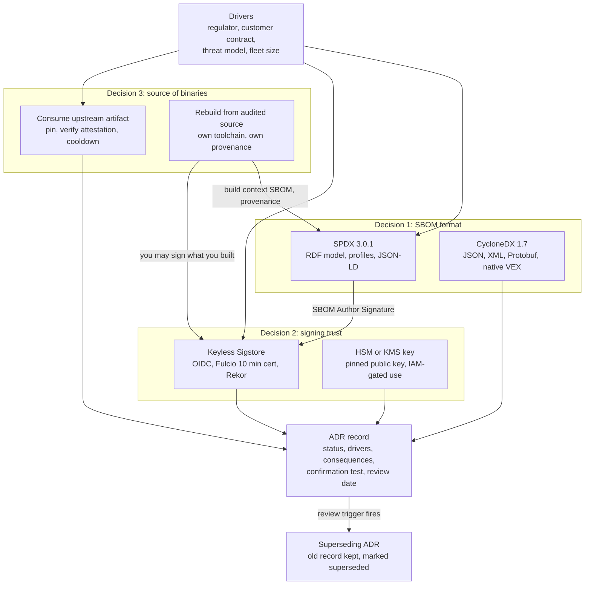

# Software Supply Chain Architecture Decision Records

> [!summary] Claim:
> A supply chain control is a decision with a price, so each one needs a record that names the threat it addresses, the parties it still trusts, the guarantee it does not give, and a test that confirms it is in force.
> Three decisions dominate an enterprise program: which SBOM format to emit (SPDX 3.0.1 or CycloneDX 1.7), whether signing identity comes from ephemeral keyless certificates (Sigstore, 10-minute Fulcio certificates) or from keys held in an HSM or KMS, and whether to consume upstream binaries or rebuild dependencies from source.
> The recurring finding is that each choice moves trust rather than removing it: an HSM protects a key from extraction but not from use, keyless signing replaces a key with an identity policy you must get right, and a rebuild protects against a tampered artifact but not a malicious source.
> Record each decision in a numbered, superseded-not-deleted ADR with a dated review trigger, because the facts it rests on (spec versions, regulator guidance, service availability) change on a known clock.



## The Mechanism

[[SBOM-Standards-SPDX-CycloneDX-and-VEX]] owns the SBOM data models, [[Sigstore-Keyless-Signing-Cosign-Fulcio-and-Rekor]] owns the Sigstore protocol, [[Enterprise-Third-Party-Code-Ingestion-and-Quarantine-Architecture]] owns the quarantine perimeter, and [[Reproducible-Builds-as-a-Security-Control]] owns determinism.
This note owns the comparison between their options: what each option guarantees, what it costs, how it fails, and how to write the choice down.
Every fact below is from the sources in the frontmatter, fetched on 2026-11-21 and re-checked against the same primary sources on 2026-11-22, unless it is marked as this note's own inference or arithmetic.

### 1. Why a decision record, and what shape

Michael Nygard's 2011 post defines the record: a short document with a title, a context, the decision, a status, and the consequences.
Records are numbered sequentially and monotonically, and a number is never reused.
A reversed decision stays in the repository and is marked superseded with a pointer to its replacement, so a reader can reconstruct why the organization believed something at a given time.
MADR 4.0.0 (released 2024-09-17 per its project page) refines this into Context and Problem Statement, an optional Decision Drivers list, Considered Options, and a Decision Outcome that carries Consequences and an optional Confirmation subsection.

Supply chain decisions need four fields that a generic ADR leaves implicit:

| Field | Question it forces | Failure it prevents |
| :--- | :--- | :--- |
| Threat addressed | Which attack from the vault's case studies does this stop? | Buying a control that does not touch your actual exposure |
| Trusted parties after the decision | Who can still forge the guarantee? | Believing a signature proves more than the signer's identity |
| Non-guarantee | What does the control explicitly not prove? | A passing check read as a safety proof |
| Confirmation test and review trigger | What command fails if the control is absent, and what event reopens the decision? | A policy that rots after the first spec release |

The "as of" stamp matters because the inputs expire on a schedule.
CycloneDX said in its news item of 2026-08-05 that version 2.0 was expected in fall 2026 with Ecma ratification in December, and its specification overview still listed 1.7 as the current version on 2026-11-22, so 2.0 had not shipped as a current release (as of 2026-11, Both).
CISA replaced the NTIA minimum elements on 2026-07-29.
Each of those is a review trigger, not background.

### 2. The trust ledger: what each control asserts

Before comparing options, fix the vocabulary.
Every control below produces a claim, and each claim has a set of parties who can falsify it.

| Control | Asserts | Does not assert | Parties still trusted |
| :--- | :--- | :--- | :--- |
| SBOM (any format) | This inventory describes the software, at a stated lifecycle phase | That the inventory is complete or the components are safe | The SBOM author and the generator tool |
| VEX statement | A vulnerability is or is not exploitable in this product | That the author's analysis is right | The statement's author |
| Keyless signature (Sigstore) | An identity, authenticated by an OIDC provider, held a 10-minute certificate and signed this digest at a logged time | That the signing workflow was uncompromised, or the artifact is benign | OIDC provider, Fulcio, Rekor or TSA, the TUF trust root, your identity policy |
| HSM or KMS signature | Someone with permission to use this key signed this digest | Who they were, when they signed, or why | Key custodian, IAM policy on the key, public-key distribution |
| Build provenance (SLSA L2 or L3) | A hosted platform produced this artifact from this source by these steps | That the source was benign | The build platform operator; at L3, its isolation |
| Registry attestation (npm, PEP 740, Go checksum database) | Where a package was built, or that every client sees the same bytes | That the package is free of malicious code | The CI provider and the registry or log |
| Reproducible build | An independent party got the same bytes from the same source | That the source is benign | The source, plus the independence of the rebuilders |
| Rebuild from source | You, not the publisher, produced the binary | That the source or your toolchain is benign | Source, your toolchain's own lineage, your build hosts |

Two source quotes anchor the "does not assert" column.
npm's documentation says provenance lets you "publicly establish where a package was built and who published a package" and that it "does not guarantee the package has no malicious code".
PEP 740 says it "does not increase (or decrease) trust in the index itself" and is "primarily mechanical in nature".
The Go checksum database, launched 2019-08-29, is built on a transparent log of hashes, and the `go` command checks inclusion and consistency proofs before it adds lines to `go.sum`: it guarantees that you see the same bytes as everyone else, not that those bytes are safe.

### 3. Decision 1: SBOM format, SPDX 3.0.1 versus CycloneDX 1.7

#### What the two specifications are

| Property | SPDX 3.0.1 | CycloneDX 1.7 |
| :--- | :--- | :--- |
| Formal standing | The SPDX project states the specification is recognized as ISO/IEC 5962:2021; the project timeline ties that standard to SPDX 2.2.1, prepared for ISO in 2020-08 | ECMA-424; 1.6 is "1st Edition" and 1.7 is "2nd Edition" per the CycloneDX docs; ECMA-424 published 2025-12-10 per the overview |
| Version date | SPDX 3.0.0 released 2024-04 per the project timeline; the 3.0.1 release on the spdx-spec GitHub repository is dated 2024-12-17 | 1.7 released 2025-10-21; described as the final version in the 1.x series |
| Data model | RDF-based model with profiles | Object model of BOM, components, services, vulnerabilities |
| Serializations | JSON-LD 1.1 (context at `https://spdx.org/rdf/3.0.1/spdx-context.jsonld`), Turtle, N-Triples, RDF/XML, plus a canonical JSON serialization | JSON, XML, Protocol Buffers (`vnd.cyclonedx+json`, `vnd.cyclonedx+xml`, `x.vnd.cyclonedx+protobuf`) |
| Scope beyond software | Profiles: Core, Software, Security, Licensing, SimpleLicensing, ExpandedLicensing, Dataset, AI, Build, Lite, Extension | Capabilities: SBOM, SaaSBOM, CBOM, HBOM, ML-BOM, OBOM, MBOM, VDR, VEX, BOV, CDXA attestations, BOM-Link, Common Release Notes Format |
| Vulnerability and VEX | Security profile with `VexAffectedVulnAssessmentRelationship` and its Fixed, NotAffected, and UnderInvestigation peer classes | `vulnerabilities[].analysis` with `state` and `justification` enumerations in the BOM itself |
| Minimal profile | Lite: "minimum set of information required for license compliance"; a package needs copyrightText, packageVersion, suppliedBy, and downloadLocation or packageUrl | No separate minimal profile; required fields are small |

The ISO row is a trap.
ISO/IEC 5962:2021 is the SPDX 2.2.1 line, and the CISA 2026 document cites it for SPDX; it cites ISO/IEC 18670:2025 for a different specification, SWHID.
Do not write "SPDX 3.0 is an ISO standard" into a contract: no source read for this note says so (as of 2026-11).
The CISA document likewise cites ECMA-424 (December 2025) for CycloneDX and ECMA-427 (December 2025) for Package-URL.
The same trap applies to CycloneDX: Ecma's ECMA-424 page lists ISO/IEC DIS 27055, a draft international standard, not a published one (as of 2026-11).

#### What the regulators require

The 2021 NTIA baseline named seven data fields: Supplier, Component Name, Version of the Component, Other Unique Identifiers, Dependency Relationship, Author of SBOM Data, and Timestamp.
The 2026 CISA guidance, issued jointly with NSA, FBI, and international partners (BSI and ANSSI among them), updates and replaces it.
It is format-neutral: it names SPDX and CycloneDX as the two formats currently widely used, says minimum support for automation means supporting all data formats that are widely used, open source, and compatible with existing formats, and says format versions declared deprecated by their maintainers should not be used.
Its new elements are:

| New in 2026 | Why it matters for this ADR |
| :--- | :--- |
| SBOM Author Signature | Ties Decision 1 to Decision 2: the SBOM itself must be signed, so the signing choice must cover SBOMs |
| SBOM Data Format Name and Version | Consumers must reject deprecated format versions, so you need an upgrade clock |
| SBOM Generation Context | Values such as "before build", "build", "after build"; component data differs by phase |
| SBOM Tool Name and Version | Lets a consumer discount a tool with known gaps |
| SBOM Version | Update tracking |
| Component Hash Value and Algorithm | Binds the entry to bytes, which makes the SBOM checkable against Decision 3 |
| Component License | License identifiers, with SPDX license identifiers named as the machine-processable option |

It also changes Supplier Name into Component Producer, because the older field was ambiguous for distributors, and its Coverage element says an SBOM should include all components, "including transitive dependencies" with "no minimum depth".
Its Coverage rationale is an operational test: a recipient should be able to conclude that a new vulnerability does not affect them if the SBOM does not list the component.

The EU Cyber Resilience Act sets a lower bar on depth.
Annex I Part II point 1 of Regulation (EU) 2024/2847 requires "a software bill of materials in a commonly used and machine-readable format covering at the very least the top-level dependencies of the products".
Article 71(2) applies the regulation from 2027-12-11, Article 14 (reporting obligations) from 2026-09-11, and Chapter IV (Articles 35 to 51) from 2026-06-11, so as of 2026-11 the reporting duties already apply and the main product obligations are about 13 months away.
The CRA names no format, so neither SPDX nor CycloneDX is mandated.
BSI TR-03183 Part 2 is the German SBOM technical guideline, at version 2.1.0 on the BSI page, with a mapping between its data fields and both formats; the accepted format versions were not stated on the page read, so this note does not quote them.

#### VEX: three vocabularies, one decision

An SBOM lists what is present, and VEX says what it means.
The decision is which vocabulary your pipeline treats as canonical, because the three do not map one to one.

| Concept | OpenVEX | CycloneDX 1.7 `analysis.state` | CSAF 2.0 `product_status` |
| :--- | :--- | :--- | :--- |
| Affected, act | `affected` | `exploitable` | `known_affected` |
| Not affected | `not_affected` (needs a justification or impact statement) | `not_affected`, `false_positive` | `known_not_affected` |
| Fixed | `fixed` | `resolved`, `resolved_with_pedigree` | `fixed` |
| Not yet decided | `under_investigation` | `in_triage` | `under_investigation` |

This table is this note's proposed alignment of the verified enumerations, not a standard mapping.
OpenVEX justifications are `component_not_present`, `vulnerable_code_not_present`, `vulnerable_code_not_in_execute_path`, `vulnerable_code_cannot_be_controlled_by_adversary`, and `inline_mitigations_already_exist`.
CycloneDX 1.7 justifications are `code_not_present`, `code_not_reachable`, `requires_configuration`, `requires_dependency`, `requires_environment`, `protected_by_compiler`, `protected_at_runtime`, `protected_at_perimeter`, and `protected_by_mitigating_control`.
The lossy points are real: CycloneDX separates `false_positive` from `not_affected` and offers four `protected_*` justifications where OpenVEX has the single `inline_mitigations_already_exist`, while OpenVEX's `vulnerable_code_cannot_be_controlled_by_adversary` has no direct CycloneDX peer.
A conversion that maps `false_positive` to `not_affected` silently drops the distinction between "scanner was wrong" and "product is exposed but safe", and the first becomes a scanner tuning input while the second is a claim someone must be able to defend.

#### The decision and its drivers

There are three coherent policies:

| Policy | Emit | Fits when | Downside |
| :--- | :--- | :--- | :--- |
| A. One canonical format | CycloneDX 1.7 or SPDX 3.0.1 only | Your consumers are your own scanners and a few customers | A customer or regulator asks for the other format and you convert, with field loss |
| B. One canonical model, two renderings | A generator emits both from one internal graph | You ship to many customers, or contracts name a format | Two schemas to validate, and a rendering bug becomes a trust bug |
| C. Accept anything, emit one | Ingest both, emit your preference | You are mostly a consumer | Ingest normalization is the hard part and is where fields are lost |

The recommendation is B for a vendor and C for a pure consumer, with the canonical model carrying the CISA 2026 fields as first-class data so that neither rendering is lossy for them.
The downside of B is the validation bill: every release must validate both outputs against their schemas and round-trip a sample through the scanners you operate.
Pick the format per use, not per company, when the evidence supports it: CycloneDX embeds VEX in the same document and carries a vulnerability object model, while SPDX 3.0.1 has the richest license model (Licensing and ExpandedLicensing profiles) and the ISO lineage.
That pairing is this note's reading of the profile lists above, not a measured tool-support claim, so confirm it with an ingest test (see the Practice Drill) rather than relying on it.

Generation phase is the second axis.
CISA's Generation Context says component data "may differ based on the phase of the software lifecycle".
An SBOM generated from the lockfile before build misses what the build fetched, and one generated by binary analysis after build misses what was compiled in and stripped.
Generate at build time from the same step that records provenance, and record the context value, so the claim matches the evidence.

### 4. Decision 2: keyless Sigstore versus HSM or KMS keys

#### How keyless signing works, and where the trust moved

The flow, from the Sigstore documentation:

1. The signer obtains an OIDC identity token from a provider such as GitHub Actions.
2. Fulcio verifies the token and "signs X.509 certificates valid for 10 minutes" that bind a fresh public key to the identity.
3. The signer signs the artifact digest with the ephemeral private key and discards that key.
4. A transparency log (Rekor) records the signature and certificate, and the log's signed entry timestamp, or an RFC 3161 timestamp, proves signing happened inside the certificate's validity window.
5. A Sigstore bundle packages the certificate, signature, and log or timestamp evidence.

The bundle format (version 0.3.2 in the docs) states that bundles "must include at least one transparency log's signed entry timestamp or an RFC3161 timestamp to provide proof that signing occurred during the certificates validity window".
That is why a verifier can accept a signature a year after its 10-minute certificate expired.
Sigstore distributes its root of trust, "which includes Fulcio's root CA certificate and Rekor's public key", through The Update Framework (TUF), and "Clients MUST NOT trust certificates that are not in the log".

Fulcio binds the authenticated identity into the certificate.
The verifier checks it with `--certificate-identity` or `--certificate-identity-regexp`, and checks the issuer with `--certificate-oidc-issuer` or `--certificate-oidc-issuer-regexp`; cosign requires one of each form for keyless flows, and its help text says valid identity values include email addresses, DNS names, IP addresses, and URIs.
The Fulcio OID registry carries machine-readable build facts as extensions, all DER-encoded strings from `1.3.6.1.4.1.57264.1.8` upward:

| OID | Field | Example from the registry |
| :--- | :--- | :--- |
| `1.3.6.1.4.1.57264.1.8` | Issuer (V2) | URI of the OIDC provider that signed the token |
| `1.3.6.1.4.1.57264.1.9` | Build Signer URI | For GitHub, `server_url` plus `job_workflow_ref`; a reusable workflow ref |
| `1.3.6.1.4.1.57264.1.10` | Build Signer Digest | Immutable commit SHA of the build instructions |
| `1.3.6.1.4.1.57264.1.11` | Runner Environment | `[platform]-hosted` or `self-hosted` |
| `1.3.6.1.4.1.57264.1.12` | Source Repository URI | Fully qualified repository URL |
| `1.3.6.1.4.1.57264.1.13` | Source Repository Digest | Immutable commit SHA of the source |

The older `1.3.6.1.4.1.57264.1.1` through `.1.6` extensions, including the original Issuer, are marked deprecated in the registry in favor of the provider-generic `.1.8` and later.
Policies written against `.1.1` will break as Fulcio deployments drop them, so a policy engine should read `.1.8`.

The result is that keyless signing has no key to steal, and the security of the signature collapses onto three things you must now own:

- The identity policy, meaning the exact workflow, ref, and repository the verifier will accept.
- The integrity of the workflow that obtains the token, because a compromised workflow receives a perfectly valid certificate.
- The availability and trust of the Sigstore services and trust root, unless you run your own.

#### What the public good instance gives and costs

Sigstore's Rekor documentation states that "the public instance offers an SLO of 99.5% availability and is monitored by an oncall team".
The Rekor v2 README states a 99.5% availability SLO for the community-hosted instance, and says its URL changes about every six months through log sharding.
This note's arithmetic: a 99.5% SLO permits 0.5% of a 30-day month, 3.6 hours, of downtime, and a release pipeline that signs synchronously inherits that budget.
The status page on 2026-11-22 showed "99.952% uptime" for the Rekor log, "99.851%" for the Rekor v2 log, and "100%" for Fulcio, with no measurement window stated, so treat those as observations, not guarantees.
The status page listed only the previous seven days of incident history (2026-11-16 to 2026-11-22, all "No incidents reported"), so it cannot confirm or refute any earlier outage and this note makes no claim about one.
The status page did not state an SLO.

Two more operational facts bear on the decision (both as of 2026-11, Both):

- The Sigstore blog of 2026-06-28 says the public good instance "will continue using Rekor v1 as the default log for the foreseeable future" and that Rekor v2 "introduces breaking changes in client behavior".
- Cosign v3.1.1 made the Sigstore bundle format the default output for signing and default input for verifying, and deprecated the older flags for removal in a future v4; the same release moved DSSE attestation logging to Rekor v2 as hashed entries.
  Cosign v3.1.4 was the latest release on 2026-10-20.
- The Sigstore blog of 2026-11-16 says the public good log now accepts only the `hashedrekord`, `dsse`, `intoto` (v0.0.1 and v0.0.2), `rekord`, and `helm` entry types, and tells client authors to generate `hashedrekord`; a custom integration that uploads any other Rekor type to the public instance now fails.

Your pinned cosign version is therefore part of the decision, because the bundle and log formats it reads and writes changed within the v3 line.

For GitHub-hosted builds the choice is partly made for you.
GitHub's documentation says public repositories use the Sigstore public good instance and write an entry to a "publicly readable" transparency log, while private repositories use GitHub's own Sigstore instance, which "does not have a transparency log and only federates with GitHub Actions".
Artifact attestations alone provide "SLSA v1.0 Build Level 2".
If the existence of a private repository's name or workflow path in a public log is itself sensitive, that single fact selects GitHub's private instance or a self-hosted stack.

#### How HSM and KMS signing works, and what it actually protects

Cosign signs with a key held in a provider through a go-cloud style URI: `awskms://`, `gcpkms://`, `azurekms://`, `hashivault://`, `openbao://`, `ovhcloud://`, and `k8s://`.
Hardware tokens go through PKCS11: `cosign pkcs11-tool list-keys-uris --module-path ...` prints a `pkcs11:` URI with `token`, `slot-id`, `id`, and optional `module-path` and `pin-value` attributes, and if the URI lacks `module-path` cosign reads `COSIGN_PKCS11_MODULE_PATH`.
Local keys support RSA (PKCS#1 v1.5 padding only), ECDSA, and ED25519.

```bash
# not run here: syntax from the cosign sign-blob and verify-blob reference pages
cosign sign-blob --key awskms://[ENDPOINT]/[ID/ALIAS/ARN] --bundle app.sigstore.json app.tgz
cosign verify-blob --bundle app.sigstore.json --key cosign.pub app.tgz
```

The guarantee is narrower than keyless in identity and time, and stronger in independence:

| Property | Keyless (Sigstore) | KMS or HSM key |
| :--- | :--- | :--- |
| Key extraction | Impossible, the key lives minutes and is discarded | Prevented by the module boundary |
| Key use | Anyone who can present a token matching the policy to the CA | Anyone whose IAM or token policy allows `Sign` on that key |
| Signer identity | Bound in the certificate, verified by policy | Not in the signature; implied by who holds the key |
| Signing time | Proven by log entry or timestamp | Absent unless you add a log entry or RFC 3161 timestamp |
| Revocation | A leaked identity yields short-lived certs; revoke by changing the policy | Remove the public key from every verifier's trust store |
| Verify-time dependencies | Trust root (TUF), bundle evidence; no signer needed | A pinned public key; no network |
| Sign-time dependencies | OIDC provider, Fulcio, Rekor or TSA | The key service |
| Rotation | Not needed for the signer; the trust root rotates | You own rotation and public-key distribution |

The central point is the "key use" row.
An HSM stops an attacker who has stolen a host from copying the key out; that is the module boundary FIPS validation is about.
It does not stop that attacker, or a compromised CI job, from asking the module to sign.
A KMS key is a signing oracle protected by its access policy, so a team that holds the key in an HSM but lets any CI job in the organization call `Sign` has the cost of an HSM and the guarantee of a shared password.
The practical form of the hybrid is to hold the key in KMS and gate `Sign` on the workload identity of one release pipeline through the cloud provider's OIDC federation (the provider's IAM and federation documents were not fetched for this note, so treat that mechanism as a design to verify, not a quoted fact).

#### Hardware assurance and the FIPS facts

FIPS 140-3 defines "four increasing, qualitative levels of security: Level 1, Level 2, Level 3, and Level 4".
AWS states that all key material for KMS keys generated in its HSMs, and all operations needing decrypted key material, stay "strictly within FIPS 140-3 Security Level 3 boundary" of those HSMs (AWS KMS features page, as of 2026-11).
Google Cloud KMS documents HSM-protected keys as operating in "FIPS 140-2 Level 3 validated HSMs" and software keys as using "FIPS 140-3 Level 1" validated primitives (as of 2026-11); EXTERNAL and EXTERNAL_VPC protection levels carry no FIPS level on that page.
The NIST CMVP page (updated 2026-11-20) says FIPS 140-3 validated modules stay on the Active list for 5 years (2 years for interim validations), that FIPS 140-2 active modules could be used for new systems until 2026-09-21, and that after that date FIPS 140-2 certificates move to the Historical list, usable for existing systems only.
That date has passed as of 2026-11, so a design that cites a 140-2 module, such as the Cloud HSM wording quoted here, must check the module's current certificate state before claiming FIPS custody for a new system.
The FIPS 140-3 text states that it "aligns with ISO/IEC 19790:2012(E)", with testing per ISO/IEC 24759:2017(E), so the per-level physical and operational requirements live in those paid ISO documents and are not restated here; cite a module's certificate level, not a paraphrase of what a level means.

#### Cost and throughput numbers

From the AWS KMS pricing page (as of 2026-11, no effective date shown on the page):

- A customer managed key costs "$1/month (prorated hourly)", symmetric or asymmetric.
- The page's own file-signing example prices asymmetric ECC 256 requests at "$0.15 per 10,000 requests".
- The 20,000-request monthly free tier excludes asymmetric operations.
- Its example also shows "$1.60 / HSM / hour" for a US East (N. Virginia) cluster; the CloudHSM pricing page itself lists no rate, so treat that as an example only.

This note's arithmetic from those inputs: 1,000,000 ECC signatures cost 100 x $0.15 = $15.00, and one example HSM running 730 hours costs about $1,168 before any high-availability pair.
The throughput limit is the shared request quota: the AWS KMS quota page lists "1,000 (shared)" requests per second for RSA keys and for elliptic curve keys (as of 2026-11).
A release process signing hundreds of artifacts per release is nowhere near that, but per-request signing of every container layer or every SBOM from a large fleet can be.

#### Who holds the trust root

Both options end at a root someone controls.
Sigstore's TUF repository is maintained by five listed keyholders who sign changes "with their personal hardware keys", with online metadata re-signed by KMS keys at least every three days because of online-signature expiry (root-signing README).
The published root metadata (version 16, expiring 2027-04-22) requires 3 of 5 signatures for the root and targets roles and 1 of 1 online key for snapshot and timestamp (as of 2026-11).
The TUF specification (1.0.37) defines the four top-level roles, root, targets, snapshot, and timestamp, says the root role delegates trust to the keys for all others, and says root keys "should be kept offline".
If you run a private Fulcio and Rekor, you become the operator of that root, and the HSM question returns one level up: the CA key and the TUF root keys need custody, ceremony, and rotation.
The Fulcio documentation says it "can also be deployed as a self-hosted service", Rekor "can also be run on its own", and the Rekor v2 repository ships "prebuilt binaries and containers for private deployments".

#### The decision

| Use case | Recommended | Reason | Downside accepted |
| :--- | :--- | :--- | :--- |
| Build provenance and release artifacts from hosted CI | Keyless, identity pinned to the release workflow | No key custody, per-build identity, time proof | Dependency on Sigstore services and your identity policy |
| Private repositories with sensitive names | GitHub's private instance or a private Sigstore stack | No public log entry | No public transparency, and you operate or trust the instance |
| Air-gapped deployment, offline verifiers, long-lived devices | KMS or HSM key, public key pinned in the verifier | No network or trust-root refresh needed at verify time | No identity or time proof unless added; rotation burden |
| FIPS-validated custody mandated by contract | KMS or HSM key with `Sign` gated by workload identity | The module is the compliance boundary | You carry the signing-oracle risk and must test the gate |
| The trust root itself (private CA, TUF root) | Offline HSM with a threshold and a ceremony | Nothing above it can vouch for it | Ceremony cost and key-holder logistics |

The default is keyless for CI-built artifacts and SBOMs, and an HSM only where one of the last three rows applies.
Do not run both for the same artifact class without a rule for what a verifier does when they disagree.

### 5. Decision 3: consume upstream binaries or rebuild from audited source

The question is a spectrum, not a switch.

| Level | Practice | What it adds |
| :--- | :--- | :--- |
| 0 | Install by name and range from the public registry | Nothing |
| 1 | Pin by digest, verify upstream attestations where they exist | Same bytes as everyone, and where the publisher built them |
| 2 | Mirror and quarantine with a cooldown (see [[Enterprise-Third-Party-Code-Ingestion-and-Quarantine-Architecture]]) | Time for the community to find a bad release |
| 3 | Rebuild from the release source archive with your build system | Your toolchain and environment produce the binary |
| 4 | Rebuild from the version-control source at an audited commit, with provenance | The source you reviewed is the source built |
| 5 | Also rebuild the toolchain from audited or bootstrapped inputs | The compiler is no longer an inherited unknown |

#### What a rebuild protects against, and what it does not

A rebuild defeats a tampered upload: a stolen publisher credential used to push a binary that does not match the source, or a mirror that serves different bytes.
It does not defeat a malicious source.
The xz case shows both sides.
Andres Freund's disclosure states that "the upstream xz repository and the xz tarballs have been backdoored", that "one portion of the backdoor is solely in the distributed tarballs", and that the tarball-only `build-to-host.m4` line "is not in the upstream source of build-to-host, nor is build-to-host used by xz in git".
A Level 3 rebuild from the release tarball would have built the backdoored m4 anyway.
A Level 4 rebuild from the Git tag would have skipped that tarball-only piece, but the extraction script read data from test `.xz` files that were in the repository, so the repository still carried payload and a source review that did not read binary test fixtures would have missed it.
The detection drill is [[Drill-Supply-Chain-Detect-Tarball-vs-Git-Tag-Backdoor]] and the full account is [[Case-Study-XZ-Utils-Backdoor-CVE-2024-3094]].

The SolarWinds Orion compromise is the case where a rebuild by the publisher is itself the attack surface.
CISA's alert AA20-352A says the adversary added a malicious version of `solarwinds.orion.core.businesslayer.dll` into the software lifecycle, "which was then signed by the legitimate SolarWinds code signing certificate".
A valid signature from the publisher's own certificate and a build the publisher ran itself were both present, and the artifact was still malicious.
CrowdStrike's SUNSPOT analysis describes malware in the build that "replaces one of the source files".
That is the case for reproducible builds with independent rebuilders ([[Case-Study-SolarWinds-Orion-SUNBURST]]), and it is the reason a rebuild you run on a build platform you also trust is weaker than one a second party reproduces.

#### Reproducibility turns rebuild into verification

The Reproducible Builds definition is that "any party can recreate bit-by-bit identical copies of all specified artifacts" given the same source, build environment, and build instructions.
If a package is reproducible, trusting a binary no longer needs you to rebuild everything: a second party's matching result is evidence, and SLSA v1.2 even allows a Build L2 provenance to be produced by "an after-the-fact reproducible build, or some equivalent system".
Measured at scale, the Debian reproducibility test page showed on 2026-11 (amd64):

| Suite | Reproducible | Source packages | Share |
| :--- | :--- | :--- | :--- |
| forky | 38,472 | 40,028 | 96.1% |
| unstable | 39,762 | 41,843 | 95.0% |

The page's footer read "Last update: 2026-11-22 02:02 UTC" when fetched, and it does not label which suite is stable or testing (as of 2026-11, Linux).
By this note's subtraction 1,556 forky source packages are not in the reproducible column; the page itself lists 1,050 of them as unreproducible and 328 as failing to build, so even in the best-instrumented distribution the tail is real work.
The Go toolchain is the clean single-vendor case: since Go 1.21.0 (blog post of 2023-08-28) release builds are verified bit for bit on both a trusted Linux/x86-64 and a Windows/x86-64 system, and the `gorebuild` verifier runs nightly.

#### Trusting trust, and why Level 5 exists

Thompson's 1984 Turing lecture shows that a compiler can be modified to insert a backdoor into programs it compiles, including into new copies of itself, so the backdoor survives a clean source.
David Wheeler's diverse double-compiling defense compiles the compiler source with a second, trusted compiler and then recompiles the source with the result; "if the result is bit-for-bit identical with the untrusted executable", the executable matches its source.
A rebuild that starts from a binary compiler you did not build only relocates the trust to that compiler, so Level 5 matters for the few components that sit under everything else.

#### What the vendors offer, and the ecosystem split

Google's Assured Open Source Software documentation says its packages are "built by Google in a secure manner", meet SLSA level 3 requirements, carry signed provenance and an SBOM, and number "more than one thousand" Java, Go, Python, and JavaScript (npm) packages, with Python, Go, and Java in the free tier and JavaScript in premium (as of 2026-11).
That documentation does not use the words "from source", so the exact build input was not confirmed.
Buying such a feed is Level 3 or 4 outsourced, with a new party in the trust ledger and a new availability dependency.

Which ecosystems even ship a binary matters, because "consume binaries" applies unevenly:

| Ecosystem | What the registry distributes | What an attestation proves | Rebuild decision |
| :--- | :--- | :--- | :--- |
| C and C++ (distribution packages, tarballs) | Source tarballs and distro binaries | Distro-level reproducibility data, where measured | Highest value: native code, build-time scripts, privileged runtime |
| Python | Wheels (prebuilt) and sdists | PEP 740 attestations: signing identity such as a Trusted Publisher, digest match; "does not increase (or decrease) trust in the index" | Prefer source builds for native extensions; wheels hide the build |
| JavaScript | Tarballs, some with native prebuilds | npm provenance from GitHub Actions or GitLab CI/CD cloud-hosted runners, npm CLI 9.5.0 or later; proves build location and publisher | Source is already the artifact for pure JS; risk is install scripts and prebuilt natives |
| Rust | Crate sources, compiled by the consumer | Trusted Publishing (RFC 3691, accepted) shipped for GitHub Actions in July 2025 and added GitLab CI/CD and a Trusted-Publishing-only mode by the 2026-01-21 update; it authenticates the publishing CI identity with short-lived tokens (as of 2026-11) | Already a source build, so the question is which source and which toolchain |
| Go | Module sources via the module mirror, checked against the checksum database | Same bytes for everyone via a transparent log | Already a source build; the toolchain is reproducible since 1.21 |

#### The decision rule

Rebuild a dependency from audited version-control source when at least one holds:

1. It contains native code or runs code at build or install time.
2. It is in the trust path of authentication, signing, or transport (compression and crypto libraries linked into `sshd` are the canonical example).
3. There is no upstream attestation, or the attestation names an identity or ref you cannot pin.
4. You must backport fixes on your schedule, not upstream's.

Consume with pin, attestation verification, and cooldown otherwise.
Measure the rebuild set, not the whole graph: a rebuild program covering every transitive dependency of every service has to build its own build-dependency closure, patch queue, and toolchain lineage, and its cost grows with the graph while the audited-source claim shrinks with every unreviewed line.
Debian's 41,843 unstable source packages is a scale reference for what "rebuild everything" means for one distribution.
The confirmation test for a rebuild decision is the reproducibility check: build twice in different directories on different hosts and diff the artifacts (see [[Reproducible-Builds-as-a-Security-Control]]).

### 6. How the three decisions interact

- A rebuilt artifact carries the SBOM and provenance you generated at build context, which is the generation phase that gives the best component data, so Decision 3 improves Decision 1.
- The SBOM Author Signature element and any VEX statements are signed objects, so Decision 2 must cover them: a keyless signature on a CycloneDX document through `cosign attest` keeps the same identity policy as the artifact it describes.
- Provenance is the object that makes Decision 2 meaningful: a signature on a binary says who signed it, and a [[SLSA-Framework-Build-and-Source-Tracks]] provenance statement says how it was built.
  The in-toto envelope that carries both is owned by [[In-Toto-Layouts-Link-Metadata-and-DSSE-Attestations]].
- A rebuild you cannot sign is only an internal fact, so Decision 3 at Level 3 or above creates the signing workload that Decision 2 secures.

### 7. ADR template for this pillar

```markdown
# ADR-NNNN: <short decision title>

- Status: proposed | accepted | deprecated | superseded by ADR-MMMM
- Date: YYYY-MM-DD
- Review trigger: <date or external event, such as a spec release or a regulator date>

## Context and problem statement
<The threat, the case study it maps to, the constraint.>

## Decision drivers
- <Regulator or contract text, with citation>
- <Threat-model fact>
- <Fleet size, latency, availability, cost limits with units>

## Considered options
1. <Option A>
2. <Option B>

## Decision outcome
Chosen: <option>, because <driver that decided it>.

### Trusted parties after this decision
<Who can still falsify the guarantee.>

### Non-guarantees
<What a passing check does not prove.>

### Consequences
- Good: ...
- Bad: ... (name the downside)
- Cost: <money per unit, operator hours, latency>
- Reversal cost: <what migrating away takes>

### Confirmation
<The command or test that fails if this decision is not in force, and where it runs.>
```

## Commands and Numbers to Know

| Item | Value | Platform | Source |
| :--- | :--- | :--- | :--- |
| Fulcio certificate validity | 10 minutes (as of 2026-11) | Both | Fulcio overview |
| Rekor public instance SLO | 99.5% availability, about 3.6 hours per 30-day month (as of 2026-11) | Both | Rekor overview, arithmetic |
| Default public good log | Rekor v1 "for the foreseeable future" (2026-06-28 blog, as of 2026-11) | Both | Sigstore blog |
| Latest cosign | v3.1.4, released 2026-10-20 (as of 2026-11) | Both | cosign releases |
| Verify keyless blob | `cosign verify-blob --bundle B --certificate-identity ID --certificate-oidc-issuer ISS BLOB` (as of 2026-11) | Both | cosign verify-blob reference |
| Verify with KMS key | `cosign verify-blob --bundle B --key awskms://... BLOB` (as of 2026-11) | Both | cosign verify-blob reference |
| Fulcio issuer and build OIDs | `.1.8` Issuer, `.1.9` Build Signer URI, `.1.12` Source Repository URI, `.1.13` Source Repository Digest (as of 2026-11) | Both | Fulcio oid-info |
| Deprecated Fulcio OIDs | `1.3.6.1.4.1.57264.1.1` through `.1.6` (as of 2026-11) | Both | Fulcio oid-info |
| KMS providers cosign supports | AWS, GCP, Azure Key Vault, HashiCorp Vault, OpenBao, OVHcloud KMS, Kubernetes Secrets (as of 2026-11) | Both | cosign key management |
| AWS KMS key price | $1/month per key, prorated hourly (as of 2026-11) | Both | AWS KMS pricing |
| AWS KMS asymmetric ECC requests | $0.15 per 10,000 in the pricing page example (as of 2026-11) | Both | AWS KMS pricing |
| AWS KMS asymmetric rate limit | 1,000 per second shared, RSA; 1,000 per second shared, ECC (as of 2026-11) | Both | KMS quotas |
| AWS KMS HSM boundary | FIPS 140-3 Security Level 3 (as of 2026-11) | Both | AWS KMS features |
| Cloud KMS HSM protection level | FIPS 140-2 Level 3 validated HSMs; 140-2 certificates are Historical (existing systems only) after 2026-09-21 (as of 2026-11) | Both | Cloud KMS protection levels, NIST CMVP |
| Sigstore TUF root threshold | root and targets 3 of 5, snapshot and timestamp 1 of 1, root version 16 (as of 2026-11) | Both | tuf-repo-cdn.sigstore.dev |
| CycloneDX | 1.7, 2025-10-21, ECMA-424 2nd edition; 2.0 expected fall 2026 per 2026-08-05 news, overview still lists 1.7 as current on 2026-11-22 (as of 2026-11) | Both | CycloneDX overview, news |
| SPDX | 3.0.1 specification; ISO/IEC 5962:2021 is the SPDX 2.2.1 line (as of 2026-11) | Both | SPDX spec, spdx.dev |
| SBOM minimum elements | CISA 2026, 2026-07-29, replaces NTIA 2021 (as of 2026-11) | Both | CISA |
| EU CRA dates | Chapter IV from 2026-06-11, Article 14 from 2026-09-11, general application 2027-12-11 | Both | Regulation 2024/2847, Art. 71 |
| Debian reproducibility | forky/amd64 96.1% (38,472 of 40,028); unstable/amd64 95.0% (39,762 of 41,843) (as of 2026-11) | Linux | Debian reproducible page |
| SLSA Build levels | L1 provenance, L2 signed provenance from a hosted platform, L3 hardened platform (as of 2026-11, SLSA v1.2) | Both | SLSA build track basics |
| ADR template | MADR 4.0.0, 2024-09-17 | Both | adr.github.io |

## Multi-Language Comparison

The concern spans ecosystems, so the table compares how each one answers the three decisions.

| Concern | C and C++ | Python | Rust | Go and JavaScript |
| :--- | :--- | :--- | :--- | :--- |
| Dominant artifact | Source tarballs, distro binaries, static or shared libraries | Wheels and sdists | Crate source, built by the consumer | Go: module source; JavaScript: tarballs |
| Where the upstream attestation comes from | Distro build farms, reproducibility tests | PEP 740 attestations from a Trusted Publisher | crates.io Trusted Publishing from GitHub Actions or GitLab CI/CD (publisher identity, not build provenance) | Go: checksum database; npm: provenance from supported hosted CI |
| What the attestation misses | Source-level backdoors such as xz | Malicious source, and the index itself | Malicious source and build scripts | npm: "does not guarantee the package has no malicious code"; Go: safety |
| Rebuild value | Highest; native code and build-time scripts | High for native extensions, low for pure Python | Already source; pin the toolchain and vendor | Go: toolchain reproducible since 1.21; npm: install scripts are the exposure |
| SBOM build-context data | Compiler and linked libraries visible only at build | Wheel metadata hides what a native wheel vendors | Lockfile precise, toolchain separate | Go module graph in the binary; npm lockfile |
| Signing fit | Keyless for CI, KMS for distro roots | Keyless via the publisher; verify by identity | Keyless for CI; token issuance moves to OIDC | Keyless via GitHub Actions identity |

## Worked Lab Example

This note has no lab: the decisions are policy choices, so the exercise is to write and test one record.
Nothing below was run, and the commands show syntax from the cosign reference pages, not output.

The scenario is a private-repository service, "payments-gateway", of a hypothetical company.
The inputs are illustrative, not measured: about 100 signatures a month (20 releases of 5 artifacts), customers with air-gapped sites that verify offline, and a contract clause demanding FIPS-validated key custody.

```markdown
# ADR-0007: Release signing for payments-gateway

- Status: accepted
- Date: 2026-11-21
- Review trigger: any of cosign v4 release, FIPS certificate expiry of the KMS module, or a customer without offline verification

## Context and problem statement
Air-gapped customers verify offline, and the contract requires FIPS-validated custody.
The repository is private, and its name must not appear in a public transparency log.

## Decision drivers
- Offline verification at customer sites (no trust-root refresh)
- FIPS-validated module as the custody boundary
- Private repository: no public log entry
- About 100 signatures per month (illustrative)

## Considered options
1. Keyless, public good Sigstore
2. Keyless, private Sigstore stack
3. KMS key (ECC), `Sign` gated to the release workload identity
4. Offline HSM key signing by hand

## Decision outcome
Chosen: option 3, because offline verification and FIPS custody rule out options 1 and 2, and option 4 cannot meet release cadence.

### Trusted parties after this decision
The cloud provider's KMS and its IAM, the release workflow's identity policy, and our public-key distribution channel.

### Non-guarantees
A signature does not say who ran the release, when, or that the source was benign.
Time is recorded in our own append-only release ledger, not a transparency log.

### Consequences
- Good: customers verify with one pinned public key and no network.
- Bad: no identity or time proof in the signature; we own rotation and revocation by publishing a new key.
- Cost: $1/month for the key plus 100 requests at $0.15 per 10,000 requests, about $0.0015 per month in requests (arithmetic from the AWS KMS pricing page example).
- Reversal cost: moving to keyless requires every customer verifier to take a trust-root and policy update.

### Confirmation
CI job `verify-release` runs `cosign verify-blob --bundle app.sigstore.json --key cosign.pub app.tgz` on every artifact.
A negative test signs with a different key and must fail.
A policy test asserts that `Sign` from a workflow on a non-release ref is denied by the key policy.
```

Reading the record: the chosen option is correct only if the last confirmation line is true, because without the gate the HSM boundary protects a key that any job can use.
That line is the one that fails when someone widens the IAM trust policy, which is the common regression.

## Pitfalls

> [!warning] Pitfall 1: Reading an SBOM format choice as a compliance decision
> The CRA names no format, and the 2026 CISA guidance asks for support of all widely used, open, compatible formats and says deprecated format versions should not be used.
> Choosing a format to "be compliant" misses the real obligations: transitive coverage, a signature, the generation context, and an upgrade clock.

> [!warning] Pitfall 2: Claiming an ISO standard for SPDX 3.0
> The SPDX project timeline ties ISO/IEC 5962:2021 to SPDX 2.2.1, and none of the sources read here states that 3.0.1 is an ISO standard.
> A contract that says "ISO SPDX" without a version number is ambiguous in either direction.

> [!warning] Pitfall 3: Lossy VEX conversion
> Mapping CycloneDX `false_positive` to `not_affected` merges a scanner defect with a defended exposure claim, and a downstream consumer reads both as a vendor assertion.

> [!warning] Pitfall 4: A keyless policy that accepts too much
> An identity regexp that matches a whole organization accepts any workflow file at any ref in it, including a feature-branch workflow someone can edit.
> Pin the exact workflow path and tag ref, and read `.1.8` for the issuer, not the deprecated `.1.1`.

> [!warning] Pitfall 5: HSM theatre
> Holding the key in an HSM while any CI job can call `Sign` gives the cost of a module and the guarantee of a shared credential.
> Test the use gate as hard as the extraction boundary.

> [!warning] Pitfall 6: Synchronous dependency on the public log
> A release that cannot sign when the Rekor public instance is down inherits a 99.5% SLO, about 3.6 hours a month.
> Use retries and queueing, and decide in the ADR whether a fallback key is allowed, because a fallback key silently turns the strong option into the weak one.

> [!warning] Pitfall 7: Rebuilding the tarball
> A "rebuild from source" program that builds from release tarballs inherits every tarball-only difference, which is exactly where the xz m4 payload lived.
> Build from a reviewed commit and compare against the tarball.

> [!warning] Pitfall 8: Mutable references in the build graph
> The tj-actions/changed-files compromise (CVE-2025-30066) was possible because attackers "retroactively modified multiple version tags to reference a malicious commit", exposing CI secrets in logs on 2025-03-14 and 2025-03-15.
> A tag is a mutable pointer, so a rebuild or a signing workflow that references actions or sources by tag has re-opened the hole the rebuild was meant to close.
> The advisory also tells workflows that referenced the malicious commit directly by SHA to update, which shows the limit of pinning: a pinned SHA must itself be vetted.

## At Scale

| Scale | Typical posture | Decision rule |
| :--- | :--- | :--- |
| 1 to 10 engineers | One format emitted by the build tool; keyless via the CI provider; consume with lockfile pins | Do not run infrastructure; adopt what the CI platform offers by default |
| 100 engineers | CycloneDX or SPDX from a single generator; VEX tracked per release; keyless with exact identity pins; mirror and cooldown | Write the first three ADRs; assign an owner for the review trigger |
| 1,000 engineers | One canonical SBOM model rendered to both formats; signed SBOMs; private Sigstore or KMS for regulated lines; rebuild tier for native and trust-path dependencies | Rebuild only where a rule from Decision 3 fires; measure reproducibility and track it as a metric |
| 10,000 to 50,000 engineers | Paved road: one signing service, one SBOM pipeline, one rebuild farm with reproducibility checks and independent verification | Reversal cost dominates, so require a Confirmation test and a review date on every ADR |

Decision rules that change with scale:

- Sign-time availability: a synchronous public-log dependency is tolerable with retries while a 3.6-hour monthly outage budget is acceptable, and when volume or release deadlines make it unacceptable, run a private log or batch with a queue.
- Ownership: at 1,000 or more engineers each rebuilt dependency needs an owning team, because a rebuild with no owner is a patch backlog.
- Verification: an organization with air-gapped customers must treat offline verification as a requirement that outranks the identity features of keyless signing.
- Governance: keep the ADR set small and numbered; a superseding ADR beats an edited one, because the old record shows what the organization knew when it chose.

## Practice Drill

> [!tip] Practice Drill: Ingest test, then forgery test
> 1. Generate an SBOM for one real service in both CycloneDX 1.7 and SPDX 3.0.1 and feed both to every scanner you operate; record which of the CISA 2026 fields (hash, license, generation context, tool name) survive ingestion.
> 2. Write ADR-0001 choosing a format policy (A, B, or C) with a Confirmation test that fails when a required field is dropped.
> 3. Complete [[Drill-Supply-Chain-Verify-and-Reject-Forged-SLSA-Provenance]] and then write the identity policy that would reject its forgery as a keyless `--certificate-identity` check.
> 4. Take the xz timeline in [[Case-Study-XZ-Utils-Backdoor-CVE-2024-3094]] and state, for Levels 0 to 5, which levels would have prevented each part of the backdoor.

## Interview Questions

> [!question] L5: Your customer asks for "an SBOM in the ISO format". What do you ask back, and what do you deliver?
> > [!success]- Answer
> > The SPDX timeline ties ISO/IEC 5962:2021 to SPDX 2.2.1, so ask which format and version they mean and whether their tool reads SPDX 3.0.1.
> > The 2026 CISA guidance is format-neutral: it asks for support of all widely used, open, compatible formats and says deprecated format versions should not be used.
> > Deliver the format they can ingest, rendered from one internal model, with the CISA 2026 fields (hash, license, generation context, tool name and version, author signature), and say so in the delivery note.
> > Do not promise an ISO claim for SPDX 3.0.1, because no source read supports it.

> [!question] L5: A Fulcio certificate lives 10 minutes, yet a verifier accepts a signature made last year. How?
> > [!success]- Answer
> > The bundle carries a transparency log entry with a signed entry timestamp, or an RFC 3161 timestamp, that proves the signature was made inside the certificate's validity window.
> > The verifier checks the certificate chain against the TUF-distributed Fulcio root, checks the log or timestamp evidence against the trust root, and checks the identity and issuer against policy.
> > The certificate expiring does not matter, because the claim is "this identity signed during the window", not "the certificate is valid now".

> [!question] L6: Why is "we keep the signing key in an HSM" not a complete answer to a signing audit?
> > [!success]- Answer
> > An HSM prevents extraction of the key, and its FIPS validation attests the module boundary.
> > It does not constrain who may use the key: any identity allowed to call `Sign` can sign anything, so the guarantee equals the strength of the access policy.
> > A complete answer shows the gate (which workload identity, which ref), a negative test that a job outside it is denied, how the public key is distributed and rotated, and how signing time is recorded, since a bare key signature carries no time.

> [!question] L6: Map OpenVEX statuses onto CycloneDX analysis states and name what is lost.
> > [!success]- Answer
> > `affected` maps to `exploitable`, `fixed` to `resolved` or `resolved_with_pedigree`, `under_investigation` to `in_triage`, and `not_affected` to `not_affected`.
> > CycloneDX also has `false_positive`, which separates "the scanner was wrong" from "present but not exploitable", and a conversion to `not_affected` merges them.
> > Justification vocabularies differ too: CycloneDX has four `protected_*` values where OpenVEX has one `inline_mitigations_already_exist`, and OpenVEX's `vulnerable_code_cannot_be_controlled_by_adversary` has no direct CycloneDX peer.
> > Pick one canonical vocabulary and keep the original value alongside any converted one.

> [!question] L6: Predict the output.
> ```python
> import re
>
> want = "https://github.com/acme/app/.github/workflows/release.yml@refs/tags/v"
> sans = [
>     "https://github.com/acme/app/.github/workflows/release.yml@refs/tags/v1.4.0",
>     "https://github.com/acme/app/.github/workflows/release.yml@refs/heads/main",
>     "https://github.com/acme/app-fork/.github/workflows/release.yml@refs/tags/v9",
>     "https://github.com/acme/app/xgithub/workflows/release.yml@refs/tags/v1",
> ]
> loose = re.compile(want)
> tight = re.compile(re.escape(want) + r"[0-9]+\.[0-9]+\.[0-9]+")
> print([bool(loose.search(s)) for s in sans])
> print([bool(tight.fullmatch(s)) for s in sans])
> ```
> > [!success]- Answer
> > Captured by running the snippet on 2026-11-21 and again on 2026-11-22 with identical output (Python 3.15.2, macOS arm64):
> > ```text
> > [True, False, False, True]
> > [True, False, False, False]
> > ```
> > The loose pattern leaves the dots unescaped and is unanchored, so the fourth identity matches because `.` matches the `x` in `xgithub`, and it also accepts any tag beginning with `v`.
> > The tight pattern escapes the literal, requires three numeric tag components, and uses `fullmatch`, so only the first identity passes.
> > Cosign accepts regular expressions in Go RE2 syntax through `--certificate-identity-regexp`; the same escaping and anchoring discipline applies, and the exact `--certificate-identity` form avoids the problem.

> [!question] L7: Debug this. A verifier accepted a release signed by a workflow on a feature branch.
> ```bash
> cosign verify-blob \
>   --bundle app.sigstore.json \
>   --certificate-identity-regexp 'https://github.com/acme/app/.*' \
>   --certificate-oidc-issuer https://token.actions.githubusercontent.com \
>   app.tgz
> ```
> > [!success]- Answer
> > The regexp accepts any identity under that prefix, which, if the identity is the workflow reference URI, covers every workflow file at every ref in the repository, including one on a branch an attacker can push to.
> > A valid Fulcio certificate for that workflow exists, so every other check passes.
> > Replace it with the exact `--certificate-identity` for the release workflow at a tag ref, or an anchored regexp that requires a release tag, keep the issuer pin, and add a negative test that signs from a feature-branch workflow and must fail.
> > Confirm the identity value on a real bundle before writing the policy, because this note quotes the Build Signer URI mapping (`server_url` plus `job_workflow_ref`) but not the exact certificate subject string.

> [!question] L7: Rekor is down during a release. What does the ADR say?
> > [!success]- Answer
> > First separate sign-time from verify-time: verification of existing bundles needs only the bundle and the trust root, while signing needs the OIDC provider, Fulcio, and the log or a timestamp authority.
> > Then pick from: retry with a deadline, queue releases, run a private log, or allow a fallback key.
> > A fallback key must be an explicit decision with its own identity gate and a rule for verifiers, otherwise it becomes the effective policy.
> > The 99.5% SLO means up to about 3.6 hours a month, so the budget argues for retries and a queue first.

> [!question] L7: Argue for or against "rebuild every open-source dependency from source", using xz and SolarWinds.
> > [!success]- Answer
> > Against as stated: xz shows that a rebuild from the release tarball would still build the tarball-only m4 payload, and a rebuild from the Git tag would still carry payload data in the repository's test fixtures, so a rebuild does not review source.
> > SolarWinds shows that a build run by the publisher, with a legitimate certificate, can ship a malicious binary, so who runs the build and whether a second party reproduces it matters.
> > For: a rebuild removes the tampered-upload and registry-substitution classes and gives you the right to attest what you built.
> > The defensible position is a rebuild tier chosen by rule (native code, build-time execution, trust-path libraries, no verifiable attestation), built from reviewed commits, reproducibility-checked, and signed, with consume-pin-cooldown for the rest.

> [!question] L8+: You own the ADR program for 8,000 engineers. What makes the records worth keeping, and what retires them?
> > [!success]- Answer
> > Records are worth keeping when they carry trusted parties, non-guarantees, a Confirmation test, and a review trigger; without those they are minutes.
> > Retire by superseding, never deleting, as Nygard prescribes, so the history shows what the organization believed.
> > Review triggers are the clock: a new SBOM specification version, a regulator date such as the CRA's 2027-12-11, a cosign major release, a FIPS certificate expiring from the CMVP Active list, and a case-study-class incident.
> > Tie each trigger to an owner and make the Confirmation test part of CI, so a drifting control fails a build rather than an audit.

> [!question] L8+: A regulator demands SBOMs for all products and your rebuild farm covers 12% of dependencies. What do you do?
> > [!success]- Answer
> > The SBOM obligation is about inventory and coverage, not rebuild coverage, so separate them: generate build-context SBOMs for everything, including transitive dependencies per the CISA 2026 Coverage element, and use the rebuild tier only to raise assurance on the components selected by the Decision 3 rules.
> > Sign the SBOMs under the existing signing policy, record the generation context, and publish VEX statements so the inventory is actionable.
> > Report the 12% as a measured property of the program with a plan to extend by rule, rather than as a gap hidden in the inventory.

## Further Reading

- [Nygard, Documenting Architecture Decisions](https://cognitect.com/blog/2011/11/15/documenting-architecture-decisions): the original short record, with the numbering and supersede rules this note adopts.
- [MADR 4.0.0](https://adr.github.io/madr/): the template whose Decision Drivers and Confirmation sections this note extends.
- [CISA, 2026 Minimum Elements for a Software Bill of Materials](https://www.cisa.gov/resources-tools/resources/2026-minimum-elements-software-bill-materials-sbom): the current SBOM baseline, element by element, and the Coverage, signature, and generation-context rules.
- [Regulation (EU) 2024/2847](https://eur-lex.europa.eu/eli/reg/2024/2847/oj/eng): Annex I Part II point 1 and the Article 71 dates.
- [SPDX 3.0.1 specification](https://spdx.github.io/spdx-spec/v3.0.1/): profiles, serializations, and the Security profile's VEX classes.
- [CycloneDX specification overview](https://cyclonedx.org/specification/overview/): the 1.7 capabilities and the ECMA-424 standing.
- [Sigstore documentation](https://docs.sigstore.dev/): the trust model, the bundle format, and the Rekor SLO statement.
- [Fulcio OID information](https://github.com/sigstore/fulcio/blob/main/docs/oid-info.md): the certificate extensions a verifier policy reads.
- [Cosign key management](https://github.com/sigstore/docs/tree/main/content/en/cosign/key_management): KMS and PKCS11 URIs for the HSM option.
- [Russ Cox, Perfectly Reproducible, Verified Go Toolchains](https://go.dev/blog/rebuild): the clearest single-vendor case of reproducibility as verification.
- [Wheeler, Diverse Double-Compiling](https://dwheeler.com/trusting-trust/): the defense that justifies Level 5 of the rebuild spectrum.
- [Debian reproducibility results](https://tests.reproducible-builds.org/debian/reproducible.html): live numbers for what reproducibility looks like at distribution scale.
- [Freund, xz backdoor disclosure](https://www.openwall.com/lists/oss-security/2024/03/29/4): the primary account of a tarball-only payload.

## Related

- Prerequisites: [[SBOM-Standards-SPDX-CycloneDX-and-VEX]], [[Sigstore-Keyless-Signing-Cosign-Fulcio-and-Rekor]], [[Enterprise-Third-Party-Code-Ingestion-and-Quarantine-Architecture]]
- Next: [[Respond-to-a-Compromised-Transitive-Dependency]]
- See also: [[SLSA-Framework-Build-and-Source-Tracks]], [[In-Toto-Layouts-Link-Metadata-and-DSSE-Attestations]], [[Reproducible-Builds-as-a-Security-Control]], [[Case-Study-XZ-Utils-Backdoor-CVE-2024-3094]], [[Case-Study-SolarWinds-Orion-SUNBURST]], [[Drill-Supply-Chain-Verify-and-Reject-Forged-SLSA-Provenance]]
