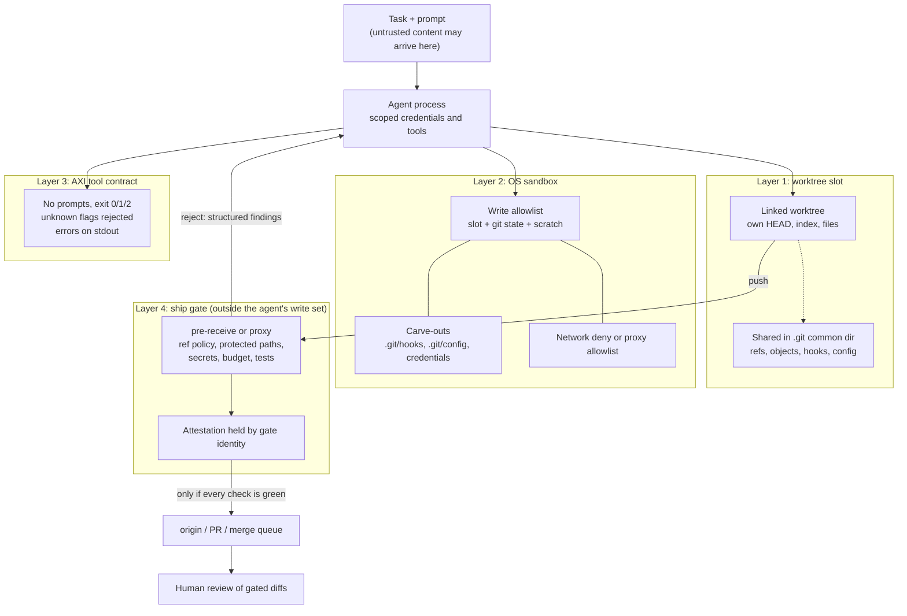

# AI Coding Agents: Sandboxes, Worktrees, and Ship Gates

> [!summary] Claim:
> A linked Git worktree gives each coding agent its own files, index, and HEAD while sharing repository state.
> An OS sandbox limits what the agent's subprocesses can read, write, and reach over the network.
> An agent-friendly CLI gives those subprocesses bounded output and actionable results without interactive prompts.
> A ship gate outside the agent's authority checks the candidate before human review, and the destination enforces the acceptance policy.



## The Mechanism

[[Platform-Engineering-Paved-Roads-and-Deprecation]] owns the idea that a platform wins by making the safe path the easy path.
This note applies that idea to autonomous coding agents.
[[Multi-Agent-Supervision-and-Quota-Aware-Routing]] owns what happens above one agent (fleets, supervisors, quota routing) and is not repeated here.
[[CLI-Design-and-Agent-Friendly-Interfaces-AXI]] owns the full AXI treatment of command design; this note covers only why the contract matters to a sandboxed agent.
[[Sandboxing-and-Hermetic-Execution-Internals]] owns build-system sandboxes (Bazel-style hermetic actions); here the sandbox contains a process that is adversarial by accident or by injection, not a build action that is merely impure.

### 1. Why an agent is a different principal

A coding agent can turn text from a tool result, README, or web page into a command.
A dependency install script can execute code directly under the invoking process's permissions.
Both paths matter when the agent can reach sensitive data or shared infrastructure.

- Simon Willison's "lethal trifecta" (2025-06-16): an agent that combines access to private data, exposure to untrusted content, and the ability to communicate externally can be tricked into reading the private data and sending it to an attacker.
  A laptop agent can have all three if its host permissions expose credentials, its tools ingest outside content, and its shell or connectors can send data.
  Put read and egress controls at the execution boundary, and enforce the separate decision to accept a change at its destination.
- OWASP Top 10 for LLM Applications 2025 lists LLM01 Prompt Injection and LLM06 Excessive Agency as separate entries.
  Excessive agency is the engineering problem this note solves: the agent was given more filesystem, network, and credential power than the task needed.
- Two real 2025 incidents show the failure on both sides of the agent:
  - Nx (GHSA-cxm3-wv7p-598c, CVE-2025-10894, advisory published 2025-08-27): malicious `nx` versions had a `postinstall` script that scanned the filesystem for text files and credentials, published them to a GitHub repository under the victim's account, and modified `.zshrc` and `.bashrc` to include `sudo shutdown -h 0`.
    The advisory also states that "AI agents" are one way an npm install can be triggered without a developer typing it, and its appendix shows a `telemetry.js` prompt that tells a file-search agent to inventory text files.
    The Nx maintainers' [postmortem](https://nx.dev/blog/s1ngularity-postmortem) identifies Claude and Gemini as examples of local AI tools the script attempted to use.
    Run dependency lifecycle code with the same resource restrictions as other untrusted code, because it inherits the install process's authority.
  - Amazon Q Developer extension for VS Code (AWS-2025-015, CVE-2025-8217, bulletin dated 2025-07-23): AWS states the extension's repository had "an inappropriately scoped GitHub token in their CodeBuild configuration", a threat actor used it to commit malicious code that was automatically included in release 1.84.0, and the code did not execute because of a syntax error; 1.85.0 replaced it.
    The lesson for ship gates is that a credential able to write to the release path is itself a bypass of every review step before it; the gate must be the only holder of that credential.

### 2. Layer 1: git worktree isolation

[[Git-Object-Model-and-Content-Addressing]] and [[Git-Refs-Reflog-and-Reftable]] own the object store and ref storage that this section builds on.
Every fact in this section is from `git-worktree` at Git 2.55.0 unless another source is named.

#### 2.1 What a linked worktree is

`git worktree add <path>` creates a linked worktree: a second working directory attached to the same repository.
It shares "everything except per-worktree files such as `HEAD`, `index`, etc."
Mechanically, the main repository keeps a private directory per linked worktree at `$GIT_DIR/worktrees/<id>`, where `<id>` is usually the basename of the worktree path, made unique with a number suffix.
Inside the linked worktree, `.git` is a file, not a directory, that points at that private directory.
There `$GIT_DIR` is the private directory and `$GIT_COMMON_DIR` points back at the main `.git`.
The docs state the rule for tools: do not assume whether a path belongs to `$GIT_DIR` or `$GIT_COMMON_DIR`; ask `git rev-parse --git-path <name>`.

The sharing rules decide everything an agent harness must design around:

| Item | Shared across worktrees | Evidence |
| :--- | :--- | :--- |
| Working files, `index`, `HEAD`, `refs/bisect`, `refs/worktree`, `refs/rewritten` | No, per worktree | git-worktree REFS section |
| Every other ref under `refs/` (all branches and tags) | Yes | git-worktree REFS section |
| Object store, `packed-refs`, stash | Yes (stash is a ref under `refs/`) | git-worktree REFS section; stash is `refs/stash` |
| `config` | Always shared; `extensions.worktreeConfig` adds a per-worktree `config.worktree` read afterward | git-worktree CONFIGURATION FILE |
| `hooks/` | Yes (observed in the lab: a hook written from slot 1 ran on a commit in slot 2) | lab step 1 |

Two exclusivity rules protect the working trees:

- A branch can be checked out in only one worktree: `git worktree add` refuses to create a worktree on a branch "checked out anywhere else" unless `--force` is used.
  The lab shows `git switch agent/a` from slot 2 failing with exit 128 and `fatal: 'agent/a' is already used by worktree at '<work>/slots/1'`.
- `git worktree add -d <path>` creates a detached HEAD, which has no such exclusivity.
  A pool of slots that are all detached never collides on a branch name until an agent creates one.

#### 2.2 What a worktree does not isolate

The shared parts are an attack surface and a collision surface, and the lab measures both:

- Shared refs: branch names are one global namespace.
  Two agents that both run `git switch -c fix-tests` race, and one fails after the other creates the branch.
  Worse, any process that can write `$GIT_COMMON_DIR/refs` can delete or move any other agent's branch.
  The lab shows this is still `ALLOWED` for a sandboxed agent whose write set includes the shared git dir.
- Shared hooks and config: a hook is code that runs in a different security context (the committer's, outside any sandbox) at a later time.
  The lab plants `pre-commit` from slot 1 and an innocent commit in slot 2 runs it.
  Claude Code's sandbox documentation and the sandbox-runtime README both treat `.git/hooks` and `.git/config` as write-protected inside an otherwise writable directory for exactly this reason.
- The git docs' BUGS section says multiple checkouts are "still experimental", submodule support is "incomplete", and making multiple checkouts of a superproject is not recommended.
  A monorepo with submodules is a poor fit for worktree pools.

A worktree is therefore a collision-avoidance mechanism, not a security boundary.
The security boundary is layer 2, and the acceptance boundary is layer 4.

#### 2.3 Pooling, leasing, and recycling

Creating a worktree per task costs a checkout plus dependency setup; recycling a slot costs a reset.
treehouse (Kun Chen) is the pool used in the harness this note comes from.
treehouse pools worktrees by repository and normally prepares a slot at a detached base.
`treehouse get --lease` reserves the slot even with no process inside it.
`treehouse return` verifies lingering processes have stopped before resetting the slot and releasing the lease.
For unattended cleanup, record the per-acquisition lease ID and provide it via `treehouse return --if-lease-id`.
The condition prevents a late cleanup from releasing a new task's lease on the same path (as of 2026-11, Both).
The upstream configuration example lists `max_trees = 16` (as of 2026-11, Both). [treehouse README](https://github.com/kunchenguid/treehouse)
Its safety stance is the generalizable part: never reset or delete work it cannot prove landed, treat a slot with unmerged commits as not reusable, and ignore hooks in a repository-level `treehouse.toml` "so that running treehouse in an untrusted clone cannot execute checked-in shell" (README; user-level hooks only).
See [[13-Agentic-AI/Agentic-Harness/components/treehouse|treehouse]] for the measured walkthrough; this note does not re-derive it.

Recycling has two sharp edges that follow from the sharing table:

- A reset must also stop processes whose working directory is inside the slot, because a lingering dev server keeps writing files into a slot that has been handed to another agent.
- A recycled slot keeps whatever untracked or ignored files the last tenant left, unless the pool removes them.
  Reset to a commit does not remove ignored files, so credentials or caches written by a previous task can leak to the next.
  Recreate slots when the trust domain changes.
  On same-trust reuse, reset to the intended base and verify that the cleanup contract removed previous-task state before transferring the lease.

#### 2.4 Build state is per worktree, and it is the real cost

A worktree contains source only; every build tool keeps its own state, and several embed absolute paths.
This is why the "just add a worktree" estimate is optimistic.

| Concern | C++ | Python | Rust |
| :--- | :--- | :--- | :--- |
| Where the state lives | CMake build tree; `CMakeCache.txt` records `CMAKE_HOME_DIRECTORY` and `CMAKE_CACHEFILE_DIR` as absolute paths (observed with CMake 4.5.1 on macOS 27.3, 2026-11) | A venv; scripts get a shebang line pointing at the venv's interpreter at an absolute path (Python docs, venv) | `target/` at the workspace root by default (`build.target-dir`, default `"target"`; Cargo book) |
| Consequence | Configure for each slot's source and build paths | Recreate a venv at its destination path | Give each slot its own target directory and reuse eligible compilation results through a shared compiler cache |
| Shared-cache option | ccache via `CCACHE_DIR` (ccache 4.14.3 manual) | pip's HTTP and wheel cache, discoverable with `pip cache dir` (pip 26.3 docs) | sccache via `RUSTC_WRAPPER` or `build.rustc-wrapper` (Cargo Book, Build Cache) |
| Sandbox consequence | Compiler writes to scratch and cache dirs outside the slot; the write allowlist must name them | `__pycache__` writes into the slot are fine; the package cache and interpreter are outside it | `CARGO_HOME` defaults to `$HOME/.cargo/` and holds the registry and git checkouts; the allowlist and network policy must cover it |

Put reusable cache entries outside the slot under an explicit trust policy.
Content addressing helps identify inputs and results, while writer authorization decides who can populate the cache.
Use writable caches scoped to a trust domain and grant untrusted jobs read-only access to trusted entries where practical.
For example, ccache warns that modifying a hard-linked object can also modify the cached result (ccache 4.14.3 manual).
[[Hermetic-and-Reproducible-Builds]] and [[Build-and-Test-Latency-Economics-and-Flaky-Tests]] own the cache and latency side of this trade.

### 3. Layer 2: OS sandboxing

[[Processes-Fork-Exec-and-File-Descriptors]] owns how a child inherits what its parent set up.
Seatbelt and Landlock carry restrictions into subsequently launched descendants.
Bubblewrap places the launched process in a configured set of namespaces and mounts.
The recorded macOS run shows the shell-mediated write failed outside the workspace.
The updated probe requires the process that attempts the write to report `EPERM`.

#### 3.1 macOS Seatbelt

`sandbox-exec` runs a command under a Seatbelt profile given by `-f file`, `-n name`, or `-p string`, with `-D key=value` parameters.
Its own manual page marks it DEPRECATED (page dated March 9, 2017) and points developers at App Sandbox.
It still ships and works on macOS 27.3 (as of 2026-11, macOS): the lab runs it.
Claude Code and Codex document Seatbelt as their macOS sandbox, and sandbox-runtime generates Seatbelt profiles dynamically.
The deprecation makes the behavior worth checking at each supported macOS upgrade.

The profile language (SBPL) is a Scheme-like rule list.
The lab's profile (`seatbelt.sb.in`, condensed here) is the shape those tools document: reads open, writes confined.

```text
(version 1)
(allow default)
(deny network*)
(deny file-write*)
(allow file-write* (subpath "@WORKTREE@") (subpath "@COMMON@") (subpath "@SCRATCH@") (subpath "/dev"))
(deny file-write* (subpath "@COMMON@/hooks") (literal "@COMMON@/config"))
(deny file-read* (subpath "@FAKEHOME@/.ssh") (subpath "@GATEDIR@"))
```

Three behaviors the lab measures (macOS 27.3, arm64, as of 2026-11):

- For the overlapping file rules in this profile, the later matching rule takes precedence.
  `(deny file-write*)` followed by an allow of the slot permits the slot write.
  Subsequent denies inside the allowed common Git directory block hook and config writes while the commit succeeds.
  The macOS transcript shows this outcome, and Anthropic's [Seatbelt profile generator](https://raw.githubusercontent.com/anthropic-experimental/sandbox-runtime/main/src/sandbox/macos-sandbox-utils.ts) documents the same ordering when generating overlapping file rules.
- Paths are matched after symlink resolution.
  A deny rule written against a symlink path does not deny a write made through the real path, and the write succeeds silently.
  The previous verifier separately observed the same behavior for a write made through the alias itself on macOS 27.3.
  Resolve policy roots before rendering the profile, including roots under symlinked macOS system paths such as `/tmp`.
  Claude Code's documentation has a "Denied paths that pass through a symlink" section for the same reason: on macOS its sandbox also denies the real location of a denied path that passes through a symlink.
- The recorded sandboxed `git config` exited 4, which `git-config(1)` defines as a config write failure.
  The Git source reports the write failure with the operating system's error message.
  The updated probe requires the diagnostic to report `EPERM` and prints it to stderr. [Git 2.55.0 config source](https://github.com/git/git/blob/v2.55.0/config.c)

The lab's `(deny network*)` blocks even its connection to a listening 127.0.0.1 port with `EPERM`.
A harness that needs outbound network can route approved destinations through a filtering proxy.

#### 3.2 Linux: Landlock

Landlock is a stackable Linux Security Module that lets an unprivileged process restrict itself.
The kernel documentation structures it as a ruleset (a set of rules with a set of handled access rights), populated with rules, then applied.
The call sequence is `landlock_create_ruleset(2)`, then `landlock_add_rule(2)` for each file hierarchy (`LANDLOCK_RULE_PATH_BENEATH`) or network port, then `landlock_restrict_self(2)`.
Properties that matter for agents, from the kernel documentation:

- Inheritance and permanence: after `landlock_restrict_self` succeeds the policy "will be enforced on all its subsequently created children", and "there is no way to remove its security policy; only adding more restrictions is allowed."
  Domains merge with the parent's.
- An unprivileged process needs `no_new_privs` before enforcement, or can ask the kernel to set it on successful enforcement with `LANDLOCK_RESTRICT_SELF_NO_NEW_PRIVS` (ABI 11).
- Query the ABI with `landlock_create_ruleset(NULL, 0, LANDLOCK_CREATE_RULESET_VERSION)` before constructing the ruleset.
  The kernel tutorial masks unsupported rights for best-effort use.
  When a right enforces a required boundary, fail closed or choose a backend that can enforce it.
- Ruleset access masks specify which rights the ruleset handles.
  Account for the special cross-directory `REFER` default in the kernel's access-rights documentation when reasoning about rename and hard-link behavior.

Linux ABI versions come from `landlock(7)` for 1 to 9 and the tagged kernel source for 10 to 12 (as of 2026-11, Linux).

| ABI | Kernel | New capability |
| :--- | :--- | :--- |
| 1 | 5.13 | Filesystem rights from `LANDLOCK_ACCESS_FS_EXECUTE` onward |
| 2 | 5.19 | `LANDLOCK_ACCESS_FS_REFER` (rename or link across directories) |
| 3 | 6.2 | `LANDLOCK_ACCESS_FS_TRUNCATE` |
| 4 | 6.7 | `LANDLOCK_ACCESS_NET_BIND_TCP` and TCP connect control |
| 5 | 6.10 | `LANDLOCK_ACCESS_FS_IOCTL_DEV` |
| 6 | 6.12 | `LANDLOCK_SCOPE_ABSTRACT_UNIX_SOCKET` and signal scoping |
| 7 | 6.15 | `LANDLOCK_RESTRICT_SELF_LOG_*` flags (audit logging control) |
| 8 | 7.0 | `LANDLOCK_RESTRICT_SELF_TSYNC` (enforce on every thread of the process) |
| 9 | 7.1 | `LANDLOCK_ACCESS_FS_RESOLVE_UNIX` for pathname Unix sockets |
| 10 | 7.2 | UDP port rights and per-rule audit suppression |
| 11 | 7.3 | `LANDLOCK_RESTRICT_SELF_NO_NEW_PRIVS` |
| 12 | 7.4-rc1 (prerelease as of 2026-11, Linux) | Capability and namespace restrictions |

`landlock(7)` itself says the kernel versions are "only included for orientation" and that programs should test the ABI version, because distribution kernels backport features.
The ABI constant is 10 in the [7.2 sources](https://github.com/torvalds/linux/blob/v7.2/security/landlock/syscalls.c), 11 in [7.3](https://github.com/torvalds/linux/blob/v7.3/security/landlock/syscalls.c), and 12 in [7.4-rc1](https://github.com/torvalds/linux/blob/v7.4-rc1/security/landlock/syscalls.c).
Check the running kernel's ABI to account for backports and release-candidate behavior.
Landlock must also be compiled in (`CONFIG_SECURITY_LANDLOCK=y`) and enabled in the boot LSM list; a kernel can lack it, and `landlock_create_ruleset` reports `ENOSYS` or `EOPNOTSUPP` in that case.
Two limits to remember: Landlock restricts the enforcing thread and its future children, not sibling threads that already exist, unless the caller passes `LANDLOCK_RESTRICT_SELF_TSYNC` (ABI 8 and later) to enforce on every thread of the process; and it restricts file hierarchies, so rights propagate across bind mounts but not across OverlayFS: the kernel documentation says a policy restricting an OverlayFS layer "will not restrict the resulted merged hierarchy, and vice versa."

#### 3.3 Linux: bubblewrap, and what the agent vendors actually ship

bubblewrap builds a sandbox from unprivileged user namespaces and bind mounts.
Its README states it removed the setuid mode, uses `PR_SET_NO_NEW_PRIVS`, and, critically, that it "is not a complete, ready-made sandbox with a specific security policy": the protection level is "entirely determined by the arguments passed to bubblewrap", and whatever builds those arguments owns the security model.
That sentence is the right reading of every product built on it.

What the vendors document (as of 2026-11):

| Tool | macOS | Linux | Network | Source |
| :--- | :--- | :--- | :--- | :--- |
| Claude Code sandbox | Built-in Seatbelt | bubblewrap and socat | Host proxy mediates outgoing connections using configured domain policy | Claude Code docs, Sandboxing |
| Codex CLI and app | Built-in Seatbelt | bubblewrap on PATH, else a bundled helper that needs unprivileged user namespaces | Sandbox controls whether commands can use the network | Codex docs, Sandbox |
| sandbox-runtime (open source, used by Claude Code) | `sandbox-exec` with generated profiles | bubblewrap | Seatbelt allows only a localhost port where proxies listen | sandbox-runtime README |

Codex configures sandbox scope and approval policy independently (as of 2026-11, Both).
For example, a non-interactive approval policy can operate with workspace write restrictions still in effect.
Review authority at that boundary separately from the permissions of commands already allowed inside it. [Codex sandbox documentation](https://developers.openai.com/codex/concepts/sandboxing)
Claude Code documents `enableWeakerNestedSandbox` for container environments without privileged namespaces (as of 2026-11, Linux).
It recommends using that mode only when another boundary supplies the required isolation.

#### 3.4 What a sandbox profile must decide: the policy surface

The decisions and their failure modes (Claude Code docs and sandbox-runtime README, plus the lab):

- Write allowlist.
  Default for Claude Code: working directory, a per-user temp directory, and directories added explicitly.
  The lab allows writes to the common Git directory so that it can update objects and per-worktree state.
  Updating a branch can also write shared refs and reflogs.
  Claude Code documents the same rule: when the working directory is a linked worktree, its sandbox also allows writes to the main repository's shared `.git` directory, and writes to `hooks/` and `config` there remain denied.
  Without that allowance, `git commit` in a sandboxed linked worktree fails; with the whole `.git` dir allowed and no carve-out, an agent can plant a hook.
  The needed shape is allow-then-deny: allow the common dir, then deny `hooks` and `config`.
- Mandatory protected paths.
  sandbox-runtime always blocks writes to shell startup files (`.bashrc`, `.bash_profile`, `.zshrc`, `.zprofile`, `.profile`), `.gitconfig`, `.gitmodules`, `.mcp.json`, `.vscode/`, `.idea/`, and `.git/hooks` and `.git/config` even inside an allowed write path.
  sandbox-runtime also notes that where the working directory is a worktree or submodule its `.git` is a file, and on Linux that file is blocked so it can be read but not changed, moved, or removed.
  Claude Code adds its own settings, skills, agents, commands, and hooks directories to the protected list.
  The Nx payload is the argument for this list: it appended to `.zshrc` and `.bashrc`.
- Read policy.
  Claude Code's shell sandbox allows reads by default and supports explicit protections for credential paths (as of 2026-11, Both).
  Its documentation says there is no built-in credential deny list.
  The lab's `~/.ssh` and gate-key reads are `DENIED` in the sandbox and `ALLOWED` without it: the control run proves the probe can succeed.
- Environment.
  The sandbox does not scrub the environment: Claude Code documents sandboxed commands inherit environment variables "including any secrets", and offers `CLAUDE_CODE_SUBPROCESS_ENV_SCRUB` and a `credentials` block.
  The lab shows `AGENT_DEMO_TOKEN` `VISIBLE` inside the sandbox and `ABSENT` under an `env -i` allowlist.
  Build the child environment from an allowlist.
  Close unneeded inherited descriptors and explicitly declare any sockets or files passed into the child.
  Linux preserves descriptors across `execve` unless marked close-on-exec, and Landlock's filesystem rules do not retroactively restrict files opened before enforcement.
  Tool calls made by a parent-side connector or broker also need their own access policy.
  For example, Claude Code documents that shell sandbox settings do not govern its built-in file and web tools or local MCP servers (as of 2026-11, Both). [execve(2)](https://man7.org/linux/man-pages/man2/execve.2.html), [Landlock userspace API](https://docs.kernel.org/userspace-api/landlock.html), [Claude Code sandboxing](https://code.claude.com/docs/en/sandboxing)
- Network.
  Direct connections are blocked and traffic goes through a proxy that checks the requested hostname against an allowlist.
  Claude Code states the proxy by default does not terminate or inspect TLS, so it decides from the client-supplied hostname, and that allowing broad domains such as `github.com` "can create paths for data exfiltration" and domain fronting may reach hosts outside the allowlist.
  Its built-in proxy also checks DNS answers for loopback, link-local, and the machine's own addresses, subject to the documented IP allowlist and upstream-proxy exceptions.
- Unix sockets.
  Allowing `/var/run/docker.sock` "effectively grants access to the host system", so a sandbox with that socket is not a sandbox.
- The escape hatch.
  Claude Code can request an unsandboxed retry through `dangerouslyDisableSandbox` (as of 2026-11, Both).
  Approval depends on permission mode and rules, and `allowUnsandboxedCommands: false` disables the retry.
  For installations that require the sandbox, Claude Code documents managed settings that enable it, disable unsandboxed retries, and set `sandbox.failIfUnavailable` so an unsupported platform or missing dependency fails startup (as of 2026-11, Both). [Claude Code managed sandbox settings](https://code.claude.com/docs/en/sandboxing)
- Violation feedback.
  When the sandbox blocks something, naming the blocked resource in the command result lets the agent adapt; sandbox-runtime keeps a violation store for this.
  A silent deny wastes agent turns on retries.

None of this protects the shared refs.
The sandbox in the lab lets a sandboxed process delete another slot's branch because the agent legitimately needs `refs` writable to commit.
Use separate clones when local refs need independent protection.
Enforce the remote ref policy separately against the pushing identity.

### 4. Layer 3: the AXI tool contract

[[CLI-Design-and-Agent-Friendly-Interfaces-AXI]] owns command-line design for agents; [[19-Shell-and-Unix-Engineering/22-Shell-and-AI-Agents/Designing-Commands-for-Agents|Designing Commands for Agents]] owns the shell-side view.
A shell invocation can be non-interactive even when the agent's approval interface is interactive.
Give routine commands a bounded machine-readable response and send approval decisions through the harness.

The AXI specification (`SKILL.md` in kunchenguid/axi, read 2026-11) lists ten principles: token-efficient output (TOON on stdout), minimal default schemas, content truncation with a `--full` escape, pre-computed aggregates, definitive empty states, structured errors and exit codes, ambient context, content first, contextual disclosure, and a consistent way to get help.
The parts that interact with sandboxing and gating:

- No interactive prompts: "Every operation must be completable with flags alone", and a missing required value fails immediately.
  An agent that hits a prompt in a sandbox hangs until timeout.
- Reject unknown flags rather than ignore them: "A dropped flag is worse than an error: the agent gets plausible-looking output it believes is scoped or filtered."
  Unknown flags fail with exit code 2 before any dependency call.
- Exit code contract: 0 success including no-ops, 1 error, 2 usage error; structured output and errors on stdout, progress and diagnostics on stderr.
- Idempotent mutations: acknowledging an already-satisfied request with exit 0 lets an agent retry safely after a timeout.
- Definitive empty state: "0 findings" is information; empty output is ambiguous.

The lab's gate follows this contract on purpose, and the "Gate CLI contract" part of its output shows it: an empty diff prints `secrets,pass,"0 findings"` and exits 0, and `gate.py --bogus` prints `error:`, `code: VALIDATION_ERROR`, and a `help[1]` next step on stdout and exits 2.
The lab uses a hand-rendered TOON-style format for fixed fixtures.
For a production CLI, serialize dynamic fields with the chosen format's encoder and give each policy failure a stable code.
A gate submission retried after a lost response can use repository, target ref, candidate commit, and policy revision as its identity.
Return the existing verdict for that identity when its inputs are still current, and distinguish a rejection from a retryable infrastructure failure.

### 5. Layer 4: the ship gate

#### 5.1 Why a gate runs before human review

Automating mechanical checks lets reviewers spend their time on design, intent, and risk.
Run checks such as test failures, committed credentials, and protected-path edits before asking a human to review the change.
[[Code-Review-and-Readability-Systems-at-Scale]] owns review latency and size limits; [[Static-Analysis-at-Scale-Tricorder-and-Autofix]] owns the principle that checks belong in the author's workflow rather than at the end.

Two pieces of evidence bound the argument without overclaiming:

- METR's randomized controlled trial (published 2025-07-10; 16 experienced open-source developers, 246 issues, early-2025 tools) found developers took 19% longer with AI tools allowed, while they had forecast a 24% speedup and afterward estimated a 20% speedup.
  METR states plainly that it does not provide evidence that AI fails to speed up most developers, and does not claim its developers or repositories represent a majority or plurality of software development work.
  The relevant lesson is perception error: developers' own sense of AI-assisted throughput was wrong in the study, so a process that relies on self-reported confidence ("looks fine to me") needs an objective check beside it.
- DORA's 2025 report describes AI's primary role as an amplifier of an organization's existing strengths and weaknesses.
  For an agent harness, measure how much additional change reaches review and whether its verification capacity keeps pace.
  [[Developer-Productivity-Metrics-DORA-SPACE-and-GSM]] owns how to measure that without Goodhart effects.

#### 5.2 Where the gate can sit

| Placement | How it enforces | Bypass | Notes |
| :--- | :--- | :--- | :--- |
| Local hook (`pre-commit`, `pre-push`) | Runs in the agent's own process tree | `git push --no-verify` skips `pre-push` "completely"; a sandbox that cannot write `.git/hooks` stops tampering but not skipping | Advisory; useful as a fast, friendly first line |
| Local proxy remote (no-mistakes) | A daemon checks work submitted to a local bare remote before pushing to the configured destination | Direct pushes remain possible for an agent whose remote credential permits them | Protect the release path with server-side authorization |
| Server-side `pre-receive` | Runs once for the receive operation and a nonzero exit rejects all proposed updates | A privileged path that updates refs outside that receive operation | Objects are quarantined until the hook succeeds, and the hook must avoid ref updates |
| Hosting-platform rulesets and required checks | Restrict updates, block force pushes, require status checks, require merge queue | Actors with bypass permission; any writer can set a status unless an expected source app is chosen | See below |
| Merge queue | Re-runs required checks on the queued merge result | Checks that do not trigger on `merge_group` never report | Owns throughput; see [[Git-Branching-Models-Merge-Queues-and-Code-Review\|Git branching and merge queues]] |

Facts for the table: the `pre-receive` hook "executes once for the receive operation", gets `<old> <new> <ref>` lines on stdin, and "if the hook exits with non-zero status, none of the refs will be updated" (githooks, Git 2.55.0).
The quarantine described in `git-receive-pack` holds incoming objects until `pre-receive` succeeds.
A rejection before that migration discards the quarantine, and ref updates attempted inside the hook are rejected.
GitHub's rulesets documentation says "Any person or integration with write permissions to a repository can set the state of any status check", and lets a ruleset name a GitHub App as the expected source: the app must be installed with `statuses:write`, must have recently submitted a check run, and must be associated with a pre-existing required status check in the ruleset, and a status set by anyone else does not allow merging.
A required status check whose source is "any" is therefore only as strong as the weakest writer in the repository, and agents are writers.
GitHub's merge queue documentation says Actions workflows "must" use the `merge_group` event to run when a pull request is added to the queue; a required check whose workflow does not trigger on it never reports for the queued merge group.

The no-mistakes gate model uses a local bare repository, a daemon, and disposable worktrees.
The documented order is `intent -> rebase -> review -> test -> document -> lint -> push -> pr -> ci` (as of 2026-11, Both).
Local checks precede branch publication, and remote CI follows publication.
The pipeline supports operator-controlled skips, so a mandatory check on the protected branch also needs enforcement by the destination. [no-mistakes pipeline](https://kunchenguid.github.io/no-mistakes/concepts/pipeline/)
See [[13-Agentic-AI/Agentic-Harness/components/no-mistakes|no-mistakes]] for the measured walkthrough.

#### 5.3 What a gate must check, and how agents defeat naive ones

An agent optimizes the verifier you give it.
A gate that reports only pass or fail on one command invites the shortest path to green.
Failure patterns, and the lab check that closes each:

| Agent shortcut | Naive gate result | Closing control (lab check) |
| :--- | :--- | :--- |
| Delete a test file | A runner can report success if it discovers an empty suite | Flag deleted files and compare the candidate's test count with the base (scenario C) |
| Skip or replace a test | Total count can stay the same | In production, track skipped tests and compare trusted test identifiers or approved suite changes |
| Weaken the gate itself (edit CI config, policy files) | Green | Protected-path rule on `.gate/` and `.github/` for any change (scenario E) |
| Commit a credential | Green | Secret scan on added lines only, never printing the match (scenario D) |
| Produce a huge diff no one can review | Green | Diff budget (the lab's 200 changed lines is an arbitrary lab constant, not a recommendation) |
| Write to a protected branch directly | Green if branch rules are absent | Ref policy: agents may update only `refs/heads/agent/*` (the check also runs in the hook) |
| Push around the gate to `origin` | Accepted if `origin` trusts any pusher | `origin` accepts only attested updates (scenario F) |
| Make tests pass by breaking behavior | Green only if the suite is weak | Not catchable by this gate; needs review of intent, mutation or differential testing (see [[Playbook-Quarantine-and-Eliminate-Flaky-Tests\|Flaky-test playbook]] for the flake side of a weak suite) |

A passing gate records the rules evaluated and the inputs used.
Record the candidate commit, baseline, toolchain, policy version, and reason for each verdict so a reviewer can interpret it.
The lab models a text diff limit and scans added text for two example secret patterns.
A production policy needs explicit handling for binary changes, history and new objects when relevant, and test or policy changes that require approval.
A count ratchet catches a shrink in the suite count, while a stable trusted test inventory can also reveal missing or newly skipped tests.
An untrustworthy baseline or a runner that fails to collect tests should yield an infrastructure or policy failure.

#### 5.4 The attestation pattern

The destination needs a trusted source for the verdict.
The lab models this with an HMAC attestation.

1. The gate repo's `pre-receive` runs the checks; on green the `post-receive` hook computes `HMAC-SHA256(key, "<ref>\n<sha>")` and forwards the branch to `origin` with a push option `-o attest=<hex>`.
2. `origin` enables `receive.advertisePushOptions` (default false, as of 2026-11, Both) and reads `GIT_PUSH_OPTION_COUNT` and `GIT_PUSH_OPTION_<n>` in its own `pre-receive`.
   For non-deletion updates it recomputes the HMAC and rejects a missing or wrong value.
3. The agent probe's profile denies reads of the key directory.
   The unsandboxed control can read it under the same Unix user.

Separate the test worker, verdict producer, and destination authorization in production.
The test worker executes candidate code under a disposable identity with no signing key, push credential, or trusted cache write access.
The verdict producer publishes only results for an immutable candidate and the evaluated baseline and policy.
Bind a reusable attestation to the repository, target ref, candidate commit, and policy revision, and have the destination check freshness or the expected prior ref before accepting an update.
Specify explicit policies for deletion, force updates, and multi-ref changes.
SLSA's Source Track similarly checks the attestation's signature and subject against the source revision and trusted source control system. [GitHub Actions secure use](https://docs.github.com/en/actions/reference/security/secure-use), [SLSA v1.2 Source Track](https://slsa.dev/spec/v1.2/verifying-source)

The lab forwards in `post-receive`, which runs after the gate repo has accepted the ref and cannot change that receive result.
Treat receipt, validation, and successful delivery as separate states, and verify the destination ref before reporting delivery.
When the base advances before merge, use the destination's checks for the current merge result. [githooks](https://git-scm.com/docs/githooks), [GitHub merge queue](https://docs.github.com/en/repositories/configuring-branches-and-merges-in-your-repository/configuring-pull-request-merges/managing-a-merge-queue)

### 6. Putting the layers together

The lab illustrates the worktree, shell sandbox, CLI contract, and gate in one script.

1. Slot: `git worktree add --detach`; one slot per task; branch created by the agent under `agent/`.
2. Sandbox profile generated from resolved paths: allow the slot and the shared git dir, deny `hooks` and `config` inside it, deny reads of credentials and the gate's private directory, deny network (or proxy), scratch directory for temp files, environment rebuilt from an allowlist.
3. Agent runs inside the sandbox and can commit locally but cannot push (no credentials, no network).
4. A separate process outside the sandbox pushes the branch to the gate on the agent's behalf, or the agent pushes to a gate that is reachable but credential-less.
5. The gate returns a short structured verdict; on reject the agent reads it and fixes; on green the gate forwards with its own credential.
6. A human reviews the gated diff, or a policy-bound auto-merge takes it through a merge queue.

Step 4 is the subtle one: if the agent is both network-denied and expected to push, a hole must be made.
A deliberately exposed gate socket or a harness-owned push can transport the candidate.
Authorize the caller and scope the broker to its task, repository, namespace, and immutable candidate.
Keep the broker operation narrow, because a shell or general network tool on the broker would extend the agent's effective permissions.

## Commands and Numbers to Know

The platform column identifies where each entry applies.

| Item | Value | Platform | Source |
| :--- | :--- | :--- | :--- |
| Per-worktree state | `HEAD`, `index`, `refs/bisect`, `refs/worktree`, `refs/rewritten` (as of 2026-11, Git 2.55.0) | Both | git-worktree REFS |
| Worktree admin directory | `$GIT_COMMON_DIR/worktrees/<id>`, with files such as `gitdir` and an optional `locked` (as of 2026-11, Git 2.55.0) | Both | git-worktree DETAILS |
| Same branch in two worktrees | `git worktree add` refuses unless forced (as of 2026-11, Both); the lab observed `git switch` exit 128 (as of 2026-11, macOS, Git 2.55.0) | Both | git-worktree and lab |
| Detached slot | `git worktree add --detach <path>` (as of 2026-11, Git 2.55.0) | Both | git-worktree |
| Stale entry cleanup | `git worktree prune`, `gc.worktreePruneExpire`, `git worktree lock` (as of 2026-11, Git 2.55.0) | Both | git-worktree |
| Shared hooks | A hook written through one worktree ran in another (as of 2026-11, Git 2.55.0, lab) | macOS | lab step 1 |
| Per-worktree config | `extensions.worktreeConfig` then `git config --worktree`; older Git refuses such a repo (as of 2026-11, Git 2.55.0) | Both | git-worktree CONFIGURATION FILE |
| treehouse default `max_trees` | 16 (as of 2026-11, README config example; also measured 2026-09 in the vault) | Both | treehouse README; treehouse note |
| `sandbox-exec` status | Deprecated per its manual page; still runs on macOS 27.3 (as of 2026-11) | macOS | sandbox-exec(1); lab |
| Seatbelt rule order | Later matching rules win for the overlapping file rules shown (as of 2026-11, macOS 27.3) | macOS | lab step 2 and sandbox-runtime source |
| Seatbelt path matching | Resolved paths; deny on a symlink path did not deny the real path (observed, as of 2026-11, macOS 27.3) | macOS | lab step 2 |
| Landlock ABI 1 to 9 | 5.13, 5.19, 6.2, 6.7, 6.10, 6.12, 6.15, 7.0, 7.1 (as of 2026-11; kernel versions are for orientation only) | Linux | landlock(7) |
| Landlock ABI 10 to 12 | 7.2, 7.3, and 7.4-rc1 (as of 2026-11, Linux) | Linux | Tagged kernel source |
| Landlock query | `landlock_create_ruleset(NULL, 0, LANDLOCK_CREATE_RULESET_VERSION)` returns the ABI; `ENOSYS` or `EOPNOTSUPP` when absent or disabled (as of 2026-11) | Linux | landlock docs |
| Landlock enforcement | Needs `no_new_privs` (or `CAP_SYS_ADMIN`); inherited by children; cannot be removed (as of 2026-11) | Linux | landlock docs |
| bubblewrap setuid mode | Removed; uses `PR_SET_NO_NEW_PRIVS` (as of 2026-11) | Linux | bubblewrap README |
| Claude Code network mediation | Host proxy checks the requested hostname; sandboxing uses Seatbelt on macOS and bubblewrap and socat on Linux (as of 2026-11) | Both | Claude Code docs |
| Claude Code unsandboxed retry | `dangerouslyDisableSandbox`; disabled by `allowUnsandboxedCommands: false` (as of 2026-11) | Both | Claude Code docs |
| Codex Linux sandbox | First `bwrap` on PATH, else bundled helper needing unprivileged user namespaces (as of 2026-11) | Linux | Codex docs |
| `pre-receive` semantics | One run per push; non-zero exit updates no refs; stdin `<old> <new> <ref>`; stdout and stderr forwarded to the pusher (as of 2026-11, Git 2.55.0) | Both | githooks |
| Push options in hooks | `GIT_PUSH_OPTION_COUNT`, `GIT_PUSH_OPTION_<n>`; server needs `receive.advertisePushOptions` (default false) (as of 2026-11, Git 2.55.0) | Both | githooks; config/receive |
| `git push --no-verify` | Bypasses `pre-push` completely (as of 2026-11, Git 2.55.0) | Both | git-push |
| Receive quarantine | Objects held in a temporary directory until `pre-receive` succeeds; hook ref updates rejected (as of 2026-11, Git 2.55.0) | Both | git-receive-pack |
| AXI exit codes | 0 success including no-ops, 1 error, 2 usage error (as of 2026-11) | Both | AXI SKILL.md |
| no-mistakes steps | `intent, rebase, review, test, document, lint, push, pr, ci`; order not configurable (as of 2026-11) | Both | no-mistakes docs |
| GitHub rulesets | Restrict updates, block force pushes, required status checks with expected source, merge queue, require workflows (as of 2026-11) | Both | GitHub Docs |
| Merge queue trigger | `merge_group` event must trigger CI (as of 2026-11) | Both | GitHub Docs |
| METR RCT | 16 developers, 246 issues, 19% longer with AI; forecast 24% faster; post-hoc belief about 20% faster (published 2025-07-10, as of 2026-11) | Both | METR |

## Multi-Language Comparison

The agent's tool surface is language-independent, but the per-slot cost and the sandbox write set are not.
The build-state comparison lives under "Build state is per worktree, and it is the real cost"; this table covers the verification half.

| Gate concern | C++ | Python | Rust |
| :--- | :--- | :--- | :--- |
| Candidate must be built in a clean tree | Fresh CMake configure per extracted tree; build tree is not relocatable | Fresh venv or `python3 -m` in an extracted tree; the lab's gate uses `python3 -m unittest discover` with an empty-ish environment | `cargo test` in a clean target dir, or a shared compiler cache |
| Empty suite (as of 2026-11, Both) | CTest 4.5.1 normally permits an empty selection in command-line mode when the test file exists; use `--no-tests=error` | CPython 3.11 `unittest` can succeed with zero tests; CPython 3.12 exits 5 when no tests ran or were skipped | Cargo's default Rust 1.96 libtest harness can pass with zero selected tests; compare counts per target and include doctests in the policy |
| Sanitizer and strictness flags | Gate can require a sanitizer build; owned by [[Static-Analysis-at-Scale-Tricorder-and-Autofix\|Static analysis at scale]] | Type check and lint as gate steps | `clippy` and `cargo deny` style steps as gate steps |
| What a sandbox must allow | Compiler temp and cache dirs; no network | Interpreter, package cache; network for installs only through the proxy | `$CARGO_HOME`, registry network through the proxy |

The lab exercises the Python workflow.
The C++ and Rust columns pair documented runner behavior with suggested gate settings.

## Worked Lab Example

The lab is `code/09-Engineering-Systems-at-Scale/agent_sandbox_harness/` (`# requires: macos`).
It builds temporary worktrees, runs the sandbox probe, and exercises the ship gate and its CLI.
The recorded stdout is `expected/darwin-arm64.txt` from macOS 27.3 on arm64 with Git 2.55.0 and Python 3.15.2 (as of 2026-11, macOS).
Each transcript excerpt comes from that capture.
The lab's updated assertions were reviewed from source and await execution.

### Step 1: worktrees share more than you expect

The script makes a seed repo with `src/calc.py`, a two-test suite, and a `.gate/` policy file, then adds two detached worktrees.

Recorded stdout on `darwin-arm64`.

```text
== 1. Worktree isolation ==
worktrees: 3 (1 main + 2 linked slots)
slot 1 git-dir: .git/worktrees/1
slot 2 git-dir: .git/worktrees/2
slots share one common dir: yes
slot 2 sees slot 1 edit: no
slot 2 switch to slot 1's branch: rc=128
  fatal: 'agent/a' is already used by worktree at '<work>/slots/1'
slot 2 sees slot 1's branch tip: yes
hook planted from slot 1 ran on a commit in slot 2: yes
  planted in slot 1, ran in 2
```

Read it as a table of what is private and what is shared: files are private (`slot 2 sees slot 1 edit: no`), the branch namespace is shared (`slot 2 sees slot 1's branch tip: yes`), a checked-out branch is exclusive (`rc=128`), and hooks are shared code (`planted in slot 1, ran in 2`).
Each line can fail: if the files were shared, `slot 2 sees slot 1 edit` would print `yes`; if hooks were per-worktree, the hook line would print `no` and the `planted in slot 1, ran in 2` line would be missing.

### Step 2: the sandbox, with a control run

The same probe runs twice: once unsandboxed (control) and once under the Seatbelt profile.
Every row is an attempt a misbehaving agent might make.
A `DENIED` only means something if the control shows the attempt can succeed, which is why both columns are printed.

Recorded stdout on `darwin-arm64`.

```text
== 2. Seatbelt confinement ==
attempt                                        unsandboxed  sandboxed
write inside worktree                          ALLOWED      ALLOWED
git commit in worktree                         ALLOWED      ALLOWED
write into main checkout                       ALLOWED      DENIED (EPERM)
write outside everything                       ALLOWED      DENIED (EPERM)
plant hook in shared .git/hooks                ALLOWED      DENIED (EPERM)
git config in shared .git/config               ALLOWED      DENIED (rc=4)
delete another slot's branch (shared refs)     ALLOWED      ALLOWED
read ~/.ssh key                                ALLOWED      DENIED (EPERM)
read gate attestation key                      ALLOWED      DENIED (EPERM)
connect to loopback service                    ALLOWED      DENIED (EPERM)
grandchild writes outside                      ALLOWED      DENIED (child inherited policy)
AGENT_DEMO_TOKEN in environment                VISIBLE      VISIBLE
AGENT_DEMO_TOKEN with env -i allowlist: ABSENT
deny rule on the link path, write via the real path: ALLOWED
deny rule on the real path, write via the real path: DENIED
```

What to take from it:

- Rows 1 and 2 show the sandbox is usable: the agent can edit and commit.
- Rows 3 to 6 show confinement and the git-specific carve-outs: it cannot touch the main checkout, plant a hook, or rewrite shared config, even though it can write `objects` and `refs` of the same `.git` directory.
- Row 7 is the limit: the sandbox does not protect another agent's branch.
- Rows 8 to 11 are credential, network, and inheritance checks.
- Row 12 and the `env -i` line show the sandbox does not clean the environment; the harness must.
- The last two lines compare the two profiles for writes through the real path.
  The updated probe asserts the expected errno through both the real path and its symlink alias.

### Step 3: the gate, five scenarios, and a bypass attempt

The script clones the seed into a bare `origin.git` and a bare `gate.git`.
The gate repo's `pre-receive` runs `gate.py hook`; its `post-receive` forwards green refs to `origin` with an attestation push option.
`origin.git`'s `pre-receive` verifies attestations for changes that specify a new commit.

Scenario A, a good change, is forwarded.
Scenario C, deleting the failing test, is the instructive rejection:

Recorded stdout on `darwin-arm64`.

```text
-- C. agent deletes the failing test instead of fixing it
  | result: rejected
  | ref: refs/heads/agent/delete-test
  | checks[5]{name,status,detail}:
  |   ref_policy,pass,"agent branch"
  |   protected_paths,fail,"deleted tests/test_calc.py"
  |   secrets,pass,"0 findings"
  |   diff_budget,pass,"10 of 200 changed lines"
  |   tests,fail,"ran 0 tests, base ran 2 (test-count ratchet)"
  | passed: 3 of 5
  | help[1]:
  |   Fix the failing checks and push again; the gate never edits your branch
  push exit code: 1
  origin has agent/delete-test: no
```

The protected-path rule catches the deleted test file and the ratchet detects the drop from two tests to zero.
This lab also returns an error from its runner when the tests directory is missing.
The other scenarios in the file: B (the regression, `ran 2 tests, exit code 1`), D (a credential, `AWS access key id in settings.cfg`, with the key value never printed), E (editing `.gate/` and `.github/`, both reported).
Scenario A's output ends with `forwarded: refs/heads/agent/good`, a successful push exit code, and `origin has agent/good: yes`.
The updated scenario E checks the destination ref and reports the result on stderr.

Scenario F attacks the gate placement itself:

Recorded stdout on `darwin-arm64`.

```text
-- F. skipping the local hook does not skip the gate
plain push to origin:
  | local pre-push: push to the gate, not origin
  push exit code: 1
push --no-verify to origin:
  | origin: refused refs/heads/agent/direct: no valid gate attestation
  push exit code: 1
  origin has agent/direct: no
```

The local hook stops the plain push.
When the client skips that hook, the destination still enforces its attestation requirement for the proposed update.

### Step 4: the gate speaks AXI

Recorded stdout on `darwin-arm64`.

```text
== 4. Gate CLI contract ==
result: green
ref: refs/heads/agent/noop
checks[5]{name,status,detail}:
  ref_policy,pass,"agent branch"
  protected_paths,pass,"none"
  secrets,pass,"0 findings"
  diff_budget,pass,"0 of 200 changed lines"
  tests,pass,"ran 2 tests, base ran 2"
passed: 5 of 5
exit code: 0
error: unrecognized arguments: --bogus
code: VALIDATION_ERROR
help[1]:
  Run `gate.py check --repo DIR --base SHA --new SHA --ref REF`
exit code: 2
```

In this fixture an unchanged commit passes the checks and explicitly reports zero findings and zero changed lines.
An unknown flag yields a structured exit-2 error with a usage hint.

### Lab scope

- The transcript covers functional behavior on macOS 27.3.
  Linux sandbox behavior comes from documentation and kernel source.
- The Seatbelt profile is allow-default with explicit denies for the operations shown.
- The lab runs candidate Python tests as the gate's own user, and the HMAC key is a file readable by that user outside the agent sandbox.
  These fixtures model a trusted verdict and illustrate why a deployment needs a separately isolated test worker and signer.
- The origin hook checks attestations for non-deletion updates, and the matching payload covers only the ref and new commit.
  The scenarios cover the specific fixture updates in the transcript.

## Pitfalls

> [!warning] Pitfalls:
> - Treating a worktree as a security boundary.
>   Shared hooks, config, and refs mean one compromised slot can affect every other slot and the human's own checkout; the lab plants a hook that runs in another slot.
> - Profile paths that are not resolved.
>   Generate profile roots using resolved paths and test both the intended path and its aliases.
>   On the lab machine, a deny on the symlink path left the tested write allowed.
> - Allowing the whole shared git dir with no carve-out.
>   A linked-worktree commit needs to update objects, the ref or detached HEAD, and the per-worktree index.
>   Protect shared hook and config files from writes by the agent.
> - Trusting a sandbox with an off switch.
>   A model-operable "retry unsandboxed" parameter, `bypassPermissions` mode, a mounted `docker.sock`, or a weaker nested-sandbox mode each turns the sandbox into a suggestion.
> - Passing the environment through.
>   Sandboxes confine files and network, not variables; a token in the parent environment is visible to every sandboxed process and can leave through any allowed domain.
> - Allowing `github.com` and assuming the proxy contains exfiltration.
>   The proxy decides on the requested hostname, does not inspect TLS by default, and a broad allowlist is itself an exfiltration path.
> - A required status check with "any source".
>   An agent with write access can set a status.
>   Pin the expected source to a GitHub App and keep that app's credential away from the agent's identity.
> - A gate the agent can edit.
>   Gate config, CI workflows, and the test suite must be protected paths, and the gate must run from a trusted checkout of the gate, not the candidate's copy of it.
> - A gate that only runs the candidate's own tests.
>   Deleting tests or skipping them makes it green; add a test-count ratchet against the base and treat test deletion as a finding.
> - Printing secrets in gate output.
>   The finding must name the file and the pattern class, never the match; the lab prints `AWS access key id in settings.cfg` and nothing else.
> - Shared build state between slots.
>   Shared writable build trees and caches let an untrusted writer influence future builds.
>   Partition cache write access by trust domain.
> - Recycling a slot without cleaning ignored files.
>   Reset to a commit leaves untracked and ignored files, which can carry the previous task's secrets or poisoned caches into the next.
> - Stale facts about vendor sandboxes.
>   Linux sandbox implementations change (the Codex docs fetched for this note name bubblewrap, not Landlock); recheck the vendor page before relying on a remembered mechanism.

## At Scale

From one developer to 1,000 to 50,000 engineers, the problem changes from "protect my laptop" to "run a fleet of untrusted processes against a shared source of truth."

| Concern | Single developer | Org of 1,000 to 50,000 | Decision rule |
| :--- | :--- | :--- | :--- |
| Isolation unit | One worktree per agent on a laptop | Per-task ephemeral environment (see [[Ephemeral-Cloud-Development-Environments\|Ephemeral cloud environments]]) with a worktree inside | Use a throwaway VM or container when the task needs network or untrusted dependency installs; a worktree plus OS sandbox is adequate when the code and dependencies are already trusted |
| Sandbox policy source | Personal settings file | Managed policy pushed by the platform team; the model-operable escape hatch disabled | If the agent can edit its own policy, it is not policy; mandatory paths and domain lists come from a source the agent cannot write |
| Credentials | The developer's own tokens in the environment | Short-lived, scoped, per-task tokens; push credentials held only by the gate identity | A credential that can write the release path must never be in an agent's environment (the Amazon Q token) |
| Gate placement | Local proxy or hooks | Server-side hooks, rulesets with expected-source status checks, merge queue | Enforce protected-ref policy at the destination and restrict which identities may write or report a required verdict |
| Gate content | Tests, lint, secret scan | Plus ownership, license, dependency-policy, protected paths, ratchets | Add a check when an incident class repeats; remove one when its false-positive rate erodes trust (see [[Static-Analysis-at-Scale-Tricorder-and-Autofix\|Static analysis at scale]]) |
| Review | Self-review of gated diffs | Gated diffs routed by ownership, size limits, labeled as agent-authored | Agent changes enter the normal review system; do not build a parallel one ([[Code-Review-and-Readability-Systems-at-Scale\|Code review at scale]]) |
| Attribution | Commit trailer | Task-scoped identity and audit record with candidate SHA, policy version, and verdict | Correlate ref updates with gate records and protect any retained prompt content as sensitive data |
| Fleet control | Manual | Supervision, tiering, and quota routing | Owned by [[Multi-Agent-Supervision-and-Quota-Aware-Routing\|Multi-agent supervision]] |
| Supply chain | `npm install` in a sandbox | Dependency policy and pipeline hardening apply to agent runs | Follow [[OpenSSF-Scorecard-and-CI-CD-Pipeline-Hardening\|CI/CD pipeline hardening]]; the Nx case shows install scripts run with the invoking identity |
| Metrics | Felt speed | Measure outcomes, not agent volume | METR's perception gap is a warning; use [[Developer-Productivity-Metrics-DORA-SPACE-and-GSM\|Developer productivity metrics]] and guard against gaming ([[Drill-Engineering-Systems-Audit-a-Gamed-Productivity-Dashboard\|Productivity dashboard drill]]) |

Decision rules, in the order to apply them:

1. Decide the trust level of the code the agent will read and execute.
   Untrusted content (third-party issues, web pages, new dependencies) requires a network-denied or proxied sandbox with a credential-free environment; trusted content with a human watching can run with a lighter profile.
2. Remove one leg of the lethal trifecta by construction.
   If an agent must read private data and ingest untrusted content, it must have no external channel; if it needs the channel, it must not read the private data.
3. Enforce acceptance outside the agent's write and credential scope, with a verdict bound to the exact candidate and target.
4. Gate on mechanical facts first (ref policy, protected paths, secrets, budget, tests with a ratchet), and let humans review intent and design second.
5. Budget the per-slot build state before promising parallelism: N agents on a large monorepo cost N checkouts and N build trees unless caches are shared outside the slots.

## Practice Drill

> [!tip] Practice Drill:
> 1. Run `bash run.sh` in `code/09-Engineering-Systems-at-Scale/agent_sandbox_harness/` and read the transcript against the note.
> 2. In the lab fixture, predict which rules govern writes to the slot, hook directory, and shared config, then explain the control and sandboxed results.
> 3. Check that the real-path deny applies both to that path and its symlink alias.
> 4. Add a sixth gate check to `gate.py` that rejects a change which adds a `skip` decorator to an existing test, and write the scenario that proves it fails and a scenario that proves a legitimate change passes.
> 5. Move the HMAC key out of reach of the agent's Unix user (for example a second account) and explain what that buys over the sandbox read-deny.
> 6. Port the sandbox step to Linux with bubblewrap or a small Landlock program, record it from a `requires: linux` lab, and compare the carve-out semantics.
> 7. Write the incident review for scenario F as if `origin` had trusted any pusher.

## Interview Questions

### L5

> [!question] L5 (Q1): Why does `git switch agent/a` fail in a second worktree, and why do agent pools usually use detached slots?
>
> > [!success]- Answer
> > A branch can be checked out in only one worktree at a time; `git worktree add` and `git switch` refuse when the branch is already checked out elsewhere unless forced.
> > The lab shows exit 128 and `'agent/a' is already used by worktree at ...`.
> > A detached HEAD has no branch, so it has no exclusivity: a pool of detached slots never collides at checkout.
> > The agent creates its own branch under a namespace such as `agent/`, which matters because the branch namespace is still shared by all worktrees (all refs under `refs/` except `refs/bisect`, `refs/worktree`, and `refs/rewritten`).

> [!question] L5 (Q2): What does a worktree share with the main checkout that makes it unsafe as a security boundary?
>
> > [!success]- Answer
> > Refs (every branch and tag), the object store, hooks, and by default `config`.
> > A process that can write the common git directory can plant a hook that runs later in another worktree or in the developer's own checkout, rewrite or delete any branch, or change `core.hooksPath`.
> > The lab plants `pre-commit` from slot 1 and an innocent commit in slot 2 runs it.
> > A worktree prevents two agents from overwriting each other's files; it does not stop a hostile one.

> [!question] L5 (Q3): Predict the output.
> A Seatbelt profile is generated with `(deny file-write* (subpath "/tmp/work/link"))` where `/tmp/work/link` is a symlink to `/tmp/work/real`.
> A sandboxed `sh -c 'echo x > /tmp/work/real/f'` runs.
> Does the write succeed?
> What if the rule names `/private/tmp/work/real`?
>
> > [!success]- Answer
> > The first write succeeds and the second is denied with `Operation not permitted`.
> > Seatbelt matches rules against the resolved path, so a rule on the symlink path never matches an access made through the real path.
> > The lab's last two lines show the same pair (`deny rule on the link path ... ALLOWED`, `deny rule on the real path ... DENIED`).
> > On macOS `/tmp` itself is a symlink to `/private/tmp`, so even a rule that looks right (`/tmp/work/real`) is wrong; resolve with `pwd -P` or `realpath` before generating the profile.

### L6

> [!question] L6 (Q4): Debug this.
> A sandbox profile allows writes only to the worktree.
> In the linked worktree, `git commit` fails with `Unable to create '.../.git/worktrees/1/index.lock': Operation not permitted`.
> What is the minimal fix that does not let the agent plant hooks?
>
> > [!success]- Answer
> > A linked worktree's index and HEAD live under `$GIT_COMMON_DIR/worktrees/<id>/`, and a commit writes new objects and updates a ref in the common directory, all outside the worktree.
> > Allow the repository state needed for the supported Git operations and explicitly protect shared hooks and config.
> > In the lab's overlapping Seatbelt file rules, the denies follow the broader allow so they take precedence.
> > The lab does exactly this, and the sandboxed column shows `git commit in worktree: ALLOWED`, `plant hook in shared .git/hooks: DENIED (EPERM)`, and `git config in shared .git/config: DENIED (rc=4)`.
> > Accept the residual risk the lab also shows: with `refs` writable the agent can delete another slot's branch.

> [!question] L6 (Q5): Your team installs a local `pre-push` hook that runs tests and calls it the gate.
> List three ways an agent gets around it and what actually enforces the policy.
>
> > [!success]- Answer
> > `git push --no-verify` bypasses the `pre-push` hook completely (git-push docs).
> > The agent can edit or delete the hook if `.git/hooks` is writable, or set `core.hooksPath` through shared config.
> > The agent can push with a different client, or to a different remote, if its credentials allow it.
> > Enforcement has to live where the agent cannot reach: a server-side `pre-receive` hook (non-zero exit updates no refs), hosting rulesets with required checks whose source is pinned to a specific app, and a merge queue; plus a push credential held only by the gate.
> > The lab's scenario F shows `--no-verify` reaching `origin` and being refused there for lack of an attestation.

> [!question] L6 (Q6): The agent's tests pass in your gate but the change deleted half the suite.
> How do you detect and prevent it?
>
> > [!success]- Answer
> > Two independent controls.
> > A protected-path rule that treats deletion of test files as a finding unless a human approves, and a ratchet that runs the suite on the base and on the candidate and fails if the candidate ran fewer tests.
> > The lab's scenario C fails both (`deleted tests/test_calc.py` and `ran 0 tests, base ran 2 (test-count ratchet)`).
> > Neither catches a behavior-breaking change that keeps all tests green; that needs a stronger suite, differential or mutation testing, and human review of intent.

### L7

> [!question] L7 (Q7): Why can a prompt-injected agent still leak secrets when its shell runs in a sandbox?
>
> > [!success]- Answer
> > The sandbox confines files and network but not the environment: a token in the parent environment is visible to every sandboxed process (lab: `VISIBLE` inside, `ABSENT` under an `env -i` allowlist).
> > Reads are open by default in the documented Seatbelt and bubblewrap setups, so credentials must be listed as explicit read denies; Claude Code says there is no built-in credential deny list.
> > A network allowlist that includes a broad domain such as `github.com` is an exfiltration path, the proxy decides from the client-supplied hostname and by default does not inspect TLS, and domain fronting may reach hosts outside the allowlist.
> > A mounted `docker.sock` or an enabled escape hatch (`dangerouslyDisableSandbox` in permissive modes, `enableWeakerNestedSandbox`) removes the boundary.
> > Mandatory write protections (shell startup files, `.git/hooks`, IDE configs) matter because a later, unsandboxed process executes them.
> > The structural fix is to remove one leg of the lethal trifecta: no private data, or no untrusted input, or no external channel.

> [!question] L7 (Q8): Design the acceptance path for agent-authored commits in a 5,000-engineer monorepo.
> Which components are advisory and which enforce, and who holds which credential?
>
> > [!success]- Answer
> > Advisory: local hooks, local proxy remotes, the agent's own sandbox policy, any check whose result the agent's identity can set.
> > Enforcing: a server-side ref policy (agents may write only a namespace such as `agent/*`), required status checks with the expected source pinned to a GitHub App, a merge queue that re-runs checks on the merge result and triggers on `merge_group`, and a gate identity that is the only principal able to write protected branches.
> > Credentials: the agent gets none that can write beyond its namespace; the gate holds a scoped, short-lived credential or signs an attestation that the target verifies; a human or policy-bound auto-merge holds the merge permission.
> > Content: ref policy, protected paths (gate config, CI, tests), secret scan, diff budget, test-count ratchet, ownership and dependency policy; structured, short verdicts so the agent can self-correct and reviewers can read them.
> > The Amazon Q incident (a write-scoped token in a build configuration reached a release) is the case for keeping the release-path credential out of every environment an agent or a contributor-controlled workflow touches.

### L8+

> [!question] L8+ (Q9): Defend or attack: "Run the gate before human review, and let humans review only gated diffs."
>
> > [!success]- Answer
> > Defense: reviewer attention is the constrained resource and agent volume scales faster than it; mechanical failures (failing tests, secrets, deleted tests, protected-path edits) are decidable by a program and cost a human minutes each if left to review; the gate also produces the structured findings that make agent retries cheap.
> > METR's trial is relevant as a perception warning: experienced developers estimated a speedup while measuring a 19% slowdown in that setting, so intuition about how fine a change looks is unreliable and objective checks should come first.
> > Attack: a green gate manufactures false confidence; it proves only mechanical rules, and the failure class that matters most (a plausible, wrong change that keeps tests green) is exactly what the gate cannot see; agents optimize the verifier, so each gate invites a specific shortcut (delete the test, weaken the config); a gate that is too strict trains teams to bypass it.
> > Resolution: the gate narrows what humans read, it does not replace reading; protect the gate from the agent, ratchet rather than just run, keep false positives low, and measure outcomes (change failure, review time, escaped defects) rather than agent output volume, using [[Developer-Productivity-Metrics-DORA-SPACE-and-GSM]] practices.
> > What would change the answer: evidence that the suite and gate catch the defect classes agents introduce at least as well as review does, or evidence that gated diffs are reviewed less carefully than ungated ones (automation bias).

## Further Reading

- [git-worktree manual](https://github.com/git/git/blob/v2.55.0/Documentation/git-worktree.adoc): the exact sharing rules, `$GIT_COMMON_DIR`, lock and prune behavior, and the BUGS caveats on submodules.
- [githooks and git-receive-pack](https://github.com/git/git/blob/v2.55.0/Documentation/githooks.adoc): `pre-receive` semantics, push options, and the quarantine environment that a server-side gate depends on.
- [SLSA v1.2 Source Track](https://slsa.dev/spec/v1.2/verifying-source) describes verification of source revision attestations.
- [Landlock userspace API](https://github.com/torvalds/linux/blob/master/Documentation/userspace-api/landlock.rst) and [landlock(7)](https://man7.org/linux/man-pages/man7/landlock.7.html): ruleset model, ABI table, best-effort pattern, and the permanence guarantee.
- [Claude Code sandboxing](https://code.claude.com/docs/en/sandboxing): the clearest public statement of a production agent sandbox policy, including its own security limitations section.
- [sandbox-runtime](https://github.com/anthropic-experimental/sandbox-runtime): source and README for the Seatbelt and bubblewrap backends and the mandatory deny paths.
- [Codex sandbox concepts](https://developers.openai.com/codex/concepts/sandboxing): the other major agent's platform-native enforcement and its approval-versus-sandbox split.
- [bubblewrap README](https://github.com/containers/bubblewrap): why it is a toolkit and not a policy, which is the right way to read any product built on it.
- [The lethal trifecta](https://simonwillison.net/2025/Jun/16/the-lethal-trifecta/): the threat model in three clauses.
- [OWASP Top 10 for LLM Applications](https://genai.owasp.org/llm-top-10/): the standard vocabulary for prompt injection and excessive agency.
- [Nx advisory GHSA-cxm3-wv7p-598c](https://github.com/nrwl/nx/security/advisories/GHSA-cxm3-wv7p-598c) and [AWS-2025-015](https://aws.amazon.com/security/security-bulletins/AWS-2025-015/): two primary postmortems for the credential and write-path lessons.
- [AXI SKILL.md](https://github.com/kunchenguid/axi/blob/main/.agents/skills/axi/SKILL.md): the ten principles and the exit-code contract used by the lab's gate.
- [no-mistakes pipeline](https://kunchenguid.github.io/no-mistakes/concepts/pipeline/) and [treehouse](https://github.com/kunchenguid/treehouse): the local gate and worktree pool this harness is modeled on.
- [GitHub rulesets](https://docs.github.com/en/repositories/configuring-branches-and-merges-in-your-repository/managing-rulesets/available-rules-for-rulesets): required checks and the expected-source setting.
- [METR early-2025 developer study](https://metr.org/blog/2025-07-10-early-2025-ai-experienced-os-dev-study/) and [DORA 2025](https://dora.dev/research/2025/dora-report/): evidence on what AI assistance does to delivery, with the authors' own limits stated.

## See Also

- [[Platform-Engineering-Paved-Roads-and-Deprecation]]: the paved-road idea this note applies to agents.
- [[Multi-Agent-Supervision-and-Quota-Aware-Routing]]: fleets and routing built on the single-agent harness here.
- [[CLI-Design-and-Agent-Friendly-Interfaces-AXI]]: full AXI design treatment.
- [[Sandboxing-and-Hermetic-Execution-Internals]]: build-action sandboxes and hermetic execution.
- [[Git-Hooks-and-Cryptographic-Signing]]: hook mechanics and signed commits.
- [[Git-Refs-Reflog-and-Reftable]]: ref storage, per-worktree refs, and reftable.
- [[Git-Branching-Models-Merge-Queues-and-Code-Review]]: merge queues and branch policy.
- [[Ephemeral-Cloud-Development-Environments]]: the isolation unit above the worktree.
- [[Code-Review-and-Readability-Systems-at-Scale]]: what human review does after the gate.
- [[Static-Analysis-at-Scale-Tricorder-and-Autofix]]: checks in the author's workflow.
- [[Build-and-Test-Latency-Economics-and-Flaky-Tests]]: the cost of the gate's test step.
- [[OpenSSF-Scorecard-and-CI-CD-Pipeline-Hardening]]: pipeline and token hardening.
- [[Developer-Productivity-Metrics-DORA-SPACE-and-GSM]]: measuring outcomes without Goodhart effects.
- [[Large-Scale-Changes-and-Codemods-Across-Repos]]: automated change at fleet scale.

## Related

- Prerequisites: [[Platform-Engineering-Paved-Roads-and-Deprecation]]
- Next: [[Multi-Agent-Supervision-and-Quota-Aware-Routing]]
- See also: [[13-Agentic-AI/Agentic-Harness/components/treehouse|treehouse]], [[13-Agentic-AI/Agentic-Harness/components/axi|axi]], [[19-Shell-and-Unix-Engineering/22-Shell-and-AI-Agents/Agent-Shell-Sandboxing-Seatbelt-and-Landlock|Agent Shell Sandboxing Seatbelt and Landlock]], [[19-Shell-and-Unix-Engineering/22-Shell-and-AI-Agents/Designing-Commands-for-Agents|Designing Commands for Agents]]
- Lab: `code/09-Engineering-Systems-at-Scale/agent_sandbox_harness/` (requires: macos)
