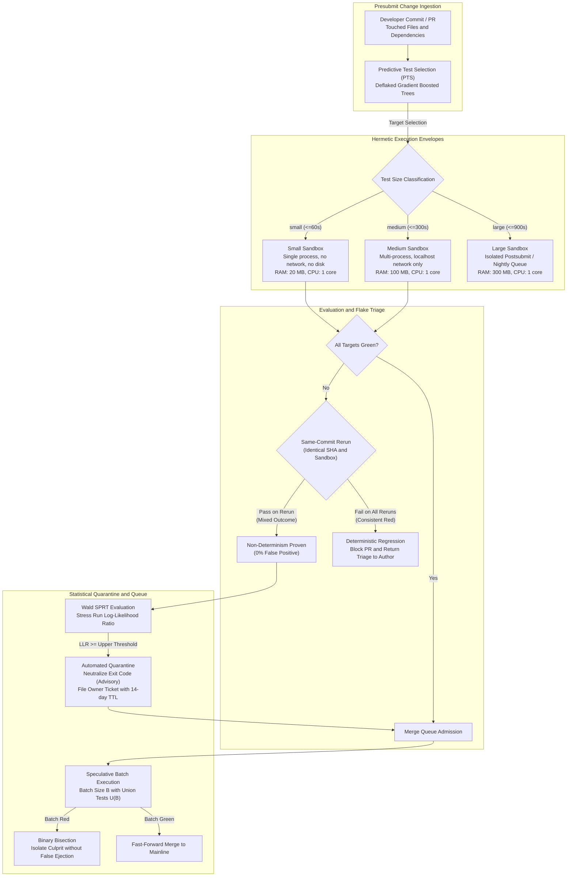
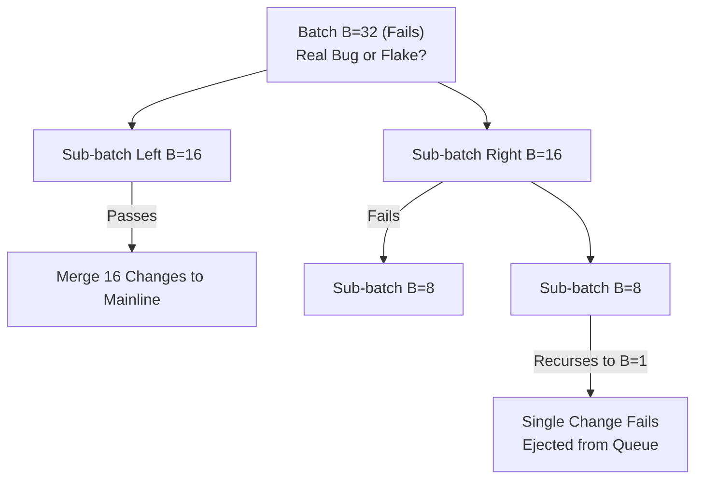
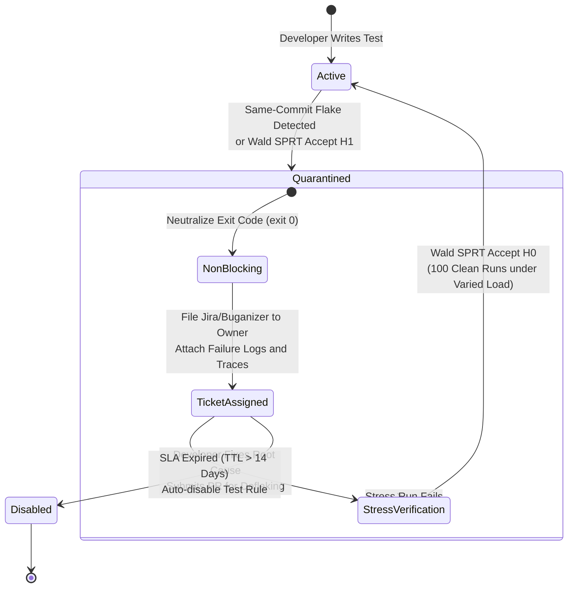

# Build and Test Latency Economics and Flaky Test Mitigation

> [!summary] Claim:
> Build and presubmit latency dictates developer iteration speed and queue stability: DORA recommends automated-test feedback in under ten minutes, and as waits grow developers batch work, switch context, and saturate merge queues.
> Because test outcomes compound across suites, a seemingly negligible per-test flake rate $f$ produces a suite false-red probability of $1 - (1 - f)^T$; at Google about 84% of observed pass-to-fail transitions involved a flaky test rather than a code regression (Micco 2016).
> Unconditional test reruns drop individual failure rates to $f^k$ but double critical-path P95 latency and mask genuine intermittent concurrency defects ($q \to q^k$), converting live race conditions into production outages.
> Resilient engineering platforms govern test execution through strict hermetic resource sizing envelopes, automated same-commit flake detection, Wald Sequential Probability Ratio Test quarantine lifecycles, deflaked predictive test selection, and adaptive merge queue bisection.



## The Mechanism

Modern engineering organizations operate under a fundamental socio-technical invariant: the latency and determinism of the build and test toolchain dictate developer productivity and software reliability.
When continuous integration (CI) presubmit checks exceed a few minutes or report false failures, developer iteration stalls, merge queues back up, and engineering velocity collapses.

### 1. The Economics and Queueing Physics of Build and Presubmit Latency

Software integration operates across a hierarchical continuum of feedback loops.
Chapter 23 of Software Engineering at Google (restating Chapter 11) says that the cost of a bug grows almost exponentially the later it is caught, which motivates fast feedback loops.
The timescales below are illustrative orders of magnitude, not figures from the book:

1. Level 1: Local edit-compile-test loop (1 second to 30 seconds).
2. Level 2: Presubmit validation on pull requests (2 minutes to 10 minutes).
3. Level 3: Postsubmit and merge queue integration (10 minutes to 60 minutes).
4. Level 4: Staging environments and system-level canary deployments (hours to days).
5. Level 5: Production releases (days to weeks).

```
+-----------------------------------------------------------------------------------+
|                            The Feedback Continuum                                 |
+-----------------------------------------------------------------------------------+
| Fast, Cheap, Deterministic                          Slow, Expensive, Multi-System |
|                                                                                   |
|  [L1: Local]  -->  [L2: Presubmit]  -->  [L3: Merge Queue]  -->  [L4: Canary]     |
|   < 30 sec           2 - 10 min             10 - 60 min             Hours         |
|   In-process        Hermetic Small/Med     Speculative Batch      Full Traffic    |
|   Single process    Namespaces             Bisection Tree         Version Skew    |
+-----------------------------------------------------------------------------------+
```

#### Attention Decay and Cognitive Switching Costs

Human working memory cannot maintain active focus across protracted idle intervals.
No primary study fixes the wait length at which developers abandon a task, so this note states no such threshold; the metric dimensions in [[Developer-Productivity-Metrics-DORA-SPACE-and-GSM]] do not supply one either.
Software Engineering at Google reports that the average wait to submit a change at Google is around 11 minutes, which works because the wait is usually spent in the background rather than blocking the author (Chapter 23).
As a wait grows, the developer tends to switch context to read email, review an unrelated pull request, or answer messages.
Gloria Mark, Daniel Gudith, and Ulrich Klocke found in a laboratory study that interrupted work is done faster but at higher stress, frustration, and workload ("The Cost of Interrupted Work: More Speed and Stress", CHI 2008); the paper does not give a single resumption delay that this note could use, so the cost of a switch is left as the assumed multiplier $M_{\text{interrupt}}$ below.

When presubmit latency increases from 5 minutes to 30 minutes, developers cease waiting synchronously.
They initiate speculative multitasking, opening multiple parallel branches and accumulating work-in-progress (WIP).
High WIP amplifies branch divergence: each hour a branch remains unmerged increases the probability that concurrent changes land on the mainline, generating semantic merge conflicts and invalidating earlier test results.

#### Financial Cost Modeling

The operational cost of build and presubmit latency can be quantified as an organizational loss function:

$$\text{Loss}_{\text{annual}} = E \times B \times D \times \left( \Delta t_{\text{wait}} \times M_{\text{interrupt}} \right) \times C_{\text{engineer}} + \text{Cost}_{\text{compute}}$$

Where:
- $E$ is the engineering headcount (e.g., 5,000 engineers).
- $B$ is the average number of presubmit builds initiated per engineer per day (e.g., 4 builds/day).
- $D$ is the number of working days per year (e.g., 250).
- $\Delta t_{\text{wait}}$ is the idle wait time per build (hours).
- $M_{\text{interrupt}}$ is the context-switching penalty multiplier (an assumed modeling parameter, e.g. $1.5$ to $2.5$ for long waits, not a measured constant).
- $C_{\text{engineer}}$ is the fully loaded hourly cost of an engineer (e.g., $150/hour).
- $\text{Cost}_{\text{compute}}$ is the cloud infrastructure expenditure for CI runners and remote execution clusters.

For an organization of 5,000 engineers running 4 builds per day, reducing presubmit latency by just 5 minutes (0.083 hours) with a conservative interruption multiplier of $1.5$ saves:

$$5000 \times 4 \times 250 \times (0.083 \times 1.5) \times 150 = \$93,375,000 \text{ / year}$$

This economic reality justifies dedicated platform teams investing tens of millions of dollars into hermetic build caching, remote compilation clusters, and automated test optimization.

#### Queueing Theory and CI Cluster Saturation

CI execution clusters behave as $M/M/c$ or $M/G/c$ queueing systems, where jobs arrive according to a Poisson process with arrival rate $\lambda$ and are processed across $c$ parallel build workers with service rate $\mu$.
Traffic intensity (utilization) is defined as:

$$\rho = \frac{\lambda}{c \mu}$$

Little's Law ($L = \lambda W$) converts waiting time into queue length, and Kingman's formula (exact in heavy traffic for a single-server $G/G/1$ queue, and a rough approximation for $c$ servers) shows that the average queue waiting time $W_q$ does not scale linearly with arrival rate; it diverges as utilization approaches unity:

$$W_q \approx \left( \frac{C_a^2 + C_s^2}{2} \right) \left( \frac{\rho}{1 - \rho} \right) \left( \frac{1}{\mu} \right)$$

Where $C_a^2$ and $C_s^2$ are the squared coefficients of variation for arrival and service intervals.
When a sudden influx of changes arrives (such as during mid-afternoon peak hours), a system operating at $\rho = 0.85$ experiences manageable queue times, but a minor volume increase that pushes $\rho \to 0.95$ causes queue wait times to multiply by more than three times.
If tests are slow, service rate $\mu$ is small, driving $\rho$ higher and triggering queue collapse.

```
Queue Latency W_q
  ^
  |                                        | Asymptote: rho -> 1.0
  |                                       /
  |                                      /
  |                                     /
  |                                   /
  |                                 /
  |                             _.-'
  |                     _...--''
  |          _...---''''
  +----------------------------------------------------> Utilization (rho)
  0.0       0.2       0.4       0.6       0.8       1.0
```

### 2. The Statistical Mechanics of Test Flakiness

A flaky test is defined formally as an automated test that produces differing outcomes (passing and failing) when executed against identical source code, identical dependency artifacts, and identical configuration inputs.
Flakiness represents a breakdown of determinism in the testing harness or the system under test.

#### The Compound Probability Theorem of Flaky Suites

Engineers frequently assume that if individual tests have high reliability (such as a 99.9% pass rate on healthy code), the entire suite is reliable.
This assumption is mathematically false across large test corpora.

Let a test suite consist of $T$ independent test targets executed during presubmit.
Assume each test target $i$ exhibits an independent non-deterministic failure probability $f_i$ under clean, regression-free code.
The probability that the entire suite passes is the joint probability that every individual test passes:

$$P(\text{Suite Green} \mid \text{No Regressions}) = \prod_{i=1}^{T} (1 - f_i)$$

Conversely, the probability that the presubmit suite produces a spurious red failure (false alarm) is:

$$P(\text{Suite Red} \mid \text{No Regressions}) = 1 - \prod_{i=1}^{T} (1 - f_i)$$

If the per-test flake rate is homogeneous across targets ($f_i = f$), this simplifies to:

$$P(\text{Suite Red}) = 1 - (1 - f)^T \approx 1 - e^{-fT} \quad (\text{for small } f \text{ and large } T)$$

The compounding effect across varying suite sizes $T$ and per-test flake rates $f$ illustrates how rapidly determinism vanishes:

| Per-Test Flake Rate ($f$) | Suite Size $T=100$ | Suite Size $T=1,000$ | Suite Size $T=5,000$ | Suite Size $T=10,000$ | Suite Size $T=50,000$ |
| :--- | :--- | :--- | :--- | :--- | :--- |
| $0.0001$ ($0.01\%$) | $0.0100$ ($1.0\%$) | $0.0952$ ($9.5\%$) | $0.3935$ ($39.4\%$) | $0.6321$ ($63.2\%$) | $0.9933$ ($99.3\%$) |
| $0.0005$ ($0.05\%$) | $0.0488$ ($4.9\%$) | $0.3935$ ($39.4\%$) | $0.9180$ ($91.8\%$) | $0.9933$ ($99.3\%$) | $>0.9999$ ($100\%$) |
| $0.0010$ ($0.10\%$) | $0.0952$ ($9.5\%$) | $0.6323$ ($63.2\%$) | $0.9933$ ($99.3\%$) | $>0.9999$ ($100\%$) | $1.0000$ ($100\%$) |
| $0.0050$ ($0.50\%$) | $0.3942$ ($39.4\%$) | $0.9933$ ($99.3\%$) | $1.0000$ ($100\%$) | $1.0000$ ($100\%$) | $1.0000$ ($100\%$) |
| $0.0100$ ($1.00\%$) | $0.6340$ ($63.4\%$) | $1.0000$ ($100\%$) | $1.0000$ ($100\%$) | $1.0000$ ($100\%$) | $1.0000$ ($100\%$) |

In a monorepo or microservice suite running 5,000 tests per presubmit, a per-test flake rate of only 1 in 1,000 ($f = 0.001$) guarantees that over 99.3% of all clean presubmit runs fail spuriously.
At that point, CI ceases to function as a verification gate; developers learn to ignore red test results, re-running builds blindly until an arbitrary run happens to pass.

#### Empirical Evidence at Scale: Google and Meta

Empirical investigations across industry giants validate these theoretical bounds:

- **Google (Micco 2016, Listfield 2017):** Micco reports "a continual rate of about 1.5% of all test runs reporting a 'flaky' result", where a flaky result means both a pass and a fail on the same code, and that almost 16% of Google's tests have some level of flakiness.
  Listfield reports that Google has around 4.2 million tests on its continuous integration system, of which around 63 thousand have a flaky run over the course of a week.
  Crucially, Micco reports that **about 84% of the transitions observed from pass to fail involve a flaky test**, so only a minority of pass-to-fail transitions signal a genuine breakage.
- **Facebook, now Meta (Machalica et al. 2019):** Running every build-dependent test on every diff was costly enough that learned selection halved the infrastructure cost of testing code changes.
  Flaky outcomes in the training data had to be removed by an explicit deflaking procedure (rerunning failed targets) before training the selection model.

#### Root Causes of Test Flakiness

The empirical taxonomy established by Luo, Hariri, Eloussi, and Marinov (FSE 2014) inspected 201 commits that likely fix flaky tests in 51 open-source Apache Software Foundation projects, precisely classified 161 of them, and split the root causes into ten categories (counts out of 161, from the paper's Table 2):

```
+-----------------------------------------------------------------------------+
|               Distribution of Flaky Test Root Causes (Luo et al.)           |
+-----------------------------------------------------------------------------+
| Async Wait (74, 45%)            ========================================    |
| Concurrency (32, 20%)           =================                           |
| Test Order Dependency (19, 12%) ==========                                  |
| Resource Leak (11, 7%)          ======                                      |
| Network (10, 6%)                =====                                       |
| Time (5, 3%)                    ===                                         |
| IO (4, 2%)                      ==                                          |
| Randomness (4, 2%)              ==                                          |
| Floating Point (3, 2%)          ==                                          |
| Unordered Collections (1, 1%)   =                                           |
+-----------------------------------------------------------------------------+
```

1. **Asynchronous Wait (45% of investigated commits):** The dominant cause of flakiness.
   The test initiates an asynchronous background task (e.g., an RPC, thread, or file write) and attempts to synchronize using a hardcoded sleep call (`sleep(500)`).
   On a developer workstation with low load, the task completes in 80 ms, and the test passes.
   On a heavily loaded CI runner where CPU cores are shared or throttled by cgroups, context switching delays the task to 550 ms; the assertion executes before the task finishes, causing a spurious failure.
2. **Concurrency and Race Conditions (20%):** Data races, atomicity violations, deadlock, and non-thread-safe test doubles.
   Luo et al. found that almost all Concurrency flaky tests contain only two threads or can be simplified to two threads, and that 97% of their failures are due to concurrent accesses only on memory objects (Table 1, finding F.6).
3. **Test Order Dependency (12%):** A test fails or passes depending on the execution order of the test suite.
   This arises when a "polluter" test modifies shared mutable state (a global singleton, an in-memory cache, an environment variable, or a database record) without cleaning up, and a subsequent "victim" test fails because it expects clean default state.
4. **Resource Leaks (7%):** Exhaustion of file descriptors, TCP sockets in `TIME_WAIT` state, or database connection pool limits caused by unclosed connections across thousands of sequential test executions.
5. **Network Dependency (6%):** Tests connecting to unisolated external services, public APIs, or remote package registries that experience transient packet loss, DNS lookup timeouts, or rate limiting.
6. **Time and Date Handling (3%):** Tests relying on `System.currentTimeMillis()` or local machine timezone, failing during daylight saving time transitions, leap years, or midnight boundaries.
7. **Unordered Collections (1%):** Iterating across hash-based collections (`std::unordered_map`, Python `dict` or `set`, Java `HashSet`) and asserting against serialized string output.
   Because hash seed randomization or pointer-based hash codes vary across processes and language runtime versions, serialization order varies across runs.

### 3. Test Sizing Envelopes and Hermetic Sandboxing

To contain non-determinism, modern build systems (such as Bazel, Buck2, and Google's internal Blaze) attach a **test size category** to every test.
In Bazel the size sets the default timeout, which is enforced, and the assumed peak RAM and CPU, which are scheduling assumptions rather than enforced limits ("assumed peak local resource usages", Bazel common definitions at v9.3.3); Bazel's test encyclopedia says tests should be hermetic but that this "is not enforced".
The process, disk, and network constraints in the last column come from Chapter 11 of Software Engineering at Google (small, medium, large), not from Bazel, and have to be enforced by a sandbox.
The book's footnote says Google has four sizes (small, medium, large, enormous), that the large/enormous difference is "subtle and historical", and that its descriptions of large mostly apply to enormous; it gives no separate constraints for enormous, so that row is inferred from Bazel's timeout alone.

```
+---------------------------------------------------------------------------------------+
|                              Test Size Specifications                                 |
+-----------+---------------+----------+------------+-----------------------------------+
| Size      | Timeout       | RAM      | CPU Cores  | Network and Process Constraints   |
+-----------+---------------+----------+------------+-----------------------------------+
| small     | short (60s)   | 20 MB    | 1 core     | Single process, no network,       |
|           |               |          |            | no disk I/O, no sleeps            |
+-----------+---------------+----------+------------+-----------------------------------+
| medium    | moderate (5m) | 100 MB   | 1 core     | Multi-process, threads, blocking  |
|           |               |          |            | calls, localhost network only     |
+-----------+---------------+----------+------------+-----------------------------------+
| large     | long (15m)    | 300 MB   | 1 core     | No localhost restriction, may     |
|           |               |          |            | span multiple machines            |
+-----------+---------------+----------+------------+-----------------------------------+
| enormous  | eternal (60m) | 800 MB   | 1 core     | Not distinguished from large by   |
|           |               |          |            | the book (Bazel timeout only)     |
+-----------+---------------+----------+------------+-----------------------------------+
```

#### Small Tests: The Hermetic Core

Small tests represent the foundational bedrock of reliable continuous integration.
By definition:
- They must execute inside a single process (and ideally a single thread).
- They are strictly forbidden from performing blocking disk I/O, accessing filesystem paths outside `$TEST_TMPDIR`, or making network calls.
- They are forbidden from calling `sleep()` or waiting on real wall-clock timers; all time must be driven through simulated clock doubles.
- All external dependencies (databases, RPC servers, message queues) must be replaced with lightweight in-process test doubles (stubs, mocks, or fakes).

Consistent with small tests avoiding the primary sources of environmental variance (operating system scheduling, disk saturation, network latency), only **0.5%** of Google's small tests were flaky over the course of a week (Listfield 2017; a fraction of tests, not of runs, and the size label is chosen by the author).
Small tests execute in milliseconds, allowing thousands of assertions to run within seconds on developer machines.

#### Medium Tests: Local Integration

Medium tests relax in-process constraints to allow testing interactions between components on a single host:
- They can spawn multiple subprocesses and background worker threads.
- The book states no disk restriction for them; a sandbox that confines writes to a private directory such as `$TEST_TMPDIR` is a sensible implementation choice rather than a quoted rule.
- Network access is strictly restricted to loopback (`localhost` / `127.0.0.1`).
- Engineers can spin up ephemeral, in-process database instances (e.g., SQLite, embedded RocksDB, or a localized Redis process) or run headless browser drivers (e.g., WebDriver connecting to a local headless Chrome instance).

Because medium tests depend on operating system process scheduling and inter-process communication, the fraction of flaky tests increases to **1.6%** of medium tests over a week (Listfield 2017), over 3 times the small-test fraction.

#### Large and Enormous Tests: Distributed Systems

Large tests remove the localhost restriction:
- They may communicate across machines, for example with remote database clusters, staging microservices, or cloud endpoints.
- They validate system assembly, end-to-end integration, and configuration validity.
- Because large tests traverse physical network switches, depend on multi-tenant remote clusters, and contend with transient infrastructure blips, the fraction of flaky tests surges to **14%** of large tests over a week (Listfield 2017) - roughly **28 times the small-test fraction**.

Consequently, distinguished platform engineering rules mandate that **large tests must never run on the blocking presubmit path**.
Large tests are relegated to asynchronous postsubmit runs, scheduled nightly pipelines, or pre-release release-candidate qualification.

#### Hermetic Sandboxing Primitives on Linux

To enforce these size boundaries deterministically, modern test runners isolate test execution using Linux kernel sandboxing primitives:

```c
/* Pseudocode of a hermetic test sandbox runner */
#define _GNU_SOURCE
#include <sched.h>
#include <sys/mount.h>
#include <unistd.h>

void enter_hermetic_sandbox(void) {
    /* 1. Unshare namespaces: Mount, Network, PID, IPC, UTS */
    unshare(CLONE_NEWNS | CLONE_NEWNET | CLONE_NEWPID | CLONE_NEWIPC | CLONE_NEWUTS);

    /* 2. Configure network loopback only (medium tests) or empty (small tests) */
    system("ip link set lo up");

    /* 3. Pivot filesystem root to an ephemeral, read-only container view */
    mount("none", "/", NULL, MS_REC | MS_PRIVATE, NULL);
    mount("tmpfs", "/tmp", "tmpfs", 0, "size=64M,mode=1777");

    /* 4. Set deterministic environment variables */
    setenv("TZ", "UTC", 1);
    setenv("LC_ALL", "C", 1);
}
```

- **Network Namespaces (`CLONE_NEWNET`):** Isolates network devices, protocol stacks, routing tables, firewall rules, and port numbers (network_namespaces(7)); a process in a fresh namespace does not see the host's interfaces.
  A runner then chooses what to provide: for small tests, no usable interface at all; for medium tests, only loopback brought up inside the namespace, as the pseudocode above does with `ip link set lo up`.
  The exact error codes a test sees (for example from `connect` on a namespace with no route) were not reproduced on Linux here and are deliberately not listed.
  Bazel's `linux-sandbox` (v9.3.3, `src/main/tools/linux-sandbox-pid1.cc`) always creates user, mount, IPC, and PID namespaces, and adds a network namespace only when network access is blocked (`--sandbox_default_allow_network=false`, default `true`, or the `block-network` tag).
- **Mount Namespaces (`CLONE_NEWNS`):** Constructs a sterile filesystem view.
  Source files and build toolchains are bind-mounted read-only (`MS_RDONLY`).
  A private, empty `tmpfs` is mounted at `$TEST_TMPDIR`.
  When the test process terminates, the namespace collapses, guaranteeing that no state pollutes subsequent test executions.
- **PID Namespaces (`CLONE_NEWPID`):** `unshare(CLONE_NEWPID)` does not move the caller; the first child it forks becomes PID 1 inside the new namespace (pid_namespaces(7)), which is why a real runner forks its init process after unsharing (Bazel uses `clone` with `CLONE_NEWPID` for `linux-sandbox-pid1`).
  Any child or grandchild worker processes spawned by the test cannot escape or orphan themselves into the host system; when PID 1 exits, the kernel terminates all descendants via `SIGKILL`.
- **Cgroups v2:** Constrains resource ceilings:
  `memory.max` prevents test memory leaks from triggering host OOM killer cascades.
  `cpu.max` throttles runaway CPU spinning.
  `pids.max` prevents fork-bombing bugs from exhausting kernel task structures.

### 4. Retry Economics, Critical Path Inflation, and the Masking Hazard

When confronted with flaky tests, the most common engineering reaction is to configure automated retries (e.g., `--flaky_test_attempts=3`).
While retries provide an immediate, superficial reduction in spurious build failures, they introduce severe economic costs and catastrophic safety hazards.

#### The Mathematical Effect of Retries

Let a test have an independent per-run flake probability $f$.
Under a retry policy allowing up to $k$ sequential attempts, the test produces a false red failure only if it fails *every* attempt:

$$P(\text{Test False Red} \mid k \text{ attempts}) = f^k$$

If $f = 0.01$ (1%) and $k = 3$, the test-level failure rate drops from $10^{-2}$ to $10^{-6}$ ($0.0001\%$).
For a test suite of $T = 1,000$ tests, the suite false-red probability drops from:

$$P(\text{Suite Red})_{k=1} = 1 - (1 - 0.01)^{1000} \approx 0.999957 \quad (99.996\% \text{ failure})$$

to:

$$P(\text{Suite Red})_{k=3} = 1 - (1 - 0.000001)^{1000} \approx 0.001000 \quad (0.10\% \text{ failure})$$

Superficially, the build appears green and stable.

#### Critical Path Latency Inflation

The hidden cost of retries is the destruction of CI throughput and latency predictability.
Tests execute in parallel across worker pools, but a presubmit pipeline cannot proceed until all tests complete.
When a test fails, the test runner must wait for that test to finish, spawn a second attempt, wait for it to finish, and potentially spawn a third attempt.

The expected number of sequential execution rounds on the critical path is:

$$\mathbb{E}[\text{Rounds}] = \sum_{j=0}^{k-1} \left( 1 - (1 - f^j)^T \right) \quad (\text{with } f^0 = 1)$$

For a suite of $T = 1,000$ tests where $f = 0.01$:
- Round 1 executes unconditionally: probability $1.0$.
- The probability that at least one test fails in round 1 and triggers round 2 is $1 - (1 - 0.01)^{1000} = 0.999957 \approx 1.0$.
- The probability that at least one test fails round 1 and round 2, triggering round 3, is $1 - (1 - 0.0001)^{1000} \approx 0.0952$ ($9.5\%$).

Thus, the expected sequential duration on the critical path is:

$$\mathbb{E}[\text{Rounds}] = 1.0 + 0.999957 + 0.0952 = 2.0951 \text{ rounds}$$

Even though only 1% of test runs fail, **virtually 100% of presubmit builds are forced into round 2**.
The P95 and P99 presubmit latency of the entire development organization effectively doubles.
Compute resource consumption expands simultaneously, consuming expensive CI worker cores to execute repeated test runs.

#### The Masking Hazard: Hiding Real Concurrency Regressions

The most dangerous consequence of automated retries is the **masking of genuine production bugs**.
Not all intermittent failures are benign harness flakes.
Real concurrency defects - race conditions, lock contention bugs, memory visibility failures, and deadlocks in production code - manifest intermittently during test execution.

Suppose a developer introduces a real data race into production code.
Under the test suite, this race causes a test to fail with probability $q$ per run (e.g., $q = 0.5$ under specific thread interleavings).
Under an unpadded single-run policy ($k=1$), the bug is caught with probability $P(\text{Detect}) = q = 0.5$.
If it slips through once, the next developer change touching that code has another 50% chance of failing, ensuring rapid detection.

Under a retry policy ($k=3$), the test runner passes the build if *any* attempt succeeds.
The genuine bug is caught only if it fails **all three attempts**:

$$P(\text{Detect} \mid k \text{ attempts}) = q^k$$

$$P(\text{Masked} \mid k \text{ attempts}) = 1 - q^k$$

The resulting detection collapse is catastrophic:

| Real Race Failure Rate ($q$) | Detection Rate ($k=1$) | Detection Rate ($k=2$) | Detection Rate ($k=3$) | Expected Runs to First Detection ($k=3$) |
| :--- | :--- | :--- | :--- | :--- |
| $1.0$ (Deterministic) | $1.0000$ ($100\%$) | $1.0000$ ($100\%$) | $1.0000$ ($100\%$) | $1.0$ |
| $0.5$ (Severe Race) | $0.5000$ ($50\%$) | $0.2500$ ($25\%$) | $0.1250$ ($12.5\%$) | $8.0$ |
| $0.2$ (Moderate Race) | $0.2000$ ($20\%$) | $0.0400$ ($4\%$) | $0.0080$ ($0.8\%$) | $125.0$ |
| $0.05$ (Subtle Race) | $0.0500$ ($5\%$) | $0.0025$ ($0.25\%$) | $0.000125$ ($0.0125\%$) | $8,000.0$ |

For a severe race condition that fails 50% of the time, retrying 3 times allows the bug to pass into main **87.5% of the time**.
For a moderate race condition failing 20% of the time, the bug passes **99.2% of the time**, requiring an expected 125 independent presubmit runs before triggering a failure.
Retries still catch deterministic code bugs ($q = 1$ fails every attempt), but they let subtle, intermittent concurrency bugs sail directly into production.

### 5. Merge Queue Economics and Flakiness in Batch Bisection

To protect the mainline from broken builds while scaling merge throughput across thousands of engineers, enterprise platforms deploy **merge queues** (such as GitHub Merge Queue, Uber's SubmitQueue, and Bors-NG, whose repository is archived (as of 2026-11)).
Merge queues replace uncoordinated local merges with automated, speculative integration pipelines.

#### Speculative Batching and Growth Dynamics

When commit arrival rates exceed the time required to build and test a change, changes must be batched.
Instead of evaluating changes serially ($C_1$, then $C_2$, then $C_3$), the merge queue groups $B$ changes into a single speculative batch:

$$\text{Batch } \mathcal{B} = \{ C_1, C_2, \dots, C_B \}$$

Batching amortizes fixed costs: compilation, container setup, and common dependency initialization are performed once.
Furthermore, the test suite executed for batch $\mathcal{B}$ is the union of tests required by the constituent changes:

$$\mathcal{T}(\mathcal{B}) = \bigcup_{i=1}^{B} \mathcal{T}(C_i)$$

In a monorepo containing $N$ total tests, suppose each individual change $C_i$ touches a random subset of $S$ tests.
The expected number of unique tests executed by a batch of size $B$ is:

$$U(B) = N \left( 1 - \left( 1 - \frac{S}{N} \right)^B \right)$$

As batch size $B$ increases, $U(B)$ grows sublinearly, approaching $N$ as $B \to \infty$.

```
Unique Tests Run U(B)
  ^
N |------------------------------------------------------- Total Test Pool
  |                                               _...--''
  |                                        _...--''
  |                                _...--''
  |                         _...--''
  |                  _...--''
  |           _...--''
  |    _...--''
  +----------------------------------------------------> Batch Size B
  0    1     2      4       8       16      32      64
```

#### The Batch Flake Amplification

While batching reduces compilation overhead, it dramatically amplifies flakiness.
Because the batch executes $U(B)$ tests, the probability that a healthy batch (containing zero defective changes) fails spuriously due to test flakiness is:

$$P(\text{Spurious Batch Red}) = 1 - (1 - f)^{U(B)}$$

Consider an organization with $N = 3,000$ tests, where each change touches $S = 300$ tests, with a low per-test flake rate $f = 0.0002$ ($0.02\%$):
- For a single change ($B=1$): $U(1) = 300$ tests; $P(\text{Spurious Red}) = 1 - (1 - 0.0002)^{300} = 0.0582$ ($5.8\%$).
- For a batch of size $B=4$: $U(4) = 1,032$ tests; $P(\text{Spurious Red}) = 0.1865$ ($18.7\%$).
- For a batch of size $B=16$: $U(16) = 2,444$ tests; $P(\text{Spurious Red}) = 0.3867$ ($38.7\%$).
- For a batch of size $B=32$: $U(32) = 2,897$ tests; $P(\text{Spurious Red}) = 0.4398$ ($44.0\%$).

Nearly half of all clean batches of size 32 fail spuriously before reaching mainline.

#### Binary Bisection and False Ejections

When a batch build fails, the merge queue cannot distinguish between a real code regression and a flaky test.
To preserve mainline integrity, the queue executes a **recursive binary bisection**:

1. The batch of size $B$ is partitioned into two sub-batches of size $\lfloor B/2 \rfloor$ and $\lceil B/2 \rceil$.
2. Both sub-batches are built and tested concurrently.
3. If a sub-batch passes, all its constituent changes are merged immediately.
4. If a sub-batch fails, bisection recurses until the failure is isolated to a single change ($B=1$).
5. A failing single change is ejected from the queue, and an error notification is delivered to the author.



When test flakiness is present, this bisection process collapses into pathology:
- **Cascading Bisection:** Spurious flakes in large batches trigger unnecessary bisections, multiplying the total number of builds executed per change.
- **False Ejections:** If a healthy change flakes during its final single-change evaluation ($B=1$), the merge queue falsely identifies it as the culprit and ejects it.
  The blameless author is forced to rebase, re-queue, and wait through the entire queue again, destroying developer trust in the platform.

As simulated in the lab (section D), unmitigated flakiness ($k=1$) raises the cost at $B=32$ from 0.277 to 0.372 builds per change, makes $B=16$ (0.371) marginally cheaper than $B=32$, and causes 54.6 false ejections per 1,000 changes in a serial queue ($B=1$) and 2.2 to 7.4 for batched queues.
Rebuilding a red batch once before bisecting ($k=2$, the only mitigation the lab models; quarantine is not simulated) cuts false ejections to 0.0 to 0.2 per 1,000 for batched queues and makes $B=32$ the cheapest again (0.332 builds per change).
A detailed operational failure mode involving merge queue collapse is analyzed in [[Drill-Engineering-Systems-Diagnose-CI-Merge-Queue-Collapse]].

#### Presubmit Infrastructure at Google (TAP) and the DORA Capabilities

Chapter 23 of Software Engineering at Google describes the Test Automation Platform (TAP), the continuous build that gates almost all changes in Google's monorepo and handles more than 50,000 unique changes and more than four billion test cases per day.
It splits testing into two phases:
- **Presubmit:** each team defines a fast subset of tests, "only fast, reliable ones", that runs before the change is submitted; the book reports that a change passing presubmit has a very high likelihood (95%+) of passing the remaining tests, so the change is optimistically integrated.
- **Postsubmit:** TAP then runs all potentially affected tests asynchronously, including larger and slower tests, where "longer times and some instability" are acceptable if there are mechanisms to deal with them; the average wait to submit a change is around 11 minutes.

The same chapter describes the batching and culprit-finding mechanics that the merge-queue model in this note formalizes.
TAP cannot run every test on every change, so it batches related changes, which lowers the number of unique tests run but obscures which change broke a test; it then automatically splits a failing batch into individual changes and reruns the tests, and developers have culprit-finding tools that binary search a batch.
The chapter also says flaky tests erode confidence like a broken test, that some teams use a tool to remove them from presubmit temporarily, and, in Chapter 11, that Google's flaky rate "hovers around 0.15%" (a rate the book states without defining its denominator, so do not compare it to the 1.5% of runs and 16% of tests in Micco's post).

DORA frames the same economics as capabilities rather than as a queueing model (dora.dev, as of 2026-11):
- Continuous integration: each commit should trigger a build and a series of automated tests that provide feedback in a few minutes, and the tests must be reliable so that a failure signals a real problem.
- Test automation: keep the suite fast, with feedback in less than ten minutes both on local workstations and from the continuous integration system.
- Test data management: unit tests should not depend on external data or state, and test data must be available on demand without constraining which tests can run, which removes one source of order and environment dependence.

### 6. Automated Detection, Wald's SPRT, and Quarantine Lifecycles

Rather than masking flakes with indiscriminate retries or tolerating merge queue collapse, distinguished engineering platforms deploy **automated statistical quarantine pipelines**.
These systems detect non-deterministic tests algorithmically and decouple them from the critical gating path.

#### Same-Commit Rerun Detection

The most powerful, mathematically irrefutable signal of flakiness is **same-commit divergence**:

$$\exists \text{ Commit } C, \text{ Environment } E : \text{TestRun}_1(C, E) \neq \text{TestRun}_2(C, E)$$

If a test runs twice against the exact same source commit SHA and identical sandbox configuration, and one run reports `PASS` while the other reports `FAIL`, the test is non-deterministic by construction.
This signal has a **0.0% false-positive rate on deterministic code bugs**: a deterministic bug will produce identical failure outcomes across both runs.
Platforms leveraging same-commit evidence can immediately flag tests without human intervention.

#### Wald's Sequential Probability Ratio Test (SPRT)

When a test is suspected of flakiness, or when a modified test must be certified clean before unquarantine, running a fixed number of stress tests (e.g., exactly 100 runs) is inefficient.
A severely broken test ($f = 0.5$) wastes compute running 100 times when 5 runs would suffice; conversely, a subtle flake ($f = 0.01$) might pass 100 runs by chance.

The classical answer is Abraham Wald's **Sequential Probability Ratio Test (SPRT)**.
SPRT formulates flake detection as a sequential hypothesis test on repeated stress executions of a known-good commit:
- Null Hypothesis $H_0$: The test is stable ($p \le p_0$, e.g., acceptable flake rate $p_0 = 0.005$).
- Alternative Hypothesis $H_1$: The test is flaky ($p \ge p_1$, e.g., unacceptable flake rate $p_1 = 0.05$).
- False positive bound $\alpha$ (Type I error: quarantining a stable test, e.g., $\alpha = 0.01$).
- False negative bound $\beta$ (Type II error: failing to quarantine a flaky test, e.g., $\beta = 0.01$).

The stopping boundaries are defined by Wald's log-likelihood ratio thresholds:

$$A = \ln \left( \frac{1 - \beta}{\alpha} \right) \quad (\text{Upper threshold, accept } H_1)$$

$$B = \ln \left( \frac{\beta}{1 - \alpha} \right) \quad (\text{Lower threshold, accept } H_0)$$

For $\alpha = \beta = 0.01$:

$$A = \ln(99) \approx 4.595, \quad B = \ln(1/99) \approx -4.595$$

After each stress execution $m$, the cumulative Log-Likelihood Ratio (LLR) updates incrementally:

$$S_m = S_{m-1} + \Delta \text{LLR}$$

$$\Delta \text{LLR} = \begin{cases}
\ln \left( \frac{p_1}{p_0} \right) & \text{if execution fails} \\
\ln \left( \frac{1 - p_1}{1 - p_0} \right) & \text{if execution passes}
\end{cases}$$

For $p_0 = 0.005$ and $p_1 = 0.05$:
- A failure adds: $\ln(0.05 / 0.005) = \ln(10) \approx +2.3026$ to the LLR.
- A pass subtracts: $\ln(0.95 / 0.995) \approx -0.04628$ from the LLR.

```
Cumulative LLR
  ^
  |  Upper Threshold A = +4.595  (Accept H1: Quarantine Test)
--+-------------------------------------------------------------
  |                   /\  /--\  /--*  <- Two failures trigger
  |                  /  \/    \/         immediate quarantine
  |      /\         /
  |     /  \       /
0 +----+----\-----/---------------------------------------------
  |          \   /
  |           \ /
--+------------*------------------------------------------------
  |  Lower Threshold B = -4.595  (Accept H0: Certify Stable)
  +----------------------------------------------------> Runs (m)
```

The decision policy terminates at the earliest possible execution:
1. If $S_m \ge A$: Halt and accept $H_1$ (quarantine the test as flaky).
   Notice that because each failure adds $+2.3026$, if the **first two runs both fail** on a known-good commit, $S_2 = 4.6052 > 4.595$ and the test terminates in exactly two runs.
   Any pass in between subtracts $0.04628$ and leaves two failures just short of $A$, so a third failure is then needed.
2. If $S_m \le B$: Halt and accept $H_0$ (certify the test as stable).
   Clean passes accumulate negative evidence ($-0.04628$ per pass), reaching $-4.595$ in approximately $\lceil 4.595 / 0.04628 \rceil = 100$ clean runs.
3. If $B < S_m < A$: Continue sampling.

For simple hypotheses, Wald and Wolfowitz (1948) proved that SPRT minimizes the expected number of samples ($\mathbb{E}[N]$) under both $H_0$ and $H_1$ among all tests with the same error bounds; the optimality statement is about those two hypotheses only, and between them (true $p = 0.02$ in the lab) the expected run count peaks (232.2 runs, more than the fixed 100-run design above), so this note claims no general saving over a fixed-sample test.

#### The Quarantine Lifecycle

Once identified, a flaky test enters an automated quarantine lifecycle:



1. **Non-Blocking Execution:** The quarantined test continues to run during presubmit and merge queues, but its failure status is **neutralized** (the test runner logs the failure but returns exit status 0).
   The test cannot block developer pull requests or stall merge queues.
2. **Owner Ticketing and SLA:** An automated ticket is assigned to the owning team containing failure logs, stack traces, and historical pass/fail ratios.
   A strict Time-to-Live (TTL) is enforced: if the test is not fixed within a designated SLA (e.g., 14 days), the test target is automatically disabled or deleted from the build file.
   Micco describes Google's tool that automatically quarantines a test whose flakiness is too high, removing it from the critical path and filing a bug, and warns that this "could easily mask" a real problem; leaving tests in quarantine indefinitely turns them into zombie tests that waste compute without providing verification value.
3. **Deflaking Verification:** Before a quarantined test can be reinstated to the blocking tier, it must undergo automated verification: executing 100 consecutive stress runs across randomized thread concurrency and CPU loads without a single failure (or passing Wald's SPRT for $H_0$).

A complete operational runbook for executing this quarantine workflow is detailed in [[Playbook-Quarantine-and-Eliminate-Flaky-Tests]].

### 7. Predictive Test Selection (PTS) and the Label Poisoning Dilemma

At hyper-scale (hundreds of millions of lines of code), running even the transitive closure of affected tests on every commit is computationally prohibitive.
To reduce presubmit latency, platforms employ **Predictive Test Selection (PTS)**, as described for Facebook, now Meta, by Machalica et al. (2019).

#### Machine Learning Architecture for Test Selection

PTS replaces exhaustive test execution with a supervised machine learning classifier.
Given a code modification (diff) $d$ and a candidate test target $t$ reachable via the build dependency graph, the model predicts the probability that test $t$ will fail on diff $d$:

$$\hat{y} = P(t \text{ fails} \mid d) = \sigma\left(F(\mathbf{x}(d, t))\right), \quad F = \text{sum of boosted regression trees}$$

The paper's selector is a gradient boosted decision trees classifier (Section IV-B), with these features (Section IV-A):
- **Features ($\mathbf{x}$):**
  - Cross features: minimal distance in the build dependency graph between touched files and the test target, and common tokens between modified file paths and the test target's name (lexical distance).
  - Change-level features: change history of the touched files (changes in the last 3, 14, and 56 days), file and target cardinality, file extensions, and number of distinct authors.
  - Target-level features: historical failure rates of the target (last 7, 14, 28, and 56 days), project name, and number of tests in the target.
  - Semantic call-graph distance from indexing engines like Kythe or SCIP (explored in [[Code-Search-and-Semantic-Indexing-at-Scale]]) is a plausible extension; it is not among the paper's features.

The platform sets an operational budget cutoff (e.g., select the top 30% of candidate tests).
The system optimizes two competing metrics:
- **Test Recall:** Proportion of failing tests correctly identified and executed:
  $$\text{TestRecall} = \frac{|\text{Selected} \cap \text{FailingTests}|}{|\text{FailingTests}|}$$
- **Change Recall:** Proportion of buggy changes where *at least one* failing test is selected:
  $$\text{ChangeRecall} = \frac{|\text{Changes with Caught Failure}|}{|\text{Total Buggy Changes}|}$$

Because catching any failure is sufficient to reject a broken pull request, Machalica et al. calibrate for **$>99.9\%$ Change Recall** and $>95\%$ Test Recall while selecting **fewer than a third of the tests** that build dependencies would select, which halves ("a factor of two") the infrastructure cost of testing code changes.

#### The Flaky Label Poisoning Problem

The critical architectural vulnerability of predictive test selection is **training label contamination by flaky tests** (Machalica et al. Section V and Section VI-C).

In standard CI logs, test outcomes are recorded as binary labels ($y \in \{0, 1\}$).
If a test flakes on a clean commit, the CI log records a failure ($y = 1$).
Because flaky tests fail frequently across diverse diffs, a naive machine learning model trained on raw CI logs learns an erroneous correlation: it learns that flaky tests are "predictive of failure"!
The model assigns high failure probabilities to flaky tests regardless of whether the incoming diff touched related code.

```
Training Data Poisoning:
  Diff touches: [payment_service.cpp]
  Flaky Test:   test_order_processing (failed due to async timeout)
  Model Learns: payment_service.cpp -> test_order_processing fails! (FALSE CORRELATION)
```

As demonstrated experimentally by Machalica et al. (Section VI-C, Experiment B), when a model is trained on non-deflaked labels (failed or flaked counted as positive):
1. At a selection rate of 0.15 it shows an apparent TestRecallWithFlakes of about 0.9, because it successfully selects flaky tests when they flake.
2. Its **true TestRecall at that selection rate is only about 0.7**, so deployed it would "fail to report three times as many test failures as expected from the evaluation"; at every selection rate it is strictly worse than the model trained on deflaked data.

#### Mitigation: Training on Deflaked Labels

To prevent model poisoning, the training pipeline must apply **label deflaking**:
- A failure label ($y = 1$) is assigned **only if the test failed deterministically across multiple attempts**; Machalica et al. rerun each failed target "up to ten times or until it reports a successful result" (Section V), and a target with both outcomes counts as flaked, not failed.
- Any test currently in quarantine is masked out of the training set.

As validated in Section F of our lab, training on deflaked labels increases genuine regression recall from $0.956$ to $0.984$ while reducing the proportion of selected test slots wasted on flaky tests from $19.6\%$ down to $13.8\%$.

---

## Commands and Numbers to Know

Every metric and flag below represents verified production defaults and reference specifications (as of 2026-11).

| Tool / Metric | Flag / Parameter | Default Value | Target Platform | Operational Significance |
| :--- | :--- | :--- | :--- | :--- |
| Bazel Test Runner | `--flaky_test_attempts` | `default` (1 attempt, or 3 for `flaky = True` targets) | Both | Retries failed tests up to $N$ times (or `regex@N`); tests needing more than one attempt are reported `FLAKY`; masks flakes but doubles P95 latency |
| Bazel Test Runner | `--runs_per_test` | `1` | Both | Runs each test $N$ times (or `regex@N`); if any run fails, the whole test is considered failed |
| Bazel Test Runner | `--runs_per_test_detects_flakes` | `false` | Both | If true, any shard with at least one passing and one failing run or attempt gets a `FLAKY` status |
| Bazel Test Sizes | `size="small"` | `short (60s)`, assumes 20MB, 1 CPU | Both | Timeout enforced, RAM and CPU are scheduling assumptions; SWE at Google: single process, no network, no disk I/O, no sleep |
| Bazel Test Sizes | `size="medium"` (default) | `moderate (300s)`, assumes 100MB, 1 CPU | Both | Timeout enforced; SWE at Google: multi-process, disk I/O, localhost network only |
| Bazel Test Sizes | `size="large"` | `long (900s)`, assumes 300MB, 1 CPU | Both | Timeout enforced; SWE at Google: multi-machine, full external network permitted |
| Bazel Test Sizes | `size="enormous"` | `eternal (3600s)`, assumes 800MB, 1 CPU | Both | Timeout enforced; not defined in SWE at Google; keep off presubmit |
| Bazel Sandboxing | `--spawn_strategy` | `""`, meaning `remote,worker,sandboxed,local` | Both | Highest-priority strategy that can run the action wins; on Linux `sandboxed` is `linux-sandbox` (user, mount, IPC, PID namespaces; network namespace only when network is blocked) |
| Bazel Sandboxing | `--sandbox_default_allow_network` | `true` | Linux | Set `false` (or tag `block-network`) to give sandboxed actions no external network |
| GitHub Merge Queue | `max_entries_to_build` (UI: build concurrency) | 1 to 100 in the UI, 0 to 100 in the REST schema; no default documented (as of 2026-11) | Both | Maximum number of queued pull requests requesting checks and workflow runs at the same time (UI: `merge_group` webhooks dispatched); throttles CI load |
| GitHub Merge Queue | `max_entries_to_merge` / `min_entries_to_merge` (UI: merge limits) | 1 to 100 in the UI, 0 to 100 in the REST schema; no defaults documented (as of 2026-11) | Both | Maximum and minimum number of PRs merged together in a group, the batch size $B$ |
| GitHub Merge Queue | `check_response_timeout_minutes` (UI: status check timeout) | 1 to 360 minutes in the REST schema; no default documented (as of 2026-11) | Both | How long the queue waits for CI before assuming the required checks failed |
| Google Flake Rate | Corpus Run Flake Rate | `1.5%` | Both | "about 1.5% of all test runs" report a flaky result (Micco 2016); Google has about 4.2M CI tests (Listfield 2017) |
| Google Flake Impact | Pass-to-fail Transitions | `84%` | Both | Proportion of observed pass-to-fail transitions that involve a flaky test (Micco 2016) |
| Google Test Size | Small Tests Flaky in a Week | `0.5%` | Both | Fraction of small tests with a flaky run over a week (Listfield 2017) |
| Google Test Size | Medium Tests Flaky in a Week | `1.6%` | Both | Fraction of medium tests with a flaky run over a week (Listfield 2017) |
| Google Test Size | Large Tests Flaky in a Week | `14%` | Both | Fraction of large tests with a flaky run over a week (Listfield 2017) |
| Meta PTS Accuracy | Change Recall ($s^*$) | `>99.9%` | Both | Proportion of faulty diffs where at least one failing test is executed; Test Recall `>95%` (Machalica 2019) |
| Meta PTS Reduction | Test Selection Rate | `< 1/3` | Both | Fraction of build-dependent tests selected; halves the infrastructure cost of testing changes (Machalica 2019) |

---

## Multi-Language Comparison

The mechanics of test isolation, concurrency non-determinism, and flaky test mitigation manifest distinctly across language toolchains:

| Dimension | C++ (Bazel / GoogleTest) | Python (pytest / uv) | Rust (Cargo / Nextest) |
| :--- | :--- | :--- | :--- |
| **Primary Test Runner** | `bazel test //...` running compiled GoogleTest (`cc_test`) binaries | `pytest -v` or `pytest-xdist` orchestrated by `uv run` | `cargo nextest run` (replacing default `cargo test` harness) |
| **Dominant Flake Mechanism** | Memory safety races, uninitialized memory reads, pthread lock ordering, static initialization order | Asyncio event loop drift, unpinned mock state, monkeypatch pollution, dict hash seed divergence | Threadpool exhaustion in Tokio runtime, channel buffer deadlocks, unsynchronized `loom` permutations |
| **Hermetic Sandbox Enforcement** | Linux namespaces (`CLONE_NEWUSER`, `CLONE_NEWNS`, `CLONE_NEWPID`, `CLONE_NEWNET` when network is blocked) via Bazel `linux-sandbox` | Isolated `venv`, `tmp_path` fixtures, and loopback socket mocking via `pytest-socket` | Process isolation per test target in `cargo-nextest`, sandbox mounts in Nix/Buck2 |
| **Native Flake Detection Flags** | `bazel test --runs_per_test=10 --runs_per_test_detects_flakes` | `pytest --reruns 3` (`pytest-rerunfailures`) or `pytest-repeat --count=10` | `cargo nextest run --retries 3` or `cargo test -- --nocapture` with stress loops |
| **Order Dependency Mitigation** | `--gtest_shuffle --gtest_random_seed=N` | `pytest-randomly` or `pytest-reverse` to randomize fixture and module order | Tests run in parallel processes by default in nextest; state isolation mandatory |
| **Concurrency Sanitizers** | ThreadSanitizer (`-fsanitize=thread`), AddressSanitizer (`-fsanitize=address`) | `tracemalloc`, asyncio debug mode (`asyncio.run(main(), debug=True)` or `PYTHONASYNCIODEBUG=1`), thread-switch fuzzers | Miri for undefined behavior (`cargo miri test`), `loom` for permutation testing |

---

## Worked Lab Example

The companion lab in `code/09-Engineering-Systems-at-Scale/flake_detector/` provides an executable, deterministic simulation of build latency economics, compound flake probabilities, merge queue bisection dynamics, Wald SPRT quarantine, and deflaked predictive test selection.

To execute the lab and verify output on macOS (as of 2026-11, `darwin-arm64`):

```bash
cd code
python3 -m _harness.verify 09-Engineering-Systems-at-Scale/flake_detector/
```

Execution output copied directly from `expected/darwin-arm64.txt`:

```text
A. Spurious-red probability of one presubmit: 1 - (1 - f)^T
   f = per-test-run flake rate, T = tests executed
   f             T=100     T=1000    T=10000
   0.0001       0.0100     0.0952     0.6321
   0.001        0.0952     0.6323     1.0000
   0.0015       0.1394     0.7771     1.0000
   0.01         0.6340     1.0000     1.0000
   Monte Carlo check, f=0.005 T=200, 4000 trials: closed form 0.6330, simulated 0.6232

   Batch growth model: pool N=3000 tests, each change selects 300 random tests, f=0.0002
   B      tests run U(B) P(spurious red)
   1      300            0.0582      
   2      570            0.1078      
   4      1032           0.1865      
   8      1709           0.2895      
   16     2444           0.3867      
   32     2897           0.4398      

B. Retry economics: f=0.01 per test run, T=1000 tests, every test takes one time unit
   rounds = expected sequential attempt rounds on the critical path
   attempts  P(test false red)  P(suite false red)       extra runs/test    rounds  
   1         0.010000           0.999957                 0.0000             1.0000  
   2         0.000100           0.095167                 0.0100             2.0000  
   3         0.000001           0.001000                 0.0101             2.0951  
   Monte Carlo check, attempts=2: closed 2.0000 rounds, simulated 2.0000 rounds

C. Masking: a real race regression fails a test with probability q per run
   q      P(red) at 1 attempt    P(red) at 3 attempts   presubmits to first red (3)
   1.0    1.0000                 1.0000                 1.0                     
   0.5    0.5000                 0.1250                 8.0                     
   0.2    0.2000                 0.0080                 125.0                   

D. Merge-queue bisection: 19200 changes, 3% truly bad, batch builds flake via model A
   Red batch is split in half and rebuilt; a red single change is ejected.
   builds/chg = builds per change; fe = false ejections per 1000 changes (good change ejected)
   B    no flakes      flaky,k=1    fe       flaky,k=2    fe      
   1    1.000          1.000        54.6     1.055        3.5     
   2    0.560          0.666        7.4      0.625        0.2     
   4    0.368          0.469        3.4      0.432        0.0     
   8    0.295          0.401        2.5      0.357        0.1     
   16   0.283          0.371        2.2      0.335        0.1     
   32   0.277          0.372        3.2      0.332        0.1     
   cheapest batch size: no flakes B=32, flaky k=1 B=16, flaky k=2 B=32

E. Rerun detection: 600 tests, 100 commits, up to 2 reruns of a red first attempt
   Flag = some commit shows both a fail and a pass on the same code (same-commit evidence).
   true pf      tests  flagged   expected  
   0.002-0.02   86     53        53.7      
   0.02-0.10    20     19        19.7      
   0.10-0.50    12     12        12.0      
   stable tests flagged flaky: 0 of 477
   broken tests (fail every attempt from commit 60) flagged flaky: 0 of 5, red on all attempts at the tail: 5 of 5

   SPRT quarantine rule on stress runs of a known-good commit
   H0 pf=0.005, H1 pf=0.05, alpha=beta=0.01; accept H1 at LLR>=4.595, accept H0 at LLR<=-4.595
   LLR step: fail +2.3026, pass -0.04628
   true pf  P(quarantine) mean runs   
   0.0      0.000        100.0       
   0.005    0.005        134.5       
   0.02     0.476        232.2       
   0.05     0.991        78.8        
   0.2      1.000        14.5        
   0.5      1.000        5.4         

F. Toy predictive test selection: 40 modules, 400 tests (24 flaky at pf=0.2), 3000 train + 3000 test changes
   Select the top third of the build-dependency candidates per change by learned score.
   Truth for recall = deterministic failures (red on all 3 attempts). Build-dependency selection is recall 1.000 by construction.
   strategy           test recall    change recall  flaky share     
   random             0.321          0.911          0.065           
   raw labels         0.956          1.000          0.196           
   deflaked labels    0.984          1.000          0.138           
```

### Lab Walkthrough and Verification Points

1. **Compound Flake Probability (Section A):** Confirms that at $f = 0.001$, a suite of 1,000 tests produces a $63.23\%$ false-red rate.
   The Monte Carlo check aligns with the analytical closed form within $0.01$.
   The batch growth model verifies that as batch size increases from $B=1$ to $B=32$, unique tests run $U(B)$ expand from 300 to 2,897, causing spurious red probability to escalate from $5.8\%$ to $44.0\%$.
2. **Critical Path Inflation (Section B):** Proves that while retrying 3 times drops suite false red from $99.99\%$ to $0.1\%$, the expected sequential rounds on the critical path expands from $1.0$ to $2.0951$ rounds, doubling P95 pipeline latency.
3. **Regression Masking (Section C):** Proves that for an intermittent race condition failing 20% of the time ($q=0.2$), a 3-attempt retry policy reduces detection probability to $0.0080$, requiring an expected 125 presubmits to catch.
   The lab also simulates 20,000 presubmits per $q$ under 1 and 3 attempts and asserts that detection falls to $q^3$, so the check does not rest on arithmetic alone.
4. **Merge Queue Bisection Dynamics (Section D):** Under clean conditions, the optimal batch size is $B=32$ (yielding $0.277$ builds per change).
   When flakiness is introduced without retries ($k=1$), cascading bisections raise the cost at $B=32$ to $0.372$ builds/change with $3.2$ false ejections per 1,000 changes, and $B=16$ ($0.371$) becomes marginally cheaper, a near tie rather than a collapse.
   Rebuilding a red batch once before bisecting ($k=2$, a whole-batch rebuild rather than a per-test retry) suppresses false ejections at $B=32$ to $0.1$ per 1,000 and restores $B=32$ as the cheapest ($0.332$ builds/change).
5. **Rerun Detection and Wald SPRT (Section E):** Demonstrates that same-commit rerun detection achieves exactly 0 false positives on deterministic stable code (0 of 477) and deterministic regressions (0 of 5).
   The Wald SPRT stress test quarantines tests with $f=0.5$ in an average of only $5.4$ runs, and tests with $f=0.05$ in $78.8$ runs, terminating early when the evidence is strong.
6. **Predictive Test Selection and Deflaking (Section F):** Evaluates a toy learned selector against random selection; the lab's model is a smoothed per-(test, touched module) historical failure rate, not a GBDT.
   Training on raw labels results in $19.6\%$ of selected slots being wasted on flaky tests, yielding a true test recall of $0.956$.
   Filtering the training set with deflaked labels increases true test recall to $0.984$ while reducing wasted flaky slots to $13.8\%$.

---

> [!warning] Pitfalls:
> 1. **Unconditional Global Retries:** Configuring `--flaky_test_attempts=3` across the entire build file hides real multi-threaded race conditions in production code and doubles P95 presubmit latency.
> 2. **Sleep-Based Synchronization:** Using `Thread.sleep()` or `time.sleep()` to wait for asynchronous background events.
>    Under congested CI runner conditions with CPU throttling, fixed timeouts elapse prematurely.
>    Always replace fixed sleeps with condition-polling primitives (`awaitility`, `waitForCondition`) parameterized by generous timeouts.
> 3. **Shared Mutable State Across Test Targets:** Relying on shared disk paths, global database tables, or static singletons without resetting state in teardown fixtures.
>    This produces "test order dependency" where tests pass in isolation but fail when shuffled.
> 4. **Training Machine Learning on Raw CI Outcomes:** Feeding raw CI pass/fail logs into predictive test selection or bug prediction models without deflaking labels.
>    The models learn to select flaky tests rather than tests that detect code regressions; in Machalica et al.'s Experiment B the apparent recall was about 0.9 while the true recall was about 0.7 at a 0.15 selection rate.
> 5. **Expanding Merge Queue Batch Sizes Blindly:** Increasing merge queue batch size $B$ to boost throughput without accounting for the compound flake probability $1 - (1 - f)^{U(B)}$.
>    If flakiness is unaddressed, large batches trigger bisection cascades; in the lab's model the cost at $B=32$ rises by about a third (0.277 to 0.372 builds per change) and the largest batch stops being the cheapest, and at higher flake rates the extra builds can saturate the runner pool.
> 6. **Quarantine Without Enforced TTL:** Placing flaky tests into quarantine without automated alerting, ownership assignment, and expiration deadlines.
>    Quarantined tests accumulate into hundreds of zombie tests that consume compute indefinitely while providing zero protection.

---

## At Scale

Operational trade-offs evolve dramatically as an engineering organization scales from a single team to tens of thousands of engineers:

```
+-----------------------------------------------------------------------------------------+
|                              The Scale Evolution Matrix                                 |
+-------------------+----------------------------+----------------------------------------+
| Scale Tier        | Architecture & Sandboxing  | Flake Mitigation & Queue Policy        |
+-------------------+----------------------------+----------------------------------------+
| 1 to 50 devs      | Local execution, Docker CI | Manual triage, local reruns,           |
| (Single Team)     | Basic small/medium sizing  | Direct merge to main                   |
+-------------------+----------------------------+----------------------------------------+
| 50 to 1,000 devs  | Remote build cache (Bazel) | Automated rerun detection on diffs,    |
| (Mid-Enterprise)  | Linux namespace sandboxing | Merge queue with fixed batching (B=4), |
|                   | Hermetic loopback network  | Automated Slack alerts to test owners  |
+-------------------+----------------------------+----------------------------------------+
| 1,000 to 50k devs | Remote execution clusters  | Wald SPRT automated quarantine gate,   |
| (Hyper-Scale)     | Dynamic Predictive Test    | Deflaked ML training pipelines,        |
|                   | Selection (Meta PTS model) | Adaptive speculative merge queue with  |
|                   | Cgroups v2 limits          | dynamic bisection and 14-day test TTL  |
+-------------------+----------------------------+----------------------------------------+
```

### Decision Rules for Platform Architects

1. **The 5-Minute Presubmit Invariant:** This is a house rule rather than a published standard (DORA's test automation capability says developers should get automated-test feedback in under ten minutes): the presubmit test suite executed on pull requests must complete in under 5 minutes (and under no circumstances exceed 10 minutes) at the P90 percentile.
   If the suite approaches 10 minutes, platform teams must immediately apply predictive test selection, shard test actions across remote executors, or move slow integration tests to postsubmit.
2. **Zero Large Tests in Presubmit:** Enforce a hard architectural barrier in build files: targets marked `size="large"` or `size="enormous"` are blocked from presubmit triggers.
   Large tests execute exclusively in postsubmit or nightly release pipelines.
3. **Same-Commit Rerun Quarantine:** If a test exhibits both pass and fail outcomes on the exact same commit SHA within 24 hours, the quarantine system must immediately neutralize its exit code (`exit 0`) and file a P1 bug to the owning codeowners.
   Human approval is not required to quarantine.
4. **Enforce Test Sizing via Sandbox Sandbagging:** Do not rely on developer honesty for test sizing.
   Enforce size boundaries at runtime via Linux namespaces: drop network interfaces for small tests, restrict loopback for medium tests, and kill any test process exceeding its size memory limit with an immediate SIGKILL.
5. **Merge Queue Dynamic Batching:** When merge queue bisection rates exceed 10% of batches over a rolling 1-hour window, the queue controller must automatically throttle batch size $B$ down to $\lfloor B/2 \rfloor$ to preserve throughput until the culprit change or flaky test is isolated.

Related architectural policies governing golden paths and organizational paved roads are detailed in [[Platform-Engineering-Paved-Roads-and-Deprecation]].
The broader theory of monorepo dependency management and Live-at-Head testing is covered in [[Dependency-Management-Theory-and-Hyrums-Law]].

---

> [!tip] Practice Drill:
> Write a script that simulates the compound flake probability across a growing test suite and demonstrates how a single flaky test causes merge queue bisection collapse.
> 
> ```bash
> #!/usr/bin/env bash
> set -euo pipefail
> 
> python3 -c '
> import random
> 
> def simulate_merge_queue(batch_size=8, changes=1000, flake_rate=0.001, bad_rate=0.02):
>     rng = random.Random(42)
>     total_builds = 0
>     false_ejections = 0
>     
>     def test_batch(batch):
>         nonlocal total_builds
>         total_builds += 1
>         # Red if any change is bad, or if a flake occurs
>         if any(batch):
>             return False
>         # Flake check: 200 tests per change in the batch
>         if rng.random() < (1.0 - (1.0 - flake_rate) ** (len(batch) * 200)):
>             return False
>         return True
> 
>     def bisect(batch):
>         nonlocal false_ejections
>         if test_batch(batch):
>             return
>         if len(batch) == 1:
>             if not batch[0]: # False ejection!
>                 false_ejections += 1
>             return
>         mid = len(batch) // 2
>         bisect(batch[:mid])
>         bisect(batch[mid:])
> 
>     for _ in range(changes // batch_size):
>         batch = [rng.random() < bad_rate for _ in range(batch_size)]
>         bisect(batch)
> 
>     print(f"Batch Size: {batch_size}")
>     print(f"Total Builds per Change: {total_builds / changes:.3f}")
>     print(f"False Ejections per 1000: {false_ejections * (1000 / changes):.1f}")
> 
> simulate_merge_queue(batch_size=8, flake_rate=0.0)
> simulate_merge_queue(batch_size=8, flake_rate=0.001)
> '
> ```
> 
> Run the drill and observe how introducing a $0.1\%$ per-test flake rate causes total builds to expand and triggers false ejections of healthy code.

---

## Interview Questions

> [!question] L5: Predict the output: A test suite executes 2,000 independent unit tests.
> Each test has an individual non-deterministic flake rate of 0.05% ($f = 0.0005$).
> What is the exact mathematical probability that a presubmit run on completely bug-free code will fail, and what does this mean for developer velocity?
>
> > [!success]- Answer
> > The probability that the entire suite passes is $(1 - f)^T = (1 - 0.0005)^{2000}$.
> > Calculating:
> > $$(1 - 0.0005)^{2000} = 0.367788 \approx e^{-0.0005 \times 2000} = e^{-1} \approx 0.367879$$
> > Therefore, the exact probability of a spurious red presubmit failure is:
> > $$P(\text{Suite Red}) = 1 - 0.367788 = 0.6322 \quad (63.22\%)$$
> > and the $e^{-1}$ approximation gives $0.6321$.
> > Despite each individual test possessing a 99.95% success rate, nearly two out of every three presubmit builds fail spuriously.
> > Developers will spend the majority of their time diagnosing non-existent regressions, triggering repeated rebuilds, and losing confidence in the CI toolchain.

> [!question] L5 (Debug this): A unit test testing an asynchronous cache eviction worker passes 100% of the time on a developer M3 Max MacBook Pro, but fails intermittently (roughly 8% of runs) in CI on an 8-core Linux virtual machine.
> Inspect the test implementation below, identify the root cause, and rewrite it to be fully deterministic:
> ```python
> def test_cache_eviction():
>     cache = AsyncCache(ttl_ms=100)
>     cache.put("key", "value")
>     time.sleep(0.12)  # Wait for background eviction thread
>     assert cache.get("key") is None
> ```
>
> > [!success]- Answer
> > **Root Cause:**
> > The test commits the classic "Asynchronous Wait" anti-pattern (Luo et al. FSE 2014, 45% of the classified flaky-test fix commits).
> > The author relied on a fixed wall-clock sleep (`time.sleep(0.12)`) assuming the eviction worker would execute within 120 ms.
> > On a multi-tenant or CPU-throttled Linux CI runner, operating system thread scheduling, cgroup CPU quotas, or context switches delay the eviction thread.
> > The assertion executes before the thread runs, observing the stale key.
> > 
> > **Deterministic Solution:**
> > Replace fixed sleeping with a condition-polling predicate bounded by a generous timeout (e.g., 5 seconds).
> > Even better, inject a simulated mock clock (`ClockDouble` or `VirtualClock`) that advances time deterministically without real thread sleeping:
> > ```python
> > def test_cache_eviction_polling():
> >     cache = AsyncCache(ttl_ms=100)
> >     cache.put("key", "value")
> >     
> >     # Poll condition with timeout
> >     deadline = time.monotonic() + 5.0
> >     while time.monotonic() < deadline:
> >         if cache.get("key") is None:
> >             break
> >         time.sleep(0.005)
> >     assert cache.get("key") is None, "Key was not evicted within 5.0s"
> > ```

> [!question] L6: Why does an automated retry policy (such as `--flaky_test_attempts=3`) double the P95 latency of a test suite even if only 1% of tests fail on their initial attempt?
>
> > [!success]- Answer
> > CI presubmit execution is a synchronized fork-join barrier: the build cannot proceed until every parallel test action reports completion.
> > In a suite of $T = 1,000$ tests where each test has a 1% failure rate ($f = 0.01$), the probability that *at least one* test fails in Round 1 is:
> > $$1 - (1 - 0.01)^{1000} \approx 0.999957 \quad (99.996\%)$$
> > This means virtually 100% of presubmit builds experience at least one failed test in Round 1.
> > The test runner must wait for all tests in Round 1 to complete, schedule Round 2 for the failed target, wait for the runner container to re-spawn, and execute the test again.
> > The critical path latency of the entire build is determined by the slowest test target across all rounds.
> > Because Round 2 is triggered on virtually every build, the P95 and P99 latency experienced by developers is inflated by the duration of a full second round.

> [!question] L6: Explain how "test order dependency" flakiness arises, distinguish between "polluter" and "victim" tests, and describe how modern test harnesses diagnose and prevent it.
>
> > [!success]- Answer
> > **Mechanism:**
> > Test order dependency occurs when test targets share mutable state across execution within the same process or environment.
> > A **polluter** test modifies shared state (writing to a global static singleton, inserting records into a shared database table, modifying process environment variables via `setenv`, or leaving temp files on disk) and fails to clean up in its teardown method.
> > A **victim** test executes subsequent to the polluter and assumes clean default state; it fails because of the residual pollution.
> > If the test runner executes tests in alphabetical order, the suite consistently passes; if the test runner runs in parallel or shuffles order, the victim fails intermittently.
> > 
> > **Detection and Prevention:**
> > 1. **Order Shuffling:** Modern runners (like GoogleTest with `--gtest_shuffle` or pytest with `pytest-randomly`) randomize execution order using a reproducible seed (`--gtest_random_seed=12345`, or `--randomly-seed=12345` for pytest-randomly, which activates automatically once installed, accepts `--randomly-seed=last` to replay the previous seed, and is disabled with `-p no:randomly` per its README).
> > 2. **Bisection Isolation:** When a test fails under a shuffled seed, the harness runs bisection: running candidate prior tests before the victim in a binary search tree to identify the minimal pair $(P, V)$ where $P$ pollutes $V$.
> > 3. **Process Sandboxing:** Running each test in a dedicated, isolated process or using Linux mount namespaces so shared memory and disk pollution cannot cross test boundaries.

> [!question] L7: Design an automated flaky test quarantine and deflaking architecture for an organization of 10,000 engineers running 500,000 presubmits per day in a monorepo.
>
> > [!success]- Answer
> > A distinguished platform architecture comprises five coordinated subsystems:
> > 1. **Detection Engine:**
> >    - Real-time same-commit rerun verification: if a test fails in presubmit, trigger an immediate background rerun against the exact same commit SHA.
> >      If it passes, emit a verified `FlakeEvent` (0% false positive).
> >    - Telemetry stream ingestion: collect structured test event records (`test_name`, `git_sha`, `outcome`, `duration`, `worker_host`) into an analytics lake.
> > 2. **Automated Quarantine Gate:**
> >    - When a `FlakeEvent` occurs, an automated service dynamically updates the global test metadata service (or commits an automated change adding `tags = ["quarantine"]`).
> >    - In presubmit and merge queues, quarantined tests still run, but their exit code is neutralized (`exit 0`).
> >      They cannot block pull requests.
> > 3. **Ticketing and TTL Enforcement:**
> >    - Automatically file a P1 bug to the `OWNERS` file directory owner containing reproduction command, failure logs, and frequency.
> >    - Enforce a 14-day SLA.
> >      If the test is not resolved within 14 days, an automated codemod adds `tags = ["manual"]` or comments out the test target, preventing compute waste on abandoned tests.
> > 4. **Deflaking Verification Gate:**
> >    - When an engineer claims a fix and removes the quarantine tag, the PR triggers a verification job.
> >    - The verification job runs Wald's Sequential Probability Ratio Test (SPRT) under varied CPU/memory load and thread scheduling.
> >    - The test is only restored to the blocking presubmit tier if SPRT accepts $H_0$ ($p \le 0.005$) without a single failure across 100 runs.
> > 5. **Label Deflaking for PTS:**
> >    - Filter quarantined test outcomes out of the training logs for Predictive Test Selection models to prevent training set corruption.

> [!question] L7: How does training machine learning models on raw CI test outcomes poison predictive test selection, and what mathematical calibration prevents recall collapse?
>
> > [!success]- Answer
> > **The Poisoning Mechanism:**
> > Predictive Test Selection (PTS) trains classifiers (e.g., GBDT) to predict $P(\text{fail} \mid \text{diff})$.
> > In raw CI logs, flaky test failures are recorded as label $y = 1$.
> > Because flaky tests fail randomly across completely unrelated diffs, the model identifies high empirical correlation between disparate source files and flaky tests.
> > The model shifts its decision boundaries to prioritize flaky tests over deterministic regression tests.
> > In Machalica et al.'s Experiment B, at a 0.15 selection rate the model appears to reach $\text{TestRecallWithFlakes} \approx 0.9$, but its **true TestRecall** on deterministic failures is only $\approx 0.7$, so about three times as many failures go unreported as the evaluation predicts.
> > 
> > **Mathematical Calibration:**
> > 1. **Label Deflaking:** Formulate the training target as true regression:
> >    $$y_{\text{clean}} = \begin{cases}
> >    1 & \text{if test failed all } k \text{ attempts on diff } d \\
> >    0 & \text{if test passed any attempt on diff } d \text{ or is marked quarantined}
> >    \end{cases}$$
> > 2. **Loss Reweighting:** Apply an asymmetric loss function penalizing false negatives on deterministic tests much more heavily than false positives.
> > 3. **Separation of Metrics:** Report both $\text{ChangeRecall}$ (catching at least one failure per buggy change) and $\text{TestRecall}$ exclusively against deflaked historical ground truth.

> [!question] L8+: A high-throughput merge queue processing 5,000 commits per day experiences throughput collapse when the platform team increases batch size from $B=8$ to $B=32$ to amortize container build costs.
> Model the failure mode mathematically and formulate the architectural remediation.
>
> > [!success]- Answer
> > **Mathematical Root Cause:**
> > The platform team evaluated container build amortization without modeling the compound failure probability under sublinear test union.
> > The union of tests run for batch $B$ is:
> > $$U(B) = N \left( 1 - \left( 1 - \frac{S}{N} \right)^B \right)$$
> > For $N = 3,000$, $S = 300$, increasing $B$ from 8 to 32 increases $U(B)$ from $1,709$ to $2,897$ tests.
> > Even with a low per-test flake rate $f = 0.0002$, the spurious batch failure probability escalates from:
> > $$P(\text{Red})_{B=8} = 1 - (1 - 0.0002)^{1709} = 0.2895 \quad (29\%)$$
> > to:
> > $$P(\text{Red})_{B=32} = 1 - (1 - 0.0002)^{2897} = 0.4398 \quad (44\%)$$
> > Factoring in a true defect rate of 3%, $1 - 0.97^{32} \times (1 - 0.4398) \approx 0.79$, so about 79% of all batches of size 32 fail.
> > Every failing batch triggers recursive binary bisection: $32 \to 16 \to 8 \to 4 \to 2 \to 1$.
> > With a single culprit and green halves merged, bisection costs 2 builds per level, $2 \log_2 32 = 10$ sub-batch builds; if every sub-batch is red it costs $2 + 4 + 8 + 16 + 32 = 62$.
> > The CI runner pool is instantly swamped with bisection jobs, queue wait times $W_q$ diverge asymptotically as utilization $\rho \to 1$, and healthy commits suffer false ejections during $B=1$ evaluations.
> > 
> > **Architectural Remediation:**
> > 1. **Dynamic Adaptive Batching:** Implement closed-loop batch sizing: $B(t) = \max(1, B_{\text{max}} \times (1 - \text{BisectionRate}_{1\text{h}}))$.
> >    If bisections exceed 10%, throttle $B$ down to 8 or 4 immediately.
> > 2. **Targeted Same-Commit Batch Retry:** When batch $B=32$ fails, do not bisect immediately.
> >    Rerun only the specific failing test targets within the batch once.
> >    If they pass on rerun, the batch was green; merge immediately without bisecting.
> > 3. **Aggressive Automated Quarantine:** Isolate any test exhibiting flakiness in the queue so it is excluded from the batch gating condition.

> [!question] L8+: Formulate the financial ROI model and executive business case for investing $15M into developer toolchain latency reduction and hermetic sandboxing across an enterprise of 8,000 software engineers.
>
> > [!success]- Answer
> > **Financial ROI Framework:**
> > 1. **Direct Engineering Time Savings:**
> >    - 8,000 engineers running an average of 3.5 presubmit builds/day = 28,000 builds/day = 7,000,000 builds/year.
> >    - Current P50 latency: 18 minutes; Target P50 latency: 6 minutes ($\Delta t = 12\text{ minutes} = 0.2\text{ hours}$).
> >    - Interruption multiplier $M = 1.5$ (an assumed modeling parameter, not a measured constant).
> >    - Total productive hours saved: $7,000,000 \times 0.2 \times 1.5 = 2,100,000\text{ engineering hours/year}$.
> >    - At fully loaded cost of $140/hour: $\$294,000,000$ in annual capacity unlocked.
> > 2. **Compute Infrastructure Efficiency:**
> >    - Eliminating uncontrolled retries and bisection storms reduces wasted CI test executions by 40%.
> >    - On a \$25M annual cloud CI runner spend, saving 40% = \$10,000,000/year in hard cloud spend reduction.
> > 3. **Defect Blast Radius Reduction:**
> >    - Hermetic sandboxing and elimination of retry masking catches concurrency bugs in presubmit rather than post-release canary.
> >    - Preventing 5 major Tier-1 customer outages per year at an estimated \$3M per outage = \$15,000,000/year.
> > 
> > **Net Present Value (NPV) and Payback Period:**
> > - Total annual recurring benefit: $\$294\text{M (capacity)} + \$10\text{M (cloud)} + \$15\text{M (reliability)} = \$319\text{M/year}$.
> > - Even discounting soft productivity gains entirely and counting only hard cash savings (\$25M/year in cloud and outage costs), an upfront investment of \$15M achieves full capital payback within **7.2 months**, yielding a 3-year hard ROI of 400% ($(3 \times 25 - 15) / 15$).

---

## Further Reading

- Titus Winters, Tom Manshreck, Hyrum Wright, *Software Engineering at Google*, Chapters 11 & 23 (O'Reilly Media, 2020): the foundational philosophy of test sizing envelopes, hermeticity constraints, and the Test Automation Platform (TAP).
- John Micco, "Flaky Tests at Google and How We Mitigate Them" (Google Testing Blog, 2016): primary source for the 1.5% flaky run rate and for about 84% of pass-to-fail transitions involving a flaky test.
- Jeff Listfield, "Where do our flaky tests come from?" (Google Testing Blog, 2017): empirical study showing the weekly fraction of flaky tests rising from 0.5% of small tests to 14% of large tests, and correlating flakiness with binary size, RAM use, and tools such as WebDriver and the Android emulator.
- Qingzhou Luo, Farah Hariri, Lamyaa Eloussi, Darko Marinov, "An Empirical Analysis of Flaky Tests" (ACM FSE 2014): seminal taxonomy of 10 root causes across 201 inspected Apache fix commits, with 45% of the 161 classified commits from asynchronous wait.
- Mateusz Machalica et al., "Predictive Test Selection" (ACM/IEEE ICSE-SEIP 2019): architecture of Facebook's GBDT test selection model, establishing >99.9% change recall and the label poisoning problem.
- Sundaram Ananthanarayanan et al., "Keeping Master Green at Scale" (EuroSys 2019, https://doi.org/10.1145/3302424.3303970): design of Uber's speculative merge queue, batching dynamics, and bisection economics.
- Bazel Documentation, "Test Encyclopedia" (v9.3.3, 2026): normative contract for test sizing, memory, CPU, and network sandboxing specifications.
- Abraham Wald, *Sequential Analysis* (John Wiley and Sons, 1947): mathematical foundation of the Sequential Probability Ratio Test (SPRT).

---

## Related

- Prerequisites: [[Developer-Productivity-Metrics-DORA-SPACE-and-GSM]]
- Next: [[Platform-Engineering-Paved-Roads-and-Deprecation]]
- See also: [[Dependency-Management-Theory-and-Hyrums-Law]], [[Large-Scale-Changes-and-Codemods-Across-Repos]], [[Code-Review-and-Readability-Systems-at-Scale]], [[Static-Analysis-at-Scale-Tricorder-and-Autofix]], [[Playbook-Quarantine-and-Eliminate-Flaky-Tests]], [[Drill-Engineering-Systems-Diagnose-CI-Merge-Queue-Collapse]]
- Lab: `code/09-Engineering-Systems-at-Scale/flake_detector/`
