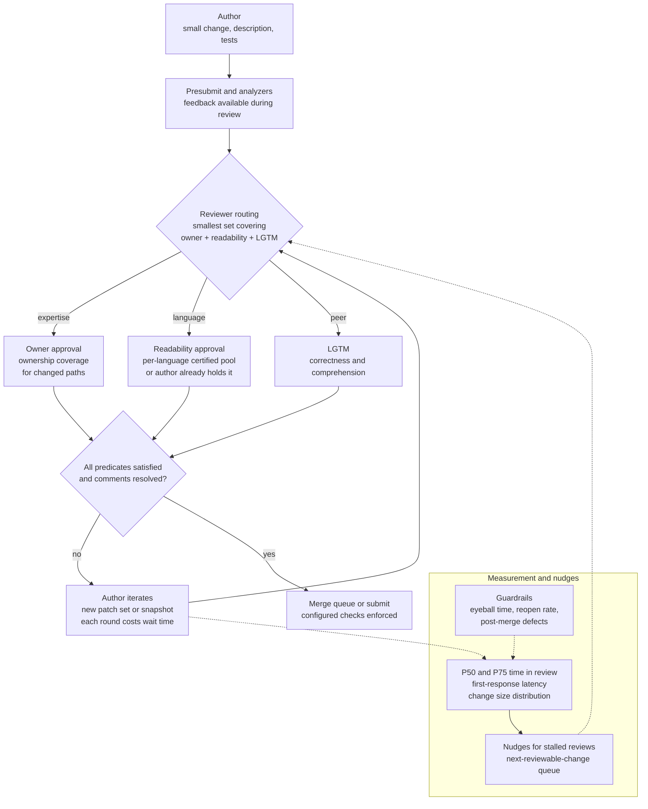

# Code Review and Readability Systems at Scale

> [!summary] Claim:
> Google's review process distinguishes three checks: a peer checks correctness and comprehension, an owner checks whether the change fits the affected code, and a readability holder checks language norms.
> Google reported 24 modified lines, one reviewer, and under 4 hours of review latency at the median in its 2014 to 2016 sample, with one reviewer often covering all outstanding requirements.
> Defects accounted for 14% of comments in one Microsoft sample and about 15% in a later Microsoft estimate, with more feedback devoted to improving the code.
> Meta found that slower P75 Time In Review correlated with developer dissatisfaction.
> An expert sets a size norm, a turnaround SLA, a routing algorithm that balances expertise against load and knowledge spread, and a guardrail against rubber-stamping, then measures all four.



## The Mechanism

### What review is for, measured

The seed question is why an organization pays for review at all, and the evidence says the answer is not mainly bug finding.
Bacchelli and Bird (ICSE 2013) interviewed and surveyed Microsoft developers and classified 570 comments in 200 threads from CodeFlow.
Finding defects was the top stated motivation: it was the first motivation for 383 of the programmer respondents (44%), and 873 programmers answered the survey (44% response rate).
The comments told a different story: "code improvements" were 165 of 570 (29%), the most frequent category, while "defect" comments were 78 (14%), the fourth most frequent of nine categories.
The paper lists 65 logical issues, 6 high-level issues, 5 security issues, and 3 exception-handling issues.
Those subcounts sum to 79, one more than the 78 defect comments reported in section IV-E and Figure 4.
Only 12 comments were explicit knowledge transfer, yet the authors found that code and change understanding is the main challenge reviewers report.
Czerwonka, Greiler, and Tilford (ICSE 2015 SEIP, a two-page talk abstract) report a similar split from Microsoft's wider data: about 15% of comments indicate a possible defect and at least 50% concern long-term maintainability.
They also report that a reviewer with no prior exposure to the code gets only about 33% of comments judged useful by the author, rising to about 67% on the third review of the same area.

Google reports the same direction from the inside.
The first author of the Google study interviewed an early employee who introduced review so that developers would write code their peers could understand (Sadowski et al., section 4.1).
Four expectations came out of the interviews: education, maintaining norms, gatekeeping, and accident prevention.
All 44 survey respondents agreed or strongly agreed that review was valuable (Table 2).
In follow-up details about sampled changes, 2 respondents said the comments had found a bug (section 6.2).
The implication for design is direct: a system built only to catch defects would optimize reviewer count and checklist depth, while a system built for comprehension, consistency, and knowledge spread optimizes small diffs, familiar reviewers, and short waits.
Software Engineering at Google, chapter 9, lists six benefits: checking correctness, ensuring comprehensibility, enforcing consistency, promoting team ownership, enabling knowledge sharing, and providing a historical record.
Two later sections depend on this: the ownership and readability gates exist because of the second and third benefits, and the latency work exists because comprehension decays when the author has moved on.

### The lifecycle and the three approval predicates

The Google flow in Critique has five steps (Sadowski et al., section 5.1).
1. Creating: the author prepares a change.
2. Previewing: the author views the diff and the results of automatic analyzers such as Tricorder, then mails the change to one or more reviewers.
3. Commenting: reviewers draft comments; unresolved comments are action items and resolved comments are optional or informational.
4. Addressing feedback: the author uploads a new snapshot, and any two snapshots can be diffed.
5. Approving: reviewers mark LGTM, and a commit typically needs approval from at least one reviewer.

The commit gate is the conjunction of three predicates, described in the paper and in the SWE book (chapter 9):

| Predicate | Who can satisfy it | What it certifies |
|---|---|---|
| LGTM | Any peer, often a teammate | Correctness and comprehension. |
| Owner approval | A member of the OWNERS set of the directory or an ancestor | The change is appropriate for this part of the codebase. |
| Readability approval | A holder of readability in each language that requires approval | The change follows the language's style and best practices. |

The author can fill the owner and readability roles if they already hold them, and by default only one LGTM is required.
Murphy-Hill et al. (2023, appendix B.2) document that a sufficiently small edit in one language can be exempt from its readability approval in a mixed-language change.
An owner with the required readability can cover all three predicates, and authors already cover some requirements on many changes.
In the logs, fewer than 25% of changes had more than one reviewer, over 99% had at most five, and the median was 1.
The design choice is to make approval roles orthogonal, so that routing becomes a covering problem (see the routing section) instead of a negotiation about who is senior enough.

Counting reviewers needs care.
The paper counts as a "reviewer" any user who approves a change, whether or not the author asked for them.
It also reports that 30% of changes have comments from more than one commenter and estimates that about 5% have additional comments from someone who did not act as an approver (section 5.2, footnote 1).
Both facts matter when you compare your own reviewer counts to the published ones.

The Google process is not unique in outline.
Rigby and Bird (ESEC/FSE 2013, section 7) found five common practices across their industrial and open-source settings: lightweight review, frequent and quick feedback, small changes, typically two reviewers, and group problem solving and knowledge sharing.
Sadowski et al. found the first three at Google, with a median of one reviewer and an emphasis on education and norms in the interviews.

### Ownership: OWNERS files, CODEOWNERS, and what they gate

Ownership is a tree-shaped permission system for review.
In Google's monorepo each directory is owned by a set of people; any developer may propose a change to any part, but an owner of the directory or a parent must approve it, and even owners have their changes reviewed (Sadowski et al., section 5.1).
SWE chapter 9 states the resolution rule: OWNERS files list usernames for a directory and its children, and a file is generally owned by the union of the members of all OWNERS files above it in the tree.
Owners decide what belongs in their directories.

The external implementations differ in details that matter in incidents.

| Property | GitHub CODEOWNERS | Gerrit code-owners plugin | Chromium OWNERS (on Gerrit) |
|---|---|---|---|
| File | One `CODEOWNERS` file in `.github/`, the root, or `docs/`; first found is used | `OWNERS` files in the tree, applying to the directory and below | `OWNERS` files per directory |
| Resolution | Last matching pattern wins, using the PR's base branch | With the find-owners backend, inherits owners unless `set noparent` stops it | Inherits owners unless `set noparent` stops it |
| Per-file rules | Patterns are similar to gitignore | In find-owners, `per-file <path-exp-1,path-exp-2,...>=<access-grant>` | `per-file foo_bar.cc=a@chromium.org` |
| Satisfaction | With required code owner review, any one eligible owner of a matching pattern can cover that pattern | Each file needs ownership coverage when enforcement applies, with `Code-Review+1` accepted by default | Ownership coverage for affected paths, with a positive review from another committer for ordinary changes |
| Author as approver | Authors cannot approve their own PRs | `codeOwners.enableImplicitApprovals` can count a code owner who owns the change and uploaded its current patch set | Committer authors need one other committer, and owners can cover paths they own |
| Size and syntax limits | Under 3 MB to load, with no support for escaping a leading `#`, `!` negation, or `[ ]` ranges | Backend-specific | See Chromium's OWNERS syntax |

(All rows as of 2026-11, Both.
Sources are GitHub's code owners and required reviews docs, Gerrit's code-owners user guide and find-owners config, and Chromium's Code Reviews guide.)
GitHub's page adds four failure semantics worth memorizing.
An invalid line is skipped, not rejected.
Users need write access to the repository.
Teams must be visible and have write access even if their individual members already have access.
When several owners follow one pattern, they must be on the same line, or only the last owner on separate lines applies.
Draft pull requests do not auto-request owners.

Ownership mixes two jobs that need different treatment.
One job is gatekeeping, protecting a directory's design from drive-by change.
The other is reviewing, which needs a person with time and context.
At scale a small owner pool can become a bottleneck even when other engineers can do a technical review.
Chromium gives scoped `Owners-Override +1` permissions to active gardeners, Release Program Managers, large-scale-change reviewers, global approvers, and Chrome ATLs.
Its Rubber Stamper supplies a separate `Bot-Commit +1` vote for eligible changes, such as clean reverts, while ownership still needs to be covered or explicitly overridden (Chromium `docs/code_reviews.md`, as of 2026-11, Both).

### Readability: certification, not a lint

Readability is Google's per-language certification program for style and idiom (Sadowski et al., section 5.1).
A developer seeking certification submits changes for feedback to a centralized group of readability reviewers.
Readability administrators look across reviewers' evaluations of several changes before deciding whether to grant certification (Murphy-Hill et al., 2023, section 5.2).
SWE chapters 3 and 9 describe certification holders approving ordinary changes and a smaller volunteer pool mentoring and evaluating candidates.
The review covers language idioms, structure, complexity, API design, documentation, and test coverage.

The mechanism is a rate-limited, transferable gate.
1. It limits who approves language style across an organization of more than 30,000 engineers in the book's 2020 account (SWE chapter 8).
2. It gives candidates line-level feedback on real changes from a mentor outside their immediate team (SWE chapter 3).
3. It gives the author and router a way to cover language norms separately from directory ownership (SWE chapter 9).

The cost is another approval type that can require a separate reviewer or another round.
In the 2020 book, about 20% of Google engineers were participating as authors or reviewers at a given time, and about 1% to 2% of engineers were readability reviewers (SWE chapter 3).
The number of changes before graduation varies, with a median of 10 in the Java program reported by Murphy-Hill et al. (2023, section 5.2).
The published sources give no per-language mentor pool sizes or certification throughput, so size your own pool from your measured candidate volume rather than from Google's figures.

Readability sits on top of a style guide, and chapter 8 explains how the rules are justified.
Rules are mandatory, while guidance allows discretion.
Every rule should justify its adoption cost, optimize for readers, promote consistency, avoid constructs likely to cause errors or surprises, and allow practical exceptions.
The guide favors code that stays easy to read and a consistent default when several choices are reasonable.
Style arbiters make the final decision on rule changes by consensus, and the C++ group had four members in the 2020 book.
Google relaxed its policy against changing C++ style rules once preserving perfect consistency became too costly.

What should humans keep, and what should machines take?
Chapter 8 says tools such as clang-tidy for C++ and Error Prone for Java automate enforcement, while some rules call for human judgment.
The Google paper describes analyzers taking routine formatting issues off reviewers' plates so reviewers can spend more attention on understandability and maintainability.
The rule for a new organization is therefore to put everything mechanical into the formatter and presubmit (see [[Static-Analysis-at-Scale-Tricorder-and-Autofix]]) and reserve readability reviewers for the judgments a tool cannot make: naming, decomposition, idiom choice, and unnecessary complexity.
The kernel treats `scripts/checkpatch.pl` as guidance and tells contributors to keep their code as written when a suggested fix would make it worse (Linux kernel docs, Submitting patches and 5. Posting patches, version 7.4.0-rc4, as of 2026-11).

### Change size: the lever that moves everything else

Large changes are associated with longer waits and less useful review feedback.
The studies measure observed review behavior, and the guides give practical thresholds for splitting changes.

| Source | Finding |
|---|---|
| Google log analysis, 9 million changes, Jan 2014 to Jul 2016 | Median of 24 modified lines, over 35% touching one file, about 90% touching fewer than 10 files, and over 10% modifying one line <br/>Mean comment count peaking at 12.5 around 1,250 changed lines, with the authors suggesting generated code and deletions help explain the later drop |
| Microsoft (Czerwonka et al.) | Usefulness of review comments falls as the number of files rises, with the drop noticeable from 20 or more changed files. |
| Google eng-practices | Usually reasonable around 100 lines and usually too large at 1,000 <br/>Possibly fine with 200 lines in one file, usually too large across 50 files |
| SWE chapter 9 | About 200 lines for a small change, about 35% of changes touching one file, and initial feedback expected within about a day for most changes |
| Linux kernel docs | One patch per logical change <br/>For series that cannot be condensed, about 15 patches at a time before waiting for review and integration (as of 2026-11, Linux, docs 7.4.0-rc4) |

(Unless otherwise specified, as of 2026-11, Both.
The Google log data covers 2014 to 2016.)
The mechanism is comprehension cost.
The reviewer has to rebuild the author's mental model of the change from the diff, and Bacchelli and Bird report understanding as the dominant challenge.
Every added file adds context to hold, so quality of review drops with size instead of staying flat, which is why Google "strongly encourages" small, incremental changes with the exception of large deletions and automated refactorings (Sadowski et al., section 7.1).

Definitions matter more than the thresholds.
Eng-practices calls for one self-contained change with tests, separate refactoring from feature or bug work, and a working system after each change in a stack lands.
Deleting a whole file counts as roughly one line, and a trusted automated refactoring can be large.
The guide allows reviewers to turn down a change because of its size alone.
Splitting strategies in the guide are stacking changes on each other, splitting by files (for example protocol definitions versus consuming code), splitting horizontally across layers, and splitting vertically by feature slice.
The size of large mechanical changes is a separate topic owned by [[Large-Scale-Changes-and-Codemods-Across-Repos]].

The failure mode of a size rule is gaming.
If the dashboard rewards small diffs, authors split one idea into six unreviewable pieces that no single reviewer can judge, which raises the number of review rounds without raising comprehension.
The guard is to measure the distribution (P50, P90) and the number of rounds per idea, not an average, and to keep the "self-contained and keeps the build green" rule explicit.

### Turnaround: latency is round trips times wait

Review latency is mostly waiting, and waiting multiplies with iterations.
Google's logs show a median time to initial feedback under an hour for small changes and about 5 hours for very large ones, with an overall median latency for the entire review under 4 hours (section 5.2).
The same paper contrasts the median time to approval Rigby and Bird reported: 17.5 hours at AMD, 15.7 at Chrome OS, and 14.7, 19.8, and 18.9 hours at three Microsoft projects, and it cites another Microsoft study at a median of 24 hours.
Over 80% of Google changes involve at most one iteration of resolving comments, and 70% of changes during the week commit in less than 24 hours after being mailed for initial review (sections 5.1 and 8).
The median developer authors about 3 changes a week and reviews 4; 80% of authors make fewer than 7 changes and 80% of reviewers review fewer than 10 a week.
In a separate five-week sample starting in October 2016, the study estimated that developers spent a mean of 3.2 hours a week reviewing (median 2.6) from tool interaction logs.
The 6.4 hours per week for open-source projects cited in section 6.2 came from self-reports, so the two measurements have different definitions.

The published response norms depend on the review community.

| Source | Rule (as of 2026-11, Both) |
|---|---|
| Google eng-practices, Speed of Code Reviews | One business day to respond, with prompt subsequent responses and reviews scheduled at breaks in focused work |
| SWE chapter 9 | Provide feedback within 24 working hours, or acknowledge the review and follow up. |
| Chromium | Three actionable feedback rounds per workday or two across time zones, and an additional reviewer after two workdays of silence |
| Linux kernel | At least one week before resubmitting or pinging, with comments typically arriving within two to three weeks (Linux, docs 7.4.0-rc4) |

The elapsed-time model explains why the SLA is stated per response and why iteration count matters more than review effort.
If the reviewer polls every T hours and each round becomes ready at a uniformly distributed point between polls, the expected wait to the next poll is T/2.
Assume a fixed review time r, a fixed author edit time a between rounds, and no queue backlog.
For k rounds, elapsed time is `k * (T/2 + r) + (k - 1) * a`.
The table substitutes r = 0.25 h and a = 0.5 h into the model.

| Queue check interval T | k = 1 round | k = 2 rounds | k = 3 rounds |
|---|---|---|---|
| 1 hour | 0.75 h | 2.00 h | 3.25 h |
| 4 hours | 2.25 h | 5.00 h | 7.75 h |
| 24 hours | 12.25 h | 25.00 h | 37.75 h |

Under those assumptions, daily polling gives an expected 25 hours for two rounds and 37.75 hours for three.
With fixed polling and immediate edits, round arrivals can be correlated and the estimate for later rounds can change.
Google's speed guide allows approval with comments if the reviewer trusts the author to address them, the comments are optional, or the changes are minor.
That can eliminate a follow-up approval round, especially when review hours overlap little.

Median latency hides what developers feel.
Meta's Time In Review sums the time a diff waits on reviewer action across its review cycles.
In early 2021 the median was a few hours, while P75 had increased by as much as a day.
Meta made P75 its primary metric after a company survey linked slower reviews in an engineer's tail to lower satisfaction (Meta Engineering blog, 2022-11-16).
The measured effects of their changes, as published, were:

| Intervention | Published effect |
|---|---|
| Next Reviewable Diff: after finishing one review, surface the diff the reviewer is most likely to want next | 17% overall increase in review actions per day; engineers using the flow did 44% more review actions than the average reviewer (the blog does not claim causality from a controlled test). |
| Reviewer recommendation with work-hours awareness and file ownership | Blog reports a 1.5% increase in diffs reviewed within 24 hours, top-three recommendation accuracy rising from below 60% to nearly 75%, and a factor of 14 reduction in P90 recommendation display latency |
| Stale Diff Nudgebot: ping the likeliest reviewers on diffs waiting too long | Average Time In Review for all diffs dropped 7% (weekends excluded); the share of diffs waiting longer than three days dropped 12%. |

(As of 2022-11, Meta's internal diff system; published by Meta, not reproduced here.)
Microsoft's Nudge selects gradient boosting to estimate pull request lifetime, filters predicted-overdue requests for recent activity, and identifies who can act (Maddila et al., ACM TOSEM 2022, sections 4 to 7).
The batch runs every six hours and sends at most one notification per pull request.
In its nine-month trial on 147 repositories, about 8,500 pull requests received a nudge across two configurations.
The 60.62% reduction in mean lifetime applies to the full configuration (4,383 pull requests, 77.7 hours), compared with no notification (3,856 pull requests, 197.2 hours), as reported in Table 4.
The 2021 deployment to about 8,000 systems sent 210,000 notifications on pull requests authored by 40,000 developers, and 71.5% of notifications were resolved positively (sections 8.1 and 8.5).
Both systems use targeted reminders to move requests that have been waiting for action.

Speed without a guardrail invites rubber-stamping.
Meta used Eyeball Time, the total time reviewers spent viewing a diff, as a guardrail against rubber-stamping.
It is an attention proxy and needs interpretation alongside other quality signals.

### Reviewer routing, load, and knowledge spread

Routing decides who gets the review, and it has three objectives that pull against each other: cover the approval predicates, get a fast response, and spread knowledge and workload.

Critique's recommender seeks the smallest set of reviewers that covers the change's requirements and prioritizes people who recently edited or reviewed the affected files.
New team members are explicitly added, because they have no history yet, and unassigned reviewers can comment and potentially approve (Sadowski et al., section 5.1).
Many teams also assign reviews sent to a team alias in a round-robin manner, taking review load and vacations into account.
Minimizing reviewer count is an instance of set cover when each candidate can satisfy a fixed subset of the unmet requirements.
Set cover is NP-hard, and the unweighted greedy algorithm picks the candidate who covers the most remaining requirements at each step.
Its approximation factor is at most the harmonic number H(n), where n is the number of requirements (Vazirani, section 2.1, Theorem 2.4).
Greedy can be beaten by a small adversarial instance, and tie-breaks decide load.
The routing example traces both approaches.

GitHub's team auto-assignment offers two algorithms (GitHub team code review settings, as of 2026-11, Both).
Round robin favors the member whose last review request was longest ago, without considering outstanding reviews.
Load balance considers outstanding reviews and tries to equalize review counts over a 30-day window.
Both skip members whose status is "Busy," and if everyone is busy the request stays assigned to the team.
Settings include never assigning certain members, including child team members, and counting existing requests.
For a code owner team on a branch that requires code owner review, the assigned individuals appear alongside the team request until an individual completes the review.

Research on recommenders at Meta shows that offline accuracy and production behavior diverge.
The Meta paper (Rigby et al., arXiv 2312.17169v2) replaced a blame-based recommender with a learning-to-rank model (LambdaMART) using features such as time spent on the author's diffs in the past 90 days, assigned reviews, rejected diffs, and comment counts.
In the first production experiment on 82,000 diffs, top-three accuracy rose by 14.19 percentage points and P90 recommendation display latency fell by a factor of 14.
The experiment found no statistically significant change in the review duration or viewing-time guardrails (section 5).
The second experiment applied a workload penalty using `e^(theta * workload)` with theta = 0.1 and re-ranked only the top five suggestions.
Authors often passed over the top low-workload recommendation, and the guardrail time metrics showed no statistically significant change (sections 3.2 and 6.2).
For team-only assignments, the third experiment added one of the top three recommended reviewers at random.
Time In Review decreased by 11.6%, with no statistically significant change in time reviewers spent on each diff (section 7, Table 10).

Expertise concentration is the long-run cost of recommending the same experts.
Hajari et al. report that the top 20% of reviewers do between 75% and 84% of the review work, depending on the project, and define files at risk (FaR) as files known by zero or one active developers.
Sofia, introduced by Mirsaeedi and Rigby (ICSE 2020), combines an expertise recommender with a routing rule for spreading knowledge.
Hajari et al.'s workload-aware SofiaWL uses the knowledge-spreading rule when any affected file has at most two knowledgeable developers and otherwise prioritizes expertise with a workload penalty (section II-C, equation 14).
Across the projects in their simulation, they report about 3% more measured expertise, 12% less workload concentration, and 28% fewer files at risk.
The expertise measure uses file-history signals, so it does not directly measure the quality of a review.

### Review quality and etiquette

Google's review standard favors approval once the change clearly improves overall code health.
The style guide governs style questions, and technical evidence governs design decisions.
Where multiple approaches are technically valid, the standard gives the author discretion and permits consistency with the codebase to guide the choice.
Google's checklist puts design first and also covers functionality, complexity, tests, names, comments, style, consistency, documentation, each assigned line, and context beyond the diff.
Its navigation guide starts with the change description and the most important file, with major design concerns sent early.

Comment mechanics are part of the system because tone and power show up as delays.
Eng-practices asks reviewers to discuss the code, explain their reasoning, and label feedback with prefixes such as `Nit:`, `Optional:` or `Consider:`, and `FYI:`.
When code needs an explanation, it asks for clearer code or a comment that stays with the code.
Google's interviews found that tone and power (dragging out reviews, withholding approvals) cause breakdowns, as do distance, disagreement about whether code review is the right place for design review, and missing context (section 6.1).
The review standard calls for seeking agreement, talking directly and recording the outcome in the review, then escalating unresolved issues to the wider team, lead, maintainer, or manager.

The Linux kernel formalizes reviewer accountability as a tag.
`Reviewed-by:` says that the reviewer did a technical review, raised concerns with the submitter, and considers the patch worthwhile and free of known issues, without giving a warranty.
`Acked-by:` records a less formal agreement, `Tested-by:` records testing, and `Signed-off-by:` attests to the Developer's Certificate of Origin.
Of the attribution tags listed in 5. Posting patches, only `Cc:`, `Reported-by:`, and `Suggested-by:` may use implicit permission under the documented conditions (Linux, docs 7.4.0-rc4, as of 2026-11).
The useful generalization is that a review tool should record what a reviewer asserted, not only that they clicked approve.

### Emergencies and break-glass

Every gated system needs a documented bypass, and the bypass is part of the design.
Eng-practices defines an emergency CL as a small change that lets a major launch continue instead of rolling back, fixes a bug significantly affecting production users, handles a pressing legal issue, or closes a major security hole.
Not emergencies: launching a week earlier, a long-running feature, reviewers in another time zone, the end of a Friday, a soft deadline.
Emergency reviews take priority, are judged on speed and whether the fix resolves the problem, and are re-reviewed more thoroughly afterward.
Chromium's `Owners-Override +1` bypass is limited to named roles, with usage restricted by role and responsibility for adequate review placed on the person overriding.
For an emergency path, record who overrode the gate, why, and the outcome of the post-incident review.

### Tools compared

| Capability | Critique (Google, internal) | Gerrit | GitHub pull requests | Kernel mailing list |
|---|---|---|---|---|
| Unit of review | Change with snapshots | Change with patch sets; each patch set is a git commit; identified by a `Change-Id` footer (SHA-1 prefixed with `I`) | Pull request with commits | Patch series by email |
| Approval model | LGTM + owner + readability | Default Code-Review label spans -2 to +2, and Verified can be configured for CI | Configurable approvals, code owners, and status checks | `Reviewed-by:` and `Acked-by:` tags |
| Submit gate | Pre-commit checks and approvals | Default Code-Review requirement of MAX and no MIN votes <br/>Uploader exclusion example: `label:Code-Review=MAX,user=non_uploader AND -label:Code-Review=MIN` | Branch protection and optional merge queue | Maintainer applies patch |
| Stale approval handling | Clears per-file reviewed checkboxes on edits (SWE chapter 19) <br/>Reviewers can diff any pair of snapshots (SWE chapter 19) | Votes copy when the label's `copyCondition` matches, and become outdated otherwise | Optional stale approval dismissal and optional approval of the most recent reviewable push by someone other than its pusher | Carry Tested-by and Reviewed-by on resend when the patch remains substantially unchanged |
| Routing | Recommender (smallest covering set) | Reviewers added manually or by plugin | Code owners and team auto-assignment | `scripts/get_maintainer.pl` and `MAINTAINERS` |

(As of 2026-11, Both for the review tools, and Linux for the kernel.
Gerrit docs v3.15.0-rc4-356-g0bdf31d913 and kernel docs 7.4.0-rc4.)
Gerrit recommends submit requirements and deprecates Prolog submit rules (Gerrit Submit Requirements documentation).
GitHub's merge queue lets you choose merge, rebase, or squash and throttle concurrent builds by limiting the number of dispatched `merge_group` webhooks to 1 through 100.
You can also configure the minimum and maximum PRs per merge into the base branch, each from 1 through 100.
Those merge limits do not combine CI builds, and GitHub Actions workflows that supply required checks need a `merge_group` trigger.
Moving a PR to the front of the queue forces a rebuild of in-progress groups.
Merge queue throughput is owned by [[Drill-Engineering-Systems-Diagnose-CI-Merge-Queue-Collapse]] and [[Build-and-Test-Latency-Economics-and-Flaky-Tests]].

## Commands and Numbers to Know

| Item | Value | Platform | Notes |
|---|---|---|---|
| Google changes reviewed | About 9 million, Jan 2014 to Jul 2016; over 25,000 authors and reviewers; about 20,000 changes committed per workday (as of 2026-11, data 2014 to 2016) | Both | Sadowski et al., section 3.3; the figures are a snapshot in time. |
| Median change size, Google | 24 lines modified; over 35% single-file; about 90% under 10 files; over 10% one line (as of 2026-11, data 2014 to 2016) | Both | Section 5.2; "median" excludes changes with zero source-line delta. |
| Reviewers per change, Google | Median 1; under 25% have more than one; over 99% have at most five (as of 2026-11, data 2014 to 2016) | Both | Counts approvers. |
| Median review latency, Google | Under 4 hours overall; under 1 hour to initial feedback for small changes, about 5 hours for very large (as of 2026-11, data 2014 to 2016) | Both | Compare Rigby and Bird: 14.7 to 19.8 hours at AMD, Chrome OS, Microsoft. |
| Iterations, Google | Over 80% of changes need at most one iteration; 70% commit within 24 hours on weekdays (as of 2026-11, data 2014 to 2016) | Both | Iteration = one author upload resolving comments. |
| Weekly review time | Average 3.2 hours, median 2.6 hours per developer (October 2016 sample) | Both | 5-week sample; OSS self-reported is 6.4 hours. |
| SLA: Google | One business day to respond; 24 working hours (as of 2026-11) | Both | eng-practices and SWE chapter 9. |
| Response norm: Chromium | 3 iterations per workday in the same time zone or 2 across time zones, with an additional reviewer after 2 workdays of silence (as of 2026-11) | Both | `docs/code_reviews.md`. |
| Small change guidance | About 100 lines reasonable, 1000 too large (eng-practices); about 200 lines "small" (SWE) (as of 2026-11) | Both | Judgment, file count matters. |
| Defect share of review comments | 14% (78 of 570) at Microsoft in 2013; about 15% in a 2015 estimate; maintainability at least 50% | Both | Bacchelli and Bird; Czerwonka et al. |
| Reviewer workload skew | Top 20% of reviewers do 75% to 84% of reviews (projects studied in Hajari et al., 2023 preprint) | Both | The range is project-dependent. |
| Meta Nudgebot | 7% reduction in mean Time In Review, adjusted for weekends, and 12% reduction in the share waiting over three days (as of 2022-11) | Both | The reported effects use two metrics separate from the P75 target. |
| CODEOWNERS file | Under 3 MB; last matching pattern wins; locations `.github/`, root, `docs/` (as of 2026-11) | Both | A file over the limit is not loaded. |
| GitHub team assignment | Round robin or load balance (30-day window); skips "Busy" members (as of 2026-11) | Both | Settings under team code review settings. |
| Gerrit Code-Review label | -2 to +2; default submit needs a MAX vote and no MIN vote (as of 2026-11) | Both | Gerrit v3.15.0-rc4-356-g0bdf31d913 docs. |
| Merge queue limits | Build concurrency and minimum and maximum PRs per merge each range from 1 to 100 (as of 2026-11). | Both | Build scheduling and merging to the base branch use separate limits. |
| Kernel resend wait | Minimum one week before resubmitting or pinging (as of 2026-11) | Linux | Kernel docs 7.4.0-rc4. |

## Multi-Language Comparison

Readability exists because style and idiom are language-specific, so the split between "a tool decides" and "a certified human decides" differs by language.
The tool names are illustrative and checked against the LLVM, Astral, LibCST, and Rust documentation (as of 2026-11, Both).

| Concern | C++ | Python | Rust |
|---|---|---|---|
| Mechanical formatting | `clang-format` with a checked-in `.clang-format` | `ruff format` or a Black-compatible formatter | `rustfmt` through `cargo fmt` |
| Mechanical diagnostics | `clang-tidy`; compiler warnings as errors | `ruff check`, type checking | `cargo clippy`; compiler lints |
| Where humans still exercise judgment | Ownership design, template complexity, ABI exposure, whether an abstraction pays for itself | API shape, error-handling policy, clarity of control flow | Ownership design, error-type design, unsafe boundaries, trait abstraction |
| Readability reviewer focus | Rule of zero, RAII, const-correctness, avoiding hidden allocations in hot paths | Straightforward control flow, typed interfaces, explicit data transformations | Idiomatic ownership, minimal `unsafe`, clear `Result` handling |
| Routing artifact | CODEOWNERS path rules for a language owners team | Same | Same |
| Typical large-scale automation | Codemods with Clang LibTooling | Codemods with LibCST | `cargo clippy --fix` and `cargo fix` |

With required code owner review, a GitHub pattern such as `*.cc @org/cpp-style-reviewers` can make members of a language team the eligible owners for matching files (as of 2026-11, Both).
Because the last match wins, that rule can replace directory owners for those files.
Listing both teams on one line allows approval by either, so a separate gate is needed to require both a directory owner and a language reviewer.
GitHub requires another eligible reviewer even when the pull request author belongs to the language team (Approving a pull request with required reviews).

## Worked Example: Routing and Latency Without a Lab

This worked example models the requirements in the Google study.
The trace follows directly from the two inputs, and the latency table follows from the stated polling assumptions.

### Routing is set cover, and tie-breaks are policy

The example needs one eligible peer approval, one owner approval per file, and one readability approval per language where required.
Remove owner and readability requirements the author already satisfies.
Give each candidate a set of requirements they can cover, and choose the candidate covering the most remaining requirements at each step.

```python
def greedy(reviewers, requirements, prefer_loaded):
    # reviewers maps each name to (covered requirements, recent review count).
    sign = -1 if prefer_loaded else 1
    chosen = []
    remaining = set(requirements)
    while remaining:
        best = min(
            reviewers,
            key=lambda name: (
                -len(reviewers[name][0] & remaining),
                sign * reviewers[name][1],
                name,
            ),
            default=None,
        )
        if best is None or not reviewers[best][0] & remaining:
            raise ValueError("some requirements cannot be covered")
        chosen.append(best)
        remaining -= reviewers[best][0]
    return chosen
```

In scenario 1, the author has readability and a peer LGTM, and six file ownership requirements remain.
`big` owns f1, f2, f4, and f5, `left` owns f1, f2, and f3, and `right` owns f4, f5, and f6.
All three have equal recent review counts, so the last tie-break is alphabetical.
In scenario 2, both candidates cover the same two outstanding requirements and have recent review counts of 40 (`senior`) and 5 (`junior`).
One check of the inline function and both inputs produced these choices on macOS arm64 with Python 3.15.2 (as of 2026-11).

```text
scenario 1: requirements 6
  greedy : ['big', 'left', 'right']
  optimal: ['left', 'right']
scenario 2: requirements 2
  most-loaded tie-break : ['senior']
  least-loaded tie-break: ['junior']
```

Reading the trace:
1. Greedy picks `big` first because it covers four of six requirements, then needs both `left` and `right` for f3 and f6, so it uses three reviewers where two suffice.
2. For a bounded candidate set, try combinations in increasing cardinality and stop at the first complete cover.
   There are up to 2^m candidate subsets for m reviewers, so cap exact search by candidate count.
3. With equal coverage, choosing the higher count concentrates assignments, while choosing the lower count places the review with the less recently loaded candidate.
   Review count by itself is a load proxy.
4. The routing example concerns coverage and assignment.
   The turnaround model quantifies how the polling interval affects elapsed review time.

### Measure your own repository

Use the practice drill's `gh pr list` command from the repository you want to sample.
All shown flags and JSON fields are listed by `gh pr list --help` in gh 2.106.0 (as of 2026-11, macOS arm64).
Sum additions and deletions for the pull request's diff size.
For each pull request, subtract the creation time from the first submitted human review by someone other than the author, and separately from the merge time.
Report missing human reviews separately, and use the ready-for-review timestamp for draft pull requests when measuring the response SLA.
These timestamps describe first review and end-to-end merge time, while Meta's Time In Review needs a timeline of reviewer and author turns.

## Pitfalls

> [!warning] Pitfall 1: Optimizing the median
> A healthy median can sit next to a bad tail.
> Meta's median was a few hours while P75 had grown by up to a day, and satisfaction tracked the slowest quarter of reviews.
> Report P50, P75, and P90 of first-response and total time in review, and alert on the tail and on the share waiting longer than three days.

> [!warning] Pitfall 2: Rubber-stamping created by the speed target
> A turnaround SLA with no quality signal teaches reviewers to approve quickly.
> Pair every latency target with a guardrail such as time spent viewing the diff (Meta's Eyeball Time), post-merge reverts, or the share of approvals with zero comments on large changes.
> Do not set a target on comment counts, which rewards noise.

> [!warning] Pitfall 3: Silent ownership failures
> On GitHub an invalid CODEOWNERS line is skipped, owners without write access get no assignment, and a file over 3 MB is not loaded.
> The intended code owner can go unrequested, so verify the owners GitHub actually resolves for the changed paths.
> Check CODEOWNERS in CI for valid syntax, accessible owners, and expected coverage, and alert when a reviewable change goes unassigned past your routing target.

> [!warning] Pitfall 4: Owner sets as bottlenecks and single points of knowledge
> A directory with two owners has a single point of failure while one is on leave, and routing to the same expert concentrates knowledge.
> Keep at least three active owners for critical directories, balance review load, and track files at risk (files known by zero or one active developer).

> [!warning] Pitfall 5: Gaming change size
> Splitting one idea into many small diffs satisfies a size dashboard and defeats review.
> Keep "self-contained, tested, build green after each change" as the definition, and measure rounds per logical change, not just lines per diff.

> [!warning] Pitfall 6: Readability as a hazing queue
> A certification pool that is too small, or that applies subjective taste instead of the written guide, becomes a throughput tax on newcomers.
> Put mechanical rules in tooling, cite the style guide in style comments, and track the time candidates spend waiting for readability reviewers.

> [!warning] Pitfall 7: Stale approvals and the last-push race
> A push after approval can change the diff while the approval stays, unless the tool dismisses it.
> On GitHub, enable dismissal of stale approvals and, for sensitive paths, the option that the most recent reviewable push must be approved by someone other than the pusher; on Gerrit, set label `copyCondition` deliberately, since votes outdated by a new patch set do not count.

> [!warning] Pitfall 8: Treating AI-authored volume as free
> If agents raise the number of changes without raising reviewer capacity, queues grow and review quality falls.
> Size limits, ownership gates, and verification before human review apply to agent output; see [[AI-Coding-Agents-Sandboxes-Worktrees-and-Ship-Gates]].

## At Scale

For one developer or a team of five, a review checklist and a written norm ("one business day, under 200 lines, everyone reviews") are enough, and heavy tooling costs more than it returns.
For 50 to 500 engineers, the failures are CODEOWNERS drift, owner concentration, and PRs without a named reviewer; the fixes are routing automation, named reviewers, and a visible queue.
For 1,000 to 50,000 engineers, review is a throughput system with a capacity budget, and the sums are large.

Google's paper reports over 25,000 authors and reviewers across its 2014 to 2016 log dataset and about 20,000 qualifying changes committed per workday.
As a capacity scenario, 25,000 weekly active reviewers averaging 3.2 hours would spend 80,000 reviewer hours a week.
The first number is a multi-year participant count, and the second is an estimate from a separate five-week sample, so the product is illustrative.
Measure reviewer effort separately from elapsed wait before sizing the savings from fewer rounds.

Decision rules:
1. Pilot one required approver for routine changes and use a separate approval for named risk classes such as security, schema, public API, and payments.
   Google's study describes operating context, while the pilot would measure the effect of the approval requirement.
2. Publish a first-response SLA of one business day, measure P75 Time In Review and the three-day tail, and try nudging at half the first-response SLA so the prompt precedes the miss.
3. Use a distribution target for size, such as a P50 near 100 lines and 90% of changes touching fewer than 10 files, informed by Google's observed distribution and the eng-practices guidance.
4. Route to cover requirements first, then use recent load and reserve opportunities to spread knowledge when few active developers know a file.
   Measure the effect on review quality and turnaround.
5. Name an individual reviewer (a recommended one) for every team-routed change; Meta's randomized assignment of a top-three recommendation lowered TimeInReview by 11.6%.
6. Introduce a readability program only when style variance is costly and a pool of reviewers exists per language; before that, a formatter, linters, and a style guide with arbiters cover most of the value (chapter 8: rules must pull their weight).
7. Keep a break-glass path with audit and mandatory post-merge review, restricted to named roles.
8. Review the metrics themselves against Goodhart's law with [[Developer-Productivity-Metrics-DORA-SPACE-and-GSM]] and the gamed-dashboard drill [[Drill-Engineering-Systems-Audit-a-Gamed-Productivity-Dashboard]].

A strict ownership-plus-readability system can add a wait for authors who need separate coverage, and approval power over paths remains concentrated in the owner set.
The next topic in this pillar, [[Ephemeral-Cloud-Development-Environments]], removes a different source of review friction: setup and environment drift.

> [!tip] Practice Drill: Profile your own review pipeline
> Export a sample of up to 500 merged pull requests with `gh pr list --state merged --limit 500 --json number,createdAt,mergedAt,additions,deletions,changedFiles,reviews,author`.
> Calculate P50 and P90 for lines and files changed, and compare them with Google's median of 24 modified lines and its finding that about 90% of changes touched fewer than 10 files.
> Compare first response with the one-business-day target using a working calendar, and report merge times separately.
> Inspect the timelines of the ten slowest pull requests for waits before assignment, after assignment, during author iteration, and in CI.
> Propose one routing change, one nudge, and one guardrail, and state the metric that would show each failed.
> For the CI classification, continue with [[Drill-Engineering-Systems-Diagnose-CI-Merge-Queue-Collapse]].

## Interview Questions

> [!question] L5: What are the three approval predicates in Google's review process, and why can one reviewer often satisfy all three?
> > [!success]- Answer
> > LGTM certifies correctness and comprehension, owner approval certifies the change is appropriate for that directory, and readability approval certifies the language's style and best practices.
> > A reviewer who owns the directory and holds readability for the language satisfies all three, and the author can fill the owner and readability roles if they hold them.
> > Only one LGTM is required by default, and Google's logs show a median of one reviewer per change.

> [!question] L5: What does review find, based on published data, and what follows for your process?
> > [!success]- Answer
> > In a Microsoft sample of 570 comments, 14% were about defects and 29% about code improvements; a later Microsoft estimate was about 15% defect-related and at least 50% maintainability.
> > Google's founding motivation was code that others can understand, and 2 respondents mentioned a bug caught in the sampled change.
> > Design review for comprehension, consistency, and knowledge spread (small diffs, familiar reviewers, quick turnaround), and rely on tests and analyzers for defects.

> [!question] L5 (predict the output): given this CODEOWNERS file, who is requested for `docs/api/x.md`, `docs/readme.md`, and `src/a.cc`?
> ```text
> *           @org/platform
> /docs/      @org/docs
> *.md        @org/tech-writers
> /docs/api/  @org/api
> ```
> > [!success]- Answer
> > The last matching pattern wins for each file, assuming these teams are visible, have write access, and the pull request is ready for review (GitHub CODEOWNERS, as of 2026-11, Both).
> > `docs/api/x.md` matches `*`, `/docs/`, `*.md`, and `/docs/api/`; the last is `/docs/api/`, so only `@org/api`.
> > `docs/readme.md` matches `*`, `/docs/`, and `*.md`; the last is `*.md`, so only `@org/tech-writers`, and the docs team is not requested.
> > `src/a.cc` matches only `*`, so `@org/platform`.

> [!question] L6 (debug this): a pull request touching `docs/` has had no reviewer for three days, branch protection requires code owner review, and CODEOWNERS has `/docs/ @org/docs-team`; what do you check?
> > [!success]- Answer
> > First, check whether `@org/docs-team` is visible and has write access to the repository (as of 2026-11, Both).
> > Second, whether the CODEOWNERS line is valid, since invalid lines are skipped, and whether the file is in `.github/`, the root, or `docs/` and under 3 MB, since an oversized file is not loaded.
> > Third, whether the pull request is a draft, because owners are not auto-requested on drafts, and whether the CODEOWNERS version on the base branch (not the head) is the one you edited.
> > Fix the cause, add a CI check that lints CODEOWNERS, and alert on required-review pull requests with no assigned reviewer.

> [!question] L6: A reviewer-routing function must cover owner and readability requirements with the fewest reviewers: what goes wrong with the obvious greedy algorithm, and what is a sound policy?
> > [!success]- Answer
> > Greedy picks the reviewer covering the most uncovered requirements and can overshoot: with `big` covering f1, f2, f4, f5, `left` covering f1, f2, f3, and `right` covering f4, f5, f6, greedy chooses three reviewers while the optimum is two (`left`, `right`).
> > For a small candidate set, search combinations by increasing size to obtain an exact cover.
> > For larger pools, use a bounded search or a heuristic, and handle cases where no available candidate can cover a requirement.
> > Break ties using load among reviewers who already have the required coverage, and measure whether authors actually select recommendations.

> [!question] L6: Why did Meta make P75 Time In Review the north-star metric instead of the median, and what guardrail did they add?
> > [!success]- Answer
> > Their median was a few hours while P75 had grown by as much as a day, and survey satisfaction correlated with the slowest quarter of diffs.
> > Optimizing speed alone could encourage rubber-stamping, so they used Eyeball Time, the total time reviewers spent looking at a diff, as a guardrail for lost attention.
> > The note's pattern: pick a tail metric that tracks pain and a guardrail that tracks the obvious cheat.

> [!question] L7: Design the turnaround system for 5,000 engineers across three time zones, with numbers and the reasoning.
> > [!success]- Answer
> > Set a first-response SLA of one business day (Google's maximum) and track P50, P75, and P90 of first response and total time in review, plus the share waiting over three days.
> > Use the round-trip model `k * (T/2 + r) + (k - 1) * a`: with a daily reviewer, two rounds already take about 25 hours, so allow "LGTM with comments" to remove a round and route to reviewers in overlapping hours.
> > Nudge stalled reviews (Microsoft's Nudge sent at most one notification per pull request, every six hours in batch; Meta's nudgebot cut the three-day tail 12%) and name an individual reviewer for team-routed changes (11.6% lower TimeInReview in Meta's experiment).
> > Add a quality guardrail so the SLA does not produce rubber-stamping, and review the tail monthly.

> [!question] L7: Should we introduce a Google-style readability certification program?
> > [!success]- Answer
> > Pilot it where inconsistent code is costly and a pool of qualified reviewers can support mentoring and approvals.
> > Google's book describes consistency and mentoring benefits, while Murphy-Hill et al. report a median of 10 changes to complete Java readability.
> > Measure candidate wait time and mentor load in the pilot, and keep mechanical checks in formatting and presubmit.

> [!question] L7: A new policy says every change needs two approvals: argue for or against it using evidence.
> > [!success]- Answer
> > Google's sample shows quick reviews and a median of one reviewer, while Rigby and Bird report that reviews in their settings generally involved two.
> > Neither observation establishes the effect of requiring a second approval.
> > Serial approvals add a wait, while parallel approvals finish when the slower reviewer is done.
> > Reserve independent approval for risk classes such as security, public API changes, and data migrations, and measure delay and reverts per tier.

> [!question] L8+: You own review governance for 30,000 engineers: how do you keep ownership from concentrating knowledge and approval power?
> > [!success]- Answer
> > Measure files at risk (known by at most one active developer) and the review-load distribution.
> > Hajari et al. found that the top 20% of reviewers performed 75% to 84% of reviews in their open-source sample.
> > Route some reviews of poorly shared files to people who can learn the area, and keep at least three active owners as a policy target for critical paths.
> > Keep owner changes reviewable, audit break-glass overrides, and review style arbiters' membership and decisions.
> > Treat the numbers as research results, run an experiment on a pilot area first, and track the guardrails (reverts, rework, review time).

> [!question] L8+: Agents will triple the number of changes per engineer next year: what happens to review, and what do you change first?
> > [!success]- Answer
> > Reviewer capacity becomes the bottleneck: at the Google-reported average of 3.2 hours a week per developer, tripled volume raises queue time or lowers attention, and rubber-stamping risk grows.
> > Change first what is cheap and measurable: enforce size and self-containment on agent output, push verification (tests, analyzers, gates) before human review, route agent changes to named owners, and watch Eyeball Time and reverts.
> > Do not cut human review for risk classes, and design the review UI around comprehension (summaries, diffs between iterations), not more approvals; coordinate with [[AI-Coding-Agents-Sandboxes-Worktrees-and-Ship-Gates]].

## Further Reading

- Sadowski et al., Modern Code Review: A Case Study at Google (ICSE-SEIP 2018): the primary source for Google's review flow, ownership, readability, and the distributions quoted here.
- Software Engineering at Google, chapters 3, 8, 9, and 19: the mentorship program, style governance, review practices, and Critique's interaction model.
- Murphy-Hill et al., Systemic Gender Inequities in Who Reviews Code: the distinction between readability approval and certification, plus the Java candidate data.
- Google Code Review Developer Guide (eng-practices): the reviewer standard, speed rule, small-change guidance, comment writing, and emergencies.
- Bacchelli and Bird, Expectations, Outcomes, and Challenges of Modern Code Review: the study behind "review is more about understanding than defects."
- Czerwonka, Greiler, Tilford, Code Reviews Do Not Find Bugs: a short Microsoft summary of defect share, comment usefulness, and size effects.
- Maddila et al., Nudge (TOSEM 2022): the design and trial results of overdue pull request nudging.
- Meta, Improving code review time at Meta, and Rigby et al., Improving Code Reviewer Recommendation: Time In Review, Eyeball Time, and recommender experiments including the bystander effect.
- Hajari et al., Factoring Expertise, Workload, and Turnover into Code Review Recommendation: files at risk and workload skew.
- GitHub docs on code owners, team code review settings, protected branches, and merge queues: the exact behaviors and limits quoted in this note.
- Gerrit documentation (labels, submit requirements, code-owners plugin) and Chromium's code review guide: a public, configurable approval and ownership model.
- Linux kernel documentation on submitting patches and posting: the tag-based reviewer accountability model and mailing-list etiquette.

## Related

- Prerequisites: [[Developer-Productivity-Metrics-DORA-SPACE-and-GSM]]
- Next: [[Ephemeral-Cloud-Development-Environments]]
- See also: [[09-Engineering-Leadership/03-Code-Review/checklist|checklist]], [[Static-Analysis-at-Scale-Tricorder-and-Autofix]], [[Build-and-Test-Latency-Economics-and-Flaky-Tests]], [[Large-Scale-Changes-and-Codemods-Across-Repos]], [[Platform-Engineering-Paved-Roads-and-Deprecation]], [[AI-Coding-Agents-Sandboxes-Worktrees-and-Ship-Gates]], [[Drill-Engineering-Systems-Diagnose-CI-Merge-Queue-Collapse]], [[Drill-Engineering-Systems-Audit-a-Gamed-Productivity-Dashboard]]
