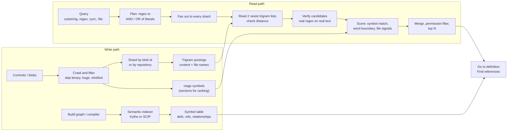

# Code Search and Semantic Indexing at Scale

> [!summary] Claim:
> Text search at scale is an inverted index over substrings: map every trigram to the places it occurs, turn a query or regex into a boolean expression over trigrams, read the few shortest posting lists, and verify the surviving candidates against the real text.
> Zoekt makes the lists positional, so a substring query reads only its two rarest trigrams and checks their distance, at the price of an index about the size of the corpus or larger.
> Symbol search is a different system: compiler-grade indexers (Kythe, SCIP) emit definitions and references keyed by stable symbol names, which text search cannot reproduce because names collide, and which are rebuilt per build, not per commit.
> The design decisions are all freshness, completeness, and cost trade-offs, and the same engines now feed AI coding agents, where exact search and a symbol graph beat or complement embeddings depending on corpus size.



## The Mechanism

[[Static-Analysis-at-Scale-Tricorder-and-Autofix]] owns what runs on the code once you can find it, [[Large-Scale-Changes-and-Codemods-Across-Repos]] owns rewriting what you found, and [[Dependency-Management-Theory-and-Hyrums-Law]] owns the question of who depends on an API.
This note owns the index underneath all three: how a corpus of terabytes becomes a structure that answers "where is this string, regex, or symbol used" in tens of milliseconds.
Every number below is quoted from a named source; numbers that come from the lab say so.

### 1. Why grep stops working: the napkin math

Brute force costs corpus size divided by scan rate, multiplied by queries per second.
Software Engineering at Google (chapter 17) does the arithmetic for Google's 1.5 TB index and a 50 ms budget: RE2 scans about 100 MB/s from RAM, so 1.5 TB in 50 ms needs about 300,000 cores.
A specialized substring scanner at about 1 GB/s cuts that 10x, and at 200 queries per second about 10 queries are in flight inside any 50 ms window, which brings the core count back up.
GitHub makes the same argument with ripgrep, measured at 2.769 s for an exhaustive regex over a 13 GB in-memory file on an eight-core Intel machine (about 0.6 GB/s per core): 115 TB on 2,048 cores is about 96 seconds for one query, or 0.01 queries per second.
Both organizations conclude the same thing: an index is not an optimization, it is the only way the product exists.

The break-even for a small corpus is the opposite.
Cox's article measures `csearch` against brute force on the Linux 3.1.3 kernel (36,972 files): the trigram index narrowed `hello world` to 25 candidate files and ran in 0.01 s against 1.96 s brute force, about 100x.
On a laptop-sized corpus that still saves a second.
Google's chapter draws the line lower than intuition suggests: brute-force grep suffices for a repository of a couple of megabytes, and at hundreds of megabytes a simple local index already speeds search up by an order of magnitude or more.
Livegrep's README scopes itself to "gigabyte-scale source repositories" for the same reason.

### 2. The inverted index and the trigram

An inverted index maps a key to a sorted list of document identifiers, a posting list.
AND is a linear merge-intersection of two sorted lists, OR is a merge-union, and sorted order makes both run in time linear in the list lengths.
Word-based full-text search tokenizes documents, but code breaks every assumption of tokenization: the chapter lists `function()` versus `function(x)`, `(x ^ y)`, and `=== myClass` as queries a token index cannot answer, identifiers in CamelCase, snake_case, or mashedtogether form have no agreed word boundaries, and stemming collapses `searching` and `searched`.
So the key becomes any fixed-length substring, an n-gram.

Why three: Cox's article says that in practice there are too few distinct 2-grams and too many distinct 4-grams.
GitHub's footnote gives the operational form of the same trade-off: trigrams are a known sweet spot, bigrams are not selective enough, and quadgrams take up too much space.
The lab prints the vocabulary of its synthetic corpus: 774 distinct trigrams for 295 files (as of 2026-11, Both, a synthetic code-like corpus, not real code).
Real corpora have far more, because identifiers and string literals create rare trigrams; that tail of rare trigrams is exactly what makes lookups selective.

Two index shapes exist, and the choice drives everything downstream:

| Shape | Posting list holds | Query reads | Index size | Source |
| :--- | :--- | :--- | :--- | :--- |
| Document-level (Cox) | document ids that contain the trigram | every trigram of the query, ANDed | about 20% of the corpus for Linux 3.1.3 (77 MB for 420 MB) | Cox, 2012 |
| Positional (Zoekt) | every offset where the trigram occurs | the two rarest trigrams of the query, plus a distance check | about 3x the corpus (2x offsets plus 1x content) per the design doc; the same document says about 3.5x elsewhere | Zoekt design.md |

Cox's list needs all trigrams because a document holding `Goo`, `oog`, `ogl`, and `gle` in unrelated places still passes the AND; the final verification step discards it.
Zoekt's design document gives three advantages for positional lists: only a couple of lists are touched per substring, so lists can live on SSD instead of RAM; any pair of trigrams can be chosen, so the rarest wins (`qui` rather than `the`); and the document gives the downside plainly, that the index is large.
It adds that, because only a limited number of ngrams are read, the index does not have to be held in memory, and that positional-trigram search needs only about 1.2x the corpus size in RAM, which it lists as an advantage over suffix arrays.

### 3. Query planning: from regex to a boolean query

A trigram index answers substring questions.
A regex needs a translation step: compute a boolean expression over literal substrings that any matching text must satisfy, run that, and apply the real regex to the survivors.
The expression is a necessary condition, never a sufficient one, so the index may return false positives and must never return false negatives.

Cox's rules compute five properties per sub-expression: whether the empty string matches, the exact set of matching strings (or "unknown"), a set of prefixes, a set of suffixes, and a match query.
Concatenation crosses exact sets (`(a|b)(c|d)` becomes `ac, ad, bc, bd`), alternation unions them and ORs the queries, and `*` loses exactness.
Because exact sets can grow exponentially, the rules add information-discarding steps: drop a string when a shorter prefix already covers it, chop the last character off the longest prefixes when the set is too large, and set `exact` to unknown when it is too large.
Information-saving steps convert prefixes, suffixes, and exact sets into trigram ANDs and ORs before anything is discarded.
The trigram function of a string shorter than three characters is ANY, the match-everything query, so a literal such as `=` contributes nothing.

Zoekt keeps the idea and simplifies it (`design.md`): extract normal strings from the regex, so `(Path|PathFragment).*=.*/usr/local` becomes `AND(OR(substr:"Path", substr:"PathFragment"), substr:"/usr/local")`, and every document that passes is searched with the real regex.
In code, `regexpToMatchTreeRecursive` in `index/eval.go` returns a `bruteForceMatchTree` when a sub-expression has no indexable literal, which is the engine-level name for ANY.
The lab implements this subset in `regex_query.py` and prints what it extracts (as of 2026-11, Both):

- `(Path|PathFragment).*=.*/usr/local` becomes `AND(OR("Path", "PathFragment"), "/usr/local")`, 11 candidate documents of 295, 6 matching.
- `zxqv_checkpoint_(flush|drain)` becomes `OR("zxqv_checkpoint_flush", "zxqv_checkpoint_drain")`, exact-set crossing at work.
- `a.*b` becomes `ANY`: 295 candidates of 295, so the index prunes nothing and the engine scans everything.

The last line is the failure mode that matters in production: a query is only as fast as its most selective required literal, and a regex built from short fragments, character classes, or `.` runs degrades to a scan of the whole corpus.
Google's chapter says it directly: there is no perfect regex index, it is always possible to construct a query that becomes a brute-force search, and the approximation works because only a small fraction of real queries are complex regexes.

Case-insensitive search multiplies lookups.
Cox's `-i` query for `hello world` ORs every case variant of every trigram (eight for an all-letter trigram), and the candidate count rose from 25 files to 599 in his run.
Zoekt does the same: for a case-insensitive pattern it sums the posting sizes over `generateCaseNgrams` variants for each trigram (`index/bits.go`, `index/indexdata.go`).
The lab shows the cost: a 21-character case-insensitive needle needs 128 trigram lookups against 19 for the case-sensitive form (as of 2026-11, Both).
The lab models only ASCII upper and lower case; `generateCaseNgrams` walks `unicode.SimpleFold` orbits, where `k` also folds to the Kelvin sign and `s` to the long s, so Zoekt would make 148 lookups for the same needle (counted by hand from the source, not run against Zoekt).

### 4. Zoekt: positional trigrams in a shard

Zoekt began at Google as `google/zoekt` and has been maintained at `sourcegraph/zoekt` since the 2017 fork (README); its stated goals in `doc/design.md` are sub-50 ms results on codebases such as Android (about 2 GB of text) or Chrome, on a single standard Linux machine with SSD.
The facts below are from `doc/design.md` and the `index/` package on the main branch (as of 2026-11, Both); the main branch has no tagged release, so no version pin exists, and the lab does not depend on Zoekt itself.

**Posting lists.** For the corpus `banana`, the index is `ban: 0`, `ana: 1,3`, `nan: 2`.
A query for `The quick brown fox` looks up two trigrams, for example `The` and `fox`, and checks that they occur the right distance apart, which is the whole positional trick.
In `index/bits.go` an ngram is a `uint64` packing three runes at 21 bits each (`b[0]<<42 | b[1]<<21 | b[2]`); the lab prints the same packing for `par` as 492581412667506.
Lists are varint delta encoded (`postingList` in `index/shard_builder.go`, which comments that about 80% of deltas fit the single-byte fast path).
Offsets are in runes, not bytes: UTF-8 characters have different widths, so Zoekt stores a rune-index to byte-index mapping every 100 runes and short-circuits the lookup for pure-ASCII corpora.

**Finding a list on disk.** `index/ngramindex.go` keeps the sorted ngrams on disk (mmapped) in buckets of 512 ngrams, which is 4 KiB at 8 bytes each, the common page size.
Only the first ngram of each bucket stays in memory.
A lookup binary searches those heads in memory, reads one bucket from disk (one access), binary searches it, and then reads the posting list (one more access).
The lab prints how many bucket heads its tiny vocabulary would need: 1.
For a corpus with millions of distinct trigrams that table is a few thousand entries, which is why the structure is cheap in RAM.

**Choosing the pair.** `iterateNgrams` splits the pattern into trigrams, looks up the frequency of each, and `findSelectiveNgrams` returns the two lowest-frequency ngrams, with the earlier first.
If they overlap, it shifts them apart because non-overlapping trigrams give a smaller intersection.
If any trigram has frequency zero, the whole query returns `noMatchTree` with the reason `freq=0` without reading any list.
A distance iterator then walks the two lists and keeps pairs whose positions differ by the distance between the two trigrams in the query.
Patterns under three runes skip the trigram path: `newSubstringMatchTree` turns them into a regexp match tree that scans.
The lab ports `findSelectiveNgrams` into `pick_pair` (`trigram_index.py`) and prints which pair it chose (as of 2026-11, Both, synthetic corpus):

| query | hits | docs | cox docs | candidates | chosen pair (distance) | posting entries read |
| :--- | ---: | ---: | ---: | ---: | :--- | ---: |
| `zxqv_checkpoint_flush` | 2 | 2 | 2 | 2 | `zxq` + `_fl` (15) | 5 |
| `parse_header(` | 3 | 3 | 11 | 11 | `par` + `se_` (3) | 22 |
| `for item in` | 3101 | 270 | 270 | 3101 | `r i` + `tem` (3) | 6202 |

Two lessons are visible in the second row.
The document-level AND returns 11 documents because 8 decoy files hold every trigram of `parse_header(` scattered across unrelated words; the positional pair also returns 11 candidate positions, because the lowest-frequency pair it picked, `par` and `se_` three apart, also appears in the decoys' `parse_a`.
Neither index is exact, both are filters in front of the verifier, and the quality of the pair is a performance property, not a correctness one: the lab asserts that its answer equals a brute-force scan for every query.

**Shards.** An index is a set of shard files laid out for mmap, holding file contents, file names, content and filename posting lists (varint), branch masks, and metadata including the format version, which is also part of the shard filename.
A format upgrade is a rebuild: generate shards in the new format, stop the old search service, start the new one, delete the old shards.
Offsets are `uint32`, so a shard must stay under 4 GB; given posting-data overhead, the design document caps content per shard at about 1 GB.
A single goroutine searches all documents of a shard, so shard size sets the parallelism of one query, and large repositories should be split into several shards.
Builder defaults in `index/builder.go` (as of 2026-11, Both): `SizeMax` 2 MiB per file, `ShardMax` 100 MiB of corpus per shard, `TrigramMax` 20,000 distinct trigrams per document (flags `-file_limit`, `-shard_limit`, `-max_trigram_count`); `SetDefaults` enables ctags only when it finds a `universal-ctags` binary on `PATH` or `CTAGS_COMMAND` is set, and `-disable_ctags` turns it off.
A file over `SizeMax` is not dropped silently: `Builder.Add` records a `SkipReason` (`TooLarge`, `TooSmall` for too few trigrams, `Binary`, or `TooManyTrigrams`), keeps the file name searchable, and replaces the content with a `NOT-INDEXED` marker plus the reason (`index/shard_builder.go`).
A `LargeFiles` glob list can override the size limit per path.

**Branches and merging.** Each file blob carries a bitmask of the branches it appears in, so `x.java` identical on `master` and `staging` is stored once and a differing copy on `stable` is stored separately, which indexes many similar branches at little extra cost.
`index/merge.go` merges shards into a compound shard holding several repositories, and `index/tombstones.go` sets a per-repository tombstone in the shard's `.meta` sidecar instead of rewriting the shard (`SetTombstone`).
Partial evaluation uses a `ConstQuery`: for a shard of repository `bazel`, the query `and[substr:"needle" repo:"zoekt"]` rewrites to FALSE, and the shard is skipped entirely.

**Query language and ranking.** Queries are expression trees (AND, OR, NOT over atoms such as substring, regexp, repo, branch), with at least one positive atom required because a negation can only prune.
Implicit AND, a lowercase `or`, fields such as `file:`, `lang:`, `repo:`, `sym:`, `case:`, and `type:` are documented in `doc/query_syntax.md`; in that grammar the word `and` is not an operator but a search term.
Ranking signals in the design document are the number of atoms matched, closeness of matches, whether a match boundary coincides with a word boundary, file update time, filename length, whether a match falls in a comment or string, and whether it is a symbol definition, the last found through `ctags`.
An alternative BM25-style scorer can be enabled with `UseBM25Scoring`.
Universal Ctags from commit `db3d9a6` on, running on Linux, is called under seccomp, so a bug in ctags cannot escalate to access to the indexing machine (`doc/ctags.md`); the design document names the indexed code as untrusted input for the same reason.

### 5. The other designs: suffix arrays, sparse n-grams, and delta indexing

**Suffix arrays (livegrep).** A suffix array is the sorted array of all suffixes of the text; binary search finds any substring.
Livegrep flattens all source into one buffer, builds the arrays with libdivsufsort, and keeps a "file content map" from buffer ranges to files (Elhage, 2015).
Zoekt's design document compares directly: against suffix arrays, positional trigrams are straightforward to build and make incremental, need about 1.2x the corpus in RAM because the lists sit on SSD, and return matches in document order, which keeps compound AND and OR queries simple; for suffix arrays it notes that regular expressions cannot be transformed into ranges of the array.
A suffix array also needs no choice of n, since it indexes substrings of every length (a property of the structure, not a claim from either source).
Google moved from the original trigram index through a custom suffix-array index to a sparse n-gram index; the reason given for leaving suffix arrays is that building and distributing custom indexes became a challenge in itself, while standard reverse-index technology brings instant indexing, encoding, and serving for free.

**Sparse n-grams (Google, GitHub).** Common trigrams are not selective at scale, and "follow masks" (a bitmask of the character after the trigram) saturate quickly.
GitHub's solution: assign each bigram a weight, then index variable-length n-grams whose inner bigram weights are strictly smaller than the weights at both borders, recursively down to trigrams.
At query time the same algorithm runs and keeps only the covering n-grams.
GitHub's own example: the regex `/arguments?/` is answered with grams `arg`, `rgu`, `gum`, and then `ume` and `ment`, or the six-gram `uments`.
Google's chapter says the sparse n-gram index is more than 500 times more efficient than brute force and fits flash storage better, because both the number of posting lists read and their sizes shrink at the cost of a larger index.

**Index on flash, not RAM.** Google originally served everything from memory.
Flash is at least an order of magnitude cheaper than memory but at least two orders of magnitude slower to access, so an index that works in RAM (many large lists, as the original trigram index needs) can be wrong for flash.
The positional pair and sparse n-grams both read fewer or smaller lists per query, which is consistent with that constraint (an inference from the two sources, not a claim either makes about the other).

**Delta and dedup at ingest (Blackbird).** (Git's own pack-level delta compression is a different mechanism, owned by [[Git-Packfiles-and-Delta-Compression]].) GitHub's engine, written in Rust, indexed in 2023 about 45 million repositories, 115 TB of code, and 15.5 billion documents.
Its design choices:

- Shard by Git blob object id, so identical content lands on the same shard once, load is even, and no repository can create a hot server.
- Model the index as a tree and use delta encoding, with the repository order chosen by a probabilistic set-similarity structure (a "geometric filter") and a minimum spanning tree over repository similarity, so each repository is crawled as a diff against its parent and only unique blobs are crawled.
- Publish documents through Kafka with one partition per shard; Kafka ordering gives commit-level query consistency, so a search never sees a half-processed push.
- Compaction k-merges posting lists by score so higher-ranked documents get lower ids and lazy iterators return them first, and it is where document deletions are handled.
- Every query fans out to every shard; per-shard p99 is on the order of 100 ms, and a query occupies one core for that time, which bounds a 64-core host at roughly 640 queries per second.

Reported results: ingest at about 120,000 documents per second would take about 36 hours for 15.5 billion documents, delta indexing cuts crawled documents by over 50% for a full reindex in about 18 hours, and 115 TB of content reduces to about 28 TB unique, with a 25 TB index that includes a compressed copy of the content, about a quarter of the original size (GitHub, 2023-02).
The lab reproduces the sharding rule in miniature: 295 files hold 265 unique blobs (30 vendored duplicates planted), and hashing the blob id spreads the unique blobs as 54, 56, 76, and 79 over four shards (as of 2026-11, Both, synthetic).
The imbalance is real: four shards over 265 items by an unnormalized hash prefix are not equal, which is why production uses many more shards than hosts.

### 6. Google's system: freshness, completeness, and the two indexes

Chapter 17 is the most detailed public statement of the trade-offs, and several decisions are counterintuitive.

- **Two indexes with different freshness.** The text index is incremental: a submitted change reindexes only touched files, median indexing latency under 10 seconds, and median server-side search latency under 50 ms at about 200 queries per second over about 1.5 TB (as of the 2020 book).
  The cross-reference index cannot be incremental, because any change can potentially influence the entire codebase and most full binaries must be built or analyzed; it is produced daily and uses substantial compute (Chromium's Kythe index takes about six hours in a distributed setup, footnote 8).
  The chapter names the gap between instant search and daily cross-references as a source of rare but recurring user confusion.
- **Completeness over cost.** The authors chose to index nearly everything, with high limits meant to prevent abuse and keep the system stable, because a search that silently omits files cannot give feedback about what it omitted, and trust is the product.
  Non-text files are dropped except their names, generated JavaScript is a borderline exclusion, and multi-megabyte files rarely help.
- **All results versus top results.** Ranked results suit most queries, but tools and refactorings need every result.
  The corpus is split into shards ordered by file priority so a typical query can stop early; when asked, the engine fetches all results from each chunk to guarantee completeness, optionally ordered alphabetically.
- **History.** Code Search indexes the linear Piper history with a custom compression scheme; indexing full history raised resource consumption by a factor of only 2.5.
  This lets the tool search any past snapshot, deleted code, and code by author, and lets obsolete code simply be deleted.
- **Workspaces.** Unsubmitted changes are served by machines doing simple brute-force search over a workspace loaded on first request and kept in sync by file-change events, with least-recently-used eviction; unchanged documents come from the history index so the search is restricted to the repository state the workspace is synced to.
- **Ranking.** Query-independent signals include file views and reference counts (a PageRank analogue where links are include or import statements, later replaced by correct data from the Kythe graph after regex-extracted imports became error prone).
  View counts create an exploitation versus exploration feedback loop that hurts new files.
  Query-dependent signals include clean token matches, case, symbol and filename matches boosted over content, and path overlap with the query.
  Supplemental retrieval rewrites a query into specialized variants (definitions only, filenames) so the one definition among thousands of usages is not cut off by a retrieval limit.
- **Latency economics.** The chapter's break-even: at one million queries per day, one extra second of latency is about 35 idle full-time engineers per day, against a backend maintained by roughly a tenth of that; about 100,000 queries per day, under 5,000 developers, is the one-second break-even.
  The target is sub-200 ms end to end for frequent operations.

The workload mix matters for design: of Code Search queries about 16% ask where something is, about a quarter are file browsing (what), about a third seek examples of how others did something, about 16% ask why, and about 8% ask who or when (Neubeck and St. John, 2020, which cites Sadowski et al., FSE 2015, for the underlying intents; the percentages are as stated in the chapter).
Only the first group is pure retrieval; the rest need navigation, history, and context.

### 7. Semantic indexing: symbols, not substrings

Text search cannot tell `cfg.parse(x)` from `tpl.parse(x)` or from a comment mentioning `parse`.
The lab shows it with a six-line fixture: `parse` as a substring has 11 hits in 3 files, but only 1 definition and 2 references belong to `Config.parse`, so 8 of 11 text hits are noise for that question (as of 2026-11, Both).
Of the 11, 3 are definitions of three different symbols, 4 are references to three different symbols, and 4 are inside comments or strings.

A semantic index is built with the compiler's name resolution, not by pattern matching, and stores a graph or table of definitions, references, and relations keyed by stable symbol identifiers.

**Kythe.** Kythe grew out of Google's cross-reference index for a huge multilingual codebase.
Its aim is a hub-and-spoke interchange: connecting L languages, C clients, and B build systems costs O(L+C+B) integrations instead of O(L x C x B).
Analyzers read build information, run a compiler front end, and emit facts and edges into a graph store; extraction is instrumented into the build, per build rule, and the partial graphs are merged into a global graph (SWE at Google, footnote 8).
Facts and names:

- A node is a bag of string key/value facts under a unique name, a VName with five fields: `language`, `corpus`, `root`, `path`, `signature`.
  The signature is opaque outside the analyzer that generated it and need only be sufficient to distinguish nodes within a corpus of the language, though VNames for built-ins should be unique across corpora (Kythe Storage Model).
- The schema defines node kinds (`anchor`, `file`, `function`, `record`, `variable`, `package`, and others) and edge kinds (`defines/binding`, `ref`, `ref/call`, `childof`, `overrides`, `extends`, `satisfies`, and more), under the `/kythe/edge` namespace.
- Reverse edges are written with a `%` prefix and are created in post-processing, never emitted by indexers.
- The storage model is explicitly for storage, not serving: first-normal-form entries, no query performance goal, to be post-processed into denormalized tables for serving.

**SCIP.** Sourcegraph's SCIP (pronounced "skip") is a Protobuf schema for code-intelligence data, designed after Sourcegraph's experience with LSIF.
Design decisions from `docs/DESIGN.md` (as of 2026-11, Both):

- A transmission format for producers to consumers, not a storage or query format; navigation needs bidirectional lookup that a query engine provides.
- Documents and arrays, not an adjacency-list graph, so an indexer can load a part of the codebase, append its data to an open file, free memory, and continue; this also makes parallelism and file-level incrementality easy.
- String identifiers, not integer ids, to limit the blast radius of indexer bugs: with LSIF, off-by-one bugs in integer ids broke navigation repository-wide.
- Raw data compresses well: SCIP data compresses to roughly 10% to 20% of its size, according to the design document.
- LSIF support was fully deprecated and removed from Sourcegraph.

The schema (`scip.proto`): an `Index` holds `Metadata` (which must be first in a stream), `Document`s each with `Occurrence`s and `SymbolInformation`, and optional `external_symbols`.
An `Occurrence` carries a range, a `symbol` string, a `symbol_roles` bitset (`Definition` 0x1, `Import` 0x2, `WriteAccess` 0x4, `ReadAccess` 0x8, `Generated` 0x10, `Test` 0x20, `ForwardDefinition` 0x40), optional documentation, a syntax kind, and diagnostics.
Position encoding is per document: UTF-8 byte, UTF-16 unit, or UTF-32 unit offsets from line start, chosen to match the indexer's host language.
`SymbolInformation` carries `Relationship`s with `is_reference`, `is_implementation`, `is_type_definition`, and `is_definition` flags, which power find-implementations and go-to-type-definition.
A symbol string follows a grammar: `<scheme> <package> <descriptor>+` where the package is `<manager> <name> <version>` and descriptors are suffix-marked: `/` namespace, `#` type, `.` term, `(` `).` method, `[ ]` type parameter, `( )` parameter, `:` meta, `!` macro.
The lab emits `lab python demo 0.1 models/Config#parse().`, which follows that grammar for a method (the lab's indexer is a toy built on Python's `ast`, not an implementation of any real SCIP indexer).
The `scip-code/scip` repository lists indexers for Java, Scala, Kotlin, TypeScript, JavaScript, C and C++, Ruby, Python, C# and Visual Basic, and others, and rust-analyzer emits SCIP for Rust (README, as of 2026-11).
The latest release at that time was v0.10.0, published 2026-09-03.

**Stack graphs (file-incremental, no build).** GitHub's stack graphs encode name-binding rules in a DSL on top of Tree-sitter, so a file is analyzed in isolation at index time and graphs are merged at query time.
The motivation is that reanalyzing every file in a repository and its dependencies whenever any file changes makes the work quadratic in the number of changed files, plus zero per-repository configuration and no build or CI hook at GitHub scale.
The cost is that binding semantics must be written as per-language rules over syntax trees instead of being computed by the language's compiler; the post's own Java example needs inheritance and generic type parameters traced across files, and it does not quantify fidelity against compiler-based indexers.
The `github/stack-graphs` repository is archived as of 2026-11 (last push 2025-09-09), so treat it as a design to learn from, not a dependency.

**Precise versus search-based navigation.** Search-based navigation guesses from text and ctags, usually good enough; precise navigation resolves through the compiler.
Zoekt's `sym:` and ranking use ctags, which is search-based.
Precise data needs a build or at least a faithful front end, is per-language, is stale between index runs, and costs compute; Google accepts a daily cadence for it while keeping text search instant.

### 8. Feeding AI agents and embeddings

Agents need code search for the same reason humans do, plus a bounded context window: every irrelevant hit costs tokens and displaces useful ones.
Three retrieval families are in use:

- **Exact search** (grep, trigram or sparse-gram index): high precision for names and strings, no model needed, and an agent can iterate on it.
  Cursor's documentation (fetched 2026-11-26) describes "Instant Grep", an index built and queried on the user's machine, which it says does not upload file paths or code to build the index and does not store embeddings of the codebase for search.
- **Embedding retrieval** (dense vectors of code chunks, nearest-neighbor lookup): finds conceptually related code with different words.
  Sourcegraph reported leaving embeddings in Cody Enterprise in February 2024, for operational reasons it listed: code must be sent to an embedding processor, vectors must be created and kept up to date, and vector search over more than 100,000 repositories was complex and resource-intensive; it replaced them with keyword search plus BM25-style ranking.
  A February 2025 Sourcegraph post describes a multi-retriever design with a Zoekt keyword retriever, an embedding retriever, and a code-graph retriever, noting the retrievers are complementary.
- **Graph retrieval** (symbol definitions, references, call hierarchy, dependencies): exact relations that neither text nor embeddings give.

These sources conflict only on tactics, not on principle: retrieval quality depends on corpus size, update rate, and privacy constraints, and the strongest published systems combine families.
Do not trust either camp's claim without a recall@k measurement on your own queries, because the right answer is corpus-specific.

For the security and migration uses the seed names:

- **Vulnerability audit.** Search the corpus for the vulnerable call pattern with a regex that the index can prune, then confirm candidates with symbol references so a method of the same name in a different class is not reported.
  The full-corpus guarantee matters here: this is the "all results" mode of the Google chapter, not top-N ranking, and a limit that silently truncates results turns an audit into a guess.
- **API migration impact analysis.** Find-references over the symbol graph gives the exact call-site set; text search gives a superset to cross-check, and the difference is the review list.
  [[Playbook-Execute-a-1000-Repo-Breaking-API-Migration]] owns the campaign built on this list.
- **Permissions.** Zoekt's design has the front end pass a repository and branch list the user may see and embed it in the query as an AND; GitHub re-checks permissions on the aggregated results and caches access data in Redis.
  An index that crosses trust boundaries must apply access control before returning snippets, and the result count itself can leak, so count after filtering.

## Commands and Numbers to Know

| Item | Value | Platform and date | What it means |
| :--- | :--- | :--- | :--- |
| Zoekt `SizeMax` default | 2 MiB (`2 << 20`) | Both (as of 2026-11) | Larger files are skipped with `SkipReasonTooLarge`, name still indexed |
| Zoekt `ShardMax` default | 100 MiB (`100 << 20`) | Both (as of 2026-11) | Corpus bytes per shard before a flush; shard offsets are `uint32` |
| Zoekt `TrigramMax` default | 20,000 distinct trigrams per document | Both (as of 2026-11) | Documents above it skipped as `TooManyTrigrams` |
| Zoekt ngram bucket | 512 ngrams, 4 KiB | Both (as of 2026-11) | Only the first ngram of each bucket stays in RAM |
| Zoekt index size | about 3x to 3.5x corpus | Both (as of 2026-11) | Design doc states 3x in one place and 3.5x in another |
| Zoekt shard content cap | about 1 GB of content per shard | Both (as of 2026-11) | Follows from `uint32` offsets and posting overhead |
| Cox trigram index | about 20% of corpus (77 MB for 420 MB, Linux 3.1.3) | Both (as of 2012 article) | Document-level lists only |
| Google Code Search | 1.5 TB, about 200 queries per second, median under 50 ms, indexing under 10 s | Google internal (as of the 2020 book) | Sparse n-gram index, more than 500x better than brute force |
| Google brute-force estimate | about 300,000 cores for 50 ms over 1.5 TB at 100 MB/s per core | Google internal (as of the 2020 book) | Shows why an index is mandatory |
| GitHub code search | 115 TB, 15.5 billion documents, about 45 million repositories | GitHub (as of 2023-02) | 25 TB index, 28 TB unique content |
| GitHub per-shard latency | p99 about 100 ms, about 640 queries per second per 64-core host | GitHub (as of 2023-02) | One query occupies one core for the shard time |
| ripgrep scan rate | about 0.6 GB/s per core (2.769 s for 13 GB on 8 cores) | Intel x86 (as of 2023-02) | The brute-force baseline GitHub used |
| SCIP compression ratio | about 10% to 20% of raw size | Both (as of 2026-11) | Per the SCIP design document |
| SCIP latest release | v0.10.0, 2026-09-03 | Both (as of 2026-11) | Protocol and CLI in `scip-code/scip` |
| Lab positional index | 1.58x corpus bytes (746,453 varint bytes for 472,235) | macOS arm64, synthetic (as of 2026-11) | Lab output, `zoekt_trigram_demo` |
| Lab document-level index | 0.22x corpus bytes (103,649 for 472,235) | macOS arm64, synthetic (as of 2026-11) | Same corpus, ids only |
| Lab `a.*b` | ANY, 295 of 295 candidates | macOS arm64, synthetic (as of 2026-11) | A regex with no indexable literal scans everything |

The lab's size ratios are from a small synthetic corpus (295 files, 472,235 bytes) and measure only how much a delta-varint positional list costs against a document list; they do not predict a real repository.
The positional index is larger than the corpus in the lab (1.58x) and about 7x the document-level index, which is the cost the Zoekt design document accepts for reading fewer lists.

## Multi-Language Comparison: C++ / Python / Rust

Code search engines are written in many languages, so this table compares the three that matter for tooling around them, with Go (Zoekt, `google/codesearch`) noted where it is the reference.

| Concern | C++ | Python | Rust | Note |
| :--- | :--- | :--- | :--- | :--- |
| Search engine in the wild | livegrep (suffix arrays; its README says it needs a recent C++ compiler to build) | this lab; no production engine | GitHub Blackbird, ripgrep | Zoekt and `csearch` are Go |
| Regex engine safe for untrusted queries | RE2: match time linear in input, bounded memory, no recursion | `re` is a backtracking engine (its docs explain atomic groups and possessive quantifiers in terms of backtracking) and makes no linear-time guarantee; bindings to RE2 exist | `regex` crate: documents worst-case O(m * n) search, m the regex size and n the haystack length | Go's `regexp` documents time linear in the size of the input |
| Semantic indexer | scip-clang (C and C++) | scip-python | rust-analyzer emits SCIP | Per the `scip-code/scip` README |
| Hot-path hazard | lifetime of mmapped postings and views into them | memory per posting list (the lab holds everything in dict-of-list) | borrow lifetimes on mmap-backed slices | Language-independent: offsets must be bounds checked |
| Why this lab is Python | n/a | readable, standard library only, deterministic | n/a | Not a performance claim |

The decision that crosses languages is the regex engine: a search service running user-supplied patterns over a shared corpus must use an engine with a linear-time guarantee, because a backtracking engine turns one pathological query into a denial of service.
Cox's 2012 article says that when Code Search started, none of Perl, Python, or PCRE used real automata, which is why RE2 was written; RE2's README states safety as its primary goal for exactly this use.

## Worked Lab Example

The lab is `code/09-Engineering-Systems-at-Scale/zoekt_trigram_demo/`; it needs only `python3` (standard library) and no network.
It has no `# requires:` line because it runs as is on macOS and Linux.

`lab_search.py` builds a deterministic synthetic corpus (`corpus.py`): 240 random code-like files, planted files for a rare identifier, decoys for `parse_header(`, regex targets, and 30 vendored copies of 10 base files.
It builds both indexes from `trigram_index.py`: `PositionalIndex` (offsets in one concatenated content space, as in Zoekt) and `DocIndex` (document ids, as in Cox).

1. It prints the corpus facts, the packed ngram, and the number of in-memory bucket heads.
2. It runs five case-sensitive substring queries through the Zoekt-style search and asserts each result equals a brute-force scan; it also asserts the Cox candidate set is a superset of the matching documents.
3. It runs a case-insensitive query and prints the lookup count.
4. It converts three regexes (`regex_query.py`), evaluates the boolean query through the substring search, applies the real `re` to the candidates, and asserts the result equals a full scan.
5. It prints index sizes under delta-varint encoding.
6. It runs a differential test of 177 case-sensitive and 177 case-insensitive random substring queries against brute force, and a query for an absent needle.
7. It groups files by SHA-1 of content, shards the unique blobs by `int(sha1[:8], 16) % 4`, and asserts the corpus holds exactly 30 duplicates.

`lab_semantic.py` then parses the three fixture files in `semantic_fixture/` with `ast` and `tokenize`, builds an occurrence table with SCIP-shaped symbols, runs the text search for `parse` through the same positional index, and compares.
It asserts there are 11 text hits, one definition and two references for `Config.parse` at fixed lines, and that two other `parse` symbols exist, so any break in name resolution moves an assertion.

```bash
cd code/09-Engineering-Systems-at-Scale/zoekt_trigram_demo
bash run.sh
```

### Verified output

Recorded by `python3 -m _harness.verify --record` on darwin-arm64 (as of 2026-11); the file is `code/09-Engineering-Systems-at-Scale/zoekt_trigram_demo/expected/darwin-arm64.txt`.

```text
== corpus
documents: 295
corpus bytes: 472235
distinct trigrams: 774
packed ngram 'par' = 492581412667506 (112 << 42 | 97 << 21 | 114)
ngram buckets of 512: 1 bucket heads would stay in memory

== substring queries, case sensitive
query                     hits  docs   cox  cand  pair (dist)         read
zxqv_checkpoint_flush        2     2     2     2  'zxq'+'_fl' (15)       5
parse_header(                3     3    11    11  'par'+'se_' (3)       22
for item in               3101   270   270  3101  'r i'+'tem' (3)     6202
return                    3105   274   274  3105  'ret'+'urn' (3)     6210
ab                        2811   270   295     -  scan (<3 chars)        0
hits = occurrences; docs = documents with a hit; cox = documents holding every trigram of the query
cand = pair-and-distance candidate occurrences before the final string compare; read = posting entries read

== case-insensitive
query 'ZXQV_CheckPoint_FLUSH': case sensitive hits 1, case insensitive hits 3
trigram lookups for 21 chars: 128 (case sensitive would be 19)

== regex to query
(Path|PathFragment).*=.*/usr/local
  query AND(OR("Path", "PathFragment"), "/usr/local")
  candidates 11 of 295, matching documents 6, brute force agrees
zxqv_checkpoint_(flush|drain)
  query OR("zxqv_checkpoint_flush", "zxqv_checkpoint_drain")
  candidates 3 of 295, matching documents 3, brute force agrees
a.*b
  query ANY
  candidates 295 of 295, matching documents 279, brute force agrees
a+b: unsupported (operator '+'), a real engine falls back to ANY and scans
[Pp]ath: unsupported (operator '['), a real engine falls back to ANY and scans

== index size
positional: 471645 entries, 746453 varint bytes, 1.58x corpus
document-level: 103450 entries, 103649 varint bytes, 0.22x corpus

== differential check against brute force
177 case-sensitive and 177 case-insensitive queries equal brute force
absent needle returns no hits

== shard by blob hash
files 295, unique blobs 265, duplicate files 30
unique blobs per shard: [54, 56, 76, 79]

== text search for 'parse' through the trigram index
hits: 11 in 3 files
  models.py:4:8 definition lab python demo 0.1 models/Config#parse().
  models.py:8:23 string
  models.py:12:8 definition lab python demo 0.1 models/Template#parse().
  notes.py:1:13 comment
  notes.py:2:21 string
  service.py:4:4 definition lab python demo 0.1 service/parse().
  service.py:5:6 comment
  service.py:12:16 reference lab python demo 0.1 models/Config#parse().
  service.py:13:17 reference lab python demo 0.1 models/Template#parse().
  service.py:14:12 reference lab python demo 0.1 service/parse().
  service.py:19:15 reference lab python demo 0.1 models/Config#parse().

== semantic find-references
symbol: lab python demo 0.1 models/Config#parse().
definitions: 1, references: 2
  models.py:4:8
  service.py:12:16
  service.py:19:15
text hits that are not Config.parse: 8 of 11
```

### Reading the result

- The rare query reads 5 posting entries to find 2 hits in 295 documents; the common query `return` reads 6,210 entries for 3,105 hits, so cost tracks the rarest trigram pair, not the corpus size.
- `parse_header(` shows both indexes being loose: 11 candidates for 3 real hits, because eight decoy files hold all its trigrams scattered; the verification step is what makes the answer exact.
- `ab` has fewer than three characters, so no trigram exists and the engine scans: 295 candidate documents against 270 that match.
- The case-insensitive needle costs 128 lookups instead of 19, and finds 3 hits instead of 1.
- `a.*b` extracts to ANY, and the index prunes nothing.
- The positional index is 1.58x the corpus against 0.22x for the document index, in exchange for reading 22 posting entries for `parse_header(` instead of intersecting its 11 trigram lists.
- The 11 text hits for `parse` collapse to 3 relevant to `Config.parse`; the other 8 are different symbols, comments, and strings.

The lab was run a few times while it was being written and recorded once per change; the brief paused mutation and cross-platform checks, so `expected/` has only `darwin-arm64.txt`, no Linux recording exists, and the fault checks are the assertions in the scripts, not a separate mutation suite.

## Pitfalls

> [!warning] Pitfall: treating a candidate list as the answer
> A trigram index returns a superset.
> Skipping the verification step, or verifying with a different regex dialect than the one the user typed, returns false positives; in the lab 8 of 11 candidates for `parse_header(` are decoys.
> Always run the real matcher on every candidate, and compare against a brute-force scan in tests.

> [!warning] Pitfall: a short or fuzzy regex that degrades to a scan
> `a.*b`, `[Pp]ath`, and any pattern whose required literals are under three characters extract to ANY.
> One such query on a multi-terabyte corpus costs a full scan across every shard.
> Reject or rate limit patterns with no indexable literal, and show the user that the query is unindexed.

> [!warning] Pitfall: silent truncation of "all results"
> A ranked top-N result is the right default and the wrong tool for an audit or a migration.
> If a safety review reads page one, it misses every other occurrence.
> Use an exhaustive mode, check the reported total against a second method, and fail the job when the engine says results were truncated.

> [!warning] Pitfall: unindexed files that look indexed
> Zoekt skips files over 2 MiB, files with too many trigrams (minified bundles), binaries, and files with too few trigrams, keeping only the name.
> Google drops binaries and generated files for the same reasons.
> A search for a symbol inside a skipped file returns nothing, which reads as "no usage".
> Surface skip reasons in the UI, and put a coverage metric (files skipped by reason) on the dashboard.

> [!warning] Pitfall: expecting semantic data to be as fresh as text
> Google's text index lags commits by under 10 seconds; its cross-reference index is daily.
> A rename merged an hour ago breaks "find references" while grep works.
> Show the index revision next to semantic results, and fall back to text search when the revisions differ.

> [!warning] Pitfall: tokenizing code
> Word-based engines cannot search `function(x)`, `=== myClass`, or half an identifier, and they fold case and stems, which is wrong for code.
> Do not build code search on a general text-search product unless the product supports substring or n-gram indexes; GitHub reported poor user experience, slow indexing, and high hosting cost from general text engines before building its own.

> [!warning] Pitfall: ranking feedback loops
> Ranking by view counts raises the visibility of already viewed files and starves new ones, and a large refactoring that moves a file resets its views and references.
> Add exploration (experiments, curated sets) and boost moved files manually during a migration, as the Google chapter describes.

> [!warning] Pitfall: one shard per huge repository
> Zoekt searches a shard on a single goroutine, and offsets are 32 bits.
> One enormous shard has no query parallelism and a hard size ceiling.
> Keep shards near the `ShardMax` scale and let large repositories span several.

> [!warning] Pitfall: leaking through search
> Indexes hold every branch and every file.
> A shard served without permission filtering exposes private code through a snippet, a count, or a ranking change.
> Filter before ranking where possible, again after merging, and never cache results across users.

> [!warning] Pitfall: UTF-8 and offsets
> Zoekt assumes UTF-8 and indexes runes; SCIP documents offsets per document in UTF-8, UTF-16, or UTF-32 units.
> A consumer that mixes units shifts every highlight after a non-ASCII character.
> Record the position encoding with the data and convert at the boundary.

## At Scale

From one developer to a small team, none of this machinery is needed: `ripgrep` over a warm checkout answers in well under a second.
The index starts paying when the corpus passes the point where a full scan misses the interactive budget, and when many people run the same searches.

The decision rules:

- **Tens of megabytes, one repository, one developer.** Use `ripgrep` and your editor's language server; do not run an index.
  At hundreds of megabytes a local index already buys an order of magnitude (Google's chapter), so try one before reaching for a service.
- **About 1 GB to 100 GB across repositories, tens to a few thousand engineers.** Run Zoekt or an equivalent on one SSD machine, rebuild shards on push or on a poll, and give it a named owner.
  This is the range Zoekt's design targets (Android at about 2 GB in under 50 ms).
- **Hundreds of gigabytes to terabytes.** Shard by content hash or repository across hosts, fan every query to every shard, make indexing event-driven, and plan for dedup, because duplicated vendored and forked code dominates (GitHub reduced 115 TB to 28 TB unique).
- **When tools consume search, not people.** Provide an API with exhaustive mode and total counts; migrations, security audits, and agents must not depend on ranked pages.
- **Semantic data.** Add it only where a wrong "find references" costs more than the daily build: start with an indexer for the one or two languages that carry most of the risk, publish its revision, and keep text search as the fallback.
- **Embeddings.** Treat as an add-on retriever evaluated on recall@k against exact search for your own queries; the published experience splits (Sourcegraph left them in 2024 for operations at 100,000-repository scale, then described them as one retriever among several in 2025).
- **Freshness budget.** Decide separately for text (seconds), history (minutes), and cross-references (hours to daily), and write the numbers on the tool's page, because the mismatch is what users report as a bug.
- **Cost model.** Capacity is queries per second times the per-shard time per query, divided by cores; GitHub's one-core-per-100-ms rule gives about 640 QPS per 64-core host, a starting formula, not a guarantee.
  Include index storage: about 3x corpus for positional trigrams, much less for sparse n-grams and dedup.

Organizational rules at 1,000 to 50,000 engineers: make the code-search link the canonical way to refer to code in logs, stack traces, reviews, and docs (Google's chapter describes this as a main source of its value), publish its limits, and onboard new engineers to it.
Without that, a fast index is used by the few who already know about it.

[[Static-Analysis-at-Scale-Tricorder-and-Autofix]] consumes the same corpus for analyzers, [[Large-Scale-Changes-and-Codemods-Across-Repos]] shards a codemod over the call-site list, and [[Code-Review-and-Readability-Systems-at-Scale]] is where the canonical code links live.

## Practice Drill

> [!tip] Practice Drill:
> Run the lab, then change `corpus.py` to add 50 files whose lines all contain a common 10-character string, and predict, before running, how the candidate count and read count for that string change and why the chosen pair does not.
> Next extend `regex_query.py` to support `+` on a single literal character by treating `a+` as the literal `a` followed by a gap, and show with a new regex that your extraction never drops a document the real regex matches (compare against the full scan).
> Then break the extractor on purpose by emitting AND for an alternation, and confirm the lab's brute-force assertion fails; write down which false negative it produces.
> As a stretch, replace the positional index with a document-level index plus a verification step, and compare the posting entries read for `for item in` and `zxqv_checkpoint_flush`; explain which query each design favors.

## Interview Questions

> [!question] L5: Why do code search engines index trigrams, and not words or 4-grams?
>
> > [!success]- Answer
> > Words break on code: `function(x)`, `=== myClass`, and partial identifiers cannot be expressed, and tokenizers fold case and stems.
> > An n-gram index supports any substring and, through a regex-to-query translation, regexes.
> > With n=2 there are too few distinct keys, so each list is long and unselective; with n=4 the number of keys and total index size grow too much.
> > Three is the sweet spot Cox and GitHub both cite, and at very large scale GitHub and Google move to variable-length sparse n-grams because common trigrams stop being selective.

> [!question] L5: A trigram search returns a candidate document that does not contain the query; is the index broken?
>
> > [!success]- Answer
> > No.
> > The index is a necessary-condition filter: it guarantees no false negatives and allows false positives.
> > A document can hold every trigram of `parse_header(` scattered across unrelated words, and the lab has 8 such decoys against 3 real hits.
> > The engine must verify each candidate with the real matcher, and tests should compare results to a brute-force scan.

> [!question] L5: What is the difference between a text search hit and a reference?
>
> > [!success]- Answer
> > A hit is a substring match; a reference is an occurrence resolved by a compiler or type-aware indexer to a specific symbol.
> > In the lab, `parse` has 11 text hits but `Config.parse` has 1 definition and 2 references; the rest are other symbols, comments, and strings.
> > Use text search to find and a semantic index to be exact about usage, as in migration impact analysis.

> [!question] L6: Predict the output: the positional index of `banana` is `ban: 0`, `ana: 1,3`, `nan: 2`; for a Zoekt-style search for `anan`, which pair does it read and what does it return?
>
> > [!success]- Answer
> > The needle `anan` has trigrams `ana` at index 0 and `nan` at index 1.
> > Frequencies are 2 and 1, so the two lowest-frequency trigrams are both of them; with `ana` first they overlap (distance 1, under 3), but shifting is a no-op because there are only two trigrams.
> > The pair is `ana` (0) and `nan` (1) at distance 1: from `ana` at 1 and 3, only position 1 has `nan` at 2.
> > One candidate, verified by comparing the text at offset 1: `anan`.
> > The result is one hit at offset 1.
> > (Traced by hand against the Zoekt algorithm and re-checked against the lab's `pick_pair` port, which is not part of the recorded lab output.)

> [!question] L6: Debug this: a Zoekt-style search for a symbol that exists in a 3 MB generated bundle returns nothing; what do you check, and how do you fix it without indexing everything?
>
> > [!success]- Answer
> > Check the document's skip reason.
> > `Builder.Add` marks a file over `SizeMax` (default 2 MiB) as `SkipReasonTooLarge`, and a file over `TrigramMax` (default 20,000 distinct trigrams) or one that looks binary is skipped as well; the file name stays searchable but the content is dropped.
> > Confirm the skip, then decide: raise `-file_limit`, use a `LargeFiles` glob for the specific path, or accept the exclusion and tell users.
> > Google's chapter makes the policy argument: silently leaving files out destroys trust because users cannot see what was omitted, so surface the reason and keep limits high.

> [!question] L6: What does the regex `a.*b` do to an index, and how do you protect the service?
>
> > [!success]- Answer
> > It has no literal of three or more characters, so the extracted query is ANY: all 295 documents are candidates in the lab, and a real engine scans the whole corpus.
> > Protect the service with a per-query budget and an unindexed-query check: reject or deprioritize patterns whose extracted query is ANY, limit result counts and time, and use a linear-time regex engine (RE2, Go `regexp`, Rust `regex`) so a hostile pattern cannot blow up the verifier.

> [!question] L7: Compare a document-level trigram index, a positional trigram index, a suffix array, and sparse n-grams.
>
> > [!success]- Answer
> > Document-level (Cox): small (about 20% of the corpus on Linux 3.1.3), but reads every trigram list of a query and verifies more false positives.
> > Positional (Zoekt): about 3x the corpus, reads two lists and checks distance, lists can sit on SSD, results come in document order, and it extends to branches, shards, and boolean queries.
> > Suffix array (livegrep): no choice of n and fast substring lookup, but regexes do not map to array ranges, construction and distribution are harder, and Google left it for standard reverse-index infrastructure.
> > Sparse n-grams (Google, GitHub): variable-length grams chosen by bigram weights, so common substrings read fewer, shorter lists, at the price of a larger index and a more complex query-time cover.

> [!question] L7: A security audit needs every use of a vulnerable API across 8,000 repositories, and the search UI shows 4,200 results and a "more" button; design the audit.
>
> > [!success]- Answer
> > Ranked, paged UI results are not an audit: use an exhaustive API mode with an explicit result total and an error on truncation.
> > Run a regex the index can prune, then confirm candidates through the symbol graph to exclude same-named methods and comments, and keep the difference between the two sets as a review list.
> > Check index coverage first (skipped files by reason, repositories not yet indexed, index revision), and cross-check on a sample with brute-force `ripgrep` in a few repositories.
> > Record the index revision in the audit report, since the semantic index may lag the text index by up to a day (Google's cadence).

> [!question] L7: Design the freshness model for text search, history, and cross-references at 20,000 engineers.
>
> > [!success]- Answer
> > Split by cost: text is incremental per file and can reach seconds (Google: median under 10 s), history can be compressed and indexed once per revision (Google: 2.5x cost for full history), and cross-references need build-level analysis and are batch (Google: daily).
> > Give each index a revision identifier, show it in the UI, and let a text query fall back for fresh changes.
> > For uncommitted work, serve workspaces by brute force over a small delta layered on the history index, as Google does.
> > Write the SLOs per index and alert on lag, because users experience a stale xref index as a wrong answer, not a slow one.

> [!question] L8+: You must choose between exact search, embeddings, and a symbol graph as the retrieval layer for coding agents over a 30,000-repository code base; what do you recommend and how do you validate it?
>
> > [!success]- Answer
> > Recommend exact search first (trigram or sparse-gram index) because agents iterate on it, results are verifiable, and it needs no code sent to a model; add a symbol graph for definitions, references, and implementations where precision matters; add embeddings only for queries where vocabulary differs from the code.
> > Cite the evidence on both sides: Sourcegraph reported embeddings were costly to maintain and search at 100,000 repositories and moved to keyword retrieval in 2024, then in 2025 described keyword, embedding, and code-graph retrievers as complementary; Cursor's documentation describes a local exact index with no stored embeddings for search.
> > Validate with a labeled set of real agent tasks, measuring recall@k of the files an engineer later edited, tokens spent per task, latency, and update lag after a commit.
> > Decide by the measurement; the published positions disagree because corpus size, privacy, and update rate differ.

> [!question] L8+: You own search for 20,000 engineers; p99 query latency rose from 80 ms to 400 ms while the index grew, and the semantic index is stale half the day; what is your plan?
>
> > [!success]- Answer
> > Diagnose first: break latency down by query class, since ANY-extracted regexes and case-insensitive short needles dominate tails; read per-shard stats (postings read, candidates, verified).
> > Fixes in order of cost: reject or budget unindexed queries; raise selectivity with sparse n-grams or a better pair choice; dedup by blob id; shard to the per-shard core budget (one query occupies a core for its shard time, so capacity is shards times cores over per-query time); move large lists to flash-friendly layouts.
> > For the stale semantic index, make it incremental per file where the language allows (SCIP's document model and stack graphs were built for this) or shard the build, and publish its revision in the UI.
> > Report cost per query and trust metrics (skipped files, truncated results) to leadership next to latency, because those are what make people stop using the tool.

## Further Reading

- Russ Cox, "Regular Expression Matching with a Trigram Index": the definitive explanation of trigram indexes, regex-to-query rules, and `csearch`; read it before any engine source.
- Software Engineering at Google, chapter 17 "Code Search": the trade-offs between freshness, completeness, ranking, and history at Google scale, in prose.
- Zoekt `doc/design.md` and `index/` source: the clearest open implementation of positional trigrams, shards, branch masks, and ranking.
- Timothy Clem, "The technology behind GitHub's new code search": sharding by blob id, delta indexing, sparse n-grams, and measured ingest and query numbers.
- Nelson Elhage, "Regular Expression Search with Suffix Arrays": the alternative design and why it was attractive.
- Kythe Storage Model and Schema Reference: how a language-neutral cross-reference graph is named and stored.
- SCIP `scip.proto` and `docs/DESIGN.md`: a modern, producer-friendly format and the reasons behind each choice, including what went wrong with LSIF.
- Introducing stack graphs (GitHub): file-incremental precise navigation without a build, and the scope-graph theory behind it.
- Sourcegraph, "How Cody understands your codebase" and "Lessons from building AI coding assistants": retrieval for agents, and the embeddings decision as a case study.
- Sadowski, Stolee, Elbaum, "How Developers Search for Code": the data on what people look for.

## Related

- Prerequisites: none
- Next: [[Static-Analysis-at-Scale-Tricorder-and-Autofix]]
- See also: [[Large-Scale-Changes-and-Codemods-Across-Repos]], [[Dependency-Management-Theory-and-Hyrums-Law]], [[Playbook-Execute-a-1000-Repo-Breaking-API-Migration]], [[Code-Review-and-Readability-Systems-at-Scale]], [[AI-Coding-Agents-Sandboxes-Worktrees-and-Ship-Gates]], [[Git-Packfiles-and-Delta-Compression]]
- Lab: `code/09-Engineering-Systems-at-Scale/zoekt_trigram_demo/`
