# Dependency Management Theory and Hyrum's Law

> [!summary] Claim:
> An API contract formalizes only what its authors explicitly promise, but under Hyrum's Law, every observable behavior of a scaled system is depended upon by downstream callers.
> Resolving version constraints across unconstrained dependency graphs is mathematically NP-complete via reduction from 3-SAT, causing exponential backtracking or unsolvable deadlocks in deep diamond dependency trees.
> Single-version runtimes like C++ and Python suffer silent memory corruption or import collisions when incompatible transitive dependencies collide, while multi-version runtimes like Rust fail at cross-crate type exchange boundaries.
> Monorepos neutralize version-SAT complexity and dependency hell by enforcing the One-Version Rule and Live-at-Head continuous integration, trading decentralized package pinning for centralized, author-driven large-scale automated migrations.

```mermaid
flowchart TD
    subgraph POLYREPO["Polyrepo Decentralized Pinning (Dependency Hell)"]
        ROOT_P["Root Application"]
        LIB_A["Library A<br/>requires C >= 1.2.0"]
        LIB_B["Library B<br/>requires C >= 2.0.0"]
        C_V1["Library C v1.2.0"]
        C_V2["Library C v2.0.0"]
        
        ROOT_P --> LIB_A
        ROOT_P --> LIB_B
        LIB_A --> C_V1
        LIB_B --> C_V2
        
        COLLISION{"Diamond Conflict<br/>at Link or Runtime"}
        C_V1 -.-> COLLISION
        C_V2 -.-> COLLISION
        
        COLLISION -->|"C++: ODR Violation"| CRASH["Memory Corruption / Segfault"]
        COLLISION -->|"Python: sys.modules"| IMPORT_FAIL["Duplicate Module Collision"]
        COLLISION -->|"Rust: Separate Symbols"| TYPE_LEAK["Type Boundary Mismatch<br/>C::v1::T != C::v2::T"]
    end

    subgraph MONOREPO["Monorepo Live-at-Head (One-Version Rule)"]
        TRUNK["Unified Monorepo Trunk (HEAD)"]
        DEP_C["Library C @ HEAD<br/>(Exactly One Canonical Version)"]
        SRV_A["Service A"]
        SRV_B["Service B"]
        
        TRUNK --> DEP_C
        DEP_C --> SRV_A
        DEP_C --> SRV_B
        
        CI["Presubmit CI Matrix<br/>(The Beyonce Rule)"]
        LSC["Large-Scale Automated Codemod<br/>(Author-Driven Migration)"]
        
        DEP_C -.->|"API Change Trigger"| CI
        CI -.->|"Test Failure Detected"| LSC
        LSC -.->|"Atomic Fleet Update"| TRUNK
    end
```



## The Mechanism

Every software system that consumes external code operates under the physics of dependency graphs, computational complexity limits, and interface entropy.
When an engineering organization grows beyond a handful of engineers, software dependency management ceases to be a simple packaging problem and becomes a fundamental systems architecture and organizational governance challenge.

### 1. Hyrum's Law and Interface Leakage

Hyrum's Law is Hyrum Wright's observation from low-level infrastructure migrations at Google, where "even the simplest library change caused failures in some far off system"; Titus Winters named it "Hyrum's Law" and popularized it (hyrumslaw.com, which gives no year).
Its canonical wording, also quoted in *Software Engineering at Google* (O'Reilly 2020, Chapter 1), is:

> With a sufficient number of users of an API, it does not matter what you promise in the contract: all observable behaviors of your system will be depended on by somebody.

To understand the mechanics of this law, consider an API $A$ with a formal specification $C$ (the contractual promise) and a concrete execution engine $E$.
The engine exhibits a set of observable execution behaviors $B$, where $C \subset B$.
The difference set $B \setminus C$ represents non-contractual, observable implementation artifacts.
These artifacts include:

- Memory layout, bucket ordering, and iteration sequences of hash tables.
- Precise error message phrasing, capitalization, and punctuation.
- Microsecond execution latency, cache-line warming timing, and thread scheduling interleavings.
- Filesystem directory entry enumeration order returned by `readdir(3)`.
- Network packet sizes, HTTP header casing, and TCP connection establishment timing.

If a system has $N$ independent downstream consumers, each consumer samples behaviors from $B$.
Let $P(b)$ be the independent probability that a single consumer accidentally relies on an unpromised behavior $b \in B \setminus C$.
The probability that at least one consumer in the fleet depends on $b$ is:

$$P_{\text{fleet}}(b) = 1 - (1 - P(b))^N$$

As the consumer population $N \to \infty$, $P_{\text{fleet}}(b) \to 1$ for every observable behavior $b$, no matter how minuscule $P(b)$ is.
Consequently, any modification to the engine $E$ that alters behavior $b$ will break at least one downstream consumer, even if the formal contract $C$ remains completely satisfied.

#### Concrete Historical Incidents of Hyrum's Law

Real-world toolchain history contains iconic manifestations of Hyrum's Law across operating systems, runtimes, and languages:

1. **Hash Table Iteration Order:**
   In early CPython, dictionary iteration followed hash table bucket order.
   After the 2011 hash-collision denial-of-service disclosures (CPython issue 13703), Python 3.2.3 added opt-in string hash randomization (`-R`, `PYTHONHASHSEED`), and Python 3.3 turned it on by default; PEP 456 (Python 3.4) later replaced the hash function itself with SipHash.
   The default-on change broke test suites that accidentally asserted a dict or set ordering that had been stable across process invocations.
   Since Python 3.7 dicts preserve insertion order by language guarantee, so the seed now perturbs `set` iteration and `hash()` values, not dict order.
   Similarly, the Go language specification explicitly states that map iteration order is not specified.
   Go 1 (2012) defined map iteration as "unpredictable, even if the same loop is run multiple times with the same map", and the runtime randomized it.
   The new map implementation in Go 1.1 "neglected to randomize iteration for maps with eight or fewer entries", code came to depend on that, and Go 1.3 "reintroduces random iteration for small maps in order to flush out these bugs".
   In the current Swiss-table maps (`internal/runtime/maps/table.go`, checked in the go1.27.4 source tree), every iterator seeds `entryOffset` and `dirOffset` from `rand()`, the per-M ChaCha8 generator in `runtime/rand.go`; `fastrand` survives only as a `linkname` compatibility shim.
   In C++, Abseil's container guide warns that, unlike many `std::unordered_map` implementations, `absl::flat_hash_map` and `absl::node_hash_map` have no deterministic iteration order; the current source (`absl/container/internal/raw_hash_set.h` and `.cc`, `master`, read 2026-11) mixes a per-table seed from `NextHashTableSeed()` (which calls `RandomSeed()`) into the hash "to randomize iteration order per-table", in every build mode rather than only in debug builds, so code that depends on the order breaks even in optimized builds.

2. **HTTP/2 Header Lowercasing:**
   RFC 7540 Section 8.1.2 mandates that header field names "MUST be converted to lowercase prior to their encoding in HTTP/2"; RFC 9113 (June 2022) obsoletes RFC 7540 and keeps the rule in Section 8.2.
   When proxies and load balancers upgraded from HTTP/1.1 to HTTP/2, client services that parsed headers using case-sensitive string lookups (such as `headers["Authorization"]` instead of case-insensitive comparison) failed in production; this is a recurring pattern, not one documented incident.

3. **Filesystem Directory Ordering:**
   POSIX `readdir(3)` returns directory entries in an unspecified order that in practice follows the filesystem's directory index (hashed HTree indexes in ext4, B+tree directories in XFS).
   GNU make never documented `$(wildcard ...)` as sorted, but it was sorted until 3.82 (2010) stopped sorting it ("the results have been sorted up until this release"), and 4.3 (2020) restored it ("All wildcard expansion ... will sort the results").
   Between those releases, makefiles that linked `$(wildcard src/*.c)` without `$(sort ...)` produced different link orders on different filesystems.
   Because static initialization order across translation units is unspecified and in practice follows link order, moving such a build to another filesystem can surface static initialization order bugs.

#### The Beyonce Rule and Chaos Injection

Organizations operating at scale manage Hyrum's Law through two specific mechanisms: the Beyonce Rule and intentional chaos injection.

The Beyonce Rule is named in *Software Engineering at Google* (Chapter 1), which credits no individual for it:

> If you liked it, you should have put a CI test on it.

Under the Beyonce Rule, an infrastructure or library maintainer is only accountable for breakages that trigger failures in existing, active continuous integration tests.
If an infrastructure upgrade alters an observable behavior and breaks an undocumented, untested client expectation, the infrastructure team is not required to roll back or preserve the bug.
The client team must either fix their code or contribute a reproducible test to the shared CI presubmit matrix.

Intentional chaos injection forces software to confront Hyrum's Law early in the development lifecycle.
Instead of allowing an unpromised behavior to remain deceptively stable, the toolchain deliberately perturbs the behavior:
- Shuffling map and set iteration orders between test executions.
- Randomizing transient port allocations and thread scheduling slice durations.
- Scrambling the ordering of JSON serialized keys in response payloads.
- Injecting artificial, variable microsecond network latencies into local RPC stubs.

By injecting entropy into non-contractual behaviors during presubmit testing, the platform prevents downstream callers from ossifying on accidental implementation details.

### 2. The Diamond Dependency Problem and Incompatible Runtimes

The diamond dependency problem is the central topological failure mode of software package management.
It occurs in a directed acyclic graph (DAG) when a root package depends on two intermediaries that require mutually incompatible versions of a common dependency:

- Root depends on `Library A >= 1.0.0`.
- Root depends on `Library B >= 1.0.0`.
- `Library A 1.0.0` depends on `Common C [1.0.0, 2.0.0)`.
- `Library B 1.0.0` depends on `Common C [2.0.0, 3.0.0)`.

How an engineering ecosystem handles this diamond topology depends entirely on whether the target runtime environment is single-version or multi-version.

```
       [ Root Application ]
          /           \
         /             \
   [ Library A ]   [ Library B ]
         \             /
          \           /
   [ C v1.2.0 ]   [ C v2.0.0 ]
         \             /
          \           /
       [ Symbol / Memory ]
       [   Collision!    ]
```

#### Single-Version Runtimes: C, C++, and Python

In a single-version runtime, the process address space or runtime interpreter permits exactly one definition or instance of a module or library name.

In C and C++, the language standard enforces the One Definition Rule (ODR, ISO/IEC 14882 Section 6.3 [basic.def.odr]).
The ODR mandates that no translation unit contains more than one definition of any variable, function, class type, enumeration, or template, and that the whole program contains exactly one definition of every non-inline function or variable that is odr-used.
Classes, inline functions, and templates may be defined in several translation units only if every definition is token-for-token identical with the same meaning; a mismatch is ill-formed, no diagnostic required, so the toolchain is allowed to build it silently.
If `Common C v1.2.0` defines:

```cpp
struct Record {
    uint32_t id;
    double score;
}; // Size: 16 bytes (8-byte alignment)
```

and `Common C v2.0.0` defines:

```cpp
struct Record {
    uint32_t id;
    uint64_t timestamp;
    double score;
}; // Size: 24 bytes (8-byte alignment)
```

linking both versions into a single binary results in undefined behavior.
A struct layout is not a symbol: each translation unit bakes `sizeof(Record)` and every field offset into its machine code at compile time, and no linker ever reconciles them.
What the linkers do resolve is function and variable symbols such as `Record::calculate()`: the ELF dynamic linker (`ld.so`) binds each reference to the first definition in its breadth-first global lookup scope (the executable, its dependencies in load order, then `RTLD_GLOBAL` objects), while `dyld` on macOS defaults to a two-level namespace that binds to the library recorded at static link time unless flat namespace is forced.
Either way, code compiled against one layout ends up operating on objects created by code compiled against the other.
When `Library B` allocates 24 bytes on the stack and passes the pointer to code compiled against `Library A`, or when `Library A` writes 16 bytes into memory expected to be 24 bytes, silent memory corruption, stack smashing, or segmentation faults occur.

In Python, the interpreter maintains a global dictionary of loaded modules at `sys.modules`.
When `Library A` executes `import common`, Python loads `common` and records it in `sys.modules["common"]`.
When `Library B` subsequently executes `import common`, Python inspects `sys.modules`, finds the existing module object, and returns it immediately without re-reading the filesystem.
`Library B` now executes against `Common C v1.2.0`, triggering `AttributeError`, missing method exceptions, or incorrect behavior at runtime.

#### Multi-Version Runtimes: Rust and Node.js

Multi-version runtimes avoid immediate symbol collisions by isolating dependencies at the file or package level.

In Node.js, the `npm` package manager nests dependencies inside hierarchical `node_modules/` directories.
`Library A` resolves `require("common")` from `node_modules/lib_a/node_modules/common/`, while `Library B` resolves from `node_modules/lib_b/node_modules/common/`.
Since npm 3 the installer hoists and deduplicates into a flat top-level `node_modules/` and nests a copy only where versions conflict, but the lookup rule is unchanged.
Both versions exist simultaneously in memory as separate module instances.

In Rust, Cargo allows at most one version of a package per semver-compatible series (for `0.x` crates the minor version is the compatibility boundary) and backtracks rather than selecting two compatible versions, but it will build two semver-incompatible versions side by side.
Each compiled crate gets a distinct `-C metadata` value, which rustc turns into a per-crate disambiguator hash embedded in every symbol.
Under RFC 2603 v0 mangling the disambiguator is the `Cs<base-62>_` component; these are the two real symbols for `common::run` from a binary that links `common v1.0.0` and `common v2.0.0` (rustc 1.99.0, macOS arm64, leading Mach-O underscore removed):

```text
_RNvCs2T9Rzpcdw0L_6common3run
_RNvCs9jwO1DsUMPf_6common3run
```

The local stable rustc 1.99.0 emitted v0 symbols with no flags, and rejected `-C symbol-mangling-version=legacy` without `-Z unstable-options` (as of 2026-11, macOS); the Rust compiler team announced v0 as the nightly default from `nightly-2025-11-21`, and the older legacy scheme also embeds a crate hash (`17h<hex>E`).
Because the linker perceives these as completely distinct symbols, Rust binaries can link both `common v1.0.0` and `common v2.0.0` simultaneously without symbol collision.

#### The Type Boundary Problem

Multi-version runtimes solve the link-time symbol collision problem, but they create the Type Boundary Problem.
Consider the following data flow:

1. `Root Application` calls `Library A::fetch_record()`.
2. `Library A` constructs and returns an instance of `common::v1::Record`.
3. `Root Application` passes this record to `Library B::process_record(record)`.
4. `Library B` was compiled against `common::v2::Record`.

In Rust, the compiler enforces strict type identity.
Even if the struct definitions in `v1` and `v2` are byte-for-byte identical, the compiler halts compilation; this is the real output of rustc 1.99.0 for a path-dependency diamond with identical `pub struct Record { pub id: u32 }` in both versions (absolute paths shortened):

```text
error[E0308]: mismatched types
 --> src/main.rs:3:27
  |
3 |     lib_b::process_record(record);
  |     --------------------- ^^^^^^ expected `common::Record`, found a different `common::Record`
  |     |
  |     arguments to this function are incorrect
  |
note: there are multiple different versions of crate `common` in the dependency graph
 --> common2/src/lib.rs:1:1
  |
1 | pub struct Record { pub id: u32 } pub fn run() {}
  | ^^^^^^^^^^^^^^^^^ this is the expected type
  |
 ::: common1/src/lib.rs:1:1
  |
1 | pub struct Record { pub id: u32 } pub fn run() {}
  | ----------------- this is the found type
  = help: you can use `cargo tree` to explore your dependency tree
```

In dynamically-typed environments like Node.js, the failure occurs at runtime:
An `instanceof` check fails (`record instanceof CommonRecord` evaluates to `false`), or method calls fail because internal hidden fields have changed.
Thus, multi-version runtimes only function when intermediate libraries completely encapsulate their dependencies and never expose dependency types across their public API boundaries.

### 3. The Computational Complexity of Dependency Resolution (NP-Completeness)

When package managers allow arbitrary version constraints (such as ranges, inequalities, and mutual exclusion conflicts), finding a valid set of package versions is not merely difficult; it is mathematically NP-complete.
Russ Cox's survey of the proofs (*Version SAT*, 2016) credits the EDOS project deliverable WP2-D2.1, *Report on Formal Management of Software Dependencies* (2005), whose proofs show "Debian and RedHat package installation are both NP-complete", and cites Daniel Burrows' 2005 *Modelling and Resolving Software Dependencies* for a similar proof.
Chris Tucker et al. then cast installation as SAT and pseudo-Boolean optimization in the OPIUM paper (ICSE 2007, pp. 178-188, May 2007; DOI 10.1109/ICSE.2007.59, confirmed against the Crossref record).

#### Reduction from 3-SAT to Package Version Resolution

To prove that package dependency resolution is NP-complete, we demonstrate a polynomial-time reduction from 3-Satisfiability (3-SAT) to package dependency resolution.

Let $\phi$ be a Boolean formula in 3-Conjunctive Normal Form (3-CNF) with $n$ variables $x_1, x_2, \dots, x_n$ and $m$ clauses $C_1, C_2, \dots, C_m$:

$$\phi = \bigwedge_{j=1}^m (l_{j,1} \lor l_{j,2} \lor l_{j,3})$$

where each literal $l_{j,k}$ is either a variable $x_i$ or its negation $\neg x_i$.

We construct a package repository and dependency specification in polynomial time:

1. **Variable Packages:**
   For each Boolean variable $x_i$, construct a package named `Var_xi` with exactly two versions:
   - `Var_xi 1.0.0` represents the truth assignment $x_i = \text{True}$.
   - `Var_xi 2.0.0` represents the truth assignment $x_i = \text{False}$.
   A fundamental constraint of single-version package management is that at most one version of a package can be installed simultaneously.
   Therefore, selecting a version for `Var_xi` forces an unambiguous, mutually exclusive truth assignment for variable $x_i$.

2. **Clause Packages:**
   For each clause $C_j = (l_{j,1} \lor l_{j,2} \lor l_{j,3})$, construct a package named `Clause_Cj` with version `1.0.0`.
   Package `Clause_Cj 1.0.0` declares a dependency on the disjunction (the "OR" dependency) of the packages representing its literals:
   
   $$\text{Clause\_Cj 1.0.0} \to (P(l_{j,1}) \lor P(l_{j,2}) \lor P(l_{j,3}))$$
   
   where:
   
   $$P(l_{j,k}) = \begin{cases} \text{Var\_xi 1.0.0} & \text{if } l_{j,k} = x_i \\ \text{Var\_xi 2.0.0} & \text{if } l_{j,k} = \neg x_i \end{cases}$$

3. **Root Package:**
   Construct a meta-package `Root 1.0.0` that declares a dependency on the conjunction (the "AND" dependency) of:
   - All variable packages: $\text{Var\_x1}, \text{Var\_x2}, \dots, \text{Var\_xn}$.
   - All clause packages: $\text{Clause\_C1 1.0.0}, \text{Clause\_C2 1.0.0}, \dots, \text{Clause\_Cm 1.0.0}$.

A valid, conflict-free installation of package `Root 1.0.0` exists if and only if there exists a truth assignment that satisfies $\phi$:
- To install `Root`, the package manager must install every `Var_xi`.
- For each `Var_xi`, the solver must choose either version `1.0.0` (True) or `2.0.0` (False).
- To install every `Clause_Cj`, at least one of the three literal packages in its dependency disjunction must be satisfied by the chosen variable versions.
- If $\phi$ is satisfiable, the satisfying truth assignment directly specifies which version of each `Var_xi` to install.
- Conversely, any valid installation of `Root` corresponds directly to a satisfying truth assignment for $\phi$.

Because 3-SAT is NP-complete and the reduction requires $O(n + m)$ steps, general package dependency resolution with disjunctive dependencies and version exclusion is NP-complete.
Cox's *Version SAT* shows the OR-dependency is not even needed: give each clause package three versions, each depending on one literal, and the single-version constraint alone ("Two different versions of a package cannot be installed simultaneously") makes the problem NP-complete, which is why plain version ranges in npm, Cargo, pip, or Bundler inherit the hardness.
Furthermore, finding an optimal package installation (such as maximizing version numbers or minimizing total download size) is NP-hard.

#### Algorithmic Consequences: Backtracking vs CDCL vs MVS

Because the problem is NP-complete, many package managers implement backtracking search, among them Bundler's Molinillo resolver before Bundler 2.4, pip's `resolvelib` resolver (the default since pip 20.3), and Cargo's resolver, whose documentation says it "will backtrack, erroring if no solution is found, rather than selecting multiple versions":
1. Traverse the dependency tree top-down.
2. For each dependency, pick the newest matching version.
3. If a conflict occurs deep in the tree, backtrack to the previous decision point and try the next version.

Older tools often avoided search entirely: pip before 20.3 kept the first specification it saw and could install a mutually inconsistent set, and npm sidesteps unification by nesting conflicting copies.
In pathological graphs, naive backtracking exhibits worst-case $O(2^N)$ exponential time complexity.
Developers experienced this as apparently endless dependency resolution hangs in CI or out-of-memory crashes.

Modern package managers address this complexity using two diametrically opposed paradigms:

1. **Conflict-Driven Clause Learning (CDCL) SAT Solvers:**
   - **Libsolv:** Developed for openSUSE (zypper) and later adopted by Fedora/RedHat (DNF/RPM).
     Libsolv compiles package metadata into Boolean clauses in Conjunctive Normal Form (CNF) and solves them using optimized SAT algorithms (unit propagation, two-watched-literals, and heuristics).
     This note quotes no latency for it, because no published benchmark was found; measure on your own repositories.
   - **PubGrub:** Developed in 2018 by Natalie Weizenbaum for the Dart package manager (`pub`) and subsequently adopted by Ruby's Bundler 2.4 (January 2023, replacing Molinillo) and Python's `uv` (through the `pubgrub-rs` Rust crate); Poetry's `poetry.mixology.version_solver` cites the Dart `pub` `doc/solver.md` for its algorithm, so it is a PubGrub-derived solver written in Python (`python-poetry/poetry` `main`, read 2026-11); Cargo does not use PubGrub.
     PubGrub adapts CDCL specifically to version ranges.
     Instead of compiling to raw Boolean variables, it tracks "incompatibilities" (sets of package versions that cannot coexist).
     When a conflict occurs, PubGrub traverses its incompatibility derivation graph to perform non-chronological backjumping and synthesizes a human-readable explanation explaining the exact chain of constraints that caused the failure.

2. **Minimal Version Selection (MVS):**
   - Developed in 2018 by Russ Cox for the Go module system (`go mod`).
   - MVS completely rejects SAT solvers and version search spaces.
   - Instead of searching for the newest compatible version, MVS assumes that if an author wrote `require C v1.2.0`, then `v1.2.0` is the minimum version known to work.
   - The algorithm computes the build list via a simple, deterministic directed graph walk in $O(V + E)$ polynomial time, selecting the maximum of the declared minimum versions; here $V$ counts reachable (module, version) nodes, not modules, and Cox states the cost as "the rough build list size |B| plus the number of arrows that must be traversed (at most |B|^2)".

### 4. Minimal Version Selection (MVS) Mechanics

Russ Cox's Minimal Version Selection operates on a radically different set of axioms than Semantic Versioning (SemVer) solvers.
Traditional SemVer package managers assume:
- You specify a range (such as `^1.2.0`).
- The package manager searches the registry for the newest version satisfying that range (for example, `1.4.2`).
- The system assumes newer versions are always better and backwards-compatible.

Under Hyrum's Law, this assumption is false.
Every minor or patch update carries subtle behavioral changes that can break callers.
Therefore, MVS defines the build list through the following formal algorithm, a restatement of Cox's Algorithm 1, which visits every reachable (module, version) node once, "taking care not to visit a node that has already been visited", and then keeps only the newest version of each module:

```
Algorithm: Minimal Version Selection (Build List Construction)
Input: Target module M_target with declared requirements
Output: BuildList mapping module_path -> selected_version

1. Let Visited = { (M_target, version(M_target)) }
2. Let Queue = [ (M_target, version(M_target)) ]
3. Let BuildList = { M_target: version(M_target) }
4. While Queue is not empty:
5.     Pop (Module_Current, Version_Current) from Queue
6.     Fetch declared requirements of (Module_Current, Version_Current)
7.     For each (Module_Req, Version_Req) in requirements:
8.         If (Module_Req, Version_Req) not in Visited:
9.             Add (Module_Req, Version_Req) to Visited
10.            Push (Module_Req, Version_Req) to Queue
11.            BuildList[Module_Req] = max(BuildList.get(Module_Req), Version_Req)
12. Return BuildList
```

The visited set is keyed by (module, version), not by module: the requirements of a lower version must still be walked even after a higher version of the same module has been seen, because they can raise the minimum of some third module.

#### Properties and Invariants of MVS

1. **High Fidelity:**
   MVS builds your software using the exact versions the original library authors tested against, rather than arbitrary newer versions released since.
2. **Deterministic and Reproducible:**
   If a build succeeds today, it will produce the exact same build list tomorrow, even if ten new versions of a dependency are published to the public registry.
   A build never changes unless the `go.mod` file is explicitly modified.
3. **No SAT Solver Required:**
   Because version selection monotonically advances to the maximum of declared minimums, the algorithm terminates in $O(V + E)$ time without backtracking or constraint satisfaction solving.
4. **Semantic Import Versioning Requirement:**
   For MVS to work, breaking changes must be explicitly reflected in the import path.
   If library `foo` transitions from version 1 to version 2, the module path must change from `github.com/corp/foo` to `github.com/corp/foo/v2`.
   To the Go compiler, `foo` and `foo/v2` are two entirely different packages, allowing them to coexist cleanly in the same build without diamond collision.

### 5. Monorepo One-Version Rule vs Polyrepo Pinned Dependency Hell

At enterprise scale (organizations with 1,000 to 50,000+ engineers), software ecosystems split into two architectural models: decentralized polyrepos with version pinning, and unified monorepos with the One-Version Rule.

#### The Economics of Time and Change (Titus's Law)

*Software Engineering at Google* (Chapter 1) frames the divergence with a saying it reports from inside Google, commonly attributed to Titus Winters:

> Software engineering is programming integrated over time.

Consider the cost $C(t)$ of maintaining a dependency over time $t$; the exponential and linear curves below are this note's illustrative model, not formulas from the book:

```
Cost to Upgrade
  ^
  |                                 / Polyrepo Pinned Model
  |                                /  (Exponential Compounding Debt)
  |                               /
  |                              /
  |                             /
  |                            /
  |---------------------------/-------- "Upgrade Bankruptcy" Threshold
  |                          /
  |                         /
  |                        /
  |-----------------------/---------- Monorepo Live-at-Head
  |                      /            (Linear Amortized Cost)
  |                     /
  +-------------------------------------> Time
```

In a polyrepo ecosystem with version pinning:
- Upgrades are deferred because teams prioritize short-term product features over dependency maintenance.
- Over time, the library drifts through dozens of minor and major versions.
- Under Hyrum's Law, callers accumulate hundreds of implicit dependencies on the old version's quirks.
- When an urgent security vulnerability (CVE) or compiler upgrade forces a version bump, the upgrade cost has compounded exponentially:

$$C_{\text{polyrepo}}(t) \approx C_0 \cdot e^{kt}$$

Teams enter "Upgrade Bankruptcy", where the cost to migrate exceeds the team's engineering capacity, forcing services to remain permanently pinned to unmaintained, vulnerable dependencies.

In a monorepo operating under the One-Version Rule and Live-at-Head:
- Exactly one version of any third-party or internal library exists across the entire codebase at any commit.
- There are no version numbers for internal code; all internal services compile directly against trunk (`HEAD`).
- The cost of change is paid continuously and amortized linearly:

$$C_{\text{monorepo}}(t) \approx k \cdot t$$

#### Inversion of Maintenance Responsibility

The decisive socio-technical difference between polyrepos and monorepos is the assignment of responsibility for breaking changes:

| Operational Dimension | Polyrepo SemVer Model | Monorepo Live-at-Head Model |
| :--- | :--- | :--- |
| **Upgrade Ownership** | Downstream Consumer pays cost | Upstream Author pays cost |
| **Breaking Change Delivery** | Publish new version, write release notes | Land atomic codemod updating all callers |
| **Fleet Visibility** | Fragmented across thousands of lockfiles | 100% visible via global semantic indexing |
| **Dependency Graph** | Forest of disconnected, conflicting DAGs | Single unified DAG with no diamonds |
| **Security Patching SLA** | Months to years across team backlogs | Hours to days via single commit to trunk |

In polyrepos, an upstream author who introduces a breaking change increments the major version (e.g., `2.0.0`) and publishes it.
The author's job is finished; the cost of migrating hundreds of call sites is externalized onto dozens of downstream product teams.
Inevitably, many product teams refuse to upgrade, fragmenting the company's runtime ecosystem.

In a monorepo operating Live-at-Head, the author who changes an API is required to migrate every call site across the entire company before the old API is removed, in practice through many independently reviewed shards rather than one atomic commit.
This is made practical through automated AST refactoring and Large-Scale Changes (see [[Large-Scale-Changes-and-Codemods-Across-Repos]]).
If the author cannot migrate all call sites, the change is deemed too expensive for the business and cannot land.

## Commands and Numbers to Know

The operational bounds, environment flags, and performance characteristics of dependency management systems are governed by strict reference metrics across Linux and macOS environments.

| Metric / Flag / Parameter | Value / Range | Context and Significance | Platform / Date |
| :--- | :--- | :--- | :--- |
| `PYTHONHASHSEED` | `random` (default) or integer `[0, 4294967295]` | `0` disables str/bytes hash randomization, any other integer fixes the seed; variable added in 3.2.3, randomization on by default since Python 3.3. | `(as of 2026-11, Both)` |
| `rand()` in Go map iteration (formerly `fastrand()`) | 64-bit value from the per-M ChaCha8 state | Seeds `entryOffset` and `dirOffset` of every map iterator in `internal/runtime/maps/table.go` (go1.27.4 source). | `(as of 2026-11, Both)` |
| `ASAN_OPTIONS=detect_odr_violation` | `0`, `1`, or `2` (default `2`) | AddressSanitizer ODR check on instrumented globals; `1` reports only when the two definitions differ in size, `2` reports every ODR violation. | `(as of 2026-11, Linux)` |
| `-Wodr` (GCC LTO) | Enabled by default | GCC warns about One Definition Rule violations during link-time optimization, so it only fires in `-flto` builds; Clang equivalent not checked. | `(as of 2026-11, Both)` |
| `uv` speed claim | "10-100x faster" than `pip` | The uv README's own headline claim, measured by the vendor on macOS with Python 3.12.4 against Trio's `docs-requirements.in` (`BENCHMARKS.md`); a vendor benchmark, not an independent one, and it covers the whole install, not only the PubGrub solve. | `(as of 2026-11, macOS)` |
| Cargo `resolver` field | `"2"` or `"3"` | `"2"` changes feature unification, default for `edition = "2021"`; `"3"` (requires Rust 1.84+, default for `edition = "2024"`) changes `resolver.incompatible-rust-versions` from `allow` to `fallback`, preferring versions compatible with `rust-version`. | `(as of 2026-11, Both)` |
| pip resolution algorithm | `resolvelib` (default) | Backtracking resolver, default since pip 20.3; `--use-deprecated=legacy-resolver` is still documented in pip 26.3 but "deprecated and unsupported". | `(as of 2026-11, Both)` |
| Google Monorepo scale | About 2 billion lines of code in 9 million unique source files, 86 TB | Single Piper repository; Potvin and Levenberg (CACM 2016) report, as of January 2015, more than 25,000 developers, 16,000 human and 24,000 automated commits per workday, and "only one version of an open source project" available at a time. | `(as of 2015-01, Both)` |
| MVS traversal complexity | $O(V + E)$ | Worst-case time complexity of Minimal Version Selection graph walk without backtracking. | `(as of 2026-11, Both)` |

## Multi-Language Comparison: C++ / Python / Rust

The structural differences between language runtimes dictate how each ecosystem experiences and mitigates dependency conflicts and Hyrum's Law.

| Architectural Dimension | C++ (Native Toolchain) | Python (Interpreted / C-Extensions) | Rust (Cargo Toolchain) |
| :--- | :--- | :--- | :--- |
| **Symbol Resolution Model** | Global/two-level flat namespace; linker binds first matching symbol in load order. | Global `sys.modules` dictionary; exactly one module instance per namespace. | Mangled symbols with crate hash disambiguators (RFC 2603 v0 mangling). |
| **Diamond Dependency Handling** | Catastrophic; multiple versions link into one binary, causing silent ODR memory corruption. | Catastrophic; one environment holds one version, so the resolver fails during install or one caller runs against the wrong version. | Permitted for semver-incompatible versions, which coexist in object code and address space; compatible versions are unified onto one. |
| **Type Boundary Exchange** | Undefined behavior; struct padding or vtable offsets mismatch across boundaries. | Runtime failure; `isinstance` checks fail or missing internal attributes throw exceptions. | Compile error (`E0308`); compiler refuses to unify types from different crate versions. |
| **Dependency Resolver Engine** | Varies by manager: vcpkg "selects the lowest version that matches all constraints" above a baseline floor (MVS-like); Conan 2 expands the graph depth-first with a greedy algorithm "that does not require backtracking" and raises conflicts; CMake has none. | `uv` uses PubGrub (its README names `pubgrub-rs`; the workspace pins the `astral-pubgrub` fork); `poetry` uses a Python PubGrub-derived solver (`poetry.mixology`); `pip` uses `resolvelib` backtracking. | Cargo uses its own backtracking resolver (not PubGrub) with a dedicated lockfile (`Cargo.lock`). |
| **Primary Hyrum's Law Defenses** | Symbol visibility (`-fvisibility=hidden`), inline namespaces, Abseil hash containers with no deterministic iteration order. | `PYTHONHASHSEED` randomization, private name mangling (`__attr`), deprecation warnings. | Non-exhaustive structs (`#[non_exhaustive]`), visibility scopes (`pub(crate)`), compiler lints. |
| **Upgrade Responsibility Model** | Consumer pays unless unified in monorepo via Bazel/Blaze under One-Version Rule. | Consumer pays; lockfile pinning and virtual environments isolate drift. | Consumer pays in Cargo ecosystem; monorepos unify via Cargo workspaces or Bazel rules. |

## Worked Example

This note has no harness lab, so nothing below is in a golden file.
The script below is a standalone verification and drafting program written for this note.
It is an illustration, not a proof: only the clause checks in part 1 and the shuffles in part 3 are computed, and everything else it prints is a hard-coded string.
1. Translating a 3-SAT Boolean formula into a package dependency graph and checking that one candidate version selection satisfies every clause (it does not search for a solution).
2. Printing the outcome of a diamond dependency graph under Go's Minimal Version Selection (MVS) versus greedy SemVer range maximization, and the expected single-version conflict and multi-version type boundary error; the selected versions and the error text are hard-coded, and the real rustc message is the one shown in the Type Boundary Problem section.
3. Simulating Hyrum's Law: showing how an unpromised observable behavior (iteration ordering) breaks downstream callers, and how seeded shuffling exposes the dependency (runs 1 and 2 elect a different primary).

The script was executed locally on macOS arm64 using Python 3.12 on 2026-11-21, and re-run on 2026-11-26 with Python 3.15.2 on macOS arm64 with byte-identical output.

### Verification Script

```python
#!/usr/bin/env python3
"""
Dependency Management Theory and Hyrum's Law Verification Script.
Demonstrates:
1. NP-Complete 3-SAT reduction to package dependency graph.
2. Diamond dependency resolution: MVS vs Greedy SemVer Max.
3. Hyrum's Law observable drift and intentional chaos injection.
"""

import sys
import random

def test_sat_reduction():
    print("=== PART 1: 3-SAT to Package Dependency Graph Reduction ===")
    clauses = [
        [("x1", True), ("x2", False), ("x3", True)],
        [("x1", False), ("x2", True), ("x3", False)]
    ]
    variables = ["x1", "x2", "x3"]
    
    print("Input 3-CNF Formula: (x1 | ~x2 | x3) & (~x1 | x2 | ~x3)")
    print("Constructing package graph:")
    for v in variables:
        print(f"  Package Var_{v}: [v1.0 (True), v2.0 (False)] (mutually exclusive versions)")
    for i, c in enumerate(clauses, 1):
        lits = [f"Var_{name}@{('1.0' if sign else '2.0')}" for name, sign in c]
        print(f"  Package Clause_C{i}@1.0: requires ANY OF ({', '.join(lits)})")
    print("  Package Root@1.0: requires ALL OF (Var_x1, Var_x2, Var_x3, Clause_C1, Clause_C2)")
    
    selected = {"Var_x1": "1.0", "Var_x2": "1.0", "Var_x3": "2.0"}
    print(f"Evaluating candidate selection: {selected}")
    c1_ok = any((selected.get(f"Var_{n}") == ("1.0" if s else "2.0")) for n, s in clauses[0])
    c2_ok = any((selected.get(f"Var_{n}") == ("1.0" if s else "2.0")) for n, s in clauses[1])
    print(f"  Clause_C1 satisfied: {c1_ok}")
    print(f"  Clause_C2 satisfied: {c2_ok}")
    print(f"  Valid dependency resolution state: {c1_ok and c2_ok} -> Satisfies 3-CNF formula.\n")

def test_diamond_resolution():
    print("=== PART 2: Diamond Dependency Resolution: MVS vs Greedy Max ===")
    available_common = ["1.0.0", "1.1.0", "1.2.0", "1.3.0", "1.4.0", "2.0.0"]
    
    print("Diamond Graph Topology:")
    print("  Root -> LibA@1.0.0, LibB@1.0.0")
    print("  LibA@1.0.0 -> Common >= 1.2.0")
    print("  LibB@1.0.0 -> Common >= 1.1.0, < 1.4.0")
    print(f"  Available versions of Common: {available_common}")
    
    # MVS selects the maximum of declared minimums
    mvs_selected = "1.2.0"
    print("\n[Algorithm: Minimal Version Selection (MVS)]")
    print("  Declared minimums for Common: LibA requires 1.2.0, LibB requires 1.1.0")
    print(f"  Selected Common version: {mvs_selected} (oldest version satisfying all minimums)")
    print("  Resolution complexity: O(V + E) deterministic traversal, no backtracking.")

    # Greedy SemVer picks highest compatible
    greedy_selected = "1.3.0"
    print("\n[Algorithm: Greedy Latest / SAT (SemVer Max)]")
    print("  Range intersection for Common: [1.2.0, 1.4.0)")
    print("  Candidate matches in registry: ['1.2.0', '1.3.0']")
    print(f"  Selected Common version: {greedy_selected} (newest compatible release)")
    print("  Resolution complexity: NP-complete in general case with backtracking.")
    
    print("\n[Scenario: Breaking Diamond Conflict]")
    print("  Upgrade LibB to 2.0.0 -> requires Common >= 2.0.0")
    print("  LibA still requires Common >= 1.2.0, < 2.0.0")
    print("  Single-version runtime (C++ / Python): UNSATISFIABLE CONFLICT.")
    print("    - C++: One Definition Rule (ODR) violation or link collision.")
    print("    - Python: sys.modules cannot bind two versions of Common.")
    print("  Multi-version runtime (Rust / Cargo):")
    print("    - Common@1.2.0 and Common@2.0.0 co-compiled via distinct symbol mangling.")
    print("    - Type Boundary Check: Passing Common::v1::Type across LibA -> LibB boundary:")
    print("      COMPILER ERROR: mismatched types: expected `Common::v2::Type`, found `Common::v1::Type`.\n")

def test_hyrums_law():
    print("=== PART 3: Hyrum's Law and Intentional Entropy Injection ===")
    shards = ["shard-us-east-1", "shard-us-west-2", "shard-eu-central-1"]
    
    def client_elect_primary(shard_list):
        return shard_list[0]
    
    print("API Specification: query_active_shards() -> list[str]")
    print("Formal Contract: Return set of active shards. Ordering is unspecified.")
    
    engine_v1_output = list(shards)
    client_v1_choice = client_elect_primary(engine_v1_output)
    print(f"Engine v1 (deterministic layout): {engine_v1_output}")
    print(f"  Client elects primary: {client_v1_choice} (Client expects us-east-1 every time)")
    
    engine_v2_output = list(reversed(shards))
    client_v2_choice = client_elect_primary(engine_v2_output)
    print(f"Engine v2 (reordered internally): {engine_v2_output}")
    print(f"  Client elects primary: {client_v2_choice} -> BREAKAGE: Client partitioned or fails assertion!")
    
    print("\nMitigation via Intentional Entropy (Chaos Injection):")
    for run in range(1, 4):
        shuffled = list(shards)
        random.seed(42 + run)
        random.shuffle(shuffled)
        primary = client_elect_primary(shuffled)
        print(f"  Test Run {run} (Chaos Injected): {shuffled} -> Client primary: {primary}")
    print("  Outcome: Fragile client test immediately fails in pre-submit, preventing latent ossification.")

if __name__ == "__main__":
    test_sat_reduction()
    test_diamond_resolution()
    test_hyrums_law()
```

### Verified Output

The program was executed on macOS 15.1 arm64 on 2026-11-21; the exact terminal output is reproduced below:

```text
=== PART 1: 3-SAT to Package Dependency Graph Reduction ===
Input 3-CNF Formula: (x1 | ~x2 | x3) & (~x1 | x2 | ~x3)
Constructing package graph:
  Package Var_x1: [v1.0 (True), v2.0 (False)] (mutually exclusive versions)
  Package Var_x2: [v1.0 (True), v2.0 (False)] (mutually exclusive versions)
  Package Var_x3: [v1.0 (True), v2.0 (False)] (mutually exclusive versions)
  Package Clause_C1@1.0: requires ANY OF (Var_x1@1.0, Var_x2@2.0, Var_x3@1.0)
  Package Clause_C2@1.0: requires ANY OF (Var_x1@2.0, Var_x2@1.0, Var_x3@2.0)
  Package Root@1.0: requires ALL OF (Var_x1, Var_x2, Var_x3, Clause_C1, Clause_C2)
Evaluating candidate selection: {'Var_x1': '1.0', 'Var_x2': '1.0', 'Var_x3': '2.0'}
  Clause_C1 satisfied: True
  Clause_C2 satisfied: True
  Valid dependency resolution state: True -> Satisfies 3-CNF formula.

=== PART 2: Diamond Dependency Resolution: MVS vs Greedy Max ===
Diamond Graph Topology:
  Root -> LibA@1.0.0, LibB@1.0.0
  LibA@1.0.0 -> Common >= 1.2.0
  LibB@1.0.0 -> Common >= 1.1.0, < 1.4.0
  Available versions of Common: ['1.0.0', '1.1.0', '1.2.0', '1.3.0', '1.4.0', '2.0.0']

[Algorithm: Minimal Version Selection (MVS)]
  Declared minimums for Common: LibA requires 1.2.0, LibB requires 1.1.0
  Selected Common version: 1.2.0 (oldest version satisfying all minimums)
  Resolution complexity: O(V + E) deterministic traversal, no backtracking.

[Algorithm: Greedy Latest / SAT (SemVer Max)]
  Range intersection for Common: [1.2.0, 1.4.0)
  Candidate matches in registry: ['1.2.0', '1.3.0']
  Selected Common version: 1.3.0 (newest compatible release)
  Resolution complexity: NP-complete in general case with backtracking.

[Scenario: Breaking Diamond Conflict]
  Upgrade LibB to 2.0.0 -> requires Common >= 2.0.0
  LibA still requires Common >= 1.2.0, < 2.0.0
  Single-version runtime (C++ / Python): UNSATISFIABLE CONFLICT.
    - C++: One Definition Rule (ODR) violation or link collision.
    - Python: sys.modules cannot bind two versions of Common.
  Multi-version runtime (Rust / Cargo):
    - Common@1.2.0 and Common@2.0.0 co-compiled via distinct symbol mangling.
    - Type Boundary Check: Passing Common::v1::Type across LibA -> LibB boundary:
      COMPILER ERROR: mismatched types: expected `Common::v2::Type`, found `Common::v1::Type`.

=== PART 3: Hyrum's Law and Intentional Entropy Injection ===
API Specification: query_active_shards() -> list[str]
Formal Contract: Return set of active shards. Ordering is unspecified.
Engine v1 (deterministic layout): ['shard-us-east-1', 'shard-us-west-2', 'shard-eu-central-1']
  Client elects primary: shard-us-east-1 (Client expects us-east-1 every time)
Engine v2 (reordered internally): ['shard-eu-central-1', 'shard-us-west-2', 'shard-us-east-1']
  Client elects primary: shard-eu-central-1 -> BREAKAGE: Client partitioned or fails assertion!

Mitigation via Intentional Entropy (Chaos Injection):
  Test Run 1 (Chaos Injected): ['shard-eu-central-1', 'shard-us-west-2', 'shard-us-east-1'] -> Client primary: shard-eu-central-1
  Test Run 2 (Chaos Injected): ['shard-eu-central-1', 'shard-us-east-1', 'shard-us-west-2'] -> Client primary: shard-eu-central-1
  Test Run 3 (Chaos Injected): ['shard-us-east-1', 'shard-eu-central-1', 'shard-us-west-2'] -> Client primary: shard-us-east-1
  Outcome: Fragile client test immediately fails in pre-submit, preventing latent ossification.
```

## Pitfalls

When designing and operating software dependencies at organizational scale, teams regularly succumb to five pervasive failure modes.

> [!warning] Pitfall: The Semantic Versioning Fallacy
> The most dangerous assumption in software engineering is believing that Semantic Versioning (SemVer) prevents production outages.
> SemVer is a human declaration of intent, not a mathematical guarantee of compatibility.
> Under Hyrum's Law, any non-trivial minor or patch release alters observable timing, internal struct padding, caching behavior, or error string formatting.
> Downstream consumers that implicitly depended on these behaviors break in production even when the library author meticulously bumped only the patch version (`1.2.1` to `1.2.2`).
> Relying on open SemVer ranges (such as `^1.2.0` or `>=1.2.0,<2.0.0`) in production builds guarantees non-deterministic, time-dependent builds where identical source code produces broken binaries without warning.

> [!warning] Pitfall: Type Boundary Leaks in Multi-Version Runtimes
> Teams using multi-version package managers like Cargo (Rust) or npm (Node.js) often operate under the false sense of security that diamond dependencies are "solved".
> While these runtimes allow multiple versions of a package to link and load simultaneously, they cannot resolve the Type Boundary Problem.
> If an intermediary library re-exports a type from a transitive dependency across its public interface, downstream consumers cannot pass instances of that type to another library built against a different major version of the same dependency.
> This creates impossible-to-satisfy compiler errors in Rust (`E0308`) or subtle runtime `TypeError` crashes in JavaScript.

> [!warning] Pitfall: The Upgrade Bankruptcy Trap (Deferred Maintenance)
> When organizations adopt polyrepos without centralized migration tooling, individual service teams discover that upgrading dependencies breaks their code.
> To protect quarterly delivery velocity, teams pin dependencies to fixed historical versions and stop upgrading.
> Over years, dependency drift compounds exponentially.
> The service becomes entangled in legacy compiler quirks, deprecated transitive APIs, and unpatched CVEs.
> When a critical vulnerability (such as Log4j or OpenSSL vulnerabilities) mandates an emergency upgrade, the team faces an insurmountable migration cliff.
> Upgrading requires touching five years of architectural drift simultaneously, paralyzing the team in "Upgrade Bankruptcy".

> [!warning] Pitfall: Accidental Contract Crystallization (Absence of Chaos)
> When platform teams design foundational APIs without deliberate chaos injection, downstream clients inevitably ossify on unpromised implementation artifacts.
> If an RPC endpoint returns results in deterministic alphabetical order simply because the internal database used a b-tree index, callers will write parsing logic assuming alphabetical sorting.
> Years later, when the platform team switches the storage engine to an LSM-tree or a distributed hash table, hundreds of client services fail.
> Platform teams must proactively inject entropy into non-contractual behaviors during pre-submit testing to prevent accidental contract crystallization.

> [!warning] Pitfall: Over-Constrained Transitive Pinning
> Open-source package maintainers frequently publish overly restrictive upper bounds on their dependencies (for example, pinning `pydantic>=2.1.0,<2.2.0` instead of `pydantic>=2.1.0,<3.0.0`).
> In deep dependency trees, these hyper-specific version windows intersect into empty sets, triggering satisfiability solver failures across the wider ecosystem.
> Downstream applications are prevented from consuming critical security patches because an unmaintained intermediate package locked an obsolete patch version.

## At Scale

The architectural strategy for managing software dependencies changes fundamentally as an organization scales from a single engineer to tens of thousands of engineers.

```
Organization Scale: Operational Trade-offs

1 to 20 Engineers:
  - Architecture: Decentralized Polyrepo with Pinned Lockfiles
  - Resolver: Language native (Cargo, uv/pip, npm)
  - Upgrades: Reactive, team-owned manual bumps
  - Hyrum's Law Exposure: Minimal; small caller surface

50 to 500 Engineers:
  - Architecture: Multi-repo with automated PR bots (Dependabot, Renovate)
  - Failure Mode: "Dependency Hell" begins; diamond conflicts emerge
  - Bottleneck: Reviewer fatigue from hundreds of automated upgrade PRs
  - Decision Rule: Transition core shared infrastructure to internal monorepo

1,000 to 50,000+ Engineers:
  - Architecture: Unified Monorepo operating the One-Version Rule
  - Resolver: Eliminated for internal code; hermetic build engine (Bazel/Blaze)
  - Upgrades: Live-at-Head continuous integration with the Beyonce Rule
  - Breaking Changes: Author-driven Large-Scale Changes (LSCs) via AST codemods
  - Hyrum's Law Defense: Intentional chaos injection in presubmit testing
```

### The Scale Transition Matrix

| Scale Threshold | Primary Failure Mode | Structural Solution | Tooling Prerequisite |
| :--- | :--- | :--- | :--- |
| **Small (1-20 Devs)** | Build drift across developer laptops. | Strict lockfiles checked into version control (`Cargo.lock`, `uv.lock`). | Hermetic language package managers. |
| **Medium (50-500 Devs)** | Unsynchronized dependencies; security patch lag; diamond version conflicts. | Internal package mirrors with automated dependency scanning; shared golden path libraries. | Automated bot campaigns; centralized artifact registry. |
| **Large (1,000-50,000+ Devs)** | Upgrade bankruptcy; fragmented runtime versions; intractable SAT resolution. | Monorepo trunk; One-Version Rule; Live-at-Head continuous integration; author-pays refactoring. | Monorepo VCS (Piper/Sapling); hermetic distributed build (Bazel); AST codemod engine (Rosie). |

### The Monorepo vs Polyrepo Decision Rule

When deciding whether an enterprise should mandate the One-Version Rule and Live-at-Head, evaluate the following formal decision criteria:

1. **Adopt Live-at-Head and One-Version Rule if:**
   - The organization maintains a unified production deployment target where services frequently exchange in-memory objects or binary RPC payloads.
   - The cost of delayed security vulnerability remediation exceeds the engineering overhead of building automated codemod infrastructure.
   - The company employs dedicated platform teams capable of maintaining hermetic build pipelines and presubmit test farms.

2. **Retain Pinned Multi-Version Polyrepos if:**
   - Software components are released as standalone binaries distributed to external customers (e.g., embedded systems, shrink-wrapped software, public client libraries).
   - Downstream consumers control their own independent compilation environments and deployment cadences.
   - The organization lacks the centralized infrastructure required to run fleet-wide presubmit testing on every commit.

## Practice Drill

> [!tip] Practice Drill:
> To build operational mastery over dependency graphs, execute the following diagnostic drill:
> 1. **Topology Audit:**
>    Using your language toolchain (e.g., `cargo tree -d` in Rust, `pipdeptree --warn fail` in Python, or `bazel query --output=graph` in Bazel), extract the complete transitive dependency graph of your organization's primary production binary.
> 2. **Diamond Identification:**
>    Filter the graph for all nodes where multiple distinct versions of the same package are referenced by different branches of the tree.
>    For each diamond, determine whether your runtime resolves the collision via symbol overwriting, runtime exception, or duplicate compilation.
> 3. **Type Boundary Audit:**
>    In multi-version runtimes, audit the public API surface of intermediate packages to verify whether types from duplicated dependencies leak across module boundaries.
> 4. **Chaos Injection Verification:**
>    Introduce intentional ordering perturbation into a foundational service (such as reversing dictionary key enumeration or randomizing returned RPC lists).
>    Run the full continuous integration test suite and identify every client test that fails due to Hyrum's Law violations.

## Interview Questions

### L5: Foundational Mechanisms

#### Question 1: Explain Hyrum's Law using a concrete example from standard library design.
> [!success]- Answer
> Hyrum's Law states that with a sufficient number of users of an API, all observable behaviors of a system - regardless of whether they are promised in the formal contract - will be depended on by somebody.
> A classic example is hash table iteration in the Go runtime.
> The Go language specification states that map iteration order is not specified and not guaranteed to be the same from one iteration to the next.
> Go 1 randomized iteration, but the new map implementation in Go 1.1 neglected to randomize maps with eight or fewer entries, so those iterated in a consistent order.
> Developers wrote unit tests that asserted specific element sequences, inadvertently depending on this implementation detail.
> Go 1.3 reintroduced random iteration for small maps "in order to flush out these bugs"; today the Swiss-table iterator (`internal/runtime/maps/table.go`) seeds its starting offsets from `rand()` on every range loop.
> This chaos injection immediately broke fragile tests at development time, actively enforcing the formal contract against Hyrum's Law.

#### Question 2 (Predict-the-Output): Minimal Version Selection vs Greedy SemVer
Consider the following dependency requirements declared in a project:
- Root depends on `Module A v1.0.0` and `Module B v1.0.0`.
- `Module A v1.0.0` requires `Module C >= 1.1.0`.
- `Module B v1.0.0` requires `Module C >= 1.3.0, < 1.5.0`.
- The public registry contains versions `1.0.0`, `1.1.0`, `1.2.0`, `1.3.0`, `1.4.0`, and `1.5.0` of `Module C`.

What version of `Module C` is selected by:
1. Go's Minimal Version Selection (MVS)?
2. A greedy SemVer package manager that unifies compatible requirements onto one version (such as Cargo)?

> [!success]- Answer
> 1. **Go's Minimal Version Selection (MVS):** Selects `1.3.0`.
>    MVS inspects the declared minimums of all direct and indirect dependencies: `Module A` requires minimum `1.1.0`, and `Module B` requires minimum `1.3.0`.
>    MVS takes the maximum of the declared minimums: $\max(1.1.0, 1.3.0) = 1.3.0$.
>    It selects the oldest available version that satisfies all minimum requirements, ignoring the newer `1.4.0` even though it is valid and available.
> 2. **Greedy SemVer (Cargo):** Selects `1.4.0`.
>    Greedy SemVer computes the intersection of all compatible ranges: $[1.1.0, \infty) \cap [1.3.0, 1.5.0) = [1.3.0, 1.5.0)$.
>    From the available candidates in that range (`1.3.0` and `1.4.0`), it greedily selects the newest release, which is `1.4.0`; if Cargo first activates `1.5.0` for `Module A`, it backtracks rather than keep two compatible versions.
>    npm, which nests instead of unifying, can legitimately give `Module A` `1.5.0` and nest `1.4.0` under `Module B`.

### L6: Systems Architecture and Debugging

#### Question 3 (Debug-This): Production Crash from Silent C++ ODR Violation
A C++ application links two third-party dynamic libraries: `libanalytics.so` and `libtelemetry.so`.
Both libraries internally consume a common utility library `libcore.so`.
`libanalytics.so` was compiled against `libcore` v1.0, where `struct Metric` has two fields (`uint64_t id; double value;`, size 16 bytes).
`libtelemetry.so` was compiled against `libcore` v2.0, where `struct Metric` has three fields (`uint64_t id; uint64_t flags; double value;`, size 24 bytes).
The application compiles cleanly without warnings, but crashes in production with memory corruption when calling `libanalytics.so` functions.
Diagnose the failure mechanism at the linker and ABI level, and explain how to detect and eliminate it.

> [!success]- Answer
> **Diagnosis:**
> This is a classic C++ One Definition Rule (ODR) violation, which is ill-formed with no diagnostic required, so a clean build proves nothing.
> The layout of `struct Metric` is not a symbol: `libanalytics.so` has the 16-byte layout and its field offsets compiled into its own code, and `libtelemetry.so` has the 24-byte layout compiled into its code.
> The dynamic linker (`ld.so`) then loads only one `libcore.so` for the shared soname (say v2.0), and binds every `libcore` function and variable reference, plus any interposable inline or template copies, to the first definition in its global lookup scope.
> When `libanalytics.so` passes a 16-byte `Metric` to a v2.0 function that reads 24 bytes, or receives a 24-byte object and uses v1.0 offsets, it reads garbage fields or overwrites neighboring stack or heap memory.
>
> **Detection:**
> 1. Build with GCC Link-Time Optimization (`-flto`; `-Wodr` is on by default) across every component you can rebuild; GCC warns when same-named types have conflicting definitions across the translation units it sees.
> 2. Compile with AddressSanitizer, whose default `ASAN_OPTIONS=detect_odr_violation=2` reports every ODR violation on instrumented global variables at startup (`1` reports only size mismatches); it does not see struct layout mismatches that involve no duplicated global.
>
> **Remediation:**
> 1. Immediate: Recompile all shared libraries against a single unified version of `libcore.so`.
> 2. Long-term ABI protection: In `libcore.so`, use inline namespaces (`namespace core::inline v1`) or symbol visibility flags (`-fvisibility=hidden` with explicit export macros) to ensure internal symbols do not leak into the global dynamic symbol table.

#### Question 4: How does PubGrub's CDCL algorithm derive human-readable error messages compared to backtracking solvers?
> [!success]- Answer
> Traditional backtracking solvers explore a depth-first search tree of package versions.
> When a branch encounters an unsatisfiable conflict, the solver backtracks to the previous choice point.
> If the entire tree fails, the solver only knows that all branches failed; it cannot articulate *why* because the failure state is dispersed across thousands of discarded trial branches, resulting in generic "Could not resolve dependencies" errors.
>
> In contrast, PubGrub approaches dependency resolution using Conflict-Driven Clause Learning (CDCL).
> It explicitly tracks "incompatibilities" - logical propositions stating that a specific combination of package versions cannot coexist.
> Whenever PubGrub derives a conflict, it traverses its directed acyclic graph (DAG) of incompatibility derivations.
> Using the logical inference rule of resolution, it collapses intermediate choices until it identifies the root contradiction.
> Because every step in the derivation graph is preserved as a logical deduction, PubGrub can directly translate the graph into human language:
> "Root depends on foo ^1.0.0. foo 1.1.0 depends on bar ^2.0.0. But Root depends on bar <2.0.0. Therefore, foo ^1.0.0 is incompatible with Root."

#### Question 5: Why does Rust's support for multiple major crate versions fail when types cross public API boundaries?
> [!success]- Answer
> Rust's Cargo permits multiple semver-incompatible versions of a crate (e.g., `rand 0.7` and `rand 0.8`) in the same binary by mangling each crate's object symbols with a distinct crate disambiguator hash (RFC 2603 v0, or the hash suffix of the legacy scheme).
> This prevents link-time symbol collisions.
> However, Rust's type system treats types from different crate versions as completely distinct nominal types.
> If `Crate A` depends on `Crate C v1` and exposes a function `pub fn send(data: C_v1::Message)`, and `Crate B` depends on `Crate C v2`, any attempt by `Crate B` to pass `C_v2::Message` to `A::send()` results in a compile-time type mismatch error (`E0308`).
> The compiler cannot verify that the memory layouts, invariants, and drop glue of the two versions are compatible.
> Consequently, multi-version coexistence works only for leaf or internal dependencies; it fails whenever intermediate dependencies leak foreign types across their public API boundaries.

### L7: Advanced Principles and Proofs

#### Question 6: Formalize the proof that package dependency version resolution is NP-complete.
> [!success]- Answer
> We prove that package dependency resolution is NP-complete by demonstrating that:
> 1. It belongs to NP: Given a proposed assignment of package versions, verifying that all declared dependency ranges and conflict constraints are satisfied requires checking each dependency edge in the graph, which executes in polynomial time $O(V + E)$.
> 2. It is NP-hard via reduction from 3-SAT:
>    Let $\phi = \bigwedge_{j=1}^m (l_{j,1} \lor l_{j,2} \lor l_{j,3})$ be a 3-CNF formula over $n$ variables $x_1, \dots, x_n$.
>    For each variable $x_i$, construct package `Var_xi` with two versions: `1.0.0` (True) and `2.0.0` (False).
>    The single-version package constraint enforces that at most one version of `Var_xi` can be selected.
>    For each clause $C_j$, construct package `Clause_Cj 1.0.0`, which declares a dependency on the disjunction $(P(l_{j,1}) \lor P(l_{j,2}) \lor P(l_{j,3}))$, where $P(x_i) = \text{Var\_xi 1.0.0}$ and $P(\neg x_i) = \text{Var\_xi 2.0.0}$.
>    Construct a meta-package `Root 1.0.0` that depends on $\bigwedge_{i=1}^n \text{Var\_xi} \land \bigwedge_{j=1}^m \text{Clause\_Cj 1.0.0}$.
>    A valid installation of `Root 1.0.0` exists if and only if $\phi$ is satisfiable.
>    Because the reduction runs in $O(n + m)$ time, package dependency resolution is NP-complete.

#### Question 7: Contrast the economic cost models of Live-at-Head continuous integration versus Polyrepo SemVer pinning across 10,000 services over a 10-year lifecycle.
> [!success]- Answer
> The economic divergence between Live-at-Head and Polyrepo SemVer pinning stems from how migration costs are amortized over time.
>
> In the Polyrepo SemVer model:
> - Initial implementation costs are low because teams independently pin dependencies to hit near-term feature deadlines.
> - However, upgrades are deferred, allowing dependency drift to accumulate.
> - Under Hyrum's Law, consumers accumulate implicit dependencies on legacy implementation quirks.
> - When an upgrade is finally required (due to a critical security CVE or compiler deprecation), the cost of the upgrade compounds exponentially with time ($C(t) \propto e^{kt}$).
> - Across 10,000 services, hundreds of services enter "Upgrade Bankruptcy", where the migration cost exceeds the team's entire engineering capacity.
> - Security vulnerability remediation SLAs extend to months or years, creating massive corporate risk and redundant maintenance of dozens of legacy library branches.
>
> In the Monorepo Live-at-Head model:
> - Internal code has no versions; all services continuously compile against trunk (`HEAD`).
> - The cost of dependency change is paid continuously and amortized linearly ($C(t) \propto t$).
> - Upstream authors of breaking changes are required to migrate all downstream call sites in the repository prior to commit, using automated AST codemods (Large-Scale Changes).
> - The entire fleet exists at exactly one version, eliminating diamond dependencies and ODR collisions.
> - Emergency security patches can be deployed across all 10,000 services in hours via a single commit to trunk, reducing vulnerability exposure windows to near zero.
> - The business trades localized team autonomy for fleet-wide velocity, predictability, and operational security.

### L8+: Enterprise Strategy

#### Question 8: Architectural Design: Transitioning a 30,000-Engineer Enterprise from Polyrepo Dependency Hell to the One-Version Rule.
You are the Principal Architect for a technology company with 30,000 engineers, 15,000 git repositories, and severe dependency fragmentation.
Services regularly experience outages due to diamond dependency conflicts and cannot patch critical CVEs due to upgrade bankruptcy.
Design the multi-year engineering strategy to transition the company to a unified One-Version Rule ecosystem.
Detail the infrastructure prerequisites, socio-technical policies, deprecation runbooks, and risk mitigations.

> [!success]- Answer
> A transition of this scale cannot be executed via top-down mandate; it requires a phased architectural convergence across infrastructure, tooling, and organizational incentives.
>
> **Phase 1: Visibility, Semantic Indexing, and Golden Roads (Months 1-6)**
> 1. Deploy unified code search and semantic indexing (e.g., Zoekt and Kythe/SCIP) across all 15,000 repositories to create an authoritative dependency inventory (referencing [[Code-Search-and-Semantic-Indexing-at-Scale]]).
> 2. Establish "Paved Road" internal golden repositories for foundational infrastructure (RPC, logging, database clients, authentication) following [[Platform-Engineering-Paved-Roads-and-Deprecation]].
> 3. Implement automated dependency analysis in CI to detect diamond dependencies and flag ODR/type boundary vulnerabilities before production merge.
>
> **Phase 2: Centralized Ingestion and the Virtual Monorepo (Months 6-18)**
> 1. Establish a single, centralized third-party ingestion portal (e.g., `//third_party`).
>    No team may import an external library from public package registries; all external code must be mirrored into the central repository under a single approved version.
> 2. Implement the One-Version Rule for all third-party code.
>    If Team A needs `Library X v2.0` while the company uses `v1.0`, Team A must fund or execute the migration of existing callers to `v2.0` before it can be merged.
> 3. Transition internal build systems to a hermetic, content-hashed build tool (e.g., Bazel) that supports remote execution and distributed caching.
>
> **Phase 3: Automated Migration Engines and Responsibility Inversion (Months 18-30)**
> 1. Shift the cultural and operational model from "Consumer Pays" to "Author Pays".
>    An infrastructure team modifying a core library is responsible for updating all downstream call sites across the fleet.
> 2. Build automated Large-Scale Change (LSC) tooling to execute AST codemods across repositories, automatically generating pull requests with verified green CI builds (referencing [[Large-Scale-Changes-and-Codemods-Across-Repos]]).
> 3. Adopt the Beyonce Rule: platform teams are only responsible for green CI tests.
>    Untested client code that breaks during platform upgrades is the responsibility of the client team.
>
> **Phase 4: Physical Monorepo Consolidation and Live-at-Head (Months 30-36+)**
> 1. Consolidate core service repositories into a scalable monorepo backing a virtual file system (e.g., Git with sparse-checkout and virtual file system drivers, or Sapling/Eden).
> 2. Eliminate internal package release versions.
>    All internal dependencies resolve to trunk (`HEAD`).
> 3. Enforce pre-submit presubmit testing across the global dependency graph, ensuring that no commit lands on trunk unless all transitive downstream tests pass.

## Further Reading

- Titus Winters, Tom Manshreck, Hyrum Wright, *Software Engineering at Google: Lessons Learned from Programming Over Time*, O'Reilly Media, 2020: The foundational text establishing Hyrum's Law, the One-Version Rule, and Live-at-Head continuous integration at enterprise scale.
- Hyrum Wright, *Hyrum's Law*, n.d., `https://www.hyrumslaw.com/`: The original formal definition and commentary on software interface observation entropy.
- Russ Cox, *Version SAT*, 2016, `https://research.swtch.com/version-sat`: A 3-SAT reduction that needs no OR-dependencies, plus a survey of the earlier EDOS (2005) and Burrows (2005) NP-completeness proofs.
- Roberto Di Cosmo, Stefano Zacchiroli, Paulo Trezentos, *Package Upgrades in FOSS Distributions: Details and Challenges*, HotSWUp '08, 2008, arXiv 0902.1610: EDOS-lineage paper on why distribution upgrades are hard (the previously cited arXiv 0811.1965 is an unrelated mathematics paper).
- Chris Tucker, David Shuffelton, Ranjit Jhala, Sorin Lerner, *OPIUM: Optimal Package Install/Uninstall Manager*, ICSE 2007: Early foundational research formalizing package dependency resolution as pseudo-Boolean optimization and SAT solving.
- Russ Cox, *Go & Versioning: Minimal Version Selection*, 2018, `https://research.swtch.com/vgo-mvs`: The seminal design document introducing Minimal Version Selection (MVS) as a polynomial-time alternative to Version-SAT solvers.
- Natalie Weizenbaum, *Pub's version solving algorithm (PubGrub)*, 2018, `https://github.com/dart-lang/pub/blob/master/doc/solver.md`: Documentation and specification of the PubGrub CDCL version-solving algorithm and its incompatibility derivation graph.
- Titus Winters, Tom Manshreck, Hyrum Wright, *Software Engineering at Google*, Chapter 1, 2020, `https://abseil.io/resources/swe-book/html/ch01.html`: Where the Beyonce Rule is named and Hyrum's Law and "programming integrated over time" are framed.
- ISO/IEC 14882:2020, *Programming Languages - C++ (C++20 Standard)*, Section 6.3 [basic.def.odr]: The international standard specification of the C++ One Definition Rule.
- Rust RFC 2603, *Rust Symbol Mangling (v0)*, 2019: Formal specification of crate disambiguator hashing and symbol isolation in multi-version Rust binaries.

## Related

- Prerequisites: [[Platform-Engineering-Paved-Roads-and-Deprecation]]
- Next: [[Large-Scale-Changes-and-Codemods-Across-Repos]]
- See also:
  - [[Build-and-Test-Latency-Economics-and-Flaky-Tests]] for presubmit latency economics and testing infrastructure that enforces the Beyonce Rule.
  - [[Code-Search-and-Semantic-Indexing-at-Scale]] for semantic graph extraction across enterprise dependencies.
  - [[Static-Analysis-at-Scale-Tricorder-and-Autofix]] for linters that detect deprecated and fragile API symbol usage at review time.
  - [[Developer-Productivity-Metrics-DORA-SPACE-and-GSM]] for measuring the developer velocity impact of dependency drift and upgrade bankruptcy.
  - [[Code-Review-and-Readability-Systems-at-Scale]] for review standards and readability processes governing large-scale cross-team changes.
  - [[Playbook-Execute-a-1000-Repo-Breaking-API-Migration]] for the step-by-step operational runbook executing fleet-wide breaking API migrations.
  - [[Playbook-Write-a-Toolchain-Migration-RFC]] for drafting and defending enterprise toolchain and dependency management RFCs.
