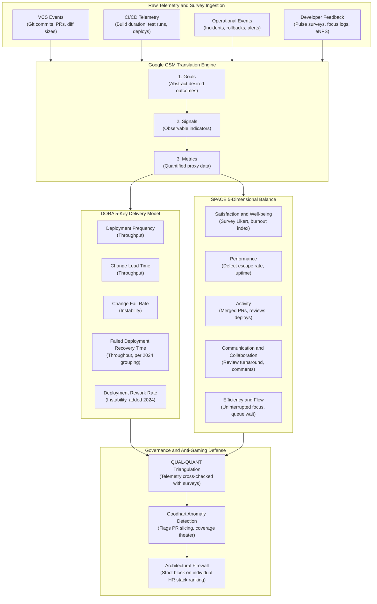
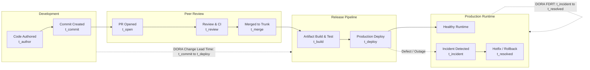
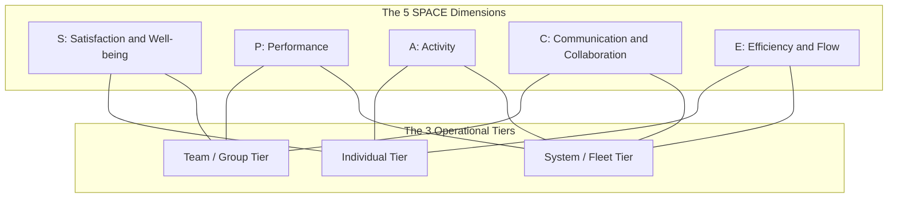
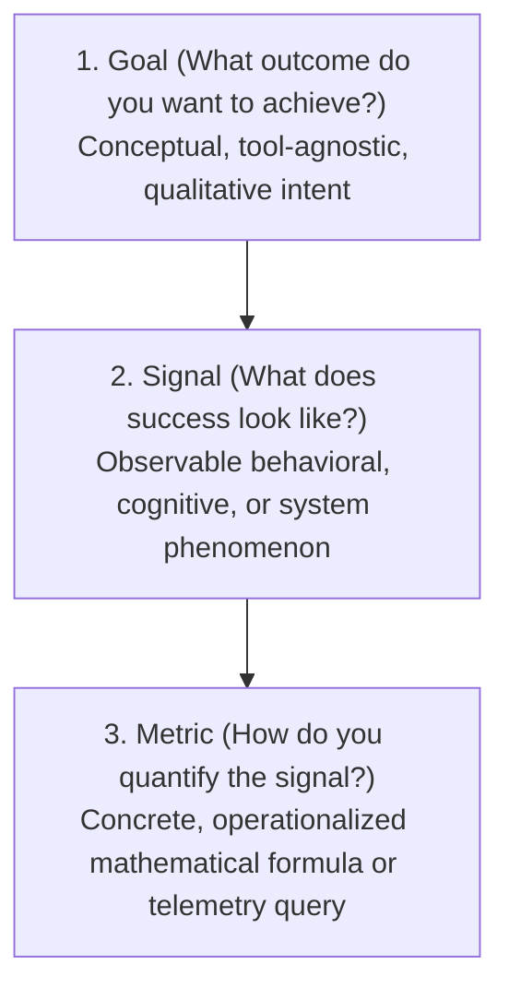
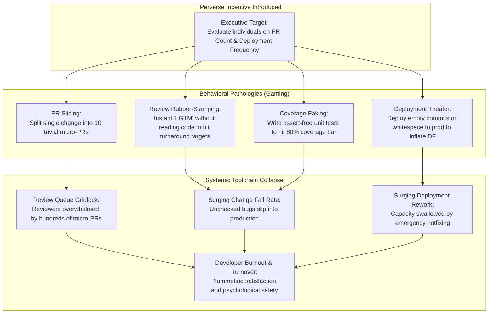
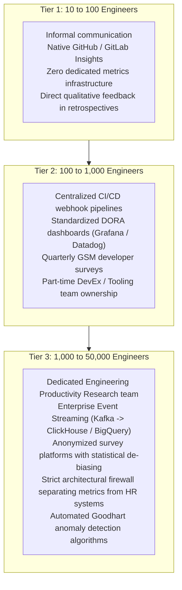

# Developer Productivity Metrics: DORA, SPACE, and GSM Frameworks

> [!summary] Claim:
> Developer productivity is a multidimensional socio-technical property that cannot be reduced to a scalar output metric like lines of code or commit volume.
> DORA quantifies delivery throughput (Change Lead Time, Deployment Frequency, Failed Deployment Recovery Time) and delivery instability (Change Fail Rate, Deployment Rework Rate) across five metrics.
> The SPACE framework balances these system metrics across five human and operational dimensions spanning individual, team, and system tiers.
> Google's Goals-Signals-Metrics (GSM) method, checked against the QUANTS components and triangulated across qualitative and quantitative data, guards against Goodhart's Law pathologies where target optimization degrades software sustainability.



## The Mechanism

Software engineering is not programming.
As Winters, Manshreck, and Wright established, programming is the immediate act of generating code to solve a technical problem, whereas software engineering is programming integrated over time, scale, and organizational change.
Productivity measurement in an engineering system is the control loop that determines whether a toolchain, architectural policy, or organizational structure accelerates or inhibits this multi-decade sustainability.
Every framework analyzed below addresses the fundamental physics of software production: how to observe, quantify, and improve engineering velocity and software reliability without creating perverse incentives that destroy the engineering culture.

### 1. Foundations of Engineering Productivity Science

Engineering organizations that scale from 50 to 50,000 developers face a classic scaling dilemma.
While software feature inventory grows with organizational ambitions, communication pathways between engineers grow quadratically as $O(N^2)$, where $N$ is the number of active contributors.
Without systematic measurement of toolchain friction, organizations respond to slowing velocity by hiring more engineers, which paradoxically increases communication overhead and slows delivery further, as predicted by Brooks's Law.

The central failure mode of historical productivity measurement is the assembly line fallacy.
In physical manufacturing, output volume is tightly correlated with value: producing 1,000 defect-free automobiles is strictly twice as valuable as producing 500.
In software engineering, lines of code (LOC), raw commit counts, or story point velocity bear no monotonic relationship to value.
An engineer who refactors a bloated distributed subsystem, deleting 5,000 lines of redundant code and eliminating a distributed race condition, has produced immense value while generating negative lines of code and zero user-facing feature tickets.
Conversely, an engineer who copy-pastes boilerplate to inflate LOC or slices a single logical commit into 15 pull requests to inflate PR activity produces technical debt and review gridlock.

To solve this, modern productivity science separates output from outcomes, and isolates system delivery capability from individual developer surveillance.

### 2. The DORA Framework: Throughput, Instability, and the 2024 Rework Key

The DevOps Research and Assessment (DORA) framework was established by Dr. Nicole Forsgren, Jez Humble, and Gene Kim, whose State of DevOps survey research began with the inaugural 2014 study; DORA was acquired by Google in December 2018 and is now "a program run by Google Cloud" (DORA history page and 2018-12-20 announcement, as of 2026-11).
DORA models software delivery as a pipeline transformation that converts developer intent (committed source code) into operational value (software running in production).
Rather than evaluating individual developer behavior, DORA evaluates organizational delivery performance by pairing throughput metrics with stability metrics.



#### Throughput Metric 1: Deployment Frequency (DF)

Deployment Frequency measures the cadence of successful software releases to production or an equivalent end-user environment.
It quantifies batch size and pipeline automation: organizations that deploy frequently must maintain small batch sizes and automated verification gates.

Mathematically, for a measurement window $W$ consisting of $|T|$ discrete calendar days, Deployment Frequency is defined as:

$$DF = \frac{\sum_{t \in T} \mathbb{I}(\text{deployment}_t = \text{success})}{|T|}$$

Where $\mathbb{I}$ is the indicator function evaluating to 1 for a successful production deployment and 0 otherwise.
The 2024 report's cluster analysis produced these deployment frequency levels (2024 report p. 13; the levels emerge from each year's survey responses and are not fixed thresholds):
- Elite: On demand (multiple deploys per day).
- High: Between once per day and once per week.
- Medium: Between once per week and once per month.
- Low: Between once per month and once every six months.

The critical architectural boundary is the target environment: releases to staging, ephemeral test environments, or developer sandbox clusters do not count toward Deployment Frequency.
In systems with continuous delivery of binary artifacts (such as mobile applications or firmware), deployment frequency is measured as the cadence of cutting validated release candidates to app stores or customer distribution channels.

#### Throughput Metric 2: Change Lead Time (CLT / Lead Time for Changes)

Change Lead Time measures the duration required for a commit to travel from trunk commit (or commit authorship) to running successfully in production.
DORA deliberately chooses the commit timestamp as the starting boundary rather than the product ticket creation timestamp.
Measuring from ticket creation introduces high variance from business ideation, product backlog prioritization, and design negotiations, which are outside the control of the software engineering toolchain.
Measuring from commit to production isolates the technical execution efficiency of code review, automated testing, artifact packaging, and deployment rollout.

Let a change $c$ have a commit timestamp $t_{\text{commit}}(c)$ and a production deployment timestamp $t_{\text{deploy}}(c)$.
The change lead time is:

$$CLT(c) = t_{\text{deploy}}(c) - t_{\text{commit}}(c)$$

Because lead time distributions in large engineering fleets exhibit extreme right-skew (log-normal or Pareto tails due to blocked reviews or flaky test queues), summarizing CLT via the arithmetic mean is an engineering anti-pattern.
Systems must report median ($P50$) and 90th percentile ($P90$ or $P95$) values.
DORA's own levels come from survey buckets, not telemetry percentiles; the 2024 clusters are:
- Elite: Less than one day.
- High: Between one day and one week.
- Medium: Between one week and one month.
- Low: Between one month and six months.

#### Instability Metric 3: Change Fail Rate (CFR)

Change Fail Rate measures the percentage of deployments to production that cause a degradation in service, an outage, or a critical defect that subsequently requires immediate remediation (a rollback, an emergency hotfix, or a fix-forward patch).
It acts as the primary quality counterbalance to Deployment Frequency and Change Lead Time: an organization cannot claim high velocity if its deployments continuously destabilize production.

For a set of deployments $D$ over measurement window $W$:

$$CFR = \frac{\sum_{d \in D} \mathbb{I}(d \in D_{\text{failed}})}{|D|} \times 100\%$$

Where $D_{\text{failed}}$ denotes any deployment that triggered a Sev-1/Sev-2 incident, violated a Service Level Objective (SLO), or necessitated an unplanned hotfix.
DORA defines it as "the percentage of deployments that cause failures in production, requiring hotfixes or rollbacks" (2024 report p. 10).
The 2024 clusters report a single typical value per level, not a range, and the values are not monotonic:
- Elite: 5%.
- High: 20%.
- Medium: 10%.
- Low: 40%.

#### Throughput Metric 4: Failed Deployment Recovery Time (FDRT)

Historically referred to as Mean Time to Recover (MTTR) or Time to Restore Service, the metric was renamed and redefined as Failed Deployment Recovery Time (FDRT) in the 2023 report (DORA metrics history page).
Since the 2024 report, DORA groups FDRT with the throughput factor, alongside Change Lead Time and Deployment Frequency, because it "measures the speed of making updates of any kind, normal changes and changes in response to a failure" (2024 report p. 12).
FDRT measures the elapsed time from the start of an incident caused by a production deployment (or detection of a production failure) until service is fully restored to acceptable SLO levels.

$$FDRT = t_{\text{resolved}} - t_{\text{incident\_onset}}$$

FDRT reflects an organization's observability infrastructure, rollback automation, canary deployment capabilities, and disaster recovery procedures.
In advanced continuous deployment environments equipped with automated canary analysis (ACA) and automated rollbacks, FDRT is measured in minutes.
The 2024 clusters:
- Elite: Less than one hour.
- High: Less than one day.
- Medium: Less than one day.
- Low: Between one week and one month.

#### Instability Metric 5: Deployment Rework Rate (Added in the 2024 DORA Report)

In the 2024 Accelerate State of DevOps Report, DORA expanded its delivery model from four keys to five by introducing rework rate (the report's name; dora.dev now calls it "deployment rework rate").
The stated motivation was statistical: change failure rate had "long had an outlier" status, correlating with the other three metrics while resisting combination with them into one factor, and DORA had "a longstanding hypothesis that the change failure rate metric works as a proxy for the amount of rework a team is asked to do" (2024 report p. 11).
The new survey question asked "approximately how many deployments in the last six months were not planned but were performed to address a user-facing bug in the application?"
The analysis confirmed that rework rate and change failure rate together "create a reliable factor of software delivery stability."

An illustration of what the extra metric captures: a single bad deployment might require seven successive emergency hotfixes and rollbacks to stabilize.
Under the classical four keys, if those seven hotfixes succeed without new incidents, they count as seven successful deployments, which inflates deployment frequency and dilutes the measured failure rate.
Deployment Rework Rate isolates this reactive capacity drain.

Mathematically, Deployment Rework Rate is defined as:

$$\text{Deployment Rework Rate} = \frac{|D_{\text{unplanned\_rework}}|}{|D_{\text{total}}|} \times 100\%$$

Where $D_{\text{unplanned\_rework}}$ represents deployments executed specifically to address an incident, patch a regression, or undo an unviable change.
If a team deploys 100 times in a month, and 25 of those deployments are emergency bugfixes and hotfixes, the team suffers a 25% Deployment Rework Rate, meaning one-quarter of its release capacity is consumed by repairing its own mistakes.
DORA's cluster analysis still used only the original four metrics "to remain consistent with previous years" (2024 report p. 13), so DORA publishes no elite-to-low tiers for rework rate.
On AI, the 2024 report estimated "a 1.5% reduction for every 25% increase in AI adoption" in delivery throughput and "a 7.2% reduction for every 25% increase in AI adoption" in delivery stability (the combined change-fail-rate and rework-rate factor), while AI adoption improved individual productivity, flow, and job satisfaction (2024 report p. 39).
The report attributes the gap to weaker adherence to delivery basics "like small batch sizes and robust testing mechanisms," not to a measured rework spike specifically.

### 3. The SPACE Framework: Five Dimensions Across Socio-Technical Tiers

Published in 2021 in *ACM Queue* by Dr. Nicole Forsgren, Dr. Margaret-Anne Storey, Chandra Maddila, Dr. Thomas Zimmermann, Brian Houck, and Dr. Jenna Butler, the SPACE framework was developed to counter the reductionist trend of measuring engineers through activity telemetry alone.
SPACE asserts that developer productivity is inherently multidimensional, and that any measurement system must balance five distinct dimensions:



The edges above are illustrative: the paper's example-metrics figure gives at least one example metric for every dimension at all three levels (individual, team or group, and system), and flags several (lines of code, story points, retention) to be used "with (even more) caution" because "they can proxy more things."

#### S: Satisfaction and Well-Being

Satisfaction captures how fulfilled, happy, and supported developers feel regarding their tools, team environment, and culture.
Well-being measures stress, psychological safety, and burnout risk.
Because dissatisfaction and burnout are leading indicators of engineering turnover, cognitive fatigue, and surging defect rates, tracking satisfaction is a prerequisite for sustainable velocity.
- Metrics: Tool satisfaction surveys (Likert scale 1-5), Developer Net Promoter Score (Dev-NPS), turnover and retention rates, survey measures of psychological safety.

#### P: Performance

Performance evaluates the outcome of an engineering system or team, rather than the quantity of work produced.
Software performance must reflect quality, customer impact, and operational health.
High activity that results in broken software or zero user adoption represents negative performance.
- Metrics: Production incident frequency, defect escape rate, customer satisfaction (CSAT), service availability and latency against [[04-System-Design/00-Concepts/SLOs-and-Observability|SLOs]], cost of infrastructure per transaction.

#### A: Activity

Activity measures the count of actions, artifacts, and transformations performed during software development.
Activity is the easiest dimension to measure via automated VCS and CI logs, making it the most frequently abused dimension in corporate dashboards.
SPACE states that activity metrics "should never be used in isolation to make decisions about individual or team productivity because of their known limitations."
- Metrics: Number of pull requests merged, commits authored, code reviews completed, design documents published, deployments executed, incident tickets resolved.

#### C: Communication and Collaboration

Software engineering at scale is a cooperative human endeavor.
Communication and collaboration capture how information flows between individuals and teams, how efficiently knowledge is discovered, and how peer review is conducted.
- Metrics: Pull request review turnaround time ($P50$ and $P90$), review comment depth and responsiveness, documentation search effectiveness, onboarding time for new hires, cross-team API contract dependency wait states.

#### E: Efficiency and Flow

Efficiency and flow measure the ability of an engineer or team to make progress without friction, interruptions, or bureaucratic handoffs.
Flow represents the psychological state of deep, uninterrupted focus.
Efficiency captures the ratio of productive working time to idle queue waiting time across the pipeline.
- Metrics: Uninterrupted focus time (the paper names focus time and interruptions, "quantity, timing, how spaced", but sets no minimum block length), number of handoffs, context switching frequency, total pull request cycle time, time spent waiting for CI build and test execution in [[Build-and-Test-Latency-Economics-and-Flaky-Tests]].

#### The Three Rules of SPACE

The paper's "How To Use the Framework" section makes three recommendations; they are guidance, not formal rules, but they are the load-bearing part of the framework:
1. Three-Dimension Rule: capture "several metrics across multiple dimensions of the framework - at least three are recommended."
2. Anti-Activity Rule: adding more activity metrics (commits plus pull requests plus coding time) does not broaden the view; add "at least one metric from two different dimensions."
3. Perceptual Rule: "at least one of the metrics include perceptual measures such as survey data."
The same section adds a privacy rule: teams and organizations should "report only anonymized, aggregate results at the team or group level."

### 4. Google Goals-Signals-Metrics (GSM) Framework and the QUANTS Model

A Goals-Signals-Metrics process first appeared in print in the HEART user experience paper by Kerry Rodden, Hilary Hutchinson, and Xin Fu of Google (CHI 2010), which maps product goals to signals and metrics.
Chapter 7 of *Software Engineering at Google* (written by Ciera Jaspan, edited by Riona Macnamara) documents how Google's engineering productivity research team uses GSM to "guide metrics creation"; the chapter itself does not cite HEART.

Teams frequently begin productivity initiatives by inspecting available data streams (e.g. GitHub commit logs, Jira tickets) and selecting whatever is easy to count.
This bottom-up approach invariably produces vanity metrics that reward gaming.
GSM enforces a strict top-down translation hierarchy:



#### The GSM Translation Mechanics

1. Goal: A high-level, conceptual objective describing the desired end state.
A goal must not mention specific tools, logs, or numerical targets.
Example Goal: "Engineers receive timely, high-quality peer review feedback without losing focus."
2. Signal: An observable phenomenon that indicates the goal is being achieved.
Signals capture the ideal behavior or feeling, regardless of whether it is currently measurable with existing tooling.
Example Signal: "Engineers feel code reviews are collaborative and prompt, and PRs rarely sit idle in review queues."
3. Metric: The concrete proxy measurement, computed from system telemetry logs or survey instruments, that quantifies the signal.
Example Metrics:
- Metric A (System Telemetry): Median turnaround time from PR creation to first human review comment ($P50$ hours).
- Metric B (Developer Survey): Proportion of engineers agreeing on a 5-point Likert scale that "Peer reviews help me maintain high code quality without blocking my daily progress."

#### Google QUANTS Dimensions

To ensure that goals cover all aspects of engineering health, Google structures its productivity research around the QUANTS mnemonic:
- Qu (Quality of the code): The architectural stability, maintainability, and test regression resilience of the software.
- A (Attention from engineers): Cognitive focus, frequency of flow states, and freedom from notification distraction.
- N (iNtellectual complexity): The inherent cognitive load required to understand internal systems and complete tasks.
- T (Tempo and velocity): The speed and cadence at which engineers can complete tasks and push releases.
- S (Satisfaction): Developer happiness, psychological safety, and tool fulfillment.

The chapter stresses that the five components "are in trade-off with one another," so a goal set that covers only Tempo will hide regressions in Quality or Attention.

#### QUAL-QUANT Triangulation

A core thesis of Google's measurement science is that neither qualitative surveys nor quantitative logs are sufficient on their own.
The chapter says quantitative metrics "give you power and scale" but "don't provide any context or narrative," and that "Qualitative metrics are metrics, too!"
Quantitative telemetry provides scale, precision, and historical timelines across thousands of engineers, but telemetry is blind to human intent.
If a telemetry dashboard shows that engineers spend an average of four hours inside an internal tool, the log cannot tell you whether the tool is so powerful that engineers rely on it all day, or whether the tool is so broken, buggy, and confusing that it took four hours to execute a trivial configuration task.

Qualitative research (interviews, diary studies, and periodic surveys) provides context, emotional reality, and causal narratives, but is vulnerable to cognitive biases:
- Recall Bias: Engineers disproportionately remember dramatic, painful incidents (such as a four-hour build failure) while forgetting weeks of smooth operation.
- Recency Bias: "people are biased toward their most recent experience" (the chapter notes that surveying engineers immediately after a process avoids recall bias but introduces recency and sampling bias).
- Sampling Bias: Voluntary pulse surveys are frequently filled out only by the most delighted or the most enraged engineers, distorting the middle distribution.

Triangulation is the operational process of cross-validating telemetry against survey sentiment.
When logs and surveys agree (e.g. CI build times decreased by 50%, and survey satisfaction with build tools surged by 40%), leadership can invest with high confidence.
When logs and surveys diverge (e.g. CI build times decreased by 50%, but engineers report feeling slower than ever), triangulation exposes hidden friction.
The chapter reports that "when the quantitative and qualitative metrics disagree, it was because the quantitative metrics were not capturing the expected result."
Its worked case is build latency: an experience-sampling survey sent after builds started revealed that some builds had been started by automated tools rather than by engineers waiting on them, so the median build latency metric was changed to exclude them.
The same pattern applies to presubmit and flaky-test telemetry in [[Build-and-Test-Latency-Economics-and-Flaky-Tests]].

### 5. The Core 4 Synthesis: Unifying DORA, SPACE, and DevEx

In 2023, Abi Noda, Dr. Margaret-Anne Storey, Dr. Nicole Forsgren, and Dr. Michaela Greiler published *DevEx: What Actually Drives Productivity* in ACM Queue, framing developer experience around feedback loops, cognitive load, and flow state.
In late 2024 (press coverage dates it to December 2024), DX introduced the DX Core 4, written by Abi Noda, Laura Tacho, Dr. Margaret-Anne Storey, and Dr. Michaela Greiler, with Nicole Forsgren and Thomas Zimmermann among those acknowledged; DX describes it as "a unified framework for measuring developer productivity that encapsulates DORA, SPACE, and DevEx."
Its published key metrics include diffs per engineer (Speed, which DX itself says "requires caution") and the Developer Experience Index (Effectiveness); its Table 1 lists change failure rate as the Quality key metric and percentage of time spent on new capabilities as the Impact key metric, with lead time, deployment frequency, failed deployment recovery time, time to 10th PR, and perceived software quality among the secondary metrics (read from the page's Table 1 image, as of 2026-11).
The Core 4 framework synthesizes the operational delivery focus of DORA, the holistic multidimensionality of SPACE, and the developer experience (DevEx) focus on feedback loops, cognitive load, and flow state into four counterbalanced quadrants:

| Quadrant | Primary Focus | Representative Telemetry Metrics | Representative Perceptual Metrics |
| :--- | :--- | :--- | :--- |
| **Speed** | Delivery velocity, workflow tempo, and cycle efficiency | DORA Lead Time for Changes, Deployment Frequency, PR cycle time | Perceived velocity survey scores, sense of momentum |
| **Quality** | System stability, defect resilience, and code maintainability | DORA Change Fail Rate, defect escape rate, rollback count | Developer confidence in test suites, perceived code health |
| **Effectiveness** | Developer experience, friction reduction, and feedback loops | CI/CD build wait time, flaky test failure rate, PR idle time | Developer Experience Index (DXI), cognitive load score |
| **Impact** | Business alignment, value creation, and engineering allocation | Ratio of roadmap feature work to technical debt / KTLO work | Perceived product impact, customer problem resolution |

By evaluating Speed alongside Quality, Effectiveness, and Impact, the Core 4 framework prevents the executive trap of treating engineering teams as raw feature factories.

### 6. Goodhart's Law, Campbell's Law, and Incentive Perversion

The most critical operational failure mode in developer productivity measurement occurs when metrics designed for system diagnostics are repurposed for individual performance evaluation, compensation, or stack ranking.
This failure is governed by two foundational socio-economic laws:

1. Goodhart's Law (Charles Goodhart, 1975): "Any observed statistical regularity will tend to collapse once pressure is placed upon it for control purposes."
The popular form, "When a measure becomes a target, it ceases to be a good measure," is not Goodhart's wording: anthropologist Marilyn Strathern wrote it in 1997 ("'Improving ratings': audit in the British University system," *European Review* 5(3), pp. 305-321), crediting Keith Hoskin with describing it as "Goodhart's law", after Goodhart's observation on instruments for monetary control.
The 1975 sentence quoted above is the wording widely cited from Goodhart's paper (as reproduced on Wikipedia); the paper itself was not retrievable for this check, so treat the exact punctuation as secondary-sourced.
2. Campbell's Law (Donald T. Campbell, 1976): "The more any quantitative social indicator is used for social decisionmaking, the more subject it will be to corruption pressures and the more apt it will be to distort and corrupt the social processes it is intended to monitor." (Checked verbatim against the 2011 JMDE reprint of the 1976 paper.)

#### Deconstruction of Gaming Pathologies

When engineering metrics are tied to individual performance evaluations, developers rationally alter their behavior to maximize the metric rather than the health of the software.
This produces severe organizational pathologies:



1. Lines of Code (LOC):
Tying performance to LOC written incentivizes verbose boilerplate, copy-paste programming, unrolled loops, and active resistance to code deletion, modularization, or refactoring.
The classic historic example comes from Apple's Lisa software team in early 1982, where managers asked engineers to report lines of code written each week on a form.
Bill Atkinson had just rewritten QuickDraw's region calculation engine with a simpler, more general algorithm that made region operations "almost six times faster" and "saved around 2,000 lines of code," so he wrote "-2000" on the form; by Andy Hertzfeld's folklore.org account, managers soon stopped asking him to fill it in.
2. Commit and Pull Request Counts:
Tying evaluation to PR count results in extreme PR slicing: an engineer who previously submitted a clean, cohesive 150-line pull request with tests now fragments the work into eight separate micro-PRs (one for interfaces, one for models, four for individual methods, two for documentation).
This floods the review queue, destroys architectural context for reviewers, and creates immense review backlog latency.
3. Story Point Velocity:
When sprint point velocity is tracked as an individual or team performance metric, teams inflate estimates (a 2-point ticket becomes an 8-point ticket).
Teams also refuse to address unestimated technical debt, architectural cleanup, or emergency tooling repairs because doing so lowers measured sprint velocity.
4. Raw Deployment Frequency:
When teams are judged on deployment counts without stability counterweights, engineers push meaningless documentation tweaks, feature flag flips, or automated whitespace commits to production multiple times a day.
This floods deployment pipelines, consumes CI capacity, and masks real feature delivery paralysis.
5. Code Coverage Percentages:
Mandating 80% or 90% line coverage as a hard gate without asserting test behavior leads to "coverage theater".
Developers write assertion-free tests that execute codepaths without verifying side effects, or mock out entire subsystems, creating high measured coverage with zero regression protection.
6. Pull Request Review Latency and Count:
If engineers are rewarded for reviewing many PRs quickly, they stop conducting thorough architectural audits in [[Code-Review-and-Readability-Systems-at-Scale]].
Instead, they form approval cartels, rubber-stamping PRs with instant "LGTM" comments.
Defect escape rates skyrocket, and complex, risky architectural changes are approved without scrutiny.
7. Bug Resolution Burndown:
Rewarding engineers for the number of bugs closed incentivizes cherry-picking trivial UI typo fixes while ignoring severe, hard-to-reproduce distributed concurrency defects.
Engineers may also file and immediately close synthetic, trivial bugs to inflate their closure tallies.
8. The 2023 McKinsey Individual Developer Productivity Model:
On 17 August 2023, McKinsey published "Yes, you can measure software developer productivity," proposing four new metrics on top of DORA and SPACE: inner/outer loop time spent, a Developer Velocity Index benchmark, contribution analysis, and a talent capability score.
On 29 August 2023, Gergely Orosz and Kent Beck published a two-part response in The Pragmatic Engineer arguing that most of the new metrics measure effort or output rather than outcomes or impact, and that they are easy to game.
Software engineering is a non-linear, collaborative system: treating an engineering department like a 19th-century physical manufacturing assembly line destroys knowledge sharing, creates organizational paranoia, and incentivizes pervasive gaming.

#### The Architectural Defense Against Goodhart's Law

To insulate engineering systems from Goodhart's Law, distinguished engineers enforce three architectural rules:
1. Team-Level Aggregation: Developer productivity metrics (DORA, SPACE, GSM) must be calculated and displayed exclusively at the team, department, or system fleet level, which SPACE itself recommends ("report only anonymized, aggregate results at the team or group level"); the minimum bucket of 10-15 engineers is a house heuristic, not a figure from any of the cited frameworks.
Individual-level productivity dashboards are strictly prohibited.
2. Paired Counterbalancing Metrics: A velocity metric must always be paired with a quality metric (e.g. Deployment Frequency must be paired with Change Fail Rate and Deployment Rework Rate; PR turnaround speed must be paired with review comment depth and post-merge defect rate).
3. System Diagnostics, Not Human Evaluation: Productivity metrics must be owned by platform engineering and tooling teams to locate toolchain bottlenecks, justify infrastructure investments, and measure developer experience.
They must never be fed into HR performance review systems or salary bonus formulas.

## Commands and Numbers to Know

The DORA rows are the 2024 report's survey clusters (2024 report p. 13), which emerge from each year's responses rather than being fixed standards.
The remaining rows are either sourced or explicitly labelled as design targets or house heuristics, not industry standards.

| Metric / Parameter | Value / Benchmark | Platform and date | Operational Significance and Bounds |
| :--- | :--- | :--- | :--- |
| DORA Deployment Frequency (Elite) | On demand (multiple deploys per day) | Both (as of 2026-11, 2024 report) | Requires fully automated CI/CD and trunk-based development |
| DORA Deployment Frequency (Low) | Between once per month and once every six months | Both (as of 2026-11, 2024 report) | Indicates massive batch sizes and manual release gates |
| DORA Change Lead Time (Elite) | Less than one day (commit to prod) | Both (as of 2026-11, 2024 report) | Bounded by automated presubmit testing and canary bake time |
| DORA Change Lead Time (Low) | Between one month and six months | Both (as of 2026-11, 2024 report) | Code rots on long-lived feature branches, driving merge conflicts |
| DORA Change Fail Rate (Elite) | 5% of deployments | Both (as of 2026-11, 2024 report) | Percentage of releases requiring immediate rollback or hotfix |
| DORA Change Fail Rate (Low) | 40% of deployments (High is 20%, Medium 10%) | Both (as of 2026-11, 2024 report) | Production is constantly destabilized by release activity |
| DORA Recovery Time - FDRT (Elite) | Less than one hour | Both (as of 2026-11, 2024 report) | Automated canary rollback or fast fix-forward pipeline |
| DORA Recovery Time - FDRT (Low) | Between one week and one month | Both (as of 2026-11, 2024 report) | Lack of deployment rollbacks, telemetry, and runbooks |
| DORA Deployment Rework Rate (Elite) | No published tier | Both (as of 2026-11, 2024 report) | Added in 2024; clusters were computed on the four original metrics only |
| DORA Deployment Rework Rate (Low) | No published tier | Both (as of 2026-11, 2024 report) | Set internal targets from your own baseline, not from DORA levels |
| Optimal PR Change Size | Less than 200 lines of code (LOC) | Both (as of 2026-11) | SmartBear's Cisco code review study guidance: 200 LOC is a good limit and 400 the maximum before reviewers stop finding defects (vendor study) |
| PR Review Turnaround (maximum) | Within one business day | Both (as of 2026-11) | Google eng-practices: "One business day is the maximum time it should take to respond to a code review request" |
| Metric Telemetry Ingestion SLA | $P95 < 60$ seconds | Both (as of 2026-11) | Design target for the pipeline in At Scale, not an industry standard |
| Minimum Aggregation Cohort Size | 10 to 15 engineers | Both (as of 2026-11) | House heuristic; SPACE recommends team- or group-level aggregates without a size |

## Multi-Language Comparison: Telemetry Collection Across Toolchains

Engineering systems at scale operate across polyglot environments.
The table below contrasts how telemetry events and productivity metrics are collected, instrumented, and analyzed across C++, Python, Rust, and Go/Java toolchains.

| Telemetry Concern | C++ (Bazel / CMake) | Python (pytest / uv) | Rust (Cargo / Nextest) | Go / Java (Go toolchain / Maven) |
| :--- | :--- | :--- | :--- | :--- |
| **Commit and VCS Event Tracking** | Git commit graph hooks, Bazel workspace status scripts (`--workspace_status_command`) | Pre-commit hooks, GitPython, Dulwich event miners | Git hooks via `gitoxide` / `git2` crates | JGit hooks, native Go Git libraries |
| **Build and Test Telemetry** | Bazel Build Event Protocol (BEP), CMake `--profiling-output` with `--profiling-format=google-trace` | `pytest-json-report`, `pytest-otel` | `cargo-nextest` JUnit XML (libtest-style JSON is experimental), `cargo build --timings` HTML report | `go test -json` event stream, Maven `EventSpy` extension API |
| **OpenTelemetry Span Generation** | OpenTelemetry C++ SDK (`opentelemetry-cpp`) embedded in build wrappers | `opentelemetry-sdk` Python package, auto-instrumentation | `tracing` crate with `tracing-opentelemetry` export | `go.opentelemetry.io/otel`, OpenTelemetry Java Agent |
| **Crash and Incident Attribution** | Google Breakpad, Crashpad, ELF build-id matching | Sentry Python SDK, traceback parsing, sys.excepthook | `sentry-rust`, backtrace crate with DWARF parsing | Sentry Java / Go SDK, runtime panic handlers |
| **Developer IDE / Focus Telemetry** | Editor-side capture around `clangd`; the LSP 3.17 spec defines a `telemetry/event` notification whose payload it leaves unspecified, and whether a given server emits it is a per-server choice | Editor-side capture around Pyright / Ruff servers | Editor-side capture around `rust-analyzer` | Editor-side capture around `gopls` / Eclipse JDTLS |
| **Test Flakiness Extraction** | Test trace replay, Bazel `--runs_per_test=10` logs | Flaky test detection plugins (`pytest-rerunfailures`) | `cargo-nextest` retry logs | `go test -count=10` JSON parser |

## Worked Lab Example

This note has no committed lab harness.
The example in this section is a complete, self-contained implementation of a Developer Productivity Telemetry and Triangulation Engine written in Python 3 using only the standard library.
It processes simulated raw VCS commit records, PR review discussions, production deployment logs, incident resolution tickets, and qualitative developer sentiment survey responses.
Every output shown below was captured in a single run on `darwin-arm64` on macOS on 2026-11-21, using Python 3.12 (as of 2026-11, macOS), and reproduced byte-for-byte by an independent run under Python 3.15.2 on macOS on 2026-11-26.
All inputs are synthetic and hard-coded, including the review delays and failure flags, so the script demonstrates how the metrics are computed and combined; it does not discover gaming from real data.

The engine executes two contrasting simulations:
- Team Alpha (Healthy Continuous Delivery Team): Operates with small batch sizes, robust automated presubmit testing, rapid peer reviews, and high developer satisfaction.
- Team Beta (Gamed Dashboard Team): Operates under an executive mandate tying bonuses to raw PR counts and deployment volume, triggering severe PR slicing, review rubber-stamping, soaring production failure rates, and developer burnout.

### The Telemetry Pipeline Script

Create a file named `telemetry_pipeline.py` and populate it with the following implementation:

```python
#!/usr/bin/env python3
"""
Developer Productivity Telemetry and Triangulation Engine.
Computes DORA 5-Key Metrics, SPACE Dimensions, and GSM / Goodhart Pathology Diagnostics.
Strict ASCII, deterministic, standard library only.
"""

import sys
from dataclasses import dataclass
from typing import List, Dict, Any

@dataclass
class ChangeRecord:
    change_id: str
    commit_epoch: int
    merge_epoch: int
    deploy_epoch: int
    lines_added: int
    lines_deleted: int
    review_comments: int
    is_rework: bool  # Unplanned hotfix/bugfix

@dataclass
class DeploymentRecord:
    deploy_id: str
    deploy_epoch: int
    is_failed: bool
    is_rework: bool
    incident_recovery_seconds: int  # 0 if not failed

@dataclass
class SurveyRecord:
    developer_id: str
    tool_satisfaction: int      # 1 to 5
    perceived_velocity: int     # 1 to 5
    uninterrupted_flow: int     # 1 to 5
    review_responsiveness: int  # 1 to 5

def percentile(values: List[float], p: float) -> float:
    if not values:
        return 0.0
    sorted_v = sorted(values)
    k = (len(sorted_v) - 1) * p
    f = int(k)
    c = f + 1
    if c < len(sorted_v):
        return sorted_v[f] + (k - f) * (sorted_v[c] - sorted_v[f])
    return sorted_v[f]

def analyze_team(
    team_name: str,
    window_days: int,
    changes: List[ChangeRecord],
    deploys: List[DeploymentRecord],
    surveys: List[SurveyRecord]
) -> Dict[str, Any]:
    # 1. DORA Metrics (5 Keys)
    total_deploys = len(deploys)
    deploy_freq_daily = total_deploys / window_days if window_days > 0 else 0.0

    lead_times_hours = [
        (c.deploy_epoch - c.commit_epoch) / 3600.0
        for c in changes
        if c.deploy_epoch >= c.commit_epoch
    ]
    lead_time_p50 = percentile(lead_times_hours, 0.50)
    lead_time_p90 = percentile(lead_times_hours, 0.90)

    failed_deploys = sum(1 for d in deploys if d.is_failed)
    change_fail_rate = (failed_deploys / total_deploys * 100.0) if total_deploys > 0 else 0.0

    recovery_times_hours = [
        d.incident_recovery_seconds / 3600.0
        for d in deploys
        if d.is_failed and d.incident_recovery_seconds > 0
    ]
    fdrt_p50 = percentile(recovery_times_hours, 0.50) if recovery_times_hours else 0.0
    fdrt_p90 = percentile(recovery_times_hours, 0.90) if recovery_times_hours else 0.0

    rework_deploys = sum(1 for d in deploys if d.is_rework)
    deployment_rework_rate = (rework_deploys / total_deploys * 100.0) if total_deploys > 0 else 0.0

    # 2. SPACE Dimensions
    # Satisfaction (S): Mean survey satisfaction normalized to 0.0 - 1.0
    mean_sat = (
        sum(s.tool_satisfaction for s in surveys) / len(surveys) if surveys else 0.0
    )
    sat_index = (mean_sat - 1.0) / 4.0 if mean_sat > 0 else 0.0

    # Performance (P): Outcome quality based on low CFR and low rework
    perf_index = max(0.0, 1.0 - (change_fail_rate / 100.0) - (deployment_rework_rate / 200.0))

    # Activity (A): Total changes merged
    activity_count = len(changes)

    # Communication (C): Review turnaround and comment density
    review_turnaround_hours = [
        (c.merge_epoch - c.commit_epoch) / 3600.0
        for c in changes
        if c.merge_epoch >= c.commit_epoch
    ]
    review_p50 = percentile(review_turnaround_hours, 0.50)
    mean_comments = (
        sum(c.review_comments for c in changes) / len(changes) if changes else 0.0
    )

    # Efficiency (E): Mean flow perception index [0.0 - 1.0]
    mean_flow = (
        sum(s.uninterrupted_flow for s in surveys) / len(surveys) if surveys else 0.0
    )
    flow_index = (mean_flow - 1.0) / 4.0 if mean_flow > 0 else 0.0

    # 3. GSM Triangulation & Goodhart Gaming Diagnostic
    # Pathology 1: PR Slicing (Micro-PRs < 30 total lines changed)
    micro_prs = sum(1 for c in changes if (c.lines_added + c.lines_deleted) < 30)
    fragmentation_ratio = micro_prs / len(changes) if changes else 0.0

    # Pathology 2: Instability Penalty (surging CFR + Rework)
    instability_penalty = (change_fail_rate + deployment_rework_rate) / 100.0

    # Pathology 3: Subjective Frustration vs Output Mirage
    perceived_vel = (
        sum(s.perceived_velocity for s in surveys) / len(surveys) if surveys else 0.0
    )
    vel_divergence = max(0.0, (deploy_freq_daily / 2.0) - ((perceived_vel - 1.0) / 4.0))

    gaming_risk_score = min(
        1.0,
        0.40 * fragmentation_ratio + 0.35 * instability_penalty + 0.25 * min(1.0, vel_divergence)
    )

    return {
        "team": team_name,
        "dora": {
            "deploy_freq_daily": deploy_freq_daily,
            "lead_time_p50_h": lead_time_p50,
            "lead_time_p90_h": lead_time_p90,
            "change_fail_rate_pct": change_fail_rate,
            "fdrt_p50_h": fdrt_p50,
            "fdrt_p90_h": fdrt_p90,
            "rework_rate_pct": deployment_rework_rate,
        },
        "space": {
            "satisfaction_index": sat_index,
            "performance_index": perf_index,
            "activity_changes": activity_count,
            "communication_review_p50_h": review_p50,
            "communication_comments_per_pr": mean_comments,
            "efficiency_flow_index": flow_index,
        },
        "gsm_goodhart": {
            "fragmentation_ratio": fragmentation_ratio,
            "gaming_risk_score": gaming_risk_score,
            "gaming_level": "CRITICAL" if gaming_risk_score >= 0.50 else ("ELEVATED" if gaming_risk_score >= 0.25 else "HEALTHY")
        }
    }

def print_report(res: Dict[str, Any]) -> None:
    t = res["team"]
    d = res["dora"]
    s = res["space"]
    g = res["gsm_goodhart"]

    print(f"=== Team: {t} ===")
    print("DORA Metrics (5 Keys):")
    print(f"  Deployment Frequency:           {d['deploy_freq_daily']:.2f} deploys/day")
    print(f"  Lead Time for Changes (P50):    {d['lead_time_p50_h']:.2f} hours")
    print(f"  Lead Time for Changes (P90):    {d['lead_time_p90_h']:.2f} hours")
    print(f"  Change Fail Rate:               {d['change_fail_rate_pct']:.1f}%")
    print(f"  Recovery Time - FDRT (P50):     {d['fdrt_p50_h']:.2f} hours")
    print(f"  Recovery Time - FDRT (P90):     {d['fdrt_p90_h']:.2f} hours")
    print(f"  Deployment Rework Rate (2024):  {d['rework_rate_pct']:.1f}%")
    print("SPACE Dimensions:")
    print(f"  Satisfaction (S):               {s['satisfaction_index']:.2f} / 1.00")
    print(f"  Performance (P):                {s['performance_index']:.2f} / 1.00")
    print(f"  Activity (A):                   {s['activity_changes']} changes merged")
    print(f"  Communication (C) - Review P50: {s['communication_review_p50_h']:.2f} hours")
    print(f"  Communication (C) - Discussion: {s['communication_comments_per_pr']:.1f} comments/PR")
    print(f"  Efficiency/Flow (E):            {s['efficiency_flow_index']:.2f} / 1.00")
    print("GSM Triangulation & Goodhart Diagnostic:")
    print(f"  Micro-PR Fragmentation Ratio:   {g['fragmentation_ratio']:.2f}")
    print(f"  Composite Gaming Risk Score:    {g['gaming_risk_score']:.2f}")
    print(f"  Diagnostic Status:              {g['gaming_level']}")
    print()

def main() -> None:
    T0 = 1793491200  # Base epoch: 2026-11-01 00:00:00 UTC
    window_days = 14

    # Scenario A: Healthy Continuous Delivery Team
    changes_a: List[ChangeRecord] = []
    deploys_a: List[DeploymentRecord] = []

    for i in range(20):
        c_time = T0 + i * 55000
        m_time = c_time + 5400      # 1.5 hours review
        d_time = m_time + 3600      # 1.0 hour build/deploy pipeline
        is_rew = (i == 14)          # exactly 1 rework hotfix
        changes_a.append(ChangeRecord(
            change_id=f"CHA-{i:02d}",
            commit_epoch=c_time,
            merge_epoch=m_time,
            deploy_epoch=d_time,
            lines_added=95 + (i * 7) % 80,
            lines_deleted=30 + (i * 3) % 40,
            review_comments=4 + (i % 5),
            is_rework=is_rew
        ))
        is_fail = (i == 13)         # deploy 13 caused incident
        recovery_sec = 1800 if is_fail else 0 # 30 min recovery
        deploys_a.append(DeploymentRecord(
            deploy_id=f"DEP-A-{i:02d}",
            deploy_epoch=d_time,
            is_failed=is_fail,
            is_rework=is_rew,
            incident_recovery_seconds=recovery_sec
        ))

    surveys_a = [
        SurveyRecord("dev-a1", tool_satisfaction=4, perceived_velocity=4, uninterrupted_flow=4, review_responsiveness=5),
        SurveyRecord("dev-a2", tool_satisfaction=5, perceived_velocity=4, uninterrupted_flow=4, review_responsiveness=4),
        SurveyRecord("dev-a3", tool_satisfaction=4, perceived_velocity=5, uninterrupted_flow=4, review_responsiveness=4),
        SurveyRecord("dev-a4", tool_satisfaction=5, perceived_velocity=4, uninterrupted_flow=5, review_responsiveness=5),
    ]

    # Scenario B: Gamed Dashboard Team (Incentivized on PR & Deploy Count)
    changes_b: List[ChangeRecord] = []
    deploys_b: List[DeploymentRecord] = []

    for i in range(60):
        c_time = T0 + i * 18000
        m_time = c_time + 108000    # 30 hours review backlog delay
        d_time = m_time + 2700      # 45 min deploy
        is_rew = (i % 4 == 0)       # high rework: 15 out of 60
        changes_b.append(ChangeRecord(
            change_id=f"CHB-{i:02d}",
            commit_epoch=c_time,
            merge_epoch=m_time,
            deploy_epoch=d_time,
            lines_added=10 + (i % 15), # micro-PRs: 10 to 24 lines
            lines_deleted=2 + (i % 5),
            review_comments=1,         # rubber-stamp review
            is_rework=is_rew
        ))

    for j in range(40):
        d_time = T0 + j * 28000
        is_fail = (j % 4 == 1 or j % 7 == 0) # 15 failed deploys
        is_rew = (j % 3 == 0)                # 14 rework deploys
        rec_sec = (7200 + (j % 5) * 3600) if is_fail else 0 # 2 to 6 hours recovery
        deploys_b.append(DeploymentRecord(
            deploy_id=f"DEP-B-{j:02d}",
            deploy_epoch=d_time,
            is_failed=is_fail,
            is_rework=is_rew,
            incident_recovery_seconds=rec_sec
        ))

    surveys_b = [
        SurveyRecord("dev-b1", tool_satisfaction=2, perceived_velocity=2, uninterrupted_flow=1, review_responsiveness=2),
        SurveyRecord("dev-b2", tool_satisfaction=1, perceived_velocity=1, uninterrupted_flow=2, review_responsiveness=1),
        SurveyRecord("dev-b3", tool_satisfaction=2, perceived_velocity=2, uninterrupted_flow=1, review_responsiveness=2),
        SurveyRecord("dev-b4", tool_satisfaction=1, perceived_velocity=2, uninterrupted_flow=1, review_responsiveness=1),
    ]

    res_a = analyze_team("Team-Alpha-Healthy-CD", window_days, changes_a, deploys_a, surveys_a)
    res_b = analyze_team("Team-Beta-Gamed-Metrics", window_days, changes_b, deploys_b, surveys_b)

    print_report(res_a)
    print_report(res_b)

if __name__ == "__main__":
    main()
```

### Verified Output

The script was executed via `python3 telemetry_pipeline.py`.
The exact output captured on `darwin-arm64` on macOS on 2026-11-21 is shown below:

```text
=== Team: Team-Alpha-Healthy-CD ===
DORA Metrics (5 Keys):
  Deployment Frequency:           1.43 deploys/day
  Lead Time for Changes (P50):    2.50 hours
  Lead Time for Changes (P90):    2.50 hours
  Change Fail Rate:               5.0%
  Recovery Time - FDRT (P50):     0.50 hours
  Recovery Time - FDRT (P90):     0.50 hours
  Deployment Rework Rate (2024):  5.0%
SPACE Dimensions:
  Satisfaction (S):               0.88 / 1.00
  Performance (P):                0.92 / 1.00
  Activity (A):                   20 changes merged
  Communication (C) - Review P50: 1.50 hours
  Communication (C) - Discussion: 6.0 comments/PR
  Efficiency/Flow (E):            0.81 / 1.00
GSM Triangulation & Goodhart Diagnostic:
  Micro-PR Fragmentation Ratio:   0.00
  Composite Gaming Risk Score:    0.03
  Diagnostic Status:              HEALTHY

=== Team: Team-Beta-Gamed-Metrics ===
DORA Metrics (5 Keys):
  Deployment Frequency:           2.86 deploys/day
  Lead Time for Changes (P50):    30.75 hours
  Lead Time for Changes (P90):    30.75 hours
  Change Fail Rate:               37.5%
  Recovery Time - FDRT (P50):     4.00 hours
  Recovery Time - FDRT (P90):     6.00 hours
  Deployment Rework Rate (2024):  35.0%
SPACE Dimensions:
  Satisfaction (S):               0.12 / 1.00
  Performance (P):                0.45 / 1.00
  Activity (A):                   60 changes merged
  Communication (C) - Review P50: 30.00 hours
  Communication (C) - Discussion: 1.0 comments/PR
  Efficiency/Flow (E):            0.06 / 1.00
GSM Triangulation & Goodhart Diagnostic:
  Micro-PR Fragmentation Ratio:   0.93
  Composite Gaming Risk Score:    0.88
  Diagnostic Status:              CRITICAL
```

### Reading the Results

The execution demonstrates how single-dimensional activity metrics actively mislead management dashboards:
1. The Vanity Activity Mirage:
A naive executive dashboard tracking only raw activity would conclude that Team Beta is two to three times as productive as Team Alpha.
Team Beta deployed 2.86 times per day compared to Team Alpha's 1.43, and merged 60 pull requests compared to Team Alpha's 20.
2. The Delivery Instability Collapse:
The DORA stability keys instantly expose the reality.
Team Beta's Change Fail Rate is 37.5% (more than seven times Team Alpha's 5.0%), and its Failed Deployment Recovery Time sits at 4.00 hours ($P50$) and 6.00 hours ($P90$).
3. The 2024 Rework Key Proof:
Team Beta's Deployment Rework Rate is 35.0%.
More than one-third of all deployments pushed by Team Beta are emergency hotfixes and remediation patches.
4. SPACE Multi-Dimensional Exposure:
The SPACE dimensions capture the underlying human and workflow collapse.
Team Beta's PR review turnaround latency sits at 30.00 hours, the review-queue delay the scenario hard-codes to model reviewers inundated with 60 micro-PRs in two weeks.
Discussion density dropped to 1.0 comment per PR, reflecting rubber-stamp approvals without code inspection.
Developer Satisfaction plummeted to 0.12 out of 1.00, and Efficiency/Flow collapsed to 0.06, reflecting intense context-switching and frustration.
5. The Triangulation Diagnostic:
The GSM triangulation engine flags Team Beta with a Composite Gaming Risk Score of 0.88 and a `CRITICAL` alert.
The Micro-PR Fragmentation Ratio of 0.93 (56 of 60 changes under 30 lines) is the signature of engineers chopping single logical changes into micro-diffs to game the PR volume metric; on real data it is evidence to investigate, not proof.

## Pitfalls

> [!warning] Pitfall: Evaluating individuals with system delivery metrics
> Never use DORA, SPACE, or GSM metrics for individual performance reviews, promotions, or compensation.
> Delivery metrics measure the efficiency of the entire socio-technical pipeline, including toolchain automation, test suites, and team review culture.
> Tying individual compensation to these metrics triggers Campbell's Law, destroying data integrity and inducing pervasive gaming.

> [!warning] Pitfall: Summarizing skewed latency distributions with arithmetic means
> Metric pipelines that compute the arithmetic mean for Change Lead Time, Review Turnaround, or Recovery Time are fundamentally flawed.
> Software engineering latency distributions follow long-tailed log-normal or power-law distributions where a single forgotten PR or multi-day outage heavily skews the mean.
> Always calculate and report non-parametric percentiles ($P50$, $P90$, and $P95$).

> [!warning] Pitfall: The local optimization fallacy in the development pipeline
> Investing heavily to compress CI build and test execution from ten minutes to five minutes is a waste of engineering capital if pull requests sit unreviewed in peer review queues for an average of 48 hours.
> Systems architects must analyze end-to-end flow efficiency: ratio of active execution time to total queue wait time.

> [!warning] Pitfall: Coverage theater and assertion-free test suites
> Mandating an arbitrary code coverage percentage (e.g. 85%) without verifying assertion rigor leads developers to write tests that execute execution paths without asserting correctness.
> Pair coverage telemetry with mutation testing or defect escape tracking to measure real verification depth.

> [!warning] Pitfall: Misplacing the DORA Change Lead Time starting boundary
> Measuring Change Lead Time starting from ticket creation in Jira or Linear rather than the source code commit timestamp conflates product management ideation with software delivery capability.
> Maintain a strict separation between product cycle time (ticket creation to production) and engineering lead time for changes (commit to production).

> [!warning] Pitfall: Qualitative survey fatigue and non-response bias
> Blasting engineering teams with weekly 30-question surveys degrades response rates, introducing severe non-response bias where only disgruntled or idle engineers respond.
> Limit surveys to quarterly deep benchmarks paired with lightweight, asynchronous, single-question pulse checks embedded directly in developer tool interfaces.

> [!warning] Pitfall: Treating DORA throughput as independent of stability
> Accelerating deployment frequency while ignoring Change Fail Rate and Deployment Rework Rate is an organizational anti-pattern.
> A toolchain that enables developers to push defective software to production faster simply accelerates the rate at which engineering capacity is consumed by firefighting and rework.

## At Scale

Scaling developer productivity measurement across organizations of 10 to 50,000 engineers requires distinct architectural and governance transitions.
The operational mechanics and decision rules change fundamentally across headcount tiers:



### Fleet Telemetry Architecture at 10,000+ Engineers

In a fleet of 10,000 to 50,000 engineers, developer tooling generates hundreds of millions of telemetry events daily across version control, code search, static analysis presubmits, distributed build clusters, and runtime observability systems.
Handling this volume requires a dedicated event-driven analytics architecture:

1. Asynchronous Event Bus:
Tooling components (Bazel build wrappers, Git commit hooks, CI runners, deployment orchestrators) emit lightweight OpenTelemetry Protocol (OTel) events to an enterprise Kafka or Google Cloud Pub/Sub topic.
Webhooks must never block developer workflows synchronously.
2. Ingestion and Deduplication Engine:
Stream processing workers (Apache Flink or Cloud Dataflow) consume raw events, join disparate identifiers (mapping a Git commit SHA to a Gerrit Change-ID, a CI pipeline execution ID, and a production Spinnaker deployment ID), and deduplicate retried events.
3. Columnar Analytical Warehouse:
Normalized records are ingested into ClickHouse or Google BigQuery partitioned by team, repository, and calendar epoch.
4. Automated Anomaly and Gaming Scanners:
Scheduled analytical jobs scan telemetry graphs to identify gaming pathologies, such as sudden drops in PR lines changed paired with surging PR creation rates, or rubber-stamping review approval patterns.

### Decision Rules for Engineering Leadership

- If headcount is under 100 engineers: Do not build custom metrics infrastructure.
Rely on out-of-the-box DORA dashboards provided by your source code host and maintain open qualitative communication in bi-weekly sprint retrospectives.
- If headcount is between 100 and 1,000 engineers: Form a dedicated Developer Experience (DevEx) or Platform Engineering team in [[Platform-Engineering-Paved-Roads-and-Deprecation]].
Stand up automated DORA tracking fed by CI/CD webhooks and establish a quarterly GSM survey covering Google's QUANTS dimensions.
- If headcount exceeds 1,000 engineers: Establish a formal Engineering Productivity Research function employing data scientists and organizational psychologists.
Enforce an absolute architectural and policy firewall: engineering telemetry data must never be accessible to HR managers for individual performance ratings or compensation decisions.
- If a team exhibits surging Deployment Frequency alongside surging Change Fail Rate: Intervene immediately by introducing automated canary analysis and mandating trunk-based continuous integration gates before allowing further throughput acceleration.
- If qualitative survey sentiment plunges while quantitative DORA metrics remain green: Halt toolchain changes and conduct targeted developer interviews to identify hidden friction (e.g. flaky tests, broken local environments in [[Ephemeral-Cloud-Development-Environments]], or review queue gridlock).

## Practice Drill

> [!tip] Practice Drill: Audit a Gamed Productivity Dashboard
> Review the companion diagnostic scenario in [[Drill-Engineering-Systems-Audit-a-Gamed-Productivity-Dashboard]].
> Assume you are the Staff/Principal Engineer auditing a division where a newly appointed Director announced that Q4 performance bonuses will be tied directly to "Total Pull Requests Merged" and "Deployment Frequency".
> Download the division's 90-day event telemetry from your data warehouse and execute the diagnostic steps:
> 1. Run a change-size distribution query computing $P10$, $P50$, and $P90$ lines changed per PR over the last 90 days.
> Look for a collapse in median lines changed accompanied by a tripling of PR volume, indicating PR slicing.
> 2. Query code review comment density: calculate the ratio of substantive review comments (comments $> 20$ characters) to total merged PRs.
> A sharp decline toward 1.0 indicates review rubber-stamping.
> 3. Calculate the Deployment Rework Rate over the 90-day window: filter deployments for tags matching `hotfix`, `patch`, `revert`, or releases linked to high-severity incident tickets.
> 4. Present your findings to the VP of Engineering using the SPACE framework, demonstrating how the director's policy inflated activity while destroying system performance and developer retention.
>
> The script below assumes a merge-commit workflow; on squash-merge repositories `--merges` returns nothing, so drop it and treat each first-parent commit on trunk as one PR.
> 
> ```bash
> # Shell script to audit a repository for PR slicing and review rubber-stamping
> git log --since="90 days ago" --merges --format="%H %cd" > merge_commits.txt
> python3 -c '
> import subprocess, sys
> 
> # Analyze the last 50 merge commits for lines changed
> pr_sizes = []
> merges = open("merge_commits.txt").readlines()[:50]
> for line in merges:
>     sha = line.split()[0]
>     stat = subprocess.check_output(["git", "diff", f"{sha}~1..{sha}", "--shortstat"], text=True)
>     # Extract lines changed
>     parts = stat.strip().split(",")
>     changed = sum(int(p.strip().split()[0]) for p in parts if "insertion" in p or "deletion" in p)
>     pr_sizes.append(changed)
> 
> pr_sizes.sort()
> p50 = pr_sizes[len(pr_sizes)//2]
> print(f"Sampled {len(pr_sizes)} PRs: Median lines changed = {p50}")
> if p50 < 30:
>     print("WARNING: High probability of PR slicing / metric gaming detected!")
> else:
>     print("PR size distribution appears healthy.")
> '
> ```

## Interview Questions

> [!question] L5: What is the architectural difference between Cycle Time and DORA Change Lead Time, and why does DORA isolate the commit-to-production boundary?
>
> > [!success]- Answer
> > Cycle Time (often called Customer Lead Time or Ideation-to-Value) measures the entire span from when a feature request or product ticket is created in an issue tracker until that feature is active in production.
> > DORA Change Lead Time (Lead Time for Changes) strictly measures the duration from source code commit (or PR authorship) until that code is successfully running in production.
> > DORA deliberately isolates the commit-to-production boundary because the preceding ideation phases (product discovery, design review, cross-functional prioritization, and backlog grooming) are governed by product strategy and business negotiation rather than engineering toolchain performance.
> > Measuring from commit to production isolates the technical execution efficiency of the engineering system: presubmit testing, peer code review, artifact packaging, continuous delivery pipeline latency, and release deployment.
> > If an engineering team attempts to optimize Cycle Time by only pushing engineers to code faster, they ignore the fact that tickets often spend 80% of their life sitting idle in product backlogs, while introducing extreme pressure that degrades technical review rigor.

> [!question] L5: Predict the output: A service makes 20 feature releases in a month, and 4 of them fail in production. Remediation takes 4 rollback deployments and 6 emergency hotfix deployments, none of which fail. What are the Change Fail Rate and Deployment Rework Rate?
>
> > [!success]- Answer
> > Total deployments executed: $20 + 4 + 6 = 30$ total deployments.
> > Failed deployments: the 4 feature releases that caused failures in production and required a rollback or hotfix (DORA's definition counts the deployment that failed, not the remediation that followed it), so 4 out of the 30 deployments failed:
> > 
> > $$\text{Change Fail Rate} = \frac{4}{30} \times 100\% = 13.33\%$$
> > 
> > Unplanned rework deployments: The deployments executed to remediate, roll back, or patch production are the 4 rollbacks plus the 6 emergency hotfixes, totaling 10 unplanned deployments:
> > 
> > $$\text{Deployment Rework Rate} = \frac{10}{30} \times 100\% = 33.33\%$$
> > 
> > The metrics diverge because Change Fail Rate measures the probability that an individual deployment triggers an incident, whereas Deployment Rework Rate measures the downstream capacity consumed by fixing incidents.
> > In this case, while CFR is a moderate 13.3%, one-third of the team's entire deployment bandwidth ($33.3\%$) was consumed by firefighting and rework.

> [!question] L6: Debug this scenario: A 300-engineer department reports Deployment Frequency up 300% and PR count up 250%, but Sev-1 incidents rose 70% and developer survey scores hit record lows. What is the root cause?
>
> > [!success]- Answer
> > This is a classic manifestation of Goodhart's Law triggered by measuring activity in isolation without paired quality counterbalances.
> > The root cause is metric gaming: management instituted a target or executive dashboard celebrating raw PR merges and deployment velocity.
> > In response, engineers engaged in PR slicing (artificially fragmenting single logical changes into multiple micro-PRs) and deployment inflation (deploying trivial or unverified changes to prod).
> > Because PR volume surged 250%, peer review queues became saturated, leading reviewers to rubber-stamp changes without conducting deep architectural audits.
> > Unreviewed bugs slipped into production, causing the 70% surge in Sev-1 incidents.
> > Developers are experiencing severe cognitive fatigue and low satisfaction because they spend their days wrestling with review queue backlogs, context-switching across micro-PRs, and fighting production fires.
> > Remediation: Remove individual PR and deploy targets; institute the SPACE framework; pair Deployment Frequency with Change Fail Rate and Deployment Rework Rate; track median PR review turnaround and comment depth in [[Code-Review-and-Readability-Systems-at-Scale]]; aggregate metrics strictly at division levels.

> [!question] L6: Why does tracking Pull Request Review Latency as a strict engineering SLA inevitably degrade code quality, and how do SPACE and Google Readability prevent this?
>
> > [!success]- Answer
> > If PR Review Latency is enforced as a strict individual or team SLA (e.g. "all PRs must be approved within 2 hours"), reviewers face a perverse incentive: conducting a rigorous architectural review that questions design assumptions and requests refactoring takes time and risks breaching the SLA.
> > Reviewers rationally respond by rubber-stamping PRs with superficial "LGTM" comments or checking only styling trivia, allowing architectural debt and race conditions to pass into trunk.
> > Alternatively, engineers form reciprocal approval pacts ("I approve yours instantly if you approve mine").
> > The SPACE framework counters this by pairing Communication and Collaboration (review turnaround speed) with Performance (defect escape rate, production incidents) and Efficiency (uninterrupted focus blocks).
> > Google's Readability process separates standard peer review (functional correctness) from Readability approval (idiomatic design, language best practices, and long-term maintainability).
> > Because readability is a separate, certified approval rather than a turnaround target, a latency target on the functional review does not by itself lower the readability bar (Chapter 9 of *Software Engineering at Google* describes readability as a separate approval, granted from a company-wide pool of engineers, that the code conforms to the language's style and best practices; the conclusion drawn here is this note's own argument).

> [!question] L7: Architect an enterprise developer productivity telemetry pipeline for a 15,000-engineer fleet that enforces an architectural firewall against HR surveillance.
>
> > [!success]- Answer
> > 1. Ingestion: Decentralized agents and build wrappers emit standardized OpenTelemetry events across VCS (GitHub/GitLab), build systems (Bazel/Gradle), CI runners, and deployment engines.
> > Telemetry payloads capture event timestamps, repository path, team identifier, change size, and build duration.
> > 2. Identity Anonymization at Ingestion: Personal Identifiable Information (engineer usernames, email addresses) is pseudonymized at the ingestion gateway using a keyed cryptographic salt rotated monthly.
> > The salt is stored in a secure HSM inaccessible to human managers.
> > 3. Aggregation Floor: Data warehouse views enforce a minimum aggregation floor (k-anonymity where $k \ge 15$).
> > Queries returning metric distributions for cohorts smaller than 15 engineers are rejected by the query engine.
> > 4. Architectural Firewall & RBAC: System access is strictly partitioned.
> > Tooling and DevEx teams access aggregated engineering performance metrics to locate pipeline bottlenecks.
> > Human Resources, talent management, and people-analytics systems are architecturally isolated with zero API integration, read grants, or network routing to the productivity warehouse.
> > 5. GSM Triangulation Engine: Scheduled batch jobs cross-reference system metrics against quarterly anonymized survey sentiment to validate tooling ROI without exposing individual respondents.

> [!question] L7: In 2023, McKinsey published a framework advocating measuring developer productivity via inner/outer loop time spent and contribution analysis. Critique this model for an executive board.
>
> > [!success]- Answer
> > 1. The Assembly Line Fallacy: Software engineering is an interconnected creative design and knowledge-generation process, not a mechanical manufacturing pipeline.
> > Tracking individual inner-loop versus outer-loop hours presumes that more time spent typing code equates to more value, whereas the highest-leverage engineering decisions often involve writing zero lines of code, reusing existing paved roads in [[Platform-Engineering-Paved-Roads-and-Deprecation]], or deleting technical debt.
> > 2. Destruction of Psychological Safety and Collaboration: Measuring individual output pits team members against each other.
> > Senior engineers stop mentoring juniors, conducting thorough code reviews, or troubleshooting production outages because those activities do not register on their personal inner-loop contribution counters.
> > 3. Inevitable Campbell's Law Gaming: Engineers will optimize whatever proxy is tracked.
> > If inner-loop hours are rewarded, engineers will keep IDE windows active, avoid automated codemods, and resist adopting AI assistance tools.
> > 4. Proposed Alternative: Pitch the executive board on DORA and SPACE.
> > Focus executive visibility on system delivery performance (throughput and stability) and team-level developer experience (flow and satisfaction), which correlates directly with business revenue and retention while eliminating gaming incentives.

> [!question] L8+: How do you detect and dismantle rubber-stamping review rings and artificial PR slicing across a 5,000-person division without creating a surveillance culture?
>
> > [!success]- Answer
> > 1. Graph Analysis Detection: Run automated network analysis over the division's commit and review graph.
> > Construct an adjacency matrix of PR authors and approvers:
> > - Compute reciprocal approval density (pairs of engineers who approve each other's code within $< 5$ minutes with zero inline comments).
> > - Calculate PR size distributions ($P10, P50, P90$ lines changed): a sharp bimodal distribution with an overwhelming peak below 20 LOC indicates PR slicing.
> > - Correlate approval speed with post-merge incident attribution: review rings immediately stand out because their approved changes exhibit high Change Fail Rates.
> > 2. Cultural & Metric Reset: Do not publicly shame or punish individuals, which breeds fear and underground gaming.
> > Instead, dismantle the incentive structure that created the behavior:
> > - Publicly decouple PR counts and deployment counts from divisional performance reviews.
> > - Implement automated presubmit static analysis in [[Static-Analysis-at-Scale-Tricorder-and-Autofix]] and required code review checklists in [[Code-Review-and-Readability-Systems-at-Scale]] to ensure minimum verification standards.
> > - Shift executive focus to the DORA 2024 Deployment Rework Rate and SPACE Satisfaction dimensions.

> [!question] L8+: Autonomous AI coding agents are integrated into a 10,000-engineer toolchain, increasing PR submissions by 400% while system deployment frequency remains flat. How do you re-architect your metrics?
>
> > [!success]- Answer
> > 1. Symptom Diagnosis: AI agents have dramatically lowered the marginal cost of code generation, flooding the toolchain with candidate pull requests.
> > However, human review capacity, verification gates, and deployment canary pipelines remain fixed.
> > The system bottleneck has shifted from code authoring to code verification and review.
> > 2. Re-architecting DORA:
> > - Separate Human-Authored from Agent-Authored changes in telemetry tags.
> > - Track PR Abandonment Rate: the percentage of agent-generated PRs that are closed without merge due to low quality or hallucinated architecture.
> > - Track Deployment Rework Rate specifically for agent-generated code to measure latent defect introduction.
> > 3. Re-architecting SPACE:
> > - Communication & Collaboration: Measure Human Review Burden (hours spent reviewing agent diffs vs writing code).
> > - Efficiency & Flow: Measure Review Queue Saturation and context-switch frequency.
> > 4. Toolchain Governance Intervention:
> > - Deploy deterministic verification gates and sandboxed worktrees in [[AI-Coding-Agents-Sandboxes-Worktrees-and-Ship-Gates]].
> > - Implement multi-agent supervisor models in [[Multi-Agent-Supervision-and-Quota-Aware-Routing]] that filter and verify agent changes before they can request human review, protecting human verification bandwidth.

## Further Reading

- Nicole Forsgren, Jez Humble, and Gene Kim, *Accelerate: The Science of Lean Software and DevOps*, IT Revolution Press, 2018: The seminal empirical study establishing the statistical foundation of the four DORA delivery metrics.
- DORA Research Team, *2024 Accelerate State of DevOps Report*, Google Cloud, 2024: Introduces rework rate as the fifth delivery metric, regroups the metrics into throughput and stability factors, and analyzes the impact of AI adoption and platform engineering on software delivery.
- Nicole Forsgren et al., *The SPACE of Developer Productivity: There's more to it than you think*, ACM Queue, 2021: Introduces the five-dimensional framework balancing satisfaction, performance, activity, collaboration, and efficiency.
- Titus Winters, Tom Manshreck, and Hyrum Wright, *Software Engineering at Google*, Chapter 7: Measuring Engineering Productivity, written by Ciera Jaspan, O'Reilly Media, 2020: Detailed treatment of the Goals-Signals-Metrics (GSM) method and the QUANTS framework.
- Kerry Rodden, Hilary Hutchinson, and Xin Fu, *Measuring the User Experience on a Large Scale (HEART Framework)*, ACM CHI, 2010: The earliest published description of a Goals-Signals-Metrics process at Google, applied to user experience metrics.
- Abi Noda, Margaret-Anne Storey, Nicole Forsgren, and Michaela Greiler, *DevEx: What Actually Drives Productivity*, ACM Queue, 2023: Introduces the developer experience framework connecting feedback loops and cognitive load to business outcomes.
- Gergely Orosz and Kent Beck, *Measuring developer productivity? A response to McKinsey*, The Pragmatic Engineer, 2023: Two-part critique of effort- and output-based developer measurement.
- Donald T. Campbell, *Assessing the impact of planned social change*, Dartmouth College, 1976: Foundational treatise defining Campbell's Law and the corruption of quantitative social indicators under high stakes.
- Charles A. E. Goodhart, *Problems of Monetary Management: The U.K. Experience*, Reserve Bank of Australia, 1975: Foundational economic paper establishing that a measure targeted for policy ceases to function as a valid indicator.

## Related

- Prerequisites: none
- Next: [[Build-and-Test-Latency-Economics-and-Flaky-Tests]]
- See also: [[04-System-Design/00-Concepts/SLOs-and-Observability|SLOs and Observability]], [[Drill-Engineering-Systems-Audit-a-Gamed-Productivity-Dashboard]], [[Code-Review-and-Readability-Systems-at-Scale]], [[Platform-Engineering-Paved-Roads-and-Deprecation]]
