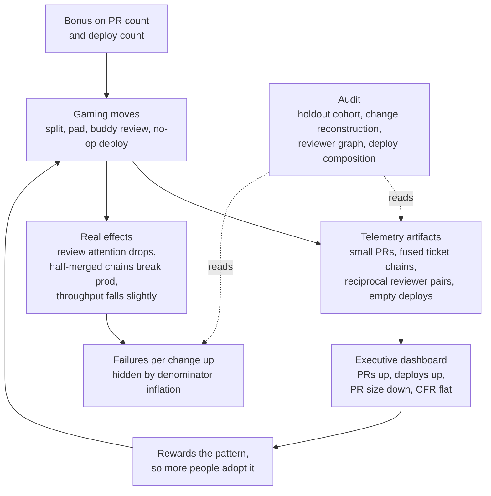

# Drill: Audit a Gamed Developer Productivity Dashboard

> [!summary] Claim:
> A bonus tied to PR count and deployment count turns both counts into cheap outputs: split one change into several PRs, pad with formatting-only PRs, trade approvals with a buddy, and redeploy no-ops.
> The dashboard then reads as an elite organization (PRs up 2x, deploys up 2.2x, median PR size down 60 percent, change fail rate flat) while delivered changes fall and failures per delivered change roughly double.
> Change fail rate stays flat because it is a ratio and the gamed deploys inflate its denominator, so the audit starts by reconstructing the true unit of work and comparing against a cohort that was never paid on the counts.
> The fix is not a smarter single metric: stop paying on counts, pair every activity metric with a counter-metric, measure at team level across several SPACE dimensions, and keep the metrics diagnostic.

This drill owns the audit procedure and its evidence.
The metric definitions, the DORA model, SPACE, and Goals-Signals-Metrics are owned by [[Developer-Productivity-Metrics-DORA-SPACE-and-GSM]].
Change size, review latency, and readability systems are owned by [[Code-Review-and-Readability-Systems-at-Scale]].
Test and build latency economics are owned by [[Build-and-Test-Latency-Economics-and-Flaky-Tests]].
A different telemetry failure, queue throughput collapse, is the sibling drill [[Drill-Engineering-Systems-Diagnose-CI-Merge-Queue-Collapse]].



## Reproduction

The lab is a seeded simulator plus an auditor that sees only warehouse-shaped fields.
It needs only `python3` (standard library, no network), runs in seconds, and prints deterministic output for a fixed seed.

```bash
cd code
python3 -m _harness.verify 09-Engineering-Systems-at-Scale/drill_gamed_dashboard/
# or run the entry point directly
bash 09-Engineering-Systems-at-Scale/drill_gamed_dashboard/run.sh
```

Lab path: `code/09-Engineering-Systems-at-Scale/drill_gamed_dashboard/` (`run.sh`, `dashboard_audit.py`, `expected/darwin-arm64.txt`).
`run.sh` pins `LC_ALL=C` and `PYTHONHASHSEED=0` and runs the script with `python3 -I`, so nothing in the current directory can shadow a standard-library module.
The output shown in this note was recorded on darwin-arm64 with Python 3.15.2 (as of 2026-11).

### The synthetic world and what it can and cannot prove

Every behavior and every rate is an assumption written in the constants block of `dashboard_audit.py`.
None of them is a measurement of a real organization, and no number in this note should be read as an industry statistic.
The point of a simulator is that ground truth exists: the auditor sees stripped telemetry, and the lab scores it against the truth.

| Assumption (constant) | Value | Meaning |
| :--- | :--- | :--- |
| `N_ENG`, `N_BONUS` | 40, 30 | 30 engineers are paid on counts from week 13, 10 form the holdout |
| `WEEKS`, `POLICY_WEEK`, `RAMP_WEEKS` | 24, 13, 4 | gaming ramps linearly over four weeks after the policy |
| `ABSTAIN` | 0.15 | share of the bonus cohort that refuses to game |
| `TICKET_OVERHEAD` | 0.08 | true throughput lost at full gaming intensity (rebases, review load) |
| `PAD_PROB` | 0.20 | per change, chance of an extra formatting-only PR, times intensity |
| `TICKET_SPLIT` | 0.30 | chance a later fragment gets its own ticket key, times intensity |
| `BUDDY_PROB` | 0.50 | chance a PR goes to the pre-agreed buddy reviewer, times intensity |
| `NOOP_PROB` | 0.10 | per PR, chance of an extra no-op redeploy, times intensity |
| `INTEG_FAIL` | 0.10 | chance an intermediate chain state breaks production, per chain boundary |
| `REVIEW_CAP` | 120 min per week | reviewer capacity; attention falls toward `ATT_FLOOR` 0.25 when overloaded |
| `ESCAPE_BASE` | 0.5 | a latent defect escapes review with probability 1 minus 0.5 times attention |

Three controls make the lab falsifiable instead of decorative.
- The holdout cohort goes through the same detectors in the same weeks and must stay quiet, which controls for anything that changed company-wide.
- A null world, the same seed with no incentive, goes through the same detectors and must stay quiet, which controls for detector false positives on this telemetry.
- Fields prefixed `truth_` exist only inside the simulator and `strip()` removes them before any detector runs, so a detector cannot cheat by reading the answer.

Limits that cap what the lab can claim:
- One seed, 40 engineers, point estimates, no confidence intervals.
- Thresholds in the detectors (the `F1` to `F8` bars) were fixed before the recorded run and were not tuned afterwards; one of them fails its bar and is reported as such in the Model Solution.
- Real warehouses lack some fields the lab assumes, in particular `review_min`, a reviewer attention signal; the section on real telemetry says what stands in for it.

## Observed Symptom

Leadership tied bonuses to PRs per engineer and deployments per engineer from week 13.
This is the executive view of the bonus cohort, as the dashboard shows it (darwin-arm64, synthetic data):

```text
== 1. What the executive dashboard shows (bonus cohort, 4-week blocks) ==
weeks    PRs/eng-wk  deploys/eng-wk  change-fail-rate%  median-PR-lines
 1-4           2.12            2.33                8.6              171
 5-8           2.20            2.39                8.0              185
 9-12          2.11            2.28                7.7              179
13-16          3.48            3.98                7.3               93
17-20          4.90            5.66                8.1               64
21-24          4.72            5.53                7.5               66
```

Read at face value this is a success story, and each column matches a standard reading of good news.
- PRs per engineer-week rose from about 2.1 to about 4.7.
- Deployments per engineer-week rose from about 2.3 to about 5.5, which a naive deployment-frequency chart scores as a leap in delivery performance.
- Median PR size fell from about 180 lines to about 65, which matches the small-change guidance in the literature (Software Engineering at Google, Chapter 9, calls changes of about 200 lines "small").
- Change fail rate did not move: 8.6, 8.0, 7.7 before the policy and 7.3, 8.1, 7.5 after.

The complaints that do not appear on the dashboard are the real symptoms.
- Reviewers say PRs arrive in fragments that cannot be understood alone.
- On-call sees incidents traced to half-landed sequences.
- The holdout team, paid on nothing, shipped about the same as before.

The brief for this drill is therefore twofold: explain why a healthy-looking dashboard is wrong, and design a measurement system that does not reward this.
A note on the premise: it is tempting to expect a surging change fail rate on the dashboard.
In this world it does not surge, and the reason is the first thing the audit must find.

## Progressive Hint Ladder

> [!tip]- Hint 1: use the control group
> Do not compare the bonus cohort with itself before and after.
> Compare each pre-to-post change with the same change in the 10 engineers who were never paid on counts.
> If the holdout moved too, the cause is company-wide (a release train change, a holiday, a reorg), not the incentive.

> [!tip]- Hint 2: look at the denominator
> Change fail rate is failed deployments divided by deployments.
> Compute failures per engineer-week and failures per delivered change instead.
> Ask what each deployment now contains, and whether a deployment is still the unit that DORA defines it to be.

> [!tip]- Hint 3: reconstruct the unit of work
> A PR is not a change, and a ticket key is not a change either.
> Group PRs by author, by code area, and by time gap into chains, and count chains.
> Compare the chain count with the ticket-key count to see which one gamers can manipulate cheaply.

> [!tip]- Hint 4: draw the reviewer graph
> Count how often each author's PRs are reviewed by each reviewer.
> Look for pairs where both directions are heavy, then look at what those approvals contain: comments, time, and size of the diff.
> Be careful with the baseline: at a healthy organization, many approvals legitimately have no comments.

> [!tip]- Hint 5: classify the deployments
> Split deployments into those that carry a substantive diff, those that carry none, and hotfixes.
> A deployment that changes nothing still counts as a deployment on a naive chart.

> [!tip]- Hint 6: test whether the bonus score still means anything
> Rank the 30 engineers by bonus score (PRs plus deployments) and by true changes delivered, using the simulator's ground truth, before and after the policy.
> A score that stops ranking people by what it was meant to measure has stopped measuring it.

> [!tip]- Hint 7: design the replacement without repeating the mistake
> Any single replacement number becomes the next target.
> Decide what you will pay on (likely nothing at the individual level), what you will only watch, and what counter-metric stands next to each watched activity number.
> Use Goals, Signals, Metrics to write down why each metric exists before choosing it.

## Model Solution

> [!success]- Solution
> **Step 1. Establish the effect with a control.**
> The paired pre/post table with the holdout as control (weeks 1-12 vs 13-24, darwin-arm64, synthetic) shows the bonus cohort moving and the holdout staying put:
>
> ```text
> metric                             bonus pre bonus pst  hold pre  hold pst       DiD
> PRs per engineer-week                   2.14      4.37      2.11      2.17     +2.16
> median lines per PR                      177        71       174       198   -130.00
> deploys per engineer-week               2.33      5.05      2.30      2.39     +2.63
> dashboard change fail rate %             8.1       7.7       8.3       9.1     -1.12
> empty-diff deploys %                     0.0      11.3       0.0       0.0    +11.32
> comments per 100 substantive lines      4.31      3.67      4.37      4.23     -0.50
> rubber-stamp approvals %                 0.0      27.8       0.0       0.0    +27.80
> approval-ring PRs %                      0.0      33.1       0.0       0.0    +33.08
> PRs per ticket key                      1.00      1.77      1.00      1.00     +0.77
> PRs per reconstructed chain             1.09      2.34      1.09      1.08     +1.25
> failed deploys per 100 changes           9.6      20.8       9.9      10.8    +10.34
> ```
>
> "DiD" is difference-in-differences: the bonus cohort's change minus the holdout's change.
> The holdout drifted a little (median PR lines 174 to 198, dashboard CFR 8.3 to 9.1), which is exactly why the subtraction is needed and why a 10-engineer control is noisy.
>
> **Step 2. Explain the flat change fail rate.**
> CFR is failed deployments over deployments.
> Deployments per reconstructed change rose from 1.18 to 2.71, a factor of 2.3.
> Failed deployments per 100 reconstructed changes rose from 9.6 to 20.8, a factor of 2.2.
> Both numerator and denominator grew by about the same factor, so the ratio (8.1 percent, then 7.7 percent) did not move.
> Failures per engineer-week, from the rounded table values, went from about 0.19 (8.1 percent of 2.33) to about 0.39 (7.7 percent of 5.05).
> The failures are real and doubled per change; the ratio was diluted by deployments that exist to be counted (11.3 percent of post-policy deployments had an empty diff).
>
> **Step 3. Reconstruct the unit of work.**
> The auditor groups PRs of one author, in one code area, opened within 12 hours of the previous one into a chain (`CHAIN_GAP_H`), and counts chains.
> The simulator knows the true number of changes, so reconstruction can be scored:
>
> ```text
> == 4. Reconstruction accuracy (ground truth exists only inside the simulator) ==
> pre : true changes 772, reconstructed chains 710 (-8.0%), ticket keys 772 (+0.0%), failures per 100 true changes 8.8
> post: true changes 715, reconstructed chains 672 (-6.0%), ticket keys 886 (+23.9%), failures per 100 true changes 19.6
> ```
>
> Two lessons are in these lines.
> The chain rule undercounts changes by 6 to 8 percent because it sometimes fuses two distinct changes by the same author in the same area within 12 hours, so every per-change metric built on it carries a known upward bias of that size.
> Ticket keys are exact before the policy (+0.0 percent) and overcount by 23.9 percent after, because gamers give some fragments their own ticket (`TICKET_SPLIT`), so a ticket key is itself gameable once the incentive exists.
> True throughput fell about 7 percent (772 to 715 true changes, weeks 1-12 vs 13-24; the model assumes 8 percent overhead at full gaming) while measured PR throughput doubled.
>
> **Step 4. Detect the review pathologies, and respect a detector that fails.**
> Two detectors need the reviewer graph.
> A rubber stamp is a zero-comment approval within 3 minutes on a PR with at least 20 substantive lines.
> A ring PR is one whose author and reviewer are each other's heavy reviewer (at least 5 PRs and at least 25 percent of the author's PRs, in both directions).
> Zero-comment approvals are the norm in a healthy organization (the Google study reports that the majority of changes are small, have one reviewer, and have no comments other than the authorization to commit), so the signal is the change from the pre-policy baseline and from the holdout, not the raw rate.
> The detector verdicts are:
>
> ```text
> == 3. Detector verdicts (FLAG = pathology present) ==
> detector                                         gamed bonus gamed hold  null
> F1 median PR size collapsed (<0.6x)              FLAG        ok          ok
> F2 PRs per reconstructed chain (>=1.5x)          FLAG        ok          ok
> F3 comments per 100 lines (<0.8x)                ok          ok          ok
> F4 rubber-stamp share (+10 points)               FLAG        ok          ok
> F5 approval ring share (>=5%, +5 points)         FLAG        ok          ok
> F6 failures per 100 changes (>=1.5x)             FLAG        ok          ok
> F7 deploys per change (>=1.5x), empty +5         FLAG        ok          ok
> F8 activity up 1.5x while failures worse 1.2x    FLAG        ok          ok
>
> F3 note: bonus comments per 100 lines post/pre = 0.85, holdout = 0.97 (bar is 0.80); outside the ring the bonus cohort goes 4.31 -> 5.05
> ```
>
> F3, mean comment density, did not fire: it fell 15 percent against a 20 percent bar.
> The cause, measured in the last line, is that the ring removes load from honest reviewers, so their comment density outside the ring rose from 4.31 to 5.05 per 100 lines while the ring PRs got none.
> The average of the two hides a collapse in one subpopulation.
> The lab does not retune F3 to make it fire; a dashboard that tracked only mean comment density would have reported stable review quality, and the lesson is to look at the distribution and the graph, not the mean.
> The model assumes this load-shedding mechanism; the output shows it is consistent with the data but does not show real reviewers behave this way.
>
> **Step 5. Show the bonus score stopped measuring contribution.**
>
> ```text
> == 5. Metric validity: does a per-engineer score track delivered changes? (bonus cohort, Spearman) ==
> pre : bonus score (PRs + deploys) +0.99, reconstructed changes +0.97 (both vs true changes delivered)
> post: bonus score (PRs + deploys) +0.79, reconstructed changes +0.93 (both vs true changes delivered)
> ```
>
> Before the policy, counting PRs plus deployments ranked engineers almost exactly as true changes delivered (Spearman 0.99).
> After it, the rank correlation fell to 0.79 because the score now also measures willingness and skill at gaming.
> The reconstructed-change count held up (0.93), which is the reason to normalize by the reconstructed unit, but it is itself an audit tool and would be gamed (for example by merging unrelated work into one PR) if it became a target.
>
> **Step 6. Resolve: change the incentive, then the measurement system.**
> 1. Stop paying on PR and deployment counts now, in writing, before any other change.
> The measurement defect cannot be repaired while the payoff still rewards it.
> 2. Treat the audit result as a diagnosis of the incentive, not of individuals: 15 percent of the cohort abstained in the model, and the rest responded to a rational signal.
> 3. Rebuild the dashboard as a scorecard where every activity metric stands next to a counter-metric (section 6 of the lab output):
>
> ```text
> == 6. Outcome-first scorecard, bonus cohort (each activity metric beside its counter-metric) ==
> metric                                           pre      post
> PRs per engineer-week (activity)                2.14      4.37
> PRs per reconstructed change                    1.09      2.34
> deploys per engineer-week (activity)            2.33      5.05
> deploys per reconstructed change                1.18      2.71
> dashboard change fail rate %                     8.1       7.7
> failed deploys per 100 reconstructed changes       9.6      20.8
> reconstructed changes per engineer-week         1.97      1.87
> comments per 100 lines, all PRs                 4.31      3.67
> comments per 100 lines, outside the ring        4.31      5.05
> ```
>
> 4. Write the goals with Goals, Signals, Metrics and choose metrics from several dimensions (see Re-Architecting the Measurement System).
> 5. Report at team level, keep individual numbers out of performance reviews, and keep a standing holdout or audit sample so the next gaming attempt is visible.
> 6. Re-run the null-world test on every new detector: a detector that fires on a world with no incentive is not evidence.

## Core Takeaway

A metric that is paid on stops being a measurement; it becomes a behavior to optimize.
The audit works by reconstructing the true unit of work, using a never-paid cohort as control, and reading ratios together with their denominators.
The durable design rule is to pair every activity metric with a counter-metric and to keep metrics diagnostic rather than evaluative.
The owning concept note is [[Developer-Productivity-Metrics-DORA-SPACE-and-GSM]]; this drill is the worked audit that applies it.

## Goodhart Pathologies, Named and Mapped

The incentive loop is a standard result with a long literature, and naming the variant tells you what remedy can work.

| Source | Statement (paraphrased unless quoted) | Applies here as |
| :--- | :--- | :--- |
| Goodhart 1975 (Reserve Bank of Australia papers) | An observed statistical regularity tends to collapse once pressure is put on it for control purposes | PRs per engineer correlated with delivered work (rank correlation 0.99) until it was paid on |
| Strathern 1997 (European Review 5(3), 305-321) | "When a measure becomes a target, it ceases to be a good measure" | the common phrasing; Strathern writes it in her own voice and credits Keith Hoskin (1996) with calling it "Goodhart's law", and Hoskin's own wording is "every measure which becomes a target becomes a bad measure" (both texts read: the Internet Archive copy of Strathern and the Hoskin chapter PDF) |
| Campbell 1979 (Evaluation and Program Planning 2(1), 67-90) | the more a quantitative indicator is used for social decision-making, the more it is subject to corruption pressure and the more it distorts the processes it monitors | review approvals become a currency for buddy pairs |
| Holmstrom and Milgrom 1991 (JLEO 7, 24-52) | multitask principal-agent model: paying on a measurable task redirects effort from tasks that are not measured | reviewing carefully and designing well are unmeasured tasks; paying on PR count diverts effort from them. The paper's own framing: with several tasks, incentive pay "serves to direct the allocation of the agents' attention among their various duties", and piece rates on easy-to-measure volume may lead agents to raise volume at the expense of quality; the result is conditional on the tasks being substitutes in the agent's cost, since complementary tasks reverse the effect (Section 1 and the teacher example, equation 7; JSTOR copy read) |
| Software Engineering at Google, Chapter 7, footnote on performance reviews | warns that if productivity metrics feed performance reviews, engineers will be quick to game them | the policy in this drill is exactly that |

Manheim and Garrabrant (arXiv:1803.04585, 2018) split Goodhart's law into four variants, which matter because the audit finding differs for each.

| Variant | Mechanism (as the paper defines it, paraphrased) | Evidence in this drill |
| :--- | :--- | :--- |
| Regressional | selecting on a noisy proxy also selects for its noise | not exercised: the lab does not rank-select on a noisy score |
| Extremal | optimization pushes the system into a region where the old proxy-goal relation fails | PR size pushed to 65 lines, where fixed per-PR costs dominate and chains span states that cannot ship alone |
| Causal | the intervention changes the causal structure so the proxy stops tracking the goal | counts used to follow work delivered; after the bonus they follow willingness to split |
| Adversarial | an agent with goals different from the regulator's causes the collapse | the buddy ring, no-op deploys, and padding PRs; this is the dominant variant here |

The practical consequence is that adversarial gaming cannot be fixed by finding a harder-to-fool proxy and paying on it: the agent adapts to the new proxy.
The countermeasures are to remove the payoff on any single proxy, to rotate and conceal audit signals, and to keep an unpaid control.
This is a statement about incentive structure, not a result proven by the lab.

## Real Telemetry: Where Each Fingerprint Lives

The lab's fields are chosen to correspond to what a source-control and deployment warehouse can hold.
The following maps the GitHub REST API fields, as documented for API version 2022-11-28 (as of 2026-11, Both), to the lab's columns.
The same docs pages now show `X-GitHub-Api-Version: 2026-03-10` in their examples, so pin the version your warehouse ingests.

| Lab field | Real source | Caveat |
| :--- | :--- | :--- |
| `lines`, `subst` | PR `additions`, `deletions`, `changed_files` | substantive lines require filtering generated files, vendored code, and whitespace-only diffs; the lab uses `subst` to hold that filtered count |
| `open_h`, `week` | PR `created_at`, `merged_at` | use created time for chains; merge time reflects queue delay |
| `comments` | PR `review_comments` (inline review comments), review bodies | an approval with a short comment still counts as engagement; define "no comments" per organization |
| `reviewer` | pull request reviews, with `user`, `state`, `submitted_at` | the docs list `APPROVE`, `REQUEST_CHANGES`, and `COMMENT` as the `event` values when a review is submitted; the REST page types a stored review's `state` as a plain string with no enum; the GraphQL `PullRequestReviewState` enum is `PENDING`, `COMMENTED`, `APPROVED`, `CHANGES_REQUESTED`, `DISMISSED` (schema introspection, as of 2026-11), so check REST payloads against it before hard-coding |
| `review_min` | no direct equivalent | the closest stand-ins are time from review request to approval and review-tool interaction telemetry |
| `kind`, `failed`, `subst` of deploys | Deployments API and deployment statuses | status `state` values include `error`, `failure`, `inactive`, `pending`, `success`, `queued`, `in_progress` |
| `ticket` | commit and PR title conventions, issue linkage | gameable once the incentive exists, as the lab shows |

Operational details that bite:
- Deployment statuses are retained by GitHub for 90 days, after which they are no longer returned by the REST or GraphQL API (per the statuses documentation's Data retention section, as of 2026-11), so an audit that needs a year of history must have been archiving to a warehouse all along.
- The `review_min` field does not exist in GitHub data; the Google study built a comparable signal by grouping review-tool interactions into sessions with no more than 10 minutes between interactions, and found an average of 3.2 hours per week spent reviewing (median 2.6) in its 2018 sample.
- The "hotfix" and "no-op" labels in the lab are given to the auditor; in production you infer them from branch naming, revert commits, artifact digests that equal the previous deployment, and incident links.
- The Four Keys project defined change failure rate as "the number of failures per the number of deployments" and shipped dashboard colour bands that roughly follow the 2019 State of DevOps elite, high, medium, and low ranges (README); the repository was archived on 2024-01-23 and is not maintained, so use it as a reference definition rather than a dependency.

The DORA guide (last updated 2026-01-05) now describes a five-metric model: throughput is change lead time, deployment frequency, and failed deployment recovery time; instability is change fail rate and deployment rework rate.
It defines change fail rate as the ratio of deployments that need immediate intervention afterward, often a rollback or hotfix.
That definition has deployments in the denominator, which is exactly the hole this drill exploits.
Its own "Common pitfalls" section warns about setting metrics as a goal, because that invites gaming, and about comparing disparate teams, because the metrics are meant to apply per application or service.

## Detector Design and Its Limits

A detector here is a threshold on a pre/post ratio or difference, applied the same way to the bonus cohort, the holdout, and a null world.

| Detector | Signal | Failure mode in a real warehouse |
| :--- | :--- | :--- |
| F1 PR size | median lines per PR falls below 0.6x | a healthy move to small changes triggers it; use only with F2 and F6 |
| F2 PRs per chain | PRs per reconstructed chain up 1.5x | stacked-PR workflows legitimately raise it; separate stacks by tool metadata |
| F3 comment density | below 0.8x | diluted by load-shedding, as measured; weak alone |
| F4 rubber stamp | zero comments, 3-minute approval, at least 20 substantive lines | baseline is org-specific; compare to pre-policy and holdout |
| F5 ring | reciprocal heavy reviewer pair | small teams of 3 or 4 engineers form heavy pairs by default; require a minimum count and share |
| F6 failures per change | per reconstructed change, 1.5x | needs reliable incident linkage; sparse linkage undercounts |
| F7 deploys per change | 1.5x and empty-diff share up 5 points | monorepo deploy-all pipelines produce many deploys per change for benign reasons |
| F8 activity vs failures | activity up 1.5x while failures per change worsen 1.2x | the conjunction is the strongest single claim, but it depends on F6 |

Statistical care that the lab does not perform and a real audit must:
- Put intervals on every estimate; resample engineers, not rows, because PRs by one engineer are correlated (a cluster bootstrap).
- Do not let the thresholds be fitted on the data you then report; split the history, or fix thresholds before looking, as the lab does.
- Check the parallel-trends assumption behind difference-in-differences (the canonical applied example is Card and Krueger 1994, who compared New Jersey with Pennsylvania around a minimum wage change): the holdout must have moved like the bonus cohort before the policy.
- Watch spillover: honest engineers reviewing gamers' PRs are in the holdout's population too, and the lab's holdout reviewers are only other holdout members, which makes the control cleaner than reality.
- Expect the holdout to drift: in this lab, holdout median PR lines moved from 174 to 198 with no incentive, which is the noise floor for a 10-engineer control.

## Re-Architecting the Measurement System

Goals, Signals, Metrics (Software Engineering at Google, Chapter 7) defines a goal as a desired end result, a signal as how you would know you achieved it, and a metric as a proxy for a signal; the chapter stresses that the metric is not the signal.
Its five axes for engineering productivity, QUANTS, are quality of the code, attention from engineers, intellectual complexity, tempo and velocity, and satisfaction.
The SPACE paper (Forsgren et al., ACM Queue 19(1), 2021) argues that productivity cannot be measured by a single metric or dimension; this is verified from the abstract on the Microsoft Research page.
The five SPACE dimensions, in the article's own list, are satisfaction and well-being, performance, activity, communication and collaboration, and efficiency and flow.
Its advice on coverage is that "a good measure of productivity consists of a handful of metrics across at least three dimensions", and that at least one of the metrics should be perceptual (survey-based).
Both statements were read in a full-text copy of the ACM Queue article (January-February 2021; the perceptual-measure advice is on p. 17 and the three-dimension advice on p. 19 of that issue), because the queue.acm.org and dl.acm.org pages return HTTP 403 to automated fetches (as of 2026-11).
The audit here follows the advice: the scorecard pairs telemetry activity metrics with a survey signal and a quality counter-metric, so it spans more than three dimensions.

A redesigned scorecard for this organization, written as GSM with a counter-metric for each activity number:

| Goal | Signal | Metric (diagnostic) | Counter-metric | Dimension | Gaming risk if targeted |
| :--- | :--- | :--- | :--- | :--- | :--- |
| Ship valuable changes quickly and safely | changes reach users with few failures | reconstructed changes per team-week, change lead time | failed deploys per 100 changes, rework rate | Performance, Activity | merging unrelated work into big PRs |
| Keep review meaningful | defects are caught in review, reviewers are not overloaded | review latency, reviewer load distribution | comment density outside the top reviewer pairs, escaped defects | Communication | fast shallow approvals |
| Keep delivery sustainable | engineers can work without heroics | developer survey on flow and friction | on-call pages per engineer, hotfix share | Satisfaction, Efficiency | survey fatigue and pressure to answer well |
| Reduce friction | builds and tests are not the bottleneck | build and test latency, flaky-test rate | quarantine backlog age | Efficiency | hiding flakes by retry |

Rules that make the redesign hold:
- Do not pay on any of these at the individual level; use them to find where to help.
- Report per team or service, as the DORA guide advises (metrics apply per application or service), and do not rank teams against each other.
- Define a deployment so no-ops do not count: a deployment carries at least one commit not yet in production, which matches DORA's lead-time definition of commit to production.
- Count the unit of work by reconstructed change or by shipped feature flag, not by PR or ticket.
- Pair each activity metric with a counter-metric and review them together; DORA's own pitfalls list says one metric to rule them all fails and that some metrics should be in tension.
- Keep an unpaid holdout, or a rotating random audit sample, so an incentive change is visible as an experiment.
- Add the qualitative side: Chapter 7 states that "qualitative metrics are metrics, too", and DX Core 4 recommends diffs per engineer only with a counterbalancing experience index, no targets or rewards attached, and careful rollout.
  That recommendation is verified from the DX page (as of 2026-11); the DX framework's four dimensions are speed, effectiveness, quality, and business impact.

A lines-of-code anecdote shows the same incentive failure in 1982: Lisa managers asked engineers to report lines written each week, and Bill Atkinson, who had just made region operations nearly six times faster by removing about 2,000 lines, reported minus 2000 (Hertzfeld, Folklore.org).
It is a story told by a participant, not a dataset, and is cited for the incentive pattern only.

## Rollout of the Fix

Dates are relative to the decision.
1. Day 0: announce in writing that PR and deployment counts no longer feed bonuses or reviews.
2. Days 1 to 14: run the audit on archived data (mind the 90-day deployment status retention), keep the report to team level, and brief managers on the diagnosis, not the culprits.
3. Days 15 to 45: run the new scorecard in shadow mode beside the old dashboard, with the old counts demoted to a labelled activity panel.
4. Days 46 to 90: retire the old dashboard, publish the metric dictionary (definition, source, counter-metric, gaming risk), and schedule a quarterly audit with a fresh holdout.
5. Standing rule: any metric proposed as a target must come with a gaming analysis written by someone who benefits from the target.

Decision rules:
- If a metric is used for pay or promotion, expect it to be gamed; do not use it as a diagnostic at the same time.
- If a ratio changes while its denominator changes more than 20 percent, report numerator and denominator separately before concluding anything.
- If a detector fires on the null world, fix the detector before using it on live data.
- If the holdout moved with the treated group, the cause is not the incentive.

## Numbers to Know

All numbers are stamped; "paper" figures are the cited study's own sample, not current industry values.

| Quantity | Value | Source and platform |
| :--- | :--- | :--- |
| Google median change size, lines modified | 24 | Sadowski et al., ICSE-SEIP 2018, 9 million reviewed changes (paper, 2018 data) |
| Google changes that modify one file; one line | over 35 percent; over 10 percent | same |
| Google changes with more than one reviewer | fewer than 25 percent; median reviewer count 1 | same |
| Google median first-feedback wait | under 1 hour for small changes, about 5 hours for very large ones; overall review latency median under 4 hours | same |
| Google changes per author per week | median about 3; 80 percent of authors under 7 | same |
| Comments peak | 12.5 per change at about 1250 lines | same |
| Guideline for a "small" change | about 200 lines | Software Engineering at Google, Chapter 9 |
| DORA metric set | five metrics: change lead time, deployment frequency, failed deployment recovery time, change fail rate, deployment rework rate | dora.dev guide, updated 2026-01-05 |
| Lab: PRs per engineer-week, bonus cohort | 2.14 pre, 4.37 post | synthetic, darwin-arm64, 2026-11 |
| Lab: failed deploys per 100 changes | 9.6 pre, 20.8 post (holdout 9.9, 10.8) | synthetic, darwin-arm64, 2026-11 |
| Lab: rank correlation, bonus score vs true changes | 0.99 pre, 0.79 post | synthetic, darwin-arm64, 2026-11 |
| GitHub deployment status retention | 90 days | GitHub REST docs, 2026-11, Both |

The baseline numbers matter for the audit: the Google study's median of 24 lines per change means that a median of 65 lines per PR is not extreme by itself.
Size alone proves nothing; what the lab's PR sizes prove is the change from the same engineers' baseline, relative to a holdout.

> [!warning] Pitfalls:
> - **Reading CFR alone.** A ratio hides a denominator change; always show failures per engineer-week and per change beside it.
> - **Treating tickets or PRs as the unit of work.** Both are gameable once there is an incentive; the lab's ticket keys overcount by 23.9 percent after the policy.
> - **Absolute rubber-stamp thresholds.** Zero-comment fast approvals are normal in healthy review cultures; compare to baseline and holdout.
> - **Hunting individuals.** The signal at 30 engineers is a cohort effect; naming people from point estimates invites false accusations and a second round of gaming.
> - **Replacing one target with another.** If "reconstructed changes per engineer" becomes the bonus, the next gaming move (merge unrelated work) is already obvious.
> - **No control group.** Without a holdout or a null test you cannot separate the incentive from a company-wide change.
> - **Fitting thresholds on the data you report.** Thresholds chosen after the plot make every detector look good, and a detector that fits the sample fails on the next one.
> - **Trusting the Four Keys dashboard colours.** The bands are a reference project's, the project is archived, and DORA does not publish tiers on the current guide page.
> - **Bots and automation.** Dependency bots and codemod campaigns create PRs and deployments that are not human work; filter them before any per-engineer metric.
> - **Losing history.** Deployment statuses are retained 90 days; an audit that arrives late finds nothing to audit.
> - **Using the metric both ways.** A number cannot be diagnostic and a performance target at the same time.

## At Scale

The audit is cheap at 40 engineers and different at 4,000 or 40,000.

- **Data volume.** Tens of thousands of PRs per week are fine for a warehouse; the cost is identity resolution (one human, several accounts, bots) and mapping PRs to code areas, which needs CODEOWNERS or path-to-team data.
- **Unit of work across tools.** Monorepo change lists, polyrepo PRs, and stacked PRs each have a different notion of "one change"; define the chain rule per toolchain and validate it on a hand-labelled sample.
- **Unit of analysis.** Report by team or service.
  With fewer than about 10 engineers per group the confidence interval swallows most effects, and individual reporting becomes a privacy and fairness problem.
  Check with legal counsel and employee-representation requirements before any individual-level analysis; this note does not state any jurisdiction's rules.
- **Holdouts at scale.** A permanent random holdout of 5 to 10 percent of teams, never paid on activity, is cheap and gives a standing control; rotate it so the holdout does not become a known quantity.
- **Incentive owners.** Metric changes should go through the same review as a production change: a dictionary entry, an owner, a gaming analysis, and a rollback.
- **Merge queues and CI.** Counting deploys from a merge queue that batches can change the deploys-per-change ratio for benign reasons; see [[Drill-Engineering-Systems-Diagnose-CI-Merge-Queue-Collapse]] for queue behavior.
- **AI-assisted authoring.** Agent-generated PRs raise PR counts without a human unit of work.
  See [[AI-Coding-Agents-Sandboxes-Worktrees-and-Ship-Gates]] for gating and attribution and [[Multi-Agent-Supervision-and-Quota-Aware-Routing]] for supervising fleets.
  Whether any given organization's counts are inflated by agents is an empirical question this note does not answer.

> [!tip] Practice Drill:
> Run the lab, then change one assumption and predict the effect before re-running: set `BUDDY_PROB` to 0 and name which detectors should stop firing and which should not (F5 and F4 should lose their signal; F2 and F7 should keep theirs).
> Then add a fifth cohort behavior of your own, such as merging unrelated work into large PRs, and design a detector that catches it without firing on the null world.
> Finally, write the metric dictionary entry for "reconstructed changes per team-week", including its best gaming move.

## Interview Questions

### L5

> [!question] 1. State Goodhart's law and give two ways it shows up when PR count is paid on.
> [!success]- Answer
> A measure used as a target stops tracking what it measured (Goodhart 1975: a statistical regularity collapses under control pressure; Strathern 1997 gives the "ceases to be a good measure" phrasing).
> PR count: split one change into several PRs, and add formatting-only PRs.
> It also pays for buddy approvals, because review is the cheapest way to pass the gate, and for no-op deploys if deployments are counted too.

> [!question] 2. Predict the output.
> ```python
> per100 = {"pre": (118, 9.6), "post": (271, 20.8)}  # (deploys, failed deploys) per 100 changes
> for k, (d, f) in per100.items():
>     print(k, round(100 * f / d, 1), round(f, 1))
> ```
> [!success]- Answer
> The script prints `pre 8.1 9.6` then `post 7.7 20.8`; the first number is the change fail rate and the second the failures per 100 changes.
> I ran it here (Python 3.15.2, macOS) and it prints exactly that.
> The values come from the lab's rounded scorecard (1.18 and 2.71 deploys per change).
> The point: the rate fell slightly while failures per change doubled.

> [!question] 3. Debug this: with the data below, the dashboard query shows `ana 3` although ana opened 2 PRs. Find the bug.
> ```sql
> -- prs: (1, ana), (2, ana), (3, bo)
> -- reviews (pr_id, reviewer, state): (1, bo, COMMENTED), (1, bo, APPROVED), (1, cy, APPROVED), (3, ana, APPROVED)
> SELECT p.author, COUNT(*) AS prs
> FROM prs p JOIN reviews r ON r.pr_id = p.id
> GROUP BY p.author;
> ```
> [!success]- Answer
> The join fans out: PR 1 has three review rows, so it is counted three times.
> The inner join also drops PR 2, which has no review rows, so the unreviewed PR is invisible to the count.
> Use `COUNT(DISTINCT p.id)` with a `LEFT JOIN`, which returns `ana 2` and `bo 1` on the same data.
> I ran both queries with sqlite3 3.54.0 and got `ana|3, bo|1` from the buggy form and `ana|2, bo|1` from the fixed form.
> This is a realistic way for a dashboard to over-count, independent of any gaming.

### L6

> [!question] 4. Why can the dashboard change fail rate stay flat while production gets worse?
> [!success]- Answer
> CFR is failed deployments divided by deployments.
> If gaming multiplies deployments per change (here from 1.18 to 2.71) and failures per change rise by about the same factor (9.6 to 20.8), the ratio does not move (8.1 to 7.7).
> Always report failures per engineer-week or per reconstructed change next to the rate, and classify deployments by whether they carry a diff.
> DORA defines the rate with deployments in the denominator, so the definition is vulnerable by construction.

> [!question] 5. How would you reconstruct "one change" from PR telemetry, and how could the reconstruction be wrong?
> [!success]- Answer
> Group PRs by author and code area when the next PR opens within a time gap of the previous (the lab uses 12 hours).
> Errors are of two kinds: fusing distinct changes (the lab undercounts changes by 6 to 8 percent, a bias that inflates per-change metrics slightly) and splitting a real change that spans a long gap or several areas.
> Validate on a hand-labelled sample, state the bias direction, and prefer relative comparisons against a baseline so the bias cancels.
> Do not use ticket keys alone: they are exact before an incentive and overcount by 23.9 percent after it in the lab.

> [!question] 6. How do you design the comparison, and what assumptions can break it?
> [!success]- Answer
> Difference-in-differences with a never-paid holdout: the bonus cohort's pre-to-post change minus the holdout's.
> It assumes parallel pre-policy trends, no spillover (reviewers shared between cohorts break it), and a holdout large enough to estimate the noise floor (10 engineers drifted noticeably in the lab, median PR lines 174 to 198).
> Add intervals by resampling engineers, and run the detectors on a null world to show they stay quiet.

### L7

> [!question] 7. The VP wants one new number to replace PR count. What do you propose?
> [!success]- Answer
> Not a number, a scorecard of GSM-derived metrics with counter-metrics, reported per team, not paid on.
> Explain the adversarial Goodhart variant: any single proxy that is paid on gets adapted to.
> If a throughput number is needed, use reconstructed changes (rank correlation 0.93 post-policy in the lab versus 0.79 for the bonus score) as a diagnostic, document its best gaming move (merge unrelated work), and keep it out of compensation.

> [!question] 8. A director says the leaderboard motivates people and must stay. How do you respond?
> [!success]- Answer
> Separate two uses: showing activity to the team that owns it (diagnostic, harmless if not ranked) and ranking people with consequences (evaluative, invites gaming).
> Point at the evidence class: the Software Engineering at Google chapter warns that metrics used for performance reviews get gamed, and DORA's pitfalls list includes setting metrics as a goal and competing with other teams.
> Offer an alternative that keeps the motivation: team-level trends the team owns, plus recognition for outcomes such as retired toil or reduced incident rate.

### L8+

> [!question] 9. Design the governance so this does not recur across 10,000 engineers.
> [!success]- Answer
> A metric dictionary with owner, definition, source, counter-metric, and a written gaming analysis; a rule that metrics tied to compensation require executive review; a standing holdout and quarterly audit with a null-world test for each detector; and a policy that diagnostic dashboards carry no individual rankings.
> Fund the data platform with intervals and lineage so definitions change deliberately.
> Accept the downside: more process, and an audit team that can become an adversary, so publish its findings to the teams measured.

> [!question] 10. How do you know your own detectors are not just overfitted to this incident?
> [!success]- Answer
> Fix thresholds before the first run; test on a null world and on a never-paid cohort (as the lab does); report detectors that fail their bar instead of retuning them (the lab's F3 fired at 0.85 against a 0.80 bar and was left failing, with the measured reason).
> Evaluate on a second incident or a different seed before trusting a threshold, and track the false-positive rate over time in the real warehouse.
> The lab does not do the second-seed step, which is a limit stated in its assumptions.

## Further Reading

- [DORA software delivery metrics guide](https://dora.dev/guides/dora-metrics/): the current five-metric model, definitions, and the Common pitfalls section on targets and comparisons.
- [Software Engineering at Google, Chapter 7](https://abseil.io/resources/swe-book/html/ch07.html): Goals, Signals, Metrics and the QUANTS axes, with the warning about metrics in performance reviews.
- [Software Engineering at Google, Chapter 9](https://abseil.io/resources/swe-book/html/ch09.html): small-change guidance and the review practices the baselines come from.
- [Modern Code Review: A Case Study at Google](https://doi.org/10.1145/3183519.3183525): the baseline numbers for change size, review latency, and reviewer count used in this note.
- [The SPACE of Developer Productivity](https://www.microsoft.com/en-us/research/publication/the-space-of-developer-productivity-theres-more-to-it-than-you-think/): why one metric or dimension cannot describe productivity; read the article for the dimensions.
- [Categorizing Variants of Goodhart's Law](https://arxiv.org/abs/1803.04585): the regressional, extremal, causal, and adversarial taxonomy.
- [Card and Krueger 1994](https://www.nber.org/papers/w4509): the canonical applied difference-in-differences design.
- [DX Core 4](https://getdx.com/research/measuring-developer-productivity-with-the-dx-core-4/): a current framework that explicitly cautions about diffs per engineer.
- [GitHub REST API: pull requests, reviews, deployments](https://docs.github.com/en/rest/pulls/pulls?apiVersion=2022-11-28): the fields a real audit warehouse is built from.

## See Also

- [[Developer-Productivity-Metrics-DORA-SPACE-and-GSM]]: owns the metric theory this drill applies.
- [[Code-Review-and-Readability-Systems-at-Scale]]: change-size bounds and review latency targets.
- [[Build-and-Test-Latency-Economics-and-Flaky-Tests]]: the friction metrics in the redesigned scorecard.
- [[Platform-Engineering-Paved-Roads-and-Deprecation]]: platform metrics and adoption measurement, a sibling place where counts get gamed.
- [[Drill-Engineering-Systems-Diagnose-CI-Merge-Queue-Collapse]]: sibling drill on queue throughput.
- [[AI-Coding-Agents-Sandboxes-Worktrees-and-Ship-Gates]]: how agent-authored PRs change what a PR count means.
