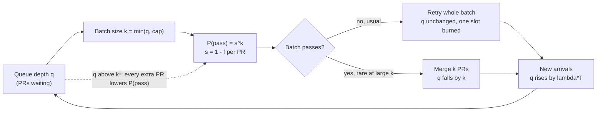

# Drill: Diagnose CI Merge Queue Throughput Collapse

> [!summary] Claim:
> A merge queue that sizes each batch to whatever is waiting, and retries a failed batch whole, has a hard throughput ceiling of 1/(e*a) PRs per build slot, where a = -ln(s) and s is the probability that one PR survives CI.
> At a 3% per-PR flake rate the ceiling is 12.08 PRs per 30 minute slot, and an arrival rate of 20 per slot sits above it for every batch size, so the queue grows without bound.
> Because batch size follows queue depth, growth lowers the pass probability of the next batch, which grows the queue faster: a positive feedback loop, not a slow drift.
> The levers are (1) cut the hazard a at its source by quarantining flaky tests, (2) buy parallelism with speculative builds and pay for it in CI cost, and (3) stop retrying whole batches; tuning batch size alone cannot fix it.

This drill owns the diagnosis and the capacity arithmetic.
Flake statistics, selection of tests, and the economics of presubmit latency are owned by [[Build-and-Test-Latency-Economics-and-Flaky-Tests]].
The mechanics of detecting, isolating, and deflaking a test are owned by [[Playbook-Quarantine-and-Eliminate-Flaky-Tests]].
Choosing and defending the dashboards that would have shown this early is owned by [[Developer-Productivity-Metrics-DORA-SPACE-and-GSM]] and practiced in [[Drill-Engineering-Systems-Audit-a-Gamed-Productivity-Dashboard]].



## Reproduction

Path: `code/09-Engineering-Systems-at-Scale/drill_merge_queue_collapse/` (requires: none; pure standard-library Python, no network).

```bash
cd code/09-Engineering-Systems-at-Scale/drill_merge_queue_collapse
bash run.sh
```

`run.sh` calls `python3 -I queue_model.py`.
All randomness comes from separate seeded `random.Random` streams (one for arrivals, one for flakes), so every policy sees the same 1,984 PRs and the output is byte-stable.
The program prints five sections: closed-form capacity, a telemetry diagnosis, the collapse trace, a nine-policy comparison, and a Monte Carlo cross-check.
It ends with named checks and exits non-zero if any fails.
Every output block in this note was copied from `expected/darwin-arm64.txt`, recorded on macOS arm64 with Python 3.15.2.
The harness verification run (`python3 -m _harness.verify`) was not repeated after recording, by the instruction that paused lab checks; one direct `bash run.sh` on 2026-11-21 (macOS arm64, Python 3.15.2) reproduced `expected/darwin-arm64.txt` byte for byte and exited 0.

### Scenario and assumptions

A 500-engineer monorepo runs a merge queue in front of its main branch.
Every PR needs one green CI run on the speculative merge result before it lands.
One CI run takes 30 minutes of wall time end to end (build, affected tests, integration shard).
The queue builds one batch at a time.
Policy as configured: "take everything that is waiting, up to 100 PRs, build it as one candidate, and if it fails put the PRs back and try again".
After a rollout of a new integration test tier, the platform team measures roughly 3% of PRs failing CI spuriously: re-running the same commit passes.
On Monday the queue stops merging.
By Tuesday morning the oldest PR has been waiting for more than 20 hours.

These are the assumptions the drill adds, because the scenario is silent on them.
Each one is a parameter in `queue_model.py` and each can be wrong for your system.

| Assumption | Value in the drill | Why it matters |
| :--- | :--- | :--- |
| Arrival rate | 20 PRs per 30 minute slot (40 per hour) | Roughly 0.8 PRs per engineer per 10 hour day for 500 engineers; sets the load to beat |
| Build slot | 30 minutes, one batch per slot | Capacity of a serial lane is one build per slot |
| Flake exposure | 3% per PR, additive: a batch of k fails spuriously with probability 1 - 0.97^k | The seed's "3% flake" is ambiguous; this is the regime where the set of flaky tests that run grows with the batch |
| Real defects | Zero in the simulation, closed form only | Isolates the flake mechanism from the culprit-finding mechanism |
| Flake independence | Independent across PRs and across retries | Correlated infrastructure outages are out of scope |

## Observed Symptom

What the on-call engineer sees is a queue that never drains.
Output of the collapse trace (macOS arm64, Python 3.15.2):

```text
== 3. The collapse: take-everything batching (cap 100), retry the whole batch ==
 round   queued    batch    P(pass)   result
     0       24       24     0.4814   FAILED
     1       39       39     0.3049   FAILED
     2       56       56     0.1816   FAILED
     3       70       70     0.1186   FAILED
     4       94       94     0.0571   FAILED
     5      112      100     0.0476   FAILED
     6      134      100     0.0476   FAILED
     7      154      100     0.0476   merged
   ...
    97     1231      100     0.0476   FAILED
    98     1243      100     0.0476   FAILED
    99     1268      100     0.0476   FAILED
builds=100 passed=12 arrived=1984 merged=716 backlog=1268
```

Reading it as an incident responder:

- Queue depth rose from 24 to 1,268 PRs over 100 rounds (50 hours), with occasional dips when a lucky build merged a large batch, and the batch hit the cap of 100 by round 5.
- 12 of 100 builds passed.
  Each pass merged a whole batch, up to 100 PRs, which is why 716 PRs merged in total even though 88% of builds failed.
- The batch pass probability fell from 0.48 to 0.0476 within five rounds and stayed there.
- Every failed build looks like an ordinary flaky failure to the author of any one PR, because their own tests pass when run alone.

The queue depth sampled every 10 rounds, for the same stream under three policies:

```text
queue depth sampled every 10 rounds (PRs waiting):
 round        naive      spec-40   quarantine
     0           24           24           24
    10          108           54           18
    20           46           24           24
    30          123           25           25
    40          228           40           24
    50          381           19           19
    60          474           21           20
    70          669           29           22
    80          890           26           12
    90         1089           36           23
```

The naive column is not smooth: it dipped from 108 to 46 between rounds 10 and 20 because five builds passed in rounds 14 to 18, two of them full batches of 100, which pushed depth back below k* for a few rounds before the next surge tipped it over again.
A dashboard that shows the mean merge rate hides this; a dashboard that shows queue depth and p95 wait does not.

## Progressive Hint Ladder

Work the hints in order, and stop as soon as you can name the mechanism.

> [!tip]- Hint 1: Compute the probability that the batch being built right now passes
> Take the current batch size from the queue, and a per-PR failure rate of 3%.
> If each PR independently contributes a 3% chance of a spurious failure, what is the pass probability for k = 20, 50, and 100?
> Compare it with the arrival rate you must keep up with.

> [!tip]- Hint 2: Is "3% flaky" a rate per test, per PR, per run, or per batch?
> The answer changes the whole model.
> If the flake probability is a property of one CI run regardless of how many PRs are in it, a bigger batch is strictly better.
> If every PR adds its own flaky exposure, a bigger batch is strictly worse.
> What would you plot from build telemetry to tell the two apart?

> [!tip]- Hint 3: Write down the useful throughput of a serial queue that retries a failed batch whole
> A batch of k passes with probability s^k and merges k PRs when it does.
> Maximize k * s^k over k.
> What is the maximum, and is it above or below the arrival rate per slot?

> [!tip]- Hint 4: Does splitting a failed batch in half (bisection) rescue the queue?
> Bisection finds a culprit PR in on the order of log2(k) extra builds when one PR is genuinely broken.
> Ask what a spurious failure looks like to a bisection: is there a culprit to find?

> [!tip]- Hint 5: What does a speculative window buy, and what does it cost?
> Build the first w queue entries in parallel, each on top of the entries ahead of it.
> The first failure merges everything ahead of it and restarts everything behind it.
> Derive the expected number of merges per round, then the number of builds started per merge.

> [!tip]- Hint 6: Attack the cause, not the symptom
> Which single parameter in your formulas moves the ceiling by a factor of ten, and what would it take to move it?
> Write the quarantine rule that would move it, including who owns a quarantined test and when it expires.

> [!tip]- Hint 7: Map the answer onto a real product's settings
> GitHub merge queue, GitLab merge trains, Zuul, and Mergify expose different knobs for batch size and speculation.
> Which setting corresponds to each term in your model, and what do the vendor docs say happens on failure?

## Model Solution

> [!success]- Solution
>
> **1. Mechanism: batch size is a function of queue depth, and pass probability is exponential in batch size.**
> The policy sets k = min(q, 100).
> With a per-PR survival s = 1 - f = 0.97, a batch passes with probability s^k.
> The closed-form table from the lab, which is derived arithmetic and not a measurement of a real system:
>
> ```text
> == 1. Closed-form capacity of a serial queue that retries a failed batch whole ==
> per-PR survival s = 1 - f = 0.970, hazard a = -ln s = 0.030459
> useful PRs per build slot g(k) = k * s^k, peaks at k* = 1/a = 32.83 with g(k*) = 1/(e*a) = 12.08
>      k      P(pass)         g(k)
>      1       0.9700        0.970
>      5       0.8587        4.294
>     10       0.7374        7.374
>     20       0.5438       10.876
>     33       0.3660       12.078
>     50       0.2181       10.903
>    100       0.0476        4.755
>    200       0.0023        0.452
> best integer batch size = 33, g = 12.078
> arrivals per build slot (lambda*T) = 20.0, utilisation at the optimum = 1.66
> largest flake rate a retry-whole serial queue survives at lambda*T = 20: f_max = 0.0182
> ```
>
> Two facts follow.
> First, g(k) = k * e^(-a k) has derivative e^(-a k) * (1 - a k), so the maximum is at k* = 1/a and equals 1/(e*a).
> At 3% that is 12.08 PRs per slot, against an arrival rate of 20 per slot: utilization 1.66 at the best possible fixed batch size, so no batch size makes the queue stable.
> Second, the largest flake rate this policy survives at 20 arrivals per slot is f_max = 1 - exp(-1/(e*20)) = 1.82% per PR.
> The seed's claim that 3% flake "reduces pass probability to near zero" is true only for the take-everything policy once the backlog is large: 0.0476 at k = 100 and 0.0023 at k = 200, but 0.5438 at k = 20.
> The collapse is a property of the policy under load, not of the 3% alone.
>
> **2. Why it is a spiral and not a plateau.**
> When q is below k*, adding a PR to the batch raises g, so the queue is self-correcting.
> When q is above k*, the take-everything cap sets k = min(q, 100), so each extra waiting PR lowers the next batch's pass probability.
> The system has two regimes with a cliff between them, which is why such a queue can look healthy until a Monday surge, a new flaky test tier, or an outage backs it up past k* and tips it.
> Little's law, L = lambda * W (Little, 1961), gives the symptom the on-call sees: with arrivals fixed, depth and wait grow together.
>
> **3. Diagnose the regime from telemetry before touching a setting.**
> Hypothesis H1 says failure grows with batch size (additive exposure).
> Hypothesis H2 says the suite flakes at a constant rate however many PRs are in it.
> They predict opposite remedies, so plot pass rate against batch size for the last N builds and fit both.
> The lab generates 600 synthetic builds across batch sizes 1, 2, 4, 8, 16, 32 and fits both:
>
> ```text
> == 2. Diagnose the regime from telemetry: does failure grow with batch size? ==
>  batch   builds   passed  pass rate    -ln(rate)/k
>      1      100       98      0.980         0.0202
>      2      100       97      0.970         0.0152
>      4      100       89      0.890         0.0291
>      8      100       83      0.830         0.0233
>     16      100       56      0.560         0.0362
>     32      100       38      0.380         0.0302
> H1 additive exposure P(pass) = s^k : s_hat = 0.9705, log-likelihood = -240.9
> H2 shared suite     P(pass) = p    : p_hat = 0.7683, log-likelihood = -324.8
> log-likelihood gap H1 - H2 = 83.9, implied per-PR flake rate f = 1 - s_hat = 0.0295
> ```
>
> Read the table as a diagnostic, not a proof.
> Pass rate falls from 0.98 at k = 1 to 0.38 at k = 32, which a constant-rate model cannot produce.
> The per-bucket hazard column -ln(rate)/k ranges from 0.0152 to 0.0362 because each bucket holds only 100 builds; pool the buckets with a likelihood fit rather than trusting one bucket.
> The fit recovers s_hat = 0.9705 (true value 0.970), and H1 beats H2 by 83.9 nats.
> The data here is generated from H1, so the fit shows that the method can tell the regimes apart, not that your production system is in H1.
> On real telemetry, run the same comparison and expect a mixture: a shared infrastructure component of flake (constant per build) plus a per-test component (grows with k).
> A constant per-build component is the part that batching amortizes; a per-PR component is the part it multiplies.
>
> **4. Policy comparison.**
> Nine policies on the same arrival stream, 100 rounds, one serial lane except where speculation is stated:
>
> ```text
> == 4. Policy comparison on one arrival stream (100 rounds of 30 min, lambda*T = 20) ==
> policy                                    f  merged  backlog  p50 min  p95 min  builds  build/PR
> naive take-all, cap 100               0.030     716     1268      150      870     100      0.14
> fixed batch k*=33, retry whole        0.030    1188      796      540     1170     100      0.08
> batch 8 + bisect                      0.030     536     1448     1110     2130     100      0.19
> batch 32 + bisect                     0.030     888     1096      810     1620     100      0.11
> speculative window 20                 0.030    1490      494      510      720    2000      1.34
> speculative window 40                 0.030    1984        0       60       90    3050      1.54
> quarantine + naive cap 100            0.003    1984        0       30       60     100      0.05
> quarantine + batch 32 + bisect        0.003    1984        0       30       90     100      0.05
> quarantine + speculative window 20    0.003    1888       96      120      180    2000      1.06
> arrived = 1984 in every row
> ```
>
> What each row proves:
>
> - **Fixed batch k* = 33.**
>   Better than take-all (1,188 merged against 716) and still far short of 1,984.
>   The closed form predicted a ceiling of about 12 PRs per slot, or roughly 1,208 over 100 slots; the simulated 1,188 matches.
>   Tuning the batch size is worth about 66% more merges here and cannot close the gap.
> - **Bisection.**
>   It does not help, and batch 8 with bisection is the worst row (536 merged).
>   Bisection assumes a culprit: a failed batch of 8 contains no bad PR, so splitting it spends builds re-running work that was fine, and each half is exposed to fresh flake.
> - **Speculative window.**
>   A window of 20 merges 1,490 and still leaves 494 waiting; a window of 40 merges all 1,984 with p95 wait of 90 minutes.
>   The price is 3,050 builds for 1,984 merges, 1.54 builds per merged PR.
>   The closed form for expected merges per round is E = (1 - f)(1 - (1 - f)^w)/f; it is 14.75 at w = 20 and 22.77 at w = 40, and the smallest window with E at least 20 is w = 32, where E is 20.13 and utilization is 99%, too thin to survive a burst.
>   Both the closed form and the lab charge each speculative entry only its own PR's flake exposure; if the build for entry i re-runs the affected tests of every PR ahead of it, it fails more often, so these speculative numbers are optimistic.
> - **Quarantine.**
>   Cutting f from 3% to 0.3% (an assumed 10x, not something the lab can show you how to achieve) makes even the naive take-all policy stable: the sampled queue depth never exceeds 25 PRs, so batches stay near 20 and the closed-form pass probability is near 0.94.
>   The cause fix is the cheapest row in the table: 0.05 builds per merged PR for the serial policies.
> - **Cost columns are not comparable across policy classes.**
>   Serial rows use one build slot per round and are capacity-bound, so their builds-per-PR is low because they are not merging most PRs.
>   Speculative rows burn 20 or more slots per round.
>   Compare builds per merged PR only between rows that merge the same number of PRs: 1.54 at w = 40 with f = 3% versus 1.06 at w = 20 with f = 0.3%.
>
> **5. Real defects change the picture and bring bisection back.**
> The simulation has no genuinely broken PRs.
> In closed form with s = (1 - f)(1 - d), d being the fraction of PRs that are really broken:
>
> ```text
> peak g(k*) by flake rate f and real-defect rate d, s = (1-f)(1-d):
>        f        d       k*       peak
>    0.030    0.000     32.8      12.08
>    0.003    0.000    332.8     122.44
>    0.000    0.020     49.5      18.21
>    0.003    0.020     43.1      15.85
>    0.030    0.020     19.7       7.26
> ```
>
> Even with zero flake, a 2% real-defect rate puts the retry-whole ceiling at 18.21, below the 20 arrivals per slot.
> That 18.21 is an upper bound: k * s^k counts only the chance that a fresh batch contains no broken PR, and treats a failed batch as if it could be redrawn.
> Under true retry-whole a broken PR makes every batch it joins fail and nothing ejects it, so the lane does not merely run below 18.21; it stalls at the first broken PR.
> This is where bisection and culprit ejection earn their cost: they are the answer to deterministic failure and the wrong answer to flake.
> The two failure types need different mechanisms, which is why the order of operations matters: separate them first (the flaky-test classification of the quarantine playbook), then use bisection only on failures that reproduce.
>
> **6. A cheap, fast lever: job-level retry.**
> If a spurious failure is independent across attempts, retrying a failed job once cuts the per-PR spurious failure probability from f to about f^2.
> At f = 0.03 that is 0.0009, and the retry-whole ceiling becomes about 409 PRs per slot (1/(e * -ln(1 - 0.0009))).
> This number is derived arithmetic and is not in the lab output.
> It holds only for independent flakes; a test that fails 100% of the time on a bad runner image will fail again.
> The cost is extra CPU only on failures, and Adam Bender's chapter of SWE at Google calls this "trading CPU cycles for engineering time", adding that rerunning "is only delaying the need to address the root cause of flakiness" (Chapter 11, case study on flaky tests).
> GitLab documents the same lever on merge trains: if a job succeeds after a `retry`, the MR is not removed from the train.
> Use retry as the stop-the-bleeding step, with a counter that records every retry that turned a failure into a pass, because that counter is the flake list for the quarantine step.
>
> **7. Recommended sequence.**
>
> 1. Stop the spiral in the first hour: cap batch size at or below k* (33 here; lower is safer), enable job-level retry on the integration tier, and raise speculative concurrency if the CI budget allows.
>    This is triage; the table shows it does not restore capacity at f = 3%.
> 2. Rank tests by the rate at which they fail and then pass on the same commit, and quarantine the top contributors until the measured per-PR spurious failure rate is under the f_max for your arrival rate, with margin.
>    At 20 arrivals per slot that is under 1.82% for retry-whole serial policy; plan for half of it.
> 3. Keep quarantined tests running as non-blocking so their failure rate stays measured, and give each an owner and an expiry.
> 4. Size speculation after the cause fix, because every failure restarts the entries behind it: at f = 3% the lab shows 1.54 builds per merged PR at w = 40; at f = 0.3% a window of 20 costs 1.06.
> 5. Alert on the leading indicators, not on merges per hour: queue depth against k*, p95 wait, and pass rate of the largest-batch bucket.
>
> **8. Mapping to product settings (as of 2026-11, vendor documentation).**
>
> | Model term | GitHub merge queue | GitLab merge trains | Zuul | Mergify |
> | :--- | :--- | :--- | :--- | :--- |
> | Batch size | Merge limits: minimum and maximum PRs merged at once, each between 1 and 100, plus a wait time before merging fewer than the minimum | No batch size setting appears on the page; each MR gets its own pipeline | No batch size setting appears on the pages read; each change is tested on the changes ahead of it | `batch_size` (default 1, fixed 1 to 128 or a `{min, max}` range), `batch_max_wait_time` (default 30 seconds) |
> | Speculative parallelism | Build concurrency: maximum `merge_group` webhooks dispatched, between 1 and 100 | By default a maximum of 20 pipelines in parallel per train, configurable down to 1 | `window` (default 20) with a TCP-like adaptive window | `max_parallel_checks` (the docs show 3 as an example; default not stated) |
> | On failure | The entry is removed from the queue and the branch is recreated without it; bisection is not described | The MR is removed and new pipelines start for every MR queued after it | Changes behind a failed change are re-tested without it | The failed batch is split to find the culprit, which leaves the queue; batches stacked on it are cancelled and retested |
> | Failure tolerance | "Only merge non-failing pull requests" checkbox; when off, a failing PR can be grouped as long as the last PR in the group passed required checks | `retry` on a job keeps the MR on the train if the retry passes | `window-floor` (default 3), `window-decrease-type` (default exponential), `window-decrease-factor` (default 2) | `batch_max_failure_resolution_attempts` (default null), `skip_intermediate_results` (default false) |
>
> Zuul's window is the one mechanism in this table that adapts to a rising flake rate: it starts at 20, grows by 1 on each merged change, and halves on each failure, so a flake storm shrinks speculation toward the floor of 3 instead of burning builds.
> The Zuul gating documentation states the rationale directly: a large window when builds usually pass maximizes throughput, a small one when they usually fail minimizes waste.
> A static `window` or build concurrency set for a quiet day is the configuration that costs the most during a flake storm, because every failure restarts every entry behind it.
>
> **9. A quarantine rule, as a policy sketch.**
> The following block is a house-policy sketch written for this drill, not the syntax of any product.
>
> ```text
> quarantine_rule:
>   detect:
>     signal: fails_then_passes_on_same_commit
>     window: last 200 runs of the test
>     enter_if: flip_rate >= 1.0%
>   action:
>     mode: run_non_blocking
>     keep_measuring: true
>   ownership:
>     owner: the team in the test's CODEOWNERS entry
>     ticket: opened automatically on entry
>     expiry_days: 14
>     on_expiry: escalate to the owner's manager, never silently delete
>   budget:
>     max_quarantined_fraction_of_suite: 2%
>     over_budget: page the owning org, stop admitting new quarantines
>   exit:
>     require: 500 consecutive clean runs and a root-cause note
> ```
>
> Each number is a starting point to calibrate, not a recommendation measured here.
> The rule has to do three things the lab cannot show: remove the test from the blocking path, keep measuring it, and keep a human accountable.
> A quarantine with no owner and no expiry is a deletion with extra steps, and it leaves the suite weaker than the day the queue collapsed.
> The detection mechanics and the stress-and-deflake procedure live in [[Playbook-Quarantine-and-Eliminate-Flaky-Tests]].
>
> **10. Verify the fix worked.**
> Before declaring recovery, check four numbers: queue depth stays under k* for a full week including a Monday; p95 wait is under your merge-time SLO; the pass rate of the largest-batch bucket has recovered toward s^k; and builds per merged PR is back near 1.
> If merges per hour recovered but p95 wait did not, you have shifted the pain onto the tail.

## Core Takeaway

A queue is a controlled system, and a policy that reads its own backlog to size its work can create a positive feedback loop.
When the cost of a batch failing grows exponentially in the batch size, the only stable designs are ones that bound the batch, spend parallelism to hide failures, or remove the failures at the source.
Of the three, the cause fix is both the cheapest and the only one whose benefit compounds.
The measurement discipline (flake rate per PR, pass rate by batch size, queue depth against a computed ceiling) belongs to [[Build-and-Test-Latency-Economics-and-Flaky-Tests]], and the quarantine procedure that moves the hazard belongs to [[Playbook-Quarantine-and-Eliminate-Flaky-Tests]].

## Commands and Numbers to Know

| Item | Value | Platform | Stamp |
| :--- | :--- | :--- | :--- |
| Retry-whole serial queue, useful throughput | g(k) = k * s^k, maximum 1/(e*a) at k* = 1/a, a = -ln s | Both | derived; checked by the lab |
| Per-PR flake ceiling at lambda*T arrivals per slot | f_max = 1 - exp(-1/(e * lambda*T)) | Both | derived; 1.82% at 20 |
| Speculative window, expected merges per round | E = (1 - f)(1 - (1 - f)^w)/f | Both | derived; checked by the lab |
| GitHub merge queue build concurrency | between 1 and 100 `merge_group` webhooks | Both | (as of 2026-11, GitHub Docs) |
| GitHub merge queue merge limits | minimum and maximum PRs per merge, each between 1 and 100; wait time before merging fewer than the minimum | Both | (as of 2026-11, GitHub Docs) |
| GitHub `merge_group` workflow event | activity type `checks_requested`; `GITHUB_SHA` is the SHA of the merge group | Both | (as of 2026-11, GitHub Docs) |
| GitLab merge trains parallel pipelines | default maximum of 20 per train, minimum 1 | Both | (as of 2026-11, GitLab Docs) |
| Zuul dependent pipeline window | `window` 20, `window-floor` 3, increase linear by 1, decrease exponential by 2 | Both | (as of 2026-11, Zuul docs) |
| Mergify batch defaults | `batch_size` 1, `batch_max_wait_time` 30 seconds, `batch_max_failure_resolution_attempts` null | Both | (as of 2026-11, Mergify docs) |
| Flake rate that wastes engineering time | 0.1% flake across 10,000 tests per day is 10 investigations per day; Google's flaky rate "hovers around 0.15%"; tests lose value approaching 1% | Both | (SWE at Google, Chapter 11, 2020) |

Source-of-truth caveats: the GitHub docs state no defaults for any merge queue setting, and the Mergify performance page gives `max_parallel_checks` only as an example value; check the vendor docs for the version you run.

## Pitfalls

> [!warning] Pitfalls:
> - **Unit confusion on the flake rate.** "3% flaky" can mean 3% of tests, 3% of runs, or 3% of PRs.
>   The three give different collapse thresholds.
>   Measure per-PR spurious failure (a failure that passes on retry at the same commit) and quote that.
> - **Letting backlog size the batch.**
>   Any policy of the form k = min(queue depth, cap) turns load into batch size.
>   Cap k at or below k* = 1/a and treat the cap as a safety limit, not a tuning knob.
> - **Retrying the whole batch.**
>   It converts every spurious failure into a full slot of lost capacity.
>   Retry at job level, and keep a counter of failures that retries rescued.
> - **Bisecting a flake.**
>   If no PR in the failed batch is bad, bisection has no culprit and spends builds.
>   Classify the failure first.
> - **Treating bisection as the fix.**
>   It is the fix for deterministic failures; the lab shows it makes the flake-only case worse (batch 8 with bisection merged 536, below the naive policy's 716).
> - **A static speculative window.**
>   Fixed concurrency during a flake storm wastes builds on entries that will be restarted.
>   Prefer an adaptive window (Zuul's halving) or an automatic fallback to smaller windows.
> - **Quarantine without ownership.**
>   A suite that quietly loses coverage is worse than a slow queue.
>   Every quarantine needs an owner, an expiry, and a budget.
> - **Gaming the symptom.**
>   Raising `status check timeout`, disabling "only merge non-failing" semantics, or auto-retrying everything makes the queue metrics look healthy while main can still break.
>   See [[Drill-Engineering-Systems-Audit-a-Gamed-Productivity-Dashboard]].
> - **Trusting a model outside its assumptions.**
>   The simulation has independent flakes, fixed 30 minute builds, stationary Poisson arrivals, and no real defects.
>   Correlated runner failures, build time that grows with batch size, and Monday surges all make the real system worse.
> - **Semantic conflicts.**
>   Two PRs that pass alone can break together; the bors-ng essay "About semantic conflicts" makes this the reason to test the combination before it reaches the main branch.
>   Any capacity fix that skips testing the combination reintroduces the problem a merge queue exists to solve.

## At Scale

At 500 engineers one queue lane is a policy problem.
At 5,000 to 50,000 engineers it is a capacity-planning and architecture problem.

- **Capacity is a number you compute.**
  Estimate lambda*T for the busiest hour, estimate the per-PR spurious failure rate s, and compute 1/(e*a).
  If lambda*T exceeds it, no batch size will fix the lane; you need parallelism, lower a, or more lanes.
- **Shard the queue.**
  One serial queue for a whole monorepo ties unrelated changes together.
  Zuul keeps a window per project queue so unreliable tests in one project queue do not shrink another's.
  GitHub merge queues are per base branch, enabled by "Require merge queue" in its branch protection rule or ruleset.
  Mergify batches together only pull requests that touch the same scopes.
  Independent lanes give independent k*, independent windows, and independent blast radius.
  The cost is that cross-lane semantic conflicts are not tested together.
- **Speculation is a spend decision.**
  The lab's cost per merged PR is 1.54 builds at w = 40 with f = 3% and 1.06 at w = 20 with f = 0.3%.
  Multiply by your build cost to see what the flake rate costs per month, then compare with the headcount cost of a flake-fixing program.
- **Make the cause visible to owners.**
  The Google guidance is that flakiness is expensive because engineering time scales with it (10 investigations per day at 0.1% across 10,000 tests).
  Attribute spurious failures to owning teams and put the per-team rate on the same dashboard as their velocity.
- **Decision rules.**
  - If queue depth is below k* and p95 wait is within SLO, change nothing.
  - If queue depth exceeds k* for three consecutive builds, cap batch size and enable job retry immediately.
  - If measured per-PR flake is above half of f_max, start the quarantine program before buying CI capacity.
  - If real-defect rate d is non-trivial, add bisection with culprit ejection, but only on failures that reproduce.
  - If the wait SLO is violated while flake is under f_max, the problem is capacity or build time, and the model in [[Build-and-Test-Latency-Economics-and-Flaky-Tests]] applies.
  - Review the flake budget at the same cadence as the productivity dashboard in [[Developer-Productivity-Metrics-DORA-SPACE-and-GSM]], and route platform decisions through [[Platform-Engineering-Paved-Roads-and-Deprecation]].

## Practice Drill

> [!tip] Practice Drill:
> Run `bash run.sh`, then change the parameters in `queue_model.py` and predict each result before you re-run.
>
> 1. Set `LAMBDA_ROUND` to 10.
>    Predict whether the naive cap-100 policy is stable at 3% flake.
>    (Compare 10 against 12.08, and against the dynamics when q hovers near 10.)
> 2. Set `F_FLAKE` to 0.018 and then 0.019.
>    Find where retry-whole at the best batch size flips between stable and unstable at 20 arrivals, and compare with f_max = 1.82%.
> 3. Add a `d` real-defect rate to the simulation: mark each arriving PR bad with probability 0.02, make any batch containing a bad PR fail deterministically, and eject a PR that fails when alone.
>    Show that bisection now beats retry-whole.
> 4. Replace the independent-flake draw with a correlated outage: with probability 0.02 per round, every build in that round fails.
>    Which policy degrades most?
> 5. Write the dashboard: which three series would have shown the collapse a week before the incident?

## Interview Questions

### L5

> [!question] L5
> A merge queue batches PRs and one batch's CI fails with an error in test X.
> How do you tell whether X is flaky or whether one of the PRs in the batch broke it?
>
> > [!success]- Answer
> > Re-run the same commit.
> > If it passes, the failure was spurious: file or update the flake record and do not eject any PR.
> > If it fails again, the failure is deterministic and a PR in the batch is a candidate culprit.
> > Then check the history of X on the base branch and on other batches: a test that fails then passes at the same commit in recent history is a flake regardless of this batch.
> > If X is deterministic, bisect the batch or test PRs individually to find the culprit.
> > The key distinction is that bisection searches for a cause and only deterministic failures have one.

> [!question] L5
> Why can a bigger batch have a lower pass rate even when no PR in it is broken?
>
> > [!success]- Answer
> > Under additive exposure, every PR in the batch brings its own set of affected tests, and each flaky test among them can fail the build.
> > If each PR carries a 3% chance of triggering a spurious failure, a batch of k passes with probability 0.97^k: 54.38% at k = 20 and 4.76% at k = 100.
> > The batch fails if any contributor fails, so pass probability is a product, which decays exponentially in k.
> > The opposite regime exists: if the suite's flake rate is constant per build, bigger batches amortize it.
> > Plotting pass rate against batch size tells you which regime you are in.

> [!question] L5
> Predict the output.
> What does this print?
> ```python
> import math
> s = 0.92
> best = max(range(1, 400), key=lambda k: k * s ** k)
> print(best, round(best * s ** best, 2))
> ```
>
> > [!success]- Answer
> > It prints `12 4.41`.
> > The continuous maximum of k * s^k is at k = 1/(-ln s) = 11.99, so the best integer is 12 or 11 or 13.
> > The ratio g(12)/g(11) = (12/11) * 0.92 = 1.0036 is above 1 and g(13)/g(12) = (13/12) * 0.92 = 0.9967 is below 1, so 12 wins.
> > g(12) = 12 * 0.92^12 = 4.41, which also equals the continuous peak 1/(e * 0.0834) = 4.41 to two decimals.
> > The `import math` is unused and does not change the output.
> > Note that for s = 1 - 1/n the ratio g(k+1)/g(k) is exactly 1 at k = n - 1, so two adjacent sizes tie, and `max` returns the first; that is why the example uses 0.92.

### L6

> [!question] L6
> Debug this.
> After an incident, an engineer changes the retry path of the queue to the code that follows.
> Throughput recovers, but authors complain that some PRs wait for days.
> What is wrong?
> ```python
> def take_batch(queue, cap):
>     k = min(len(queue), cap)
>     return [queue.popleft() for _ in range(k)]
>
> def on_failure(queue, batch):
>     queue.extend(batch)      # put them back
> ```
>
> > [!success]- Answer
> > `queue.extend(batch)` appends the failed batch to the tail of the FIFO, so the oldest PRs lose their place behind everything that arrived in the meantime.
> > Each failure sends the oldest PRs to the back of the line, so a PR that keeps landing in failed batches can be re-queued behind new arrivals indefinitely and starve while the median wait looks fine.
> > The fix is to return them to the front in order: `queue.extendleft(reversed(batch))`, which is what the drill's simulation does.
> > The remaining question is whether a PR that has failed N times should be ejected or tested alone; for flake it should not be ejected at all.
> > The symptom to monitor is p95 and max age, not the mean.

> [!question] L6
> The lab shows batch 8 with bisection merging fewer PRs than the naive take-everything policy.
> Explain, and say when bisection is the right tool.
>
> > [!success]- Answer
> > The failures in the simulation are flake, so a failed batch contains no culprit.
> > Bisection splits it into halves that are rebuilt as new builds, which burn slots without removing any cause of failure.
> > With a single serial lane and arrivals above the retry-whole ceiling, spending extra slots on splits lowers the merge rate: 536 merged against 716 in the recorded run.
> > Bisection is the right tool for deterministic failures, where it finds one broken PR in on the order of log2(k) extra builds and ejects it, so the rest merge.
> > The closed-form table shows why you need it for real defects: at 2% defects and zero flake the retry-whole ceiling is at best 18.21, below 20 arrivals, and without ejection the first broken PR stalls the lane.
> > The practical policy is to retry a failure once at the job level, and bisect only if it reproduces.

> [!question] L6
> Your vendor's merge queue lets you set build concurrency to 1 through 100 and a maximum group size.
> How do you choose values for a 3% per-PR flake rate and 20 arrivals per 30 minute slot?
>
> > [!success]- Answer
> > Start from the model, not from the default.
> > Group size: keep it at or below k* = 1/a = 32.8, and lower if you have real defects, because a failed group wastes everything in it; at 3% a group of 8 passes with probability 78% and a group of 33 with 36.6%.
> > Concurrency: with groups of size 1 and speculative entries, the expected merges per round is 14.75 at 20 and 22.77 at 40, so you need at least 32 concurrent entries to reach 20 merges per slot, and more to survive bursts.
> > Then price it: at 40 the lab shows 1.54 builds per merged PR.
> > Finally, say the honest part: this buys time; it does not fix the flake rate, and it makes the next flake storm more expensive.
> > Check the vendor's documented failure behavior (GitHub removes the failed entry and rebuilds the rest; GitLab restarts every later pipeline) because it determines the waste.

### L7


> [!question] L7
> Derive the ceiling for a retry-whole serial queue, and explain why the collapse is a cliff rather than a gradual slowdown.
>
> > [!success]- Answer
> > Let s be the per-PR survival and a = -ln s.
> > A batch of k passes with probability s^k = e^(-a k) and merges k PRs, so throughput per slot is g(k) = k e^(-a k).
> > g'(k) = e^(-a k)(1 - a k), zero at k* = 1/a, giving peak 1/(e a); at a = 0.030459 that is 12.08.
> > If lambda*T exceeds the peak, the queue is unstable for every fixed k.
> > It is a cliff because batch size follows depth: below k* more PRs raise g and the system self-corrects, above k* more PRs lower g and the system runs away.
> > The state space has an attractor at a small queue and an escape at q above k*, and a surge or a new flaky tier moves the system across.
> > Little's law, L = lambda W, then says wait grows with depth at a fixed arrival rate.
> > The recorded run shows it: depth 24 to 1,268, batch pass probability from 0.48 to 0.0476 in five rounds.

> [!question] L7
> You have a budget for either a flake-fixing program that reduces the spurious failure rate from 3% to 0.3%, or twice the CI capacity to run a window of 40.
> How do you decide?
>
> > [!success]- Answer
> > Use the lab's numbers as the shape of the comparison, then substitute your own.
> > Window 40 at 3% merges all 1,984 PRs with 3,050 builds, 1.54 builds per merged PR, and p95 wait of 90 minutes.
> > Quarantine at 0.3% with the naive serial policy merges all 1,984 with 100 builds and p95 wait of 60 minutes; with a 20-wide window it costs 1.06 builds per merged PR.
> > The cause fix is cheaper per merge and better on latency, but it needs engineering time, takes calendar time, and the 10x reduction is an assumption.
> > The capacity route is immediate but recurring, and it scales with the flake rate and the arrival rate.
> > Do both in sequence: buy the window now as triage, run the quarantine program with an owner and a measured target (per-PR spurious failure under half of f_max), and retire the extra capacity when the metric holds.
> > Decide with three numbers: monthly CI cost of the extra builds, engineers needed for the program, and the engineering hours currently lost to waiting.
> > Name the risk: a program with no budget cap on quarantined tests silently lowers coverage.

### L8+

> [!question] L8+
> Design the telemetry and policy so the queue cannot collapse silently again, across 40 independent queues owned by different teams.
>
> > [!success]- Answer
> > Per queue, emit queue depth, the computed ceiling 1/(e a) from a rolling estimate of the per-PR spurious failure rate (fit by likelihood across batch sizes, as in the lab), utilization lambda*T over the ceiling, p95 and max wait, builds per merged PR, and the pass rate of the largest-batch bucket.
> > Alert on utilization over 0.7 and on depth above k* for three consecutive builds, which fires before the cliff.
> > Policy: batch cap derived from the rolling k*, an adaptive speculative window that halves on failure (the Zuul pattern) and has a floor, job-level retry with a rescued-failure counter, and automatic quarantine with an owner, expiry, and a suite-fraction budget.
> > Governance: a shared flake budget per team, reported with the same cadence as delivery metrics, and an escalation path when a team exceeds its budget.
> > Guard against gaming: retries and timeouts must not be able to improve the reported queue metrics without improving the underlying flake rate, which is the Goodhart pathology in [[Drill-Engineering-Systems-Audit-a-Gamed-Productivity-Dashboard]].
> > Partition queues by ownership so one team's flake storm cannot block another's, and accept that cross-queue semantic conflicts need a periodic post-merge combination build.

> [!question] L8+
> A candidate says "the telemetry shows a 3% flake rate, so we should reduce batch size until the pass rate recovers". Under what conditions is that right, and under what conditions is it harmful?
>
> > [!success]- Answer
> > It is right when failure grows with batch size (additive exposure), because smaller batches then have a higher pass probability, up to the optimum k* = 1/a, and it costs nothing.
> > It is harmful when the flake is a constant per build (a shared dependency or a bad runner pool): smaller batches then mean more builds, each with the same failure probability, so capacity falls and the queue grows faster.
> > It is insufficient even when right: at 3% and 20 arrivals per slot the ceiling is 12.08, so no batch size recovers the queue.
> > The decision requires the diagnostic fit of pass rate against batch size, and then the capacity comparison of lambda*T against 1/(e a).
> > The drill shows the first failure of this reasoning concretely: a fixed batch of 33 merged 1,188 PRs of 1,984, better than 716 and still a growing backlog of 796.

## Further Reading

- GitHub Docs, [Managing a merge queue](https://docs.github.com/en/repositories/configuring-branches-and-merges-in-your-repository/configuring-pull-request-merges/managing-a-merge-queue): the settings (build concurrency, merge limits, status check timeout) that map to k and w, and the "Failing CI" walkthrough of removal and temporary-branch recreation.
- GitHub Docs, [Merging a pull request with a merge queue](https://docs.github.com/en/pull-requests/collaborating-with-pull-requests/incorporating-changes-from-a-pull-request/merging-a-pull-request-with-a-merge-queue): the author's view of the queue and the reasons a pull request is removed from it.
- GitLab Docs, [Merge trains](https://docs.gitlab.com/ci/pipelines/merge_trains/): the speculative pipeline model and the restart-on-failure rule.
- Zuul, [Project Gating](https://zuul-ci.org/docs/zuul/latest/gating.html): the clearest primary description of dependent pipelines and the adaptive window.
- Zuul, [Pipeline configuration](https://zuul-ci.org/docs/zuul/latest/config/pipeline.html): the window options with defaults.
- Mergify, [Batches](https://docs.mergify.com/merge-queue/batches/): the batch size, wait time, and split-on-failure behavior.
- bors-ng, [About semantic conflicts](https://bors.tech/essay/2017/02/02/pitch/): why the combination must be tested before it reaches the main branch.
- Bender, in Winters, Manshreck, Wright, [Software Engineering at Google, Chapter 11](https://abseil.io/resources/swe-book/html/ch11.html): the flake-rate arithmetic and the cost of rerunning.
- Memon et al., [Taming Google-Scale Continuous Testing](https://research.google/pubs/taming-google-scale-continuous-testing/): continuous-testing scale and test-workload control (only the abstract was read for this note).
- Little, [A Proof for the Queuing Formula L = lambda W](https://doi.org/10.1287/opre.9.3.383): the identity connecting queue depth and wait.

## Related

- Prerequisites: [[Build-and-Test-Latency-Economics-and-Flaky-Tests]], [[Playbook-Quarantine-and-Eliminate-Flaky-Tests]]
- Next: [[Drill-Engineering-Systems-Audit-a-Gamed-Productivity-Dashboard]]
- Lab: `code/09-Engineering-Systems-at-Scale/drill_merge_queue_collapse/`
- See also: [[Developer-Productivity-Metrics-DORA-SPACE-and-GSM]], [[Platform-Engineering-Paved-Roads-and-Deprecation]], [[Code-Review-and-Readability-Systems-at-Scale]]
