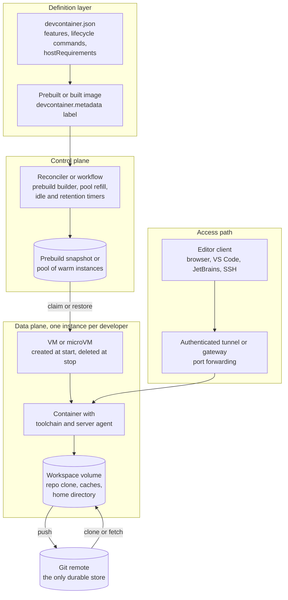

# Ephemeral Cloud Development Environments

> [!summary] Claim:
> An ephemeral cloud development environment (CDE) splits a developer workstation into five separately priced layers: a definition (usually a `devcontainer.json`), an image, the repository content, a compute instance that is created and destroyed on demand, and the access path from an editor.
> The dominant design problem is cold start, because creating an environment costs VM allocation, an image pull, a repository clone, dependency setup, and IDE server install, and every serious platform attacks it with either a snapshot of the finished environment (Codespaces and Ona prebuilds) or a pool of warm unassigned instances (Coder prebuilt workspaces, Cloud Workstations quick start pool).
> State is tiered rather than absent: compute dies on stop or timeout, a home volume or VM disk lives until deletion or a retention limit, and only the pushed Git remote is durable.
> The access path adds one network round trip to every keystroke unless the editor runs next to the code, which is why the editor backend, not file sync, is the default mechanism, and why compute is placed near the Git server and caches rather than near the developer.



## The Mechanism

This note owns the environment platform: how a workspace is defined, pre-built, started, kept, paid for, secured, and reached.
It does not own the Git object machinery ([[Git-At-Scale-VFS-Scalar-and-Monorepos]], [[Git-Transfer-Protocol-and-Partial-Clone]]), remote build caches ([[Remote-Execution-API-and-Remote-Caching]]), local container VMs on a Mac ([[Containers-and-VMs-for-macOS-Development]]), or the base `devcontainer.json` authoring walkthrough ([[Dotfiles-Nix-Direnv-Mise-and-Devcontainers]]).
It covers the Use, Explain, Debug, Rebuild, and Decide at Scale rungs for the platform layer.

### 1. Why the workstation was split

A laptop couples four things that have different cost and trust properties: the compute, the source code, the human interface, and the environment definition.
A CDE decouples them.
The human interface (editor, keyboard, display) stays on a thin client.
The source and the compute move to a datacenter, where network distance to the Git server, package mirrors, and build caches is short and where the organization can enforce policy on egress and identity.
The definition becomes a file in the repository, so "works on my machine" becomes "works in the image".

The price is that the interactive path (keystroke to screen) now crosses a network, and the lifecycle (create, start, stop, delete) becomes something the organization operates and pays for.
The rest of this note is about managing those two costs.

The vault covers Google's monorepo tooling, Piper and CitC (Clients in the Cloud), in [[Git-At-Scale-VFS-Scalar-and-Monorepos]]; this note covers only the commercial and open-source platforms whose documentation is public.

### 2. The definition layer: dev containers

Every platform examined here (GitHub Codespaces, Ona, Coder, DevPod, and Cloud Workstations through custom images) consumes or imitates the dev container specification.
This part covers only the parts that matter for ephemeral platforms; the basic authoring flow is in [[Dotfiles-Nix-Direnv-Mise-and-Devcontainers]].

#### The lifecycle, and what each phase may touch

The specification defines these command properties in this order (devcontainer.json reference, "Lifecycle scripts", as of the main branch, 2026-11):

| Order | Property | Where it runs | Intended purpose on a cloud service |
| :--- | :--- | :--- | :--- |
| 1 | `initializeCommand` | The host, "wherever the source code is located on the host"; for cloud services, in the cloud | Host-side prep; runs on creation and on every start |
| 2 | `onCreateCommand` | Inside the container, first start | Prebuild-friendly setup; "will not typically have access to user-scoped assets or secrets" |
| 3 | `updateContentCommand` | Inside the container, after `onCreateCommand`, whenever new content is available | Refreshing cached or prebuilt containers; limited to repository and organization scoped secrets |
| 4 | `postCreateCommand` | Inside the container, after the environment is assigned to a user for the first time | User-specific setup; may use user secrets and permissions |
| 5 | `postStartCommand` | Each successful container start | Per-start services |
| 6 | `postAttachCommand` | Each time a tool attaches | Per-session setup |

`waitFor` names the command a tool waits for before connecting; it defaults to `updateContentCommand`.
That default is the design contract for prebuilds: everything through `updateContentCommand` blocks the developer and so belongs in the prebuild, while `postCreateCommand` runs in the background after the tool connects.

Three behaviors are easy to miss:

- If one lifecycle script fails, no later script runs: a failing `postCreateCommand` skips `postStartCommand` and everything after it.
- A string command goes through `/bin/sh`; an array command is executed without a shell; an object runs its entries in parallel, and every entry must exit successfully for the stage to succeed.
- The `initializeCommand` can run more than once in a session, so it must be idempotent.

#### Features, image metadata, and the lockfile

A Feature is a directory with `devcontainer-feature.json` and an `install.sh` that the tool runs as root during the image build.
Installation order is chosen by the tool unless `dependsOn` (a hard dependency, resolved recursively, failing creation if unsatisfiable), `installsAfter` (a soft dependency), or the user's `overrideFeatureInstallOrder` constrains it.

Prebuilt images record their configuration in a `devcontainer.metadata` label whose value is a JSON array, one entry per Feature and one for the `devcontainer.json`.
The merge logic (image-metadata spec) is what lets a thin `devcontainer.json` reuse a prebuilt image:

| Property | Merge rule |
| :--- | :--- |
| Lifecycle commands (`onCreateCommand` ... `postAttachCommand`) | Collected into a list; all run |
| `waitFor`, `remoteUser`, `containerUser`, `shutdownAction` | Last value wins |
| `remoteEnv`, `containerEnv` | Per variable, last value wins |
| `forwardPorts` | Union without duplicates |
| `hostRequirements` | Maximum value wins |
| `privileged`, `init` | True if any entry is true |
| `capAdd`, `securityOpt` | Union |

Two consequences follow.
First, a Feature that sets `privileged` or adds capabilities silently widens the container's privileges for every consumer of the image, so Feature review is a security review.
Second, `hostRequirements` is how a repository tells a cloud service the minimum machine: `cpus` (integer), `memory` and `storage` (strings with a `tb`, `gb`, `mb`, or `kb` suffix).

The lockfile `devcontainer-lock.json`, next to the `devcontainer.json`, records for each Feature a `version`, a `resolved` reference (an OCI reference with a sha256 digest, or an `https:` URL), and an `integrity` value of `sha256:` plus the hex digest of the artifact.
The specification describes it as trust on first use: it detects when a Feature's release artifact changes after the checksum was first recorded, and it keeps image build cache keys stable.
Local Features are not recorded.

#### Prebuilt images versus prebuilt environments

There are two distinct things called a prebuild.
The first is a prebuilt image: `devcontainer build --workspace-folder . --push true --image-name <name>` builds the image (Features included) and pushes it to a registry, and the CLI accepts `--cache-from` and `--cache-to` for layer caching (devcontainers/cli source, `build` command options).
The `devcontainer up` command has a `--prebuild` flag documented in the CLI source as "Stop after onCreateCommand and updateContentCommand, rerunning updateContentCommand if it has run before."
The second is a prebuilt environment: an image plus a running container's filesystem after those two commands, with the repository content inside, which is what the cloud services snapshot.
A prebuilt image removes the image build; a prebuilt environment also removes dependency installation and the clone.

### 3. The cold-start budget

Starting an environment costs the sum of independent terms:

```text
T_start = T_vm + T_pull + T_clone + T_setup + T_ide + T_index
```

| Term | What it is | Who removes it |
| :--- | :--- | :--- |
| `T_vm` | Allocate and boot a VM, attach a disk | Warm pool (Coder, Cloud Workstations), memory snapshot resume |
| `T_pull` | Pull and unpack the container image | Pre-pulled image on pooled VMs, lazy pulling, image streaming |
| `T_clone` | Fetch repository history and objects | Prebuild snapshot that already holds the clone, partial clone, local mirror |
| `T_setup` | `onCreateCommand`, `updateContentCommand`: dependency installs, codegen | Prebuild snapshot |
| `T_ide` | Install and start the editor server and extensions | Baked into the image, or a pre-started pool member |
| `T_index` | Language server and code index warmup | Optional warmup inside the prebuild (Ona documents a JetBrains warmup) |

The image pull deserves a number.
The SOCI Snapshotter README summarizes Harter et al. (FAST '16): across a suite of images, image download accounted for 76% of container startup time, while on average only 6.4% of the fetched data was needed before the container did useful work.
Two responses exist.
Lazy pulling loads data on demand with background prefetch; SOCI Index Manifest v1 does it from an unmodified OCI image plus a separate index artifact stored next to the image in the registry, while earlier lazy snapshotters needed a build-time image conversion that invalidates signatures.
SOCI Index Manifest v2 reintroduces a build-time conversion step, because adding or removing a v1 index on a widely deployed image silently changed its pull behavior (SOCI README, as of 2026-11).
Cloud Workstations offers Image streaming, which "typically reduces container image pull time from minutes to seconds"; it requires the Container File System API enabled, images in Artifact Registry, and a service account, and the first pull of an image may not show the benefit.

Gitpod's six-year experience (Weichel and de Brito Fontes, 2024) is a useful reality check on `T_pull`: their workspace images could exceed 10 GB uncompressed.
They tried DaemonSet pre-pull (ineffective during scale-up, because a new node starts workspaces before the pre-pull finishes and the two compete for IO and CPU), layer-reuse maximization with a custom builder (reuse was hard to observe), images baked into node disks (went stale), lazy pulling (needed all images converted, and registry support was incomplete in 2022), and a registry facade with IPFS (worked well, but added significant complexity).
Their conclusion was that there is no single solution and that homogeneity of workspace images is the most straightforward way to optimize startup, which is an organizational decision, not a technical one.

### 4. Two prebuild architectures

#### Snapshot prebuilds: Codespaces and Ona

GitHub Codespaces prebuilds are configured per combination of branch and `devcontainer.json` file.
Saving a configuration runs a GitHub Actions workflow, one per prebuild, that creates a temporary codespace, performs setup "up to and including any `onCreateCommand` and `updateContentCommand` commands" (no `postCreateCommand`), and stores a snapshot of the container.
Creating a codespace from a prebuild "downloads the existing container snapshot from storage and deploys it on a fresh virtual machine, completing the remaining commands".
The machine-type picker shows "Prebuild ready" or "Prebuild in progress" labels.

Mechanics documented by GitHub (as of 2026-11, Linux hosted service):

- Triggers: every push (default), on configuration change (only `.devcontainer/devcontainer.json` and the Dockerfile referenced by its `build.dockerfile`; `devcontainer.json` files in subdirectories of `.devcontainer` do not trigger), or a schedule.
- Concurrency: one workflow run at a time per prebuild configuration, unless the push changes the dev container configuration.
  Of five quick pushes that do not touch the configuration, the first runs, and when it finishes the runs for pushes 2, 3, and 4 are canceled and only the last queued run executes.
  A push that changes the configuration is not skipped.
  Consequence: prebuild freshness is bounded below by the workflow duration; a one-hour workflow means roughly hourly prebuilds.
- Storage: prebuilds are created in all available regions unless restricted, and each region is billed separately.
  Template history keeps 1 to 5 versions (default 2), and the storage cost is regions times versions: 4 regions with 2 versions is up to 8 stored prebuilds.
- Size limit: for a repository larger than 32 GB, prebuilds are not available for the 2-core and 4-core machine types, because those provide 32 GB of storage.
- Secrets: the prebuild can use repository and organization Codespaces secrets; user-level secrets are unavailable because they exist only after the codespace is assigned.
- Failure policy: by default ("prebuild optimization"), when the latest prebuild workflow failed, a previous prebuild for the same repository, branch, and configuration file is used; "Disable prebuild optimization" makes creation skip the prebuild when the latest prebuild workflow failed or is still running (Troubleshooting prebuilds).
- Sizing heuristic from the docs: if creating a codespace currently takes more than 2 minutes, prebuilds are likely to help.

Ona (formerly Gitpod) documents the same shape with different numbers: a prebuild creates an environment, runs the Dev Container build, `initializeCommand`, `onCreateCommand`, `updateContentCommand`, and tasks with the prebuild trigger, then snapshots the Dev Container filesystem.
Selection is best-effort by environment class, using the most recent successful prebuild, and prebuilds expire after 5 days.
Ona's documentation says most prebuilds use 5 to 10 minutes of runtime per project per day, so 20 engineers sharing a 10-minute daily prebuild spend about 2% of total runtime on it.
Ona's documentation says untracked Git changes created during the prebuild are cleared when an environment starts, because Ona fetches the latest changes from the remote, so generated files must be gitignored or written outside the workspace folder to survive.

#### Warm-pool prebuilds: Coder and Cloud Workstations

A pool does not snapshot; it pre-creates whole instances and hands one out.

Coder prebuilt workspaces (Premium feature; Terraform provider `coder/coder` at 2.6.0 or later) attach a `prebuilds` block to a `coder_workspace_preset` with an `instances` count and an optional `expiration_policy` with a `ttl` in seconds.
A reconciliation loop "similar to Kubernetes" keeps the count.
Pool members are owned by a system pseudo-user named `prebuilds`, become claimable only after the agent reports `ready`, and are retried with backoff if provisioning fails.
Claiming transfers ownership to the requesting user, renames the workspace, and runs `terraform apply` with the new ownership details, which can replace resources if the template derives them from owner identity.
Scheduling blocks scale `instances` by cron expression and timezone, so the pool shrinks off-hours.
A stopped pool member is not destroyed by the reconciler, which lets an administrator park a broken one for investigation.
Preset parameters are immutable once a prebuilt workspace is provisioned; parameters not in the preset can still be set by the user at claim time.

Cloud Workstations "pool size" (shown in the console as quick start workstations) pools VMs and persistent disks and pre-pulls the container image onto the VM before assignment.
The default pool size is 1.
Unassigned pooled VMs and disks are deleted and recreated every 12 hours, and because the image is pre-pulled, a re-pushed image under the same tag is not picked up until the pool turns over; setting `pool_size` to 0 and back, or changing the image tag, forces a refresh.
Starting from the pool selects a VM, selects a disk the first time, attaches the disk, starts the container with the disk mounted at `/home`, and refills the pool.

| Property | Snapshot (Codespaces, Ona) | Pool (Coder, Cloud Workstations) |
| :--- | :--- | :--- |
| What is stored | Filesystem state after setup | Running or idle instances |
| Idle cost | Storage only | Compute plus storage for every pooled instance |
| Start path | Restore snapshot onto a fresh VM, run remaining commands | Claim instance, attach disk or transfer ownership |
| Staleness | Bounded by workflow cadence and expiry (Ona: 5 days) | Bounded by pool turnover (Cloud Workstations: 12 hours) |
| Variants | One snapshot per branch, config, region, and machine class | One pool per preset or configuration |
| Failure mode | Silent stale prebuild, or secret baked into snapshot | Pool drains under burst, falls back to cold start |

The decision between them is a cost trade: a snapshot costs storage per variant and a pool costs compute per standing instance, but the pool removes `T_vm` and `T_pull` while the snapshot removes `T_setup` and `T_clone`.
The two compose, and Ona's description of a prebuild runtime share of about 2% shows why snapshots are the cheap default for a repository-centric workload.

### 5. State and the ephemerality tiers

"Ephemeral" is a property of the compute, not of the work.
The platforms differ in exactly what survives each event:

| Event | Codespaces | Cloud Workstations | Coder |
| :--- | :--- | :--- | :--- |
| Idle timeout | Stops; data preserved from the last save; default 30 minutes | Stops VM; default auto-sleep 2 hours | Template default autostop stops a workspace after a period without user activity |
| Stop | Uncommitted changes preserved; restarts on a new VM with latest security updates | VM and runtime data deleted; persistent home disk detached and kept | Ephemeral resources destroyed; persistent resources kept |
| Maximum runtime | 12 hours regardless of activity | Running timeout is configurable | Autostop requirement (Premium) can force restarts regardless of activity |
| Retention while stopped | Deleted after inactivity, default 30 days, range 0 to 30 | Disk kept until workstation is deleted, and kept after that only if the reclaim policy is Retain | Dormancy threshold, then optional auto-deletion after a dormancy period |
| Delete | Everything gone, including unpushed commits | Disk deleted unless reclaim policy is Retain | All resources destroyed, record kept |

Codespaces keeps accruing storage charges for a stopped codespace until it is deleted.
In Cloud Workstations the home directory is a persistent disk attached to a fresh VM each session, and the dynamic attach "overwrites modifications made to the `/home` directory at container image build time", so per-user setup must be done at runtime through `/etc/workstation-startup.d` or `/etc/profile.d`.
In Coder, whether a resource survives is a per-resource property in the Terraform template ("computational" resources run the agent, "peripheral" ones do not; each can be persistent or ephemeral).

Gitpod's explanation for why this is hard is worth quoting in spirit: development environments are extremely stateful and interactive, so they cannot simply move between nodes, and gigabytes of source, caches, and test data change at a high rate, which makes migration expensive.
Their storage experiments (local SSD RAID 0, EBS or persistent disks, PVCs, tar archives to S3) all traded durability, attach time, and throughput against each other.
The operating rule that results: treat the Git remote as the only durable store, treat the workspace volume as a cache with a retention policy, and make creation cheap enough that discarding an environment is a normal act.

### 6. The access path and latency

#### What crosses the network

Three architectures exist for reaching remote code:

1. Remote editor backend: a server process on the workspace does file access, language services, terminals, and debugging; only UI traffic crosses the network.
   VS Code's Remote Development extensions and Codespaces work this way.
   The VS Code Server is installed automatically by the client, runs as the signed-in user, and is not a standalone product; the SSH transport is an authenticated SSH tunnel.
   Extensions split into UI extensions (run on the client) and workspace extensions (run where the workspace is), and the VS Code documentation warns that a workspace extension using non-VS Code APIs, such as Node APIs or shell scripts, may not work properly when run remotely.
2. Terminal only: SSH, optionally with tmux ([[SSH-In-Depth-Keys-Forwarding-Certificates-and-FIDO2]], [[Tmux-Architecture-and-Session-Persistence]]); the editor is a terminal editor on the remote host.
3. Synchronization: a local editor works on a local copy and a tool mirrors changes to the remote.
   Mutagen provides real-time bidirectional file sync with low-latency file watching; each filesystem change triggers a cycle of scanning both endpoints, reconciling against the last agreed state with a three-way merge, staging, and applying.
   Its modes are `two-way-safe` (default; conflicts are only auto-resolved when no data loss results), `two-way-resolved` (alpha wins), `one-way-safe`, and `one-way-replica`.

The first design puts the editor's tight feedback loop (completions, diagnostics, go-to-definition) on the same machine as the data, so a keystroke costs one network round trip for the echo and nothing more.
The third design keeps echo local but moves cost to a sync cycle and creates a conflict surface: build output and dependency directories must be excluded or they dominate the scan, and a two-way mode can surface conflicts as session state that a developer must resolve.

#### Numbers that bound the human path

Human perception sets the budget: about 0.1 seconds is the limit for a system to feel instantaneous, about 1.0 second keeps the flow of thought uninterrupted, and 10 seconds is the limit for holding attention (Nielsen, 1993).
Physics sets the floor: light in optical fiber travels at roughly two thirds of its vacuum speed (a derived figure from a refractive index near 1.5, not measured here), which is about 5 microseconds per kilometer one way and so about 1 millisecond of round trip per 100 km of fiber route, before any queueing.
A region 3,000 km away therefore costs at least 30 ms per round trip, comfortably inside the 100 ms budget for an echo, which is why distance alone rarely breaks a remote editor.
Loss, jitter, and mobile links do.

The Mosh paper (Winstein and Balakrishnan, USENIX ATC 2012) quantifies the bad case: on a commercial EV-DO (3G) link with an average round trip of about half a second, median keystroke response was 503 ms over SSH and under 5 ms with Mosh's speculative local echo, and Mosh displayed 70% of keystrokes immediately.
The lesson for CDEs is mechanism-level: when the link is slow or lossy, the fix is local echo (Mosh, or an editor whose text buffer is local), not a faster server.

#### Place compute near the data, not the developer

An interactive session has a few round trips per second and a build or clone has thousands.
A `git clone` or `npm install` against a distant server pays its round-trip cost many times, while a keystroke pays it once.
So the placement rule is: put the workspace in the region nearest the Git server, package mirrors, artifact registry, and remote build cache, and let the human path absorb the extra round trip.
Cloud Workstations makes this explicit by tying a cluster to one region and VPC; Codespaces lets users pick a default region and lets prebuild owners restrict regions to control storage cost.

#### The idle trap

Because inactivity ends the session, a long task with no interaction can be killed.
Cloud Workstations resets its idle timer on each incoming network request, each `workstations.Start` call, and each IDE interaction (the preconfigured IDEs include a plugin for that), and ships `/google/scripts/keep_alive.sh`; its base images also include sample hooks under `/google/samples/agents/keepalive/` that keep a workstation alive while an AI coding agent is working and stop when the agent waits for input, recommended together with suspend (`idleAction` set to `SUSPEND`), which saves memory state.
Codespaces counts personal interaction (typing, mouse use) and terminal input or output as activity, so a shared port with no terminal output still times out, and it keeps a hard 12-hour cap on a session.

### 7. Hybrid local and remote

Hybrid arrangements are the norm, not the exception.

- DevPod is client-only: it reads a `devcontainer.json` and creates the environment on "any backend" through providers, local Docker, a cloud VM, a Kubernetes cluster, or a spare machine; there is no server to operate, and so no central policy point.
  Its latest release is v0.6.15 of 2025-03-10 (as of 2026-11), so weigh project activity before standardizing on it.
- The VS Code Dev Containers extension builds from the same file on a local Docker daemon, which GitHub's lifecycle documentation recommends for work without a reliable connection.
- Remote build execution leaves editing local and moves compilation to a farm ([[Remote-Execution-API-and-Remote-Caching]]), which attacks a different term than `T_start`.
- Coder separates its control plane (`coderd`, state in PostgreSQL), provisioners (`provisionerd`, which runs Terraform), and a per-workspace agent that offers SSH, port forwarding, liveness checks, and `startup_script` execution; the workspace itself can be a VM, a Kubernetes pod, or anything Terraform can create.

A decision ladder, from least to most operated: local dev container, DevPod on a rented VM, a managed service (Codespaces, Cloud Workstations, Ona), a self-hosted platform (Coder).
Each step buys central policy and a pooled-resource economy at the price of an operations burden; Gitpod reported that teams underestimated Kubernetes complexity, producing a significant support load for its self-managed offering, and that is the cost to weigh against "self-host for control".

### 8. Pre-warmed version control caches

The repository clone is a first-order term of `T_start`.
The Git features that matter (all documented at Git v2.55.0):

- Partial clone: `git clone --filter=blob:none` omits file contents until needed; missing objects are fetched on demand from a promisor remote, so the environment must stay connected to it.
- `scalar clone` (a) fetches only commit and tree objects by default, (b) enables sparse checkout showing only top-level files until expanded with `git sparse-checkout set`, (c) places the worktree at `<enlistment>/src`, and (d) configures background maintenance.
- `git clone --reference <repository>` sets up `.git/objects/info/alternates` so objects are borrowed from a local repository; this suits a per-node mirror but needs `--dissociate` or care so deleting the mirror does not corrupt clones.
- Codespaces clones shallowly first, into `/workspaces`, then completes the history after connecting.

The CDE-specific question is which cache to put where.
A prebuild snapshot already carries the clone, so Codespaces and Ona avoid `T_clone` for the snapshot's commit; the remaining cost is the fetch from the snapshot's commit to the branch head, which is small and is why Ona fetches at start.
A pool member carries whatever clone the template made at pool-fill time and needs a fetch at claim.
The depth of the monorepo story (virtualized filesystems, sparse indexes, FSMonitor) lives in [[Git-At-Scale-VFS-Scalar-and-Monorepos]] and [[Git-Index-Stat-Cache-and-Fsmonitor]].

Git hooks need care: Codespaces clones onto the host VM before the container exists, so the Git template directory does not apply, and hooks must be installed from a lifecycle command such as `postCreateCommand` (GitHub deep dive, step 2 note).

### 9. Memory and VM snapshots

Disk snapshots preserve files; memory snapshots preserve running processes, which allows resume in place.

Firecracker's snapshot support (docs, main branch) produces a guest memory file, a microVM state file, and zero or more disk files that are managed by the user.
On load, instead of reading the memory file at resume time, Firecracker creates a `MAP_PRIVATE` mapping of it, so pages load on demand and writes go to copy-on-write anonymous memory; the cost is that the memory file must be kept for the entire life of the resumed microVM.
A `Uffd` backend lets a user-space process handle the page faults.
Diff snapshots are documented as developer preview and are generally not resumable without merging into a base.

The security caveat is documented in the same place: resuming a snapshot more than once duplicates "identifiers, random numbers and random number seeds, the guest OS entropy pool, as well as cryptographic tokens", and Firecracker considers resuming from the same state more than once insecure without a mechanism that guarantees uniqueness is restored; userspace libraries that keep their own entropy pools suffer the same problem and "there is no generic solution under the current programming model".

Gitpod's own experiments are the counterpoint to enthusiasm: microVMs promised stronger isolation, nested containers, and near-instant resume with userfaultfd, but added overhead, needed OCI-to-microVM image conversion, and turned large memory snapshots into a data movement and scheduling problem; Firecracker lacked GPU support and virtiofs at the time (mid 2023), and Cloud Hypervisor lacked userfaultfd support, which slowed snapshot and restore.
They kept the experience of full workspace backup and suspend-resume as a goal.
Cloud Workstations exposes suspend as a product feature, and recommends it for agent-assisted workflows.

### 10. Security and isolation

#### What the model protects

Moving source off laptops reduces three exposures: loss or theft of a device holding a full clone, malware on a developer laptop reading the working tree, and bulk exfiltration by a cloned repository on an unmanaged machine.
It also gives a central place to enforce identity, egress, and audit.

GitHub documents Codespaces isolation as follows (as of 2026-11): each codespace is on its own newly built VM and two codespaces are never co-located on the same VM; each codespace has its own virtual network with firewalls blocking incoming internet connections and blocking codespace-to-codespace traffic, while outbound internet connections are allowed; each create or restart issues a new GitHub token with an automatic expiry, scoped to the repository (read and write with write access; clone-only with read access, with an automatic fork on first push); connections use a TLS tunnel and only the creator can connect; forwarded ports are private by default with authentication cookies of 3-hour expiry, and a public port reverts to private on re-add or restart.
Secrets are injected as environment variables on create and resume; they are not injected for a codespace created from a fork PR branch, and are not copied if the user lacks write access.

Cloud Workstations places VMs in the customer's project and VPC, routes traffic through a gateway at `$WORKSTATION_ID.$CLUSTER_ID.cloudworkstations.dev`, can use a fully private gateway so only endpoints inside the private network reach it, can disable public IPs (requiring Private Google Access or Cloud NAT), and documents VPC Service Controls egress rules for Image streaming.

#### What it does not protect

- A developer with legitimate access still sees the code on a screen, can copy it to a clipboard, and can push it elsewhere if egress is open.
  Codespaces allows outbound internet by default, so the exfiltration control is policy on egress, not the VM.
- Prebuilds make a new attack surface: Ona states that prebuild executors are "trusted publishers" for the prepared filesystem, that a principal who can run a prebuild can persist anything available at build time into the artifact, and that Ona does not inspect credentials the build copies into project files, build artifacts, or container layers; it does clear its managed SCM credential, environment token, and Git identity before publishing.
  Organization and project secret values can remain in prepared files because the same secrets are granted to environments that consume the snapshot.
- A Feature or base image is third-party code that runs as root at build time.
  Pin by digest and use the lockfile ([[Enterprise-Third-Party-Code-Ingestion-and-Quarantine-Architecture]]).
- Root in a container is not a boundary.
  Gitpod's account: giving users root in a Kubernetes container gives them privileges on the node, so they built user namespaces (shiftfs for UID shift, a masked `/proc` via seccomp notify, an eBPF device filter for FUSE, a nested network namespace) and still called the result significantly more complex than a plain container.
  A VM per workspace, as Codespaces does, buys the boundary with isolation overhead and loses memory overbooking.

#### Shared-host noise

Multiple workspaces on one node create noisy-neighbor effects that are visible to the developer as editor lag.
Gitpod found CPU demand spiky (little most of the time, several cores within a few hundred milliseconds), that a CFS control loop could only observe throttling after the fact through `nr_throttled`, and that VS Code server starved of CPU time disconnects.
IO bandwidth during backup and restore starved other workspaces until per-workspace IO limits were added.
Dedicated VMs, as in Codespaces, avoid this by construction and pay for it in idle capacity.

### 11. Economics

#### The cost model

```text
monthly_cost = sum over developers of (hours * hourly_rate + storage_gb * storage_rate)
             + fixed platform costs (control plane, pool, prebuild storage, prebuild CI minutes)
             + operations labor
```

Compute scales with hours, so the idle policy is the main lever: a developer who leaves a workspace running pays the idle tail every day.
Fixed costs divide by headcount, so the platform is cheap per developer at scale and expensive for one developer.

Published list prices (as of 2026-11, Linux hosted services):

- Codespaces: compute per hour is proportional to cores, 2-core $0.18, 4-core $0.36, 8-core $0.72, 16-core $1.44, 32-core $2.88; storage $0.07 per GB-month, billed while the codespace or prebuild exists, including stopped ones.
  Personal accounts include 120 hours and 15 GB-month (GitHub Free) or 180 hours and 20 GB-month (Pro); organization and enterprise plans have no free quota.
  The included-usage multiplier column (2 for 2-core, up to 32 for 32-core) implies a 2-core hour consumes 2 included hours (an inference from the table).
- Cloud Workstations: Compute Engine and Persistent Disk at normal rates plus a management fee of $0.05 per vCPU per hour while a workstation runs, plus a control plane fee of $0.20 per hour per cluster whether or not workstations run (about $144 for a 30-day month); the us-central1 table lists $0.33402284 per hour for the 4-vCPU e2 standard shape, a total that already includes the management fee, with control plane and Persistent Disk applied separately.
  The page's own worked example uses $0.32 per hour for that shape, which does not match its table, so this note uses the table.

#### Worked arithmetic

Using 9 hours per workday (8 working hours plus a 1-hour idle tail, the Cloud Workstations example's assumption) for 22 workdays, 198 hours per month, the cost script in the Worked Lab Example section yields:

| Configuration | Monthly cost | Equivalent over 36 months |
| :--- | :--- | :--- |
| Codespaces 4-core, 32 GB storage | $73.52 | $2,646.72 |
| Codespaces 8-core, 32 GB storage | $144.80 | $5,212.80 |
| Codespaces 16-core, 32 GB storage | $287.36 | $10,344.96 |
| Cloud Workstations 4-vCPU, 100 GB PD, 1 developer | $220.14 | not applicable |
| Cloud Workstations 4-vCPU, 100 GB PD, 100 developers | $77.58 | not applicable |
| Cloud Workstations 4-vCPU, 100 GB PD, 3,000 developers | $76.18 | not applicable |

Reading the table: the control plane fee alone is $144 per month per cluster, so it dominates a single developer ($220.14) and almost vanishes at 3,000 ($76.18).
The "equivalent over 36 months" column is the break-even laptop premium: if a high-end laptop costs more than a thin client by at least that amount, cloud spend is lower on hardware alone.
The comparison is incomplete by design, because a thin client is still a purchase, and because it ignores the larger terms listed next.

#### The terms that actually decide

- Idle tail: 0.5 hours per day of idle on an 8-core Codespaces costs about $7.92 per month and 2.0 hours about $31.68 (computed), a recurring cost that a maximum idle timeout policy removes at no productivity price.
- Prebuild storage: 4 regions times 2 versions of a 20 GB prebuild is $11.20 per month, versus $2.80 with one region (computed; the 20 GB size is an assumption).
  The Actions minutes for building prebuilds are billed separately and are not priced here.
- Developer time: if cold start is 10 minutes and a developer creates one environment per day for 22 days, that is 220 minutes, about 3.7 hours per month, of waiting.
  Compare that, at your loaded hourly cost, with the $11.20 prebuild storage line above before deciding a prebuild is too expensive.
  The measurement belongs in [[Developer-Productivity-Metrics-DORA-SPACE-and-GSM]]; do not assume the minutes, instrument time-to-first-build.
- Operations labor: self-hosted platforms trade list price for engineers; Gitpod's account of Kubernetes complexity is the cautionary data point.

### 12. A rebuild sketch: the pool reconciler

The Rebuild rung reduces to one control loop: keep `desired` unassigned warm instances per preset, claim atomically, expire stale ones.
This is a sketch of the pattern Coder documents (a reconciliation loop with a TTL), not Coder's implementation, and it was not run:

```python
def reconcile(preset, now, store, provider):
    pool = store.unclaimed(preset)                    # owned by the system pseudo-user
    for inst in pool:
        if now - inst.created > preset.ttl_seconds:   # expire stale members
            provider.destroy(inst); store.remove(inst)
    live = [i for i in store.unclaimed(preset) if i.state != "failed"]
    for _ in range(preset.desired(now) - len(live)):  # desired() may follow a cron schedule
        store.add(provider.create(preset), owner="prebuilds")

def claim(preset, user, store, provider):
    inst = store.pop_ready(preset)                    # must be atomic: two claims, one instance
    if inst is None:
        return provider.create(preset, owner=user)    # pool empty: cold start fallback
    provider.rebind_owner(inst, user)                 # Coder: terraform apply with new owner
    return inst
```

Invariants that make it correct: claiming is atomic, only `ready` instances are claimable, failures back off instead of looping, and an empty pool degrades to a cold start instead of an error.

## Commands and Numbers to Know

| Item | Value | Platform and date | What it controls |
| :--- | :--- | :--- | :--- |
| Codespaces idle timeout | `30` minutes default; org maximum overrides personal setting | Linux hosted (as of 2026-11) | When an idle codespace stops and stops accruing compute |
| Codespaces maximum runtime | `12` hours, even if active | Linux hosted (as of 2026-11) | Forced stop and restart on a new VM |
| Codespaces retention | `30` days default, range `0` to `30` | Linux hosted (as of 2026-11) | Auto-delete of stopped, inactive codespaces |
| Codespaces prebuild template history | `2` default, range `1` to `5` | Linux hosted (as of 2026-11) | Versions kept per prebuild; storage is regions times versions |
| Codespaces prebuild triggers | every push (default), on configuration change, scheduled | Linux hosted (as of 2026-11) | Freshness versus Actions minutes |
| Codespaces prebuild size limit | no 2-core or 4-core prebuilds above 32 GB repository | Linux hosted (as of 2026-11) | Machine types offered for a prebuild |
| Codespaces prices | $0.18 (2-core) to $2.88 (32-core) per hour; $0.07 per GB-month | Linux hosted (as of 2026-11) | Compute and storage cost |
| Cloud Workstations auto-sleep | `2` hours of inactivity default | Linux hosted (as of 2026-11) | Idle shutdown |
| Cloud Workstations pool | default pool size `1`; unassigned members recreated every `12` hours | Linux hosted (as of 2026-11) | Warm start versus stale image |
| Cloud Workstations disk | default `200` GB, allowed `10`, `50`, `100`, `200`, `500`, `1000`; reclaim policy default Delete | Linux hosted (as of 2026-11) | Persistent home disk |
| Cloud Workstations fees | $0.05 per vCPU-hour management; $0.20 per hour per cluster | Linux hosted (as of 2026-11) | Platform surcharge |
| Ona prebuild expiry | `5` days; typically 5 to 10 minutes of runtime per project per day | Linux hosted (as of 2026-11) | Snapshot lifetime and cost |
| Coder prebuilds | Premium license; provider `coder/coder` at least `2.6.0`; Envbuilder in maintenance mode | Linux hosted (as of 2026-11) | Pool prerequisites |
| Dev container `waitFor` | default `updateContentCommand` | Both (as of 2026-11) | When the tool connects |
| Dev container command forms | string via `/bin/sh`; array with no shell; object runs entries in parallel | Both (as of 2026-11) | Lifecycle semantics |
| `devcontainer up --prebuild` | stops after `onCreateCommand` and `updateContentCommand` | Both (as of 2026-11) | Local rehearsal of a prebuild |
| `devcontainer build --push` | with `--image-name`, `--cache-from`, `--cache-to` | Both (as of 2026-11) | Prebuilt image to a registry |
| VS Code Server on Linux | kernel 4.18, glibc 2.28, and libstdc++ 3.4.25 or newer since VS Code 1.99 (March 2025), unless a sysroot is supplied | Linux (as of 2026-11) | Which workspace images can host the server |
| Image pull share of startup | 76% download, 6.4% of fetched data needed (Harter et al, FAST '16, via SOCI README) | Linux (published 2016) | Why lazy pulling exists |
| Mosh versus SSH | 503 ms versus under 5 ms median keystroke response on EV-DO | Both (published 2012) | Value of local echo on bad links |
| Response time limits | 0.1 s, 1.0 s, 10 s | Both (published 1993) | Latency budget |
| Firecracker snapshot | memory file, state file, disk files; `MAP_PRIVATE` load | Linux (as of 2026-11) | Resume model and clone uniqueness |
| `scalar clone` | commits and trees only; sparse checkout on; worktree at `src` | Both (Git 2.55.0, as of 2026-11) | Clone cost |

## Multi-Language Comparison

The platform concern spans languages mainly through caches that embed absolute paths, which decide whether a prebuild or a shared cache survives being moved to another directory.

| Concern | C++ | Python | Rust |
| :--- | :--- | :--- | :--- |
| Path sensitivity of cached state | ccache hashes the current directory into the key when generating debug info (`hash_dir`, default true) | A virtual environment is "inherently non-portable": scripts carry absolute interpreter paths in shebang lines | Cargo dep-info files in `target` hold absolute paths by default; `build.dep-info-basedir` makes them relative |
| Setting that makes caches location-independent | `base_dir` rewrites absolute paths under listed directories to relative; `-fdebug-prefix-map` or `-fdebug-compilation-dir`, used appropriately, removes the CWD from the hash | Recreate the environment from a requirements file instead of copying it | `build.dep-info-basedir`; the Cargo Book names sccache to share dependencies across workspaces |
| Where to store it in a CDE | A volume that survives stop, or a remote cache | Build the venv at the final path inside `updateContentCommand` | `target-dir` set by `CARGO_TARGET_DIR`, `build.target-dir`, or `--target-dir`, ideally inside the prebuild's workspace path |
| Prebuild rule | Prebuild at the same absolute path developers use | Prebuild at the same path; never bake a venv into an image layer at another path | Prebuild at the same path or enable relative dep-info |

The general rule: make the path where the prebuild runs identical to the path where the developer works (Codespaces uses `/workspaces`), or make the cache location-independent.
See [[Compiler-Caches-ccache-and-sccache]] for the cache mechanics and [[Hermetic-and-Reproducible-Builds]] for why path leakage breaks reproducibility.

## Worked Lab Example

This note has no lab: the mechanisms are hosted services, and the brief for this note pauses lab checks.
Two worked examples replace it: placing work in the right lifecycle phase, and pricing it.

### Step 1: place each command in the phase that matches its inputs

The rule: a command belongs in the earliest phase whose available inputs satisfy it.

```json
{
  "name": "example-service",
  "image": "mcr.microsoft.com/devcontainers/python",
  "features": {
    "ghcr.io/devcontainers/features/node:1": {}
  },
  "hostRequirements": { "cpus": 4, "memory": "8gb", "storage": "32gb" },
  "onCreateCommand": "bash .devcontainer/bake-toolchain.sh",
  "updateContentCommand": "pip install -r requirements.txt",
  "postCreateCommand": {
    "hooks": "git config core.hooksPath tools/hooks",
    "login": "bash .devcontainer/use-user-secrets.sh"
  },
  "waitFor": "updateContentCommand"
}
```

- `bake-toolchain.sh` installs things that do not depend on the commit: compilers, a language server, a cache directory.
  It runs in the prebuild and is cached.
- `pip install -r requirements.txt` depends on repository content, so it is in `updateContentCommand`, which the specification says is re-run to refresh cached or prebuilt containers; it uses repository or organization secrets for a private index.
- The two `postCreateCommand` entries run in parallel after assignment, so the one needing a personal token can use user secrets.
  Neither delays connection, because `waitFor` is `updateContentCommand`.
- `hostRequirements` keeps users from choosing a machine too small to run the tests.

Rehearse the prebuild boundary locally (requires Docker and the CLI; not run for this note):

```sh
npm install -g @devcontainers/cli
devcontainer up --workspace-folder . --prebuild
devcontainer build --workspace-folder . --push true --image-name registry.example.invalid/team/devimage:1
```

### Step 2: price it

The arithmetic is the short Python script below; it uses only the published prices cited in the Economics section.

```python
"""Cost arithmetic for the note. Inputs are published list prices (see note); nothing here is measured."""

HOURS_PER_DAY = 9          # 8 working hours + 1 hour idle tail, as in the Cloud Workstations pricing example
WORKDAYS = 22
HOURS = HOURS_PER_DAY * WORKDAYS

# GitHub Codespaces list prices, per hour by core count, and storage per GB-month.
CS_RATE = {2: 0.18, 4: 0.36, 8: 0.72, 16: 1.44, 32: 2.88}
CS_STORAGE = 0.07

# Cloud Workstations, us-central1, e2-standard-4 (compute + management fee), balanced PD, control plane.
GCW_HOURLY_E2_STD_4 = 0.33402284
GCW_PD_PER_GB_MONTH = 0.10
GCW_CONTROL_PLANE_HOUR = 0.20


def codespaces_month(cores: int, storage_gb: int, hours: float = HOURS) -> float:
    return CS_RATE[cores] * hours + CS_STORAGE * storage_gb


def prebuild_storage(regions: int, versions: int, size_gb: int) -> float:
    return regions * versions * size_gb * CS_STORAGE


def gcw_month(devs: int, hours: float = HOURS, disk_gb: int = 100) -> float:
    per_dev = GCW_HOURLY_E2_STD_4 * hours + GCW_PD_PER_GB_MONTH * disk_gb
    fixed = GCW_CONTROL_PLANE_HOUR * 24 * 30
    return per_dev + fixed / devs


print(f"hours per month: {HOURS}")
for cores in (4, 8, 16):
    c = codespaces_month(cores, 32)
    print(f"codespaces {cores:>2} core, 32 GB: ${c:8.2f}/month, 36-month equivalent ${c * 36:9.2f}")
for devs in (1, 100, 3000):
    g = gcw_month(devs)
    print(f"cloud workstations e2-standard-4, {devs:>4} devs: ${g:8.2f}/dev/month")
print(f"prebuild storage, 4 regions x 2 versions x 20 GB: ${prebuild_storage(4, 2, 20):.2f}/month")
print(f"prebuild storage, 1 region x 2 versions x 20 GB:  ${prebuild_storage(1, 2, 20):.2f}/month")
for timeout_h in (0.5, 2.0):
    extra = WORKDAYS * timeout_h * CS_RATE[8]
    print(f"idle tail {timeout_h} h/day on 8 core: ${extra:.2f}/month")
```

Output captured on darwin-arm64 with Python 3.15.2 (computed from list prices, not measured performance):

```text
hours per month: 198
codespaces  4 core, 32 GB: $   73.52/month, 36-month equivalent $  2646.72
codespaces  8 core, 32 GB: $  144.80/month, 36-month equivalent $  5212.80
codespaces 16 core, 32 GB: $  287.36/month, 36-month equivalent $ 10344.96
cloud workstations e2-standard-4,    1 devs: $  220.14/dev/month
cloud workstations e2-standard-4,  100 devs: $   77.58/dev/month
cloud workstations e2-standard-4, 3000 devs: $   76.18/dev/month
prebuild storage, 4 regions x 2 versions x 20 GB: $11.20/month
prebuild storage, 1 region x 2 versions x 20 GB:  $2.80/month
idle tail 0.5 h/day on 8 core: $7.92/month
idle tail 2.0 h/day on 8 core: $31.68/month
```

### Reading the result

Hand-check one line: 4-core Codespaces is 198 hours times $0.36 plus 32 GB times $0.07, which is 71.28 plus 2.24, or $73.52.
The Cloud Workstations single-developer line is 198 times 0.33402284 plus 100 GB times $0.10 plus the $144 cluster fee, which is 66.14 plus 10.00 plus 144.00, or $220.14.
The check that could fail: if the control plane fee were per workstation instead of per cluster, the 3,000-developer line would not fall toward $76.

## Pitfalls

> [!warning] Pitfall: dependency install in `postCreateCommand`
> Prebuilds stop at `updateContentCommand`; `postCreateCommand` runs only after a user is assigned.
> A `pip install` or `npm ci` placed there is repeated for every user and the Codespaces list still shows "Prebuild ready".
> Move content-dependent installs to `updateContentCommand` and keep user-secret steps in `postCreateCommand`.

> [!warning] Pitfall: a prebuild that fails softly
> Ona documents that by default a failed prebuild task produces a warning and the prebuild still succeeds; only `prebuildRequiresSuccess: true` fails the prebuild.
> In Codespaces, the default "prebuild optimization" serves a previous prebuild for the same repository, branch, and configuration when the latest workflow failed, so a broken prebuild can leave developers on stale content; "Disable prebuild optimization" makes creation skip the prebuild when the latest workflow failed or is still running (GitHub, Troubleshooting prebuilds).
> Decide which behavior you want, and add failure notifications (Codespaces lets you name users or teams to email).

> [!warning] Pitfall: secrets baked into a snapshot
> A prebuild is a filesystem artifact consumed by many users.
> Anything a build command writes into the workspace, an image layer, or a build output is published to every consumer.
> Ona states it does not inspect these locations; keep tokens in environment variables supplied at runtime, and give prebuild secrets the narrowest scope.

> [!warning] Pitfall: stale pool image
> A Cloud Workstations pool pre-pulls the image, so a re-pushed tag is invisible for up to 12 hours.
> Use immutable tags or digests, and change the tag in the configuration to force a refresh.

> [!warning] Pitfall: the idle timer kills the long job
> Both Codespaces (30 minutes) and Cloud Workstations (2 hours) stop idle sessions, and Codespaces caps even active sessions at 12 hours.
> A test run or agent task with no terminal output and no IDE interaction can be stopped mid-run.
> Use keep-alive scripts, suspend, or run the task in CI instead.

> [!warning] Pitfall: unpushed work lost on retention or delete
> Stopped codespaces are deleted after the retention period (default 30 days); removing a user from an organization or repository deletes their codespaces; deleting a codespace deletes unpushed commits.
> The Git remote is the only durable store, and Codespaces documents exporting changes to a branch as a way to rescue work before deletion.

> [!warning] Pitfall: `/home` overwritten, hooks not applied
> In Cloud Workstations the persistent disk is attached at runtime and hides build-time changes under `/home`.
> In Codespaces the Git template directory is not applied because the clone happens before the container exists.
> Install per-user and per-repository setup from runtime hooks.

> [!warning] Pitfall: storage billed per variant
> Each prebuild, region, version, machine class, and branch-config pair is a stored artifact.
> Enabling all regions for a repository used in one is a recurring charge for nothing; restrict regions and keep template history at the minimum that covers rollback.

> [!warning] Pitfall: cloning a microVM snapshot without refreshing entropy
> Resuming several guests from one Firecracker snapshot duplicates random number state and cryptographic tokens.
> Create unique state after restore (the Firecracker docs describe the mechanisms) before any key generation or token issuing.

> [!warning] Pitfall: syncing build output
> Two-way file sync (Mutagen) scans both endpoints on every change.
> Syncing `node_modules`, `target`, or `build` directories multiplies scan cost and creates conflicts; ignore them and build on the remote side.

## At Scale

A single developer needs only a default Codespace.
An organization of 1,000 to 50,000 engineers needs a policy, a cost model, a cold-start SLO, and an exit plan.

### What changes with size

| Headcount | Dominant problem | Control that matters |
| :--- | :--- | :--- |
| 1 to 50 | Setup time per new hire | Checked-in `devcontainer.json`, one prebuild per default branch |
| 50 to 1,000 | Cost leakage from idle and oversized machines | Maximum idle timeout, retention period, machine-type restrictions, budgets and spend limits |
| 1,000 to 10,000 | Cold-start variance and image sprawl | Few standard images, prebuild SLOs, region placement, pool for hot presets |
| 10,000 and up | Operational burden and noisy-neighbor effects | Dedicated VM per workspace or microVMs, autoscaling ahead of demand, per-workspace IO and CPU budgets |

Codespaces gives organization owners policy handles for each lever: a maximum idle timeout, a retention period (0 to 30 days), restriction of machine types, and a restriction on port visibility.
Cloud Workstations exposes idle and running timeouts, pool size, persistent disk size and reclaim policy in the configuration that administrators share.

### Decision rules

- Build a prebuild when creation takes more than a couple of minutes (GitHub's documented heuristic) and many people create environments from the same branch.
  The break-even is `creations_per_day * setup_minutes * loaded_hourly_cost / 60` against `storage + build minutes`.
  Ona's published figure of 5 to 10 build minutes per project per day sets the cost side's scale.
- Choose a snapshot when idle cost matters and many variants exist; choose a pool when `T_vm` and `T_pull` dominate and demand is predictable enough to schedule (Coder's cron scheduling exists for this).
- Choose a managed service when the team cannot staff platform operations; choose self-hosted (Coder, Gitpod Flex) when egress control, data residency, or custom infrastructure is the requirement, and budget the engineers.
- Place compute by data gravity (Git server, mirrors, registry, remote cache), then verify the human path stays inside the 100 ms echo budget.
- Standardize images before optimizing pulls.
  Gitpod's conclusion that image homogeneity is the cheapest startup optimization is an argument for a paved road, not for more caching ([[Platform-Engineering-Paved-Roads-and-Deprecation]]).
- Never make a CDE mandatory before measuring cold-start time, create success rate, and developer-reported friction; the instrumentation belongs in the productivity program ([[Developer-Productivity-Metrics-DORA-SPACE-and-GSM]]), and a flaky CDE destroys the savings ([[Build-and-Test-Latency-Economics-and-Flaky-Tests]]).
- Plan the migration as a toolchain migration with an opt-in path, parity checks, and a rollback ([[Playbook-Write-a-Toolchain-Migration-RFC]]).

### Agents change the sizing

Background coding agents are workspaces that nobody watches: they run long, idle without terminal output, and multiply environment count.
The platform features that matter for them are a per-task disposable environment, suspend and resume, idle policy that understands agent activity (Cloud Workstations ships keep-alive hooks for agents), and clean credentials per task.
The sandbox and ship-gate design belongs to [[AI-Coding-Agents-Sandboxes-Worktrees-and-Ship-Gates]], and fleet scheduling to [[Multi-Agent-Supervision-and-Quota-Aware-Routing]].

## Practice Drill

> [!tip] Practice Drill:
> You run platform engineering for 3,000 engineers on a 40 GB monorepo.
> The current local setup takes a new hire two days, and a recent dependency bump broke "works on my machine" for a team of 60.
> Design a CDE rollout in four artifacts, then defend each against a skeptical staff engineer.
>
> 1. A `devcontainer.json` with commands placed in `onCreateCommand`, `updateContentCommand`, and `postCreateCommand`, with a one-line justification each, and a `hostRequirements` choice.
> 2. A prebuild policy: trigger, regions, template history, secrets scope, failure notification, and what happens when the prebuild fails.
> 3. A cost model using the formula in the Economics section: hours, idle timeout, storage, pool, and a break-even against the laptop premium (state the premium you assume and why).
> 4. A latency plan: where the compute runs relative to the Git server and cache, the expected round trip to developers, and what you do for developers on lossy links.
>
> Rehearse the prebuild boundary with `devcontainer up --workspace-folder . --prebuild` on a repository you own, and record the time before and after moving a dependency install from `postCreateCommand` to `updateContentCommand` (it requires Docker and was not run for this note).
> A good answer names one failure mode per artifact and its detection signal.

## Interview Questions

> [!question] L5: Debug this - what is wrong with this prebuild setup and what do you change?
>
> A repository has a Codespaces prebuild and the picker shows "Prebuild ready", yet creating a codespace takes 6 minutes.
> The `devcontainer.json` has `"postCreateCommand": "pip install -r requirements.txt"`.
>
> > [!success]- Answer
> > The prebuild workflow runs setup only through `onCreateCommand` and `updateContentCommand`; no `postCreateCommand` runs during prebuild creation.
> > The install therefore executes for every user after assignment, which is the 6 minutes.
> > Move the install to `updateContentCommand` so it runs in the prebuild; it can use repository and organization secrets for a private index.
> > Keep only steps that need user-scoped secrets in `postCreateCommand`.
> > Then verify the prebuild matches the branch, configuration file, region, and machine type the developer selected, since the label depends on that combination.

> [!question] L5: Predict the output - which markers appear where?
>
> A `devcontainer.json` has `onCreateCommand` printing `O`, `updateContentCommand` printing `U`, `postCreateCommand` printing `P`, and `waitFor` unset.
> Which markers appear in the Codespaces prebuild log, which appear in a user's creation, and what does the tool wait for before connecting?
>
> > [!success]- Answer
> > The prebuild log shows `O` then `U`, and not `P`.
> > The user's creation runs the remaining commands, so `P` appears there, and by the specification the creation commands run in order `onCreateCommand`, `updateContentCommand`, `postCreateCommand` on a container created from scratch.
> > `waitFor` defaults to `updateContentCommand`, so the tool connects after `U`, and `P` runs in the background.
> > If any of these fails, later scripts do not run.

> [!question] L5: What does "ephemeral" guarantee in Codespaces versus Cloud Workstations, and what must a developer do to keep work?
>
> > [!success]- Answer
> > Compute is ephemeral in both; data is tiered.
> > Codespaces preserves uncommitted changes across a stop or idle timeout, restarts on a new VM, force-stops at 12 hours, and deletes stopped codespaces after the retention period (default 30 days); deleting a codespace deletes everything.
> > Cloud Workstations deletes the VM and runtime data at stop, but keeps the home persistent disk until the workstation is deleted (or retains it with the Retain reclaim policy).
> > In both, push to the Git remote; that is the only durable store.

> [!question] L6: How do snapshot prebuilds (Codespaces, Ona) compare with warm-pool prebuilds (Coder, Cloud Workstations), and when do you choose each?
>
> > [!success]- Answer
> > A snapshot stores the finished filesystem and restores it onto a fresh VM, removing setup and clone time, with idle cost limited to storage per variant; staleness is bounded by workflow cadence and expiry.
> > A pool keeps idle instances and hands one out, removing VM allocation and image pull, with idle cost of standing compute; staleness is bounded by pool turnover (12 hours for Cloud Workstations, a TTL for Coder).
> > Choose snapshots when variants are many and cost matters, pools when allocation and pull dominate and demand is schedulable, and combine them for hot presets.
> > Pool failure mode: a burst drains it and callers fall back to cold start, so the system must degrade, not fail.

> [!question] L6: Why is the remote editor backend the default for CDEs rather than file sync, and when would you choose sync?
>
> > [!success]- Answer
> > With a backend (VS Code Server), file access, language services, and terminals run next to the code, so a keystroke costs one round trip for the echo and nothing else; with sync, echo is local but every change triggers a scan, reconcile, and transfer cycle and a conflict surface, and large directories must be ignored.
> > Choose sync when a local tool cannot run remotely and the link is lossy enough that local echo matters, with one-way modes where possible.
> > On bad links the Mosh result shows the right fix is local echo (503 ms median over SSH versus under 5 ms), not faster hardware.

> [!question] L6: Why does a background test run on a Cloud Workstation die after about two hours, and what are three remedies?
>
> The run prints no output and nobody touches the IDE meanwhile.
>
> > [!success]- Answer
> > The default auto-sleep is 2 hours of inactivity, and the idle timer resets only on incoming network requests, `Start` calls, and IDE interaction, so a silent background process looks idle.
> > Remedies: run `/google/scripts/keep_alive.sh` in the background; call `gcloud workstations start` periodically; enable suspend (`idleAction` `SUSPEND`) so state is saved; raise the timeout in the configuration; or move the job to CI.
> > The durable fix is the last one: long unattended work belongs on infrastructure designed for it.

> [!question] L7: What does a CDE actually protect, including the prebuild risk, when a security reviewer asks?
>
> > [!success]- Answer
> > It protects against device loss or theft, malware on unmanaged laptops, and uncontrolled clones, and it centralizes identity, egress, and audit; Codespaces uses a dedicated VM and network per codespace with short-lived scoped tokens.
> > It does not stop a legitimate developer from viewing or copying code, and outbound internet is open by default, so exfiltration control is egress policy.
> > Prebuilds are a shared artifact: Ona states a principal who can run a prebuild can persist anything available at build time and that it does not inspect credentials copied into files, layers, or outputs; secret values granted to the prebuild remain readable by consumers.
> > Mitigate with narrow prebuild secret scope, no credentials written to disk, pinned Features with a lockfile, and review of Features that set `privileged` or add capabilities, since metadata merges widen privileges.

> [!question] L7: How do you design prebuild freshness for a monorepo where dependency changes land hourly, covering triggers, retention, and fallback?
>
> > [!success]- Answer
> > Trigger on configuration change plus a schedule, rather than every push, because Codespaces serializes prebuild runs per configuration and cancels intermediate queued runs, so freshness is bounded by workflow duration anyway.
> > Keep the prebuild's job to the slow, content-dependent work (`updateContentCommand`) and let the environment `git fetch` the delta at start, as Ona does.
> > Keep template history at 2 so a rollback exists, restrict regions to where developers are, and notify an owner on failure.
> > Decide failure behavior explicitly: serve the last good prebuild (default) or disable the optimization on failure.
> > Measure the staleness a developer sees as the time from prebuild commit to branch head and the extra seconds the fetch costs.

> [!question] L8+: For 5,000 engineers, how do you decide between a managed service, a self-hosted platform, and staying local, and what evidence do you require?
>
> > [!success]- Answer
> > Start from measurement: cold-start time and its causes, laptop provisioning cost and time, incident data on environment drift, and the share of developers who benefit (large repository, heavy builds, security constraints).
> > Price it with the cost model: hours, idle policy, storage, fixed fees (Cloud Workstations' $144 cluster fee per month is noise at this size), prebuild storage and build minutes, and the platform team (self-hosted costs engineers; Gitpod reported significant support load from self-managed Kubernetes).
> > Decide by constraint: managed if operations staff are scarce; self-hosted if egress control or residency demands it; stay local for workloads that need a local GPU, macOS-specific tools, or offline work, and keep a local dev container fallback.
> > Roll out opt-in with parity checks and a defined exit, per the migration RFC pattern; require a cold-start SLO and a create-success SLO before making it the default.
> > Name the downside: the organization now operates a dependency on a network and a service for every keystroke.

> [!question] L8+: How do you build isolated, warm environments for thousands of coding-agent tasks per day from these mechanisms?
>
> > [!success]- Answer
> > Use a disposable environment per task from a snapshot or pool of the prebuilt state, so `T_start` is a restore, not a build.
> > If using microVM memory snapshots, restore from a base snapshot with copy-on-write memory, and regenerate entropy, identifiers, and tokens after every restore, because duplicated state is documented as insecure.
> > Give each task a short-lived scoped credential, restrict egress, and cap lifetime; Codespaces' 12-hour cap and per-restart tokens show the pattern.
> > Make idle policy agent-aware (Cloud Workstations' keep-alive hooks stop sending when the agent waits for input) and use suspend rather than long runs.
> > Gate results through the same checks as human work ([[AI-Coding-Agents-Sandboxes-Worktrees-and-Ship-Gates]]) and schedule across quota and capacity ([[Multi-Agent-Supervision-and-Quota-Aware-Routing]]).
> > Watch the failure signals: pool drain, prebuild staleness, and cost per task.

## Further Reading

- Dev Container Specification and `devcontainer.json` reference (`devcontainers/spec`): the normative lifecycle, `waitFor`, `hostRequirements`, and the image metadata merge rules.
- Dev Container Features and Lockfile specifications: install order, `dependsOn`, and the trust-on-first-use lockfile that protects Feature supply chains.
- GitHub Docs, Codespaces deep dive, lifecycle, prebuilds, security, and billing: the numbers behind timeouts, retention, prebuild mechanics, and pricing.
- Google Cloud Documentation, Cloud Workstations architecture, pricing, and container image customization: pools, image streaming, idle behavior, and the fee structure.
- Coder documentation (`coder/coder` docs): architecture (`coderd`, provisioners, agents), prebuilt workspace reconciliation, and Envbuilder status.
- Weichel and de Brito Fontes, "We're leaving Kubernetes" (Ona, 2024): six years of evidence on CPU, memory, storage, image pull, security, and microVMs for development environments.
- Ona Documentation, Prebuilds: the snapshot contents, credential handling, and the trusted-publisher caveat.
- Winstein and Balakrishnan, "Mosh" (USENIX ATC 2012): the measured case for speculative local echo.
- Firecracker `docs/snapshotting`: memory snapshot mechanics and the clone uniqueness warning.
- SOCI Snapshotter README: lazy image loading design and the Harter et al. startup figures.
- Git 2.55.0 `scalar`, `git-clone`, and partial-clone documentation: the clone-cost levers.

## Related

- Prerequisites: [[Platform-Engineering-Paved-Roads-and-Deprecation]]
- Next: [[AI-Coding-Agents-Sandboxes-Worktrees-and-Ship-Gates]]
- See also: [[19-Shell-and-Unix-Engineering/19-Containers-CI-and-Cloud/README|README]], [[Dotfiles-Nix-Direnv-Mise-and-Devcontainers]], [[Containers-and-VMs-for-macOS-Development]], [[Git-At-Scale-VFS-Scalar-and-Monorepos]], [[Git-Transfer-Protocol-and-Partial-Clone]], [[Remote-Execution-API-and-Remote-Caching]], [[Compiler-Caches-ccache-and-sccache]], [[Developer-Productivity-Metrics-DORA-SPACE-and-GSM]], [[Multi-Agent-Supervision-and-Quota-Aware-Routing]], [[Playbook-Write-a-Toolchain-Migration-RFC]]
