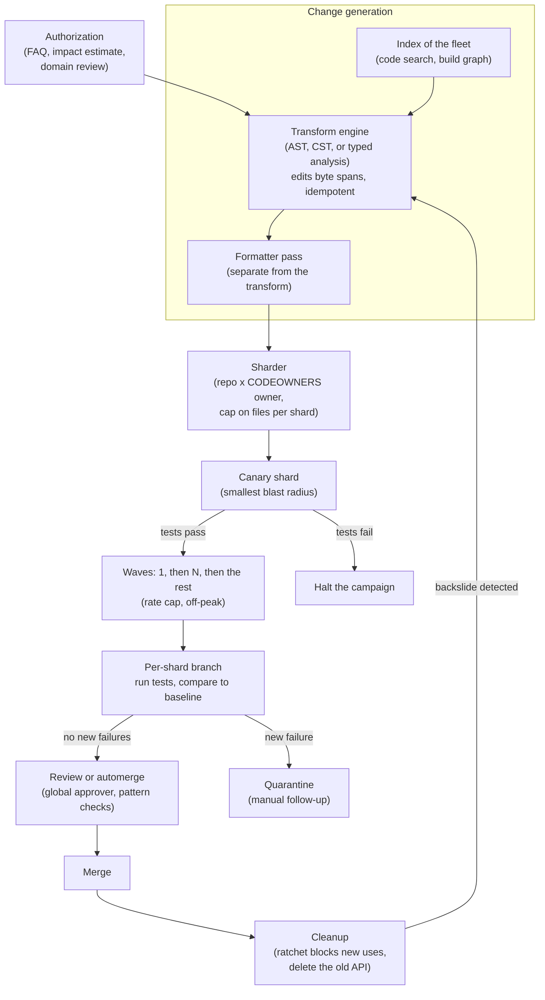

# Large-Scale Changes and Codemods Across Repositories

> [!summary] Claim:
> A large-scale change (LSC) is a set of logically related edits that cannot be committed atomically, so the work is split into a generator, a sharder, a verifier, and a cleanup guard.
> The generator is an automated, idempotent transformation that edits exact source spans from a syntax tree, ideally one backed by type information, so that it touches code and never text that merely looks like code.
> The sharder cuts the global change along repository and ownership boundaries into independently mergeable units, a canary shard goes first, and every shard is tested on its own branch and merged or quarantined, so one bad shard never blocks or poisons the herd.
> Done means the old symbol cannot come back, which is a ratchet in review or CI, and not that the last pull request merged.



## The Mechanism

[[Dependency-Management-Theory-and-Hyrums-Law]] explains why an API change breaks callers nobody knew about, and why a team that owns a library must be able to change it.
This note owns the machinery that makes that possible: how to generate the edits, how to cut them into shards, how to verify and land them, and how to keep them landed.
[[Platform-Engineering-Paved-Roads-and-Deprecation]] owns the policy side (advisory versus compulsory deprecation, migration budgets), and [[Playbook-Execute-a-1000-Repo-Breaking-API-Migration]] is the operational runbook that uses this machinery.

### 1. Why a large change cannot be one commit

Hyrum Wright's definition in *Software Engineering at Google* (Chapter 22) is that an LSC is "any set of changes that are logically related but cannot practically be submitted as a single atomic unit".
The chapter names the barriers, and each one maps to a part of the machinery below:

| Barrier | Mechanism behind it | Machinery that answers it |
| :--- | :--- | :--- |
| Technical limits | Most VCS operations scale linearly with change size; centralized systems block other writers while a huge commit lands | Shards small enough to commit atomically |
| Merge conflicts | The chance of conflict grows with files touched and with the number of engineers in the tree | Regenerate from the transform instead of rebasing by hand |
| Haunted graveyards | Frozen code nobody dares touch blocks every migration | Tests thorough enough to say whether a change breaks it |
| Heterogeneity | Many VCSs, CI systems, formatters, and presubmit rules defeat a single transform | Standardize what you can, selectively skip per-team checks |
| Testing | A 10,000-file change makes a failure a needle in a haystack; a 25-file change does not | Test per shard, run the transitive closure of affected tests |
| Code review | Reviewing a huge generated change is tedious and error prone | Shard, route to a global approver, review with pattern tooling |

The chapter's own observation is counterintuitive: as a codebase and its engineer count grow, the largest atomic change possible decreases, because running every affected presubmit and test and keeping every file current becomes harder.
Russ Cox's Go article gives the quantitative version, which he calls the repair multiplier: when `io.ByteBuffer` became `bytes.Buffer` in 2009, the commit moved two files, adjusted three makefiles, and repaired 43 other Go source files, so repairs outweighed the API change by about twenty to one in a 250-file codebase.
Similar changes in large Go codebases such as Docker, Juju, and Kubernetes had multipliers of 10x to 100x, and inside Google he reports multipliers well over 1000x.
The same article shows that even the "atomic" bytes.Buffer commit was not atomic: it left an `io.ByteBuffer` stub for the protocol compiler, which lived in another repository, and a later commit removed it.
That shape is the one every real LSC takes, and it is the only one that works across repositories, where an atomic commit does not exist.

#### The three-stage gradual repair

Cox's article describes the general recipe, and the chapter's `scoped_ptr` case study follows it:

1. Introduce the new API so that old and new are interchangeable, meaning a single use can be converted without changing program behavior and both can coexist in one program.
2. Convert every use, across as many commits as needed.
3. Remove the old API.

The Google C++ migration from `scoped_ptr` to `std::unique_ptr` is the canonical example: more than 500,000 references across millions of source files, the largest LSC attempted within Google to that point.
At the height of the migration the infrastructure produced, tested, and committed more than 700 independent changes touching more than 15,000 files per day, and later sometimes ten times that throughput.
`scoped_ptr` was a parameter type in some widely used APIs, which made small independent changes difficult, and a call-graph tool that changed an API and its callers in one commit was rejected because its changes would themselves be too large to commit atomically.
The key move was instead to first make `scoped_ptr` a type alias of `std::unique_ptr`, then do a textual substitution of the alias, and only then delete the alias.
The chapter also notes the long tail that stays after the automation is done: nuanced behavior dependencies (Hyrum's Law), races with other engineers, and uses in generated code that the tooling could not see.

The prerequisite is therefore a language or API feature that lets old and new coexist: forwarding functions, type aliases, deprecated re-exports.
Chapter 22 names those features directly: type aliasing and forwarding functions let existing users keep running while a new system is introduced and callers move across many commits.
The `scoped_ptr` migration is the C++ form of the alias: the old name became a type alias of `std::unique_ptr`, a textual substitution followed, and only then was the alias deleted.
Python's backwards-compatibility policy (PEP 387) is the same shape for a library.
The API may gain a new function for the new behavior, and the old entry point warns, usually with `DeprecationWarning`, for at least two years, with five years preferred before removal.
The warnings documentation shows the wrapper form: `warnings.warn(message, DeprecationWarning, stacklevel=2)` attributes the warning to the caller, not to the wrapper.
Since Python 3.13, `@warnings.deprecated` (PEP 702, on the 3.15 warnings page) emits that warning on use and gives static type checkers a diagnostic.
`DeprecationWarning` is ignored by default except when raised from `__main__`, so a test run sees it only with `-Wd` or `PYTHONWARNINGS=default`.
Rust's reference says a `use` declaration qualified by `pub` re-exports a name, and can redirect that public name onto a different target, including one whose canonical path is private.
`pub use new_api::get as fetch` is the shim: old callers keep compiling while the body is the new function.
Edition migrations are a separate tool, `cargo fix --edition`, which still cannot see code in inactive features or `cfg` branches.
The same chapter says statically typed languages make automated change much easier than dynamically typed ones, because compiler-based tools reject invalid transformations before the testing phase.

### 2. Change generation: the engine ladder

The generator decides how much of the change is correct before any test runs.
Engines differ in three properties: whether they preserve the exact bytes they do not touch, whether they know types and symbol identity, and how they merge several fixes into one file.

| Engine class | Examples | Preserves untouched bytes | Knows types and symbols | Failure it cannot avoid |
| :--- | :--- | :--- | :--- | :--- |
| Text | `sed`, `perl`, regex | Yes (it only edits matches) | No | Matches strings, comments, docs, shadowed names; misses aliases |
| Structural pattern | Comby, ast-grep, Semgrep | Yes | Semgrep only, and only shallow in-file types | Semgrep does not treat `A[0]` as an `int` when `A` is `int[]`; Comby and ast-grep have no types |
| Lossless syntax tree | LibCST, jscodeshift (recast), OpenRewrite LST | Yes (whitespace and comments live in the tree) | OpenRewrite attributes types; LibCST offers scope metadata | Syntax-only engines still guess at semantics |
| Lossy AST plus span edits | Python `ast` with byte offsets (the lab) | Yes, if you splice by span | No | You own the span bookkeeping |
| Compiler-backed | ClangMR, clang-tidy, Error Prone, Refaster, `go fix` analyzers, `cargo fix` | Fixes are span replacements | Yes, the compiler's own model | Only code in the build configuration you ran is seen |

Facts behind that table, each from the project's own documentation:

- LibCST's documentation says Python's `ast` module is lossy "like a JPEG": it drops the comment, the newline style, and inter-argument whitespace, so the source cannot be reprinted from it, and LibCST is a lossless concrete syntax tree that "looks and feels like an AST".
  It ships a codemod runner, `python3 -m libcst.tool codemod`.
- OpenRewrite's Lossless Semantic Tree is format-preserving and carries type attribution; the docs give the example that without types you cannot tell whether a `logger` is an SLF4J logger or a Logback logger.
  A recipe is a group of search and refactoring operations over an LST, implemented by a visitor, and recipes compose, for example into a "Migrate to JUnit 5" recipe.
- jscodeshift is a wrapper around recast, which preserves formatting when it reprints.
  It runs transforms in parallel child processes (`--cpus`, default `max(all - 1, 1)`), has `--dry` and `--print`, and prints a summary such as `Results: 0 errors 2 unmodified 3 skipped 5 ok`.
  `--parser` accepts `babel` (the default), `babylon`, `flow`, `ts`, or `tsx`, and `--fail-on-error` returns exit code 1 if any file failed.
- ast-grep rewrites with `ast-grep run --pattern 'foo' --rewrite 'bar' --lang python`, shows a diff by default, applies everything with `-U` (`--update-all`), asks per match with `--interactive`, and supports a YAML `fix:` key with meta variables for larger rules.
- Semgrep searches a syntax tree (`semgrep --pattern`, or a YAML rule) and rewrites a match with a `fix:` key.
  `semgrep --autofix` writes the edit, and adding `--dryrun` previews it without writing.
  `fix-regex` is a regular-expression replacement inside the match, and `fix: ""` deletes the match.
  Within one file it treats some equivalent imports as the same call: the pattern `subprocess.Popen(...)` matches `import subprocess.Popen as sub_popen`.
  Typed metavariables exist, but the pattern-syntax page says type understanding is shallow: given `int[] A`, `A[0]` is not recognized as an `int`, and a field access is not typechecked.
  That sits above a regex and below a compiler-backed fixer.
- Comby is language-aware in a shallow way: it understands balanced delimiters, strings, and comments for many languages without a full parser per language.
- clang-tidy applies compiler-verified fixes with `--fix`, applies fixes even when compilation errors exist with `--fix-errors`, writes fixes to a YAML file for `clang-apply-replacements` with `--export-fixes`, and formats around fixes with `--format-style` (default `none`).
  The export route exists so that fixes can be gathered from many translation units and merged once, which is how it scales.
- Error Prone patches with `-XepPatchChecks:<checks>` and `-XepPatchLocation:<dir>`, which writes `error-prone.patch`, a unified diff you apply with `patch -p0 -u -i error-prone.patch`; the special location `IN_PLACE` edits files directly and is documented as experimental.
- Refaster describes a refactoring as compilable before and after examples (`@BeforeTemplate`, `@AfterTemplate`), compiled to `.refaster` files and applied by the Error Prone compiler.
  It has been used by the Java Core Libraries team across Google's Java codebase (Wasserman, 2013).
- ClangMR combines the Clang compiler framework with MapReduce so that code maintainers can transform large C++ collections "easily and correctly" (Wright et al., ICSM 2013).
  Chapter 22 names the family: ClangMR, JavacFlume, and Refaster run AST-based transformations in parallel over compiler-based indices, and Kythe supplies the cross-reference graph.
- `cargo fix --edition` applies compiler suggestions for a Rust edition, but the Cargo book's `cargo fix` page states it cannot update code for inactive features or `cfg` expressions, so you run it again with `--all-features` and with different `--target` values.

#### What a safe transform has to get right

The lab (`code/09-Engineering-Systems-at-Scale/ast_codemod_campaign/`) implements the lowest rung that is still correct, so that every property is visible in one readable file (about 840 lines including the fixtures and the harness).
It migrates `old_api.fetch(url, timeout_ms)` to `new_api.get(url, timeout_s=...)`, a change that is not a rename because the unit changes from milliseconds to seconds.
The properties that separate a transform from a regex:

1. Edit by byte span, never by reprinting.
   Python's `ast` reports `col_offset` as a UTF-8 byte offset, so a line containing a multibyte character before the call shifts every later column; the lab works on bytes and converts line starts to absolute offsets.
   Because only the matched spans change, comments, blank lines, and trailing commas around them survive.
2. Resolve names, not text.
   The lab collects top-level import bindings (`import old_api`, `import old_api as x`, `from old_api import fetch as f`) and only treats a call as a target if its name resolves to one of them and is not shadowed by a parameter or assignment in an enclosing function.
3. Refuse what you cannot prove.
   A call with `*args`, `**kwargs`, a duplicate keyword, an unknown keyword, or more than two positional arguments is counted as unmigratable and left alone.
   The duplicate-keyword guard has to be explicit: `ast.parse` accepts `f(a=1, a=2)` and only `compile()` raises `SyntaxError: keyword argument repeated` (checked on Python 3.15.2).
   A `getattr(old_api, "fetch")` site is reported, not migrated.
   A generated file (header containing `DO NOT EDIT` or `@generated`) and a file that does not parse are skipped and counted, because the right fix for generated code is in the generator (`go fix` makes the same choice and discards fixes that touch generated files).
4. Change the import only when nothing else uses it.
   If the old module is still referenced elsewhere in the file (the `getattr` case), the lab keeps the old import and adds the new one.
   Replacing it would turn a working file into a `NameError`.
5. Be idempotent.
   A second pass over the transform's own output finds zero edits, which is what lets the campaign re-run safely when users backslide, and what regenerating a shard after a merge conflict, instead of rebasing it by hand, needs.
6. Verify the output parses.
   The transform re-parses what it produced and aborts if the result is not valid Python.
7. Leave formatting to a formatter.
   Chapter 22 says every LSC generator runs the language's formatter (`google-java-format`, `clang-format`) as a separate pass so that transforms need not care about whitespace, and changes look human-written.

#### Testing the transform on fixtures

LibCST defines a codemod as an automated refactor that can be applied to a codebase of arbitrary size, and it says to prove the transform with tests before running it across a repository.
`CodemodTest` is a `unittest.TestCase`: set the `TRANSFORM` class attribute to the codemod and call `assertCodemod(before, after)`.
That assertion also checks warning strings, in order, and an expected skip when `expected_skip=True`.
`should_allow_multiple_passes` repeats the transform until the tree stops changing, which is the fixed point `go fix` reaches by being run again.
`ScopeProvider` records assignments and accesses and follows Python's function scope, not block scope, which is the metadata a name-resolving codemod needs.
The lab is that test without the library: a hand-counted table of call lines, a second pass that must report zero edits, four refusal shapes that must stay byte-for-byte unchanged, and a real `unittest` failure that quarantines one shard.

#### Merging many fixes in one file

`go fix` in Go 1.26 documents the cleanest published merge model.
Each analyzer's fix is conceptually independent, like git commits with the same parent, and the driver applies them in sequence with a three-way merge: a fix that conflicts with the edits accumulated so far is discarded, with a warning that the tool should be run again.
This catches syntactic conflicts but not semantic ones: two fixes that each remove the second-to-last use of a local variable are individually fine and together leave an unused variable, a compile error in Go.
The driver therefore adds one final pass that removes imports made unused by the combined fixes, and the blog recommends running `go fix` until it reaches a fixed point, noting that twice is usually enough because one fix can enable another (for example `minmax` applied twice to a clamp).
Because analysis is per build configuration, it also says to run once per `GOOS` and `GOARCH` for files tagged for other platforms, which is the same lesson as `cargo fix --target`.

#### Source-level inlining as a self-service transform

The Go team's `//go:fix inline` directive turns a deprecated forwarding function into a migration: annotate the old function, and `go fix` replaces each call with a copy of the body, substituting arguments for parameters.
Because the replacement is the callee's own body and not an arbitrary rewrite, the blog argues behavior is preserved "barring code that inspects the call stack", whereas it describes rewrite rules such as `gofmt -r` as very powerful but needing to be watched closely.
The hard part is correctness at the edges: the blog says the inliner is about 7,000 lines of dense, compiler-like logic, with parameter elimination, side-effect ordering, and shadowing among the problems it handles.
The same post reports that equivalent tools for Java, Kotlin, and C++ have eliminated millions of calls to deprecated functions inside Google, that engineers "add the directives, and wait" while robots prepare and submit batches overnight, and that the Go inliner had been used to prepare more than 18,000 changelists to the monorepo (as of 2026-03).
The design point for a toolchain team is that the library owner, not a central migration team, ships the migration as data next to the API, which scales with the number of libraries rather than with the size of a central team.

The `go fix` blog also records a case where a plausible modernizer was kept out of `go fix`: replacing `append([]string{}, slice...)` with `slices.Clone(slice)` changes the result from an empty non-nil slice to `nil` when `slice` is empty, which can matter, so that modernizer was excluded from the suite.
Fixers must be correct in obscure edge cases because users apply hundreds of them with cursory review.

### 3. Codebase insight: knowing what to change

A transform needs a list of sites, and the list has to be complete or the old API never dies.
Chapter 22 describes two layers: textual search for small changes, and semantic indexes (Kythe: callers of a function, subclasses of a class) plus compiler-based indices for AST-level work.
The human effort to produce the change set should scale sublinearly with the codebase, and the rule of thumb from the chapter is that a change needing more than 500 edits is usually cheaper to generate with a tool than to do by hand, and for experienced "code janitors" the threshold is much lower.
[[Code-Search-and-Semantic-Indexing-at-Scale]] owns how those indexes are built; this note only requires that the index exist and be fresh enough to drive a generator.
Outside a monorepo, the same role is played by a code-host search: turbolift's workflow starts from a `repos.txt` produced by a code search, multi-gitter accepts a GitHub code search query, and Spotify ingests all source from GitHub into BigQuery daily so that shift authors can find, for example, all repositories containing production data pipelines that call a particular method and also use version 2.3 of some library.

### 4. Sharding along ownership

A global change is too large to test or land as one unit, so the sharder splits it along two boundaries that both come from the world and not from the diff.

- **Atomicity boundary.** A shard cannot cross a repository, because there is no atomic commit across repositories.
  Inside a monorepo the boundary is whatever the tooling can commit atomically and test.
- **Ownership boundary.** A shard should have reviewers who can approve it, which in practice means an `OWNERS` or `CODEOWNERS` file.

Google's Rosie, as described in Chapter 22, "takes a large change and shards it based upon project boundaries and ownership rules into changes that can be submitted atomically" and puts each shard through an independent test-mail-submit pipeline.
It is also a good citizen: it caps the number of outstanding shards per LSC, runs at lower priority, and negotiates with shared infrastructure how much load it may generate.
Reviewer discovery uses an owners service that weights each owner by their expected ability to review the specific shard, and it adds reviewers automatically when one is unresponsive.
Shards that depend on each other (a header and its implementation) must be grouped into one shard, since each shard must be committable independently.

On GitHub the equivalent ownership data is `CODEOWNERS`, with semantics the sharder must reproduce exactly (as of 2026-11, GitHub):

- The file lives in `.github/`, the repository root, or `docs/`.
- The last matching pattern takes precedence, so order matters: a broad `*` line must come first.
- Gitignore negation with `!` does not work, and a line with invalid syntax is skipped.
- The file must be under 3 MB or it is not loaded at all.

The lab implements a subset (`*`, `/dir/`, `/path`, and `*.ext`) with last-match-wins, shards by repository and owner, and caps a shard at two files.
Its eight shards come from six repositories: the `monolith` repository yields four because its `CODEOWNERS` assigns `core/a.py`, `core/b.py`, and `core/d.py` to the platform team (two shards because of the cap), `core/c.py` to infra by a later, more specific line, and `ads/x.py` to ads.
A cap matters because a shard is also the unit of rollback and of review attention, and because test selection grows with the files a shard touches.

### 5. Verification: from a shard to a fleet

#### Per-shard tests

Chapter 22's rule is to run, for each shard, the transitive closure of every test it might affect, and not the project-based presubmit set, because a shard can contain arbitrary files.
Small shards trade extra compute for diagnosability: the authors accept that smaller changes rerun the same tests, because engineer time spent chasing failures costs more than compute.
Most shards affect fewer than 1,000 tests out of millions; for the ones that affect more, shards are grouped, the union of affected tests runs first, and each shard then runs only the intersection of its affected tests with those that failed, which makes adding shards to a batch nearly free.

#### The TAP train

For LSCs, Google batches change validation on a train that starts fresh every three hours, as described in the chapter:

1. For each change on the train, run a sample of 1,000 randomly selected tests.
2. Combine the changes that passed into one uber-change, "the train".
3. Run the union of all tests affected by the group, which for a low-level change can be every test in the repository and can take more than six hours.
4. For each non-flaky failing test, rerun it individually against each change on the train to find the culprit.
5. Report passing and failing targets for each change, as evidence that it is safe to submit.

The train works because LSCs rarely interact and are mostly pure refactorings, so most tests pass for most LSCs and one combined run replaces many.
The chapter also records a pragmatic stance on flakiness: for machine-generated, semantics-preserving changes, Google is now more confident in a single change than in a test with a recent flaky history, so recently flaky tests are ignored when submitting through the automated tooling.
Flaky tests nonetheless drag LSC throughput, and the authors say the cost has to be pushed back to the teams that own them; [[Build-and-Test-Latency-Economics-and-Flaky-Tests]] owns that economics, and [[Playbook-Quarantine-and-Eliminate-Flaky-Tests]] owns the response.

#### Pre-existing failures

Rosie "aggressively" ignores presubmit failures that predate the change, because an LSC author cannot be expected to fix every team's backlog, and the social contract is that local owners keep their trees free of pre-existing failures.
The lab encodes the same rule: a shard passes when its failing-test count after the change is not greater than the count before it, and the baseline is measured on the same repository just before each shard.

#### Canary and waves

The lab makes the rollout policy explicit, and the thresholds are the lab's own parameters and not published numbers.
Chapter 22 does not use the word canary.
Its published batching mechanism is the TAP train above, and deploying first to a small slice of production is a different chapter's topic (continuous integration).
The single-shard-first halt rule in this note is the lab's rollout policy.
Shards are ordered by blast radius (call sites, then name), wave 0 is a single canary, then two shards, then the rest.
A failing canary halts the campaign, and in a later wave a failure rate above one half halts it.
A failing shard is quarantined, meaning its branch is dropped and the shard is handed to a human, instead of being force-merged.

The same shape appears at ecosystem scale in Rust's Crater, which compiles and tests every crate on crates.io (and a few from GitHub) to measure the breakage of a compiler change.
The Rust compiler guide gives its limits, which are the limits of any canary population: not all code is on crates.io, only Linux x86_64 builds are run (so Windows is not tested), many crates are excluded because they no longer compile or have flaky tests, and runs take about 3-4 days for check-only and 5-6 days for build-and-test (as of 2026-11).
A passing canary population bounds the risk; it does not remove it.

#### Post-merge health

Spotify's automerger adds a layer after merge.
It lets the change author, not the repository owner, decide that a shift may merge automatically once tests pass, throttles the merge rate to avoid overloading CI, and merges only during working hours of the owning team, never on weekends or holidays.
A service called Firewatch consumes deployment and pipeline events and correlates failed deployments with recently automerged pull requests, alerting the change owners when too many correlate.
Automerge was first enabled for one shift (a daily Java BOM bump) and one criticality phase of backend components at a time.
An important incentive effect is reported: if the tests cannot catch a bad change, that is a signal to the owner to add tests, and teams raised their Soundcheck scores so that more of their code could be maintained automatically.

### 6. Review: scaling the human step

The chapter says plainly that review does not disappear for LSCs, but the unit of review changes.
Many first-time authors assume local project owners must review everything; one of the most common changes the oversight committee makes is to route all reviews to one "global approver" who understands the change and its failure modes.
Global approvers use a separate set of pattern-based tools to auto-approve the shards that match expectations and manually examine only anomalies from merge conflicts or tool bugs.
Local owners get only the changes for which their review is required for context, not merely for approval rights, because they trust infrastructure teams to the point of cursory review.
[[Code-Review-and-Readability-Systems-at-Scale]] owns review SLAs and readability certification; this note owns the observation that review economics invert once generation is nearly free: Google notes that the costs of generating and reviewing were historically symmetric, which limited the scope of changes one engineer could produce, and cheap generation made it equally easy for one engineer to burden many reviewers.
That asymmetry is why Google has a lightweight approval process for LSCs, run by a group of experienced engineers.

### 7. Governance and authorization

Google's authorization step is a short document with the reason for the change, an estimate of its impact (how many shards it will generate), and an FAQ and proposed change description for an engineer unfamiliar with it, plus a "domain review" by the owners of the API.
It goes to a list of about a dozen people with oversight, who give feedback, often directing reviews to a global approver, and who act as the escalation body when a local owner objects.
The chapter reports that the committee has been very liberal, approving broad sets of related changes, and has outright rejected only changes judged dangerous (converting every `NULL` to `nullptr`) or extremely low value (switching British and American spelling), with the threshold falling as the cost of LSCs fell.
It also records the cultural shift that made this work: local owners can ask questions and authors answer as in any review, but owners "don't hold a veto over the broader LSC".
Operation RoseHub is the external version of the same process: after a 2017 Apache Commons vulnerability (Mad Gadget), volunteers used BigQuery to find affected open-source projects and sent more than 2,600 patches, with more than 50 humans doing the work in place of automation.

### 8. Cleanup: done means it cannot come back

Chapter 22's definition of done varies per LSC, from removing the old system entirely to migrating only high-value references and letting the rest disappear, with the sobering footnote that the systems one most wants to see decompose organically are the most resilient to doing so.
It is explicit about the guard: "it's important to have a system that prevents additional introductions" of the old symbol, and at Google that is Tricorder flagging a new use of a deprecated object at review time.
The reasons people backslide are mundane: copy-paste from existing examples, commits that were in development before the migration, and habit.
The lab's stage 4 shows a ratchet in its simplest form, a per-file count of old-API sites recorded after the campaign and a check that no file's count increases: a new file with an old call fails the check, the generator re-runs, produces exactly one new shard, and the check passes again.
[[Static-Analysis-at-Scale-Tricorder-and-Autofix]] owns the review-time analyzer that is the production form of that ratchet, and [[Platform-Engineering-Paved-Roads-and-Deprecation]] owns the deprecation policy that decides when the old API may be deleted.

### 9. The multi-repository delivery layer

Without a monorepo, the delivery of shards is a separate engineering problem: clone, run the transform, commit, push, open a pull request, track it, and merge it, for hundreds of repositories, under API rate limits.

| Tool | Model | Notable documented behavior |
| :--- | :--- | :--- |
| Sourcegraph Batch Changes | A YAML batch spec: `on:` selects repositories, `steps:` run commands in containers, `changesetTemplate:` describes the commit and PR | Preview diffs before applying; applied changesets stay unpublished until you publish them, as drafts if the code host supports them |
| turbolift | Six phases: init, list repos in `repos.txt`, clone, change, commit, create PRs | Campaign name is the branch name; `--draft` PRs; `--sleep` to space out PR creation; supersedes Skyscanner's centralized Codelift |
| multi-gitter | Run a script across repositories, then create PRs | `--dry-run`; concurrency configurable with `concurrent` (the sample config shows `1`); `conflict-strategy: skip`; optional auto-merge |
| git-xargs | Clone, run a command, commit, open PRs, print a report | Uses goroutines to update repositories in parallel |
| Fleetshift (Spotify, internal) | A shift is a Docker image run against each target repository as a Kubernetes Job; shift resources are YAML in a repository | Targets chosen by GitHub search or BigQuery; shifts can be one-off or recurring on weekdays; PR creation, tracking, and automerge are platform features |

Spotify's numbers for this model, from its engineering blog (as of the 2023 posts): in 2022 Fleetshift created more than 270,000 pull requests, 77% automerged and 11% merged by a human, and the 241,000 merged pull requests represented 4.2 million lines of code changed.
Its Java BOM (a bill of materials that pins many library versions in one artifact) was used by 96% of production backend services, with 80% on a version less than seven days old, which let 80% of production backend services be patched within 9 hours when Log4j was disclosed in late 2021.
Before fleet management, one Java runtime upgrade took eight months and about 2,000 semi-automated pull requests; a new version of the internal service framework took about 200 days to reach 70% of backend services and now takes less than 7 days.
The architectural lesson is the one in Chapter 22 in different clothes: a platform team owns the machinery, and each library team owns its own migration (Spotify says explicitly that it does not want a single refactoring team rolling out other teams' changes), and the machinery must make a ten-repository change and a thousand-repository change equally easy.

#### GitHub limits that shape a campaign

GitHub documents these limits, which bound how fast a code-host-based campaign can run (as of 2026-11, GitHub.com REST API):

- Primary limit for an authenticated user: 5,000 requests per hour.
  `GITHUB_TOKEN` in Actions: 1,000 requests per hour per repository.
- Secondary limits: no more than 100 concurrent requests, no more than 900 points per minute per REST endpoint, and in general no more than 80 content-generating requests per minute and 500 per hour, with some endpoints lower.
  The documentation says these may change without notice and that there is no way to check the status of a secondary limit.
- The best-practices page says to make requests serially, to wait at least one second between mutative requests (POST, PATCH, PUT, DELETE) when making many of them, and to honor `retry-after` and `x-ratelimit-reset` on 403 and 429 responses, backing off exponentially if limits persist.

As arithmetic and not a measurement: if opening one pull request costs at least one content-generating request, 500 per hour puts a floor of two hours on opening 1,000 pull requests, and any additional content-creating call per pull request (a push-triggered event, a comment, a review request) raises the floor.
A campaign tool therefore needs a queue, a pause between writes, and the shard-count cap that Rosie applies for the same reason.

## Commands and Numbers to Know

| Item | Value | Platform and date | What it controls |
| :--- | :--- | :--- | :--- |
| `go fix ./...` | Silently rewrites; `-diff` previews; discards fixes to generated files | Both (as of 2026-11, Go 1.26) | Applies modernizers and `//go:fix inline` fixes |
| `go tool fix help` | Lists registered analyzers; `help <name>` documents one | Both (as of 2026-11, Go 1.26) | Discover fixers; `-any` runs one, `-any=false` excludes one |
| `GOOS=... GOARCH=... go fix ./...` | One build configuration per run | Both (as of 2026-11, Go 1.26) | Coverage of platform-tagged files |
| `cargo fix --edition` | Needs `--all-features` and `--target` runs for gated code | Both (as of 2026-11) | Rust edition migration; cannot fix inactive `cfg` code |
| `cargo fix --allow-dirty`, `--allow-staged`, `--broken-code` | Flags that relax the clean-tree check or fix broken code | Both (as of 2026-11) | Run the fixer in a dirty tree; avoid in campaigns |
| `clang-tidy --fix`, `--fix-errors`, `--export-fixes=<file>` | `--format-style` defaults to `none` | Both (as of 2026-11) | Apply fixes directly, despite errors, or export YAML for `clang-apply-replacements` |
| `-XepPatchChecks`, `-XepPatchLocation` | Location may be a directory or `IN_PLACE` (experimental) | Both (as of 2026-11) | Error Prone patch generation |
| `jscodeshift --cpus` | Default `max(all - 1, 1)`; `--dry`, `--print`, `--parser` | Both (as of 2026-11) | Parallel JS and TS codemods |
| `ast-grep run -p P -r R -l LANG`, `-U` | Prints a diff; `-U` applies | Both (as of 2026-11) | Structural search and rewrite |
| `semgrep --autofix`, `--dryrun` | Applies a rule's `fix:`; `--dryrun` previews and does not write | Both (as of 2026-11) | Structural rewrite; types are shallow and in-file |
| `python3 -m libcst.tool codemod` | Runs a LibCST codemod command | Both (as of 2026-11) | Lossless Python codemods |
| Rule of thumb: more than 500 edits | Learn the tool instead of editing by hand | Both (as of the 2020 book) | When generation pays off |
| TAP train | Every 3 hours; 1,000 random tests per change; union run over 6 hours | Google internal (as of the 2020 book) | LSC validation batching |
| Rosie caps | Outstanding shards per LSC are capped; low priority | Google internal (as of the 2020 book) | Load on shared CI |
| Secondary rate limit | 80 content requests per minute and 500 per hour | GitHub.com (as of 2026-11) | Rate of PR creation |
| CODEOWNERS | Last match wins; under 3 MB; no `!` negation | GitHub.com (as of 2026-11) | Shard ownership |
| Crater run time | 3-4 days check-only; 5-6 days build and test | Rust project (as of 2026-11) | Ecosystem canary latency |

## Multi-Language Comparison: C++ / Python / Rust

Each language answers the same four questions: what engine sees the code, how the old and new API coexist during the migration, which tool applies compiler-checked fixes, and what the engine cannot see.

| Concern | C++ | Python | Rust |
| :--- | :--- | :--- | :--- |
| Engine with type knowledge | Clang-based: clang-tidy, ClangMR | LibCST (lossless, scope metadata); the lab's `ast` is lossy but exact for spans | The compiler itself: `cargo fix` applies rustc suggestions |
| Fix application | `clang-tidy --fix` or `--export-fixes` plus `clang-apply-replacements` | Codemod commands under `libcst.tool` | `cargo fix`, `cargo fix --edition` |
| Coexistence during migration | Type alias or forwarding function (Chapter 22); `scoped_ptr` became an alias of `std::unique_ptr` | A wrapper that calls the new API and warns (`DeprecationWarning`, PEP 387); `@warnings.deprecated` since 3.13 | A `pub use` re-export of the new item under the old name (Rust Reference); `cargo fix` for editions |
| What it cannot see | Code outside the compiled configuration, macros, generated code | `getattr` and string-built names, monkeypatching, runtime imports, mocks | Code in inactive features or `cfg` branches |
| Hardest long-tail break | Behavior dependence (Hyrum's Law) in code the index does not cover | Tests that patch the old name (the lab's ledger shard) | Platform-specific code not built on the run machine |

The chapter's claim that statically typed languages are much easier for automated change than dynamic ones is visible in the lab: the Python transform needed name resolution, shadow analysis, and a manual-report bucket for `getattr`, and it still could not see one test that patches the old name.
The coexistence row is the same idea in each language, and each cell is the feature named by the source in that cell, not a second mechanism.

## Worked Lab Example

The lab is `code/09-Engineering-Systems-at-Scale/ast_codemod_campaign/`; it needs only `git` and `python3` (3.9 or newer, because it uses `ast` end positions, added in 3.8, and keyword node positions, added in 3.9 by bpo-40141) and no network.

```bash
cd code/09-Engineering-Systems-at-Scale/ast_codemod_campaign
bash run.sh
```

`run.sh` pins git identities, dates, and config, then runs `campaign.py`, which builds a fleet of six git repositories in a temporary directory, with a tiny `old_api` and `new_api` library that return the timeout in seconds so that tests can check the unit conversion.
The fleet contains, deliberately:

- `auth`: an aliased from-import (`from old_api import fetch as f`) and a multibyte character before the call on the same line.
- `billing`: a multi-line call with comments, a keyword call with a computed timeout, a function whose parameter is named `old_api`, a docstring and a string that mention `old_api.fetch(`, a generated file, and `refusals.py` with four real calls the transform must refuse (`*args`, `**kwargs`, an unknown keyword, and a duplicate keyword).
- `ledger`: a call whose test uses `mock.patch("store.old_api.fetch")`.
- `search`: a `getattr(old_api, "fetch")` call, a Python 2 file that does not parse, and a TOML file that mentions the name.
- `monolith`: five files with `CODEOWNERS` rules that exercise last-match-wins.
- `docs`: only text and comments that mention the old API.

Stage 1 compares a regex rewrite with the AST transform and shows the actual diff for `billing/client.py`:

```text
== 1. Text codemod versus AST codemod
fleet: 6 repos, baseline tests pass in all, migratable call sites (hand-counted truth): 10
regex 'old_api.fetch(' over every non-test file: 21 hits, 9 correct, 8 false positives, 4 refused by the AST, 1 call sites missed
refusal fixtures left untouched: *args, **kwargs, unknown keyword, duplicate keyword (4)
regex rewrite of billing: 4 of 4 tests fail
AST codemod on billing/client.py: 2 sites migrated, 0 unmigratable; diff:
  --- a/client.py
  +++ b/client.py
  @@ -1,2 +1,2 @@
  -import old_api
  +import new_api
   
  @@ -7,5 +7,5 @@
       # first attempt uses a tight timeout
  -    return old_api.fetch(
  +    return new_api.get(
           url,  # the endpoint
  -        2500,  # milliseconds
  +        timeout_s=2.5,  # milliseconds
       )
  @@ -14,3 +14,3 @@
   def retry(url, delay_ms):
  -    return old_api.fetch(url=url, timeout=delay_ms * 2)
  +    return new_api.get(url=url, timeout_s=(delay_ms * 2) / 1000)
   
second pass over its own output: 0 edits (idempotent)
skipped: legacy_gen_pb2.py (generated), broken.py (parse-error); reported not migrated: 1 getattr(old_api, 'fetch') site
search/engine.py keeps the old import because getattr still needs it: ['import old_api', 'import new_api']
auth/session.py, multibyte character before the call: banner = "caf\xe9"; return new_api.get(token_url, timeout_s=1)
```

Recorded on darwin-arm64 on 2026-11-26 with Python 3.15.2 and git 2.55.0; the file is `code/09-Engineering-Systems-at-Scale/ast_codemod_campaign/expected/darwin-arm64.txt`.

Reading stage 1:

- The regex finds 21 lines: 9 are real call sites the AST migrates, 4 are real calls the AST deliberately refuses (the `billing/refusals.py` fixtures), and 8 are not call sites at all: a shadowed parameter, a docstring, a string, a generated file, a file that does not parse, a comment, a string in `notes.py`, and a README line.
  A blind regex rewrite would have rewritten all 4 refused calls with no way to convert their arguments.
  It also misses the aliased call in `auth`, which does not contain the text `old_api.fetch(`.
- A regex rewrite of `billing` fails all 4 of its tests, for four different reasons: no unit conversion, the keyword name changes, the shadowed parameter, and the prose.
- The AST diff leaves the comments and the trailing comma alone, converts `2500` to `2.5` exactly, wraps a computed value as `(delay_ms * 2) / 1000`, and replaces `import old_api` with `import new_api` because nothing else uses the old name.
- The `search/engine.py` output shows the import-retention rule, and the `auth` line shows that the byte-offset arithmetic survives the two-byte `e` with acute accent (printed as `\xe9` to keep the output ASCII).

Stages 2 and 3 shard the change and roll it out:

```text
== 2. Shards (repository x CODEOWNERS owner, at most 2 files each)
  auth/@team-identity#1      files=1 calls=1
  ledger/@team-pay#1         files=1 calls=1
  monolith/@team-ads#1       files=1 calls=1
  monolith/@team-infra#1     files=1 calls=1
  monolith/@team-platform#2  files=1 calls=1
  search/@team-search#1      files=1 calls=1
  billing/@team-pay#1        files=1 calls=2
  monolith/@team-platform#1  files=2 calls=2
```

```text
== 3. Rollout: canary, then waves; a failing shard is quarantined
  wave 0  auth/@team-identity#1      files=1 calls=1  failing 0 -> 0  MERGED
  wave 1  ledger/@team-pay#1         files=1 calls=1  failing 0 -> 1  QUARANTINED
  wave 1  monolith/@team-ads#1       files=1 calls=1  failing 0 -> 0  MERGED
  wave 2  monolith/@team-infra#1     files=1 calls=1  failing 0 -> 0  MERGED
  wave 2  monolith/@team-platform#2  files=1 calls=1  failing 0 -> 0  MERGED
  wave 2  search/@team-search#1      files=1 calls=1  failing 0 -> 0  MERGED
  wave 2  billing/@team-pay#1        files=1 calls=2  failing 0 -> 0  MERGED
  wave 2  monolith/@team-platform#1  files=2 calls=2  failing 0 -> 0  MERGED
merged 7, quarantined 1: ['ledger/@team-pay#1']
```

Reading stages 2 and 3:

- The eight shards come from the CODEOWNERS file of `monolith` (platform has three files and is split by the two-file cap; infra owns `core/c.py` by a later rule) plus one shard each for `auth`, `billing`, `ledger`, and `search`; `docs` has no shard because the AST finds nothing to change.
- Wave 0 is the single canary, `auth`, and it passes; the `ledger` shard goes in wave 1 and goes from 0 failing tests to 1, so it is quarantined, and the other seven merge.
- The `ledger` failure is the Hyrum's Law break: its test patches the attribute `store.old_api.fetch`, and after the correct transform `store` no longer has an `old_api` name.
  No syntax tree could have predicted that without also reading the test, which is why the test run is the verifier and not the transform.
  On Python 3.15.2 here, `mock.patch("store.old_api.fetch")` against a module that no longer has `old_api` raises exactly that `AttributeError`.

Stages 4 and 5 measure burndown, re-run, and a failing canary:

```text
== 4. Burndown, re-run, ratchet
category                                     before  after
static call sites (codemod handles)              10      1
unmigratable call sites (manual)                  4      4
getattr(old_api, 'fetch') sites (manual)          1      1
generated files skipped (fix the generator)       1      1
unparsable files skipped                          1      1
text-only or shadowed mentions (untouched)        7      7
re-plan after merge: 1 shard(s) with edits: ['ledger/@team-pay#1']
ratchet after a copy-pasted old call lands: violations=['auth/extra.py']
re-run generates 1 shard (MERGED), ratchet violations after merge: []
```

```text
== 5. A failing canary halts the campaign
canary forced to the ledger shard:
  wave 0  ledger/@team-pay#1         files=1 calls=1  failing 0 -> 1  QUARANTINED
  HALT after wave 0: 7 shard(s) not started
repositories left unchanged: 10 call sites still old
```

Reading stages 4 and 5:

- After the campaign one static site remains (the quarantined `ledger` call); the four refused calls stay at 4 before and after, are manual work, and never open a shard; the getattr site, the generated file, the unparsable file, and seven text-only or shadowed mentions are unchanged, which proves the transform did not edit text that only looks like code.
- The re-plan finds only the quarantined shard, so a second run of the whole campaign is a no-op apart from retrying it.
- The ratchet catches the copy-pasted call in `auth/extra.py`; re-running the generator yields exactly one shard, it merges, and the ratchet is clean.
- In the second fleet the canary is forced to be the `ledger` shard: it fails, the campaign halts with seven shards never started, and all ten sites are unchanged.

The lab's checks can fail: the regex baseline must show false positives and misses, the naive rewrite must break tests, the AST site counts must match a hand-counted table per file, the transform must be idempotent, the skip rules must fire, only the ledger shard may be quarantined, the re-run must converge, and a failing canary must leave every repository unchanged.
The harness check `make verify` passed on darwin-arm64 against this recorded output; the lab was not run on Linux, and no coverage, mutation, or repeated-platform checks were run.

## Pitfalls

> [!warning] Pitfall: treating a codemod as search and replace
> A regex matches strings, comments, docstrings, generated files, and shadowed names, and misses aliased imports; in the lab it produced 8 false positives and 1 miss on 10 real sites, and broke every test in the repository it rewrote.
> Anchor on a syntax tree, resolve names, and report the cases you refuse instead of guessing.

> [!warning] Pitfall: character offsets where the parser gives bytes
> Python's `ast` columns are UTF-8 byte offsets, so slicing a `str` by `col_offset` corrupts any line with a multibyte character before the node.
> Work on bytes, or convert explicitly, and keep a fixture with a multibyte character on the same line as a target.

> [!warning] Pitfall: a rename when the semantics changed
> The lab's units change from milliseconds to seconds, so a rename passes the type checker and ships a 1000x timeout error.
> Every migration needs a test that would fail if the argument were passed through unchanged, and the transform must compute the conversion, with parentheses for any non-atomic expression.

> [!warning] Pitfall: removing an import that is still used
> If any other reference to the old module remains (a `getattr`, an unmigrated call), replacing the import turns a working file into a `NameError`.
> Count remaining references before replacing; otherwise keep the old import and add the new one.

> [!warning] Pitfall: trusting the transform where the tests do not look
> The `ledger` shard is a correct transform that breaks a test that patches the old name; a repository with no such test would have merged silently and failed in production.
> Spotify's answer is to treat insufficient tests as a signal to the owner and to watch deployments after automerge (Firewatch), and Google's is the transitive test closure.

> [!warning] Pitfall: leaving the generator out of generated code
> Edits to generated files are overwritten at the next build, so the fix has to go in the generator or the template, and a transform that silently edits them only creates churn.
> Skip and count them, as the lab and `go fix` do, and track the generator change separately.

> [!warning] Pitfall: one build configuration
> `go fix` and `cargo fix` analyze one configuration per run, so files tagged for other platforms or features are never seen.
> Run once per `GOOS` and `GOARCH`, or per `--target` and feature set, and diff the results.

> [!warning] Pitfall: stale comments and non-idempotent output
> The lab's diff leaves the comment `# milliseconds` next to a value now in seconds; transforms rarely rewrite prose.
> Separately, a transform that is not idempotent cannot be re-run after backsliding, so test `transform(transform(x)) == transform(x)` on every fixture.

> [!warning] Pitfall: ordering CODEOWNERS rules wrongly
> Because the last match wins, a broad rule placed after a specific one silently re-routes the specific files to the wrong reviewers, and an invalid line is skipped without failing.
> Assert in the sharder that every file in a shard has the owner you expect, and lint the file in CI.

> [!warning] Pitfall: declaring victory at the last merge
> Without a ratchet, copy-paste and old branches reintroduce the symbol, and the old API can never be deleted.
> Ship the guard with the first shard, not after the last one.

> [!warning] Pitfall: overloading shared infrastructure and the code host
> A thousand pull requests opened at once saturate CI and trip the 80 per minute and 500 per hour content limits.
> Cap outstanding shards, pause between writes, and space PR creation (turbolift's `--sleep`, Rosie's caps).

## At Scale

For one developer, a codemod is a script run over one repository with `git diff` as the safety net.
For 10 to 100 repositories under one organization, a campaign directory with a list of repositories and a script (turbolift, multi-gitter, git-xargs) is enough, if the first batch is small and draft.
From 1,000 to 50,000 engineers the problem becomes the review and verification capacity of the organization, and not the generator, and the economics invert: generation is nearly free, and every shard costs review attention, CI, and a chance of a production incident.

Decision rules:

- A change needing more than about 500 edits justifies tooling (Chapter 22's rule of thumb); below that, edit by hand.
- If the change is a pure rename or move, add an alias or forwarding function first and migrate callers to it, so shards are independent and reversible.
  If the API cannot be aliased, expect to need a call-graph change or a lockstep change, and weigh that against not making the change.
- Pick the engine by what has to be known: syntax only (Comby, ast-grep) for mechanical edits, a lossless tree (LibCST, OpenRewrite) when formatting must survive, and a compiler-backed analysis when correctness depends on types or overload resolution.
- Ship the migration as data with the API when you can (`//go:fix inline`, Refaster templates, OpenRewrite recipes), so that library owners, and not a central team, scale the migration.
- Choose the review model by risk: a global approver with pattern-based review for mechanical changes; owner review for changes where domain context matters.
- Choose the landing model by test strength: automerge only where tests and deployment monitoring (Spotify's automerger and Firewatch) can catch a bad change, and treat weak tests as a finding, not a reason to avoid the migration.
- Always run a canary and waves, cap outstanding shards, and run off-peak; quarantine failures instead of forcing them.
- Write the definition of done and the ratchet before the first shard; if the old system cannot be deleted, say which references will be left and why.

The chapter's governing caution is that tooling reduces the cost of making changes, so an approval process is needed to keep the volume of change purposeful; Google's committee exists so that LSCs are not used to fight about "gray" versus "grey" in comments.
[[Playbook-Execute-a-1000-Repo-Breaking-API-Migration]] turns these rules into a runbook, [[Playbook-Write-a-Toolchain-Migration-RFC]] covers how to justify one, and [[AI-Coding-Agents-Sandboxes-Worktrees-and-Ship-Gates]] covers what changes when the generator is an LLM agent instead of a deterministic transform: output is no longer idempotent or reproducible, so the verification and review layers above carry more of the weight.

## Practice Drill

> [!tip] Practice Drill:
> Extend the lab so that one more shard is quarantined for a different reason, and predict the output before running.
> First, add a repository whose test asserts on the exact text of an exception raised by the old API and predict whether the shard is quarantined and which test count changes.
> Second, make `new_api.get` reject `timeout_s` values above 100 and add a call whose old timeout is `500000`; decide whether the transform should refuse it or the test should catch it, and implement the choice.
> Third, change one `CODEOWNERS` file so that a broad `*` rule comes after `/ads/`, predict which shards change owner, and add the assertion that would have caught it.
> Stretch: replace the Python `ast` span edits with LibCST (install it with `pip` in a separate directory), keep the same fixtures, and compare which of the lab's checks the lossless tree makes unnecessary.

## Interview Questions

> [!question] L5: Why does Google not make a sweeping change as one big commit, and what does it do instead?
>
> > [!success]- Answer
> > The largest atomic change possible shrinks as the codebase and the number of engineers grow: the version control system, the tests, the reviewers, and merge conflicts all stop scaling with change size.
> > Across repositories an atomic commit does not exist at all.
> > Instead the change is generated by a tool, split into shards along ownership boundaries, and each shard is tested, reviewed, and submitted independently, using a compatibility shim so that old and new can coexist during the migration.

> [!question] L5: Why is a regex or `sed` codemod unsafe for a real API migration?
>
> > [!success]- Answer
> > Text matching cannot tell code from strings, comments, or docstrings, cannot resolve an alias or a shadowed name, and cannot compute a semantic change such as a unit conversion.
> > In the lab's fleet the regex produced 8 false positives and missed an aliased call, and rewriting one repository broke all 4 of its tests.
> > A syntax-tree transform resolves names and edits exact spans, and it reports the cases it cannot prove instead of guessing.

> [!question] L6: Predict the output of the lab's transform on each of these calls?
>
> Each call is in a module whose only reference to the old API is `import old_api`.
>
> ```python
> old_api.fetch(u, 2500)
> old_api.fetch(u, timeout=ms)
> old_api.fetch(u, timeout=delay_ms * 2)
> ```
>
> > [!success]- Answer
> > The first becomes `new_api.get(u, timeout_s=2.5)`, because an integer literal is converted exactly with `Decimal` and the positional argument becomes a keyword.
> > The second becomes `new_api.get(u, timeout_s=ms / 1000)`: a bare name is atomic, so it is not parenthesized.
> > The third becomes `new_api.get(u, timeout_s=(delay_ms * 2) / 1000)`, which the lab's diff shows for the same expression, because a multiplication needs parentheses before the division.
> > The import line becomes `import new_api` only if no other reference to `old_api` remains in the file.

> [!question] L6: Debug this: why does a correct codemod shard fail this test, and what do you do?
>
> The failure is `AttributeError: module 'store' has no attribute 'old_api'`, raised by the `mock.patch` line below.
>
> ```python
> with mock.patch("store.old_api.fetch", return_value={"timeout_s": 3.0}) as m:
>     self.assertEqual(store.load("u")["timeout_s"], 3.0)
> ```
>
> > [!success]- Answer
> > The transform replaced `import old_api` with `import new_api` in `store.py`, so the attribute `store.old_api` no longer exists and `mock.patch` cannot resolve its target; this is a Hyrum's Law break in test code.
> > The transform is not wrong, the test is coupled to an implementation detail, and the verifier did its job by catching it.
> > Quarantine the shard, extend the generator (or add a second pass) to rewrite patch targets (`store.new_api.get`), or fix the test by hand and re-run, and add the pattern to the campaign's FAQ.
> > Do not force-merge: a repository with no such test would have passed silently and broken in production.

> [!question] L6: Who owns `ads/x.py` when CODEOWNERS has `/ads/ @team-ads` followed by `*.py @team-platform`, and how does that affect sharding?
>
> > [!success]- Answer
> > `@team-platform`, because on GitHub the last matching pattern takes precedence, so the later broad rule overrides the earlier specific one.
> > A sharder that implements first-match or most-specific semantics would route the shard to the wrong reviewers.
> > Reproduce the host's semantics exactly (last match wins; no `!` negation; invalid lines skipped), put broad rules first, and assert owners per shard.

> [!question] L7: How do you decide what lands automatically when 1,200 of the 3,000 repositories touched by a migration have weak tests?
>
> > [!success]- Answer
> > Do not average: split by evidence.
> > Strong-test repositories ride waves behind a canary, with automerge limited to the author-configured rule, working hours, and a rate cap, plus post-merge monitoring that correlates failed deployments with merged shards.
> > Weak-test repositories get pull requests that require owner review, or are deferred with a message that insufficient tests are the blocker, since an automated change you cannot verify is the same risk as an unreviewed change.
> > Report the two populations separately in the burndown so that the migration's finish date is not hidden by the second group.

> [!question] L7: When is each right: a central team's script, a Refaster or OpenRewrite recipe, or a `//go:fix inline` annotation?
>
> > [!success]- Answer
> > A central script is fastest for a one-off with no reusable structure, but it scales with the size of the central team.
> > A recipe or template is reusable and typed, and is right for a family of similar migrations by a platform team.
> > An inline annotation puts the migration next to the API as data, so every library owner can ship one and every consumer can apply it with the toolchain they already run; it is limited to migrations expressible as inlining a forwarding function, and the inliner is about 7,000 lines because correctness at the edges is hard.
> > Choose by who owns the API and how many migrations of that shape you expect.

> [!question] L8+: Design the verification and rollout system for 100 LSCs per week across 20,000 repositories with a shared CI of fixed capacity.
>
> > [!success]- Answer
> > Treat CI capacity as the scarce resource and the generator as free.
> > Admission: an authorization step with an impact estimate (shard count) and a global approver, and a priority and cap per campaign, as Rosie caps outstanding shards.
> > Batching: group shards and run the union of affected tests once, then the intersection per shard, and consider a periodic train that combines passing shards, since most LSCs do not interact.
> > Rollout: a canary, waves, per-wave failure thresholds that halt a campaign, and quarantine of failing shards.
> > Post-merge: deployment-health correlation and automerge only where it is justified by tests.
> > Cleanup: a ratchet per campaign and a registry of "done" criteria, so the old API can be deleted.
> > Measure, per campaign, time to canary, shard failure rate, review time per shard, and backslide rate, and use them to retire campaigns that cost more than they return.

> [!question] L8+: Argue for and against using an LLM agent as the change generator for a migration that the deterministic transform cannot express.
>
> > [!success]- Answer
> > For: it can handle cases that defeat a syntactic transform, such as patch targets in tests or idioms that depend on local context, and it lowers the cost of writing a transform for a one-off.
> > Against: its output is not idempotent or reproducible, so the re-run loop that handles backsliding and conflicts becomes a new generation with a new review, and the pattern-based global approver cannot trust shapes it has not seen.
> > A defensible hybrid is a deterministic transform for the bulk, an agent for the quarantined remainder, and the same test-and-canary pipeline for both, with the agent's changes reviewed by owners, not auto-approved by pattern.
> > Ownership of that boundary belongs with [[AI-Coding-Agents-Sandboxes-Worktrees-and-Ship-Gates]].

## Further Reading

- Hyrum Wright, "Large-Scale Changes", Chapter 22 of *Software Engineering at Google*: the primary description of the LSC process, Rosie, the TAP train, and the `scoped_ptr` case study.
- Russ Cox, "Codebase Refactoring (with help from Go)": the repair multiplier and the argument for gradual code repair over atomic repair.
- Alan Donovan, "Using go fix to modernize Go code" and "//go:fix inline and the source-level inliner" (2026): how a modern toolchain merges fixes, handles semantic conflicts, and ships self-service migrations.
- Wright et al., "Large-Scale Automated Refactoring Using ClangMR" (ICSM 2013) and Wasserman, "Scalable, Example-Based Refactorings with Refaster" (2013): the compiler-backed generators behind the chapter.
- The LibCST "Why LibCST?" page and the OpenRewrite LST page: the clearest statements of why lossless trees and type attribution matter.
- Spotify Engineering, "Fleet Management at Spotify" Parts 1 and 3: a multi-repository platform with automerge and post-merge health checks, with published numbers.
- The Rust compiler guide's Crater page: the limits of an ecosystem-wide canary.
- GitHub Docs, "Rate limits for the REST API" and "Best practices for using the REST API": the constraints any pull-request campaign must respect.

## Related

- Prerequisites: [[Dependency-Management-Theory-and-Hyrums-Law]]
- Next: [[Code-Search-and-Semantic-Indexing-at-Scale]]
- See also: [[Static-Analysis-at-Scale-Tricorder-and-Autofix]], [[Platform-Engineering-Paved-Roads-and-Deprecation]], [[Code-Review-and-Readability-Systems-at-Scale]], [[Build-and-Test-Latency-Economics-and-Flaky-Tests]], [[Playbook-Execute-a-1000-Repo-Breaking-API-Migration]]
- Lab: `code/09-Engineering-Systems-at-Scale/ast_codemod_campaign/`
