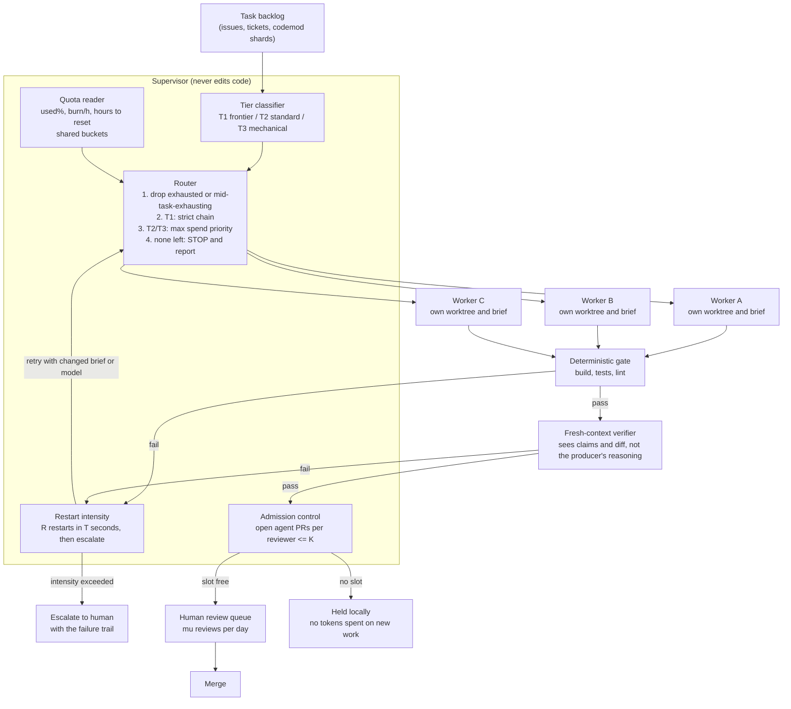

# Multi-Agent Supervision and Quota-Aware Routing

> [!summary] Claim:
> A fleet of coding agents is a supervised queueing system, not a bigger single agent: a supervisor tiers each task, routes it to a worker by fit first and remaining quota second, and gates the result with a fresh-context verifier before a human sees it.
> Two budgets bound the fleet and neither is compute: the provider quota windows (a token bucket per minute, a rolling window per session or week) and human review capacity, which obeys the nonlinear M/M/1 wait `W = 1/(mu - lambda)`.
> Agents spend quota to produce changes faster than people can verify them, so the control that matters most is admission at the source: cap work in flight per reviewer, shed load before it becomes review debt, and never let a verifier share the producer's context, because correlated misses erase the value of the second check.
> Supervision follows the OTP rule that a worker which keeps dying for the same reason must escalate, with the one change that an agent restart costs tokens, so a retry must change the model, the brief, or the scope.



## The Mechanism

### 1. Why a fleet exists, and when it loses

The case for several agents is economic before it is architectural.
Anthropic's write-up of its multi-agent Research feature (2025-06-13) reports that three factors explained 95% of the variance in BrowseComp performance, and that token usage alone explained 80% of it.
The same post puts the price at about 4x the tokens of a chat interaction for an agent and about 15x for a multi-agent system, and states that the architecture pays only when the task value covers that multiplier.
Its lead-agent plus subagent configuration beat a single-agent baseline by 90.2% on an internal research evaluation, a figure for breadth-first research, not for coding.
The same post says plainly that most coding tasks have fewer truly parallelizable pieces than research, and that agents are not yet good at delegating to each other in real time.

Cognition's "Don't Build Multi-Agents" (2025-06-12) is the strongest counterweight and states two principles: share full agent traces, not only messages, and remember that actions carry implicit decisions that conflict when subagents cannot see each other.
Its worked example is two subagents building the same game and producing mismatched visual styles because neither saw the other's choices.
The two positions reconcile on one condition: parallelize only work whose decisions do not interact.
For a software repository that means partitioning by ownership boundary (a directory, a package, a codemod shard), one worktree per stream as [[AI-Coding-Agents-Sandboxes-Worktrees-and-Ship-Gates]] establishes, and refusing to run two workers on the same files.

Decision rule: run a single agent until one of three things is true.
The work splits into streams that touch disjoint files, the context needed exceeds one window, or the wall-clock gain is worth several times the tokens.
Short of that bar, a fleet buys coordination bugs and a bigger quota bill.

### 2. The supervisor-worker hierarchy

Three roles recur in every fleet that works, whatever the framework.

- **Supervisor.** Decomposes, tiers, routes, tracks state, and enforces budgets.
  It does not edit code, so a supervisor failure never corrupts a working tree.
- **Worker.** Executes one task in one isolated worktree with a bounded brief.
  Anthropic's lesson on delegation, and its "Building effective agents" description of the orchestrator-workers workflow (a central LLM that breaks down tasks, delegates to workers, and synthesizes results, suited to cases where the subtasks cannot be predicted, such as the number of files a coding change touches), is that each subagent needs an objective, an output format, guidance on tools and sources, and clear task boundaries; without them workers duplicate effort or leave gaps.
  The same post records early failures such as spawning 50 subagents for a simple query, which is why it embeds effort-scaling rules (one agent with 3 to 10 tool calls for a fact lookup, 2 to 4 subagents with 10 to 15 calls each for a comparison, more than 10 for complex research).
- **Verifier.** A separate agent, or a deterministic gate, that judges the worker's output; the Fresh-context verification subsection covers why it must not share the producer's context.

Structural facts from Claude Code, the one public harness whose documentation spells these out (as of 2026-11, Both):

- Each subagent has its own context window, system prompt, tool access, and permissions, and its requests count toward the same usage limits as the main conversation.
- A subagent returns its result to the caller; a shared task list and direct teammate-to-teammate communication are what agent teams add, at higher token cost, although subagents that Claude named when spawning them can also message each other with `SendMessage`.
- Subagents can nest: by default a subagent can spawn its own subagents up to three layers below the main conversation, and `CLAUDE_CODE_MAX_SUBAGENT_SPAWN_DEPTH` changes that depth.
- Agent teams are the other mode: a lead session plus teammates that share a task list and message each other.
  They are experimental and off by default, enabled with `CLAUDE_CODE_EXPERIMENTAL_AGENT_TEAMS=1`.
  A session has one team, and teammates cannot spawn teammates, so a team is exactly two levels deep (lead and teammates).
- The shared task list has three states (pending, in progress, completed), supports dependencies that show a task as blocked, and prevents two teammates claiming one task with file locking.
- A subagent can run with `isolation: worktree`, which gives it a temporary git worktree; `maxTurns` bounds its agentic turns and returns partial output when hit.
- Agent teams use roughly 7x the tokens of a standard session when teammates run in plan mode, and the cost guidance says token use is roughly proportional to team size.

Two design consequences follow.
First, a bounded depth is a feature: unbounded delegation makes cost and failure analysis intractable, so a two-level hierarchy with an explicit budget at each edge is the default to defend, and with Claude Code subagents, whose default nesting depth is three, you set that bound yourself.
Second, pass artifacts, not transcripts.
Anthropic's "game of telephone" advice is to have subagents write outputs to external storage and return a lightweight reference, which prevents loss in multi-stage handoffs and avoids copying large outputs through the coordinator's context.
For a coding fleet the artifact is a branch plus a structured result record (task id, files touched, gate results, claims the verifier should check).

### 3. Supervision semantics: borrowing OTP, changing the cost model

Erlang/OTP solved supervision in the 1990s and its documentation is still the clearest statement of the contract.
A supervisor owns child processes and applies a restart strategy: `one_for_one` restarts only the dead child, `one_for_all` restarts every child, `rest_for_one` restarts the dead child and those started after it, and `simple_one_for_one` is a simplified form for dynamically added identical children.
It also carries a maximum restart intensity.
If more than `MaxR` restarts occur in the last `MaxT` seconds, the supervisor terminates all its children and then itself with reason `shutdown`, and its own supervisor decides what happens next.
The defaults are intensity 1 and period 5.
The stated purpose is to prevent a process from repeatedly dying for the same reason and being restarted forever.

The OTP guide's tuning advice transfers directly:

- Intensity sets the tolerated burst; period sets the sustained rate.
  An intensity of 5 over 30 seconds allows at most one restart per 6 seconds on average, the same sustained rate as 1 over 6 or 10 over 60, but 1 over 6 rejects even two restarts in quick succession.
- A very long period (the guide's example is 5 per 3600 seconds) means one more crash an hour later still kills the supervisor, which treats separate incidents as one.
- Do not repeat the same intensity at every level: the total restarts before the top gives up is the product of the intensities above the failing child, so 10 at two levels allows 100.

What changes for agents is the unit cost.
An Erlang restart costs microseconds and re-runs deterministic code that usually succeeds on retry.
An agent restart costs a full context rebuild in tokens and re-runs a nondeterministic process whose failure is often a property of the task, not a transient.
Three rules follow.

1. Keep intensity tiny, 1 or 2 restarts per task, and treat the third failure as an escalation to a human with the failure trail.
2. A restart must change something: a different model tier, a narrower brief, a reduced file scope, or added failure evidence.
   Restarting the identical brief on the identical model is exactly the "dies for the same reason" loop OTP exists to stop.
3. Resume, do not restart from zero, when state is recoverable.
   Anthropic's production notes say restarts are expensive and that the system resumes from where the agent was, combined with deterministic safeguards such as retry logic and checkpoints.

What counts as a crash needs a definition, because agents rarely exit non-zero.
Useful crash signals: gate failure, `maxTurns` reached, a wall-clock timeout, a diff that touches files outside the declared scope, and an identical tool call repeated N times.
The lab's supervisor section implements the OTP sliding-window rule over such events.

### 4. Task tiering: classify by blast radius and ambiguity, not by size

Routing literature gives the economic frame.
FrugalGPT (Chen, Zaharia, Zou, 2023) frames three cost-reduction strategies (prompt adaptation, LLM approximation, LLM cascade) and reports that its cascade can match the best single model with up to 98% cost reduction on its benchmarks.
RouteLLM (Ong et al., 2024) trains routers between a strong and a weak model from preference data and reports cost reductions of more than 2x in certain cases without quality loss.
Both were measured on question answering and preference benchmarks, not on multi-file repository edits, so treat the headline numbers as evidence that routing pays, not as a forecast for your fleet.

A coding fleet has an advantage those papers lacked: a deterministic gate.
A gate (build, tests, lint) is a cheap, high-precision verifier for a large class of failures, which makes a cascade natural: try the cheaper tier, escalate on gate failure.
The break-even is arithmetic.
With cheap-attempt cost `c`, strong-attempt cost `C`, and failure probability `p` for the cheap tier, the cascade costs `c + p*C` against `C` for going straight to the strong tier, so it wins when `p < 1 - c/C`.
If the cheap tier costs a fifth of the strong one, it must fail less than 80% of the time.
That inequality omits the human cost of reviewing a failed attempt, so for work that reaches review the effective threshold is stricter.

A working tier scheme (an example policy, not a standard):

| Tier | Task shape | Typical examples | Routing rule |
| :--- | :--- | :--- | :--- |
| 1 Frontier reasoning | Ambiguous, high blast radius, hard to verify mechanically | Architecture, concurrency and lifetime bugs, root-cause debugging of an unreproduced fault, security-sensitive change | Strict fallback chain; never balanced by headroom; stop if the chain is empty |
| 2 Standard coding | Well specified, contained, gate-verifiable | Scoped feature, known-cause fix, tests, contained refactor | Balance across peers by spend priority |
| 3 Mechanical | No judgment, trivially verifiable | Renames, formatting sweeps, version bumps, boilerplate | Cheapest peers; balance by spend priority |

The classifier is itself a failure source with asymmetric costs.
Under-tiering sends a hard task to a weak worker, burns attempts against the restart budget, and ends in an escalation after quota is spent.
Over-tiering wastes the scarcest window.
Because the second error is silent and the first is loud, teams drift toward over-tiering, so log the tier of every task and the tier that finally passed, and tune the classifier against that data.

Why Tier 1 does not balance by headroom: balancing optimizes utilization, and utilization is the wrong objective when the task's value depends on the model's capability.
A balancer that sends a root-cause investigation to whichever subscription has the most unused quota trades correctness for utilization.
Tier 2 and Tier 3 tasks are well specified and gate-verified, so a weaker peer costs retries at worst, and balancing is sound there.

### 5. Quota-aware dispatch

Quota has two layers that fail differently.
Conflating them is the most common routing bug.

**Layer A: short-window rate limits (seconds to minutes).**
The Claude API uses a token bucket: capacity is replenished continuously up to the maximum, not reset at fixed intervals (as of 2026-11, API).
Limits are expressed as requests per minute, input tokens per minute, and output tokens per minute, per model class, and are set per organization by usage tier.
Exceeding one returns HTTP 429 (RFC 6585, Section 4), and when the response carries a `retry-after` header the client must wait that many seconds, because earlier retries might fail.
RFC 9110 Section 10.2.3 defines the field's value as either an HTTP-date or a number of seconds, so a robust client parses both.
The API also returns `anthropic-ratelimit-{requests,tokens,input-tokens,output-tokens}-{limit,remaining,reset}` headers, with reset times in RFC 3339 format and the `-remaining` token counts rounded to the nearest thousand; these are the free quota reader for API-key fleets.

Two subtleties from the same document matter for fleets.
A *ramp limit* caps how fast an organization's usage of a model can grow: the limit is the recent peak per-minute usage plus a step, so a fleet that starts 40 workers at once can get 429s while far below its rate limit, and the documented remedy is to start at a low rate, spread requests evenly, and raise by at most one step per minute.
The monthly spend cap (on the Start, Build, and Scale tiers) returns a 429 of type `rate_limit_error`, error code `enforced_spend_limit_reached`, with *no* `retry-after` header, and retrying, including SDK automatic retries, fails until the cap resets at 00:00 UTC on the first of the next month or the tier is raised.
A retry loop that treats this as a transient rate limit spins for days.

**Layer B: long windows (hours to weeks).**
Subscription products meter a different object.
Claude Code's cost documentation describes per-seat allowances on Teams and Enterprise plans that reset on a rolling five-hour window and a weekly window, shared with Claude chat and Cowork and across all models, so switching models does not restore access once a session or weekly limit is hit; a separate model-specific limit (for example an Opus limit) does clear by switching to another model family (as of 2026-11).
A fleet that behaves like an API client (retry with backoff) is wrong against these windows: waiting minutes does not help when the weekly window is spent, and parallel workers drain a five-hour window several times faster than one session does.

The dispatcher therefore needs per-window state and a runway model.
For each window `i`, define from a reading of percent used `u`, hours elapsed `e`, and window length `L`:

- burn rate `b = u / e` percent per hour,
- remaining `r = 100 - u`,
- hours to exhaustion `r / b` (infinite when `b = 0`),
- hours to reset `L - e`,
- spend priority: the projected unused percentage at reset, `max(0, r - b*(L - e))`.

Spend priority is the use-it-or-lose-it signal.
A window projected to end with 60% unused is wasting paid capacity; a window projected to hit zero before reset has negative headroom and should be spared.
The router then applies four rules in order.

1. **Drop** any candidate that is exhausted now, has less remaining than the task's estimated cost, or is projected to exhaust before the task finishes (`r/b` less than the task duration).
2. **Tier 1:** walk a fixed chain in order and take the first survivor.
   Do not rank by spend priority.
3. **Tier 2 and 3:** among survivors take the highest spend priority.
4. **Unknown runway** (reader failed, auth missing) keeps a candidate eligible but never ranks it above a peer with known evidence.
   If no candidate survives, stop and report; do not silently downgrade a Tier 1 task.

Operational details that decide whether this works:

- **Shared buckets.** Several models can draw on one window, and one model can also have a separate window of its own.
  Charge the *bucket*, not the model, or the second model's reading goes stale the moment the first one runs.
  The lab's router section charges by bucket.
- **Reserve before launch.** Readings lag.
  Deduct the estimated task cost at dispatch, reconcile at completion, and re-read the real window periodically.
  Without a reservation, ten simultaneous dispatches all see the same headroom and oversubscribe it.
- **Size against the limiting window.** The headline percentage is the wrong number.
  A task fits only if it fits the binding constraint: the five-hour window for a long run, the per-minute bucket for a burst.
  A long-context session also drains faster per turn because every turn re-sends context, so estimate cost from context length, not from task description.
- **Concurrency bound.** If each worker burns `w` percent per hour for a horizon of `H` hours against `r` percent remaining, at most `floor(r / (w*H))` workers fit.
  This is a budget division, not Little's law: it fixes how many workers the remaining percentage can fund for the horizon `H`.
  Little's law (`L = lambda*W`) enters in the review queue below, where it relates changes waiting to arrival rate and time in system.
- **Honor `retry-after`, add jitter, cap attempts.** The lab's retry section shows why jitter matters; see Retry herding.

#### Retry herding

When N workers hit a limit together and retry on the same schedule, they collide again together.
AWS's Architecture Blog analysis (2015, updated 2023) shows that capped exponential backoff alone leaves clusters of calls with idle gaps in between, and that adding jitter spreads the calls to an approximately constant rate; for 100 contending clients it cut the call count by more than half.
Of its variants, full jitter and equal jitter make about the same number of calls, decorrelated jitter makes more, equal jitter takes much longer than full jitter, and no-jitter backoff is the clear loser; the post also notes none of them removes the N^2 total-work shape under contention, only reduces it.
The lab reproduces the shape with a server that admits 10 requests per one-second slot and 100 workers that all fail at slot 0.
A fixed one-slot retry finishes in 10 slots but makes 550 attempts, because every waiting worker retries every slot.
Unjittered exponential backoff also makes 550 attempts and takes 319 slots, since the whole cohort sleeps through slots where the server has free capacity.
Full jitter makes 303 attempts and takes 17 slots: it keeps most of the fixed-delay speed at 45% fewer attempts, and the peak retry wave falls from 90 to 50.
The server's per-slot cap in this model is what makes fixed delay look fast; a real service that charges for rejected requests, or that raises its penalty for repeat offenders, makes the 550 attempts the dominant cost.

### 6. Fresh-context verification

A verifier that reads the producer's reasoning inherits its assumptions.
Huang et al. (ICLR 2024) found that models struggle to self-correct reasoning without external feedback and sometimes get worse after trying.
Cognition's principle that actions carry implicit decisions is the same effect seen from the other side: whatever the producer assumed is invisible to a reader who adopts the producer's frame.

The quantitative core is correlation.
If one verifier misses a real defect with probability `m`, two verifiers whose misses are independent both miss with probability `m^2`.
If a common cause (shared context, shared model, shared blind spot) makes the second copy the first with probability `rho` and independent otherwise, the joint miss probability is `m*(rho + (1 - rho)*m)`.
At `m = 0.4` that is 0.16 independent, 0.28 at `rho = 0.5`, and 0.40 at `rho = 1`, where the second verifier adds nothing.
The parameters in the lab are assumptions chosen to show the shape; they are not measured miss rates for any model.

Design rules that follow:

1. **Mechanical gates first.** Compilation, tests, type checks, and linters have near-zero correlation with the producer's beliefs.
   Spend model verification only on what they cannot check: claims, intent, spec fit.
2. **Give the verifier the artifact and the claims, not the reasoning.** A fresh session receives the diff, the task statement, and an explicit list of claims to check, never the transcript.
3. **Verify claims against primary sources, not against the producer's summary.** For a documentation or knowledge task the verifier fetches the source itself.
4. **Diversify where cheap.** A different model family, or at least a different tier, lowers `rho`. It also spreads quota across windows, which the router already does for Tier 2.
5. **Budget the verifier.** It is another agent drawing the same quota; include it in the cost per accepted change.
6. **Grade the outcome, not the path.** Anthropic's evaluation notes recommend end-state evaluation for agents that mutate state and found one LLM call with a 0.0 to 1.0 score and a pass or fail grade more consistent than several judges per criterion.

A verifier cannot catch a wrong specification, a gate that does not test the behavior, or a defect both parties are blind to.
It reduces the producer's error rate by a factor of `m*(rho + (1-rho)*m)` at best, never to zero, and the residual is what reaches human review.

### 7. Review-queue saturation and verification capacity

This is the binding constraint at scale and the one fleets most often ignore.
Human review is a server with finite service rate, and agents are an arrival process limited by quota, not by people.

Anchor the human side with Google's published numbers (Sadowski et al., ICSE-SEIP 2018, measured at Google, so a reference point and not a universal constant): the median developer authors about 3 changes a week and reviews about 4, 80% of reviewers review fewer than 10 changes a week, developers spend an average of 3.2 hours a week reviewing (median 2.6), the median change is 24 lines, and median overall review latency is under 4 hours.
*Software Engineering at Google* chapter 9 adds that "small" means about 200 lines and that most changes are expected to receive initial feedback within about a day.
Those figures describe a human-authored flow with small changes; an agent that emits large diffs at machine speed has none of those properties by default.

Model the pool as a single FIFO server (M/M/1) with service rate `mu` reviews per day and arrival rate `lambda`.
Utilization is `rho = lambda/mu`, mean time in system is `W = 1/(mu - lambda)`, and Little's law (Little, 1961) gives `L = lambda*W` changes in the system.
The hyperbola is the point: from `rho = 0.9` to `0.95` the wait doubles, from `0.95` to `0.975` it doubles again, and at `rho >= 1` the queue grows without bound.
Agent throughput can move `rho` from 0.6 to 1.1 in an afternoon because the quota windows, not reviewers, govern agent output.

Three consequences:

1. **Verification capacity is a budget.** Estimate it as reviewers times review hours per week divided by hours per review, and treat it as a hard cap on merged agent work, exactly as a quota window is a cap on tokens.
2. **Admit at the source.** Once a PR is in the review queue, tokens are spent and the problem is human.
   Cap agent PRs in flight per reviewer or per code owner, and let excess work wait locally as a branch or a ticket, so no tokens are spent producing work nobody can check.
   The lab shows the effect: with 20 agent PRs a day on top of 24 human PRs against capacity 40, human PR wait grows from 28.7 to 237.0 working hours as the horizon lengthens from 50 to 500 days, while a cap of 6 holds it at 1.1 hours and rejects 36% of agent submissions at the door.
3. **Change what review means.** Keep agent changes small (the Google small-change norm), route mechanical Tier 3 changes through gate-only approval where policy allows (the codemod pattern in [[Large-Scale-Changes-and-Codemods-Across-Repos]]), and send hard changes to the owner of the code through [[Code-Review-and-Readability-Systems-at-Scale]].

Evidence that this is not hypothetical, with limits stated:

- DORA's 2024 report summary says AI adoption raises individual productivity, flow, and satisfaction but negatively affects delivery stability and throughput, and points to small batch sizes and robust testing as the remedy (the summary page gives no numbers here; the report carries them).
- METR's randomized trial of 16 experienced open-source developers found AI use made them 19% slower on their own repositories, while they expected a 24% speedup and still believed after the trial that it had sped them up by 20%.
  The authors describe it as a snapshot of early-2025 capabilities in one setting, and as of 2026-11 METR marks the page as out of date.
  METR's 2026-02-24 update ("We are Changing our Developer Productivity Experiment Design") calls the data from its follow-up experiment (started August 2025) an unreliable signal, mainly because many developers declined to work without AI, which likely biases the speedup estimate downwards.
  It still reports the raw numbers: 19% longer in the early-2025 study (confidence interval +2% to +39%), and a "speedup of -18%" (interval -38% to +9%) for the returning developers from the original study, on the same sign scale as the +19% time figure, with an interval that includes zero.
  METR says it believes developers are likely more sped up in early 2026 than in early 2025, and that its new data is only very weak evidence for the size of the change.
  Read the 19% slowdown as a historical result, not a current estimate.
- Neither measures a supervised fleet; both are reasons to measure accepted changes and rework, not output volume.
  See [[Developer-Productivity-Metrics-DORA-SPACE-and-GSM]] for why raw PR counts invite gaming.

### 8. Failure taxonomy and observability

Cemri et al. (MAST, arXiv:2503.13657 v3) annotated more than 1600 traces across 7 multi-agent frameworks and derived 14 failure modes in three categories: system design issues, inter-agent misalignment, and task verification, with inter-annotator agreement of kappa = 0.88.
The categories map onto controls in this note.

| MAST category | Fleet symptom | Control in this note |
| :--- | :--- | :--- |
| System design issues | Workers given vague or overlapping briefs; no stop condition | Bounded briefs, scope check on the diff, `maxTurns`, restart intensity |
| Inter-agent misalignment | Two workers make conflicting decisions; information lost in handoff | Disjoint file ownership, artifacts not transcripts, single owner per shard |
| Task verification | Premature completion; weak or missing check | Deterministic gate, fresh-context verifier, end-state evaluation |

Observability decides whether any of this is tunable.
Anthropic's production notes recommend full tracing of agent decisions and interaction structure, plus rainbow deployments (shifting traffic gradually while old and new versions both run) because agents mid-flight cannot be swapped atomically.
For a coding fleet record per task: tier assigned, tier that passed, provider chosen, tokens or percent of window spent, restarts, gate result, verifier verdict, time in review queue, and merge outcome.
The headline metric is cost per accepted change, not tokens per PR, with acceptance measured after the merge window so reverted work counts against it.

## Commands and Numbers to Know

External figures are as published by the named source; the last block is output of this note's lab model on the platform stated, not a measurement of any real system.

| Item | Value | Platform and date | What it controls |
| :--- | :--- | :--- | :--- |
| OTP supervisor flags | `intensity` default 1, `period` default 5 (seconds) | Both (as of 2026-11) | More than `intensity` restarts in `period` seconds terminates the children and the supervisor (reason `shutdown`) |
| OTP restart strategies | `one_for_one`, `one_for_all`, `rest_for_one`, `simple_one_for_one` | Both (as of 2026-11) | Which siblings restart when one child dies |
| OTP nested intensity | Total restarts is the product of intensities above the child | Both (as of 2026-11) | 10 at two levels allows 100 restarts |
| Claude API rate limiter | Token bucket, continuous replenishment; RPM, ITPM, OTPM per model class | Both (as of 2026-11) | Short-window admission; set per organization by usage tier |
| `retry-after` header | Seconds to wait; RFC 9110 Section 10.2.3 also allows an HTTP-date | Both (as of 2026-11) | Minimum wait before retry; not on every 429 |
| `anthropic-ratelimit-*` headers | `{requests,tokens,input-tokens,output-tokens}-{limit,remaining,reset}`; reset is RFC 3339; `-remaining` token counts rounded to nearest thousand | Both (as of 2026-11) | Free quota reader for API-key fleets |
| Ramp limit | Recent peak per-minute usage plus a step; error code `ramp_limit_exceeded` on the Messages API; Batches API exempt | Both (as of 2026-11) | Why a sudden fleet start gets 429 while under the rate limit |
| Spend-cap 429 | `rate_limit_error`, error code `enforced_spend_limit_reached`, no `retry-after`; resumes 00:00 UTC on the 1st of next month | Both (as of 2026-11) | Never retry blindly; trip a circuit breaker |
| Subscription windows | Rolling five-hour window plus weekly window, shared across models (Teams and Enterprise seat allowance); model-specific limits are separate | Both (as of 2026-11) | Layer B quota; switching model does not restore access |
| Agent teams | Env `CLAUDE_CODE_EXPERIMENTAL_AGENT_TEAMS=1`; experimental, off by default; one team per session; no nested teams | Both (as of 2026-11) | Lead plus teammates with a shared task list and file-locked claims |
| Subagent frontmatter | `isolation: worktree`, `maxTurns`, `model`, `background` | Both (as of 2026-11) | Per-worker isolation, turn budget, model tier |
| Token multipliers | Agent about 4x chat; multi-agent about 15x chat (Anthropic Research, 2025-06); agent teams about 7x in plan mode (Claude Code docs) | Both (as of 2026-11) | Cost bound for a fleet; the task must be worth it |
| Claude Code spend | About $13 per developer per active day, $150-250 per developer per month, under $30 per active day for 90% of users (enterprise deployments, single-agent baseline) | Both (as of 2026-11) | Baseline to multiply by fleet width |
| Claude Code TPM guidance | 200k-300k per user for 1-5 users down to 10k-15k per user for 500+ users | Both (as of 2026-11) | Org-level rate-limit sizing; per-user share shrinks with team size |
| Google review flow | Median author 3 changes a week, median reviewer 4; 3.2 h/week reviewing (median 2.6); median change 24 lines; median latency under 4 h | Google, 2018 study | Human service rate to compare against agent arrivals |
| M/M/1 | `rho = lambda/mu`; `W = 1/(mu - lambda)`; `L = lambda*W` | Both | Why review wait is hyperbolic in load |
| Cascade break-even | Cheap-first wins when `p < 1 - c/C` | Both | Tier escalation economics |
| AWS jitter result | 100 contending clients: call count cut by more than half with jitter | Both (as of 2026-11) | Backoff needs randomness |
| Lab: fixed retry, 100 workers, 10 per slot | 550 attempts, 10 slots | darwin-arm64, Python 3.15.2 | Wasted attempts without jitter |
| Lab: exponential no jitter | 550 attempts, 319 slots | darwin-arm64, Python 3.15.2 | Idle capacity behind synchronized retries |
| Lab: full jitter | 303 attempts, 17 slots, peak retry wave 50 | darwin-arm64, Python 3.15.2 | Jitter's effect in this model |
| Lab: queue mu=40/day, human 24/day | Analytic W 0.50, 1.00, 2.00, 4.00, 8.00 working hours at agent 0, 8, 12, 14, 15 per day | darwin-arm64, Python 3.15.2 | Hyperbolic wait |

## Multi-Language Comparison: C++ / Python / Rust

A fleet supervisor is usually written in Python or Rust, with C++ appearing where an existing build or scheduling service is extended.
The mechanisms are the same; the primitives differ.
No ecosystem ships an OTP-style supervisor in its standard library, so the restart-intensity window is code you write (the lab's `supervise` is 10 lines).

| Concern | C++ | Python | Rust |
| :--- | :--- | :--- | :--- |
| Bound concurrent workers | `std::counting_semaphore` (C++20) | `asyncio.Semaphore` | `tokio::sync::Semaphore` |
| Structured fan-out and cancellation | `std::jthread` with `std::stop_token` | `asyncio.TaskGroup` (3.11+), `asyncio.timeout` | `tokio::task::JoinSet`, `tokio::time::timeout` |
| Token bucket for per-minute limits | Hand-rolled with `std::chrono::steady_clock` | Hand-rolled or a library; the lab uses none | Hand-rolled or a crate; check maintenance before adopting |
| Jittered backoff | `<random>` with `uniform_int_distribution` | `random.randrange`; seed it only in tests | `rand` crate; seed only in tests |
| Restart intensity window | `std::deque` of timestamps | `collections.deque` (as in the lab) | `VecDeque<Instant>` |
| Subprocess worker with kill on timeout | `posix_spawn` plus `waitpid` and a process group | `asyncio.create_subprocess_exec`, kill the group | `tokio::process::Command` with `kill_on_drop` |

Language choice matters less than three properties: a monotonic clock for windows (never wall-clock time, which jumps), a process-group kill so a timed-out worker's children die with it, and cancellation that reaches the model call so a cancelled worker stops spending quota.

## Worked Lab Example

The lab is `code/09-Engineering-Systems-at-Scale/quota_router_demo/`.
Run it with `bash run.sh`; it prints deterministic output and ends with `ALL CHECKS PASSED`.
It is five seeded models, not a client of any real service, and every section ends in checks that raise if the mechanism is absent.
It does not call a model, read a real quota, or measure real reviewers.

### 1. Router

Five windows: a frontier model with its own weekly window, two models sharing a weekly window, and two peers with a monthly and a daily window.
`spend_pr` is the projected percent of the window unused at reset.

```text
== 1. quota-aware router ==
name    bucket      used% burn/h    h_exh spend_pr
fable   fable-week   30.0  0.357    196.0     40.0
opus    shared-week  55.0  0.655     68.7      0.0
haiku   shared-week  55.0  0.655     68.7      0.0
grok    grok-month   20.0  0.056   1440.0     60.0
gemini  gemini-day   10.0  0.833    108.0     80.0
dispatch of 10 tasks (tier: choice, reason)
   1  t2 -> gemini  spend_priority 80.0
   2  t2 -> gemini  spend_priority 74.0
   3  t3 -> gemini  spend_priority 68.0
   4  t1 -> fable   tier1 chain position 1
   5  t2 -> gemini  spend_priority 67.0
   6  t3 -> gemini  spend_priority 61.0
   7  t2 -> grok    spend_priority 60.0
   8  t1 -> fable   tier1 chain position 1
   9  t2 -> gemini  spend_priority 60.0
  10  t3 -> grok    spend_priority 54.0
end-state used%: fable-week=42.0 gemini-day=23.0 grok-month=23.5 shared-week=55.0
edge cases
  fable exhausted: chain -> opus, naive balancer -> gemini
  all tier1 exhausted: None | STOP: no tier1 candidate has runway
  grok unknown: tier2 -> gemini
  grok burn 20.0%/h with 60% left: viable for a 1h task = True
  gemini burn 40.0%/h with 20% left: viable for a 1h task = False
  shared bucket: haiku used% 55.0 -> 58.0 after charging opus
```

Output from `darwin-arm64`, Python 3.15.2 (`expected/darwin-arm64.txt`).

Reading it:

- `opus` and `haiku` show `spend_pr` 0.0: at 55% used after half the window, the shared window is projected to exhaust at 68.7 hours, before reset, so the router never picks either for balanced work and the Tier 2 stream goes to `gemini` (80.0), then `grok`.
- Every Tier 1 task goes to `fable`, the head of the chain, even though `gemini` holds more headroom.
  That is the rule, not an accident.
- With `fable` exhausted, the chain falls to `opus`, while a naive balancer would pick `gemini`; the lab checks both outcomes, so removing the chain makes the run fail.
- With every Tier 1 candidate exhausted, the router returns `None` and a `STOP` reason instead of downgrading.
- Charging `opus` raised `haiku` from 55.0 to 58.0 because they share a bucket.

### 2. Retry herding

```text
== 2. retry herding (100 workers, server admits 10 per slot) ==
policy         attempts peak retry/slot   slots
fixed               550             90      10
exp                 550             90     319
full-jitter         303             50      17
```

Output from `darwin-arm64`, Python 3.15.2 (`expected/darwin-arm64.txt`).

The check asserts that fixed delay costs exactly 550 attempts (100 + 90 + ... + 10), that jitter lowers both attempts and the retry peak, and that jitter beats unjittered exponential on completion time.

### 3. Supervisor restart intensity

```text
== 3. supervisor restart intensity ==
  intensity= 5 period=30s sustained<=0.17/s | quick burst: survived 3 crashes | steady every 7s: survived 43 crashes
  intensity= 1 period= 6s sustained<=0.17/s | quick burst: ESCALATE at t=1 after 1 restarts in 6s | steady every 7s: survived 43 crashes
  intensity=10 period=60s sustained<=0.17/s | quick burst: survived 3 crashes | steady every 7s: survived 43 crashes
  nested 10 x 10 supervisors allow up to 100 restarts before the top gives up
```

Output from `darwin-arm64`, Python 3.15.2 (`expected/darwin-arm64.txt`).

All three settings sustain the same 0.17 restarts per second, yet `intensity=1 period=6` escalates on a burst of three crashes in two seconds, while 5 over 30 and 10 over 60 absorb it, exactly the OTP guide's point about burst versus sustained rate.
None of them gives up on a steady crash every 7 seconds, because that rate sits below every setting's sustained limit: a restart-intensity window bounds the crash rate, not the crash count, so a process failing slowly enough is restarted forever (the guide's log-filling warning is about the extreme case, 10 restarts per 1 second); for agents, add a separate cap on total restarts per task.

### 4. Review queue

```text
== 4. review queue saturation (mu=40 reviews/day, 8 working hours/day) ==
lam_agent    rho W analytic h  W simulated h
     0.0  0.600         0.50           0.51
     8.0  0.800         1.00           0.97
    12.0  0.900         2.00           1.93
    14.0  0.950         4.00           3.77
    15.0  0.975         8.00           7.11
overload (lam_agent=20 => rho=1.1), human PR mean sojourn in working hours
  no cap: 50 days -> 28.7 h, 500 days -> 237.0 h
  agent WIP cap=6: 50 days -> 1.1 h, 500 days -> 1.1 h
  agent PRs rejected at the cap over 500 days: 3635 of 10068 (36%)
```

Output from `darwin-arm64`, Python 3.15.2 (`expected/darwin-arm64.txt`).

The analytic column is `8/(mu - lambda)` working hours; the simulated column is a seeded single-run estimate, so it drifts from the formula near saturation (7.11 against 8.00 at `rho = 0.975`) because convergence slows as `rho` approaches 1.
The decisive rows are the last two: past `rho = 1` the uncapped wait scales with the horizon, and the agent cap makes it independent of the horizon at the price of refusing 36% of agent submissions, which is the quota those submissions did not spend.

### 5. Verifier independence

```text
== 5. verifier independence (model, assumed parameters) ==
  one verifier miss rate m=0.40; two verifiers, common-cause coupling rho
    rho P(both miss)    simulated
    0.0        0.160        0.159
    0.5        0.280        0.279
    1.0        0.400        0.394
  residual wrong-claim rate with 2 verifiers at rho=0.5: 0.042 (producer alone 0.150)
```

Output from `darwin-arm64`, Python 3.15.2 (`expected/darwin-arm64.txt`).

The simulated joint miss rates match the closed form `m*(rho + (1-rho)*m)` within 0.01 at each coupling, and the check fails if coupling does not erode the second verifier.
The parameters (`p_wrong = 0.15`, `m = 0.4`) are assumptions for illustration.

## Pitfalls

> [!warning] Pitfall: treating a window-exhaustion signal as a retryable rate limit
> The spend-cap 429 has no `retry-after`, and a spent weekly subscription window will not refill in minutes.
> A loop that sleeps and retries burns time, and with SDK auto-retries it multiplies requests.
> Classify the failure first: per-minute limit (back off with jitter), ramp limit (slow down), window or cap exhausted (route elsewhere or stop).

> [!warning] Pitfall: balancing Tier 1 work by spare headroom
> A router that maximizes utilization will send the hardest tasks to whichever window has the most room, which is usually the weakest model.
> Tier 1 uses a fixed chain, and when the chain is empty the correct output is a stop-and-report, not a quiet downgrade.

> [!warning] Pitfall: charging the model, not the bucket
> Models that share a window drain each other.
> A router that tracks per-model counters oversubscribes the shared window and discovers it when a worker fails mid-task.

> [!warning] Pitfall: dispatching on a stale reading
> A quota read taken before ten parallel dispatches describes none of them.
> Reserve the estimated cost at dispatch, reconcile on completion, and treat an unreadable window as unknown, not as full.

> [!warning] Pitfall: restarting the same brief on the same model
> That reruns the failure that just happened, at full token cost.
> A restart must change the model tier, the scope, or the evidence given to the worker, and the third failure escalates.

> [!warning] Pitfall: a verifier that sees the producer's reasoning
> It inherits the producer's assumptions, so `rho` approaches 1 and the second check adds nothing (the 0.40 row in the lab).
> Hand the verifier the artifact and the claims, and let it fetch primary sources itself.

> [!warning] Pitfall: measuring fleet success by merged PR count or tokens per PR
> Output volume is the quantity quota already controls, so it rises whether or not value does.
> Measure cost per accepted change with a post-merge window for reverts and rework.

> [!warning] Pitfall: letting agent output set the review arrival rate
> Review wait is hyperbolic in utilization, so a fleet that is fine at `rho = 0.6` is in trouble at 0.95 and unbounded past 1.
> Cap agent work in flight per reviewer, and size the cap from review capacity, not from quota.

> [!warning] Pitfall: starting the whole fleet at once
> A ramp limit rejects sudden growth even when you are under the rate limit, and all workers retrying together re-collide.
> Stagger launches, add one step per minute, and jitter every retry.

> [!warning] Pitfall: parallelizing coupled work
> Two workers editing interacting files make conflicting implicit decisions (Cognition's second principle).
> Partition by ownership boundary, or run one agent.

## At Scale

The same design changes shape with fleet and organization size.

| Scale | Binding constraint | What to do |
| :--- | :--- | :--- |
| One engineer, one to three agents | The engineer's attention | One worktree per stream, manual routing by tier, stop at a green gate and review yourself |
| A team of 10, a fleet of 5 to 20 workers | One subscription window, shared review | A dispatcher with a quota reader and a reservation ledger; per-reviewer WIP cap of about 2 to 4 open agent PRs (a starting value to tune, not a standard) |
| 100 engineers | Org-level rate limits and the review pool | Central quota service reading headers and windows; admission control per code owner; a fresh-context verifier tier; cost-per-accepted-change dashboard |
| 1,000 to 50,000 engineers | Review capacity per owning team and cross-window economics | Per-team verification budgets published like quota; gate-only approval for mechanical classes under explicit policy; reserved Tier 1 capacity; spend priority across vendors and windows |

Decision rules:

1. If agent PRs per reviewer per day approach the reviewer's capacity, add reviewers or lower the cap before adding agents.
   More agents past `rho = 0.9` buys wait, not throughput.
2. If more than a few percent of Tier 2 tasks reach restart intensity, fix the brief template or the classifier before buying quota.
3. If the weekly window of the frontier tier is spent while Tier 2 windows have unused headroom at reset, the tier boundary is too conservative; if the reverse, it is too loose.
   Spend priority makes this visible.
4. If verifier and producer agree suspiciously often, measure `rho` by seeding known defects and counting joint misses, and diversify models before adding a third verifier.
5. Treat the quota reader as a dependency with an SLO: an unavailable reader must fail the router into conservative behavior (Tier 1 stops, Tier 3 continues on the cheapest known window), never into assuming headroom.

The organizational design question, beyond mechanism, is who owns the verification budget.
Publishing it per code owner, as a number of agent PRs per week they will accept, converts an unbounded externality into a negotiated limit, which is the same move quota windows made for tokens.
Fleet-wide tooling that sits upstream of this, paved roads and deprecation, is owned by [[Platform-Engineering-Paved-Roads-and-Deprecation]]; the test-suite cost that inflates every gate is owned by [[Build-and-Test-Latency-Economics-and-Flaky-Tests]].

## Practice Drill

> [!tip] Practice Drill:
> Run the lab, then change one assumption at a time and predict before you run.
> 1. In `quota_router.py`, set `used_pct` of `gemini` in `make_fleet` to 90 and predict where Tier 2 work goes, then run `bash run.sh`.
> 2. Change `cap=6` in `section_queue` to `cap=30` and predict what happens to the 500-day human wait and to the rejected fraction.
> 3. Make the quick-burst crash list in `section_supervisor` `[0, 20, 40]` and find the smallest `intensity` for `period=30` that survives it.
> 4. Set `rho` to 0.25 in the verifier section and predict the joint miss rate by hand before running.
> Then apply the idea to your own fleet: write down the per-reviewer cap that keeps utilization under 0.8 for your human review rate, and the stop condition for each tier.
> The related operational drill for a collapsing shared queue is [[Drill-Engineering-Systems-Diagnose-CI-Merge-Queue-Collapse]].

## Interview Questions

> [!question] L5: A worker gets HTTP 429 with no `retry-after` header from the Claude API. What are the possible causes, and what does your retry code do?
>
> > [!success]- Answer
> > Not every 429 carries `retry-after`.
> > The documented case with none is the monthly spend cap, which blocks all requests until 00:00 UTC on the first of the next month or a tier increase, so retrying, including SDK auto-retries, cannot succeed.
> > The code should read the error body, not only the status: a rate limit or ramp limit (error code `ramp_limit_exceeded`) gets jittered backoff and, for ramp, a slower start; a spend cap trips a circuit breaker, stops dispatch, and alerts a human.
> > In all cases cap total attempts, and parse `retry-after` as either delay-seconds or an HTTP-date per RFC 9110 Section 10.2.3.

> [!question] L5: Predict the output.
>
> ```python
> slots, left, attempts = 0, 100, 0
> while left:
>     attempts += left
>     left -= min(left, 10)
>     slots += 1
> print(attempts, slots)
> ```
>
> > [!success]- Answer
> > It prints `550 10`.
> > This models 100 workers retrying every slot against a server that admits 10 per slot: attempts are 100 + 90 + 80 + ... + 10 = 550 over 10 slots.
> > It is the `fixed` row of the lab, and the reason jitter matters is that full jitter in the same model takes 303 attempts (17 slots) because workers stop retrying in every slot.

> [!question] L5: Why does the supervisor not edit code itself, and why does each worker get its own worktree?
>
> > [!success]- Answer
> > A supervisor that edits shares a failure domain with the work it supervises: a bad edit or a stuck loop takes out dispatch, state, and the working tree together.
> > One worktree per worker isolates uncommitted state and lets a failed worker be discarded by deleting its worktree, as covered in [[AI-Coding-Agents-Sandboxes-Worktrees-and-Ship-Gates]].
> > It also supports the file-ownership partition that prevents two workers from making conflicting decisions on the same files.

> [!question] L6: Debug this dispatcher.
> It works for hours, then every worker hangs.
>
> ```python
> while True:
>     r = call_model(task)
>     if r.status == 429:
>         time.sleep(int(r.headers["retry-after"]))
>         continue
>     return r
> ```
>
> > [!success]- Answer
> > Several defects compound.
> > A spend-cap 429 has no `retry-after`, so `r.headers["retry-after"]` raises `KeyError` (or, if someone adds a default, the loop sleeps and retries until the month rolls over).
> > `int()` fails on the HTTP-date form RFC 9110 allows.
> > There is no attempt cap, no jitter, so all workers wake together and re-collide, and no distinction between a per-minute limit (wait) and window exhaustion (route elsewhere).
> > Fix: classify the error, parse both header forms, add capped exponential backoff with full jitter, bound total attempts, and on window exhaustion hand the task back to the router with that provider marked exhausted until its reset.

> [!question] L6: Why must a Tier 1 task not be routed by spend priority, while Tier 2 should be?
>
> > [!success]- Answer
> > Spend priority maximizes use of paid capacity; it says nothing about capability.
> > Tier 2 tasks are well specified and gate-verified, so a weaker peer costs at worst a retry, and sending them where headroom is largest recovers value that would otherwise expire at reset.
> > Tier 1 tasks are ambiguous or high blast radius and the gate verifies them weakly, so a wrong model produces a convincing wrong result that reaches review.
> > Use a fixed fallback chain, and when it is empty stop and report; the lab's `fable exhausted` case shows the chain choosing `opus` where a balancer would choose `gemini`.

> [!question] L6: An OTP-style restart policy of 5 restarts per 30 seconds and one of 1 per 6 seconds have the same sustained rate.
> Which do you pick for agent workers, and why does the answer differ from an Erlang service?
>
> > [!success]- Answer
> > Both sustain at most one restart per 6 seconds on average, but 1 over 6 rejects two quick restarts, while 5 over 30 tolerates a burst of five.
> > For an Erlang process, a burst is cheap and often transient, so a tolerant burst is right.
> > For an agent, each restart rebuilds context in tokens and the failure is frequently deterministic for the task, so choose a very small intensity (1 or 2 per task) with a long period, require that each restart changes model, scope, or evidence, and escalate on the next failure.
> > Also remember the product rule: nested supervisors multiply, so an inner 3 under an outer 3 allows 9 attempts, which for tokens may already be too many.

> [!question] L7: Your reviewers handle 40 reviews a day and humans file 24.
> How many agent PRs a day can you admit before mean review wait reaches 4 working hours, and what does that number tell you about the fleet's design?
>
> > [!success]- Answer
> > With `W = 8/(mu - lambda)` working hours, `W = 4` gives `mu - lambda = 2`, so `lambda = 38` and the fleet may add 14 agent PRs a day; the lab table shows exactly 4.00 hours at agent rate 14 (`rho = 0.95`).
> > Beyond 14 a day, 15 a day doubles the wait to 8.00 hours, and past 16 the queue is unstable.
> > The number is an admission budget, not a target: set the cap below it, shed load at the source, and recognize that quota allows far more agent output than review can absorb.
> > This is an M/M/1 idealization (exponential arrivals and service, one FIFO pool); real review has varying change sizes and ownership routing, so treat it as a lower bound on wait.

> [!question] L7: You run two verifiers with a miss rate of 0.4 each and a producer defect rate of 0.15.
> A teammate says the second verifier cuts the residual defect rate from 0.06 to 0.024.
> What is wrong, and what is the residual if the verifiers share a context half the time?
>
> > [!success]- Answer
> > The teammate assumed independence, so the joint miss is `0.4*0.4 = 0.16`, and `0.15*0.4 = 0.06` becomes `0.15*0.16 = 0.024`.
> > With a common cause linking the verifiers with probability `rho = 0.5`, the joint miss is `0.4*(0.5 + 0.5*0.4) = 0.28`, so the residual is `0.15*0.28 = 0.042`, which is what the lab prints.
> > The second verifier then cuts the residual by 30% (0.06 to 0.042), not the 60% the independence assumption promised.
> > The remedy is to lower `rho`: fresh context, different model family, artifact-plus-claims input, and mechanical gates that do not share the producer's beliefs.
> > The miss rates here are assumptions; measure them by seeding known defects.

> [!question] L8+: Anthropic reports a multi-agent system beat a single agent by 90.2% on research, and Cognition argues against multi-agent architectures.
> How do you decide for a code-change fleet?
>
> > [!success]- Answer
> > The two positions concern different task structures.
> > Anthropic's result is for breadth-first research where subagents explore independent directions and their outputs are merged by compression; its own post says most coding tasks have fewer parallelizable pieces.
> > Cognition's principles apply when decisions interact: parallel workers that cannot see each other's choices produce conflicts.
> > Decide per task by interaction: partition by ownership boundary so streams are disjoint (a codemod shard, a package, a test-only change), run coupled work as a single linear agent with context compression, and justify the 4x to 15x token multiplier by task value.
> > Then verify the choice empirically on accepted-change cost and rework, since both sources are measured on tasks unlike yours.

> [!question] L8+: Design the quota and verification architecture for a 5,000-engineer organization adopting coding agents across three vendors with different window types.
>
> > [!success]- Answer
> > Separate the planes.
> > Admission plane: a central dispatcher per tenant with a quota reader that normalizes API headers (token buckets) and subscription windows (rolling and weekly) into runway and spend priority, with bucket-level reservations, a conservative failure mode when a reader is unavailable, and a tier policy that gives Tier 1 a strict chain and Tier 2 and 3 balanced routing.
> > Verification plane: deterministic gates first, then a fresh-context verifier on a different model where policy requires it, with measured `rho`.
> > Human plane: a verification budget per owning team, expressed in agent PRs per week, with admission control that holds excess work upstream, size caps on agent changes, and gate-only approval for named mechanical classes under policy.
> > Control: cost per accepted change, restart and escalation rates by tier, review wait percentiles, and revert rate in a post-merge window, all tracked as in [[Developer-Productivity-Metrics-DORA-SPACE-and-GSM]] with care for Goodhart effects.
> > Rollout: staged by team, with kill switches and rainbow-style version overlap so in-flight agents are not broken by supervisor updates.
> > Risks: vendor window semantics change without notice, so isolate them behind the reader and date every assumption.

> [!question] L8+: The fleet's gates are flaky and agents retry until green.
> What does that do to quota, review load, and trust, and what do you change?
>
> > [!success]- Answer
> > Retry-until-green converts flake probability into tokens: each spurious failure triggers a restart, so quota burn and restart intensity inflate with no change in code quality.
> > It also hides defects, since a real failure that passes on a rerun is accepted, and it lets nondeterministic changes reach reviewers with a green mark they did not earn.
> > Distinguish flakes from failures with reruns under the gate's own policy, quarantine known flaky tests so they stop consuming restarts, and count a flake-caused restart separately from a worker failure.
> > The procedure is owned by [[Playbook-Quarantine-and-Eliminate-Flaky-Tests]] and the economics by [[Build-and-Test-Latency-Economics-and-Flaky-Tests]].

## Further Reading

- Anthropic, "How we built our multi-agent research system" (2025-06-13): the token-usage finding, the 4x and 15x multipliers, delegation briefs, artifact handoff, rainbow deployments, and end-state evaluation.
- Anthropic, "Building effective agents": the orchestrator-workers and evaluator-optimizer workflows and the case for simplicity before agents.
- Walden Yan, "Don't Build Multi-Agents" (Cognition, 2025-06-12): the share-context and implicit-decision principles that bound when to parallelize.
- Cemri et al., "Why Do Multi-Agent LLM Systems Fail?" (arXiv:2503.13657): the MAST taxonomy and dataset for classifying fleet failures.
- Huang et al., "Large Language Models Cannot Self-Correct Reasoning Yet" (ICLR 2024): why a verifier without external feedback is weak.
- Chen, Zaharia, Zou, "FrugalGPT" (arXiv:2305.05176) and Ong et al., "RouteLLM" (arXiv:2406.18665): the cost case for cascades and routers, with the benchmark caveats above.
- Claude API "Rate limits": token bucket semantics, headers, ramp limits, and the spend cap behavior.
- Claude Code "Create custom subagents", "Orchestrate teams of Claude Code sessions", and "Manage costs effectively": concrete supervision primitives, limits, and the cost figures cited here.
- Erlang/OTP "Supervisor Behaviour": restart strategies and the intensity and period tuning guidance.
- AWS Architecture Blog, "Exponential Backoff and Jitter": the simulation behind full, equal, and decorrelated jitter.
- RFC 9110 Section 10.2.3 and RFC 6585 Section 4: the normative definitions of `Retry-After` and 429.
- Sadowski et al., "Modern Code Review: A Case Study at Google" (ICSE-SEIP 2018), and *Software Engineering at Google* chapter 9: the human service-rate baseline for review.
- DORA 2024 report and the METR early-2025 developer study: the evidence base, with its limits, for AI's effect on delivery stability and speed.

## Related

- Prerequisites: [[AI-Coding-Agents-Sandboxes-Worktrees-and-Ship-Gates]]
- Next: [[Playbook-Quarantine-and-Eliminate-Flaky-Tests]]
- See also: [[13-Agentic-AI/Agentic_AI_Zero_to_Godhood/Volume_13_Coding_Agents_and_Computer_Use/Chapter_06_Async_Agents_and_Fleets|Chapter_06_Async_Agents_and_Fleets]], [[Code-Review-and-Readability-Systems-at-Scale]], [[Build-and-Test-Latency-Economics-and-Flaky-Tests]], [[Large-Scale-Changes-and-Codemods-Across-Repos]], [[Developer-Productivity-Metrics-DORA-SPACE-and-GSM]], [[Platform-Engineering-Paved-Roads-and-Deprecation]], [[Drill-Engineering-Systems-Diagnose-CI-Merge-Queue-Collapse]]
- Lab: `code/09-Engineering-Systems-at-Scale/quota_router_demo/`
